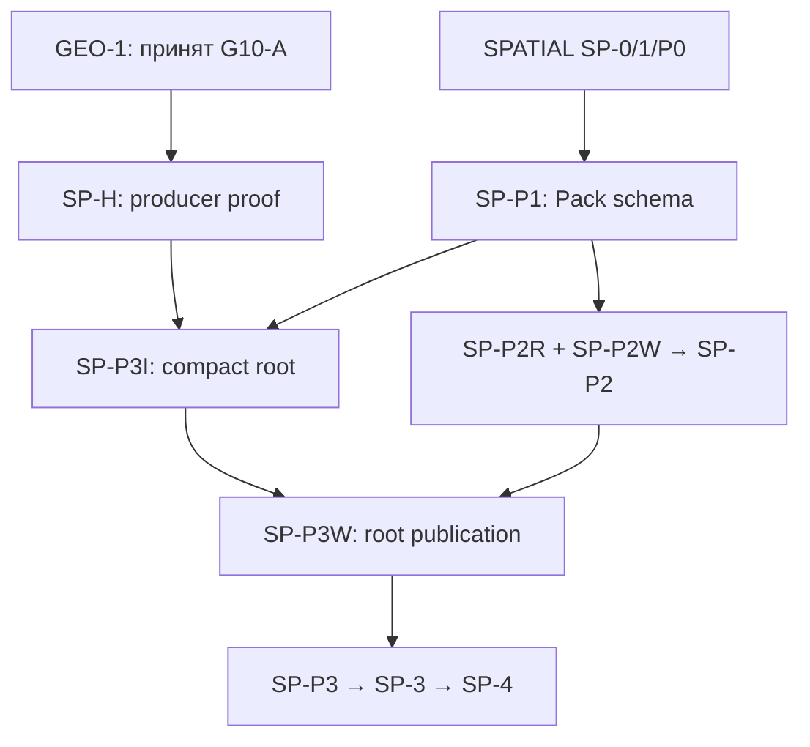
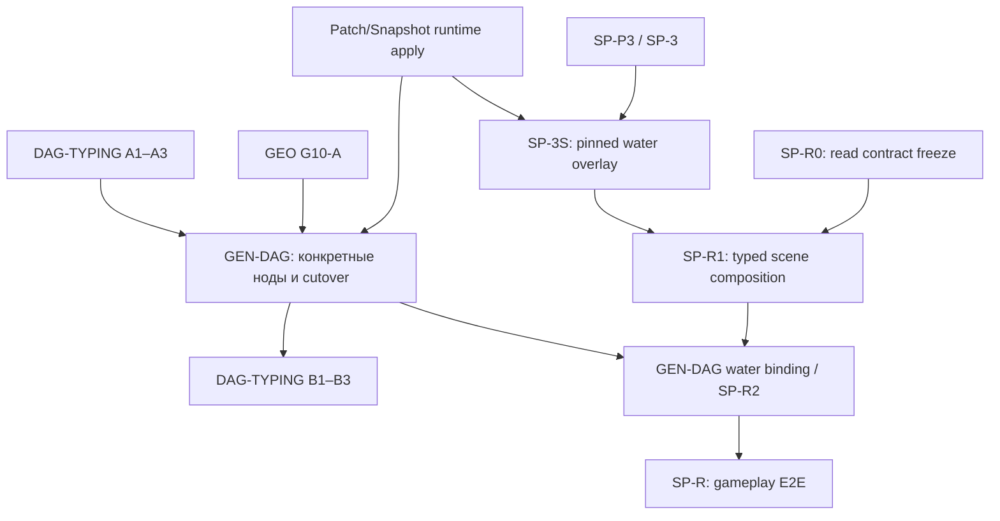

# WORLD-PLAN-GRAPH-1 — Граф зависимостей GEO-1 / SPATIAL-1 / GEN-DAG-1

**Статус:** архитектурная карта межплановых gates, v1 (2026-11-01); **не** разрешение на код, изменение POJO/enum, cutover или закрытие owning-планов. Путь документа: `.cursor/plans/world-generation-plan-dependency-graph.md`.

**Назначение:** показать зависимости **конкретных этапов**, а не объявлять один большой план prerequisite другого. Нормативный источник контрактов, статусов и доказательств приёмки — **соответствующий owning-план**; эта карта не вводит новые API, владельцев, типы, численные budgets, путь хранения, обязательный глобальный порядок и не меняет его решение. При конфликте сначала исправить и согласовать owning-план, затем синхронизировать эту карту.

## 1. Участники, владельцы, статус

| План и точный файл | Нормативная ответственность / текущий gate |
|---|---|
| [GEO-1](./geo-1-designed-water.md) — `.cursor/plans/geo-1-designed-water.md` | Hydrology canonical final source: water identity, levels, resolved membership/connectivity, final bed/geometry, proven coverage, refs/revisions. Task1–10 verified isolated; **Task11 design OPEN, G10-A production cutover OPEN**. Контракт данных и representation выбираются **до следующего зависимого producer code step**. |
| [SPATIAL-1](./spatial-distribution-domain.md) — `.cursor/plans/spatial-distribution-domain.md` | Общая typed read форма и требования к bounded query/materialization; конкретный Hydrology reader/index принадлежит Hydrology. **SP-0/1/P0/M и остальные необходимые freeze — OPEN**. Water Pack/root steps отдельно от runtime Snapshot и gameplay. |
| [Domain Patches & Snapshots](./world-domain-patches-snapshots.md) — `.cursor/plans/world-domain-patches-snapshots.md` | Принята архитектурная основа domain.read, domain PatchSet, immutable pack и Snapshot-owned apply; **runtime publication ещё не готова**. По §8.14 4C2-H требует приёмки, 4C2-O не начат, последующие 4C3+ заблокированы собственными gates. |
| [DAG-TYPING-1](./dag-typing-1.md) — `.cursor/plans/dag-typing-1.md` | Общая typed инфраструктура `NodeContract`, OutputRef, runtime, NodeRegistry, parallelism: **A1–A3 implemented/verified**, **B1–B3 не завершены**, B зависит от конкретной интеграции GEN-DAG-1. |
| [GEN-DAG-1](./gen-dag-1-post-geo-ws.md) — `.cursor/plans/gen-dag-1-post-geo-ws.md` | Concrete node Input/Output и factories, вызовы публичных доменных операций и production migration. **DRAFT/DEFERRED**: требуются принятый GEO-1, необходимые Patch/Snapshot contracts/runtime gates, готовая typed infrastructure и собственная per-node приёмка. |
| [PHYSICS-1](./physics-spatial-dynamics.md) — `.cursor/plans/physics-spatial-dynamics.md` | Будущая физическая эволюция (PH-AGG/PH-LOCAL), через DAG → доменный patch → Snapshot. **Границы согласованы, алгоритмы/контракты/код OPEN**; **не prerequisite** для GEO bootstrap, water Pack read или GEN-DAG generator cutover. |

**Дополнительные внешние контракты (не равны самостоятельным новым задачам SPATIAL):** [World Pack storage](../../docs/tz_world_pack_storage.md), [World Snapshot](../../docs/tz_world_snapshot.md), [World Source Versioning](./world-source-versioning.md). Их owners должны принимать staged immutable publication, source revisions и runtime apply в своих треках. Архивные WS-0/WS-4 **не gate и не SoT**.

## 2. Смысл стрелок и отсутствие ложных циклов

- **Сплошная стрелка** на диаграммах ниже означает принятый/обязательный prerequisite для **названного downstream gate**, а не запрет на параллельный аудит или дизайн другой части плана.
- **Согласование GEO ↔ SPATIAL** до кода — совместный contract/representation review. Оно **не означает** `SPATIAL-1 DONE → GEO G10-A` и не создаёт междоменный runtime-вызов: canonical output принадлежит GEO, generic read — SPATIAL; reader/index реализует Hydrology.
- **GEN-DAG владеет конкретными схемами нод позднее.** GEO producer **не ждёт** точных `NodeContract`/`RequiredOutput`/регистрации GEN-DAG; обратная зависимость GEO ← GEN-DAG запрещена.
- **DAG-TYPING A → GEN-DAG → DAG-TYPING B** — корректный **поэтапный** handoff, не цикл между двумя целыми планами. A1–A3 не нужно повторно реализовывать внутри GEN-DAG.
- **SPATIAL Pack/root/read** и **SPATIAL runtime/gameplay** — разные gates. Runtime Snapshot и engine activation не должны блокировать независимый immutable-base water path.
- **PHYSICS, SP-A/air, SP-G/geology, SP-5A/gas** не являются скрытыми prerequisite для water-only G10-A/SP-P3/SP-3/SP-4/SP-R.

## 3. Bootstrap: Hydrology source → Pack → bounded read

До первого зависимого кода **совместно** проверить семантику, topology/coordinate space, physical coverage, стоимость/качество и способ представления. Затем каждый owner замораживает точные POJO/enum/файлы по своим [GEO input contract](./geo-1-designed-water.md) и [SPATIAL §13](./spatial-distribution-domain.md). Ни полный SPATIAL, ни GEN-DAG production не должны быть реализованы для этого архитектурного freeze.

**Точные исключения и дополнительные внешние gates:**

1. `SP-P2W` требует отдельно принятого **staged World Pack/pregame publication port**, включая manifest CAS, hash/format/revision и rollback. Это не разрешает runtime mutation базового pack.
2. `SP-P3I` требует одновременно `SP-H` (принятый G10-A), `SP-P0` и `SP-P1`; `SP-P3W` требует `SP-P3I` и `SP-P2`. Отдельный physical source GEO и transport/index/publish steps SPATIAL **не дублируют друг друга**.
3. `SP-3` — Hydrology-owned bounded immutable-base reader, **не** универсальный Spatial solver. `SP-4` — только base/pre-game L2; не считать его доказательством runtime Snapshot-aware read.
4. Текущий `FineWaterJob.fill` требует полного fine-покрытия как **AS-IS cost**; целевой source/representation/precision/budget остаются OPEN в GEO. Маленький `read_window` не запускает fill/routes и не сканирует весь мир.
5. `SP-P0/P1/P2R` и часть Pack-инфраструктуры могут проектироваться/приниматься независимо от G10-A, если их **собственные** prerequisites и code-gates закрыты; не превращать порядок таблицы SPATIAL в глобальную последовательную блокировку.
6. Единственный canonical base source на принятую revision: Hydrology facts → immutable Pack domain-root `ArtifactRef` (вариант Б), без SQL materialization всех water cells и без второго активного legacy producer после G10-A cutover.

## 4. Runtime и engine DAG: отдельные ветки

- `SP-3S` требует принятого runtime Snapshot apply и `SP-3`; `SP-4R` отдельно требует `SP-4 + SP-3S`. **SP-4R не prerequisite водного SP-R gameplay-read**, если consumer работает с типизированными media slices без per-cell materialization.
- `SP-R1` требует `SP-R0 + SP-3S`; `SP-R2` — внешний owning GEN-DAG gate для реальных engine/LLM/UI callers после `SP-R1`; `SP-R` — cold-Pack + accepted Snapshot + real consumer E2E, **не** debug API.
- GEN-DAG может готовить node inventory/contracts и isolated implementation, когда их локальные gates приняты, но **production migration** остаётся заблокирована по его собственному плану до принятого GEO, необходимых Patch/Snapshot gates и явной команды владельца. Не писать неизвестные доменные POJO в GEN-DAG ради ускорения.
- Runtime reader: `DAG → domain.read(window, WorldPublicationRef) → typed domain result`; после игры базовый pack не переписывается, accepted changes проходят `domain.patch → PatchSet → Snapshot`. `NodeOutput` текущего исполнения DAG **не является** canonical persisted source или заменой `WorldPublicationRef`.
- **DAG-TYPING B** — cleanup/handoff после принятой GEN-интеграции, не prerequisite для завершения GEO и не разрешение держать два production runtimes.

## 5. Реестр направленных gate-зависимостей (для машинной и ручной проверки)

| Producer / owner gate | Consumer gate | Тип / критерий прохождения |
|---|---|---|
| Совместные GEO + SPATIAL инварианты и representation/price-quality | Следующий зависящий hydrology producer code step | **Contract freeze:** GEO владеет water source POJO; SPATIAL — требованиями read/window. Нет concrete GEN-DAG node freeze. |
| GEO G10-A accepted | SP-H → SP-P3I → SP-3 | **Hard:** canonical native final facts, fine coverage и exact dependencies с отключением legacy production route. |
| SPATIAL SP-0/1/P0/P1 | SP-P3I и SP-P2 transport | **Hard локальных steps:** exact file/POJO/enum/codec/storage signatures; не зависимость всей SPATIAL от GEO на фазе архитектуры. |
| World Pack staged/pregame port accepted | SP-P2W → SP-P2 → SP-P3W | **External hard:** immutable BLOB/ref/manifest CAS + cold round-trip; не runtime Snapshot apply. |
| SP-P3I и SP-P2 accepted | SP-P3W → SP-P3 → SP-3 | **Hard:** один published Hydrology root; domain reader не получает fake coverage/L0 fallback. |
| SP-M + SP-3 accepted | SP-4 bootstrap L2 | **Hard только для base L2:** не ждать GEN-DAG, air migration или runtime Snapshot. |
| Domain Patches runtime Snapshot apply accepted + SP-3 | SP-3S → SP-R1 / SP-4R | **Hard для runtime:** pinned revision, overlay и invalidation; `SP-4R` дополнительно ждёт SP-4. |
| DAG-TYPING A1–A3 + GEO accepted + необходимые Patch/Snapshot gates | GEN-DAG concrete production integration | **Hard:** stage-specific, не весь DAG-TYPING B и не весь SPATIAL; свои per-node contracts и отдельный cutover. |
| GEN-DAG accepted concrete production integration | DAG-TYPING B1–B3 | **Handoff:** remove legacy common channels после реальных usages. Нельзя делать B предварительным gate GEN-DAG. |
| SP-R1 + GEN-DAG water consumer binding (SP-R2) + SP-3S | SP-R gameplay E2E | **Hard:** реальный engine/LLM/UI read media-only воды без MapCell/SQL water fallback и mixed revisions. |
| PHYSICS-1 future + принятые domain/DAG/Snapshot public operations | Будущие PH-AGG/PH-LOCAL changes | **Future only:** нет ребра обратно в GEO G10-A, immutable Pack read или GEN-DAG generator bootstrap. |

## 6. Практический приоритет (не подмена hard gates)

1. **P0 — совместная архитектура:** GEO canonical source semantics, Task11 coarse/fine coordinate+revision, выбор compact representation/cost-quality; SPATIAL contract/reuse/layout review. **До кода:** все нужные POJO/enum/target paths согласованы в owning plans.
2. **P1 — GEO-1 G10-A:** закончить единственный native final producer и его production acceptance, без самостоятельного compact Pack writer и без изменения engine DAG ради обхода.
3. **P2 — водный SPATIAL:** принять storage-root/transport и Hydrology-owned bounded reader + base L2 `SP-P*`, `SP-3`, `SP-4`. Независимые Pack steps могут идти раньше P1 по собственным gates.
4. **P3 — GEN-DAG-1:** concrete ноды/единый production cutover, когда GEO и необходимые Patch/Snapshot gates реально приняты; GEN architecture/inventory допустим заранее.
5. **P4 — runtime water gameplay:** SP-3S/R1, GEN-DAG water binding SP-R2, SP-R E2E и, отдельно, SP-4R для runtime L2. PHYSICS/Gas/Geology/Air остаются самостоятельными треками.

**Не забыть внешний критический путь:** в [Patch/Snapshot §8.14](./world-domain-patches-snapshots.md) 4C2-H ожидает приёмки, 4C2-O не начат; 4C3+ и runtime apply не считать DONE без своих evidence. Его можно вести параллельно GEO/SPATIAL, не смешивая ответственность.

## 7. Поддержание графа, обратные ссылки и приёмка

**Точная карта документации** (только Markdown, без создания кода):

| Файл | Изменение |
|---|---|
| `.cursor/plans/world-generation-plan-dependency-graph.md` | Этот навигационный план, диаграммы, gate-таблица, статус и negative cases. |
| `.cursor/plans/geo-1-designed-water.md` | Обратная ссылка в начале; доменные POJO и G10-A остаются нормативными здесь. |
| `.cursor/plans/spatial-distribution-domain.md` | Обратная ссылка в начале; generic read, Pack, materialization и SP-R принадлежат этому плану. |
| `.cursor/plans/gen-dag-1-post-geo-ws.md` | Обратная ссылка в начале; exact concrete node Input/Output и cutover остаются здесь. |
| `.cursor/plans/dag-typing-1.md` | Обратная ссылка в начале; A/B-граф подтверждает отсутствие цикла. |
| `.cursor/plans/world-domain-patches-snapshots.md` | Обратная ссылка в начале; Snapshot runtime gates не выдаются за DONE. |
| `.cursor/plans/physics-spatial-dynamics.md` | Обратная ссылка в начале; PHYSICS по-прежнему не блокирует base water. |

**Правило обновления:** owner конкретного плана меняет свой статус/контракт первым; затем проверяется и, при необходимости, уточняется эта карта. Запрещено объявлять внешний gate завершённым только по формулировке здесь. Внедрение нового класса/POJO/enum требует file/layout/import map и отдельной приёмки по [code-gates.mdc](../rules/code-gates.mdc) и [folder-composition.mdc](../rules/folder-composition.mdc).

**Критерии приёмки GRAPH-AC:**

- [ ] Все шесть планов из §1 содержат обратную ссылку; прямые ссылки из графа ведут в существующие файлы.
- [ ] Каждое **hard** ребро §5 указано с producer gate, consumer gate и owning plan; проверка топологического порядка не выявляет циклов.
- [ ] Отсутствуют ложные `SPATIAL DONE → GEO`, `GEN-DAG DONE → GEO`, `DAG-TYPING B → GEN-DAG`, `PHYSICS → base water`, `SP-A/air → water` и `WS-4 → anything`.
- [ ] Stage A DAG-TYPING и stage B разделены; GEO final и SPATIAL root/read разделены; Pack pregame CAS и runtime Snapshot apply разделены; SP-4 и SP-4R разделены.
- [ ] GEN-DAG owns concrete node I/O; Hydrology owns water facts/read/index; SPATIAL owns generic contract/projection boundary; World Pack/Snapshot владеют публикацией и применением.
- [ ] Все OPEN/blocked statuses соответствуют owning plans; **план не разрешает код** и не закрывает отсутствие exact POJO/enum/file freeze.
- [ ] Проверка Markdown/Mermaid/ссылок и фактического наличия обратных ссылок прошла после публикации.

**Открытые вопросы, не закрываемые этой картой:** GEO Task11 coordinate/snapshot + compact membership/cost; SPATIAL SP-0/1/P0 точные POJO/format/paths; staged Pack publication port и runtime Snapshot apply; GEN-DAG concrete node bindings/cutover; SP-R0/R1 owner gameplay composition. Все решения принимаются в owning plans.
