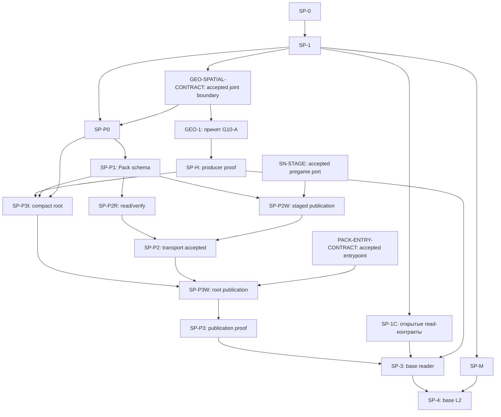
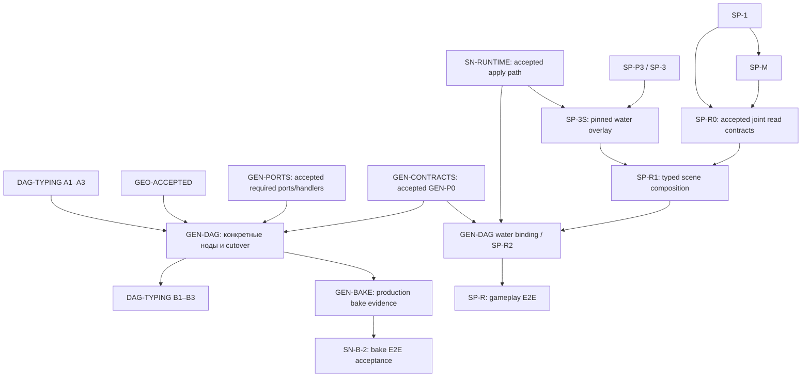
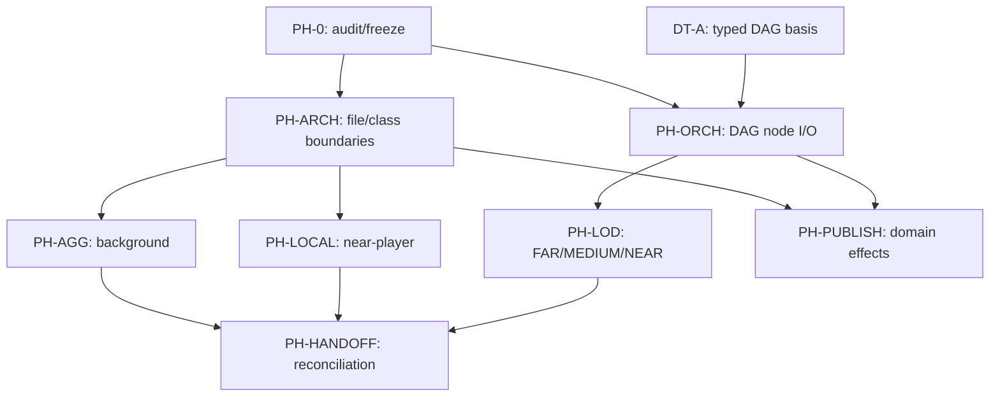
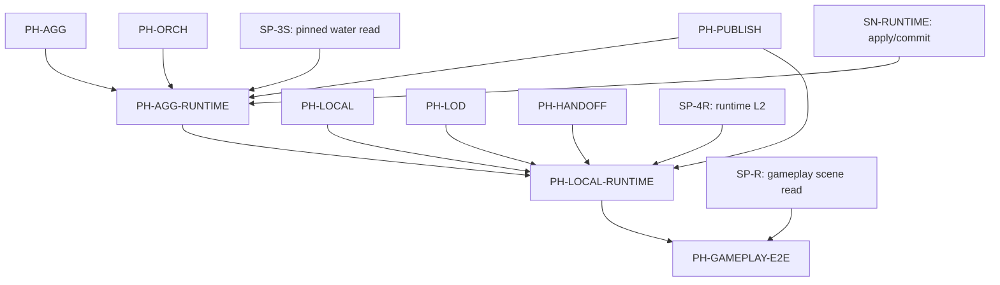
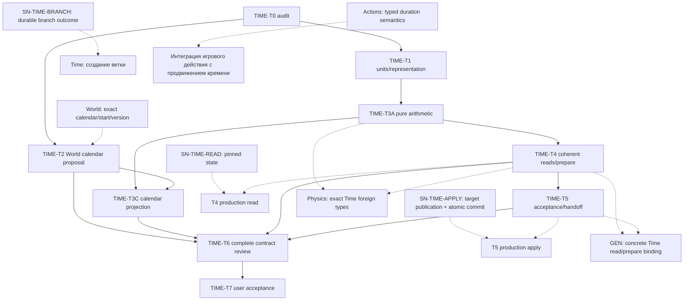
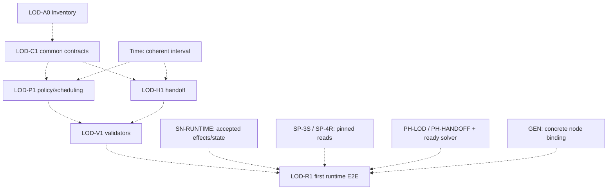

# WORLD-PLAN-GRAPH-1 — Граф зависимостей GEO-1 / SPATIAL-1 / GEN-DAG-1 / PHYSICS-1 / TIME / LOD-SIM-1

**Статус:** архитектурная карта межплановых gates, v6.15 (2026-11-05), с cross-cutting навигацией ERROR-CONTRACTS-1; **не** разрешение на код, изменение POJO/enum, cutover или закрытие owning-планов. Путь документа: `.cursor/plans/world-generation-plan-dependency-graph.md`.

**Текущая очередь и источники приёмки приведены в §12.** Разделы 9–11 сохраняют историю последовательных сверок.

**Назначение:** показать зависимости **конкретных этапов**, а не объявлять один большой план prerequisite другого. Нормативный источник контрактов, статусов и доказательств приёмки — **соответствующий owning-план**; эта карта не вводит новые API, владельцев, типы, численные budgets, путь хранения, обязательный глобальный порядок и не меняет его решение. При конфликте сначала исправить и согласовать owning-план, затем синхронизировать эту карту.

## 1. Участники, владельцы, статус

| План и точный файл | Нормативная ответственность / текущий gate |
|---|---|
| [GEO-1](./geo-1-designed-water.md) — `.cursor/plans/geo-1-designed-water.md` | Hydrology canonical final source: water identity, levels, resolved membership/connectivity, final bed/geometry, proven coverage, refs/revisions. Task1–10 verified isolated; **EF-1 и joint приняты документально; GEO-I1 принят пользователем; G10-A cutover OPEN**. Контракт данных и representation выбираются **до следующего зависимого producer code step**. |
| [SPATIAL-1](./spatial-distribution-domain.md) — `.cursor/plans/spatial-distribution-domain.md` | Общая typed read форма и требования к bounded query/materialization; конкретный Hydrology reader/index принадлежит Hydrology. **SP-0 — DONE; SP-1 принят документально; SP-P0 принят документально (§15.19); SP-M принят документально (§16.16); SP-P1-A…D, SP-P2R-A/B и SP-1C приняты (§§15.61–68, 15.82); SP-P2W на этапе проектирования и интеграционных проб (§§15.83–92)**. Water Pack/root steps отдельно от runtime Snapshot и gameplay. |
| [Domain Patches & Snapshots](./world-domain-patches-snapshots.md) — `.cursor/plans/world-domain-patches-snapshots.md` | **Актуальный owning-план Snapshot** (наряду с нормативным [World Snapshot ТЗ](../../docs/tz_world_snapshot.md)): архитектура принята, core/runtime **не DONE**. 4C2-R/H приняты 2026-11-01; 4C2-O принят 2026-11-02; 4C3-A принят, 4C3-B после исправления REV-1 прошёл повторное review и принят пользователем; C принят, D предъявлен, общий SN-CORE/production integration OPEN. 4C4 и 4D1/4D1-L приняты только в выполненных backend/port scopes; 4D2 не начат. После GEN-DAG остаётся отдельный B-2 gate первичного bake (§1.1). |
| [DAG-TYPING-1](./dag-typing-1.md) — `.cursor/plans/dag-typing-1.md` | Общая typed инфраструктура `NodeContract`, OutputRef, runtime, NodeRegistry, parallelism: **A1–A3 implemented/verified**, **B1–B3 не завершены**, B зависит от конкретной интеграции GEN-DAG-1. |
| [GEN-DAG-1](./gen-dag-1-post-geo-ws.md) — `.cursor/plans/gen-dag-1-post-geo-ws.md` | **Совместный дизайн нового production DAG**, точные Input/Output/Error POJO, factories, публичные domain operations и единый cutover. Старые 15 ID — AS-IS inventory, **все legacy concrete-ноды под удаление, кроме перерабатываемой `check_scene`**; нет 1:1 миграции. **GEN-NODE-JOINT-REVIEW** обязателен с мастером: Mermaid-карта зависимостей, решения keep/split публичных pipelines и per-node contracts до кода. **DRAFT/DEFERRED**: GEO-1, необходимые Patch/Snapshot gates и concrete contracts/приёмка OPEN. |
| [PHYSICS-1](./physics-spatial-dynamics.md) — `.cursor/plans/physics-spatial-dynamics.md` | **Owning план PH-0/PH-ARCH/PH-ORCH/PH-AGG/PH-LOCAL/PH-LOD/PH-HANDOFF/PH-PUBLISH**: DAG-node-only trigger, FAR/MEDIUM/NEAR через DAG+settings, **Grade/SQL только bounded NEAR (FAR/MEDIUM — без Grade)**; фоновая aggregate и локальная подробная стратегии; typed input/output, изменения только через domain-owned operations → Patch/Snapshot. Материалы — отдельный mutable-property owner и внешний контракт, не внутренний поддомен Physics; Physics формирует effects, DAG маршрутизирует Materials/domain change. PH-0 принят статически; направления P1.6, D1–D5 P2.10, SI/scope P2.11 и public pipelines boundary P2.12 приняты; полный PH-ARCH **OPEN**, exact freeze и runtime **OPEN**. В §5 выделены будущие water-first acceptance aliases `PH-AGG-RUNTIME`, `PH-LOCAL-RUNTIME`, `PH-GAMEPLAY-E2E`; это **не implementation steps** и не prerequisite GEO/Pack/GEN initial cutover. |
| [LOD-SIM-1](./lod-simulation-handoff.md) — `.cursor/plans/lod-simulation-handoff.md` | **Новый DRAFT owning-план** generic LOD policy/consumer, FAR↔NEAR handoff, Time/revision continuity, causal interest, resource budgets и invariant validators. PH-AGG/LOCAL transforms принадлежат PHYSICS-1; Snapshot и Spatial не приобретают нового storage/orchestrator. Только предлагаемая документальная ветка §11; не hard gate и не prerequisite GEO/Pack/GEN initial cutover. |
| [ERROR-CONTRACTS-1](./error-contracts-1.md) — `.cursor/plans/error-contracts-1.md` | **Cross-cutting owning-план типизированных ошибок/проверок/диагностики**, а не новый глобальный prerequisite всех планов. Приняты принципы F01–F09, generic `FieldPathError[CodeT]`, typed arguments, logging/product outcome policy; **A0-PROPOSAL exact shared file placement готов, но полный `FieldPathError` direct/transitive impact register OPEN; A0/C0 acceptance OPEN**. Для **всех ломаемых shared C1 consumers** принять scoped D0/D1 **до несовместимого C1**, после чего сразу C1 → D2 direct callers/carriers/re-exports → regression в одном работоспособном срезе, без V1-bridge и сломанного промежуточного master. Незатронутые домены не ждут глобального ERROR-CONTRACTS DONE; для обязательных событий реальный I0 обязателен до эксплуатации изменённой операции. |

**Новый owning-трек:** [Time](./time-domain.md) — world clock values, intervals, pure conversions, coherent reads и preparation. Calendar/settings/epochs принадлежат World, стоимость действий — Actions, выбор операций — DAG, commit/restore/branch — Snapshot. **RESEARCHED PROPOSAL; частные решения приняты, общий API/foreign freeze OPEN.** Этапы, статусы и реестр зависимостей Time — §10; это часть общего графа, не отдельный план реализации.

**Дополнительные внешние контракты (не равны самостоятельным новым задачам SPATIAL):** [World Pack storage](../../docs/tz_world_pack_storage.md), [World Snapshot](../../docs/tz_world_snapshot.md), [World Source Versioning](./world-source-versioning.md). Их owners должны принимать staged immutable publication, source revisions и runtime apply в своих треках. Архивные WS-0/WS-4 **не gate и не SoT**.

### 1.1. Актуальный Snapshot: конкретные шаги, два publication пути и зависимость B-2

**Единственный действующий план реализации Snapshot:** [Domain Patches & Snapshots, §8.3 и §8.14](./world-domain-patches-snapshots.md); нормативные семантика и staged-граница — [World Snapshot ТЗ](../../docs/tz_world_snapshot.md). `WorldPublicationRef` — pinned состояние; это не `PlanRef`, не `ArtifactRef` и не результат DAG-ноды. Эта карта **не** воскрешает архивный WS или параллельный Snapshot implementation.

| Gate owning Snapshot | Текущий статус / что именно разблокирует |
|---|---|
| **SN-CORE / 4C2-R + 4C2-H → 4C2-O → 4C3 → 4C4** | `4C2-R/H` **ПРИНЯТЫ 2026-11-01**, `4C2-O` **ПРИНЯТ 2026-11-02**. `4C3-A` принят; `4C3-B` реализован, REV-1 исправлен и повторное review PASS; B/C приняты, D предъявлен. Полная приёмка 4C3 впереди. BLOB backend `4C4` уже принят изолированно, но его concrete 4C3 integration и SN-CORE OPEN. |
| **SN-STAGE / 4D1 + 4D3 + 4E2** | Shared artifact staging/lease/GC `4D1`, **pregame** `PreparedPackActivation/GameplayStart` `4D3`, core composition `4E2`. Внешний **accepted staged Pack publication port** нужен `SP-P2W`; одних DTO и изолированных тестов недостаточно. |
| **SN-RUNTIME / 4D2 + 4E2 + применимый domain handler** | `Snapshot.apply` `4D2`, composition и принятое доменное применение (read overlay принимается отдельно в SP-3S) дают runtime gate для `SP-3S`, `SP-4R`, `SP-R1` и нужных GEN-DAG операций. Нельзя подменять его SessionSnapshot из DAG-TYPING или Pack pregame activation. |
| **SN-B-2 / GEN-DAG bake integration acceptance** | [Snapshot §7.2](./world-domain-patches-snapshots.md) требует перенести L0 → C23 / bake orchestration в GEN-DAG для **полной приёмки Snapshot-плана**. Это **поздний E2E gate после GEN-DAG**, а не prerequisite `GEN-DAG ← весь Snapshot DONE`. |

**Порядок реализации внутри Snapshot уже зафиксирован §8.3.8:** после R/H/O следуют `4C3 → 4C4 → 4D1 → 4D2 → 4D3 → 4E2 → первый concrete domain handler`. **Семантическая независимость pregame CAS от runtime Snapshot.apply не разрешает менять этот code-order:** нельзя объявлять `4D3` выполненным раньше `4D2` без изменения и приёмки owning-плана. Внешним consumer-gate служит **фактически принятый port/handler**, а не только номер достигнутого подшага.

**Отсутствие цикла:** достаточные core ports/handlers Snapshot → GEN-DAG production; затем GEN-DAG bake integration → Snapshot B-2 E2E приёмка. Не требовать «весь Snapshot DONE» на вход GEN-DAG, иначе получится ложный цикл.


## 2. Смысл стрелок и отсутствие ложных циклов

- **Сплошная стрелка** на диаграммах ниже означает принятый/обязательный prerequisite для **названного downstream gate**, а не запрет на параллельный аудит или дизайн другой части плана.
- **Согласование GEO ↔ SPATIAL** до кода — совместный contract/representation review. Оно **не означает** `SPATIAL-1 DONE → GEO G10-A` и не создаёт междоменный runtime-вызов: canonical output принадлежит GEO, generic read — SPATIAL; reader/index реализует Hydrology.
- **GEN-DAG владеет конкретными схемами нод позднее.** GEO producer **не ждёт** точных `NodeContract`/`RequiredOutput`/регистрации GEN-DAG; обратная зависимость GEO ← GEN-DAG запрещена.
- **DAG-TYPING A → GEN-DAG → DAG-TYPING B** — корректный **поэтапный** handoff, не цикл между двумя целыми планами. A1–A3 не нужно повторно реализовывать внутри GEN-DAG.
- **SPATIAL Pack/root/read** и **SPATIAL runtime/gameplay** — разные gates. Runtime Snapshot и engine activation не должны блокировать независимый immutable-base water path.
- **PHYSICS, SP-A/air, SP-G/geology, SP-5A/gas** не являются скрытыми prerequisite для water-only G10-A/SP-P3/SP-3/SP-4/SP-R.
- **ERROR-CONTRACTS-1 — горизонтальная контрактная ветка:** A0/C0 gate обязателен только **перед изменением общего error/validation ядра C1**; D0/D1 gate — перед D2 своего домена, **а для ломаемых shared C1 consumers — обязательно до самого C1**; I0 — перед эксплуатационной приёмкой затронутой операции с mandatory sink/transcript/audit. Он **не** превращает весь ERROR-CONTRACTS-1 DONE в prerequisite для GEO/Pack/SPATIAL/GEN-DAG/TIME/PHYSICS и не останавливает независимые шаги, которые не используют изменяемый shared error API. Ни D0-review, ни preparation контракта не являются кодовой миграцией.

## 3. Bootstrap: Hydrology source → Pack → bounded read

До первого зависимого кода **совместно** проверить семантику, topology/coordinate space, physical coverage, стоимость/качество и способ представления. Затем каждый owner замораживает точные POJO/enum/файлы по своим [GEO input contract](./geo-1-designed-water.md) и [SPATIAL §13](./spatial-distribution-domain.md). Ни полный SPATIAL, ни GEN-DAG production не должны быть реализованы для этого архитектурного freeze.



**Точные исключения и дополнительные внешние gates:**

1. `SP-P2W` требует отдельно принятого **staged World Pack/pregame publication port** (`SN-STAGE`, owning Snapshot 4D1/4D3/4E2 и профильный World Pack contract), включая manifest CAS, hash/format/revision и rollback. `SP-P2R` может проверять read/verify независимо после SP-P1; **он не ждёт SN-STAGE**. В текущем Snapshot code-order 4D3 следует за 4D2, но pregame activation **не является runtime Snapshot.apply**.
2. `SP-P3I` требует одновременно `SP-H` (принятый G10-A), `SP-P0` и `SP-P1`; `SP-P3W` требует `SP-P3I` и `SP-P2`. Отдельный physical source GEO и transport/index/publish steps SPATIAL **не дублируют друг друга**.
3. `SP-3` — Hydrology-owned bounded immutable-base reader, **не** универсальный Spatial solver. `SP-4` — только base/pre-game L2; не считать его доказательством runtime Snapshot-aware read.
4. Текущий `FineWaterJob.fill` требует полного fine-покрытия как **AS-IS cost**; source A/R1/G1/Z принят документально в GEO EF-1; implementation/cutover и storage budgets принимаются отдельно. Маленький `read_window` не запускает fill/routes и не сканирует весь мир.
5. `SP-P0/P1/P2R` и часть Pack-инфраструктуры могут проектироваться/приниматься независимо от G10-A, если их **собственные** prerequisites и code-gates закрыты; не превращать порядок таблицы SPATIAL в глобальную последовательную блокировку.
6. Единственный canonical base source на принятую revision: Hydrology facts → immutable Pack domain-root `ArtifactRef` (вариант Б), без SQL materialization всех water cells и без второго активного legacy producer после G10-A cutover.

### 3.1. Явное согласование GEO-1 → Spatial read

**GEO-SPATIAL-CONTRACT** — совместный architecture acceptance gate, закреплённый в одноимённых разделах [GEO](./geo-1-designed-water.md) и [SPATIAL](./spatial-distribution-domain.md). Направление принято: GEO/Hydrology производит canonical facts; Hydrology публикует compact root и реализует Spatial reader; L2/gameplay/Physics потребляют domain facts. Реализация SPATIAL целиком не является входным условием GEO.

SP-1, GEO EF-1 и GEO-SPATIAL-CONTRACT явно приняты пользователем: Spatial §14.14 / GEO EF-1.14. Приняты A (общий fine P2), R1/G1 и Z (bed,level], совместимость source/read и независимость producer/storage. Это документальные приёмки, не production evidence. GEO-I1 принят отдельным решением пользователя; SP-P0 design принят §15.19 после producer-backed closure §15.18; SP-M принят §16.16. Реализация и downstream evidence OPEN.

Порядок приёмки: SP-1 → GEO-SPATIAL-CONTRACT → G10-A и SP-P0 (параллельные downstream branches после собственных gates). Дизайн storage возможен раньше; joint gate не ждёт SP-P0, runtime/GEN/Physics. Его приёмка не закрывает остальные producer/root/transport/reader implementation gates. Это формализация уже обязательного совместного review §3, не новый solver/API.

## 4. Runtime и engine DAG: отдельные ветки



- `SP-3S` требует принятого `SN-RUNTIME` (Snapshot 4D2/4E2 и необходимого Hydrology-owned apply/commit handler) и `SP-3`; `SP-4R` отдельно требует `SP-4 + SP-3S`. **SP-4R не prerequisite водного SP-R gameplay-read**, если consumer работает с типизированными media slices без per-cell materialization.
- `SP-R1` требует `SP-R0 + SP-3S`; `SP-R2` — внешний owning GEN-DAG gate для реальных engine/LLM/UI callers после `SP-R1`; `SP-R` — cold-Pack + accepted Snapshot + real consumer E2E, **не** debug API.
- GEN-DAG может готовить AS-IS inventory и **совместный TO-BE дизайн нового графа** уже в GEN-P0; isolated target binding — только после принятой мастером Mermaid-карты/конкретных I/O/E и локальных gates, без production routing. **Production cutover** заблокирован до принятого GEO, необходимых Patch/Snapshot gates и явной команды владельца. Старые узлы нельзя автоматически переносить или копировать их `deps`, неизвестные доменные POJO нельзя писать ради ускорения.
- Runtime reader: `DAG → domain.read(window, WorldPublicationRef) → typed domain result`; после игры базовый pack не переписывается, accepted changes проходят `domain.patch → PatchSet → Snapshot`. `NodeOutput` текущего исполнения DAG **не является** canonical persisted source или заменой `WorldPublicationRef`.
- **DAG-TYPING B** — cleanup/handoff после принятой GEN-интеграции, не prerequisite для завершения GEO и не разрешение держать два production runtimes. Также **SN-B-2** в Snapshot §7.2 принимает реальную DAG-оркестрацию bake **после GEN**, не до: полный `Snapshot DONE` нельзя требовать от GEN на входе.

### 4.1. SP-R2 и единый GEN-DAG cutover: состав OPEN

[GEN-DAG, GEN-P0](./gen-dag-1-post-geo-ws.md) требует одного production switch всех действующих **callers на новый совместно принятый набор NodeId** и удаления старых concrete-нод/регистраций (кроме переработанной `check_scene`); SPATIAL §8 требует SP-R1 до SP-R2, но не завершения всего GEN-DAG. Поэтому безусловное ребро GEN cutover → SP-R2 удалено. До switch GEN-P0 фиксирует node IDs/callers и один вариант:

- **Water входит в первый cutover:** SP-R1 и готовность water bindings предшествуют switch; SP-R2 принимается в составе того же атомарного переключения.
- **Water — последующее расширение:** cutover → SP-R2 допустимо только после доказательства в GEN-P0, что первый switch полностью мигрирует действующих callers и обеспечивает обязательный scene read без legacy runtime/SQL-water/L0 fallback. Отложенные consumers перечисляются явно.

Выбор **OPEN**, production switch заблокирован до его фиксации. Это не разрешение второго runtime или частичного переключения. Независимый дизайн/isolated bindings допустимы. В диаграмме показаны общие prerequisites SP-R2; его положение относительно cutover намеренно не задано до решения owner. Нельзя включать обе альтернативы как обязательные рёбра.

**GEN-NODE-JOINT-REVIEW (мастер 2026-11-02)** является обязательной частью GEN-CONTRACTS и per-node acceptance, **не новой вершиной** этого графа. Агент сначала трассирует 15 AS-IS нод до вложенных domain pipelines, затем **вместе с мастером** рисует и исправляет Mermaid-карту **новых** связей, обсуждает, что остаётся одной публичной доменной операцией и почему, фиксирует точные typed Input/Output/Error и источники/эффекты для **каждой** новой ноды. Без явного поузлового согласия код запрещён; целевой граф не обязан сохранять legacy ID/deps. Старые concrete-ноды удаляются на едином cutover, единственное исключение — refactor `check_scene`. См. [GEN-DAG-1: GEN-NODE-JOINT-REVIEW](./gen-dag-1-post-geo-ws.md).

### 4.2. PHYSICS-1: собственная архитектурная ветка и downstream runtime (water-first)

[Owning PHYSICS-1 §6](./physics-spatial-dynamics.md) передаёт сюда **gate-зависимости**, но не сигнатуры, classes/POJO, бюджеты или разрешение на реализацию. **Дизайн** Physics может идти параллельно GEO, SPATIAL, Snapshot и GEN. Вершины ниже — результаты архитектурной приёмки; `PH-0` принят в статическом scope; D1–D5 приняты P2.10, SI/initial scope — P2.11, public pipeline boundary — P2.12; exact freeze OPEN.



- **Единственный runtime trigger — Physics DAG node.** DAG через публичные read contracts других доменов собирает типизированный `NodeInput` (facts, material property contract, revisions, zone/settings/time), вызывает выбранный публичный Physics pipeline (P2.12; универсальный compute dispatcher отменён) и получает типизированный `NodeOutput` (effects/diagnostics/continuation), не создавая параллельный доменный scheduler. Структуру классов/helpers/kernels определяет PH-ARCH; конкретные I/O, error/version semantics — PH-ORCH/PH-PUBLISH.
- **Две стратегии, три пространственные зоны:** `PH-AGG` — дешёвое фоновое влияние на мир, `PH-LOCAL` — bounded подробная симуляция вблизи игрока. FAR/MEDIUM/NEAR управляются DAG+settings через `PH-LOD`; MEDIUM — policy/переход и бюджет, а не обязательный третий solver. `PH-HANDOFF` защищает continuity времени, массы/потока, revisions и эффектов при смене зон.
- **Grade/SQL — обязательная read-граница PH-LOD:** **FAR и MEDIUM никогда не читают Grade**, даже неявно через materialization, fallback или вложенный SQL-read. `PH-AGG` в этих зонах получает compact facts через публичные Spatial/domain-owned readers. **Только NEAR** может использовать строго bounded Grade-window для `PH-LOCAL`; запрос и подготовка typed Input принадлежат Physics DAG-ноде, не solver. Событийный `PH-LOCAL` вне NEAR допускается лишь без Grade. Exact read contract, budgets/cache/missing-data policy — **OPEN PH-0/PH-ORCH/PH-LOD**, не новый hard gate и не разрешение на POJO/код.
- **Отделение Materials/междоменных изменений:** [Physics TZ](../../docs/tz_physics.md) owns physical laws и матрицу «свойство Materials → процесс/формула», Materials owns identity/properties/validation **и принятие изменений свойств**. Physics возвращает typed effects, в том числе property-change proposals, но **DAG** вызывает Materials-owned operations или owner локального размещённого состояния; Snapshot принимает prepared changes. World-wide изменение material definition и локальный change одного вещества/объекта различаются; точные mutation APIs OPEN PH-PUBLISH. Физика не пишет канонические Hydrology/Geometry/Materials факты напрямую.

- **Причинная очерёдность runtime DAG:** принята граница — DAG по уже объявленным `deps` и typed consumer dependencies выбирает порядок междоменных операций; Physics владеет численными substeps внутри compute. Earthquake→geometry→tsunami, fire→material+gas и flood→erosion→terrain→water — **показательные causal chains, не статические обязательные последовательности для всех миров**. Связанные material/gas/geometry effects требуют одной согласованной preparation/commit группы, зависимый расчёт ждёт принятого revision barrier; feedback разворачивается следующими bounded world-time стадиями без runtime DAG cycle. Exact dependency declarations, atomicity, conditional stages, cancellation/parallelism — OPEN PH-ORCH/PH-PUBLISH + engine binding [Physics TZ §8.1](../../docs/tz_physics.md). **Этот WORLD-PLAN-GRAPH-1 является графом разработки, не runtime causal scheduler.**

**Будущая water-first runtime activation** — отдельные acceptance aliases (не создание нового production API и не автоматическое начало кода):



`PH-AGG-RUNTIME` также **BLOCKED** до принятого concrete Physics node binding в production GEN-DAG и Hydrology-owned runtime change contract (CAS/idempotency/effect semantics) — **оба OPEN**, они пока не получили именованных hard-gate ребёр. `PH-LOCAL-RUNTIME` опирается на PH-AGG-RUNTIME и отдельную актуальную L2 materialization; **сам `SP-4R` не разрешает Grade-read вне NEAR**. `SP-R` не ожидает Physics; Physics gameplay E2E должен доказать видимость принятого world state после reload.

**Граница с GEN cutover:** PH может войти в первый единый GEN switch или стать поздним расширением; owner `PH-ORCH + GEN-P0` ещё не выбрал. Не добавлять безусловное `GEN-CUTOVER → PH-AGG-RUNTIME`, `PH-AGG-RUNTIME → GEN-CUTOVER` или обратные блокирующие рёбра. PH-AGG/PH-LOCAL архитектура не ждёт GEN. Initial scope — ocean/lake; river-volume ждёт отдельный GEO/SP-H2+Hydrology contract, gas/geology/thermal/structural effects — свои process-specific gates.

## 5. Реестр направленных gate-зависимостей (для машинной и ручной проверки)

Каждая строка ниже — одно обязательное ребро; несколько входов означают AND. Реестр описывает именованные межплановые gates и их локальные prerequisites, а не все внутренние implementation steps. Приёмка каждого gate дополнительно требует его owning evidence и разрешения на код.

Owners: PH-* — PHYSICS-1 §6 (PH-0/PH-ARCH/PH-ORCH/PH-AGG/PH-LOCAL/PH-LOD/PH-HANDOFF/PH-PUBLISH, а PH-*-RUNTIME/PH-GAMEPLAY-E2E — future acceptance aliases); SP-* — SPATIAL §8 (SP-H — proof GEO G10-A); SN-* и 4C*/4D*/4E* — Snapshot §8.3/8.14; GEN-* — GEN-DAG; DT-* — DAG-TYPING. `SN-CORE` везде означает принятие цепочки до **4C4 включительно**. `SN-APPLY-HANDLER` означает принятый применимый domain apply/commit handler (без read overlay SP-3S), не произвольный первый handler. `GEN-CONTRACTS` — совместно принятая мастером **новая Mermaid-карта** target NodeId/сценариев, доказанное AS-IS coverage/removal, решения о публичных domain pipelines и exact per-node Input/Output/Error, включая решение §4.1; `GEN-PORTS` — принятые необходимые конкретным нодам Patch/Snapshot ports/handlers; `GEN-BAKE` — evidence реальной L0 → C23 orchestration. SP-1 + SP-M разрешают проектирование SP-R0; совместное согласование scene/read и consumer contracts является evidence его приёмки, а не отдельным prerequisite. SPATIAL ведёт пакет evidence в §8 своего плана с подтверждением domain owners и GEN-P0 owner; принятый SP-R0 передаёт пакет в SP-R1 и соответствующие concrete bindings GEN-P0. Вершина SP-R0 означает принятый результат; его входные рёбра не означают автоматическую приёмку. `PACK-ENTRY-CONTRACT` — принятый DAG/Pack publication entrypoint contract SP-P3W, не GEN-BAKE. Exact SP-R0 contracts и PACK-ENTRY-CONTRACT остаются OPEN; owners и evidence уточнены в SPATIAL. Эти обозначения — навигационные aliases, не новые implementation steps.

| Producer gate | Consumer gate |
|---|---|
| SP-0 | SP-1 |
| SP-1 | GEO-SPATIAL-CONTRACT |
| GEO-SPATIAL-CONTRACT | G10-A |
| GEO-SPATIAL-CONTRACT | SP-P0 |
| SP-1 | SP-P0 |
| SP-1 | SP-M |
| SP-1 | SP-R0 |
| SP-M | SP-R0 |
| SP-P0 | SP-P1 |
| SP-P1 | SP-P2R |
| SP-P1 | SP-P2W |
| SN-STAGE | SP-P2W |
| SP-P2R | SP-P2 |
| SP-P2W | SP-P2 |
| G10-A | SP-H |
| SP-H | SP-P3I |
| SP-P0 | SP-P3I |
| SP-P1 | SP-P3I |
| SP-P3I | SP-P3W |
| SP-P2 | SP-P3W |
| SP-H | SP-P3W |
| PACK-ENTRY-CONTRACT | SP-P3W |
| SP-P3W | SP-P3 |
| SP-P3 | SP-3 |
| SP-1 | SP-1C |
| SP-1C | SP-3 |
| SP-H | SP-3 |
| SP-M | SP-4 |
| SP-3 | SP-4 |
| 4C2-R | 4C2-O |
| 4C2-H | 4C2-O |
| 4C2-O | 4C3 |
| 4C3 | 4C4 |
| 4C4 | SN-CORE |
| SN-CORE | 4D1 |
| 4D1 | 4D2 |
| 4D2 | 4D3 |
| 4D3 | 4E2 |
| 4E2 | SN-STAGE |
| 4E2 | SN-APPLY-HANDLER |
| SN-APPLY-HANDLER | SN-RUNTIME |
| SN-RUNTIME | SP-3S |
| SP-3 | SP-3S |
| SP-3S | SP-4R |
| SP-4 | SP-4R |
| SP-3S | SP-R1 |
| SP-R0 | SP-R1 |
| SP-R1 | SP-R2 |
| GEN-CONTRACTS | SP-R2 |
| SN-RUNTIME | SP-R2 |
| SP-R1 | SP-R |
| SP-R2 | SP-R |
| SP-3S | SP-R |
| DT-A | GEN-CUTOVER |
| GEO-ACCEPTED | GEN-CUTOVER |
| GEN-CONTRACTS | GEN-CUTOVER |
| GEN-PORTS | GEN-CUTOVER |
| GEN-CUTOVER | DT-B1 |
| DT-B1 | DT-B2 |
| DT-B2 | DT-B3 |
| GEN-CUTOVER | GEN-BAKE |
| GEN-BAKE | SN-B-2 |
| PH-0 | PH-ARCH |
| PH-0 | PH-ORCH |
| DT-A | PH-ORCH |
| PH-ARCH | PH-AGG |
| PH-ARCH | PH-LOCAL |
| PH-ORCH | PH-LOD |
| PH-AGG | PH-HANDOFF |
| PH-LOCAL | PH-HANDOFF |
| PH-LOD | PH-HANDOFF |
| PH-ARCH | PH-PUBLISH |
| PH-ORCH | PH-PUBLISH |
| PH-AGG | PH-AGG-RUNTIME |
| PH-ORCH | PH-AGG-RUNTIME |
| PH-PUBLISH | PH-AGG-RUNTIME |
| SP-3S | PH-AGG-RUNTIME |
| SN-RUNTIME | PH-AGG-RUNTIME |
| PH-AGG-RUNTIME | PH-LOCAL-RUNTIME |
| PH-LOCAL | PH-LOCAL-RUNTIME |
| PH-LOD | PH-LOCAL-RUNTIME |
| PH-HANDOFF | PH-LOCAL-RUNTIME |
| PH-PUBLISH | PH-LOCAL-RUNTIME |
| SP-4R | PH-LOCAL-RUNTIME |
| PH-LOCAL-RUNTIME | PH-GAMEPLAY-E2E |
| SP-R | PH-GAMEPLAY-E2E |

`SN-STAGE` требует фактической приёмки Pack/pregame port, hash/revision/CAS/rollback, а не только достижения 4E2. `GEO-ACCEPTED` сохраняет входное требование owning GEN-DAG «завершён и принят GEO-1»; G10-A не объявляется автоматически всей приёмкой GEO. GEN-PORTS нельзя считать закрытым по одному generic Snapshot.apply.

**PHYSICS acceptance:** 24 PH-related hard edges — из owning PHYSICS-1 §6. `PH-AGG-RUNTIME` и `PH-LOCAL-RUNTIME` — **future acceptance aliases**, не разрешение на production и не implementation steps. Входы water read (`SP-3S`), runtime apply (`SN-RUNTIME`) и local materialization (`SP-4R`) намеренно различаются. Exact production Physics-node binding и Hydrology change contract — OPEN consumer-specific gates §4.2/§7.1; не считать перечисленные входы достаточными для activation.

**Условное ребро §4.1:** только при включении water в первый switch добавляется SP-R1 → GEN-CUTOVER, а SP-R2 принимается совместно с cutover; для согласованного позднего расширения добавляется GEN-CUTOVER → SP-R2. До выбора нельзя вычислять готовность production switch по одному безусловному графу.

Совместный GEO/SPATIAL contract freeze остаётся обязательным перед зависимым producer code (§3). PHYSICS/air/gas/geology не добавляют обратных prerequisites к base-water ветке, `GEN-CUTOVER` или `SP-R`. Отсутствие циклов в реестре не закрывает OPEN contracts и не является приёмкой реализации.

### 5.1. Ограничения scope и открытые внешние bindings

- **GRAPH-Q01 / source-aware consumers:** Snapshot §6/шаг 5 зависит от World Source Versioning 2–3. Точная матрица consumers OPEN; до приёмки каждого source-aware GEN/read consumer требуется решение о применимости и evidence capture/pinning/retention/source binding. При установленной применимости добавить ребро accepted binding → конкретный consumer; сейчас не выдумывать глобальные рёбра к SP-3S/SP-R. SN-CORE и неизменённый base-Pack read не блокируются автоматически. До решения source-aware готовность не доказана.
- **GRAPH-Q04 / river volume:** SP-3/SP-R этой карты принимают ocean/lake scope; river-volume activation отложена до GEO/Hydrology SP-H2 и отдельного reader/E2E evidence в SPATIAL. RIVER_BED/UID не доказывают z_water(x,y). Это не дополнительный prerequisite ocean/lake path.
- **GRAPH-Q07 / cutover:** evidence §4.1 включает inventory node IDs/callers, cold-Pack ocean, accepted Snapshot и typed missing/unsupported outcomes. Unsupported не заменяет обязательные water facts. Если они нужны действующим callers, SP-R1 предшествует первому switch. Выбор и evidence OPEN в GEN-P0.
- **GRAPH-Q10 / Physics node contract:** §4.2/§7.1: для будущего `PH-AGG-RUNTIME` нужен accepted concrete GEN-DAG Physics node binding (input/read/settings/output/effects), Hydrology runtime change contract и решение initial vs later activation. В рамках PH-0/PH-ORCH/PH-LOD также OPEN exact bounded NEAR Grade-read contract и evidence отсутствия прямых/косвенных Grade-access в FAR/MEDIUM; это **read-policy acceptance**, не новый внешний hard edge. До появления у owners точных gate names не создавать вымышленные hard edges; activation BLOCKED, PH design независим.

### 5.2. Единый реестр выполнения и готовности — 2026-11-01

Это снимок по owning-планам, а не новый источник приёмки. **Статус выполнения и готовность независимы:** «НЕ ВЗЯТ» может сочетаться с «ГОТОВ» или «BLOCKED». OPEN не означает автоматически «не взят»; без подтверждения начала/назначения используется «НЕ УТОЧНЁН». Строка без входных рёбер не становится готовой автоматически.

| Статус выполнения | Значение |
|---|---|
| НЕ ВЗЯТ | Owning-план явно сообщает, что шаг не начат. |
| В РАБОТЕ | Есть актуальное подтверждение выполняемого шага/ответственного; старый evidence этого не доказывает. |
| ЧАСТИЧНО | Есть результаты, но объём gate не завершён; не утверждает, что агент работает сейчас. |
| РЕАЛИЗОВАН | Есть implementation/verification evidence, но приёмка отдельно не закрыта. |
| НА ПРИЁМКЕ | Результат явно передан на review/acceptance. |
| DONE | Есть явная приёмка owner и все применимые проверки, включая legacy inventory. |
| НЕ УТОЧНЁН | OPEN/blocked известен, факт начала или текущее исполнение не подтверждены. |

**Готовность:** ГОТОВ — prerequisites, exact contracts и необходимые проверки приняты для названного следующего действия; ГОТОВ К АНАЛИЗУ — разрешена только read-only/документальная работа, не code start; BLOCKED — названные prerequisites/приёмка не закрыты; НЕ ПОДТВЕРЖДЕНА — evidence недостаточно. «НА ПРИЁМКЕ / ГОТОВ К АНАЛИЗУ» означает, что можно проводить review, а не принимать результат автоматически. Разрешение на конкретное изменение остаётся отдельным gate.

**Общее ограничение:** legacy-реестры всех шести планов предварительные, общий LEGACY-AC OPEN. Он не запрещает анализ/дизайн, но блокирует полную приёмку затронутых планов и production cutover. Явно принятые мастером изолированные Snapshot-итерации (4C2-R/H/O, DB-FIELDS-1A, 4C4 backend scope, 4D1/4D1-L port scope) сохраняют свою локальную приёмку; это не DONE общего SN-CORE, 4D1 integration gate или всего Snapshot-плана. В таблице «до кода freeze/legacy» означает exact contract + file/POJO/enum freeze и применимую legacy-проверку по owning-плану.

| Gate | Prerequisites (AND, §5) | Выполнение | Готовность / следующее действие | Блокер / evidence owning-плана |
|---|---|---|---|---|
| 4C2-H | Внешние условия / критерии owning-плана | DONE | ПРИНЯТ | Принят мастером 2026-11-01 по архитектурному ревью. [Snapshot §8.13–8.14](./world-domain-patches-snapshots.md) |
| 4C2-O | 4C2-R, 4C2-H | DONE | ПРИНЯТ мастером 2026-11-02 | Изолированный operation/terminal/evidence scope принят; 108 PASS, typing 0/48 — исходное evidence, не приёмка 4C3. [Snapshot §8.14, актуальная приёмка](./world-domain-patches-snapshots.md) |
| 4C2-R | Внешние условия / критерии owning-плана | DONE | ПРИНЯТ | Принят мастером 2026-11-01 по архитектурному ревью. [Snapshot §8.13–8.14](./world-domain-patches-snapshots.md) |
| 4C3 | 4C2-O | A–D приняты | Storage core принят | Crash takeover вне scope. |
| 4C4 | 4C3 | Принят | SN-CORE принят | Snapshot §8.14. |
| 4D1 | SN-CORE | Port-scope принят | SQL+BLOB проверены в 4C3-D | 4D2 в работе. |
| 4D2 | 4D1 | В работе | Assigned Q и player CAS приняты | Открыты metadata builder, validation, apply(), terminal/retry. |
| 4D3 | 4D2 | НЕ УТОЧНЁН | BLOCKED | Prerequisites не приняты; до кода freeze/legacy. [Snapshot §8.3, §8.13–8.14](./world-domain-patches-snapshots.md) |
| 4E2 | 4D3 | НЕ УТОЧНЁН | BLOCKED | Prerequisites не приняты; до кода freeze/legacy. [Snapshot §8.3, §8.13–8.14](./world-domain-patches-snapshots.md) |
| DT-A | Внешние условия / критерии owning-плана | РЕАЛИЗОВАН | ГОТОВ К АНАЛИЗУ: handoff/legacy review | A1–A3 implemented/verified; B не выполнен. Новый LEGACY-AC OPEN, DONE не выставлен. [DAG-TYPING execution evidence A3.6 / этап B](./dag-typing-1.md) |
| DT-B1 | GEN-CUTOVER | НЕ УТОЧНЁН | BLOCKED | Prerequisites не приняты; до кода freeze/legacy. [DAG-TYPING execution evidence A3.6 / этап B](./dag-typing-1.md) |
| DT-B2 | DT-B1 | НЕ УТОЧНЁН | BLOCKED | Prerequisites не приняты; до кода freeze/legacy. [DAG-TYPING execution evidence A3.6 / этап B](./dag-typing-1.md) |
| DT-B3 | DT-B2 | НЕ УТОЧНЁН | BLOCKED | Prerequisites не приняты; до кода freeze/legacy. [DAG-TYPING execution evidence A3.6 / этап B](./dag-typing-1.md) |
| G10-A | GEO-SPATIAL-CONTRACT | ЧАСТИЧНО; CUTOVER OPEN | GEO-I1 принят | EF-1 и joint приняты документально. I1 source records/validators реализованы: I1.9: 50 tests OK, Pyright 0/0 по отчёту; producer/full fine P2 join не приняты. [GEO](./geo-1-designed-water.md) |
| GEN-BAKE | GEN-CUTOVER | НЕ УТОЧНЁН | BLOCKED | Prerequisites не приняты; до кода freeze/legacy. [GEN-P0 / production gates](./gen-dag-1-post-geo-ws.md) |
| GEN-CONTRACTS | Внешние условия / критерии owning-плана | СОВМЕСТНАЯ РАБОТА | Только совместное проектирование с пользователем | Ноды/flow обсуждаются в отдельном реестре; draft запрещён как accepted downstream dependency. GEN-P0 не принят. [GEN-DAG](./gen-dag-1-post-geo-ws.md) / [реестр нод](./gen-dag-node-dependency.md) |
| GEN-CUTOVER | DT-A, GEO-ACCEPTED, GEN-CONTRACTS, GEN-PORTS | НЕ УТОЧНЁН | BLOCKED | GEO, concrete contracts/ports, Q07 (положение SP-R2) и legacy closure OPEN; дополнительно условие §4.1. [GEN-P0 / production gates](./gen-dag-1-post-geo-ws.md) |
| GEN-PORTS | Внешние условия / критерии owning-плана | НЕ УТОЧНЁН | BLOCKED | Нужные конкретным нодам ports/handlers и Q01 applicability не заморожены; generic Snapshot.apply недостаточен. [GEN-P0 / production gates](./gen-dag-1-post-geo-ws.md) |
| GEO-SPATIAL-CONTRACT | SP-1 | ПРИНЯТ документально | Независимый producer/storage design | Явная отдельная приёмка GEO EF-1.14 / Spatial §14.14; не реализация/cutover. [GEO](./geo-1-designed-water.md) / [Spatial](./spatial-distribution-domain.md) |
| GEO-ACCEPTED | Внешние условия / критерии owning-плана | НЕ УТОЧНЁН | BLOCKED | Полная приёмка GEO OPEN; G10-A не равен автоматически завершению GEO. [GEO Task11 / G10-A](./geo-1-designed-water.md) |
| PACK-ENTRY-CONTRACT | Внешние условия / критерии owning-плана | НЕ УТОЧНЁН | ГОТОВ К АНАЛИЗУ: совместный contract review | Q03: accepted publication/bake entrypoint contract отсутствует; не требуется полный GEN cutover для дизайна. [SPATIAL §8, §11](./spatial-distribution-domain.md) |
| PH-0 | Внешние условия / критерии owning-плана | ПРИНЯТ: статический scope | Документальный PH-ARCH разрешён | Owning PH-ARCH P1 явно фиксирует приёмку PH-0 пользователем. Runtime guarantees не приняты. [PHYSICS PH-0/P1](./physics-spatial-dynamics.md) |
| PH-AGG | PH-ARCH | OPEN | ПРИЁМКА BLOCKED; дизайн по локальным constraints | Exact contracts и applicable legacy evidence OPEN; production-код не разрешён. [PHYSICS §6](./physics-spatial-dynamics.md) |
| PH-AGG-RUNTIME | PH-AGG, PH-ORCH, PH-PUBLISH, SN-RUNTIME, SP-3S | OPEN | ПРИЁМКА BLOCKED; дизайн по локальным constraints | Будущий acceptance gate, не code step; runtime и concrete bindings OPEN. [PHYSICS §6](./physics-spatial-dynamics.md) |
| PH-ARCH | PH-0 | PROPOSED / НА СОГЛАСОВАНИИ | REVIEW P2; код BLOCKED | P1.6 принимает направления; P2-T/O/B/C только предложения. Time external; units, kernels, material inputs, publication contracts OPEN. [PHYSICS P2](./physics-spatial-dynamics.md) |
| PH-GAMEPLAY-E2E | PH-LOCAL-RUNTIME, SP-R | OPEN | ПРИЁМКА BLOCKED; дизайн по локальным constraints | Будущий acceptance gate, не code step; runtime и concrete bindings OPEN. [PHYSICS §6](./physics-spatial-dynamics.md) |
| PH-HANDOFF | PH-AGG, PH-LOCAL, PH-LOD | OPEN | ПРИЁМКА BLOCKED; дизайн по локальным constraints | Exact contracts и applicable legacy evidence OPEN; production-код не разрешён. [PHYSICS §6](./physics-spatial-dynamics.md) |
| PH-LOCAL | PH-ARCH | OPEN | ПРИЁМКА BLOCKED; дизайн по локальным constraints | Exact contracts и applicable legacy evidence OPEN; production-код не разрешён. [PHYSICS §6](./physics-spatial-dynamics.md) |
| PH-LOCAL-RUNTIME | PH-AGG-RUNTIME, PH-HANDOFF, PH-LOCAL, PH-LOD, PH-PUBLISH, SP-4R | OPEN | ПРИЁМКА BLOCKED; дизайн по локальным constraints | Будущий acceptance gate, не code step; runtime и concrete bindings OPEN. [PHYSICS §6](./physics-spatial-dynamics.md) |
| PH-LOD | PH-ORCH | PARTIAL / deferred | ПРИЁМКА BLOCKED; дизайн по локальным constraints | Exact contracts и applicable legacy evidence OPEN; production-код не разрешён. [PHYSICS §6](./physics-spatial-dynamics.md) |
| PH-ORCH | DT-A, PH-0 | PARTIAL | ПРИЁМКА BLOCKED; дизайн по локальным constraints | Exact contracts и applicable legacy evidence OPEN; production-код не разрешён. [PHYSICS §6](./physics-spatial-dynamics.md) |
| PH-PUBLISH | PH-ARCH, PH-ORCH | OPEN | ПРИЁМКА BLOCKED; дизайн по локальным constraints | Exact contracts и applicable legacy evidence OPEN; production-код не разрешён. [PHYSICS §6](./physics-spatial-dynamics.md) |
| SN-APPLY-HANDLER | 4E2 | НЕ УТОЧНЁН | BLOCKED | Prerequisites не приняты; до кода freeze/legacy. [Snapshot §8.3, §8.13–8.14](./world-domain-patches-snapshots.md) |
| SN-B-2 | GEN-BAKE | НЕ УТОЧНЁН | BLOCKED | Prerequisites не приняты; до кода freeze/legacy. [Snapshot §8.3, §8.13–8.14](./world-domain-patches-snapshots.md) |
| SN-CORE | 4C4 | Принят | Storage core 4C2–4C4 | Snapshot §8.14. |
| SN-RUNTIME | SN-APPLY-HANDLER | НЕ УТОЧНЁН | BLOCKED | Prerequisites не приняты; до кода freeze/legacy. [Snapshot §8.3, §8.13–8.14](./world-domain-patches-snapshots.md) |
| SN-STAGE | 4E2 | НЕ УТОЧНЁН | BLOCKED | Prerequisites не приняты; до кода freeze/legacy. [Snapshot §8.3, §8.13–8.14](./world-domain-patches-snapshots.md) |
| SP-0 | Внешние условия / критерии owning-плана | DONE | ГОТОВ: переход к архитектурному SP-1 | Явная приёмка пользователя 2026-11-01; принят статический аудит §0.1–0.14 с доработками SP0-REV-1/2 (§0.15). Глобальный LEGACY-AC последующего cutover OPEN, runtime/code permission не выдано. [SPATIAL SP-0, §0.15](./spatial-distribution-domain.md) |
| SP-1 | SP-0 | ПРИНЯТ документально | SP-P0/SP-M design по своим gates | Scope §14.12, явная приёмка §14.14; реализация открытых read-контрактов принята отдельно в SP-1C. [SPATIAL](./spatial-distribution-domain.md) |
| SP-1C | SP-1 | ПРИНЯТ | §15.82 | Общие типы и Protocol, первый доменный reader — SP-3. |
| SP-3 | SP-P3, SP-1C, SP-H | НЕ УТОЧНЁН | BLOCKED | Открыты SP-H и SP-P3; до кода freeze/legacy. [SPATIAL §8, §11](./spatial-distribution-domain.md) |
| SP-3S | SN-RUNTIME, SP-3 | НЕ УТОЧНЁН | BLOCKED | Prerequisites не приняты; до кода freeze/legacy. [SPATIAL §8, §11](./spatial-distribution-domain.md) |
| SP-4 | SP-M, SP-3 | НЕ РЕАЛИЗОВАН | BLOCKED на executable SP-3 и code gate | SP-M принят; нужны prepared source/readers, lifetime, bounded batch budget и caller/error evidence. |
| SP-4R | SP-3S, SP-4 | НЕ УТОЧНЁН | BLOCKED | Prerequisites не приняты; до кода freeze/legacy. [SPATIAL §8, §11](./spatial-distribution-domain.md) |
| SP-H | G10-A | НЕ УТОЧНЁН | BLOCKED | Prerequisites не приняты; до кода freeze/legacy. [SPATIAL §8, §11](./spatial-distribution-domain.md) |
| SP-M | SP-1 | ПРИНЯТ ДОКУМЕНТАЛЬНО | SP-R0 design доступен; SP-4 code не разрешён | §§16.9–16.16: G1/context/result/protected-domain boundary; implementation evidence OPEN. |
| SP-P0 | SP-1, GEO-SPATIAL-CONTRACT | DESIGN ПРИНЯТ | SP-P1 preflight доступен; код требует отдельного разрешения | §§15.17–15.19: 33/38 types, narrow diagnostic admission; parser/cold/retention evidence впереди. |
| SP-P1 | SP-P0 | A…D приняты | §§15.61–62 | Удаление V1 отдельно по §15.73. |
| SP-P2 | SP-P2R, SP-P2W | НЕ УТОЧНЁН | BLOCKED | SP-P2R принят; для milestone требуется приёмка SP-P2W. [SPATIAL §8, §11](./spatial-distribution-domain.md) |
| SP-P2R | SP-P1 | A/B приняты | §§15.65–68 | Чтение immutable BLOB под guard. |
| SP-P2W | SP-P1, SN-STAGE | Проектирование | §§15.70–92 | SN-STAGE открыт для production. Проверены pin/GC, replay acquire и cleanup при отмене в тестовой схеме. Открыты production binding и окончательность завершения логического чтения при next_pass. |
| SP-P3 | SP-P3W | НЕ УТОЧНЁН | BLOCKED | Prerequisites не приняты; до кода freeze/legacy. [SPATIAL §8, §11](./spatial-distribution-domain.md) |
| SP-P3I | SP-H, SP-P0, SP-P1 | НЕ УТОЧНЁН | BLOCKED | SP-P0 и SP-P1 приняты; требуется SP-H (G10-A). [SPATIAL §8, §11](./spatial-distribution-domain.md) |
| SP-P3W | SP-P3I, SP-P2, SP-H, PACK-ENTRY-CONTRACT | НЕ УТОЧНЁН | BLOCKED | Prerequisites не приняты; до кода freeze/legacy. [SPATIAL §8, §11](./spatial-distribution-domain.md) |
| SP-R | SP-R1, SP-R2, SP-3S | НЕ УТОЧНЁН | BLOCKED | Prerequisites не приняты; до кода freeze/legacy. [SPATIAL §8, §11](./spatial-distribution-domain.md) |
| SP-R0 | SP-1, SP-M | OPEN | DESIGN ДОСТУПЕН | Локальные документальные prerequisites приняты; co-freeze domain reads/GEN consumers ещё требуется для приёмки. |
| SP-R1 | SP-3S, SP-R0 | НЕ УТОЧНЁН | BLOCKED | Prerequisites не приняты; до кода freeze/legacy. [SPATIAL §8, §11](./spatial-distribution-domain.md) |
| SP-R2 | SP-R1, GEN-CONTRACTS, SN-RUNTIME | НЕ УТОЧНЁН | BLOCKED | SP-R1, contracts/runtime и выбор §4.1 OPEN; совместная активация либо позднее расширение, не два runtime. [SPATIAL §8, §11](./spatial-distribution-domain.md) |


**Сверка фактической приёмки владельца 2026-11-02:** Snapshot DB-FIELDS-1A принят в своём typed-row scope, но весь DB-FIELDS-1 остаётся OPEN. 4C2-O принят; `4C4` BLOB backend и `4D1/4D1-L` port/logging scope приняты отдельно. Нельзя отождествлять эти локальные приёмки с завершением `4C3`, общим `SN-CORE` или полным `4D1` integration gate. `4D2` явно **НЕ НАЧАТ**. Нормативная запись — [Snapshot: актуальный статус выполненных итераций](./world-domain-patches-snapshots.md).

**Порядок работы:** актуальная очередь — §12; сортировка ID не задаёт очередь. Snapshot C принят, D предъявлен; принятые P0/M разрешают preflight/design, не код. Production остаётся за конкретными gates §5.

**Вне основного реестра рёбер:** GEO Task11 — дизайн OPEN, доступен анализ; PHYSICS PH-AGG/PH-LOCAL и SP-H2 river-volume — архитектурные контракты OPEN, code readiness не подтверждена; Q01/Q07 — решение OPEN, анализ допустим. Это не новые prerequisites ocean/lake ветки.

**Обновление:** сначала owner фиксирует статус, дату и evidence у себя; затем обновляются эта строка, readiness и blockers downstream. Перед запуском повторно проверить исходный план/изменения кода. «В РАБОТЕ» ставится только по подтверждённому старту; «ГОТОВ» не выводится из отсутствия входов; DONE требует явной приёмки. При расхождении источник — owning-план, статус карты временно НЕ УТОЧНЁН. Проверка покрытия: каждый ID §5 представлен ровно одной строкой; условные prerequisites §4.1 проверяются отдельно.

## 6. Практический приоритет (не подмена hard gates)

1. **P0 — совместная архитектура / GEO-SPATIAL-CONTRACT:** GEO canonical source semantics, Task11 coarse/fine coordinate+revision, выбор compact representation/cost-quality; SPATIAL contract/reuse/layout review. **До кода:** все нужные POJO/enum/target paths согласованы в owning plans.
2. **P0-S — актуальный Snapshot (параллельный критический путь):** R/H/O и 4C3-A приняты; принять B по актуальному diff, затем C/D по owning-порядку, затем принять интеграцию уже выполненных 4C4/4D1 scopes перед 4D2/4D3/4E2 и нужными domain handlers. Эта ветка не ждёт GEO; `SN-STAGE` и `SN-RUNTIME` разблокируют **разные** downstream steps. `SN-B-2` ожидает будущей GEN-DAG bake-интеграции.
3. **P1 — GEO-1 G10-A:** закончить единственный native final producer и его production acceptance, без самостоятельного compact Pack writer и без изменения engine DAG ради обхода.
4. **P2 — водный SPATIAL:** принять storage-root/transport и Hydrology-owned bounded reader + base L2 `SP-P*`, `SP-3`, `SP-4`. `SP-P2R` и `SP-P3I` допускают независимую работу по локальным gates; публикация ждёт `SN-STAGE`, `SP-P2` и `SP-P3I`.
5. **P3 — GEN-DAG-1:** concrete ноды/единый production cutover, когда GEO и необходимые `SN-RUNTIME`/Patch gates реально приняты; GEN architecture/inventory допустим заранее. **Полное Snapshot DONE не prerequisite.**
6. **P4 — runtime water gameplay (приоритет, не порядок после GEN cutover; см. §4.1):** SP-3S/R1, GEN-DAG water binding SP-R2, SP-R E2E и, отдельно, SP-4R для runtime L2.
7. **PX — самостоятельная Physics-ветка (§4.2):** PH-0 → PH-ARCH/PH-ORCH; PH-AGG/PH-LOCAL/PH-LOD/PH-HANDOFF/PH-PUBLISH могут проходить свои architecture gates без ожидания GEO/GEN production. Позднее water-first `PH-AGG-RUNTIME` получает pinned read+accepted apply, а `PH-LOCAL-RUNTIME` — L2+handoff; реальная активация заблокирована до exact Physics-node/Hydrology binding. Другие media/processes — отдельные расширения. Gas/Geology/Air также самостоятельны.

**Не забыть внешний критический путь:** в [Patch/Snapshot §8.13–8.14](./world-domain-patches-snapshots.md) `4C2-R/H` приняты 2026-11-01; `4C2-O` принят 2026-11-02; `4C3` не начат, 4C4 и 4D1/4D1-L приняты только в собственных изолированных scopes, а runtime apply и общий SN-CORE не считать DONE без интеграционного evidence. Эту **последовательную внутри Snapshot** ветку можно вести параллельно GEO/SPATIAL по матрице §8. `Snapshot B-2` закрывается лишь после реальной GEN-DAG bake-интеграции.

## 7. Поддержание графа, обратные ссылки и приёмка

**Точная карта документации** (только Markdown, без создания кода):

| Файл | Изменение |
|---|---|
| `.cursor/plans/world-generation-plan-dependency-graph.md` | Этот навигационный план, диаграммы, gate-таблица, статус и negative cases. |
| `.cursor/rules/dag-generator-interface.mdc` | Сверка lifecycle с Snapshot ТЗ: legacy пути отдельно от target Pack/Snapshot, атомарный доменный вызов сохранён. |
| `.cursor/plans/geo-1-designed-water.md` | Обратная ссылка в начале; доменные POJO и G10-A остаются нормативными здесь. |
| `.cursor/plans/spatial-distribution-domain.md` | Обратная ссылка в начале; generic read, Pack, materialization и SP-R принадлежат этому плану. |
| `.cursor/plans/gen-dag-1-post-geo-ws.md` | Обратная ссылка в начале; exact concrete node Input/Output и cutover остаются здесь. |
| `.cursor/plans/dag-typing-1.md` | Обратная ссылка в начале; A/B-граф подтверждает отсутствие цикла. |
| `.cursor/plans/world-domain-patches-snapshots.md` | Обратная ссылка в начале; Snapshot runtime gates не выдаются за DONE. |
| `.cursor/plans/physics-spatial-dynamics.md` | Обратная ссылка в начале; PHYSICS по-прежнему не блокирует base water. |
| `.cursor/plans/lod-simulation-handoff.md` | Собственный LOD-архитектурный план, обратная ссылка на граф; owning generic policy/handoff, без захвата numerical Physics. |

**Правило обновления:** owner конкретного плана меняет свой статус/контракт первым; затем проверяется и, при необходимости, уточняется эта карта. Запрещено объявлять внешний gate завершённым только по формулировке здесь. Внедрение нового класса/POJO/enum требует file/layout/import map и отдельной приёмки по [code-gates.mdc](../rules/code-gates.mdc) и [folder-composition.mdc](../rules/folder-composition.mdc).

**Критерии приёмки GRAPH-AC:**

- [ ] LEGACY-AC: для каждого показанного перехода проверен реестр owning-плана с явными ссылками на legacy-классы/методы и callers, target заменами, cutover/disposition gates и актуальным evidence по [legacy-folder.mdc](../rules/legacy-folder.mdc). Без такого evidence карта не принимается.

- [ ] Все owning-планы из §1, включая новый LOD-SIM-1, содержат обратную ссылку; прямые ссылки из графа ведут в существующие файлы.
- [ ] Каждое **hard** ребро §5 указано с producer gate, consumer gate и owning plan; проверка топологического порядка не выявляет циклов.
- [ ] Отсутствуют ложные `SPATIAL DONE → GEO`, `GEN-DAG DONE → GEO`, `DAG-TYPING B → GEN-DAG`, `PHYSICS → base water`, `SP-A/air → water` и `WS-4 → anything`.
- [ ] Stage A DAG-TYPING и stage B разделены; GEO final и SPATIAL root/read разделены; Pack pregame CAS и runtime Snapshot apply разделены; SP-4 и SP-4R разделены.
- [ ] GEN-DAG owns concrete node I/O; Hydrology owns water facts/read/index; SPATIAL owns generic contract/projection boundary; World Pack/Snapshot владеют публикацией и применением.
- [ ] Все OPEN/blocked statuses соответствуют owning plans; **план не разрешает код** и не закрывает отсутствие exact POJO/enum/file freeze.
- [ ] Проверка Markdown/Mermaid/ссылок и фактического наличия обратных ссылок прошла после публикации.
- [ ] SN-CORE, SN-STAGE, SN-RUNTIME и SN-B-2 различены; отсутствует ложное ребро «весь Snapshot DONE → GEN-DAG», а также неразрешённый параллелизм 4D2/4D3.
- [ ] У каждого разрешённого параллельного набора §8 указаны локальные стартовые gates, точка схождения и запрет до приёмки prerequisite.

**Открытые вопросы, не закрываемые этой картой:** GEO Task11 coordinate/snapshot + compact membership/cost; SPATIAL SP-0/1/P0 точные POJO/format/paths; staged Pack publication port и runtime Snapshot apply; GEN-DAG concrete node bindings/cutover; SP-R0/R1 owner gameplay composition. Все решения принимаются в owning plans.


### 7.1. Вопросы независимого архитектурного ревью (разбор v3, 2026-11-01)

Это **реестр вопросов для owning-планов**, а не самостоятельный норматив новых API, POJO/enum, implementation tasks или дополнительных глобальных блокировок. Если вопрос касается конкретного consumer, его gate фиксируется только после решения владельца. До этого не выдавать наличие стрелки, зелёные isolated tests или готовность общего порта за принятую интеграцию.

| ID / приоритет | Открытый вопрос и основание | Владелец решения и критерий закрытия |
|---|---|---|
| **GRAPH-Q01 / P1 — Source Versioning** | Какие именно consumer gates требуют source-revision-set binding, отсутствующего в §5? [World Source Versioning](./world-source-versioning.md) всё ещё DESIGN; [Snapshot §6/§8](./world-domain-patches-snapshots.md) предусматривает отдельный шаг 5 после source-versioning steps 2–3. `SN-CORE` (4C2–4C4) разрешён независимо, но его готовность не доказывает pinning/capture/retention для source-aware read. | **World Source Versioning + Snapshot:** предъявить точный accepted source binding и список затронутых downstream gates (GEN/read/SP-3S/SP-R только если действительно потребляют такой binding); затем добавить направленные условные рёбра в §5/§8. Не блокировать этим Snapshot Core или неизменённый base-Pack read без обоснования. **OPEN**. |
| **GRAPH-Q02 / P1 — SP-R0 co-freeze** | Достаточно ли `SP-1 + SP-M` лишь для старта SP-R0, а для **приёмки** нужны ещё согласованные domain-owned scene/read ports и GEN-DAG consumer contracts? SPATIAL §8 требует их, тогда как §5 содержит только локальные рёбра. | **SPATIAL SP-R0 + Domain Patches/GEN-DAG GEN-P0:** явно разделить design-start и contract-accepted, утвердить owner композиции, typed Input/Output/error/revision/file map и совместный handoff. Не создавать цикл `SP-R0 ↔ GEN-P0` или преждевременный GEN production gate. **Уточнение внесено:** design-start и contract acceptance разделены в SPATIAL и §5; exact co-freeze OPEN. |
| **GRAPH-Q03 / P2 — SP-P3W entrypoint** | Чем подтверждается принятый DAG/World Pack publication/bake **контракт** для SP-P3W, помимо `SP-P3I + SP-P2 + SP-H`? SPATIAL §8 требует binding к принятому entrypoint, а Snapshot §7.2 оставляет production bake за DAG. | **SPATIAL + GEN-DAG/World Pack/Snapshot owners:** определить contract-level gate для isolated Pack-root publication proof и явно отделить его от позднего `GEN-BAKE` production E2E. Не вводить обходной legacy production publisher или зависимость от всего GEN cutover без доказательства. **Уточнение внесено:** PACK-ENTRY-CONTRACT добавлен в SPATIAL/§3/§5/§8; exact контракт OPEN. |
| **GRAPH-Q04 / P1 — river volume SP-H2** | Где отдельная ветка для речного `z_water(x,y)`? SPATIAL §4/SP-H2 отмечает, что `RIVER_BED`/UID ещё не доказывают поверхность водной толщи; общий `SP-3`/`SP-R` для ocean/lake нельзя считать river-volume acceptance. | **GEO-1/Hydrology + SPATIAL:** принять профиль/семантику и отдельный river-volume reader/E2E gate либо явно отложить их. Не делать SP-H2 prerequisite для ocean/lake base read и water-only gameplay E2E. **Scope уточнён:** river activation явно отложена в SPATIAL и §5.1; SP-H2 OPEN. |
| **GRAPH-Q05 / P2 — SN-APPLY-HANDLER** | Что означает `SN-APPLY-HANDLER` в §5: доменный apply SectionHandler или также Hydrology read overlay из `SP-3S`? Второе создало бы скрытую зависимость `SN-RUNTIME → SP-3S → SN-RUNTIME`. | **Snapshot + Hydrology/SPATIAL:** назвать/определить alias как accepted apply-handler/commit operation; `SP-3S` оставить отдельным Snapshot-aware **reader** после SN-RUNTIME. При необходимости отдельно перечислить domain apply и read-overlay acceptance, без нового storage/SoT. **Исправлено:** apply-handler отделён от reader в Snapshot и §1/§4/§5; read overlay не входит в SN-RUNTIME. |
| **GRAPH-Q06 / P2 — diagram parity** | Почему Mermaid §4 ещё содержит `GEO G10-A → GEN` и прямое `GEN → SN-B-2`, тогда как нормативный §5 требует `GEO-ACCEPTED → GEN-CUTOVER → GEN-BAKE → SN-B-2`? | **WORLD-PLAN-GRAPH-1:** синхронизировать обе диаграммы с §5 и условием SP-R2 из §4.1, затем повторить проверку рёбер/циклов и Markdown/Mermaid. До этого не использовать диаграмму как самостоятельное разрешение gate. **Исправлено:** Mermaid использует GEO-ACCEPTED, GEN-PORTS и GEN-BAKE; условие SP-R2 сохранено в §4.1. |
| **GRAPH-Q07 / P1 — water в едином cutover** | Доказуем ли вариант позднего SP-R2 без потери обязательных water facts для активных scene consumers? §4.1 и [GEN-DAG GEN-P0](./gen-dag-1-post-geo-ws.md) уже оставляют выбор OPEN; один запрет legacy SQL/L0 fallback сам по себе не доказывает корректный media-only scene read. | **GEN-DAG GEN-P0 + SPATIAL SP-R0/R1:** по inventory node IDs/callers выбрать water внутри первого атомарного switch или обосновать позднее расширение с cold-Pack ocean, accepted Snapshot и typed missing/unsupported behaviour. До решения production cutover BLOCKED; второго параллельного runtime нет. **OPEN**. |
| **GRAPH-Q08 / P3 — status evidence** | В DAG-TYPING-1 вводный текст атомарного порядка ещё говорит, что после A2.1 следующие шаги не начинались, тогда как execution evidence и таблица помечают A2.2–A3.6 DONE; граф использует A1–A3 implemented/verified. | **DAG-TYPING-1 owner:** актуализировать вводный статус по evidence owning-плана, затем сверить §1/§5 этой карты. Не менять фактический статус A/B на основании одного редакционного исправления. **Исправлено:** вводный статус атомарного порядка DAG-TYPING синхронизирован с evidence; B не закрыт. |
| **GRAPH-Q09 / P2 — provenance приёмки SP-R0** | В v3 отдельный SCENE-READ-FREEZE был одновременно результатом работы SP-R0 и входным gate SP-R0, создавая неоднозначность стадий. | **Исправлено в v4:** отдельная вершина и ребро удалены. SP-1 + SP-M разрешают проектирование; SPATIAL фиксирует evidence совместного согласования domain owners и GEN-P0 owner как критерий приёмки SP-R0. Принятый пакет передаётся в SP-R1 и соответствующие concrete bindings GEN-P0, без ожидания полного GEN-P0/cutover. Owning SPATIAL/GEN-P0 и §4/§5/§8 синхронизированы; exact contracts и приёмка SP-R0 остаются OPEN. |
| **GRAPH-Q10 / P1 — Physics node & runtime activation** | Какой concrete Physics DAG-node contract (typed Input/Output, read provenance, FAR/MEDIUM/NEAR settings, publication, retries) принят в GEN-P0, включая **bounded Grade-read только NEAR и ноль прямых/косвенных Grade-access в FAR/MEDIUM**, и включена ли Physics в первый switch или позже? Общий DT-A и готовый `PH-ORCH` ещё не доказывают production binding. Какой Hydrology change contract принимает water effects с CAS/idempotency? | **PHYSICS PH-ORCH/PH-PUBLISH + GEN-DAG GEN-P0 + Hydrology/Snapshot:** утвердить точный node inventory/consumer binding, domain-owned water effects и evidence Snapshot commit/read, выбрать один activation вариант. Затем дать именованные gate IDs/рёбра и повторить GRAPH-AC. Пока `PH-AGG-RUNTIME`/`PH-LOCAL-RUNTIME` BLOCKED; не блокировать GEO G10-A, water Pack, GEN initial switch или SP-R. **OPEN**. |
| **GRAPH-Q11 / P1 — GEN-DAG normative sync** | После GEN-NODE-JOINT-REVIEW в старых ТЗ/правилах остались конкурирующие target-списки нод, принудительная миграция 15 error POJO и старый runtime/patch flow; особенно `project-context.mdc` применяется всегда. | **GEN-DAG-1: [GEN-ALIGN-01…05](./gen-dag-1-post-geo-ws.md), DAG-TYPING-1: DT-GEN-ALIGN-01.** Owning authors согласуют исправления в `docs/tz_world_generation_dag.md`, `docs/tz_engine_node_context.md`, `docs/tz_engine_flow.md`, `.cursor/rules/engine-nodes.mdc`, `.cursor/rules/project-context.mdc`. Проверить, что old-ID inventory не является target, все concrete I/O/E принадлежат GEN, нет второго production/runtime flow. **OPEN**; GEN-P0 можно проектировать, но GEN-CONTRACTS нельзя принять до sync. |
| **GRAPH-Q12 / P2 — GEN-P0 в матрице и GRAPH-AC v6.5** | §8 сейчас говорит преимущественно о read-only inventory/mapping, хотя GEN-P0 уже разрешает совместно рисовать новый TO-BE Mermaid-граф; документальные checks §7.2 имеют старое evidence v5/v6.4, без отдельной приёмки v6.5. | **WORLD-PLAN-GRAPH-1:** явно внести совместный GEN-P0 document design в §8 с неизменными code/cutover gates, затем повторить edge/topology/status/link/backlink/Mermaid/legacy проверку и записать v6.5+ evidence. **OPEN**; не выдавать структурный PASS за GRAPH-AC при LEGACY-AC OPEN. |

**Порядок закрытия:** сначала решения и evidence в соответствующем owning-плане, затем синхронизация §1/§3–§5/§8 этой карты, обновление статуса конкретного GRAPH-Q и повторная проверка GRAPH-AC. Оставленный OPEN допустим только при явно ограниченном consumer scope и отсутствии ложного разрешения на код/production; одна эта таблица не закрывает ни один внешний gate.

### 7.2. Процедура GRAPH-AC: проверка качества карты

GRAPH-AC оценивает согласованность документа, **не** готовность изображённых implementation gates. Q01/Q07 и exact contracts могут оставаться OPEN, если область неопределённости и блокируемые consumers явно указаны; их наличие само по себе не запрещает приёмку карты. Ни положительная проверка графа, ни приёмка карты не закрывают эти вопросы и не разрешают production switch.

**Автоматическая часть.** Из корня репозитория выполнить Python-блок ниже (stdin `python -`) и `git diff --check`. Ожидается PASS, отсутствие дублированных рёбер, битых локальных ссылок, пропущенных обратных ссылок и циклов. Числа вершин/рёбер — evidence текущей версии, не фиксированный норматив.

```python
from pathlib import Path
from graphlib import TopologicalSorter
import re
p = Path('.cursor/plans/world-generation-plan-dependency-graph.md')
s = p.read_text(encoding='utf-8')
registry = s.split('## 5.', 1)[1].split('## 6.', 1)[0]
edges = re.findall(r'^\| ([A-Z0-9-]+) \| ([A-Z0-9-]+) \|$', registry, re.M)
assert edges and len(edges) == len(set(edges)), 'empty/duplicate edges'
for extra in [[], [('SP-R1', 'GEN-CUTOVER')], [('GEN-CUTOVER', 'SP-R2')]]:
    graph = {}
    for producer, consumer in edges + extra:
        graph.setdefault(consumer, set()).add(producer)
    tuple(TopologicalSorter(graph).static_order())
prose = re.sub(r'```.*?```', '', s, flags=re.S)
for target in re.findall(r'\]\(([^)]+)\)', prose):
    if '://' not in target:
        assert (p.parent / target.split('#')[0]).exists(), target
owners = ['geo-1-designed-water', 'spatial-distribution-domain',
          'world-domain-patches-snapshots', 'dag-typing-1',
          'gen-dag-1-post-geo-ws', 'physics-spatial-dynamics']
for owner in owners:
    assert '](./world-generation-plan-dependency-graph.md)' in (
        p.parent / (owner + '.md')).read_text(encoding='utf-8'), owner
print('PASS:', len(edges), 'edges; base and separate cutover alternatives')
```

**Mermaid ↔ реестр (ручная проверка).** В §3/§4/§4.2 подписи сопоставляются с IDs §5: G10-A/SP-H/SP-*, GEN = GEN-CUTOVER, A = DT-A, B = последовательность DT-B1…B3; BASE = опубликованный SP-3 после SP-P3. Остальные именованные labels сохраняют свои gate IDs. Допустимо опускать транзитивное ребро, если путь уже есть; цепочку можно свернуть только с сохранением порядка и всех внешних входов. Диаграммы — проекции bootstrap/runtime, не полная копия §5: внутренние prerequisites внешнего порта сверяются с определением порта в §1/§5. Нельзя скрывать независимый prerequisite показанного consumer; условие §4.1 всегда остаётся явно указанным рядом. Сверить все стрелки и входы; выполнить Mermaid parse/render доступным renderer. При отсутствии renderer записать «визуальная проверка не выполнена», а не PASS рендеринга.

**Два варианта cutover.** Проверяются раздельно, не объединяются: (A) water включён — SP-R1 и все prerequisites SP-R2 готовы до switch, SP-R2 и GEN-CUTOVER принимаются одним моментом production activation; (B) позднее расширение — добавляется GEN-CUTOVER → SP-R2 только после evidence GEN-P0 (§4.1). Для A не добавлять взаимные рёбра: совместную активацию проверить как один acceptance event с объединением входных условий обоих gates. Проверка топологического порядка выше проверяет лишь необходимые порядки, не атомарность события. Ни один вариант не выбран автоматически. Для PH-AGG-RUNTIME отдельно проверять Q10: отсутствие exact binding не моделируется ложным принятым ребром; PH-LOD acceptance дополнительно требует доказать **нулевые обращения к Grade в FAR/MEDIUM, включая скрытые materialization/fallback**, и bounded Grade-read исключительно в NEAR. После выбора initial/later обновить owning GEN/PH и условные рёбра/проверку, не формируя цикл.

**Семантическая часть.** Для каждого gate сверить owning раздел: кто производит результат, где принимается evidence и кто потребляет его; отличить design-start, contract acceptance и runtime activation. Проверить, что результат шага не записан собственным prerequisite (SP-R0), apply не требует будущего read overlay, generic port не заменяет domain binding, а сокращённая стрелка не объявляет весь план DONE. Проверить §8 на те же входные условия, конфликт файлов и границы атомарного cutover. Неназванный обязательный контракт = OPEN у конкретного consumer, а не придуманное глобальное ребро.

**Legacy-проверка (обязательна до приёмки).** Для каждого owning-плана §1 найти и указать точный раздел его legacy inventory; проверить ссылки на определения классов/методов и callers/registration, различение AS-IS/TARGET/production, gate отключения и evidence. Отсутствие legacy подтверждается поиском в области плана. Проверка ссылок на уровне файла и ацикличность графа не доказывают существование символа или отсутствие legacy runtime. **LEGACY-AC сейчас OPEN:** полная проверка этих реестров не выполнена; предыдущие результаты GRAPH-AC её не покрывают.

**Done проверки:** записаны автоматический результат, сверка диаграмм/семантики и отдельно статус рендеринга; отсутствуют необъяснённые противоречия. Непроверенные пункты GRAPH-AC остаются незакрытыми; при OPEN LEGACY-AC приёмка карты запрещена. Evidence — кратко, без повторного описания архитектуры.

**Сверка правила (2026-11-01):** `dag-generator-interface.mdc` синхронизирован с Snapshot ТЗ § «Staged artifacts и точки публикации» / § «Путь записи и сбор патчей»: legacy C19/RepairPatchApplier отделены от target lifecycle, до игры Pack, после игры PatchSet/commit Snapshot; атомарная доменная операция сохранена. Правило и карта не объявляют production migration выполненной.

**Evidence v5 (2026-11-01):** встроенная проверка выполнена: 58 уникальных рёбер, 45 вершин; базовый граф и обе альтернативы cutover ацикличны, локальные ссылки и шесть обратных ссылок PASS. Стрелки двух диаграмм сверены с реестром с учётом транзитивных сокращений и внешних gates; семантическая проверка SP-R0/apply/read и §8 не выявила нового противоречия. Совместная активация в варианте A требует объединения входов GEN-CUTOVER/SP-R2; production evidence не проверялось. `git diff --check` PASS. Mermaid render **не выполнен**: локальные mermaid/mermaid-cli отсутствуют. GRAPH-AC не закрыт; Q01/Q07 и exact contracts OPEN.

## 8. Матрица допустимой параллельности: конкретные шаги после gates

**Как читать:** «можно параллельно» означает **независимость по архитектурным prerequisites**, не распоряжение запустить несколько кодовых изменений сразу. Каждый code step выполняется по своему owning-плану, с точными contract/POJO/enum/file freeze и отдельным разрешением мастера. Отдельные owners могут вести архитектурный анализ одновременно; code-группы с общими файлами/consumer cutover требуют сверки import/caller map перед стартом. Условный gate `OPEN` не считается выполненным.

| Когда / стартовый gate | Какие конкретные работы можно вести независимо | Где обязательная синхронизация / что ещё запрещено |
|---|---|---|
| **Сейчас** | GEO-I11.1, Snapshot 4D2, проектирование SP-P2W. | Очередь в §12.1. |
| **После приёмки Snapshot 4C2-R/H** | Snapshot **4C2-O** как **один** собственный атомарный code step может идти одновременно с GEO контрактной/кодовой веткой и независимыми SPATIAL SP-0/1/P0 работами (при их собственных gates). | `4C3` не стартует до принятого `4C2-O`. Внутри Snapshot правило «один подшаг за заход» сохраняется, **4C2-O и 4C3 не параллелить**. |
| **После SPATIAL SP-0/1/P0 и принятия exact Pack format/POJO** | `SP-P1` (после собственного P0), затем `SP-P2R` (после P1) может разрабатываться независимо от **GEO G10-A** и последовательной ветки Snapshot `4C3+`; кодовые steps только по отдельным разрешениям. | `SP-P2W` дополнительно ждёт **SN-STAGE**; `SP-P3I` ждёт `SP-H/GEO G10-A` и `SP-P1`. Нельзя начать их из-за одного наличия generic contract. |
| **После GEO-SPATIAL-CONTRACT, GEO G10-A/SP-H и SP-P1** | `SP-P3I` (Hydrology compact facts/index) и `SP-P2R` (Pack read/verify) — **реальные независимые branches**; если к этому моменту уже принят SN-STAGE, `SP-P2W` тоже допустим параллельно, каждый со своей картой файлов и тестами. | `SP-P2` только после P2R+P2W, `SP-P3W` только после P3I+P2 и принятого PACK-ENTRY-CONTRACT; `SP-P3` только после P3W. Не смешивать hydrology source, storage port и writer в один кодовый шаг. |
| **После SN-CORE (до 4C4 включительно), затем 4D1/4D2/4D3/4E2** | **SN-STAGE** после фактической приёмки pregame port может разблокировать `SP-P2W`; **SN-RUNTIME** после `4D2/4E2` и нужных domain handlers может разблокировать `SP-3S` и необходимые runtime GEN-DAG bindings. GEO G10-A/SP-P3I/Pack read остаются независимыми до своих точек схождения. | **Не разрешено** выполнять 4D2 и 4D3 параллельно по текущему Snapshot §8.3.8, хотя их семантика различна. `4D3` ≠ `Snapshot.apply`; `4D2` без принятого composition/domain handler ≠ готовый SN-RUNTIME. |
| **После SP-P3/SP-3, SP-M; runtime Snapshot ещё может быть OPEN** | `SP-4` **bootstrap/base L2** и GEN-DAG read-only/contract design, не зависящий от runtime Snapshot, могут идти независимо. Допустимы собственные независимые SP-A air и SP-G geology architecture steps после их локальных gates. | `SP-3S`, `SP-4R` и `SP-R1` **не** активировать до SN-RUNTIME. Полный GEN production не проводить до GEO и необходимых Snapshot gates. |
| **После SP-3S + принятого SP-R0 (с совместным evidence контрактов) и принятых GEN-DAG runtime prerequisites** | `SP-R1` (typed scene composition) и **независимая** concrete GEN-DAG подготовка по owning-плану могут идти одновременно; production migration зависит от решения §4.1 и не считается независимой от SP-R1 по умолчанию, если их файлы/контракты не пересекаются и каждый gate принят. `SP-4R` отдельно возможен после SP-4+SP-3S. | `SP-R2` обязательно ждёт **SP-R1** и принятый GEN-DAG node binding; `SP-R` E2E — после SP-R2. `SP-4R` не prerequisite для media-only gameplay SP-R. |
| **После принятой GEN-DAG production/bake integration** | **DAG-TYPING B1–B3** handoff/legacy cleanup и **Snapshot SN-B-2** проверка реального bake могут идти как независимые owning acceptance tracks; `SP-R2` — по решению §4.1: в составе cutover либо как явно согласованное позднее расширение после SP-R1. | Не принимать весь DAG-TYPING или Snapshot DONE **до** соответствующего GEN-DAG handoff/E2E. При пересечении engine файлов — отдельная согласованная миграция, не одновременное изменение одних callers. |
| **PH-0 + DT-A: независимый Physics design** | После собственных gates параллельно можно принимать `PH-ARCH` и `PH-ORCH`; затем проектировать `PH-AGG`/`PH-LOCAL`, `PH-LOD`, `PH-HANDOFF`, `PH-PUBLISH`. Доменная структура классов/helpers и material input contract принадлежат PH-ARCH, точная DAG-node binding — PH-ORCH. | Не запускать Physics production по одному DT-A; нельзя закрыть PH-LOD до PH-ORCH, handoff до всех трёх входов или publish до ARCH+ORCH. Эти этапы не prerequisites GEO G10-A/SP Pack/GEN initial cutover. |
| **Будущая PH water-first activation после own architecture + accepted Snapshot/SPATIAL read** | `PH-AGG-RUNTIME` после PH-AGG/ORCH/PUBLISH + SP-3S + SN-RUNTIME; независимо от PH gameplay может готовиться `SP-4R`, затем `PH-LOCAL-RUNTIME` после local LOD/handoff и L2, `PH-GAMEPLAY-E2E` после SP-R. | **OPEN:** exact Physics DAG node + Hydrology/Materials change bindings при применимости, causal deps/atomic effect groups и inclusion в GEN cutover; все acceptance gates до этого BLOCKED. **FAR/MEDIUM: без Grade/SQL даже через fallback; NEAR: только bounded Grade-read через DAG/read API.** Physics не writes canonical Hydrology напрямую, не дублирует Snapshot, не превращает MEDIUM в обязательный третий solver. Runtime Physics не gate существующего SP-R. |
| **Вне критического water path** | **SP-A** air/world-settings и **SP-G** geology architecture, а также расширения Physics за пределами ocean/lake (river-volume/gas/structural/thermal) могут идти по собственным prerequisites. | Не делать Physics, атмосферу, газы или геологию обязательными gates для GEO G10-A, base water Pack/read либо GEN-DAG generator bootstrap. Код — только по exact freeze/разрешению. |

**Явно запрещённые «параллельности» и ложные условия:** `Snapshot 4C2-O || 4C3`, `Snapshot 4D2 || 4D3` в существующем implementation-order, `SP-P3W` до `SP-P3I + SP-P2`, `SP-R2` до `SP-R1`, `DAG-TYPING B` до GEN handoff, `Snapshot B-2` как обязательный вход GEN, `SP-4R` как обязательный вход `SP-R`, full SPATIAL/PHYSICS/air как gate GEO. Изменить такие dependencies вправе только принятие обновлённого owning-плана.

**Правило актуализации:** после закрытия каждого named gate обновить статус/доказательство в owning-плане, затем пересмотреть соответствующую строку этой матрицы; не выводить `DONE` из одной стрелки или тестов другого трека.

### Результат анализа v2 — 2026-11-01

Исправлены потерянные prerequisites SP-M → SP-4 и SP-1/SP-M → SP-R0; SN-CORE приведён к единому охвату до 4C4; реестр разбит на отдельные рёбра. Необоснованный порядок GEN cutover → SP-R2 заменён явным OPEN решением GEN-P0 (§4.1). Статусы owning-планов не закрывались. GRAPH-AC остаётся открытым до приёмки карты; выбор состава cutover — отдельный OPEN gate (уточнение §7.2).

### Результат разбора независимого ревью v3 — 2026-11-01

Q05/Q06/Q08 исправлены документально. Q02/Q03 получили явные acceptance gates, Q04 — ограниченный ocean/lake scope и отложенную river activation; exact контракты не объявлены принятыми. Q01/Q07 сохраняются OPEN с consumer-specific evidence в owning-планах. Проверка ацикличности относится только к перечисленным рёбрам; она не доказывает полноту contract inventory, готовность source binding или production switch. GRAPH-AC и внешние implementation gates не закрыты.

### Результат исправления GRAPH-Q09, v4 — 2026-11-01

Убрана самостоятельная вершина SCENE-READ-FREEZE. Проектирование SP-R0 начинается после SP-1 + SP-M; совместное evidence domain/read и GEN consumer contracts принимается внутри SP-R0. SPATIAL хранит пакет evidence в своей карте §8, domain owners и GEN-P0 owner подтверждают свои части. Принятый SP-R0 передаёт результат downstream, не требует собственного завершения на входе и не ждёт завершения всего GEN-P0. Исправлена семантика графа, а не закрыты OPEN contracts или production gates.

### Интеграция PHYSICS-1 в граф, v6 — 2026-11-01

24 обязательных PH gate edges из owning реестра PHYSICS-1 §6 добавлены в §5; §4.2 и §8 различают архитектурные результаты и будущую water-first runtime acceptance. PH не создаёт обратной зависимости для GEO/SPATIAL water/GEN switch, а Q10 оставляет конкретный engine/Hydrology change binding OPEN. Ацикличность базового графа и двух вариантов water cutover проверяется по реестру; отсутствие цикла не доказывает production readiness. Рендер Mermaid и полная повторная локальная проверка repo links/legacy inventory не выполнены, GRAPH-AC/LEGACY-AC остаются OPEN.

### Сверка PHYSICS-1 Grade-read boundary, v6.1 — 2026-11-01

Актуальный PHYSICS-1 уточнил PH-LOD: FAR/MEDIUM запрещают прямой и косвенный Grade/SQL access, NEAR допускает только bounded Grade-window через DAG-owned typed read, а событийный PH-LOCAL вне NEAR остаётся без Grade. Синхронизированы §1/§4.2/§5.1/§7/§8; новых hard edges и gate IDs нет, схема 82 ребра/56 вершин не меняется. Exact read contract, бюджеты и проверка отсутствия скрытого Grade доступа — OPEN у PH-0/PH-ORCH/PH-LOD. Это запрет обхода Spatial и производительная граница, не дополнительная зависимость от полного SPATIAL DONE.

### Вынесение физических законов из Materials и causal DAG, v6.2 — 2026-11-01

Новый [Physics TZ](../../docs/tz_physics.md) owns физические законы и матрицу material property → process/formula; Materials сохраняет identity/properties/validation и возможность версионированных изменений по своему будущему публичному contract. §4.2/§8 учитывают effects, меняющие material definitions или локальное состояние, и принятое разделение: DAG задаёт причинный междоменный порядок, Physics — внутренние численные substeps. Earthquake/tsunami, fire/material/gas, flood/erosion — runtime сценарии, **не hard edges графа разработки**. Exact NodeContract/deps/commit barriers и property mutation APIs OPEN у PH-ORCH/PH-PUBLISH/GEN; без новых PH gates: реестр остаётся 82 ребра / 56 вершин. GRAPH-AC/LEGACY-AC и production acceptance не закрыты.

### Предварительные legacy-реестры owning-планов — 2026-11-01

Все реестры **OPEN / требуют уточнения**; ссылки на определения и отдельные callers собраны, production closure и отсутствие смешанного runtime не доказаны. LEGACY-AC карты остаётся OPEN.

- [geo-1-designed-water: legacy inventory](./geo-1-designed-water.md#legacy-inventory--предварительный-требует-уточнения)
- [spatial-distribution-domain: legacy inventory](./spatial-distribution-domain.md#legacy-inventory--предварительный-требует-уточнения)
- [world-domain-patches-snapshots: legacy inventory](./world-domain-patches-snapshots.md#legacy-inventory--предварительный-требует-уточнения)
- [dag-typing-1: legacy inventory](./dag-typing-1.md#legacy-inventory--предварительный-требует-уточнения)
- [gen-dag-1-post-geo-ws: legacy inventory](./gen-dag-1-post-geo-ws.md#legacy-inventory--предварительный-требует-уточнения)
- [physics-spatial-dynamics: legacy inventory](./physics-spatial-dynamics.md#legacy-inventory--предварительный-требует-уточнения)

### Уточнение Physics ↔ Hydrology/W/L — 2026-11-01

Bootstrap confluence/fill/spill/merge остаются Hydrology; runtime физическое изменение объёма/потока/пересыхание — Physics; Hydrology принимает water facts, W/L отвечает за membership/identity/history без второго solver. Конкретные символы и callers сведены в раздел «Разделение водных алгоритмов» [PHYSICS](./physics-spatial-dynamics.md), [GEO](./geo-1-designed-water.md) и [W/L](./hydrology-water-systems.md). Нормативная граница — [Hydrology ТЗ](../../docs/tz_terrain_hydrology.md) и [Physics ТЗ](../../docs/tz_physics.md). Это уточнение PH-0/PH-PUBLISH/Q10, не новый hard edge и не закрытие runtime/legacy acceptance. W/L — owning consumer истории, не новый prerequisite генерации воды.

**Evidence v6.3:** совместный gate синхронизирован с GEO/SPATIAL, диаграммой bootstrap, реестром рёбер и статусами. Направление согласовано, exact freeze OPEN; никаких новых runtime API или code changes.


### Сверка порядка и явности контрактов — v6.4, 2026-11-02

Исторический снимок; актуальные статусы заменены v6.7 ниже.

Исправлены рассинхронизация статуса SP-0 (DONE), prerequisite SP-P0 в owning-плане и историческая сокращённая последовательность GEO. Все 11 PH-узлов получили строки статусов по PHYSICS §6; отсутствие приёмки не подменяется статусом «не взят».

| Контракт | Нормативный источник | Фактическая готовность |
|---|---|---|
| Shared window/request/read/result/failure/revision и target files | [SPATIAL §14](./spatial-distribution-domain.md#14-sp-1--exact-shared-read-contract-проект-на-согласование) | Точный проект описан; НА ПРИЁМКЕ, freeze не принят |
| Hydrology output, representation, coordinate/source mapping | [GEO: Контракт исходных фактов Hydrology и Task11](./geo-1-designed-water.md) | EF-1 на приёмке; A/R1/G1/Z выбраны, полный freeze ещё не принят |
| GEO-SPATIAL-CONTRACT | Одноимённые разделы GEO/SPATIAL | Совместное exact review EF-1/SP-1 выполнено; пакет на отдельной приёмке пользователя |
| Pack root/schema/codec/version/migration | [SPATIAL §8, SP-P0](./spatial-distribution-domain.md) | OPEN; отдельный freeze после SP-1 + GEO-SPATIAL-CONTRACT |

Порядок приёмки: SP-0 (DONE) → SP-1 → GEO-SPATIAL-CONTRACT → независимые ветки G10-A и SP-P0 по собственным gates. Совместный дизайн может идти до приёмки SP-1; это не разрешает зависимый код. Внутри joint gate нужно предъявить exact source/read compatibility и ссылки на поля/типы/ошибки/ревизии/файлы и legacy callers, а не только список будущих решений. Root codec остаётся отдельным SP-P0, полного Spatial DONE на вход GEO нет.

Проверка реестра: 57 вершин, 85 рёбер; базовый граф и обе отдельные альтернативы cutover ацикличны; все вершины имеют строки статусов. Это проверка порядка и полноты статусного реестра, не принятие контрактов, production/legacy closure или Mermaid-render. GRAPH-AC/LEGACY-AC остаются OPEN.


### Hydrology legacy/read migration — 2026-11-02

Проверенная карта HSP-01…HSP-10 с явными ссылками на definitions/callers и gate каждого перехода: [SPATIAL: Hydrology → Spatial](./spatial-distribution-domain.md#hydrology--spatial-проверенные-legacy-пути-и-места-перехода-2026-11-02). GEO owns producer cutover G10-A; SP-P3/SP-3 — root/read; SP-M/SP-4 — L2 consumer; SP-3S/SP-4R — runtime. HydrologyWorkingFields и L0 hard corridor являются legacy water source/read, но имеют соседних consumers, поэтому blanket deletion запрещён. NativeFinalWaterQuery не объявлен legacy или готовым Spatial API. Карта статически проверена; exact replacements, dynamic closure и production evidence OPEN. До кода затронутого шага закрыть его HSP dispositions; глобальный LEGACY-AC не закрыт.


**GRAPH-Q11 / GEN-ALIGN-02, уточнение 2026-11-02:** по решению пользователя в DAG-TYPING-1 и tz_engine_node_context.md §8.2 исправлен порядок: новые node I/O/E → error POJO/files → implementation/handoff. Требование миграции ровно 15 ошибок снято; этот нормативный подпункт исправлен. Остальные GEN-ALIGN и общая приёмка GEN-CONTRACTS OPEN.


**Нормативный sync 2026-11-02 — GEN-ALIGN-01/03/05:** после проверки текстов и статических callers исправлены engine-nodes.mdc (generic vs concrete owner), tz_world_generation_dag.md (все старые карты/backlog/G1–G5 — исторические, не автоматический target), project-context.mdc (legacy registration, доступный GEN-P0 и отдельные code/cutover gates). pending_patches/RepairPatchApplier явно отделены от записи мира через World Snapshot; замена запрещена. Эти документальные расхождения исправлены, но новый граф, per-node contracts, runtime/legacy closure и общая приёмка остаются OPEN. SP-R2 не назначен обязательным для первого cutover: решение по сценариям принимает GEN-P0.


### Синхронизация owning evidence — v6.6, 2026-11-02

Исторический снимок; актуальные статусы заменены v6.7 ниже.

Приоритет имеют последние owning-записи, а не исторические статусы выше. Snapshot A принят; B предъявлен на приёмку после принятого amendment, C/D не начаты. На момент сверки catalogStore.py и holderStore.py модифицированы в рабочем дереве: evidence 148 tests / typing 0/50 относится к отчёту агента, не к повторной проверке текущих файлов координатором. Файлы работающего агента не изменялись; полный 4C3 не закрыт.

PH-0 принят в статическом scope, что прямо записано в PH-ARCH P1; P1 только PROPOSED. SP-1, GEO EF-1 и GEO-SPATIAL-CONTRACT — три отдельных результата НА ПРИЁМКЕ, ни один не принят этой картой. GEN-P0 — совместная работа пользователя, включая отдельный gen-dag-node-dependency; draft не является принятым контрактом для Spatial/Physics/других consumers.

**Текущая параллельность:** review Snapshot B; приёмка согласованного GEO/Spatial пакета; документальное review Physics P1; совместное GEN-P0. PH-ORCH может проектироваться по PH-0 + DT-A, но без принятия concrete bindings из draft GEN. Producer и storage после joint acceptance независимы по собственным gates; runtime/Pack activation не разблокированы. Историческая строка «после R/H» описывает уже пройденный порядок, не команду повторять O. После приёмки B следующий Snapshot шаг C, затем D, без параллельного старта 4D2.

Реестр hard edges не изменён. Проверка: все вершины имеют статусные строки; direct prerequisites таблицы сверены с реестром; базовый DAG и обе отдельные cutover-альтернативы проверены на циклы. Локальные file links проверены отдельно без гарантии markdown anchors. Mermaid render, runtime/legacy closure и полная GRAPH-AC приёмка не выполнены; эти gates остаются OPEN. Q12: матрица совместного GEN-P0 актуализирована, полная GRAPH-AC ещё OPEN.

### Синхронизация owning evidence — v6.7, 2026-11-02

Проверены последние записи Spatial §§14.14, 15.9–15.11; GEO EF-1.14 и implementation evidence GEO-I1; Snapshot повторное review REV-1; Physics P1.6/P2; GEN draft status. SP-1, EF-1 и joint приняты отдельно документально. GEO-I1 реализован и НА ПРИЁМКЕ, не закрывает producer G10-A/SP-H. SP-P0 уточнён после findings; пользователь принял только три решения §15.11, полный freeze/verification OPEN. SP-P1 и публикация не разрешены этим статусом.

Snapshot REV-1: повторное review PASS, 25 tests OK / Pyright 0/50 по свежему owning evidence; B не принят пользователем. C/D и 4D2 не начаты. Physics PH-0 принят статически; P1.6 — принятые направления, P2 — актуальный DOCUMENTED PROPOSAL / AWAITING REVIEW. Time — внешний owner; конкретные Time/material/kernel/publication contracts OPEN. Не добавлять из этого неподтверждённые hard edges. GEN остаётся совместным draft, не accepted downstream binding.

Текущая параллельность: приёмка GEO-I1, review SP-P0, документальный SP-M, приёмка Snapshot B, review Physics P2 и совместный GEN-P0. Следующий Snapshot C только после приёмки B, далее D. Producer/storage независимы после принятого joint gate и сходятся на SP-P3I по прежним prerequisites. Непринятые adapters не ready ports.

Координатор прочитал owning evidence, но не повторял runtime/tests и не принимал результаты за пользователя. Изменён только общий граф; код и файлы работающих агентов не изменялись. Реестр hard edges и диаграммы сохранены. GRAPH-AC/LEGACY-AC, production/retention/cutover gates не закрыты.

## 9. Координаторская сверка v6.8 — 2026-11-02

Этот раздел заменяет исторические статусы v6.7. Основание — последние owning-записи, включая Spatial §§15.19/16.16 и Physics P2.10–12, появившиеся после исходного запроса. Координатор не принимает результаты за пользователя. Код не изменялся, тесты повторно не запускались.

### 9.1. Результаты и точные передачи

| Трек | Выполнено / evidence | Пользовательская приёмка | Следующий допустимый шаг / граница |
|---|---|---|---|
| GEO | I1-R1 исправлен; I1.9 independent PASS: 50 tests, Pyright 0/0, 18 negative + 3 positive probes, 351 дополнительный probe. Production source callers отсутствуют по owning review | EF-1/SP-1/joint приняты; отдельная приёмка I1 НЕ записана | Предъявить I1.9; до отдельной приёмки не переходить к зависимому producer code. I1 не G10-A/SP-H |
| SP-P0 | §15.18 завершил producer-backed roster, source 33 types/16 aliases, storage 38; старые 86/89 и broad 57-enum roster исключены | §15.17 принял требования; §15.19 отдельно принял design freeze | SP-P1 preflight по принятому lock, затем отдельное разрешение code. Registration, bounded IO/parser, golden/negative/drift/full replay и retention lifecycle ещё не доказаны |
| SP-M | §§16.9–15 исследовали G1/context/results/callers; §16.16 фиксирует приёмку | Документальный materialization contract принят | SP-R0 design доступен. SP-4 implementation ждёт executable source/readers SP-3, lifetime/IO, batch budgets/error propagation и разрешение |
| Snapshot | A принят; B реализован, REV-1 исправлен, independent PASS. Последнее review: 25 tests, Pyright 0/50; полный 149 — прежнее implementation evidence | B отдельно НЕ принят | Приёмка B → C → D; затем owning sequence 4C4/4D1 integration → 4D2 → 4D3 → 4E2. Принятый изолированный backend не означает integration |
| Physics | P2.8 исправлен; P2.9 нашёл S-aware checkpoint/group-memory/proof gaps и уточнил proposal | P2.10 D1–D5 приняты; P2.11 SI/first water scope; P2.12 DAG выбирает public pipelines | Переработать exact API/file map: отдельные initialise/resume/zero/positive operations, fixed numerical runner. Time/Materials/conversions/kernel laws/effects+continuation acceptance OPEN; код запрещён |
| GEN-BAKE-READ | §§14–16: existing light/full/detailed semantics, domain reader architecture и nested-call exclusion ledger | Архитектура readers принята; concrete API/classes не frozen | Entity→part→minimal-unit reuse matrix, затем exact typed read contracts. Missing/corrupt/error, scope/ref/publication/retention и cold completeness отдельно от Spatial wet/dry/unknown |
| GEN-DAG / public methods / node dependency | Совместные consumer requirements, §16 full→detailed→placement, §17 surface pipeline; inventory и нормативный sync выполнены | Требования не равны принятым NodeContracts/ports/bindings/готовому графу | Совместно с пользователем согласовать сценарии, CALL/RETURN, exact I/O/E и ownership; coordinate API/dispatch, C11 applicability, publication/started UOW OPEN. Не создавать concrete nodes самостоятельно |
| DAG-TYPING | A1–A3 implemented/verified, A3.6: 344 DAG unit + 15 logging, typing positive 0/negative 67 по owning evidence | Общая B3/production приёмка не завершена | Сохранить A; B1 только после concrete GEN handoff, B2 cleanup после него, B3 общая приёмка |

### 9.2. Разрешённые конфликты boundaries

1. **P0 declaration closure ≠ producer allowlist.** §15.18 сохраняет optional diagnostic declarations, но actual admitted runtime_context/reference — None. River failure enum внутри JSON message является строковым payload, не TLV enum branch. Решение owner Spatial/Hydrology: применять narrow admission до fingerprint и повторно на import; неизвестное значение — отказ и отдельное schema review. Не расширять registry по всей SURFACE_MANIFEST. Это принято §15.19, не новый blocker дизайна.
2. **G1 geometry ≠ water XYZ presence.** Actual FineTileContext содержит SurfaceWorkingMaps/TileSurfaceState, ChunkComputeResult — cells/grade; FineRefineResult содержит counts и mutable fine_surface_z, но не source-bound surface/media evidence. Поэтому эти existing результаты не могут доказать canonical dry G1 или durable completeness. Принятое решение SP-M: specialized paired surface+water handoff; fixed_z=вся observed G1, reserved=wet∪shore; sync grade → async projection → bounded admission → persist; whole-candidate refusal для изменения G1, seam-grade refusal. Owner SP-4 использует canonical siblings, не переопределяет legacy API глобально. Climate/Landcover macro consumers сохраняются; river bed не river volume.
3. **Reader со скрытым prepare.** Повторно прочитан actual trace `WildernessRegionReadService.outline → SurfacePlanningEntry.require_plan_inputs → prepare_captured → prepare_captured_bundle`; composition assembler вызывает `PlanningService.get_or_build`. `probe_extent` отдельно capture/report/status. Решение GEN-BAKE-READ: outline исключить из pure-read reuse; подготовку оставить публичному surface pipeline (§17 GEN node dependency), read получает published facts/refs. Не объявлять все progress methods генераторами.
4. **Snapshot destination validation.** Проверен actual holderStore: union(planned,retained_refs) проходит sealed/holder-chain admission до всех acquire, затем release. Исправление соответствует REV-1; borrowed UOW остаётся caller-owned. Это снимает finding, но не пользовательский gate B и не доказывает task drain/GC lifecycle C/D.
5. **Physics orchestration.** P2.12 отменяет generic compute dispatcher, а не numerical loops или D1–D5. Owner Physics готовит фиксированные public operations; GEN совместно выбирает их. Не строить DAG binding из прежнего union request или превращать каждый numerical substep в ноду. SI выбор принят; registry density=100 нельзя молча считать kg/m³.
6. **Старые локальные надписи.** Spatial начало §16 ещё называет P0 proposal; приоритет имеет явная §15.19. В общей карте заменены false BLOCKED SP-M/SP-R0 и статус P0; исторические v6.4–7 оставлены как история. Owner Spatial при следующем документальном sync устраняет старую надпись, не переоткрывая приёмку.

### 9.3. Порядок и готовые задания агентам

Команды ниже — подготовленные задания, не запуск агентов и не предоставленное координатором разрешение реализации.

1. **GEO owner:** «Предъяви пользователю GEO-I1 по I1.9, сохрани отдельные статусы independent PASS и acceptance. Scope: source admission/readmission evidence; не начинать producer/fine P2/G10-A/Pack. После явной приёмки подготовь exact следующий producer slice по owning-плану с diagnostic admission §15.18 и evidence source provenance; остановись перед кодом без отдельного разрешения».
2. **Snapshot owner:** «Предъяви исправленный B и повторный PASS REV-1. Только после явной приёмки B подготовь C по актуальному freeze: exact leases/writer claims/drain scope и tests/callers; D/4D2/composition не включать. Реализация C только по отдельной команде. Не повторять A и не считать SQL fixtures lifecycle integration».
3. **Spatial owner, последовательные задания в одном файле:** «На базе §§15.19/16.16 подготовь SP-P1 code-step preflight: actual schema IDs/lock drift, narrow diagnostics, codec/parser files/tests и dependencies. G10-A не prerequisite дизайна. Затем SP-R0 joint-contract proposal после принятых SP-1/SP-M: scene/read ownership, typed scope/errors/revisions и GEN consumer requirements. Stop: перед кодом, публикацией и объявлением draft GEN accepted; P0/M не пересогласовывать».
4. **Physics owner:** «Пересобери PH-ARCH public operation/file/import map по P2.12, сохрани D1–D5/SI/initial scope. Для каждого pipeline укажи fixed input/output/error, public CRUD/read producers, numerical runner и external acceptance. Удали роль внутреннего dispatcher из target. Stop: документальный proposal; без concrete DAG nodes, kernel implementation или invented Time/Materials ports. Общая архитектура до water-first numerical proposal».
5. **GEN-BAKE-READ owner:** «Продолжи §§15–16: domain entity/part/minimal-unit matrix, existing nested-call reuse/exclusion, exact scope/ref/revision/absence/error contracts; сверь L2/C11/full composition. Не вводи новый bake kind/read_wilderness_l2 как принятое API. Stop: concrete contract proposal перед class/file/code freeze; DAG binding согласовывается с пользователем».
6. **GEN owner совместно с пользователем:** «Согласуй текущие scenario/consumer requirements, включая full→detail→placement, domain read nodes CALL/RETURN и surface prepare. Не назначай новый coordinate dispatch и concrete Physics pipeline без принятого owner contract. Затем per-node I/O/E → errors/files → isolated binding; production только после named GEO/GEN-PORTS/cutover gates. DAG-TYPING B пока не начинать».

Параллельно допустимы пункты 1, 2, 4, 5 и совместный 6; пункт 3 внутренне последовательный. Producer и storage сходятся на SP-P3I после SP-H+SP-P0+SP-P1; transport read P2R не ждёт SN-STAGE, publish P2W ждёт. Base L2 не ждёт runtime Snapshot, runtime overlay ждёт SN-RUNTIME. Snapshot B-2 следует GEN bake, не блокирует его вход. PH/river-volume/geology не gates ocean/lake bootstrap.

**Пересечения файлов:** Spatial P0/M/R0 пишут один spatial-distribution-domain.md — один writer; Physics architecture/numerical proposals — один physics-spatial-dynamics.md; GEN public reads/public methods/node dependency пересекаются по consumer contracts — GEN-BAKE-READ владеет своими двумя файлами, GEN владеет DAG/node-dependency; handoff через evidence без встречных правок. Future SP-4 и GEN reads пересекаются в fineChunkRunner/fineTileContext/fineRefineResult, поэтому общий runtime файл нельзя менять параллельно без согласованного split. GEO source schema и SP-P1 lock должны иметь закреплённую revision; drift возвращает review, не silent registry merge. Общий граф редактирует координатор. На исходной проверке git status чист; это не доказывает отсутствие агентов в других чатах, их текущие назначения не наблюдались.

**Предел проверки:** static source trace и owning evidence; runtime/полная suite/Mermaid render не выполнялись. GRAPH-AC и LEGACY-AC не закрыты. Hard-edge registry сохранён: новые принятые требования не дают оснований придумывать concrete GEN/Physics binding edges.

Проверка v6.8: извлечены 85 hard edges / 57 вершин; topological traversal прошёл для базового реестра и отдельно для каждой из двух cutover-альтернатив. В bootstrap Mermaid добавлено ранее отсутствовавшее прямое SP-P0 → SP-P3I из реестра (транзитивно оно уже следовало через P1). Нового prerequisite нет.

## 10. Time в общем графе — v6.9, 2026-11-02

Источник: [time-domain.md §§1, 8, 10–18](./time-domain.md), включая текущие незакоммиченные owning-уточнения. Time-план координатором не изменялся. Историческое «Time — внешний owner» теперь имеет конкретный owning-план, но не означает готовый runtime port. Приоритет при последующих изменениях — последние owning-записи.

### 10.1. Ответственность, выполнение и приёмка

**Исследовано:** source/writer ledger, proposed публичные API/POJO/file map, coherent capture, OperationLedger reuse, lifecycle walkthrough и storage seam. §18 различает prepare, transaction-local append и durable Snapshot acceptance: `TimeStateAppended` не public accepted receipt, domain writer не имеет commit/rollback. Это документальное evidence, не исполнявшиеся tests или implemented ports.

**Явно принято у owner:** время принадлежит миру и не течёт само без действий; signed int64 seconds + nanos 0..999999999; час=60 минут, минута=60 секунд; hours/day — World setting, default 24. Замена старого hourly-tick baseline разрешена, migration ещё OPEN. Игровое действие имеет положительную длительность от Actions, technical zero допустим. World owns calendar/epochs/versioning; Gregorian default и once-captured UTC+0 start при отсутствии стандартного start, explicit start обязателен для custom calendar. UI показывает точное world time отдельно от turn. A4: изменение hours/day через version/anchor с сохранением допустимой даты/времени, иначе explicit re-anchor. Ни одно из этих решений не принимает целиком A1/A2/A3/A5 или production bindings.

**Открыто:** exact wire/overflow/errors, calendar grammar и foreign start/date schemas, coherent state/init binding, atomic time+effects acceptance, action-duration/turn presentation contracts и legacy writer migration. `World.calendar:dict` подлежит removal по принятому решению только в будущем согласованном cutover; generic World update/import не становится допустимым clock writer. Старые current_tick значения не переинтерпретируются молча.

### 10.2. Статусная таблица Time (часть общего реестра)

TIME-Tn — aliases существующих Tn owning §8, не новые implementation steps. Стрелка означает prerequisite результата; обсуждение внешней границы может идти раньше. T3 разделён на arithmetic/calendar gates только для точности зависимостей.

| Gate | Входы | Фактический статус / следующий допустимый шаг |
|---|---|---|
| TIME-T0 | Источники/actual callers | Исследован §§3/14; full migration closure OPEN. Уточнять writer/consumer ledger, не объявлять отсутствующие callers удалёнными |
| TIME-T1 | TIME-T0 + пользовательские решения | Основные representation/units решения приняты §1; wire/bounds/migration не frozen. Не пересогласовывать принятую точность |
| TIME-T2 | TIME-T0 + принятый World ownership/N+1 | Calendar foreign proposal §15; exact World schema/start/epoch contract OPEN. Согласовать у World owner |
| TIME-T3A | TIME-T1 | Arithmetic portion T3: proposed point/duration/interval/pure operations §§10–11; A1 на приёмке, не implementation |
| TIME-T3C | TIME-T3A, TIME-T2 | Calendar projection portion T3: exact foreign projection I/O/E OPEN; не блокирует чистую arithmetic |
| TIME-T4 | TIME-T3A + применимые Snapshot ref/read contracts | Coherent current/historical reads/preparation proposal §§14/18. Закрыть Time state/source binding; calendar reads дополнительно требуют TIME-T3C |
| TIME-T5 | TIME-T4 + joint Snapshot acceptance contract | Proposal: atomic time+effects, reuse SNAPSHOT_APPLY/OperationLedger, init/branch и unknown outcome. Concrete handler/storage/init и recovery error translation OPEN |
| TIME-T6 | TIME-T2, TIME-T3C, TIME-T4, TIME-T5 | Walkthrough §12 написаны; итоговое exact review после закрытия применимых contracts ещё OPEN. Наличие walkthrough не runtime proof |
| TIME-T7 | TIME-T6 + явная пользовательская приёмка | Общая архитектурная приёмка OPEN; отдельные A1–A5 decisions не равны whole freeze. Даже T7 не разрешает код автоматически |

### 10.3. Диаграмма и реестр рёбер

Сплошные рёбра ниже — внутренний документальный порядок owning §8. Пунктир — конкретное external agreement/consumer handoff, **не** утверждённый executable binding и не whole-plan prerequisite. Read-only проектирование всех seams доступно сейчас.



| From | To |
|---|---|
| TIME-T0 | TIME-T1 |
| TIME-T0 | TIME-T2 |
| TIME-T1 | TIME-T3A |
| TIME-T3A | TIME-T3C |
| TIME-T2 | TIME-T3C |
| TIME-T3A | TIME-T4 |
| TIME-T4 | TIME-T5 |
| TIME-T2 | TIME-T6 |
| TIME-T3C | TIME-T6 |
| TIME-T4 | TIME-T6 |
| TIME-T5 | TIME-T6 |
| TIME-T6 | TIME-T7 |

Этот дополнительный реестр расширяет §5. External arrows не включаются в hard-edge count до принятия конкретных контрактов и точных downstream gates. Не добавлять `TIME-T7 → весь PH-ARCH/GEN`, `Snapshot DONE → TIME-T0` или `GEN-CUTOVER → Time design`.

### 10.4. Конкретные внешние handoffs и runtime gates

| Owner / получатель | Что требуется передать / граница |
|---|---|
| World → Time calendar operations | Validated versioned calendar/start/epoch definitions, POJO-first defaults, historical version binding. Time не читает raw dict и не выбирает fallback calendar. Отсутствие grammar блокирует projection freeze, не arithmetic |
| SN-TIME-READ → production read T4 | Snapshot разрешает закреплённое состояние в одном read scope, Time читает clock по точной ссылке. OPEN |
| SN-TIME-APPLY → production apply T5 | Handler получает target publication, Snapshot атомарно принимает Time и эффекты. OPEN |
| SN-TIME-BRANCH → создание ветки | Durable OperationKind/outcome и восстановление результата при retry нужны только branch-сценарию. OPEN. Критерии всех трёх gates — [Snapshot](./world-domain-patches-snapshots.md) и [Time §48](./time-domain.md) |
| Actions → advance consumer | Prepared положительная duration игрового действия; стоимость/классификация остаётся Actions. Technical zero Physics/edit не запрещается этим правилом. Общий Actions DONE не нужен pure Time API |
| Time → Physics external agreement B/C | Accepted point/interval/capture semantics, seconds conversion и capture=start; затем actual runtime read evidence перед dependent activation. Calendar grammar не prerequisite Physics duration. Draft Time types пока не разрешённые imports |
| Time → GEN | Public read/prepare contracts; same-base time section и domain effects передаются Snapshot. Exact invocation/operation identities согласуются отдельно; не добавлены NodeIds/CALL edges. Time не содержит dispatcher, scheduler или чужие CRUD |
| Time/World → consumer migrations | Explicit disposition current_tick, increment_tick, generic World writers/bundle и per-tick Regions/Needs/Rest rates. Legacy removal после verified conversion/caller closure, не по наличию нового файла |

Runtime acceptance позднее требует **конкретных** ready Time state/read/handler + применимой Snapshot composition, adopted consumer contracts и отдельного code authorization. Проверки: precision roundtrip/overflow, concurrent advances, retry/unknown commit, cancellation, branch/restore/calendar history, atomic time+effects+применимая continuation и отсутствие hidden writers. Эти future proofs не маркируются DONE по T6 или tests другого owner.

### 10.5. Матрица параллельности и следующая команда

| Можно параллельно | Условие / stop boundary |
|---|---|
| TIME-T3A core review и TIME-T2 World calendar design | Общие принятые units сохраняются; один writer Time-плана. Calendar grammar не блокирует core arithmetic |
| World calendar agreement и Snapshot Time state/init/acceptance agreement | Раздельные owner files, обмен exact evidence. Snapshot не владеет календарной арифметикой, Time не владеет commit |
| Time/Physics foreign review и совместный GEN design | Не объявлять draft accepted, не начинать dependent bindings; numerical Physics laws и Time state writer не смешивать |
| Time design и GEO/Spatial/GEN-BAKE-READ base path | Time не новый prerequisite initial bake/root/base reads. Runtime time-dependent consumers получают свои local gates |

Файловые пересечения будущей реализации: World model/settings/resolver/bundle; Snapshot section registry/composition; Physics source contracts; GEN call contracts. Для каждого общего файла один owning writer, соседние агенты предъявляют contract requests. Сейчас меняется только эта карта; незавершённый time-domain.md сохраняется.

**Команда Time owner:** «Продолжи time-domain.md §§17–18: предъяви A1/A2/A3/A5, не переоткрывая принятые §1/A4; закрой по отдельным slices World calendar projection и Snapshot state/init/acceptance agreements. Различай public prepare, internal bound append и durable accepted result. Уточни exact errors/imports и legacy migration; затем T6 review/T7 приёмка. Pure arithmetic не ждёт calendar grammar или полного Physics/GEN/Snapshot. Stop: документальный freeze proposal, без кода/DDL/ports/nodes/cutover; межплановые изменения отдельными предложениями».

**Проверка v6.9:** общий hard-edge реестр §5 + §10.3: 97 рёбер / 66 вершин; базовый граф и обе отдельные cutover-альтернативы ацикличны. Все 9 новых Time aliases имеют статусные строки; 12 внутренних рёбер отражены в Mermaid. External handoffs остаются пунктирными contract requirements. Mermaid render и runtime не проверялись; GRAPH-AC остаётся OPEN.

## 11. LOD-SIM-1 — общий LOD Handoff и проверка неизменности мира (v6.10, 2026-11-03)

**Owning-план:** [LOD-SIM-1](./lod-simulation-handoff.md). Статус **DRAFT / ARCHITECTURE REVIEW**: пользователь согласовал принцип общего канонического мира и сохранения ключевых инвариантов при разной детализации, но **не** конкретные LOD-контракты, классы, приоритеты, численные допуски или код. Этот трек не превращает PHYSICS-1 в LOD Core, а общий LOD Core — в DAG/Spatial/Snapshot оркестратор.

**Аналогия с bake:** light/full формируют L0 при разном coverage, detailed bake уточняет L2 из одного источника; runtime FAR/MEDIUM/NEAR изменяют также частоту и численную точность. LOD read/projection не пишет Snapshot. Активным процессам отдельно нужна поддерживаемая continuation state, а не только уже опубликованные последствия.

### 11.1. Proposed gate slices (не часть принятого hard-edge реестра §5)

| Gate LOD | Owning-результат | Status / external seam |
|---|---|---|
| **LOD-A0** | Reuse/AS-IS inventory: LazySim, bake, Time, Physics, Spatial, Snapshot, GEN | OPEN; read-only можно сейчас |
| **LOD-C1** | Typed generic consumer, три оси LOD, ownership/invariants, exact errors + POJO/file map | OPEN после A0; joint review |
| **LOD-P1** | Policy, causal significance, hysteresis, cadence/budget и Time binding | OPEN после C1; exact Time foreign agreement |
| **LOD-H1** | Generic handoff state machine/commit barrier/continuation; domain transforms остаются у owners | OPEN после C1; PH-HANDOFF, Snapshot/Time agreements |
| **LOD-V1** | Контрактные валидаторы, negative cases, proof of invariant equivalence | OPEN после P1 + H1 |
| **LOD-R1** | Будущая first-consumer runtime/E2E приёмка (water-first кандидат) | BLOCKED: V1 + concrete accepted PH/Snapshot/Spatial/Time/DAG contracts |



Все стрелки в §11.1 — **draft prerequisites/agreements**, а не принятые hard edges §5. После review owner-а только подтверждённые обязательные связи добавляются в единый реестр §5 и пересчитываются cycles/статусы. **Текущий hard graph §5 + §10.3 неизменён: 97 рёбер / 66 вершин**; LOD-ветка пока не входит в count. Не объявлять LOD-R1 prerequisite для initial GEN-CUTOVER, GEO G10-A, SP-PACK/base reader или Snapshot core.

### 11.2. Параллельность и локальные блокировки

- LOD-A0/reuse и архитектурные исследования P1/H1 могут идти параллельно PH-ARCH, Time, GEN-P0 и SPATIAL без production edits. LOD-C1 фиксируется до exact P1/H1 signatures.
- PH-HANDOFF остаётся **численным процессным** владельцем Physics; generic LOD-H1 задаёт только общую процедуру переключения. Не переносить Physics process state/continuation трансформы в generic LOD и не создавать отдельный storage.
- Для LOD-R1 требуется доказанный snapshot-aware read, applied world revision, согласованный world Time, конкретные domain effects/continuation writers и DAG contract. `PH-AGG-RUNTIME`/`PH-LOCAL-RUNTIME` — future acceptance aliases PHYSICS-1, не готовые implementation steps.
- Не синхронизировать LOD только по расстоянию: приоритет и наблюдаемость включают активные causal processes (дорога A→B, волна, пожар). Нет silent materialization/re-solve события, double commit, unbounded Grade/SQL fallback или зацикливания при пороге.

**Следующий допустимый шаг:** LOD-A0 static inventory и совместное решение LOD-C1 boundary/typed contracts. **Stop:** без кода, новых POJO/enum, DAG-ноды, domain writer, принудительного изменения existing PH-ARCH/Time/Snapshot или утверждения runtime готовности. Правки нормативных границ сначала принимаются в owning-планах; WORLD-PLAN-GRAPH-1 синхронизируется после них.

**Проверка v6.10:** добавлен draft LOD трек и обратные ссылки без изменения hard-edge реестра. Markdown/Mermaid/ссылки и static graph должны быть проверены; implementation/runtime evidence отсутствует, GRAPH-AC остаётся OPEN.

## 12. Действующая очередь на 2026-11-05

| Трек | Последнее решение и evidence | Следующая работа |
|---|---|---|
| [GEO](./geo-1-designed-water.md) | I11.3: реестр содержит пять P1, включая plate_count=1025. | После миграции callers проверить обе цепочки notices и штатные стратегии. |
| [Snapshot](./world-domain-patches-snapshots.md) | Holder handoff прошёл повторное ревью. На 6bcd4073 импорт WorldSnapshotService останавливает тест до чтения holders. | Согласовать migration caller коллектора и повторить профильные и snapshotCore проверки. |
| [Spatial](./spatial-distribution-domain.md) | §15.94: два чтения, cleanup по владельцу и поздний acquire проверены на fixture (5/5). | Определить окончательный FAILED execution, fencing worker и drain IO до release. |
| [Time](./time-domain.md) | Изолированные T3-A/T3-C, подготовка T4 и World settings проверены: 25 тестов, Pyright без ошибок по отчёту. | Политика STANDARD для суток в 1–3 часа открыта. Production T4 требует SN-TIME-READ и Time reader, T5 — SN-TIME-APPLY и handler, создание ветки — SN-TIME-BRANCH. |
| [Physics](./physics-spatial-dynamics.md) | PS-CORE-1: P2 исправлен, 19 адресных проверок прошли. В широком прогоне до и после переноса совпали 40 неуспешных test IDs. | Независимая проверка P2. Production storage и интеграция остаются отдельными шагами. |
| [API-1](./api-1-transport-boundary.md) | Проверено покрытие полей storage и wire. Climate C1 содержит девять scalars, десять после переноса lapse. | Сопоставить вход каждой операции с версией и выходом владельца, включая presence/aliases. |
| [GEN-BAKE-READ](./generator-public-bake-reads.md) | Исправленный пакет D1–D7 предъявлен в §17.10.4 | Получить решение пользователя, затем R1/R2 отдельно по операциям. Handoff light, full L0+C23, named terrain и coordinate terrain описан в §17.10.3 |
| [DAG invocation и bake admission](./dag-invocations-bake-admission.md) | Итог ревью R6 на 7b6104d7, полный набор 392/392. | Далее R7 по условиям owning-плана. |
| [ERROR-CONTRACTS-1](./error-contracts-1.md) | D1 принят по GEO №4/5. Для №1–3 есть предложение с уточнением policy support. | D2 notices по принятому D1, согласование остальных причин отдельно. |
| [LOD](./lod-simulation-handoff.md) | §11 учитывает draft и открытые вопросы coherent capture, continuation и неизменности мира | Продолжать согласование с владельцами первого consumer. Конкретные зависимости runtime уточняются по сценарию |

Предложения новых bindings в этих планах не меняют hard-edge реестр автоматически. Исторические команды §9.3 для приёмки I1/B, preflight P1-A и проектирования уже принятой карты Physics заменены этой очередью.

### 12.1. Параллельная работа по текущим срезам

| План | Номер трека | О чём трек | Следующий трек или внешняя зависимость |
|---|---|---|---|
| GEO | I11.3 | Пять воспроизводимых дефектов в реестре GEO. | Повторить штатные сценарии после D2 соответствующих callers. |
| Spatial / World Pack | SP-P2W, §15.94 | Два логических чтения восстановлены, cleanup повторяем, поздний acquire отклонён. | Следующая проба: terminal во время IO, fencing старого worker и release после выхода из guard. |
| Time | T3-A / T3-C, подготовка T4 проверена | Арифметика, календарь, World settings, чтение через закреплённые тестовые источники. | Внутри Time открыта политика STANDARD для 1–3 часов. Production T4 ждёт SN-TIME-READ, T5 — SN-TIME-APPLY, ветвление — SN-TIME-BRANCH. |
| Snapshot | 4D2, holder handoff | Регрессия есть в 8ce0ab50. На текущем HEAD устаревший импорт блокирует проверку. | Адаптировать WorldSnapshotService к текущему collector API по scoped D1, затем повторить проверку обеих ветвей holds со второго соединения. |
| ERROR-CONTRACTS-1 | D2 №4/5, D1 №1–3 | Одобрены CoastlineCapNotice и PlateCountAdjustedNotice. | Реализовать и проверить доставку и восстановление notices. По №1–3 сначала согласовать D1. |

API-1 ведёт пользователь. GEN-BAKE-READ после решения по D1–D7 переходит к проектированию R1/R2 по операциям.

### 12.2. ERROR-CONTRACTS-1: горизонтальные gates (v6.14)

**Прикладные зависимости на 5 ноября.** [Реестр GEO-I11.3](./geo-i11-3-review-defects.md) содержит пять P1. Для №4/5 приняты типы notices, поля и пути доставки. Для №1–3 требуется решение по предложению D1. Snapshot отдельно зависит от миграции импорта и вызова коллектора в WorldSnapshotService. Spatial может проверять гонку fencing/drain независимо.

| Локальный consumer-gate | Непосредственные prerequisite | Что не следует требовать |
|---|---|---|
| **EC-C1 shared core** | Принятые ERROR-CONTRACTS A0 (exact shared file map + полный checkout-backed direct/transitive impact register), C0 (generic contracts, runtime admission, Pydantic version strategy); **если C1 несовместим, scoped D0/D1 каждого реально ломаемого consumer уже приняты** | Завершённые GEO, SPATIAL, Snapshot, GEN-DAG или D0/D1 **незатронутых** доменов. |
| **EC-D2 конкретного домена** | C1 + принятое D0/D1 **этого** домена; для direct consumers несовместимого C1 — D0/D1 приняты **до C1**, для независимых — до их D2 | Новый POJO/enum при достаточном existing; повторный freeze POJO; завершённые D2 остальных доменов. |
| **EC-quick-migrate после несовместимого C1** | Полный перечень непосредственно затронутых callers/carriers/re-exports из A0, принятые до C1 scoped D0/D1, targeted regression **до публикации общего C1/D2** | Временная V1-совместимость, вторая схема `FieldPathError`, сломанный промежуточный master, долгоживущая архитектура либо ожидание глобальной миграции. |
| **EC-I0 затронутой границы** | D2 релевантных producer/consumer, реальные mapper/sink/transcript/DAG correlation tests; **до эксплуатации**, если D1 требует обязательных event/audit sinks | Глобальный `ERROR-CONTRACTS-1 DONE`, когда независимые domain migrations ещё не требуются. |

**Обратная ссылка и SoT:** этот раздел — навигация к [ERROR-CONTRACTS-1 §6](./error-contracts-1.md#6-порядок-согласования-и-реализации). Exact type mappings, status, договорённости о логах и критерии приёмки принадлежат только owning ERROR-CONTRACTS/D0/D1; граф не устанавливает новый порядок реализации независимых функций.
