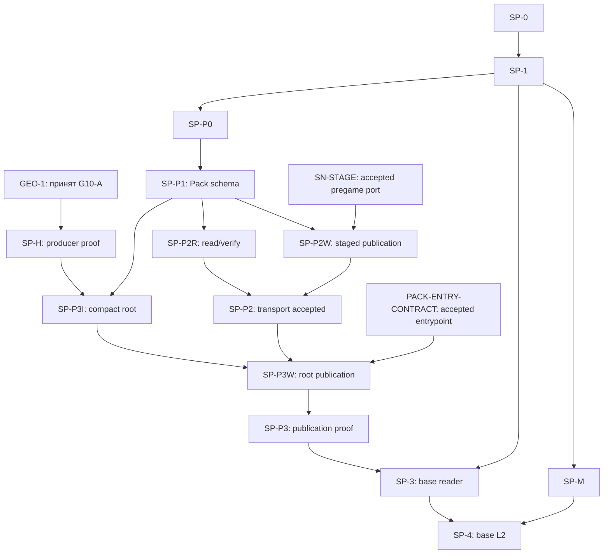
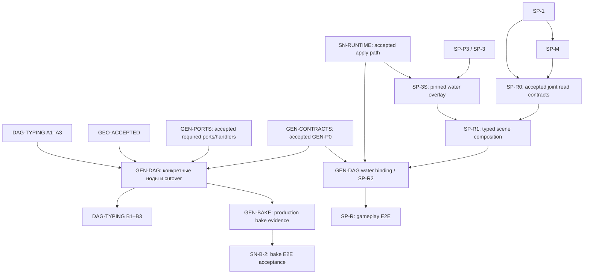

# WORLD-PLAN-GRAPH-1 — Граф зависимостей GEO-1 / SPATIAL-1 / GEN-DAG-1

**Статус:** архитектурная карта межплановых gates, v5 (2026-11-01), после анализа зависимостей; **не** разрешение на код, изменение POJO/enum, cutover или закрытие owning-планов. Путь документа: `.cursor/plans/world-generation-plan-dependency-graph.md`.

**Назначение:** показать зависимости **конкретных этапов**, а не объявлять один большой план prerequisite другого. Нормативный источник контрактов, статусов и доказательств приёмки — **соответствующий owning-план**; эта карта не вводит новые API, владельцев, типы, численные budgets, путь хранения, обязательный глобальный порядок и не меняет его решение. При конфликте сначала исправить и согласовать owning-план, затем синхронизировать эту карту.

## 1. Участники, владельцы, статус

| План и точный файл | Нормативная ответственность / текущий gate |
|---|---|
| [GEO-1](./geo-1-designed-water.md) — `.cursor/plans/geo-1-designed-water.md` | Hydrology canonical final source: water identity, levels, resolved membership/connectivity, final bed/geometry, proven coverage, refs/revisions. Task1–10 verified isolated; **Task11 design OPEN, G10-A production cutover OPEN**. Контракт данных и representation выбираются **до следующего зависимого producer code step**. |
| [SPATIAL-1](./spatial-distribution-domain.md) — `.cursor/plans/spatial-distribution-domain.md` | Общая typed read форма и требования к bounded query/materialization; конкретный Hydrology reader/index принадлежит Hydrology. **SP-0/1/P0/M и остальные необходимые freeze — OPEN**. Water Pack/root steps отдельно от runtime Snapshot и gameplay. |
| [Domain Patches & Snapshots](./world-domain-patches-snapshots.md) — `.cursor/plans/world-domain-patches-snapshots.md` | **Актуальный owning-план Snapshot** (наряду с нормативным [World Snapshot ТЗ](../../docs/tz_world_snapshot.md)): архитектура принята, core/runtime **не DONE**. 4C2-R и 4C2-H реализованы, ждут архитектурной приёмки; 4C2-O не начат, 4C3+ blocked. После GEN-DAG остаётся отдельный B-2 gate первичного bake (§1.1). |
| [DAG-TYPING-1](./dag-typing-1.md) — `.cursor/plans/dag-typing-1.md` | Общая typed инфраструктура `NodeContract`, OutputRef, runtime, NodeRegistry, parallelism: **A1–A3 implemented/verified**, **B1–B3 не завершены**, B зависит от конкретной интеграции GEN-DAG-1. |
| [GEN-DAG-1](./gen-dag-1-post-geo-ws.md) — `.cursor/plans/gen-dag-1-post-geo-ws.md` | Concrete node Input/Output и factories, вызовы публичных доменных операций и production migration. **DRAFT/DEFERRED**: требуются принятый GEO-1, необходимые Patch/Snapshot contracts/runtime gates, готовая typed infrastructure и собственная per-node приёмка. |
| [PHYSICS-1](./physics-spatial-dynamics.md) — `.cursor/plans/physics-spatial-dynamics.md` | Будущая физическая эволюция (PH-AGG/PH-LOCAL), через DAG → доменный patch → Snapshot. **Границы согласованы, алгоритмы/контракты/код OPEN**; **не prerequisite** для GEO bootstrap, water Pack read или GEN-DAG generator cutover. |

**Дополнительные внешние контракты (не равны самостоятельным новым задачам SPATIAL):** [World Pack storage](../../docs/tz_world_pack_storage.md), [World Snapshot](../../docs/tz_world_snapshot.md), [World Source Versioning](./world-source-versioning.md). Их owners должны принимать staged immutable publication, source revisions и runtime apply в своих треках. Архивные WS-0/WS-4 **не gate и не SoT**.

### 1.1. Актуальный Snapshot: конкретные шаги, два publication пути и зависимость B-2

**Единственный действующий план реализации Snapshot:** [Domain Patches & Snapshots, §8.3 и §8.14](./world-domain-patches-snapshots.md); нормативные семантика и staged-граница — [World Snapshot ТЗ](../../docs/tz_world_snapshot.md). `WorldPublicationRef` — pinned состояние; это не `PlanRef`, не `ArtifactRef` и не результат DAG-ноды. Эта карта **не** воскрешает архивный WS или параллельный Snapshot implementation.

| Gate owning Snapshot | Текущий статус / что именно разблокирует |
|---|---|
| **SN-CORE / 4C2-R + 4C2-H → 4C2-O → 4C3 → 4C4** | `4C2-R` и `4C2-H` реализованы, но **ждут архитектурной приёмки**; `4C2-O` **НЕ НАЧАТ**. `4C3` запрещён до приёмки R/H и O. Далее artifact adapters `4C3`, physical BLOB backend `4C4` — по собственным code gates. |
| **SN-STAGE / 4D1 + 4D3 + 4E2** | Shared artifact staging/lease/GC `4D1`, **pregame** `PreparedPackActivation/GameplayStart` `4D3`, core composition `4E2`. Внешний **accepted staged Pack publication port** нужен `SP-P2W`; одних DTO и изолированных тестов недостаточно. |
| **SN-RUNTIME / 4D2 + 4E2 + применимый domain handler** | `Snapshot.apply` `4D2`, composition и принятое доменное применение (read overlay принимается отдельно в SP-3S) дают runtime gate для `SP-3S`, `SP-4R`, `SP-R1` и нужных GEN-DAG операций. Нельзя подменять его SessionSnapshot из DAG-TYPING или Pack pregame activation. |
| **SN-B-2 / GEN-DAG bake integration acceptance** | [Snapshot §7.2](./world-domain-patches-snapshots.md) требует перенести L0 → C23 / bake orchestration в GEN-DAG для **полной приёмки Snapshot-плана**. Это **поздний E2E gate после GEN-DAG**, а не prerequisite `GEN-DAG ← весь Snapshot DONE`. |

**Порядок реализации внутри Snapshot уже зафиксирован §8.3.8:** после R/H/O следуют `4C3 → 4C4 → 4D1 → 4D2 → 4D3 → 4E2 → первый concrete domain handler`. **Семантическая независимость pregame CAS от runtime Snapshot.apply не разрешает менять этот code-order:** нельзя объявлять `4D3` выполненным раньше `4D2` без изменения и приёмки owning-плана. Внешним consumer-gate служит **фактически принятый port/handler**, а не только номер достигнутого подшага.

**Отсутствие цикла:** достаточные core ports/handlers Snapshot → GEN-DAG production; затем GEN-DAG bake integration → Snapshot B-2 E2E приёмка. Не требовать «весь Snapshot DONE» на вход GEN-DAG, иначе получится ложный цикл.


## 2. Смысл стрелок и отсутствие ложных циклов

- **Сплошная стрелка** на диаграммах ниже означает принятый/обязательный prerequisite для **названного downstream gate**, а не запрет на параллельный аудит или дизайн другой части плана.
- **Согласование GEO ↔ SPATIAL** до кода — совместный contract/representation review. Оно **не означает** `SPATIAL-1 DONE → GEO G10-A` и не создаёт междоменный runtime-вызов: canonical output принадлежит GEO, generic read — SPATIAL; reader/index реализует Hydrology.
- **GEN-DAG владеет конкретными схемами нод позднее.** GEO producer **не ждёт** точных `NodeContract`/`RequiredOutput`/регистрации GEN-DAG; обратная зависимость GEO ← GEN-DAG запрещена.
- **DAG-TYPING A → GEN-DAG → DAG-TYPING B** — корректный **поэтапный** handoff, не цикл между двумя целыми планами. A1–A3 не нужно повторно реализовывать внутри GEN-DAG.
- **SPATIAL Pack/root/read** и **SPATIAL runtime/gameplay** — разные gates. Runtime Snapshot и engine activation не должны блокировать независимый immutable-base water path.
- **PHYSICS, SP-A/air, SP-G/geology, SP-5A/gas** не являются скрытыми prerequisite для water-only G10-A/SP-P3/SP-3/SP-4/SP-R.

## 3. Bootstrap: Hydrology source → Pack → bounded read

До первого зависимого кода **совместно** проверить семантику, topology/coordinate space, physical coverage, стоимость/качество и способ представления. Затем каждый owner замораживает точные POJO/enum/файлы по своим [GEO input contract](./geo-1-designed-water.md) и [SPATIAL §13](./spatial-distribution-domain.md). Ни полный SPATIAL, ни GEN-DAG production не должны быть реализованы для этого архитектурного freeze.



**Точные исключения и дополнительные внешние gates:**

1. `SP-P2W` требует отдельно принятого **staged World Pack/pregame publication port** (`SN-STAGE`, owning Snapshot 4D1/4D3/4E2 и профильный World Pack contract), включая manifest CAS, hash/format/revision и rollback. `SP-P2R` может проверять read/verify независимо после SP-P1; **он не ждёт SN-STAGE**. В текущем Snapshot code-order 4D3 следует за 4D2, но pregame activation **не является runtime Snapshot.apply**.
2. `SP-P3I` требует одновременно `SP-H` (принятый G10-A), `SP-P0` и `SP-P1`; `SP-P3W` требует `SP-P3I` и `SP-P2`. Отдельный physical source GEO и transport/index/publish steps SPATIAL **не дублируют друг друга**.
3. `SP-3` — Hydrology-owned bounded immutable-base reader, **не** универсальный Spatial solver. `SP-4` — только base/pre-game L2; не считать его доказательством runtime Snapshot-aware read.
4. Текущий `FineWaterJob.fill` требует полного fine-покрытия как **AS-IS cost**; целевой source/representation/precision/budget остаются OPEN в GEO. Маленький `read_window` не запускает fill/routes и не сканирует весь мир.
5. `SP-P0/P1/P2R` и часть Pack-инфраструктуры могут проектироваться/приниматься независимо от G10-A, если их **собственные** prerequisites и code-gates закрыты; не превращать порядок таблицы SPATIAL в глобальную последовательную блокировку.
6. Единственный canonical base source на принятую revision: Hydrology facts → immutable Pack domain-root `ArtifactRef` (вариант Б), без SQL materialization всех water cells и без второго активного legacy producer после G10-A cutover.

## 4. Runtime и engine DAG: отдельные ветки



- `SP-3S` требует принятого `SN-RUNTIME` (Snapshot 4D2/4E2 и необходимого Hydrology-owned apply/commit handler) и `SP-3`; `SP-4R` отдельно требует `SP-4 + SP-3S`. **SP-4R не prerequisite водного SP-R gameplay-read**, если consumer работает с типизированными media slices без per-cell materialization.
- `SP-R1` требует `SP-R0 + SP-3S`; `SP-R2` — внешний owning GEN-DAG gate для реальных engine/LLM/UI callers после `SP-R1`; `SP-R` — cold-Pack + accepted Snapshot + real consumer E2E, **не** debug API.
- GEN-DAG может готовить node inventory/contracts и isolated implementation, когда их локальные gates приняты, но **production migration** остаётся заблокирована по его собственному плану до принятого GEO, необходимых Patch/Snapshot gates и явной команды владельца. Не писать неизвестные доменные POJO в GEN-DAG ради ускорения.
- Runtime reader: `DAG → domain.read(window, WorldPublicationRef) → typed domain result`; после игры базовый pack не переписывается, accepted changes проходят `domain.patch → PatchSet → Snapshot`. `NodeOutput` текущего исполнения DAG **не является** canonical persisted source или заменой `WorldPublicationRef`.
- **DAG-TYPING B** — cleanup/handoff после принятой GEN-интеграции, не prerequisite для завершения GEO и не разрешение держать два production runtimes. Также **SN-B-2** в Snapshot §7.2 принимает реальную DAG-оркестрацию bake **после GEN**, не до: полный `Snapshot DONE` нельзя требовать от GEN на входе.

### 4.1. SP-R2 и единый GEN-DAG cutover: состав OPEN

[GEN-DAG, GEN-P0](./gen-dag-1-post-geo-ws.md) требует одного production switch всех действующих нод/callers; SPATIAL §8 требует SP-R1 до SP-R2, но не завершения всего GEN-DAG. Поэтому безусловное ребро GEN cutover → SP-R2 удалено. До switch GEN-P0 фиксирует node IDs/callers и один вариант:

- **Water входит в первый cutover:** SP-R1 и готовность water bindings предшествуют switch; SP-R2 принимается в составе того же атомарного переключения.
- **Water — последующее расширение:** cutover → SP-R2 допустимо только после доказательства в GEN-P0, что первый switch полностью мигрирует действующих callers и обеспечивает обязательный scene read без legacy runtime/SQL-water/L0 fallback. Отложенные consumers перечисляются явно.

Выбор **OPEN**, production switch заблокирован до его фиксации. Это не разрешение второго runtime или частичного переключения. Независимый дизайн/isolated bindings допустимы. В диаграмме показаны общие prerequisites SP-R2; его положение относительно cutover намеренно не задано до решения owner. Нельзя включать обе альтернативы как обязательные рёбра.

## 5. Реестр направленных gate-зависимостей (для машинной и ручной проверки)

Каждая строка ниже — одно обязательное ребро; несколько входов означают AND. Реестр описывает именованные межплановые gates и их локальные prerequisites, а не все внутренние implementation steps. Приёмка каждого gate дополнительно требует его owning evidence и разрешения на код.

Owners: SP-* — SPATIAL §8 (SP-H — proof GEO G10-A); SN-* и 4C*/4D*/4E* — Snapshot §8.3/8.14; GEN-* — GEN-DAG; DT-* — DAG-TYPING. `SN-CORE` везде означает принятие цепочки до **4C4 включительно**. `SN-APPLY-HANDLER` означает принятый применимый domain apply/commit handler (без read overlay SP-3S), не произвольный первый handler. `GEN-CONTRACTS` — принятая карта GEN-P0, включая решение §4.1; `GEN-PORTS` — принятые необходимые конкретным нодам Patch/Snapshot ports/handlers; `GEN-BAKE` — evidence реальной L0 → C23 orchestration. SP-1 + SP-M разрешают проектирование SP-R0; совместное согласование scene/read и consumer contracts является evidence его приёмки, а не отдельным prerequisite. SPATIAL ведёт пакет evidence в §8 своего плана с подтверждением domain owners и GEN-P0 owner; принятый SP-R0 передаёт пакет в SP-R1 и соответствующие concrete bindings GEN-P0. Вершина SP-R0 означает принятый результат; его входные рёбра не означают автоматическую приёмку. `PACK-ENTRY-CONTRACT` — принятый DAG/Pack publication entrypoint contract SP-P3W, не GEN-BAKE. Exact SP-R0 contracts и PACK-ENTRY-CONTRACT остаются OPEN; owners и evidence уточнены в SPATIAL. Эти обозначения — навигационные aliases, не новые implementation steps.

| Producer gate | Consumer gate |
|---|---|
| SP-0 | SP-1 |
| SP-1 | SP-P0 |
| SP-1 | SP-M |
| SP-1 | SP-R0 |
| SP-M | SP-R0 |
| SP-P0 | SP-P1 |
| SP-P1 | SP-P2R |
| SP-P1 | SP-P2W |
| SN-STAGE | SP-P2W |
| SP-P2R | SP-P2 |
| SP-P2W | SP-P2 |
| G10-A | SP-H |
| SP-H | SP-P3I |
| SP-P0 | SP-P3I |
| SP-P1 | SP-P3I |
| SP-P3I | SP-P3W |
| SP-P2 | SP-P3W |
| SP-H | SP-P3W |
| PACK-ENTRY-CONTRACT | SP-P3W |
| SP-P3W | SP-P3 |
| SP-P3 | SP-3 |
| SP-1 | SP-3 |
| SP-H | SP-3 |
| SP-M | SP-4 |
| SP-3 | SP-4 |
| 4C2-R | 4C2-O |
| 4C2-H | 4C2-O |
| 4C2-O | 4C3 |
| 4C3 | 4C4 |
| 4C4 | SN-CORE |
| SN-CORE | 4D1 |
| 4D1 | 4D2 |
| 4D2 | 4D3 |
| 4D3 | 4E2 |
| 4E2 | SN-STAGE |
| 4E2 | SN-APPLY-HANDLER |
| SN-APPLY-HANDLER | SN-RUNTIME |
| SN-RUNTIME | SP-3S |
| SP-3 | SP-3S |
| SP-3S | SP-4R |
| SP-4 | SP-4R |
| SP-3S | SP-R1 |
| SP-R0 | SP-R1 |
| SP-R1 | SP-R2 |
| GEN-CONTRACTS | SP-R2 |
| SN-RUNTIME | SP-R2 |
| SP-R1 | SP-R |
| SP-R2 | SP-R |
| SP-3S | SP-R |
| DT-A | GEN-CUTOVER |
| GEO-ACCEPTED | GEN-CUTOVER |
| GEN-CONTRACTS | GEN-CUTOVER |
| GEN-PORTS | GEN-CUTOVER |
| GEN-CUTOVER | DT-B1 |
| DT-B1 | DT-B2 |
| DT-B2 | DT-B3 |
| GEN-CUTOVER | GEN-BAKE |
| GEN-BAKE | SN-B-2 |

`SN-STAGE` требует фактической приёмки Pack/pregame port, hash/revision/CAS/rollback, а не только достижения 4E2. `GEO-ACCEPTED` сохраняет входное требование owning GEN-DAG «завершён и принят GEO-1»; G10-A не объявляется автоматически всей приёмкой GEO. GEN-PORTS нельзя считать закрытым по одному generic Snapshot.apply.

**Условное ребро §4.1:** только при включении water в первый switch добавляется SP-R1 → GEN-CUTOVER, а SP-R2 принимается совместно с cutover; для согласованного позднего расширения добавляется GEN-CUTOVER → SP-R2. До выбора нельзя вычислять готовность production switch по одному безусловному графу.

Совместный GEO/SPATIAL contract freeze остаётся обязательным перед зависимым producer code (§3). PHYSICS/air/gas/geology не добавляют обратных prerequisites к base-water ветке. Отсутствие циклов в реестре не закрывает OPEN contracts и не является приёмкой реализации.

### 5.1. Ограничения scope и открытые внешние bindings

- **GRAPH-Q01 / source-aware consumers:** Snapshot §6/шаг 5 зависит от World Source Versioning 2–3. Точная матрица consumers OPEN; до приёмки каждого source-aware GEN/read consumer требуется решение о применимости и evidence capture/pinning/retention/source binding. При установленной применимости добавить ребро accepted binding → конкретный consumer; сейчас не выдумывать глобальные рёбра к SP-3S/SP-R. SN-CORE и неизменённый base-Pack read не блокируются автоматически. До решения source-aware готовность не доказана.
- **GRAPH-Q04 / river volume:** SP-3/SP-R этой карты принимают ocean/lake scope; river-volume activation отложена до GEO/Hydrology SP-H2 и отдельного reader/E2E evidence в SPATIAL. RIVER_BED/UID не доказывают z_water(x,y). Это не дополнительный prerequisite ocean/lake path.
- **GRAPH-Q07 / cutover:** evidence §4.1 включает inventory node IDs/callers, cold-Pack ocean, accepted Snapshot и typed missing/unsupported outcomes. Unsupported не заменяет обязательные water facts. Если они нужны действующим callers, SP-R1 предшествует первому switch. Выбор и evidence OPEN в GEN-P0.

## 6. Практический приоритет (не подмена hard gates)

1. **P0 — совместная архитектура:** GEO canonical source semantics, Task11 coarse/fine coordinate+revision, выбор compact representation/cost-quality; SPATIAL contract/reuse/layout review. **До кода:** все нужные POJO/enum/target paths согласованы в owning plans.
2. **P0-S — актуальный Snapshot (параллельный критический путь):** принять архитектурно 4C2-R/H, выполнить и принять 4C2-O, затем последовательно 4C3/4C4/4D1/4D2/4D3/4E2 и нужные domain handlers. Эта ветка не ждёт GEO; `SN-STAGE` и `SN-RUNTIME` разблокируют **разные** downstream steps. `SN-B-2` ожидает будущей GEN-DAG bake-интеграции.
3. **P1 — GEO-1 G10-A:** закончить единственный native final producer и его production acceptance, без самостоятельного compact Pack writer и без изменения engine DAG ради обхода.
4. **P2 — водный SPATIAL:** принять storage-root/transport и Hydrology-owned bounded reader + base L2 `SP-P*`, `SP-3`, `SP-4`. `SP-P2R` и `SP-P3I` допускают независимую работу по локальным gates; публикация ждёт `SN-STAGE`, `SP-P2` и `SP-P3I`.
5. **P3 — GEN-DAG-1:** concrete ноды/единый production cutover, когда GEO и необходимые `SN-RUNTIME`/Patch gates реально приняты; GEN architecture/inventory допустим заранее. **Полное Snapshot DONE не prerequisite.**
6. **P4 — runtime water gameplay (приоритет, не порядок после GEN cutover; см. §4.1):** SP-3S/R1, GEN-DAG water binding SP-R2, SP-R E2E и, отдельно, SP-4R для runtime L2. PHYSICS/Gas/Geology/Air остаются самостоятельными треками.

**Не забыть внешний критический путь:** в [Patch/Snapshot §8.13–8.14](./world-domain-patches-snapshots.md) `4C2-R` и `4C2-H` реализованы, но ожидают архитектурной приёмки; `4C2-O` не начат, `4C3+` и runtime apply не считать DONE без своих evidence. Эту **последовательную внутри Snapshot** ветку можно вести параллельно GEO/SPATIAL по матрице §8. `Snapshot B-2` закрывается лишь после реальной GEN-DAG bake-интеграции.

## 7. Поддержание графа, обратные ссылки и приёмка

**Точная карта документации** (только Markdown, без создания кода):

| Файл | Изменение |
|---|---|
| `.cursor/plans/world-generation-plan-dependency-graph.md` | Этот навигационный план, диаграммы, gate-таблица, статус и negative cases. |
| `.cursor/rules/dag-generator-interface.mdc` | Сверка lifecycle с Snapshot ТЗ: legacy пути отдельно от target Pack/Snapshot, атомарный доменный вызов сохранён. |
| `.cursor/plans/geo-1-designed-water.md` | Обратная ссылка в начале; доменные POJO и G10-A остаются нормативными здесь. |
| `.cursor/plans/spatial-distribution-domain.md` | Обратная ссылка в начале; generic read, Pack, materialization и SP-R принадлежат этому плану. |
| `.cursor/plans/gen-dag-1-post-geo-ws.md` | Обратная ссылка в начале; exact concrete node Input/Output и cutover остаются здесь. |
| `.cursor/plans/dag-typing-1.md` | Обратная ссылка в начале; A/B-граф подтверждает отсутствие цикла. |
| `.cursor/plans/world-domain-patches-snapshots.md` | Обратная ссылка в начале; Snapshot runtime gates не выдаются за DONE. |
| `.cursor/plans/physics-spatial-dynamics.md` | Обратная ссылка в начале; PHYSICS по-прежнему не блокирует base water. |

**Правило обновления:** owner конкретного плана меняет свой статус/контракт первым; затем проверяется и, при необходимости, уточняется эта карта. Запрещено объявлять внешний gate завершённым только по формулировке здесь. Внедрение нового класса/POJO/enum требует file/layout/import map и отдельной приёмки по [code-gates.mdc](../rules/code-gates.mdc) и [folder-composition.mdc](../rules/folder-composition.mdc).

**Критерии приёмки GRAPH-AC:**

- [ ] LEGACY-AC: для каждого показанного перехода проверен реестр owning-плана с явными ссылками на legacy-классы/методы и callers, target заменами, cutover/disposition gates и актуальным evidence по [legacy-folder.mdc](../rules/legacy-folder.mdc). Без такого evidence карта не принимается.

- [ ] Все шесть планов из §1 содержат обратную ссылку; прямые ссылки из графа ведут в существующие файлы.
- [ ] Каждое **hard** ребро §5 указано с producer gate, consumer gate и owning plan; проверка топологического порядка не выявляет циклов.
- [ ] Отсутствуют ложные `SPATIAL DONE → GEO`, `GEN-DAG DONE → GEO`, `DAG-TYPING B → GEN-DAG`, `PHYSICS → base water`, `SP-A/air → water` и `WS-4 → anything`.
- [ ] Stage A DAG-TYPING и stage B разделены; GEO final и SPATIAL root/read разделены; Pack pregame CAS и runtime Snapshot apply разделены; SP-4 и SP-4R разделены.
- [ ] GEN-DAG owns concrete node I/O; Hydrology owns water facts/read/index; SPATIAL owns generic contract/projection boundary; World Pack/Snapshot владеют публикацией и применением.
- [ ] Все OPEN/blocked statuses соответствуют owning plans; **план не разрешает код** и не закрывает отсутствие exact POJO/enum/file freeze.
- [ ] Проверка Markdown/Mermaid/ссылок и фактического наличия обратных ссылок прошла после публикации.
- [ ] SN-CORE, SN-STAGE, SN-RUNTIME и SN-B-2 различены; отсутствует ложное ребро «весь Snapshot DONE → GEN-DAG», а также неразрешённый параллелизм 4D2/4D3.
- [ ] У каждого разрешённого параллельного набора §8 указаны локальные стартовые gates, точка схождения и запрет до приёмки prerequisite.

**Открытые вопросы, не закрываемые этой картой:** GEO Task11 coordinate/snapshot + compact membership/cost; SPATIAL SP-0/1/P0 точные POJO/format/paths; staged Pack publication port и runtime Snapshot apply; GEN-DAG concrete node bindings/cutover; SP-R0/R1 owner gameplay composition. Все решения принимаются в owning plans.


### 7.1. Вопросы независимого архитектурного ревью (разбор v3, 2026-11-01)

Это **реестр вопросов для owning-планов**, а не самостоятельный норматив новых API, POJO/enum, implementation tasks или дополнительных глобальных блокировок. Если вопрос касается конкретного consumer, его gate фиксируется только после решения владельца. До этого не выдавать наличие стрелки, зелёные isolated tests или готовность общего порта за принятую интеграцию.

| ID / приоритет | Открытый вопрос и основание | Владелец решения и критерий закрытия |
|---|---|---|
| **GRAPH-Q01 / P1 — Source Versioning** | Какие именно consumer gates требуют source-revision-set binding, отсутствующего в §5? [World Source Versioning](./world-source-versioning.md) всё ещё DESIGN; [Snapshot §6/§8](./world-domain-patches-snapshots.md) предусматривает отдельный шаг 5 после source-versioning steps 2–3. `SN-CORE` (4C2–4C4) разрешён независимо, но его готовность не доказывает pinning/capture/retention для source-aware read. | **World Source Versioning + Snapshot:** предъявить точный accepted source binding и список затронутых downstream gates (GEN/read/SP-3S/SP-R только если действительно потребляют такой binding); затем добавить направленные условные рёбра в §5/§8. Не блокировать этим Snapshot Core или неизменённый base-Pack read без обоснования. **OPEN**. |
| **GRAPH-Q02 / P1 — SP-R0 co-freeze** | Достаточно ли `SP-1 + SP-M` лишь для старта SP-R0, а для **приёмки** нужны ещё согласованные domain-owned scene/read ports и GEN-DAG consumer contracts? SPATIAL §8 требует их, тогда как §5 содержит только локальные рёбра. | **SPATIAL SP-R0 + Domain Patches/GEN-DAG GEN-P0:** явно разделить design-start и contract-accepted, утвердить owner композиции, typed Input/Output/error/revision/file map и совместный handoff. Не создавать цикл `SP-R0 ↔ GEN-P0` или преждевременный GEN production gate. **Уточнение внесено:** design-start и contract acceptance разделены в SPATIAL и §5; exact co-freeze OPEN. |
| **GRAPH-Q03 / P2 — SP-P3W entrypoint** | Чем подтверждается принятый DAG/World Pack publication/bake **контракт** для SP-P3W, помимо `SP-P3I + SP-P2 + SP-H`? SPATIAL §8 требует binding к принятому entrypoint, а Snapshot §7.2 оставляет production bake за DAG. | **SPATIAL + GEN-DAG/World Pack/Snapshot owners:** определить contract-level gate для isolated Pack-root publication proof и явно отделить его от позднего `GEN-BAKE` production E2E. Не вводить обходной legacy production publisher или зависимость от всего GEN cutover без доказательства. **Уточнение внесено:** PACK-ENTRY-CONTRACT добавлен в SPATIAL/§3/§5/§8; exact контракт OPEN. |
| **GRAPH-Q04 / P1 — river volume SP-H2** | Где отдельная ветка для речного `z_water(x,y)`? SPATIAL §4/SP-H2 отмечает, что `RIVER_BED`/UID ещё не доказывают поверхность водной толщи; общий `SP-3`/`SP-R` для ocean/lake нельзя считать river-volume acceptance. | **GEO-1/Hydrology + SPATIAL:** принять профиль/семантику и отдельный river-volume reader/E2E gate либо явно отложить их. Не делать SP-H2 prerequisite для ocean/lake base read и water-only gameplay E2E. **Scope уточнён:** river activation явно отложена в SPATIAL и §5.1; SP-H2 OPEN. |
| **GRAPH-Q05 / P2 — SN-APPLY-HANDLER** | Что означает `SN-APPLY-HANDLER` в §5: доменный apply SectionHandler или также Hydrology read overlay из `SP-3S`? Второе создало бы скрытую зависимость `SN-RUNTIME → SP-3S → SN-RUNTIME`. | **Snapshot + Hydrology/SPATIAL:** назвать/определить alias как accepted apply-handler/commit operation; `SP-3S` оставить отдельным Snapshot-aware **reader** после SN-RUNTIME. При необходимости отдельно перечислить domain apply и read-overlay acceptance, без нового storage/SoT. **Исправлено:** apply-handler отделён от reader в Snapshot и §1/§4/§5; read overlay не входит в SN-RUNTIME. |
| **GRAPH-Q06 / P2 — diagram parity** | Почему Mermaid §4 ещё содержит `GEO G10-A → GEN` и прямое `GEN → SN-B-2`, тогда как нормативный §5 требует `GEO-ACCEPTED → GEN-CUTOVER → GEN-BAKE → SN-B-2`? | **WORLD-PLAN-GRAPH-1:** синхронизировать обе диаграммы с §5 и условием SP-R2 из §4.1, затем повторить проверку рёбер/циклов и Markdown/Mermaid. До этого не использовать диаграмму как самостоятельное разрешение gate. **Исправлено:** Mermaid использует GEO-ACCEPTED, GEN-PORTS и GEN-BAKE; условие SP-R2 сохранено в §4.1. |
| **GRAPH-Q07 / P1 — water в едином cutover** | Доказуем ли вариант позднего SP-R2 без потери обязательных water facts для активных scene consumers? §4.1 и [GEN-DAG GEN-P0](./gen-dag-1-post-geo-ws.md) уже оставляют выбор OPEN; один запрет legacy SQL/L0 fallback сам по себе не доказывает корректный media-only scene read. | **GEN-DAG GEN-P0 + SPATIAL SP-R0/R1:** по inventory node IDs/callers выбрать water внутри первого атомарного switch или обосновать позднее расширение с cold-Pack ocean, accepted Snapshot и typed missing/unsupported behaviour. До решения production cutover BLOCKED; второго параллельного runtime нет. **OPEN**. |
| **GRAPH-Q08 / P3 — status evidence** | В DAG-TYPING-1 вводный текст атомарного порядка ещё говорит, что после A2.1 следующие шаги не начинались, тогда как execution evidence и таблица помечают A2.2–A3.6 DONE; граф использует A1–A3 implemented/verified. | **DAG-TYPING-1 owner:** актуализировать вводный статус по evidence owning-плана, затем сверить §1/§5 этой карты. Не менять фактический статус A/B на основании одного редакционного исправления. **Исправлено:** вводный статус атомарного порядка DAG-TYPING синхронизирован с evidence; B не закрыт. |
| **GRAPH-Q09 / P2 — provenance приёмки SP-R0** | В v3 отдельный SCENE-READ-FREEZE был одновременно результатом работы SP-R0 и входным gate SP-R0, создавая неоднозначность стадий. | **Исправлено в v4:** отдельная вершина и ребро удалены. SP-1 + SP-M разрешают проектирование; SPATIAL фиксирует evidence совместного согласования domain owners и GEN-P0 owner как критерий приёмки SP-R0. Принятый пакет передаётся в SP-R1 и соответствующие concrete bindings GEN-P0, без ожидания полного GEN-P0/cutover. Owning SPATIAL/GEN-P0 и §4/§5/§8 синхронизированы; exact contracts и приёмка SP-R0 остаются OPEN. |

**Порядок закрытия:** сначала решения и evidence в соответствующем owning-плане, затем синхронизация §1/§3–§5/§8 этой карты, обновление статуса конкретного GRAPH-Q и повторная проверка GRAPH-AC. Оставленный OPEN допустим только при явно ограниченном consumer scope и отсутствии ложного разрешения на код/production; одна эта таблица не закрывает ни один внешний gate.

### 7.2. Процедура GRAPH-AC: проверка качества карты

GRAPH-AC оценивает согласованность документа, **не** готовность изображённых implementation gates. Q01/Q07 и exact contracts могут оставаться OPEN, если область неопределённости и блокируемые consumers явно указаны; их наличие само по себе не запрещает приёмку карты. Ни положительная проверка графа, ни приёмка карты не закрывают эти вопросы и не разрешают production switch.

**Автоматическая часть.** Из корня репозитория выполнить Python-блок ниже (stdin `python -`) и `git diff --check`. Ожидается PASS, отсутствие дублированных рёбер, битых локальных ссылок, пропущенных обратных ссылок и циклов. Числа вершин/рёбер — evidence текущей версии, не фиксированный норматив.

```python
from pathlib import Path
from graphlib import TopologicalSorter
import re
p = Path('.cursor/plans/world-generation-plan-dependency-graph.md')
s = p.read_text(encoding='utf-8')
registry = s.split('## 5.', 1)[1].split('## 6.', 1)[0]
edges = re.findall(r'^\| ([A-Z0-9-]+) \| ([A-Z0-9-]+) \|$', registry, re.M)
assert edges and len(edges) == len(set(edges)), 'empty/duplicate edges'
for extra in [[], [('SP-R1', 'GEN-CUTOVER')], [('GEN-CUTOVER', 'SP-R2')]]:
    graph = {}
    for producer, consumer in edges + extra:
        graph.setdefault(consumer, set()).add(producer)
    tuple(TopologicalSorter(graph).static_order())
prose = re.sub(r'```.*?```', '', s, flags=re.S)
for target in re.findall(r'\]\(([^)]+)\)', prose):
    if '://' not in target:
        assert (p.parent / target.split('#')[0]).exists(), target
owners = ['geo-1-designed-water', 'spatial-distribution-domain',
          'world-domain-patches-snapshots', 'dag-typing-1',
          'gen-dag-1-post-geo-ws', 'physics-spatial-dynamics']
for owner in owners:
    assert '](./world-generation-plan-dependency-graph.md)' in (
        p.parent / (owner + '.md')).read_text(encoding='utf-8'), owner
print('PASS:', len(edges), 'edges; base and separate cutover alternatives')
```

**Mermaid ↔ реестр (ручная проверка).** В §3/§4 подписи сопоставляются с IDs §5: G10-A/SP-H/SP-*, GEN = GEN-CUTOVER, A = DT-A, B = последовательность DT-B1…B3; BASE = опубликованный SP-3 после SP-P3. Остальные именованные labels сохраняют свои gate IDs. Допустимо опускать транзитивное ребро, если путь уже есть; цепочку можно свернуть только с сохранением порядка и всех внешних входов. Диаграммы — проекции bootstrap/runtime, не полная копия §5: внутренние prerequisites внешнего порта сверяются с определением порта в §1/§5. Нельзя скрывать независимый prerequisite показанного consumer; условие §4.1 всегда остаётся явно указанным рядом. Сверить все стрелки и входы; выполнить Mermaid parse/render доступным renderer. При отсутствии renderer записать «визуальная проверка не выполнена», а не PASS рендеринга.

**Два варианта cutover.** Проверяются раздельно, не объединяются: (A) water включён — SP-R1 и все prerequisites SP-R2 готовы до switch, SP-R2 и GEN-CUTOVER принимаются одним моментом production activation; (B) позднее расширение — добавляется GEN-CUTOVER → SP-R2 только после evidence GEN-P0 (§4.1). Для A не добавлять взаимные рёбра: совместную активацию проверить как один acceptance event с объединением входных условий обоих gates. Проверка топологического порядка выше проверяет лишь необходимые порядки, не атомарность события. Ни один вариант не выбран автоматически.

**Семантическая часть.** Для каждого gate сверить owning раздел: кто производит результат, где принимается evidence и кто потребляет его; отличить design-start, contract acceptance и runtime activation. Проверить, что результат шага не записан собственным prerequisite (SP-R0), apply не требует будущего read overlay, generic port не заменяет domain binding, а сокращённая стрелка не объявляет весь план DONE. Проверить §8 на те же входные условия, конфликт файлов и границы атомарного cutover. Неназванный обязательный контракт = OPEN у конкретного consumer, а не придуманное глобальное ребро.

**Legacy-проверка (обязательна до приёмки).** Для каждого owning-плана §1 найти и указать точный раздел его legacy inventory; проверить ссылки на определения классов/методов и callers/registration, различение AS-IS/TARGET/production, gate отключения и evidence. Отсутствие legacy подтверждается поиском в области плана. Проверка ссылок на уровне файла и ацикличность графа не доказывают существование символа или отсутствие legacy runtime. **LEGACY-AC сейчас OPEN:** полная проверка этих реестров не выполнена; предыдущие результаты GRAPH-AC её не покрывают.

**Done проверки:** записаны автоматический результат, сверка диаграмм/семантики и отдельно статус рендеринга; отсутствуют необъяснённые противоречия. Непроверенные пункты GRAPH-AC остаются незакрытыми; при OPEN LEGACY-AC приёмка карты запрещена. Evidence — кратко, без повторного описания архитектуры.

**Сверка правила (2026-11-01):** `dag-generator-interface.mdc` синхронизирован с Snapshot ТЗ § «Staged artifacts и точки публикации» / § «Путь записи и сбор патчей»: legacy C19/PatchApplier отделены от target lifecycle, до игры Pack, после игры PatchSet/commit Snapshot; атомарная доменная операция сохранена. Правило и карта не объявляют production migration выполненной.

**Evidence v5 (2026-11-01):** встроенная проверка выполнена: 58 уникальных рёбер, 45 вершин; базовый граф и обе альтернативы cutover ацикличны, локальные ссылки и шесть обратных ссылок PASS. Стрелки двух диаграмм сверены с реестром с учётом транзитивных сокращений и внешних gates; семантическая проверка SP-R0/apply/read и §8 не выявила нового противоречия. Совместная активация в варианте A требует объединения входов GEN-CUTOVER/SP-R2; production evidence не проверялось. `git diff --check` PASS. Mermaid render **не выполнен**: локальные mermaid/mermaid-cli отсутствуют. GRAPH-AC не закрыт; Q01/Q07 и exact contracts OPEN.

## 8. Матрица допустимой параллельности: конкретные шаги после gates

**Как читать:** «можно параллельно» означает **независимость по архитектурным prerequisites**, не распоряжение запустить несколько кодовых изменений сразу. Каждый code step выполняется по своему owning-плану, с точными contract/POJO/enum/file freeze и отдельным разрешением мастера. Отдельные owners могут вести архитектурный анализ одновременно; code-группы с общими файлами/consumer cutover требуют сверки import/caller map перед стартом. Условный gate `OPEN` не считается выполненным.

| Когда / стартовый gate | Какие конкретные работы можно вести независимо | Где обязательная синхронизация / что ещё запрещено |
|---|---|---|
| **Сейчас, без production-кода:** текущие accepted architecture baselines | **GEO:** Task11 и выбор compact semantics/representation; **SPATIAL:** SP-0 audit, SP-1/M/P0 contract work после локальных prerequisites; **Snapshot:** архитектурная приёмка 4C2-R/H; **GEN-DAG:** read-only node inventory и mapping зависимостей; **DAG-TYPING:** документальный handoff A→GEN. | Нельзя начать GEO producer code до соответствующего POJO freeze; Snapshot 4C2-O ждёт приёмки R/H; GEN production ждёт GEO и нужные Snapshot ports. Не путать параллельный **дизайн** с параллельным разрешением на код. |
| **После приёмки Snapshot 4C2-R/H** | Snapshot **4C2-O** как **один** собственный атомарный code step может идти одновременно с GEO контрактной/кодовой веткой и независимыми SPATIAL SP-0/1/P0 работами (при их собственных gates). | `4C3` не стартует до принятого `4C2-O`. Внутри Snapshot правило «один подшаг за заход» сохраняется, **4C2-O и 4C3 не параллелить**. |
| **После SPATIAL SP-0/1/P0 и принятия exact Pack format/POJO** | `SP-P1` (после собственного P0), затем `SP-P2R` (после P1) может разрабатываться независимо от **GEO G10-A** и последовательной ветки Snapshot `4C3+`; кодовые steps только по отдельным разрешениям. | `SP-P2W` дополнительно ждёт **SN-STAGE**; `SP-P3I` ждёт `SP-H/GEO G10-A` и `SP-P1`. Нельзя начать их из-за одного наличия generic contract. |
| **После GEO G10-A/ SP-H и SP-P1** | `SP-P3I` (Hydrology compact facts/index) и `SP-P2R` (Pack read/verify) — **реальные независимые branches**; если к этому моменту уже принят SN-STAGE, `SP-P2W` тоже допустим параллельно, каждый со своей картой файлов и тестами. | `SP-P2` только после P2R+P2W, `SP-P3W` только после P3I+P2 и принятого PACK-ENTRY-CONTRACT; `SP-P3` только после P3W. Не смешивать hydrology source, storage port и writer в один кодовый шаг. |
| **После SN-CORE (до 4C4 включительно), затем 4D1/4D2/4D3/4E2** | **SN-STAGE** после фактической приёмки pregame port может разблокировать `SP-P2W`; **SN-RUNTIME** после `4D2/4E2` и нужных domain handlers может разблокировать `SP-3S` и необходимые runtime GEN-DAG bindings. GEO G10-A/SP-P3I/Pack read остаются независимыми до своих точек схождения. | **Не разрешено** выполнять 4D2 и 4D3 параллельно по текущему Snapshot §8.3.8, хотя их семантика различна. `4D3` ≠ `Snapshot.apply`; `4D2` без принятого composition/domain handler ≠ готовый SN-RUNTIME. |
| **После SP-P3/SP-3, SP-M; runtime Snapshot ещё может быть OPEN** | `SP-4` **bootstrap/base L2** и GEN-DAG read-only/contract design, не зависящий от runtime Snapshot, могут идти независимо. Допустимы собственные независимые SP-A air и SP-G geology architecture steps после их локальных gates. | `SP-3S`, `SP-4R` и `SP-R1` **не** активировать до SN-RUNTIME. Полный GEN production не проводить до GEO и необходимых Snapshot gates. |
| **После SP-3S + принятого SP-R0 (с совместным evidence контрактов) и принятых GEN-DAG runtime prerequisites** | `SP-R1` (typed scene composition) и **независимая** concrete GEN-DAG подготовка по owning-плану могут идти одновременно; production migration зависит от решения §4.1 и не считается независимой от SP-R1 по умолчанию, если их файлы/контракты не пересекаются и каждый gate принят. `SP-4R` отдельно возможен после SP-4+SP-3S. | `SP-R2` обязательно ждёт **SP-R1** и принятый GEN-DAG node binding; `SP-R` E2E — после SP-R2. `SP-4R` не prerequisite для media-only gameplay SP-R. |
| **После принятой GEN-DAG production/bake integration** | **DAG-TYPING B1–B3** handoff/legacy cleanup и **Snapshot SN-B-2** проверка реального bake могут идти как независимые owning acceptance tracks; `SP-R2` — по решению §4.1: в составе cutover либо как явно согласованное позднее расширение после SP-R1. | Не принимать весь DAG-TYPING или Snapshot DONE **до** соответствующего GEN-DAG handoff/E2E. При пересечении engine файлов — отдельная согласованная миграция, не одновременное изменение одних callers. |
| **Вне критического water path** | **PHYSICS-1** contract research, **SP-A** air/world-settings и **SP-G** geology architecture могут идти независимо при своих prerequisites. | Не делать PHYSICS, атмосферу, газы или геологию обязательными gates для GEO G10-A, base water Pack/read либо GEN-DAG generator bootstrap. Код этих веток — только по собственному freeze/разрешению. |

**Явно запрещённые «параллельности» и ложные условия:** `Snapshot 4C2-O || 4C3`, `Snapshot 4D2 || 4D3` в существующем implementation-order, `SP-P3W` до `SP-P3I + SP-P2`, `SP-R2` до `SP-R1`, `DAG-TYPING B` до GEN handoff, `Snapshot B-2` как обязательный вход GEN, `SP-4R` как обязательный вход `SP-R`, full SPATIAL/PHYSICS/air как gate GEO. Изменить такие dependencies вправе только принятие обновлённого owning-плана.

**Правило актуализации:** после закрытия каждого named gate обновить статус/доказательство в owning-плане, затем пересмотреть соответствующую строку этой матрицы; не выводить `DONE` из одной стрелки или тестов другого трека.

### Результат анализа v2 — 2026-11-01

Исправлены потерянные prerequisites SP-M → SP-4 и SP-1/SP-M → SP-R0; SN-CORE приведён к единому охвату до 4C4; реестр разбит на отдельные рёбра. Необоснованный порядок GEN cutover → SP-R2 заменён явным OPEN решением GEN-P0 (§4.1). Статусы owning-планов не закрывались. GRAPH-AC остаётся открытым до приёмки карты; выбор состава cutover — отдельный OPEN gate (уточнение §7.2).

### Результат разбора независимого ревью v3 — 2026-11-01

Q05/Q06/Q08 исправлены документально. Q02/Q03 получили явные acceptance gates, Q04 — ограниченный ocean/lake scope и отложенную river activation; exact контракты не объявлены принятыми. Q01/Q07 сохраняются OPEN с consumer-specific evidence в owning-планах. Проверка ацикличности относится только к перечисленным рёбрам; она не доказывает полноту contract inventory, готовность source binding или production switch. GRAPH-AC и внешние implementation gates не закрыты.

### Результат исправления GRAPH-Q09, v4 — 2026-11-01

Убрана самостоятельная вершина SCENE-READ-FREEZE. Проектирование SP-R0 начинается после SP-1 + SP-M; совместное evidence domain/read и GEN consumer contracts принимается внутри SP-R0. SPATIAL хранит пакет evidence в своей карте §8, domain owners и GEN-P0 owner подтверждают свои части. Принятый SP-R0 передаёт результат downstream, не требует собственного завершения на входе и не ждёт завершения всего GEN-P0. Исправлена семантика графа, а не закрыты OPEN contracts или production gates.

### Предварительные legacy-реестры owning-планов — 2026-11-01

Все реестры **OPEN / требуют уточнения**; ссылки на определения и отдельные callers собраны, production closure и отсутствие смешанного runtime не доказаны. LEGACY-AC карты остаётся OPEN.

- [geo-1-designed-water: legacy inventory](./geo-1-designed-water.md#legacy-inventory--предварительный-требует-уточнения)
- [spatial-distribution-domain: legacy inventory](./spatial-distribution-domain.md#legacy-inventory--предварительный-требует-уточнения)
- [world-domain-patches-snapshots: legacy inventory](./world-domain-patches-snapshots.md#legacy-inventory--предварительный-требует-уточнения)
- [dag-typing-1: legacy inventory](./dag-typing-1.md#legacy-inventory--предварительный-требует-уточнения)
- [gen-dag-1-post-geo-ws: legacy inventory](./gen-dag-1-post-geo-ws.md#legacy-inventory--предварительный-требует-уточнения)
- [physics-spatial-dynamics: legacy inventory](./physics-spatial-dynamics.md#legacy-inventory--предварительный-требует-уточнения)
