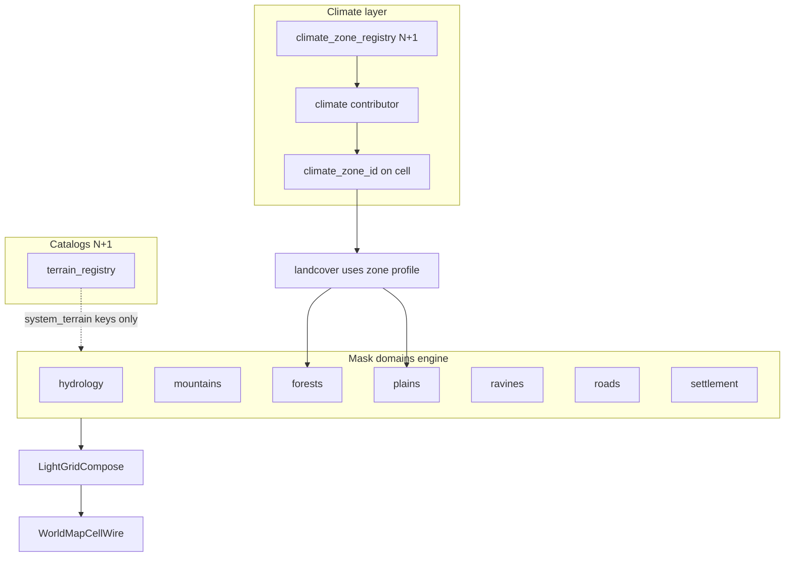
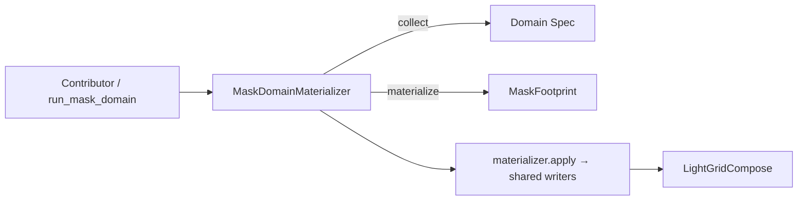
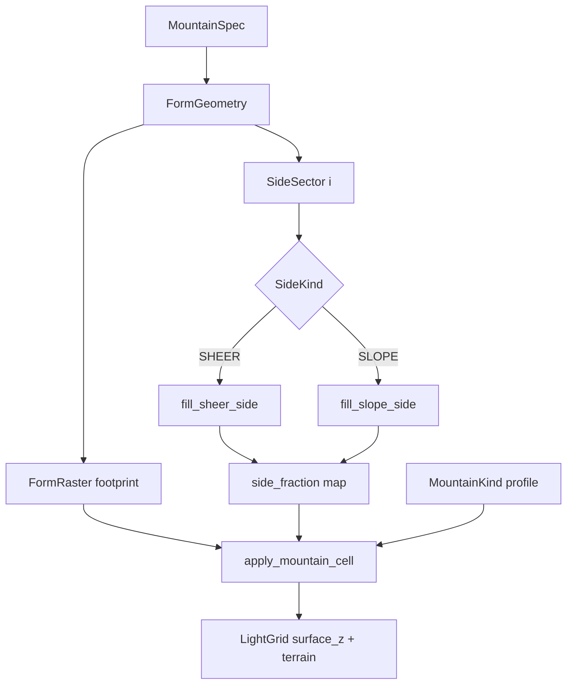
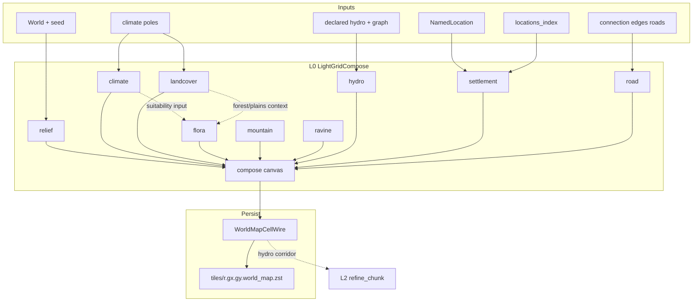

# Map Light Bake (L0 compose)

## Назначение

Зафиксировать **целевую архитектуру и контракты** materialize **light world map** (LOD L0): единый light-grid canvas, contributors по доменам, persist только через `WorldMapCellWire` → `world_map.zst`.

**Продуктовый контекст:** Идея 1 (light bake для корректной world map) и pipeline L0 — [`tz_world_pack_storage.md`](./tz_world_pack_storage.md) § LOD bake / § **Bake modes**.  
**Compose один:** `light_bake` и `full_bake` используют **тот же** L0 canvas pipeline; отличается только **набор macro-tiles** (location tiles vs весь `world_bounds`). Оба — **только L0**; `detailed_bake` / entry — вне этого ТЗ (L2). Job boundaries — [`tz_world_pack_storage.md`](./tz_world_pack_storage.md) § Bake modes.

**Outdoor grade (R36u / R36v):** L0 **не** writer SLOPE/SHEER. Height/mask paint на light — ок; grade generate — **только** detailed_bake / entry, per-chunk в `FineChunkRunner` pool ([`tz_terrain_relief.md`](./tz_terrain_relief.md)). L0 ribbon consumers (**5b** / `road_shoulder`) — **removed** (R36u-T-8), не «ещё в compose».

**Open-land hills:** L0 **не** writer холмов. Холм = L2 helper; consumers `plains` / `forest` — [`tz_world_pack_storage.md`](./tz_world_pack_storage.md) § L2 open-land hills. Не `MaskDomainId`. Landcover на light пишет только `system_terrain`.

**Не в scope этого ТЗ:**

- L2 refine / wilderness chunks / location terrain blobs / **open-land hills** ([`tz_world_pack_storage.md`](./tz_world_pack_storage.md) § Идея 2, § L2 open-land hills, WP-13; **module layout** — § «L2 refine module layout»);
- Pack completeness classifier / resume (WP-28) — pack TZ;
- Patch Store / merge priority WP-20;
- DAG wiring;
- **MountainPassBuilder / topology / карта классов** — [`tz_mountain_architecture.md`](./tz_mountain_architecture.md);
- **settlement_topology** (районы + `settlement_gate` в SQL) — после `full_bake` L0, не этот compose: [city §8](./tz_city_generation.md), [outdoor C23](./tz_settlement_outdoor.md); швы кода — [CITY-T-5](./tz_city_generation_technical_debt.md);
- план имплементации агента (`.cursor/plans/`).

**Связь с storage TZ:** wire-поля light cell, `world_map_cells_per_tile`, pins/`locations_index` уже описаны в pack storage. Этот документ закрепляет **как** наполнять L0 (compose), а не формат zstd.

---

## Внешнее предложение: производный лес и поле (НЕ ПРОВЕРЕНО)

**Источник: внешнее архитектурное обсуждение. Статус: не проверено кодом и тестами, не утверждено как контракт.** Подробности: [tz_ideas.md](./tz_ideas.md), ID-14.

Предлагается выводить лес, редколесье, луг, степь и поле из пригодности видов и фактического состояния флоры, а не использовать обязательную лесную маску как причину появления деревьев. Авторский declare задаёт начальное состояние леса, но не защищает его от гибели при симуляции. L0 остаётся сеткой хранения; природные границы могут пересекать её швы. L2 детализирует то же состояние, не сбрасывая сохранённые изменения.

**Перед изменением реализации:** проверить взаимодействие с текущим landcover paint, FL3c, LOD и patch merge. До проверки существующий compose остаётся действующим.

## Целевое состояние

### Placement priority

**Утверждено мастером 2026-10-08; целевой контракт географических регионов, реализация отдельно.** Применяется к семантическому и абсолютному размещению. Общая runtime/worldEdit политика — [tz_runtime_world_edit_policy.md](./tz_runtime_world_edit_policy.md).

**Уточнение мастера 2026-10-20:** это единый контракт **всех объектов генератора**, а не только географических регионов или landcover. Разрешение размещения выполняет **общий resolver**; доменные генераторы предоставляют свои ограничения и зависимости, но не вводят собственный порядок приоритетов или отдельный resolve. Водные объекты и coastline подчиняются этому же контракту. При переносе контракта из L0 в общий слой этот раздел остаётся ссылкой на единый SoT, а не отдельной реализацией правил.

**Размещение общего механизма (утверждено мастером 2026-10-20):** общий resolver размещения всех объектов генератора находится в `backend/app/application/worldData/placement/`; общие POJO-контракты — в `backend/app/dataModel/placement/`. Общие POJO P1 и resolver P2 реализованы; миграция adapters и подключение pipeline P3 ещё не выполнены. Доменные генераторы используют общий resolver через его контракты; отдельный resolver для гидрологии, континентов, районов или другого вида объектов не вводится. Существующий `backend/app/application/worldData/masks/regionPrecedence.py` — локальное сравнение landcover, а не общий resolver размещения.

Coastline задаёт контракт создания воды. **Если воды нет, эффективный приоритет coastline равен `0`, в том числе при явно заданном авторском `placement_specificity`; в лог выдаётся `WarningError`** (решение мастера 2026-10-20). Исходное авторское значение сохраняется в намерении; правило меняет приоритет, используемый общим resolver, а не authored-данные. Диагностика содержит UID coastline и причину понижения и выдаётся один раз на coastline за проход, не на клетку. Это правило не означает молчаливое удаление линии, отказ от создания воды или отдельный гидрологический алгоритм приоритетов. Отсутствие воды проверяется по pre-carve снимку/входным фактам в контексте coastline; её будущий fill не является опорой. Кандидат бассейна строится до общего resolve и сохраняет возможность создания воды с приоритетом 0. Общий typed-вход этого факта описывается P1; циклическая проверка результата будущего fill запрещена.

Авторское поле `placement_specificity` — целочисленный приоритет конкретности намерения разместить объект: большее значение имеет больший приоритет. Порядок для конкурирующих объектов, чьи опоры уже разрешены:

1. `placement_specificity` по убыванию.
2. Площадь исходного footprint по убыванию: при равной конкретности крупный объект имеет приоритет.
3. Стабильный `region_uid` по возрастанию в каноническом строковом представлении.

Площадь вычисляется в пространстве мира с учётом topology, до clipping, обрезки и разрешения пересечений; не по количеству L0/L2 клеток или площади bbox. После разрешения конфликта порядок не пересчитывается по изменённой форме. Wire-политика приоритета и общий typed-контракт определены ниже в § Placement P1.

Зависимости размещения имеют порядок «опора → зависимый объект»; priority не позволяет разместить ребёнка до опоры или обойти обязательные ограничения. Разрешённые отношения (покрытие, вложенность, соединение) не являются конфликтом исключительного владения пространством. Приоритет размещения не заменяет terrain merge rank и storage layer priority WP-20.

Resolver выполняет авторазрешение по указанному порядку в пределах заданных ограничений. Сдвиг абсолютного положения без явной политики запрещён. Если допустимого решения нет — runtime пишет WarningError с UID и причиной, возвращает неразрешённый результат без default-подстановок; не вводится reject всего runtime-запуска только из-за конфликта размещения.

Результат не зависит от порядка входных объектов, текущего состава bake-тайлов, порядка чанков или числа workers. Проверки контракта: равная конкретность/разные площади; разная конкретность; равенство с UID tie-break; допустимое пересечение; невозможное размещение без default; перестановка входа и full/partial bake.

#### Placement P1

**Решение мастера 2026-10-20 (уточнение B1):** один общий resolver вызывается по мере готовности опор. После base heightmap + готовых anchors, до relief Pass 1.4, выполняется совместный проход подготовленных мировых объектов (вода/горы/поселения и другие конкуренты этого snapshot). Поздние зависимые объекты (устья, hills, districts, rooms и т.д.) используют тот же resolver на явно подготовленном snapshot, с ранее принятыми решениями. Поздний вызов не пересматривает, не перемещает и не вытесняет принятые объекты. Опоры разрешаются прежде зависимых; высокий приоритет ребёнка не изменяет этот порядок. Это заменяет буквальное требование разместить все уровни мира одним вызовом до 1.4. Локальные resolver в доменах не вводятся.

**Решение мастера о specificity:** missing/null в полном intent означает auto и сохраняется как `None`; adapter обязан явно предоставить значение по утверждённому правилу. Нет правила/значения — unresolved, без подстановки 0. Явное значение — строго целое ≥0 без искусственного верхнего предела; bool, строка и дробь недопустимы. Patch missing означает «не менять», patch null — «вернуться к auto». Невалидное authored значение не скрывается auto-значением. Уже утверждённое исключение coastline без воды даёт effective 0 независимо от authored/auto значения; неизвестный факт воды не считается её отсутствием.

**Расположение и сигнатуры данных:** `backend/app/dataModel/placement/`. Это POJO P1, а не реализация алгоритма или миграция consumers P3.

- `PlacementIdentity(world_uid, source_uid, region_uid)`: `source_uid` — существующая доменная identity; `region_uid` — стабильный tie UID в каноническом строковом представлении, подготовленный adapter по профильному контракту. Resolver не генерирует UID, не использует declaration index и не проверяет REF-W заново.
- `PlacementIntent(identity, mode, shape, dependencies, permitted_overlaps, separations, placement_specificity=None, absolute_movement=forbid)`. `mode: absolute | semantic` обязателен. `shape: RegionShape | None` переиспользует существующие bbox/ellipse/polygon/anchor_radius/corridor + edge_noise. None означает отсутствие authored primitive (например, исходный graph claim), а не пустой или ошибочный footprint; его точную геометрию предоставляет adapter. Authored intent неизменяем и не переписывается при resolve.
- `PlacementDependency(target_uid, relation)` — обязательная опора; relation `resolved | supported_by | contained_by | connected_to`. UID ссылается на `region_uid` другого intent/принятого решения. `resolved` требует только готового решения, остальные также требуют соответствующего пространственного предиката. Missing/unresolved target и цикл дают unresolved зависимого объекта. Необязательная ссылка не объявляется обязательной dependency.
- `PlacementOverlap(target_uid, relation)` — явно разрешённое отношение `coverage | containment | connection | embedding | shared_boundary`. Разрешение ограничено named pair и фактическим отношением, а не любым пересечением. Оно симметрично для пары, но не транзитивно. Само наличие parent или dependency не разрешает overlap; `permitted_overlaps` не отменяет обязательные support/containment/clearance constraints.
- `PlacementSeparation(target_uid, min_xy, min_z)` — явные неотрицательные резервы в fine cells, оба обязательны. Конфликт отсутствует при достаточном горизонтальном **или** вертикальном разделении; перекрывающиеся XY и Z запрещены и при резервах 0. Мировые расстояния/соседи проверяются P2 через topology; никаких raw world offsets/евклида. Shape/clearance интерпретирует общий механизм, профильные геометрические данные готовит adapter.
- `PlacementFootprint(cells, z_min, z_max)` — непустое множество точных world fine XY клеток, не L0 samples и не packing bbox. Обе Z-границы заданы вместе или обе None (поверхностный footprint без ограниченного Z); интервалы включительные, перевёрнутые запрещены без repair. Неограниченный Z нельзя использовать для обхода volume collision. Для неоднородных по высоте объектов adapter подготавливает отдельные пространственные части с собственными стабильными identity и зависимостями. Локальные layouts переводятся в world fine frame до общего resolve; application CoordinateSpace не копируется в DM.
- `PlacementCandidate(candidate_uid, preference, footprint)`: adapter предоставляет полный конечный набор геометрически допустимых вариантов, не выбирая победителя среди объектов. preference — строго целое ≥0, меньше предпочтительнее; tie по candidate_uid. Перестановка списка вариантов не меняет выбор. Пустой список означает отсутствие кандидатов и ведёт к unresolved. `absolute_movement=forbid` допускает не более одного варианта в исходной абсолютной позиции; альтернативы абсолютного положения требуют явно заданного `explicit_candidates`. Подготовка фиксированного варианта должна сохранять authored положение, включая anchor frame; это проверяется на границе adapter/P2, не подменяется сдвигом при конфликте. Resolver не придумывает варианты/clip/clamp.
- `PreparedPlacement(intent, original_area, candidates, auto_specificity, coastline)`: площадь — обязательное положительное конечное число world fine cell², исходная до разрешения пересечений и tile clipping. Для primitive её получает adapter через topology-aware геометрию, для irregular fine-cell claim — геометрическая площадь объединения исходных unit squares (не число L0/L2 samples). Для 3D tie используется XY проекция исходного footprint, не объём. Площадь сохраняется одной для всех вариантов и не пересчитывается по оставшемуся пространству. Auto — строго целое ≥0 или None; применяется только если authored None. Вычисляемое `effective_specificity` остаётся None при неразрешённом auto/неизвестном coastline факте; это не валидное готовое размещение.
- `CoastlinePlacementFact(snapshot_uid, water_presence, reason)`: enum `present | absent | unknown`, обязательная непустая причина и identity **pre-carve** снимка. Present/absent — входной факт от HY-12, не результат будущего собственного fill. Absent понижает effective priority до 0, сохраняя кандидата и исходный intent. Unknown даёт unresolved. Границы downhill footprint, budgets и water-side готовит водный adapter по HY-12/1; P1 не задаёт неутверждённые размеры/глубины или bbox-default вместо них.
- `PlacementBatch(world_uid, snapshot_uid, phase, topology, objects, accepted)`: phase `pre_relief | dependent`, WorldTopology уже в **world fine** единицах. `pre_relief` собирает весь конкурирующий candidate universe snapshot до 1.4, без accepted от частично выбранных bake tiles. `dependent` получает готовые accepted как неизменяемые опоры/занятое пространство. World UID, snapshot identity, unique region/candidate IDs и отсутствие self refs проверяются без повторного REF-W. IDs объектов в objects и accepted не пересекаются. Accepted не re-resolve/retry по новым приоритетам. Snapshot включает всё состояние/границы, влияющее на решение; набор выдаваемых bake tiles фильтрует только materialize/output, не prepared input.
- `ResolvedPlacement(status=resolved, prepared, candidate_uid)`: хранит исходный prepared intent, ровно существующий выбранный candidate и non-null effective priority. `footprint`, `identity`, `original_area`, `effective_specificity` доступны как derived properties без дублируемых изменяемых копий. Spatial predicates ещё должен проверить resolver P2: сам constructor не доказывает отсутствие межобъектного конфликта.
- `UnresolvedPlacement(status=unresolved, prepared, diagnostics)`: обязательно хотя бы одно unresolved сообщение, нет выбранного footprint. Пустой `PlacementBatchResult.results` — валидная пустая работа, в отличие от unresolved элемента. `PlacementBatchResult(world_uid, snapshot_uid, results, diagnostics=())` допускает resolved и unresolved независимых объектов вместе; это не разрешение частичного persist bundle.
- `PlacementDiagnostic(code, region_uid, related_uids=(), path=(), detail)` — typed spatial факты без logger; codes: missing specificity, missing/failed dependency, dependency cycle, no candidates, spatial conflict, constraint violation, unknown coastline water, coastline priority lowered. Последний — диагностический факт понижения, остальные — причины unresolved. P2 дедуплицирует понижение один раз на coastline за проход с UID/причиной и передаёт факты в существующий `FieldPathError`/`ResolveReport` через `report_issues(ctx, issues)`; runtime пишет WarningError, preview получает тот же доменный результат и report без writes.
- `ResolvedWaterPlacement(placement, z_water_level, kind, liquid)`: `placement: ResolvedPlacement`, строгий int level, существующий `BasinKind` и `MaterialKey`. `source_uid` и `footprint_cells` — свойства исходного placement, не вторая identity/геометрия. Liquid и level обязательны на resolved границе, без default: их разрешает adapter по hydrology policy. Mapping record → BasinSpec и bathymetry живёт у hydrology consumer; этот POJO не содержит floor profile и не пишет z.

**Wire и локальные инварианты.** Все новые POJO frozen, extra=forbid, вложенные экземпляры повторно валидируются на входе. Обязательные поля — StrictOnWire/StrictEnumOnWire; явно описанные optional defaults применяются только при missing. Null допустим только для shape, specificity, auto_specificity, coastline и пары Z-границ, а не для mode/identity/collections/area/выбранного candidate. Поля с auto/отсутствием данных сохраняют presence через `model_fields_set`; полное разрешение выполняет существующий `resolve_result`, patch — `resolve_patch`, после merge повторная full validation. Patch не является prepared/full объектом и не выполняет spatial resolve. Null collection, malformed geometry или нарушение локального обязательного ограничения дают общий unresolved report без повторной сборки с defaults. Межобъектные missing supports, cycles, геометрические predicates и конфликты разрешает P2, не Pydantic validators, поэтому один конфликт не отклоняет весь batch runtime.

**Уточнение мастера — defaults и проверка редактора.** Nullable не означает optional: shape, dependencies/permitted_overlaps/separations, candidates/auto_specificity/coastline, z_min/z_max и objects/accepted обязательны на полной границе. Adapter явно передаёт None или пустую коллекцию, когда это корректно; отсутствие подготовленных обязательных ограничений не маскируется default=(). Объявлены defaults только для specificity=None (auto), absolute_movement=forbid (действующий запрет неявного сдвига) и служебных полей результата/диагностики (status-дискриминатор, пустые related_uids/path/diagnostics). Liquid/level и геометрические размеры берутся из профильных POJO/политик на adapter границе, не копируются новым числовым default.

Нормализация использует существующий `resolve_model`/`resolve_result`: Pydantic применяет объявленные defaults при missing и проверяет supplied значения, включая null, по типу. Существующий `_log_resolve_transform` пишет INFO с wire/resolved, когда представления различаются; отдельного обхода default-полей, opt-in-флага и дополнительного default-report нет. `ResolveContext.for_import(validate_only=True)` и общий report сохраняют прежнюю обработку ошибок для мастера без writes; domain diagnostics передаются существующим `report_issues`. Patch missing сохраняет прежнее значение и не заполняется defaults, full validation выполняется после merge. Общий JSON resolver этим срезом не меняется.

**Строковые исключения contract-creation:** world_uid/source_uid/region_uid/target_uid/snapshot_uid/candidate_uid и related_uids — opaque entity/snapshot/candidate identities, не registry keys или закрытые kinds. Непустые строгие строки без surrounding whitespace, без UUID-coerce/новой нормализации; стабильное каноническое представление готовит владелец identity. `reason` и diagnostic `detail` — непустой human-readable текст причины; path — существующий формат tuple[str | int, ...]. Enum значения принимают только строковые wire values своего StrEnum. Liquid сохраняет `MaterialKey`, не голую строку; проверка membership остаётся существующему REF-W boundary.

**Контракт вызова P2 (реализован):** `resolve_placements(batch: PlacementBatch, *, ctx: ResolveContext) -> PlacementBatchResult` в `application/worldData/placement/`. Подготовка → один детерминированный общий resolve → typed result/report. Context отдельно от topology/geometry/registries; без carve/fill/persist/lifecycle, другого wire resolver или исправления authored intent. P1 не подключает этот вызов к pipeline; adapters мигрируются срезами P3 по инвентарю.

#### Placement P2

Конкретизация алгоритма над POJO P1; новые authored knobs/defaults не вводятся.

- **Граница входа:** существующий `resolve_model(PlacementBatch, ..., ctx)` проверяет полный snapshot, включая вложенные copied/constructed модели; partial wire context остаётся patch и не запускает spatial pass. Сохраняются missing/explicit-null и исходные authored поля. Повторный REF-W, доменные specs и persist отсутствуют.
- **Подготовленная геометрия:** сравнение canonical fine cells через `WorldTopology.canonicalize`, без изменения сохранённых кандидатов. В planar выход хотя бы одной клетки за world bounds делает весь вариант недопустимым; clipping нет. Wrapped/sphere aliases сравниваются как одна физическая клетка. Original area остаётся supplied исходной площадью и не выводится из canonical/raster cells. Невалидная геометрия уже принятого решения — повреждённый snapshot/input, не повод забыть препятствие: общий validation error по accepted path. На активном candidate это локальная причина недопустимости варианта.
- **Ready queue:** обязательные dependencies должны разрешиться до объекта. Среди готовых объектов каждый раз выбирается максимум effective specificity, затем максимум original_area, затем минимальный region_uid. После каждой принятой опоры очередь обновляется; обработка всех roots одним отдельным уровнем до детей запрещена. Варианты объекта пробуются по `(preference, candidate_uid)`, исходный порядок списков не влияет. Пересчёта площади, сдвига, clipping и backtracking по принятым решениям нет. Пустые candidates/неразрешённый auto/unknown water дают typed unresolved. Опоры отсутствуют → missing dependency; опора failed → failed dependency; циклические компоненты → dependency cycle, зависимые от них → failed dependency. Обход графа итеративный, без ограничения глубиной Python recursion.
- **XY/Z collision:** canonical XY множества пересекаются, а включительные Z-интервалы пересекаются. None/None означает неограниченную Z-проекцию: ею нельзя доказать вертикальное разделение. Достаточное XY или Z разделение снимает collision. `min_z` — число пустых целых уровней между интервалами. Для disjoint XY `min_xy` проверяется минимальной topology distance² между центрами fine cells: расстояние должно быть ≥ `min_xy + 1`; при min_xy=0 достаточно отсутствия общей клетки. Расстояние считает `topologyGeometry.dist2`, не локальная формула. Пересекающиеся клетки не считаются разделёнными при нулевом резерве.
- **Пространственные dependencies:** `resolved` проверяет только готовность; `contained_by` требует XY subset и включения Z-интервала (bounded container не доказывает включение unbounded child); `supported_by` требует полного XY subset и явных bounded Z у обоих, нижний уровень ребёнка = верхний уровень опоры +1; `connected_to` требует общей XY клетки или cardinal-соседства через `topology.neighbor`, а по Z — пересечения или соприкосновения соседних целых уровней. Неограниченный Z допускает только проекционную связь, но не доказывает физическую поддержку.
- **Permitted overlap:** запись любой стороны действует только для именованной пары. `coverage` явно разрешает наложение покрытий этой пары; `containment`/`embedding` требуют включения одного footprint в другой по XY/Z. `shared_boundary` и пересекающийся `connection` допускают только общие XY клетки, принадлежащие границам обоих footprint; клетка boundary имеет cardinal-соседа вне своего множества (в planar world edge также boundary). Проверка boundary использует topology, включая швы/полюса. Для непересекающихся connection достаточно геометрической связи из предыдущего пункта. Разрешение overlap не отменяет обязательный dependency predicate или reserve.
- **Парные ограничения симметричны:** separation проверяется из intent обеих сторон, в том числе из accepted/high-priority объекта при размещении позднего target. Каждая reserve-запись проверяется отдельно; смешивать разные XY/Z альтернативы одной парой максимальных резервов нельзя. Separation/overlap сами по себе не объявляют существование опоры: они применяются к реально размещаемым парам; если target обязателен, он указывается также как dependency. Родительский UID сам по себе не разрешает пересечения. Missing required dependency не заменяется default.
- **Absolute:** forbidden movement даёт единственный подготовленный вариант, конфликт → unresolved без генерации нового положения. Проверка соответствия единственного candidate authored primitive/anchor/noise/claim — обязанность adapter до prepared boundary; P2 получает точные prepared клетки и не строит вторую геометрию из authored shape. Допустимость topology/constraints этого варианта проверяется в общем pass. Альтернативы пробуются только при явно заданном explicit_candidates или semantic mode.
- **Результат и диагностика:** results упорядочены по region_uid, accepted не входят в новые results и не меняются. Неудачные попытки вариантов не логируются, если найден допустимый; при отсутствии решения возвращаются стабильные причины с candidate/dependency/rival UID. Batch diagnostics содержат факты неразрешённых объектов и отдельное понижение coastline (один факт на UID за проход, даже при многих cells/variants). Missing water и unknown water различаются; absent принудительно даёт effective 0 и сохраняет authored priority/кандидат.
- **Runtime/preview:** сам pass не читает policy и даёт одинаковые results/diagnostics. Facade передаёт FieldPathError с code/path/world UID/object UID/reason и related UIDs в существующие `log_issues` (runtime WarningError) либо `report_issues` (validate_only). Это тот же образец, что `masks/regionIdentity.py`; runtime spatial conflict не попадает в блокирующий import error collector и не отклоняет независимые объекты. Preview ничего не пишет. Ошибки wire/повреждённого input snapshot не маскируются как успешный spatial result.
- **Bake scope:** pass принимает полный candidate universe snapshot, без tiles/chunks/worker count. Full и partial materialize получают один результат, затем выбирают нужные клетки/объекты; partial не означает `ctx.partial` и не исключает конкурента, находящегося вне выводимого tile. Подготовку полного universe обеспечивает caller/P3; resolver не делает скрытое чтение мира, чтобы восстановить отсутствующие inputs.

### Инвариант

На время light bake существует **один** in-memory canvas light cells. Все объекты world map (рельеф, леса/биом, гидро, поселения, climate tint) **укладываются на этот canvas**.  
`WorldMapBakeOrchestrator` **не** семплит hydro / z / pins в обход compose.

### Что не является write-path маски L0

| Слой | Роль |
|---|---|
| `SurfaceTerrainContext.coarse_hydro` | planning / L2; **не** SoT L0 mask |
| `sparse_fine_hydro` / fine carve | fine / L2; **не** write-path L0 |
| Один sample на macro `(gx, gy)` на весь tile | **запрещённый** антипаттерн |

### Extensibility

«Маска» = **общая light-grid raster**, не только гидрология. Новые объекты карты (горы, леса, города/footprints, дороги later) = новый **contributor** в тот же compose, без нового blob-формата и без второго bake pipeline.

---

## Слои и модули (код)

Целевой layout (имена — контракт ответственности):

```text
application/worldData/pack/bake/lightGrid/
  coords.py
  cell.py
  compose.py
  bakeContext.py
  contributor.py
  bake.py
  contributors/
    relief.py
    climate.py
    landcover.py
    ravine.py
    hydro.py
    settlement.py
    road.py

pack/bake/worldMapBakeOrchestrator.py   # thin: compose → writer
```

| Модуль | Делает | Не делает |
|---|---|---|
| `lightGrid/` contributors | наполняют compose | HTTP, SQLite, LLM, L2 carve |
| `landcover` | biome / mountain из climate+relief | z-band stub |
| `ravine` / `road` | овраг / дорога на `system_terrain` | L2 carve / city streets |
| `hydro` contributor | light-rasterize hydro mask | fine bed / column fill |
| `settlement` contributor | pin (+ footprint later) на light cells | `SettlementLayout` / packing / **C23 topology** (районы, gates) |
| `WorldMapBakeOrchestrator` | `to_wire` + `write_world_map_tile` | собственный семпл hydro/z |
| `SurfaceTerrainContext` | L2 / fine planning, climate helpers | SoT записи L0 wire |

Каталог: **`pack/bake/lightGrid/`** (утверждено).

---

## Координаты (контракт)

```text
tile_macro = fine_cells_per_map_cell
side       = 32                          # WP-10 v2: константа маски (POJO)
light_span = tile_macro // side          # масштаб light-cell; плывёт с tile мира

# Абсолютный light index:
lx = floor(x_fine / light_span)
ly = floor(y_fine / light_span)

# Macro-tile + local:
gx = lx // side,  gy = ly // side
tx = lx %  side,  ty = ly %  side
```

| Ключ | Назначение |
|---|---|
| Canvas key | `(gx, gy, tx, ty)` (или absolute `(lx, ly)` + view по tile — эквивалент) |
| Bresenham / rasterize hydro | **light indices**, не fine cells и не macro `(gx, gy)` |
| Центр light cell (climate sample) | `(x_fine + light_span/2, y_fine + light_span/2)` |

Cross-ref: [`tz_world_pack_storage.md`](./tz_world_pack_storage.md) § WP-10 v2. `side` — только через POJO [`WorldMapCellsPerTilePolicy`](../backend/app/dataModel/worldPack/worldMapCellsPerTile.py) (default **32**); **не** литерал в bake и **не** ∝-формула от `fine_cells_per_map_cell`.

### World mosaic / ASCII frame (утверждено 2026-07-19)

**Форма мира** = `world_bounds` (AABB квадрат/прямоугольник) — [`tz_terrain_generation.md`](./tz_terrain_generation.md) § Охват мира.

| Правило | Норматив |
|---|---|
| Frame SoT | Когда `world_bounds` declared (или resolved v1 AABB) — mosaic/ASCII **предпочтительно** рисует **весь** этот прямоугольник |
| Пустые клетки | ещё не baked (`unmapped` / space) — **не** «обрезка» и не другая форма мира |
| Запрещено (семантика) | считать AABB только запечённых macro-tiles формой мира (smoke `max_tiles` / sparse light) |
| Fill | `light_bake` (location tiles) → `full_bake` (весь `world_bounds`) — [`tz_world_pack_storage.md`](./tz_world_pack_storage.md) § Bake modes |


Impl note: pack ASCII default = **light-mask mosaic** (WP-10); frame от `world_bounds` / pin AABB+padding (MLB-12 ✅). `render_macro` — debug-only, не default `world-map.txt`.

---

## Связь с dataModel (SoT) — утверждено

Правило проекта [`dataModel-no-hardcode`](../.cursor/rules/dataModel-no-hardcode.mdc): **Pydantic в `dataModel/` — единственный контракт** полей, defaults, wire-ключей и enum. Compose/application — тонкий staging и алгоритмы.

### Таблица SoT ↔ bake

| Контракт bake | dataModel SoT | Правило |
|---|---|---|
| Persist light cell / `to_wire_tile` | [`WorldMapCellWire`](../backend/app/dataModel/worldPack/worldMapCellWire.py) | Имена полей, defaults, validators — только отсюда |
| `hydrology_role` / `hydrology_width` | [`WorldMapHydrologyRole`](../backend/app/dataModel/worldPack/hydrologyMaskWire.py), [`HydrologyMaskWire`](../backend/app/dataModel/worldPack/hydrologyMaskWire.py) | Width clamp / `from_wire` — в POJO; merge priority ролей — **метод/helper на enum или POJO**, не `_PRIORITY = {…}` в contributor |
| Pin index / index file | [`LocationsIndexWire`](../backend/app/dataModel/worldPack/locationsIndexWire.py), [`LocationsIndexPin`](../backend/app/dataModel/worldPack/locationsIndexWire.py) | `location_pin` = index в `locations_index.locations[]` |
| `side` / WP-10 v2 | [`WorldMapCellsPerTilePolicy`](../backend/app/dataModel/worldPack/worldMapCellsPerTile.py) | default **32**; optional master override; `light_span = tile_macro // side` |
| Bake caps (max tiles, …) | [`PackBakeDefaults`](../backend/app/dataModel/worldPack/packBakeDefaults.py) | Не дублировать в orchestrator |
| Terrain mask domains (enabled / declare / autoresolve) | target `WorldTerrainMasks` (+ existing [`WorldHydrology`](../backend/app/dataModel/hydrology/worldHydrology.py)) | § **Surface mask domains**; `DefaultOnWire`→DB; `IgnoreOnWire` overrides |
| Bake knobs (interim) | [`LightLandcoverPolicy`](../backend/app/dataModel/worldPack/lightLandcoverPolicy.py), [`LightRavinePolicy`](../backend/app/dataModel/worldPack/lightRavinePolicy.py), [`LightRoadPaintPolicy`](../backend/app/dataModel/worldPack/lightRoadPaintPolicy.py) | tech debt → fold under `terrain_masks`; гора не из z-band |
| Declared river/coast path | `dataModel.hydrology` (`DeclaredRiver`, `DeclaredCoastline`, …) | Load через существующие POJO → light rasterize |
| Fine role mapping (L2 constraint) | `WorldMapHydrologyRole.to_fine_role` → [`HydrologyCellRole`](../backend/app/dataModel/hydrology/enums/hydrologyCellRole.py) | Не параллельная таблица в pack/bake |

### Staging vs POJO

| Тип | Слой | Может ли быть SoT? |
|---|---|---|
| `WorldMapCellWire` | `dataModel` | **да** — persist/wire |
| `LightGridCell` | `application/.../bake/light` | **нет** — mutable mirror полей wire на время bake |
| `LightGridCompose` / contributors | application | **нет** — оркестрация; читают typed API POJO |

**Запрещено:**

- параллельный dict defaults в contributor (`"plains"`, `role=2`, `width=15`) если то же на Field/validator POJO;
- новое поле на light cell **сначала** в compose, **потом** в wire — только наоборот: расширить `WorldMapCellWire` (+ `HydrologyMaskWire` при hydro), затем staging;
- второй wire-схемы «LightMaskWire» рядом с `WorldMapCellWire`.

**Обязательно при изменении контракта light cell:** PR трогает `dataModel/worldPack/*` **в том же изменении**, что и compose/orchestrator.

---

## Surface mask domains — единая политика (утверждено 2026-07-16)

Одна логика для **всех** доменов маски L0 (гидрология + terrain-типы + дороги). Паттерн как у hydrology U8/U10; wire policy — [`tz_json_validation.md`](./tz_json_validation.md) § Field policy / `annotationPolicy`.

### Mask domain vs climate / biome vs terrain_registry (утверждено 2026-07-17)

Три разных слоя — **не** смешивать при росте карты:

| Слой | Примеры | SoT | Как растёт |
|---|---|---|---|
| **Climate / biome** | `tundra`, `volcanic`, `temperate`, `arid`… | `ClimateZone` builtins + N+1 `climate_zone_registry` | мастер: новая zone + defaults |
| **Terrain catalog** | `plains`, `forest`, `mountain`, `liquid_body`, optional `swamp`… | N+1 `terrain_registry` | ключ в каталоге **≠** включённая маска |
| **Mask domain** | hydrology, mountains, forests, plains, ravines, roads, settlement | engine: `MaskDomainId` + policy + declare Spec | **только PR движка** |

**Инвариант:** `terrain_registry` / `climate_zone_registry` растут N+1; **домен маски** — как `FloraKind` / `MountainKind`: новый id = PR dataModel + contributor, не JSON мастера.

**Не** mask domain: добавление `swamp` / `volcanic` в registry; новые climate zones; flora type refs ([`tz_flora.md`](./tz_flora.md)); L2 city layout и C23 topology (на L0 settlement = pin/footprint).

Mapping biome → preferred landcover terrain — **policy / climate profile**, не новый `MaskDomainId`.



**Fixed (2026-07-17):** landcover больше не пишет `tundra` как `system_terrain`. Cold zone → `climate_zone_id`; landcover = forest|plains по rainfall.

### Инварианты (все домены)

| # | Правило |
|---|---|
| 1 | **`enabled` default = true** — домен работает, пока мастер явно не поставил `enabled: false` |
| 2 | Пустой declare / нет NamedLocation **≠** выключено; autoresolve всё равно materialize |
| 3 | **`DefaultOnWire` + `Field(default)`** на мировых knobs → **normalize пишет в БД**; generate **только читает** строку мира |
| 4 | Опциональные override / «ignore»-куски — **`IgnoreOnWire`**: ключа нет → не автозаполняем; runtime → default из БД |
| 5 | **Declare** (optional) + **autoresolve** (default) + **opt-out** (`enabled: false`) — три режима на каждый домен |
| 6 | Declare **не перезаписывается** global autoresolve (как реки U27) |
| 7 | `terrain_registry` = каталог ключей (`mountain`, `forest`…); **включение маски** = policy `enabled`, не «ключ есть в registry» |
| 8 | Новый mask domain = PR: `MaskDomainId` + merge/phase slot + policy/declare POJO + contributor — **не** свободный plugin из world JSON. **Холмы ≠ mask domain** (L2 helper, § pack storage) |

### Корни JSON (не один mega-blob)

| Корень | Домены | Статус |
|---|---|---|
| `world.hydrology` | реки / озёра / моря / shore / landforms hydro | уже есть (`WorldHydrology`) |
| `world.terrain_masks` | mountains / landcover (`declared_regions[]`: forest / plains / farmland) / ravines / roads | **норматив этого §** |
| structure graph (`connection_*`) + policy enable | road | enable в `terrain_masks.default_roads`; geometry — edges |
| settlement pins / footprint | `MaskDomainId.SETTLEMENT` | L0 Spec→pin/footprint; L2 layout — не mask domain |
| farmland | `FarmlandSpec` внутри `MaskDomainId.LANDCOVER` (отдельного `FARMLAND` нет — 2026-10-17) | тот же materialize; crops — flora, не маска |

Не дублировать hydro-флаги вторым деревом: light bake **читает** `world.hydrology.*`. Terrain-типы — отдельный корень с **той же формой category policy**. Не mega-dict доменов: typed fields `default_*` / `declared_*`.

### Landcover cutover 10b (2026-10-18)

**Уточнение по замечанию мастера:** application shim не создаёт собственных
eligibility rules и не обновляет поля POJO через строковый changes-dict.
LandcoverTerrainPolicy применяет overrides через typed TerrainRegistryEntry
API. Legacy rainfall threshold параметризует canonical forest rule реестра,
сохраняя его fact/op/weight/required. Чтение authored hills presence и wire
проекция принадлежат dataModel, включая различие omit/null.

TerrainRegistryEntry.fill_roles: tuple[TerrainFillRole, ...] (default пусто)
и fill_priority: int = 0 задают использование terrain в колонках.
TerrainFillRole = subsurface | magma; canonical plains имеет subsurface.
Среди доступных ключей выбирается роль с большим priority, затем ключ по
возрастанию. Если magma не задана, используется subsurface; если нет ни
одного доступного subsurface terrain, результат неразрешён, WarningError
без выбора первого ключа. Terrain names не участвуют в выборе роли.
Роли принадлежат terrain registry, не terrain_masks; SQL не расширяется.

Единственный домен покрытия — `MaskDomainId.LANDCOVER`; его policy —
`WorldTerrainMasks.default_landcover: LandcoverRegionsCategoryPolicy`.
`enabled` выключает и регионы, и фоновый paint; `autoresolve` выключает
автоматические регионы, оставляя declared и фон. Новая policy содержит
`fallback_terrain: TerrainKey` (canonical plains), `transition_threshold`
и параметры генерации. Выбор покрытия использует общий `CoverageResolver`
с typed climate facts и eligibility реестра; ключи без eligibility не
становятся автоматическими кандидатами с нулевым score. При отсутствии
климатического контекста фон берётся из policy, без выбора первого ключа.

Canonical root factory задаёт seed_spacing=1000, max_radius=2250,
claim_noise={amplitude:125, scale:250}; transition_threshold=1.0.
Контракт самого `seed_spacing` не изменён: обязательный `int > 0` в явно
заданной policy; это не fine_cells_per_map_cell (последний >=1000 и кратен
1000). При отсутствии всего default_landcover применяется canonical root
factory. При явной policy seed_spacing обязателен, остальные knobs могут
наследоваться. Частичный claim_noise заполняет только отсутствующие поля.
Все размеры — fine-клетки, без зависимости от разбиения bake на тайлы.
Обоснование: шаг 1000 соответствует стандартной стороне макро-тайла;
cap 2250 покрывает собственный seed-участок при jitter и оставляет запас
для шума; амплитуда 125 и scale 250 равны 1/8 и 1/4 шага. Cap ограничивает
распространение seed, но не размер региона после слияния.

Legacy JSON `default_forests`/`default_plains` принимаются только на чтение
и преобразуются в `default_landcover.terrain_policies` — typed overrides
по исходному terrain-ключу. У generic LandcoverTerrainPolicy есть
system_terrain: TerrainKey, enabled/autoresolve, optional min_rainfall и
hills. `forest_min_rainfall` читается как alias min_rainfall; null legacy
threshold отклоняется. system_terrain старого default_plains также задаёт
fallback_terrain. Явные новые поля имеют приоритет над совпавшими alias.
Сериализация выдаёт только новый корень; второго runtime policy-объекта нет.
Патчи alias нормализуются до merge, отсутствующие значения сохраняются.

Hills/eligibility разрешаются на world boundary в TerrainRegistryEntry,
после чего потребители читают реестр. Явные registry hills, включая null,
приоритетнее alias hills; authored presence учитывается до materialization
canonical registry rows при импорте. Отсутствие override и явный null
сохраняют разный смысл после round-trip. Fallback и target keys проходят REF-W.

Три fixtures для проверки этого контракта: world_landcover_default.json
(минимальный мир), world_landcover_custom.json (все поля terrain_masks,
landcover policy, вложенных overrides/noise/hills и custom terrain entry
заданы явно), world_landcover_mixed.json (явные и наследуемые поля, в том
числе внутри claim_noise). Custom assertions не выводятся из canonical
defaults; completeness проверяется по schema, а независимость — через
валидацию с изменёнными defaults. По указанию мастера существующая БД пуста,
миры генерируются заново: тождество legacy bake-карты не требуется;
совместимость чтения исходных JSON остаётся обязательной.

### Шаблон MaskDomain (единственный способ роста)

```text
MaskDomain (engine):
  id: MaskDomainId              # StrEnum — dataModel/masks/enums/maskDomainId.py
  writes: WireFieldSet          # system_terrain | hydrology_* | location_pin | surface_z delta…
  policy: CategoryPolicy        # enabled + autoresolve + knobs (DefaultOnWire)
  declared: list[DomainSpec]    # подход A; typed per domain
  merge: MergeRule              # system_terrain → rank; hydro → role priority; settlement → pin
  materialize: declare ∪ autoresolve → Spec(s) → MaskFootprint → apply
  # детали контракта / anti-smell: § MaskDomain materialize (2026-07-24)
```

```text
CategoryPolicy:
  enabled: DefaultOnWire[bool] = True
  # knobs — DefaultOnWire → DB
  # optional IgnoreOnWire overlays

# на корне (подход A — как hydrology.declared_*):
declared_*[]    # полные typed Spec
default_<name>  # CategoryPolicy + autoresolve knobs
```

Цепочка resolve:

```text
IgnoreOnWire override (если ключ был в JSON)
  → иначе default-поле мира (материализовано в БД)
    → Field(default) POJO только на normalize-on-import
```

**Запрещено:** generator подставляет `enabled=True` / knobs мимо строки мира после import.  
**Запрещено:** score→paint в contributor в обход Spec (горы — stub до engine).

#### Checklist: новый mask domain (PR)

1. `MaskDomainId` member + slot в `TERRAIN_MERGE_RANK_HIGH_TO_LOW` / `COMPOSE_CONTRIBUTOR_ORDER` (+ `LightContributorId` + factory)
2. Typed `*CategoryPolicy` + `declared_*[]` / Spec POJO на корне (`terrain_masks` или `hydrology`)
3. `MaskDomainMaterializer[SpecT]` (collect helpers + `materialize` + `apply`) — **не** логика в contributor
4. Contributor: только `run_mask_domain(compose, ctx, materializer, masks)` (или эквивалент)
5. Shared writers only: `may_paint_terrain` / `paint_system_terrain(_cell)` / pin helpers; hydro — свой role merge
6. Unit: enabled gate + merge rank vs соседний домен; light/full = один pipeline (`ctx.tiles` only); **нет Spec → нет paint**

`light_bake` / `full_bake` — **один** compose; отличается только набор macro-tiles (location tiles vs весь `world_bounds`).

### MaskDomain materialize — общая абстракция (утверждено 2026-07-24)

**Смысл имплементации:** закрыть дыру между `WorldTerrainMasks` / category policy и shared paint.  
Не общий blob Spec и не god-orchestrator всех доменов — **один жизненный цикл** (`collect → materialize → apply`), **N доменных engine**. Compose по-прежнему вызывает contributors; contributor — тонкий runner, не место geometry/score→paint.

Эталон формы уже у hydrology (`declared_*` → Spec → raster → write). Terrain / settlement / later farmland копируют **паттерн**, не типы.

#### Фазы (обязательный контракт)

```text
category_enabled(policy)?
  → load_declared(ctx) ∪ autoresolve_specs(ctx, policy)   # merge: declare побеждает
  → per Spec: materialize(spec) → MaskFootprint             # domain engine, без paint
  → engine.apply(compose, footprint, spec, masks)           # writers only
```

| Фаза | Ответственность | Не делает |
|---|---|---|
| **load_declared** | Specs из `declared_*[]` | placement, paint |
| **autoresolve_specs** | placement / detect → **Spec[]** (не cells) | paint, merge rank |
| **merge_declare_over_auto** | shared helper; declare не затирается | domain geometry |
| **materialize** | Spec → `MaskFootprint` (facade; внутри — шаги engine) | `may_paint` / compose writes |
| **apply** | footprint → shared writers (+ domain z/pins) | construct form, score |
| **Contributor** | `run_mask_domain(...)` | polygon math, score→paint, disk-from-location |

**Запрещено:** score / detect / location-disk → paint в contributor в обход Spec.  
**Запрещено:** общий `BaseSpec` с полями всех доменов; общий `raster()` с `if domain == …`.  
**Запрещено:** bake-only поля (`pin_index`, tile keys) на wire Spec — резолв в apply/ctx.

#### Shared runtime types

```text
LightCellRef
  gx, gy, tx, ty: int

MaskFootprint
  cells: frozenset[LightCellRef]
  # typed optional payloads — НЕ Mapping[str, object] bag
  elevation_fraction: Mapping[LightCellRef, float] | None = None
  # новые attrs = новое optional поле или domain Result ≅ Footprint+payload;
  # не свободный dict
```

Shared helpers (application, один раз):

```text
merge_declare_over_auto(declared, auto, *, key) → list[Spec]
run_mask_domain(compose, ctx, engine, masks) → None
  # gate category_enabled → collect → materialize → apply

apply_terrain_footprint(compose, footprint, *, system_terrain, masks, preserve_hydro)
apply_location_pins(compose, footprint, *, pin_index)   # pin_index из ctx, не из wire Spec
```

Geom utilities (shared, без доменной семантики): `raster_disk`, polygon fill — переиспользуют settlement / simple specs; **не** дублировать disk в каждом contributor.

#### Protocol materializer (per domain)

```text
MaskDomainMaterializer[SpecT]:
  domain: MaskDomainId
  begin_pass() → None                   # required; no-op if no pass-state

  load_declared(ctx) → list[SpecT]      # wire declared_*[] only
  load_anchor_specs(ctx) → list[SpecT]  # optional geo/named → Spec; not declare
  autoresolve_specs(ctx, policy) → list[SpecT]
  collect(ctx, policy) → list[SpecT]
    # default_collect: merge declared > anchors > autoresolve

  materialize(spec, scale) → MaskFootprint
  apply(compose, footprint, spec, masks, *, tile_set, ctx) → None
  category_policy(masks) → CategoryPolicy
```

Имя **Materializer** (не Engine): `application/engine` — DAG runtime; mask materializer — L0 Spec→footprint→paint.

**Merge order Spec sources:** `declared_*` > anchor Specs > autoresolve.  
Geographic / named → Spec = **anchor** (не declare-path, не внутри `load_declared`).

Модули (target):

| Артефакт | Слой |
|---|---|
| Spec / Form / Kind POJO, `declared_*` на корне | `dataModel/` (`terrainMasks/…`, later farmland) |
| `MaskFootprint`, `run_mask_domain`, `apply_*`, merge helper | `application/worldData/masks/` (или `pack/bake/lightGrid/materialize/`) |
| Domain materializer + geometry steps | `application/worldData/generators/…` (pure) или masks subdomain |
| `*Contributor` | `lightGrid/contributors/` — runner only |


#### Plugin map (тот же контракт)

| Domain | SpecT (wire) | materialize | apply writes | Scope сейчас |
|---|---|---|---|---|
| **mountains** | `MountainSpec` \| `MountainRangeSpec` | FormGeometry→FormRaster→SideFill → footprint (+ fractions) | terrain + KindElevation z | **первый полный plugin**; stub disk/score→paint **удалить** |
| **ravines** | `RavineSpec` | depression/path → footprint | terrain + drop z | тем же каркасом после гор |
| **settlement** | `SettlementSpec` (origin, radius_m / size, `location_uid`) | disk / later outline | `location_pin` (index из `locations_index`) | pin→Spec; **не** SQL районов / gates (C23) |
| **landcover** (forests / plains / farmland) | `LandcoverDeclareEntry` (`declared_regions[]`) | `RegionShape` → `RegionRasterizer`; autoresolve seed/claim | terrain (`paint_key`) + `region_uid` | **один** `MaskDomainId.LANDCOVER` (2026-10-17; отдельного `FARMLAND` нет); контракт — § Регионы покрытия; per-cell climate paint — только fallback вне регионов. flora/crops — отдельно ([`tz_flora`](./tz_flora.md)) |
| **roads** | geometry = structure edges | polyline (+ dilate) | terrain | edges SoT; enable в policy; тот же apply_terrain |
| **hydrology** | already declared Specs | raster roles | `hydrology_*` (+ bathymetry) | эталон; не переписывать под terrain types |

**Settlement / farmland** — culture/land-use plugins той же абстракции, не отдельные bake pipeline.  
L2 `SettlementAssembler` ≠ L0 mask domain (на L0 только Spec→footprint/pin).  
Farmland mask ≠ `crops_registry`: маска = «здесь пашня»; flora = какие crops на клетке (later).

#### MountainsCategoryPolicy (target knobs; stub fields убрать)

```text
MountainsCategoryPolicy ⊂ MaskCategoryPolicy
  system_terrain
  enabled / autoresolve
  default_kind / default_form / default_radius_m
  sides: list[MountainSideSpec]   # один SoT; empty → N× MountainSideSpec() (kind=SLOPE на поле)
  # НЕ default_side_kind / НЕ default_sides — дубль убран
  placement: threshold, elevation_bias_weight, relief_weight, ridge_cell_m
  # УДАЛИТЬ при имплементации engine: declare_radius_light (location disk)
```

`WorldTerrainMasks.declared_mountains[]` — полные `MountainSpec | MountainRangeSpec` (подход A).

#### Порядок имплементации (слои, не slice «только paint»)

1. Shared: `MaskFootprint`, `merge_declare_over_auto`, `run_mask_domain`, `apply_terrain_footprint` / pins  
2. dataModel: mountain Spec/Form/Kind/Side + `declared_mountains` на `WorldTerrainMasks`; policy без `declare_radius_light`  
3. `MountainMaskMaterializer`: collect helpers + `materialize` facade (FG→FR→SF) + `apply` (terrain+z)  
4. Thin `MountainContributor`; удалить stub disk + score→paint  
5. Later: ravine/settlement на том же каркасе; farmland = новый MaskDomainId; forest Spec — отдельно  

Anti-smell (обязательно при ревью PR):

| # | Правило |
|---|---|
| S1 | Нет god-`raster()`: шаги гор — отдельные модули; `materialize` = facade |
| S2 | `collect` не inline’ит placement+declare — только merge двух helpers |
| S3 | Нет копипасты loop в contributors — `run_mask_domain` |
| S4 | Wire Spec без bake indices (`pin_index` и т.п.) |
| S5 | Typed footprint payloads, не `dict[str, object]` |

#### Открытые вопросы (post MLB-13 review + post-P0 re-review, 2026-07-24)

Приоритет: **P0 (закрыт) → P1 → P2 → P3**. Forest / farmland **не** начинать, пока P1 не закрыт.

**P0 — контракты** ✅

| # | Статус | Вопрос / фикс |
|---|---|---|
| Q1 | ✅ | `begin_pass()` в Protocol; `run_mask_domain` зовёт напрямую (не `getattr`) |
| Q2 | ✅ | `load_declared` = wire only; `load_anchor_specs` = geo→Spec; merge в `default_collect` (declare > anchors > auto) |
| Q3 | ✅ | Coarse Pass 1.4 = FormRaster+SideFill на macro (Q3-A); light = тот же SoT на light grid |

---

**Остаток после P0** (ревью: неявные контракты / god-object / SRP / дубли)

##### Неявные контракты

| # | Статус | Вопрос / фикс |
|---|---|---|
| Q9 | ✅ | Typed `sample.typical_elevation_z` в collect/ridge; `0` только если `pole_field is None` |
| Q13 | ✅ | `MountainsCategoryPolicy` isinstance в materializer; `policy.autoresolve` typed на `MaskCategoryPolicy` / `default_collect` |
| Q14 | ✅ | Collect merge as-is; Range materialize на coarse через Form path (expand-disk удалён) |
| Q15 | ✅ | Merge SoT: `identity_key()` + `merge_mountain_spec_sources` / `default_collect` |
| Q3-A | ✅ | Coarse footprint = Spec→FormGeometry→FormRaster→SideFill (`coarse_footprint_for_entry`); disk SoT удалён |

##### God-object

| # | Статус | Вопрос / фикс |
|---|---|---|
| Q4 | ✅ | Ridge core: `ridgePlacement.place_ridge_candidates`; light/coarse — adapters поверх; Range expand — отдельный helper |
| — | ок | `MountainMaskMaterializer` / `run_mask_domain` — **не** god; не раздувать |

##### Смешение ответственности

| # | Статус | Вопрос / фикс |
|---|---|---|
| Q11 | ✅ | `MountainMaskMaterializer._apply_elevation` — terrain paint vs z |
| Q14 | ✅ | см. выше — Range на coarse через тот же materialize path |
| Q10 | ✅ | `formPipeline.py` (Form→Raster→SideFill + `coarse_footprint_for_entry`) |
| Q16 | ✅ | `geoAnchors.anchor_mountain_locations` (+ alias `declare_mountain_locations`) |
| Q17 | ✅ | Coarse и light materializer collect → `merge_mountain_spec_sources` |

##### Дублирование кода

| # | Статус | Вопрос / фикс |
|---|---|---|
| Q4 | ✅ | см. ridgePlacement |
| Q5 | ✅ | Один merge path (Q2 + Q4 + Q17) |
| Q6 | ✅ | `mountains/geom.py` + `light_cell_center_fine` в range/SideFill |
| Q7 | ✅ | SHEER ε = `sheer_band_light * light_span` |
| Q8 | ✅ | Spec `radius_m` / Range `width_m` default ← `MountainsCategoryPolicy.default_radius_m` (factory) |
| Q12 | ✅ | Range left/right + optional start/end caps (`MountainRangeSides` + `rangeSideFill`) |

**Остаток open (mountain):** имплементация PassBuilder/D (код); open U4/U5/U7–U10 + SoT lock / классы — [`tz_mountain_architecture.md`](./tz_mountain_architecture.md); paint/plugin статус — **Реализовано vs target**.

### Declare = Spec в домене; Location — поверх (утверждено 2026-07-16)

**Подход A** (как `world.hydrology.declared_rivers|lakes|…`):

| Правило | |
|---|---|
| SoT declare маски | `terrain_masks.declared_*[]` — **полный** typed entry (Spec / geometry), не disk от location |
| **Anchor Specs** | geographic / named → Spec через `load_anchor_specs` — **не** declare; merge: declare > anchors > autoresolve |
| `NamedLocation` | **опционально поверх** объекта маски (имя, якорь сцены, «храм на горе») |
| Location → mask | **запрещено** как declare-path: geographic.mountain/peak/plain **не** рисует маску сам и **не** живёт в `load_declared` |
| Пустой `declared_*` | ≠ off; anchors + autoresolve всё равно materialize Specs |
| Optional link | declare entry может иметь `location_uid` (имя), но геометрия живёт в declare Spec |

```text
# правильно
terrain_masks.declared_mountains[] → MountainSpec / RangeSpec → engine → mask
NamedLocation(temple) / NamedLocation(peak name) → поверх / optional link

# запрещено как declare маски
NamedLocation(geographic.mountain) → disk paint  # interim; убрать
```

То же для **всех** поддоменов `terrain_masks` (не только горы).

### Домены terrain_masks (target)

| Поддомен | `system_terrain` | Declare SoT (`declared_*[]`) | Autoresolve (enabled, даже без declare) |
|---|---|---|---|
| **mountains** | `mountain` (+ summit по kind) | `declared_mountains[]`: `MountainSpec` \| `MountainRangeSpec` | placement → Spec → § Mountain engine |
| **landcover** (`LANDCOVER`; forest / plains / farmland — **один** домен, 2026-10-17) | `paint_key` региона: `current_type` → `entry_type` → policy fallback (`forest`, `plains`, `farmland`, N+1-ключи) | `declared_regions[]`: `LandcoverDeclareEntry` = `ForestSpec` \| `PlainSpec` \| `FarmlandSpec` — § Регионы покрытия | seed-решётка + claim → регионы/саблокации; клетки вне регионов — per-cell fallback. `FORESTS`/`PLAINS` и `default_forests`/`default_plains` — transitional (план шаги 7b/10b); hills — `TerrainRegistryEntry.hills` |
| **ravines** | `ravine` | `declared_ravines[]`: `RavineSpec` (path / polygon) | депрессии → RavineSpec |
| **roads** | `road` | geometry = structure edges; enable в `default_roads` | без edges маска пуста; `enabled: false` запрещает paint |
| **settlement** (mask) | pin / optional terrain later | `SettlementSpec` (или declared list) | pins → Spec → footprint; не L2 assembler; не C23 topology |

Каждый `*Spec` — POJO домена (поля footprint/knobs свои); materialize → `MaskFootprint` → shared apply (§ MaskDomain materialize).  
Defaults kind/form/… для гор — в `MountainsCategoryPolicy`, не в location.

#### Forest mask → flora (не дублировать домен)

**Лес в light bake** = footprint + `system_terrain=forest` + **per-cell ссылки на типы** flora.  
**Вес, occupancy, инстансы, FloraGenerator, FloraSuitabilityIndex** — [`tz_flora.md`](./tz_flora.md) § Climate suitability / FL3b–FL3c.

**Два правила мира (утверждено):**

| Gate | Смысл | SoT |
|---|---|---|
| **A** | мир **хочет** класс forest | `TerrainRegistryEntry.eligibility` (+ enable / declare); legacy rainfall читается через alias в `default_landcover.terrain_policies` |
| **B** | в климате клетки есть eligible **trees** | `FloraSuitabilityIndex.query` ← `tree_registry` ∩ `FloraClimateSuitability` |

`paint forest` = **A ∧ B** — **для автоматического возникновения леса (autoresolve)**. Если A прошло, а B=∅ (все деревья требуют другой rainfall/temp) → autoresolve **не** красит `forest` (fallback plains), warn в generation log. **Declared/anchor регионы veto не проходят** (2026-10-17): авторский лес ставится как начальное состояние, B=∅ → `declared_without_suitability` warning, paint выполняется; деградация — через state-change. См. § Регионы покрытия › Declaration и suitability. Запрещены: лес без деревьев у autoresolve, builtin-вид, свой скан реестра в landcover.

**Stub (2026-07-17):** flora index **отложен**; сейчас paint только по A. Target после flora: A∧B + type refs.

| Bake | Mask | Flora на cell |
|---|---|---|
| **light_bake** | footprint → `forest` **только A∧B** | **type refs** (`system_tree` / …) из index — later; stub = terrain only по A |
| **full_bake** | — | chunk flora layer — later (flora TZ) |

Target: forest/landcover зовут **тот же** index + FloraGenerator; списков видов в contributor нет.

**Гидрология** — тот же паттерн A, уже в `world.hydrology` (`declared_*`).

**Гора = поддомен общего `terrain_masks`, не отдельный bake.**  
`MountainKind` / Form / Sides / Range — **алгоритм materialize внутри** `default_mountains` + entries из `declared_mountains[]`.  
Те же: `enabled` / declare / autoresolve / `IgnoreOnWire` / merge rank / `paint_system_terrain`.  
Запрещено: параллельный «mountain pipeline» мимо `WorldTerrainMasks` / `MaskCategoryPolicy`.

### Регионы покрытия (wilderness regions) — целевой контракт (утверждено 2026-10-17)

Декомпозиция реализации — [`.cursor/plans/wilderness-regions-mechanic.md`](../.cursor/plans/wilderness-regions-mechanic.md); здесь — норматив.

**Сущность и домен.** Регион — доменно-нейтральная географическая сущность (shape + declaration + состояние), выше отдельных доменов маски. `WorldTerrainMasks.declared_regions[]` — **одна плоская коллекция** (не `declared_forests`/`declared_plains` по отдельности): конфликты размещения между типами покрытия решаются совместно. `MaskDomainId.LANDCOVER` — единый домен покрытия; `FORESTS`/`PLAINS` — transitional policy-категории до cutover; `default_forests`/`default_plains` остаются fallback-политикой.

#### Spec union (engine, закрытый)

```text
RegionSpecBase:
  name: str | None                   # identity declared; обязателен при author-валидации (› Identity)
  shape: RegionShape                 # координаты — только в shape; origin-полей нет
  entry_type                         # discriminator
  density: float = 1.0
  placement_specificity: int | None  # ge=0; tie-break равного merge_rank (› Пересечения и приоритет)
  location_uid: str | None           # optional link, как MountainSpec
ForestSpec   (entry_type="forest")    # состав — tz_flora (› Точки расширения); поля flora нет
PlainSpec    (entry_type="plains")    # покрытие; рельефная плоскость = elevation_plain (факт elevation)
FarmlandSpec (entry_type="farmland")  # культура — crops_registry (› Точки расширения); поля crop нет
LandcoverDeclareEntry = ForestSpec | PlainSpec | FarmlandSpec | …   # discriminated by entry_type
```

- `entry_type` — закрытый union видов декларации (typed knobs, engine PR).
- `current_type` — **открытый** N+1 ключ `system_terrain` из `WorldTerrainRegistry`: степь/болото/… без новых Spec-классов.
- `paint_key` = `current_type` (RegionState) → `entry_type` → policy fallback.
- `density` — доля заполнения: paint = `contains(x,y)` ∧ seeded-маска (`seeded_u01(…, channel="density", uid, x, y) < density`); «чаща»/состав — семантика флоры.
- `placement_specificity` — отсутствие (`None`) означает «автор не выразил намерение» и проигрывает любому явному значению, включая `0`; wire default не подставляется. Autoresolve-регионы и саблокации — всегда `None`.

#### RegionShape — resolution-independent геометрия (SoT формы)

```text
RegionShape = BboxShape | EllipseShape | PolygonShape | AnchorRadiusShape   # kind
  + edge_noise: {amplitude, scale}   # seeded по uid региона (channel="edge") — органичный край
```

Координаты — мировая fine-сетка (unrolled); `contains(x,y)` поточечно; растеризация независимо на L0 (`MaskFootprint`) и L2 (fine) — одна shape, два растра; `bbox()` для spatial index; `area()` — площадь геометрического примитива **без** edge_noise (`anchor_radius` → `π·r²`) для tie-break. Seam — через `WorldTopology.canonicalize`; контракт топологии — [`tz_terrain_generation.md`](./tz_terrain_generation.md) § Форма мира (`world_topology_mode`; реализация — план `surface-topology`). `AnchorRadiusShape` резолвит именованный anchor в `collect` materializer'а (не в `materialize(spec, scale)`). Author-валидация: `rx/ry>0`, `vertices>=3`, не-самопересечение, `x_min<=x_max` — ошибки, не fallback.

#### Identity

`region_uid` — `entity_uid(world_uid, UidKind.REGION, **keys)`; геометрия, `entry_type`/`current_type`, домен в uid **не входят** — сущность переживает правки и морфинг. Keys по источнику:

| Источник | Key | Примечание |
|---|---|---|
| declared | `name` — `strip()` + Unicode NFC, без casefold; `\|` в имени — ошибка валидации | обязателен при author-валидации (`validate_only`); два declared с одним нормализованным именем — ошибка |
| declared без `name` (runtime) | `bbox_min=(x_min, y_min)` из `shape.bbox()` + `shape_kind=<shape.kind>` (`kind` занят параметром DET-1); для `anchor_radius` — `anchor_uid` | **degraded**: регион красится, в лог WarningError (`FieldPathError` → `log_issues`); сдвиг min-угла = новая сущность |
| anchor | `anchor_uid` | by design |
| autoresolve-регион | `region_seed_xy=(x, y)` canonical min seed компоненты | отдельное пространство ключей агрегата |
| seed-саблокация | `seed_xy=(x, y)` своего seed | UID не зависит от родителя; merge/split меняет parent-ссылку |

**Уникальность (2026-10-18):** регион и саблокация — разные сущности.
Источники `region_seed_xy` и `seed_xy` различаются в DET-1. До paint collect
проверяет все UID, включая саблокации; дубликат — диагностируемый отказ
операции, без молчаливого merge по UID и без случайной пересолки. UID ранее
baked autoresolve-родителей меняется при re-bake; seed UID саблокаций сохраняются.

Revision — `state_fingerprint(spec_wire)` (`app.ids`), отдельный токен.

#### Autoresolve — поле в мировых координатах

Partial и full bake идентичны (контекст — чистая функция `(x,y)` + world data).

- seed-решётка `(sx, sy)` (не `gx, gy` — alias макро-тайла) + джиттер `seeded_u01(seed_root(world), UidKind.REGION, channel="seed", sx, sy)`; шаг сетки = масштаб региона (knob);
- каналы рандома `UidKind.REGION` различаются обязательным ключом `channel`: `seed` / `claim` / `edge` / `density` — одинаковые keys дали бы один `Random`;
- вид seed'а — `CoverageResolver` по контексту (domain fact consumers: climate/hydrology/relief/flora);
- claim: клетка к seed'у с лучшим `w = f(dist) + seeded-шум` (`channel="claim"`, ключи `seed_xy` кандидата и координаты клетки `x, y`), кап `max_radius`; declared/anchor выигрывают первым звеном precedence (› Пересечения и приоритет) до `merge_rank`; у autoresolve `placement_specificity` — всегда `None`. Уточнение 2026-10-17: `seed_xy` различает шум кандидатов; общий шум только по `(x,y)` сократился бы при сравнении весов и оставил прямую границу;
- обход соседей решётки — `WorldTopology.neighbor` (шов), не ручной `mod`;
- соседние seed'ы одного вида сливаются в один регион; каждый seed — **саблокация** со своим uid, адресуемая через `Facing` («Северный/Южный Тёмный лес»); `region_uid` = canonical min `seed_xy`.

#### Пересечения и приоритет

Overlap разрешён (авторское слоение; покрытие — не владение): регионы не сдвигаются и не обрезаются. Конфликт **клетки** решается одной функцией сравнения (L0 и L2 — одна и та же):

```text
1. declared/anchor           — authored-регион первым; autoresolve — после
2. merge_rank(current_type)   по убыванию   # TerrainRegistryEntry, разные ключи
3. placement_specificity      по убыванию   # None ниже любого явного
4. RegionShape.area()         по убыванию   # площадь покрытия в fine-клетках (инклюзивные границы): bbox 1×1 = 1
5. region_uid                 по возрастанию (каноническая строка)
```

Это § Placement priority, применённый на клетке после rank. Отдельного `priority`-поля нет. Equal-rank + разные ключи на одном declared-уровне → исход по п.3–5 **и** WarningError в лог. Саблокации наследуют specificity родителя; child-регион частичного перехода (› Состояние) при равном ранге с родителем получает specificity родителя + 1. Границы — seeded-шум в приграничной зоне (регионы «входят» друг в друга). Клетка в двух регионах — факты входят в контекст обоих. Клетка хранит `region_uid` победителя (› L0/L2).

#### Реестр и CoverageResolver (world data, N+1)

`TerrainRegistryEntry` += `merge_rank`, `eligibility: list[EligibilityRule]` (`{fact, op: gte|lte|in_range|flag, lo/hi, weight, required}`), `inertia` (сопротивление переходу как текущего типа), `hills: HillPolicy | None` (L2 холмы по ключу — см. `tz_world_pack_storage` § L2 open-land hills). Builtin-значения (`road > ravine > mountain > forest > plains`, hills forest/plains) — в canonical defaults реестра, не литералы в application. `CoverageResolver` — scorer: `required` провалено → кандидат отпадает; `score = Σ weightᵢ·satisfactionᵢ` (0..1); `target = argmax` при `score > 0` (нулевой борд не выбирает лексикографический минимум — это unresolved), `strength` → темп прогресса; все отпали или все `score == 0` → WarningError, тип не меняется (без default). Interim eligibility — climate-правила как canonical `eligibility` builtin-ключей с комментарием «цель — rules мира + flora suitability (`flora.*`)».

Состав кандидатов `StateChangeConsumer` (state-change / morph) = `coverage_registry(registry, policy, autoresolve=True)` — тот же фильтр, что L0 autoresolve: `enabled` + `autoresolve` + alias-dedup `terrain_policies` + непустой `eligibility`. Morph-таргеты проходят тот же eligibility-scoring: ключ без `eligibility` или закрытый policy не выбирается автоматикой ни при генерации, ни при state-change (morph→`liquid_body` требует `eligibility` на целевой записи либо отдельного контракта). Сырой реестр мира остаётся источником для type-lookup (`_require_key`) и `inertia` текущего типа.

#### Declaration и suitability

Climate-gate A∧B (§ Forest mask → flora) применяется только к **autoresolve**-кандидатам `CoverageResolver` (B — канал `flora.*` в `eligibility`; до flora-трека — interim climate). **Declared** и **anchor** регионы задают начальное состояние без veto: `current_type = entry_type` независимо от suitability. Если для declared forest B = ∅, bake пишет `landcover | declared_without_suitability | region_uid=… entry_type=forest` (`logger.warning`, тот же sink), paint выполняется. Дальнейшая судьба — `StateChangeConsumer`: пустая suitability входит в контекст как факт, `DeclarationFacts.strength` её компенсирует или нет.

#### L0/L2

L0: materialize → `MaskFootprint` → `apply_terrain_footprint` пишет `system_terrain` (paint_key) **и** `region_uid` победителя (`WorldMapCellWire.region_uid`). L2: `upsample_terrain_from_parent_light` — fallback-фон; region paint поточечно в `build_tile_surface_state` **между upsample и `place_hills`**, `FineTerrainColumnWire.region_uid`; hydro-роли старше landcover (`PRESERVE_HYDROLOGY_ROLES`). `place_hills` видит landcover на момент build чанка; последующая смена типа холмы не убирает (рельеф ≠ покрытие).

#### Состояние и переходы

SoT хранения — [`tz_world_pack_storage.md`](./tz_world_pack_storage.md) § `WildernessRegionEntry` / § Region state store / § Region state overlay. `RegionState{current_type, pending_target, progress, last_eval_tick, overrides, history[], spec_fingerprint, tombstone}` — таблица `region_states` keyed by `region_uid` (entity-store, **не** WP-20); единый writer — `StateChangeConsumer` (typed `RegionFacts`, не dict). Смена `current_type` достигает клеток через overlay по `region_uid` на read; доменные эффекты морфинга (роль воды, z) — на materialize/refine, не на read. Морфинг — та же сущность/uid; частичный переход — child-регион (саблокация); интенсивность — `overrides`. `elapsed_ticks` — рабочая заглушка-параметр до унифицированной LOD/время механики.

#### Точки расширения (поля не вводятся до владельца)

Контракт шага 10a: `StateChangeConsumer.evaluate(world_uid, RegionEvaluation)`
вызывается внешним владельцем операции, который сериализует оценки одного
региона в своём UOW. Автоматический tick/read-триггер не устанавливается.
`elapsed_ticks >= 0` передаётся явно; `at: str | int` и SQL `updated_at`
также приходят от caller до появления доменов времени/событий.
`LandcoverRegionsCategoryPolicy.transition_threshold` — конечный порог
`0 < threshold <= 1`, canonical default `1.0` (прогресс POJO ограничен 0..1).
Effective inertia = `inertia(current) + declaration.strength`, если
`declaration.present`; при target==current прогресс затухает с тем же темпом.
Смена pending target начинает накопление с нуля. Unresolved scorer сохраняет
тип и прогресс. Declared revision требует `previous_entry_type`, поскольку
старый authored тип нельзя восстановить из уже эволюционировавшего current.
Revision reset не тратит elapsed на новый переход в той же оценке.

Для частичной оценки caller передаёт `SpatialEvaluation` по устойчивым
lowland-кластерам: seed, Spec с разрешённой геометрией и observation context.
Каждый кластер оценивается тем же scorer и hysteresis; родитель сохраняет
тип снаружи. Child UID = DET-1 `entity_uid(world_uid, REGION,
parent_region_uid=…, seed_xy=…)`, без target/type/time в identity.
Равный merge rank даёт child specificity `parent+1`; для `parent=None`
child получает `0` (первое явное значение). Остальные ранги наследуют
specificity родителя. История и прогресс child сохраняются в entity store;
Spec не персистится. Caller сохраняет/повторно выводит пространственные
области при следующих оценках и передаёт возвращённые child-дескрипторы
в materialize/refine вместе с сигналами. Неполный набор областей не означает
удаления отсутствующих child; удаление — явный `consumer.tombstone`.

`EvaluationResult.materialize` — typed-сигналы с прежним/новым состоянием,
Spec и записью terrain registry; отправка в refine принадлежит внешнему
owner. `TerrainRegistryEntry.morph_hydrology_role` — optional
`HydrologyCellRole`, сейчас допускается только `LAKE`: N+1 ключ озера
помечается метаданными, а не сравнением имени ключа. Hydrology materializer
получает форму для lake role/bed carve; consumer и read-overlay не исполняют
эффект. Морфинг в море/реку остаётся вне этого контракта.

| Что | Владелец | Статус |
|---|---|---|
| состав леса (`ForestSpec` ↔ flora) | [`tz_flora.md`](./tz_flora.md) § ForestComposition (target) | ключ `flora` в wire — unknown key |
| культура пашни (`FarmlandSpec`) | `crops_registry` в dataModel | ключ `crop` в wire — unknown key |
| триггер оценки state-change / время | единый LOD/время трек | `elapsed_ticks` параметр |

### Mountain (engine) — kind / form / sides / range + elevation (утверждено 2026-07-16)

**Гора** — составной engine-объект (не N+1), materialize **поддомена** `terrain_masks`.  
Оси: **kind** (наполнение), **form** (силуэт footprint), **sides** (профили сторон).  
Отдельно: **горный хребет / range** — протяжённая **система** гор (не одна точка).

**SLOPE / SHEER + uphill facing — отдельный домен.**  
SoT: [`tz_terrain_relief.md`](./tz_terrain_relief.md).  
Горы **переиспользуют** relief SideFill; запрещено держать уникальный SoT grade только в `mountains/`.

```text
# gate + declare — общий домен (подход A)
world.terrain_masks.enabled
world.terrain_masks.default_mountains     # MountainsCategoryPolicy ⊂ MaskCategoryPolicy
world.terrain_masks.declared_mountains[]  # MountainSpec | MountainRangeSpec (полные)

# если category_enabled(default_mountains):
#   declared Specs (не затираются autoresolve)
#   + autoresolve Specs  (ниже)
#   → FormGeometry → FormRaster → SideFill(relief) → KindElevation
#   → paint через общий terrain merge (rank mountain)
# NamedLocation — optional поверх (имя пика, храм на горе, …)
```

#### Autoresolve (A + D) + MountainPassBuilder — утверждено 2026-07-16 / уточнено 2026-07-24

**SoT topology / классы / U1–U3 / saddles / gap — отдельное ТЗ:**  
[`tz_mountain_architecture.md`](./tz_mountain_architecture.md) (PassBuilder, MST, седла B, карта классов, разрыв с shipped).

**Кратко для light compose:**

```text
ridge field → candidates
  → MountainPassBuilder → MountainSpec | MountainRangeSpec
  → formPipeline / KindElevation   # этот документ § Form / SideFill
```

| Правило | |
|---|---|
| Хребет | ≥2 вершины (`summit_anchor`); не ridge-cell count |
| Declare immutable | auto не патчит declare |
| Merge | `declared > anchors > auto` |
| Paint | только готовый Spec; MST/седла **не** в FormRaster |
| Shipped autoresolve | A only: 1 candidate → 1 `MountainSpec` (PassBuilder — target) |

`declare_radius_light` — **убран**; радиус = `MountainSpec.radius_m` / policy `default_radius_m`.

#### Отдельные системы (не смешивать с PassBuilder / slope noise)

| Система | Статус | Примечание |
|---|---|---|
| **Ущелья (ravine)** | deferred | свой MaskDomain / Spec — § Plugin map; не «шум на горе» |
| **Обрывы / вертикальные грани** | deferred / partial | **relief** `SHEER` — [`tz_terrain_relief.md`](./tz_terrain_relief.md); горы задают kind на стороне Spec; standalone cliff Spec — later PR |
| Ridge noise → неровность склона | follow-up | после PassBuilder — [`tz_mountain_architecture.md`](./tz_mountain_architecture.md) U8 |

#### Иерархия абстракций

```text
MountainKind (Enum + profile)
MountainForm  = MountainFormBySides | StarForm | PeakForm | PlateauForm | …
MountainFormBySides { side_count: int >= 3 }                    # контракт 1
StarForm { rays: int >= 3, inner_ratio: float }                  # контракт 2
PeakForm { side_count: int >= 3 }
PlateauForm { side_count: int >= 3, hat_fraction: float }        # hat ∈ (0,1]
MountainSideKind / MountainSideSpec
MountainSpec  # kind + form: MountainForm + sides[]
MountainRangeSpec
```

```text
# form — sum type, не {side_count, geometry}
MountainFormBySides(side_count=6)
StarForm(rays=5)

MountainRangeSpec
  spine / width_m
  kind                    # KindElevation тела хребта (default на поле)
  style: MountainRangeStyle   # broken | smooth | hybrid — sample графа вершин
  peak_spacing_m          # мастер: одно расстояние между всеми соседними вершинами
  peak_spacings_m         # мастер: массив зазоров [d01, d12, …]; приоритетнее скаляра
  sides: MountainRangeSides   # left/right + optional start/end
  peaks: list[MountainSpec]  # полный Spec; form/sides — на peak

MountainsCategoryPolicy
  enabled / autoresolve
  default_kind
  default_form: MountainForm
  default_radius_m
  default_range_style: MountainRangeStyle   # для auto-Range; default на поле
  # auto peak spacing: fractions of ridge length × relative height → [min,max] → random
  sides: list[MountainSideSpec]   # empty → expand; len mismatch → reject (как MountainSpec)
```

#### Engine kinds (builtin)

| Kind | Смысл | Summit / состав (profile) | Shipped |
|---|---|---|---|
| `ROCKY` | каменистая гора | камень / mountain | rise only |
| `ICE_PEAK` | основа + лёд/снег наверху | cap snow/ice | rise only (**summit overlay = target**) |
| `VOLCANO` | вулкан | crater; внутри **magma** (L2) | rise only (**summit = target**) |
| `PLATEAU` | плато на вершине | **plains** на summit | rise + hat fraction в SideFill; **plains paint = target** |
| `FORESTED` | гора с лесами | низкий rise; forest на склонах | rise only (**forest on slopes = target**) |

`MountainKindProfile` shipped: `rise_fraction_of_z_max`. Target+ inset/saddle — [`tz_mountain_architecture.md`](./tz_mountain_architecture.md). KindElevation = `z = base + rise * side_fraction`; material summit overlays — follow-up.

#### Engine forms (два контракта, не плоский `{side_count, geometry}`)

**Неверно:** одно POJO с полями `side_count` + `geometry` рядом.  
**Верно:** два **разных** контракта формы (sum type / discriminated union):

```text
MountainForm  =
  | MountainFormBySides      # контракт 1: произвольная форма по числу сторон
  | MountainFormGeometryObj  # контракт 2: объект геометрии (Star, Peak, …)
```

**Контракт 1 — стороны**

```text
MountainFormBySides
  side_count: int    # >= 3; произвольный контур / N-угольник
```

Только число сторон; геометрия «по умолчанию» = простой контур на N гранях (engine raster for BySides).

**Контракт 2 — объект геометрии**

```text
MountainFormGeometryObj   # engine tagged union
  | StarForm     { rays: int >= 3, inner_ratio: float }   # лучи/стороны внутри Star
  | PeakForm     { side_count: int >= 3 }                 # острый выпуклый N-gon
  | PlateauForm  { side_count: int >= 3, hat_fraction: float }  # широкий контур + доля плоской шляпки
  | …                                                     # новые geometry objects = PR движка
```

| Объект | Параметры внутри объекта (SoT) |
|---|---|
| `StarForm` | `rays` (≥3); `inner_ratio` (R_inner/R_outer; default в POJO) — **не** внешнее `side_count` |
| `PeakForm` | `side_count` (≥3; default часто 3) — выпуклый острый N-gon |
| `PlateauForm` | `side_count` (≥3); `hat_fraction` ∈ (0,1] — доля радиуса плоской вершины (footprint hat); kind `PLATEAU` усиливает материал вершины |

```text
# OK
MountainForm = StarForm(rays=5)
MountainForm = MountainFormBySides(side_count=6)

# FORBIDDEN как контракт формы
MountainFormSpec(side_count=5, geometry=STAR)   # side_count снаружи Star
```

Resolve сторон для `MountainSpec.sides`:

```text
side_count =
  match form
    BySides(n)              → n
    StarForm(rays)          → rays
    PeakForm(side_count)    → side_count
    PlateauForm(side_count) → side_count
len(sides) == side_count
```

Form ⊥ kind: `ICE_PEAK` + `StarForm(rays=5)`, `ROCKY` + `BySides(4)`, …

#### Целевая архитектура apply (не slice)

Один pipeline для одиночной горы и для peak внутри range. Contributor — тонкий caller; вся геометрия в engine-модулях.

```text
MountainSpec | (RangeSpec + peak)
        │
        ▼
┌───────────────────────────────┐
│ 1. FormGeometry               │  vertices + closed polygon + SideSector[]
│    construct_mountain_form()  │  (метры; без light grid)
└───────────────┬───────────────┘
                ▼
┌───────────────────────────────┐
│ 2. FormRaster                 │  polygon → light cells (footprint mask)
│    raster_form_footprint()    │  Pineda (convex) / winding (concave/star)
└───────────────┬───────────────┘
                ▼
┌───────────────────────────────┐
│ 3. SideFill (per side)        │  profile(t) → height fraction на секторе
│    fill_sheer_side |          │  SHEER ≠ SLOPE = разные алгоритмы
│    fill_slope_side            │
└───────────────┬───────────────┘
                ▼
┌───────────────────────────────┐
│ 4. KindElevation + material   │  rise from kind×z_max; summit overlays
│    apply_mountain_cell()      │  z = base + rise * side_fraction
└───────────────────────────────┘
```

| Слой | Ответственность | Не делает |
|---|---|---|
| **FormGeometry** | вершины, рёбра, `SideSector[]` из form | z, soft/hard, terrain id |
| **FormRaster** | occupancy footprint на light grid | профили склонов |
| **SideFill** | `fraction∈[0,1]` по алгоритму стороны | выбор form, kind material |
| **KindElevation** | `rise`, clamp `z_min..z_max`, summit/terrain | геометрия силуэта |
| **Contributor** | scope, policy, вызов pipeline, merge | polygon math, profile math |

Range: spine corridor = тот же SideFill вдоль нормали к spine; peaks = полный pipeline на якорях.



#### FormGeometry + FormRaster (алгоритмы SoT)

```text
MountainFormGeometry
  vertices_m: list[(x,y)]      # замкнутый контур
  sectors: list[SideSector]    # ровно N сторон

SideSector
  index: int
  edge: ((x0,y0),(x1,y1))      # внешнее ребро стороны
  wedge_poly: list[(x,y)]      # сектор: origin → edge
  outward_n: (nx,ny)           # нормаль ребра наружу
```

**Construct (метры):**

| Form | Алгоритм вершин |
|---|---|
| `MountainFormBySides(n)` | правильный N-gon: `(R·cos(2πi/n+φ), R·sin(…))` |
| `StarForm(rays, inner_ratio)` | **isotoxal star**: `2·rays` вершин, чередование `R_outer=R` и `R_inner=R·inner_ratio`; `sides[]` length = `rays` |
| `PeakForm(side_count)` | правильный N-gon (тот же construct, что BySides); семантика «пик» — острый default N + KindElevation |
| `PlateauForm(side_count, hat_fraction)` | внешний N-gon радиуса R + внутренний hat-контур радиуса `R·hat_fraction` (плоская зона вершины для SideFill/elevation) |

**Raster (light cells):** центр клетки ∈ полигон:

| Полигон | Тест |
|---|---|
| выпуклый (`BySides`, plateau, peak) | **Pineda edge functions** |
| вогнутый / star | **winding number** (nonzero; Sunday) |

```text
construct_mountain_form(form, origin_m, radius_m) → MountainFormGeometry
raster_form_footprint(geometry, scale) → set[LightCell]
resolve_mountain_form(form, origin_m, radius_m, scale)
  → (geometry, footprint_cells)
```

| # | Инвариант form |
|---|---|
| R1 | Contributor зовёт facade `resolve_mountain_form` (+ sides/elevation apply) |
| R2 | Новая geometry = variant + construct/raster; не ветка в contributor |
| R3 | `StarForm`: лучи только `form.rays` |
| R4 | Выход = geometry + footprint → вход SideFill |

#### SideFill — отдельные алгоритмы на сторону (SoT)

Число сторон = из form; `len(sides) == N`.  
Мягкость **не** параметр form и **не** свойство горы целиком.

```text
t(p) = clamp( dist_along_outward(p, sector) / sector_width , 0, 1)
side_fraction(p) = profile_side(side, t(p))   # ∈ [0,1]
z(p) = base_z(p) + rise(kind) * side_fraction(p)  # clamp z_min..z_max
```

| `MountainSideKind` / `ReliefSideKind` | Алгоритм `profile(t)` | Смысл |
|---|---|---|
| `SHEER` | **step**: `1` при `t < 1−ε`, иначе `0` | жёсткий обрыв (terrain grade) |
| `SLOPE` | **smooth falloff**: default `1 − smoothstep(0,1,t)`; optional `(1−t)^k` | мягкий склон (terrain grade) |

> Kind / profile — домен [`tz_terrain_relief.md`](./tz_terrain_relief.md).  
> Имена `MountainSideKind` / `fill_*_side` в shipped коде — **адаптер** consumer-а; target: `generators/terrain/relief/`.  
> Uphill **facing** — контракт relief (аналог stair `system_facing`).

#### POJO defaults (SoT; рекомендация утверждена)

| Поле | Default |
|---|---|
| `MountainsCategoryPolicy.default_kind` | `ROCKY` |
| `default_form` | `MountainFormBySides(side_count=6)` |
| `default_radius_m` | `500` |
| `sides` (policy) | `[]` → N× `MountainSideSpec()`; kind default = `SLOPE` на `MountainSideSpec.kind` |
| Topology knobs (style, hybrid, peak/range gap, saddle) | см. [`tz_mountain_architecture.md`](./tz_mountain_architecture.md) § POJO defaults |
| Inter-range gap (auto) | random ∈ [min,max] from длина хребта × относительная высота |
| `StarForm.rays` | `5` |
| `StarForm.inner_ratio` | `0.45` |
| `PeakForm.side_count` | `3` |
| `PlateauForm.side_count` | `6` |
| `PlateauForm.hat_fraction` | `0.45` |
| `SHEER.sheer_band_light` (ε в light cells) | `1` |
| `SLOPE` profile | `smoothstep` (не power) |
| `SLOPE.k` (если profile=`power`) | `2.0` |
| Kind `rise_fraction_of_z_max` | ROCKY `0.35`, ICE_PEAK `0.45`, VOLCANO `0.40`, PLATEAU `0.25`, FORESTED `0.20` |

Правило: default живёт **на поле**, к которому относится. Нет пары `X` + `X_default` / `default_X` + `default_X_kind` на одном POJO.  
~~`default_side_kind`~~ — удалён; uniform kind сторон = default `MountainSideSpec.kind` или явный `sides[]`.

Все defaults — `DefaultOnWire` / field default на POJO; generate только читает мир.

```text
fill_sheer_side(sector, cells, side) → {(cell, fraction)}
fill_slope_side(sector, cells, side) → {(cell, fraction)}

apply_mountain_sides(geometry, sides[], footprint, kind, z_min, z_max, relief_z)
  for each side i:
    match sides[i].kind → fill_* → merge fractions (sector ownership)
  apply_mountain_cell(... z = base + rise * fraction ...)
```

**Ownership клетки (утверждено: B — nearest edge):**

```text
side_index(p) = argmin_i dist(p, edge_i)   # tie-break: меньший i
t(p), profile — только у sides[side_index]
# запрещено: max(fraction) across sides (SHEER забивает SLOPE)
# запрещено: blend нескольких сторон
```

Plateau hat (`R·hat_fraction`): внутри hat → `fraction = 1` (плоскость), ownership сторон не применяется; снаружи hat → до внешнего контура — B + SideFill.

Один writer на клетку внутри одной `MountainSpec`.  
Новый side-algorithm = новый `MountainSideKind` + `fill_*` (PR движка).

**L0 / L2 — уровни детализации одного контракта, не v1/v2 архитектуры:**

| | L0 (light bake) | L2 (fine) |
|---|---|---|
| FormGeometry / sectors | те же | те же |
| SideFill profile | пишет `surface_z` (+ band) | тот же profile → меш/нормали/3D склон |
| Kind material | `system_terrain` / summit | детализация cap/crater |

#### Горный хребет (range) — тот же pipeline

| | Одиночная гора (`MountainSpec`) | Хребет (`MountainRangeSpec`) |
|---|---|---|
| Протяжённость | компактный footprint | **длина вдоль spine ≫ ширины** |
| Геометрия | FormGeometry | polyline spine + width; `t` = dist to spine / half-width |
| Стороны | `sides[]` на peak form | **2 латерали** (left/right) = SideFill; **optional 2 торца** (start/end) |
| Стиль гребня | — | `style`: broken \| smooth \| hybrid (граф вершин → spine) |
| Состав | один kind/form/sides | тело хребта + optional peaks (полный MountainSpec) |
| Declare / autoresolve | peak / isolated | massif / elongated ridge |

```text
# Range sides (утверждено с defaults)
MountainRangeSpec.sides:
  left, right            # обязательны; default SLOPE
  start?, end?           # optional торцы; default SHEER если заданы, иначе открытый хребет
half_width_m: default = default_radius_m  # или отдельное поле policy
```

Ownership на corridor: nearest к left vs right boundary (B); торцы — nearest к end-cap edge, если есть.  
Хребет ≠ значение `MountainForm`. Range = агрегат.

**Shipped note (caps `t`):** ownership выбирает side (left/right/start/end); profile `t` / SHEER band сейчас от **dist to spine / half_width** (не dist to cap-edge). Target: для торцов `t` = dist to cap-edge / half_width.

#### Инварианты

| # | Правило |
|---|---|
| M0 | Маска горы проходит **только** через общий домен `terrain_masks` (`MountainsCategoryPolicy`); engine ≠ отдельный корень/bake |
| M0b | Declare = `declared_mountains[]` полные Spec (подход A); `NamedLocation` поверх объекта, не declare-path маски |
| M0c | Autoresolve = A+D через **MountainPassBuilder**; хребет = ≥2 вершины; score→paint запрещён; **declare immutable** (auto не меняет заказ мастера) |
| M0d | Ownership клетки = nearest edge (B); не max-fraction / не blend; hat Plateau — fraction=1 внутри |
| M0e | Numeric defaults — таблица POJO defaults (§ SideFill); Range = left/right + optional end caps |
| M1 | Kind / form / side / range — **engine materialize** внутри domain; не N+1 |
| M2 | Нет строковых ветвлений в contributor — только enums / Spec |
| M3 | Form = sum type: `BySides` **или** geometry object; запрещён плоский `{side_count, geometry}` |
| M4 | Range ≠ Form; range = протяжённая система |
| M5 | Elevation по **kind**; mask без подъёма z — запрещена |
| M6 | Новый kind/geometry-object/side/range = PR движка |
| M7 | Мягкость края = **алгоритм SideFill** (`SHEER`/`SLOPE`), не свойство form/горы |
| M8 | Pipeline FormGeometry → FormRaster → SideFill → KindElevation — целевой; не mask-only slice |
| M9 | L0 и L2 потребляют **один** SideFill/Form контракт |

#### Реализовано vs target (mountain plugin, 2026-07-24)

Единый geometric SoT для light и coarse; различается только grid sampler (light cell vs macro cell center).

```text
declared > geo anchors > ridge auto
  → MountainSpec | MountainRangeSpec
  → FormGeometry | spine corridor
  → FormRaster / occupancy + SideFill fractions
  → Light: terrain + KindElevation z
  → Pass 1.4: KindElevation z only (macro)
```

| Блок | Статус | Код / заметка |
|---|---|---|
| MaskDomain materialize (`MaskFootprint`, `run_mask_domain`, thin contributor) | ✅ shipped | `masks/`, `MountainContributor` |
| POJO Spec / Form / Kind / Side / Range / policy `sides` | ✅ shipped | `dataModel/terrainMasks/` |
| `declared_mountains` + anchors + merge `identity_key` | ✅ shipped | `collect.py`, `geoAnchors.py` |
| FG → FR → SF → KindElevation (rise) | ✅ shipped | `formPipeline`, `elevationResolve` |
| Light + coarse один footprint SoT (Q3-A) | ✅ shipped | `coarse_footprint_for_entry` |
| Range left/right + optional caps | ✅ shipped | `MountainRangeSides`, `rangeSideFill` |
| Cap `t` = dist to cap-edge | ⚠ partial | ownership side OK; `t`/SHEER от dist to spine |
| Autoresolve A (isolated Spec) | ✅ shipped | `ridgePlacement` → `MountainSpec` (без PassBuilder) |
| **MountainPassBuilder** / MST / saddles / gaps / классы | ❌ target (SoT lock) | [`tz_mountain_architecture.md`](./tz_mountain_architecture.md) |
| Ridge noise → неровность склона | ❌ follow-up | не критерий хребта |
| Ущелья / отдельные обрывы (cliff Spec) | deferred | § Plugin map + SHEER на стороне горы |
| Kind summit materials (ice/crater/plains/forest) | ❌ target | profile = rise only |
| `fill_sheer_side` / `fill_slope_side` как отдельные facade | ⚠ OK | логика в `sideFill` / `profile_side_*` helpers |
| Ravine / settlement / farmland / forest Spec plugins | deferred | § Plugin map |
| Stub disk / score→paint / `declare_radius_light` | ✅ removed | — |

**Каталог (shipped):**

| Слой | Путь |
|---|---|
| Wire / POJO | `dataModel/terrainMasks/` |
| Shared runner | `application/worldData/masks/` |
| Geometry + collect | `generators/terrain/mountains/` |
| Light plugin | `MountainMaskMaterializer` + `contributors/mountain.py` |
| Coarse z | `reliefObjects/mountainZ.py` |

#### Elevation (kind; fraction — от SideFill)

```text
base_z = cell.surface_z          # после relief
rise   = round(z_max * kind.profile.rise_fraction_of_z_max)
z      = min(z_max, max(z_min, base_z + rise * side_fraction))
```

```text
resolve_mountain_z(base_z, z_min, z_max, kind, side_fraction) → int
apply_mountain_cell(..., MountainSpec | range context) → terrain(+summit) + surface_z
```

Writer: **mountain**. Relief — база.

### Merge `system_terrain` (приоритет writers)

При включённых доменах, одна light cell:

```text
road > ravine > mountain > forest > plains      # builtin-ранги
```

**Источник ранга — `TerrainRegistryEntry.merge_rank` (world data, 2026-10-17)**, не домен-писатель: домен — writer, приоритет — у ключа. Builtin-значения выше — canonical defaults реестра; N+1-ключи (степь, болото) получают ранг в своей записи. Ранг читается из разрешённого реестра мира; отсутствующий builtin может использовать запись canonical engine-реестра, отсутствующий N+1-ключ — ошибка контракта без подстановки ранга. Пустая клетка (`system_terrain=None`) не имеет ранга и допускает запись зарегистрированного ключа. При равном ранге внутри landcover — цепочка § Регионы покрытия › Пересечения и приоритет.

| Поле | Merge |
|---|---|
| `surface_z` | relief → **mountain поднимает** (формула выше); later writers не понижают гору без своего контракта |
| `system_terrain` | `may_paint_terrain` по `merge_rank` ключа |

(hydro пишет только `hydrology_*`, не затирает terrain; road/ravine **не** красят SEA/LAKE/RIVER.)

Climate contributor пишет только `climate_zone_id` — вход для forest/plains autoresolve, **не** writer горы.

### Tech debt

- ~~Interim LightLandcoverPolicy / mountain-from-z~~ — удалено.  
- **Open (blocker):** ~~нет shared MaskDomain materialize~~ — **shipped** (`MaskFootprint` / `run_mask_domain` / Spec→apply) — § **MaskDomain materialize**.  
- **Mountain plugin:** core ✅ — § **Реализовано vs target**. PassBuilder / topology SoT — [`tz_mountain_architecture.md`](./tz_mountain_architecture.md). Paint follow-ups: ridge noise; kind summit; cap `t`; ущелья / cliff.  
- ~~**INTERIM Q3-B / Q12 corridor**~~ — closed (FormRaster+SideFill; Range sides).  
- **Deferred:** ~~forest Spec~~ → § Регионы покрытия (план wilderness); flora gate B для autoresolve; ~~farmland `MaskDomainId`~~ — снято, внутри `LANDCOVER`; settlement Spec pipeline (сейчас pin disk в contributor); **ravine** / standalone **cliff** builders.  
- **Open (2026-07-17):** coarse **relief_objects_z до hydrology** — § Coarse planning ↔ light compose; без этого procedural lakes/rivers на flat z.  
- ~~Debt: landcover `tundra` as terrain~~ — **fixed** (cold = climate_zone_id; landcover forest|plains).  
- **Stub:** flora type refs / FloraGenerator — [`tz_flora.md`](./tz_flora.md).  
- **Edge:** мир без `locations` → bake fail-closed — § Edge case (не silent empty pack).

### Hybrid C — MaskDomainId + merge SoT + contributor registry (утверждено 2026-07-17)

**dataModel SoT**

| Артефакт | Путь / роль |
|---|---|
| `MaskDomainId` | [`maskDomainId.py`](../backend/app/dataModel/masks/enums/maskDomainId.py) — engine enum доменов |
| `LightContributorId` | тот же модуль — `contributor.name` |
| `COMPOSE_CONTRIBUTOR_ORDER` | **единственный** SoT порядка compose |
| `TerrainRegistryEntry.merge_rank` | единственный SoT ранга terrain-ключа из реестра мира (§ Merge `system_terrain`) |
| `MASK_DOMAIN_CONTRIBUTOR` | domain → contributor id (`LANDCOVER` → landcover; единственный домен покрытия после 10b) |
| Корни JSON | typed `default_*` / `declared_*` — не free-form domain map |

**Application**

| Артефакт | Роль |
|---|---|
| `build_default_contributors()` | factory map × `COMPOSE_CONTRIBUTOR_ORDER` → `DEFAULT_CONTRIBUTORS` |
| Contributors | `name = LightContributorId.*.value` |

**Compose phases** (порядок = `COMPOSE_CONTRIBUTOR_ORDER`):

| Phase | Contributors | MaskDomainId? |
|---|---|---|
| 1 Base | `relief` | — |
| 2 Context | `climate` | — |
| 3 Landcover | `landcover` | `LANDCOVER` (forest / plains / farmland — § Регионы покрытия) |
| 4 Structural | `mountain` → `ravine` | `MOUNTAINS`, `RAVINES` |
| 5 Hydro | `hydro` | `HYDROLOGY` |
| ~~5b Ribbon~~ | ~~`open_land` → `shore`~~ | **removed** (R36u-T-8); grade → detailed **R36v** |
| 6 Culture | `settlement` → `road` | `SETTLEMENT`, `ROADS` (~~`road_shoulder`~~ **removed**; T-10 later on detailed) |
| ~~(later) Land-use~~ | ~~`farmland`~~ | **снято 2026-10-17**: farmland — `FarmlandSpec` внутри `LANDCOVER`, отдельного `FARMLAND` нет |
| (later) Flora | type refs | — flora TZ |

**Shared paint / materialize**

| Shared | Ответственность |
|---|---|
| `may_paint_terrain` / merge | единственный gate `system_terrain` |
| `paint_system_terrain(_cell)` / `apply_terrain_footprint` | единственный writer terrain |
| `MaskFootprint` + `run_mask_domain` | общий жизненный цикл Spec→apply (§ MaskDomain materialize) |
| Domain `MaskDomainMaterializer` | SpecT + `materialize` + `apply` (z/pins) |
| Contributor | тонкий runner; не второй merge и не geometry |

---

## Контракты типов

### `LightGridCell` (bake staging)

Mutable dataclass **до** persist. Поля **1:1** с wire SoT [`WorldMapCellWire`](../backend/app/dataModel/worldPack/worldMapCellWire.py) — отдельной persist-схемы «mask» нет. Defaults при `ensure` / `to_wire_tile` — из typed defaults/`model_construct` POJO, не локальные литералы.

| Поле | Тип | Слой-писатель |
|---|---|---|
| `surface_z` | int | relief (база); **mountain** (подъём ≤ `z_max`) |
| `system_terrain` | str \| None | landcover / mountain / ravine / road |
| `dominant_terrain_id` | int | landcover (если используется) |
| `hydrology_role` | `WorldMapHydrologyRole` | hydro |
| `hydrology_width` | int \| None | hydro |
| `climate_zone_id` | int \| None | climate |
| `location_pin` | int \| None | settlement |
| `system_tree` / `system_bush` / `system_grass` / `system_plant` (и т.п.) | str \| None | flora type refs — [`tz_flora`](./tz_flora.md); **только ключи registry**, не инстансы |

Wire/POJO SoT — § **Связь с dataModel** выше. Compose **не** дублирует defaults литералами в обход POJO.

### `LightGridCompose`

```text
LightGridCompose
  side: int
  tile_macro: int
  light_span: int
  cells: sparse map (gx, gy, tx, ty) → LightGridCell

  ensure(gx, gy, tx, ty) → LightGridCell
  iter_tile(gx, gy) → (tx, ty, cell)*
  to_wire_tile(gx, gy) → list[WorldMapCellWire]
      # плотный side×side; отсутствующие keys → defaults wire
```

### `LightGridContributor` (protocol)

```text
name: str   # relief|climate|landcover|flora|mountain|ravine|hydro|settlement|road
apply(compose: LightGridCompose, ctx: LightGridBakeContext) → None
```

**Порядок вызова (target; каждый terrain/hydro contributor читает свой `enabled`):**

1. `relief` — `surface_z` (phase Base)
2. `climate` — `climate_zone_id` (**обязательно до landcover/flora**; phase Context — не MaskDomain)
3. `landcover` — покрытие через общий scorer **если** `terrain_masks.default_landcover.enabled` (не biome-as-terrain)
4. `flora` — type refs через FloraGenerator — **stub** / later ([`tz_flora`](./tz_flora.md))
5. `mountain` — declare + autoresolve; target: `system_terrain` **и** `surface_z` (§ Mountain elevation); **сейчас stub**
6. `ravine` — **если** `default_ravines.enabled`
7. `hydro` — `hydrology_*` Path A **если** `hydrology.enabled`
8. `settlement` — `location_pin`
9. `road` — **если** `default_roads.enabled`; не затирает SEA/LAKE/RIVER

Пустой declare при `enabled=true` → autoresolve всё равно materialize (кроме road: нужна geometry edges).  
Порядок = compose phases (§ Hybrid C); merge `system_terrain` = `TERRAIN_MERGE_RANK_HIGH_TO_LOW`.

### `LightGridBakeContext` (caller contract)

| Поле | Назначение |
|---|---|
| `world` | seed, `fine_cells_per_map_cell`, flags |
| `locations` | L1 anchors |
| `nodes` / `edges` | connection graph (hydro legs + **roads**) |
| `locations_index` | `LocationsIndexWire`; `location_pin` = **index** в `locations[]` |
| `tiles` | scope bake `list[(gx, gy)]` |
| `surface_planning` | optional `SurfaceTerrainContext` — read-only adjunct; **не** write-path L0 hydro |
| climate / pole accessors | для `climate` / `landcover` |

### Coarse planning ↔ light compose — порядок z (утверждено 2026-07-17)

**Проблема smoke:** light `mountain` красит `system_terrain=mountain` без подъёма z; hydrology на coarse видит почти плоский heightmap → peaks/basins/истоки пустые → нет procedural озёр/рек. Море живёт (edge flood), не через prominence.

**Два контура (не путать):**

```text
# A — SurfaceTerrainContext / coarse planning (до light compose)
run_surface_pass_coarse          # relief base surface_z
  → relief_objects_z             # mountain/ravine materialize z на coarse
                                 # (terrain_masks subdomain; KindElevation / carve;
                                 #  interim OK без полного Form→Star)
  → HydrologyGeneratorService    # Pass 1.5: detect + water carve на УЖЕ поднятом z
  → (gap / further planning)

# B — light compose (COMPOSE_CONTRIBUTOR_ORDER)
relief → climate → landcover → [flora] → mountain → ravine → hydro → settlement → road
```

| Правило | |
|---|---|
| **R1** | Relief objects (mountain / range / ravine) — **поддомен `terrain_masks`**, не отдельный корневой домен |
| **R2** | **Mask без z запрещён** (M5): materialize footprint → `surface_z` (+ terrain paint) |
| **R3** | Coarse **relief_objects_z до** `HydrologyGeneratorService.apply` — иначе detect peaks/basins/sources слепой |
| **R4** | Light mountain/ravine: paint + дожим z на light (или sample coarse); **не** единственный writer z для hydro planning |
| **R5** | Hydro water carve ≠ mountain elevation: hydro углубляет под воду; mountain **поднимает** под маской |
| **R5b** | **Legacy implementation до HY-12/HY-10:** light hydro paint переносит bathymetry/bed `surface_z`, interim stub сохранён до миграции. **Целевой контракт HY-12:** z пишет relief `basinZ`/`riverBedZ`; hydro читает готовое дно и per-body `z_water_level`, fill строго `z < level`. Light переносит физические факты, не выполняет второй carve. Полный L0 band-профиль — отдельный HY-10. SoT: [гидрология](./tz_terrain_hydrology.md#ocean-bathymetry--depression-forms-hy-12). |
| **R6** | detailed_bake: абсолютные prominence м (`MIN_*_PROMINENCE_M`) ок; **light/coarse:** отдельные пороги (relative / scale к span z) — не те же 25/50 на z∈−1…7 |

**Light hydro — норматив порядка (R5b):**

```text
1. paint hydrology_role (SEA / LAKE / RIVER)
2. apply bathymetry / bed z
     — sample post-hydro coarse_surface_z и/или
     — U15 bands + DepressionSpec (ocean) / river bed carve
3. запрещено: SEA на light с surface_z как у соседней plains
```

**Сейчас:**

| Слой | Статус |
|---|---|
| Pass 1.4 `relief_objects_z` + light `coarse_relief_z` | ✅ |
| Light mountain rise (interim) | ✅ |
| Light hydro R5b bathymetry stub | ✅ — `apply_coarse_open_water` → `resolve_open_water_surface_z` (`stub_drop_fraction_of_span` / coarse ≤ `z_sea`) |
| Full ocean DepressionForm (Ellipse/Corridor + Kind) | ⬜ — см. [`tz_terrain_hydrology.md`](./tz_terrain_hydrology.md) § Interim stub → target mapping |
| HY-BATH-1 | **partial** (stub floor; forms open) |

**Legacy-имплементация до HY-12 (порядок слоёв):**

1. Coarse mountain/ravine z (declare + autoresolve footprint → rise/carve, clamp `z_min..z_max`)
2. Hydrology на этом heightmap (+ light-scale detect thresholds) + ocean bathymetry (coarse carve / U15)
3. Light compose: relief from `coarse_relief_z` + mountain paint/z once; hydro paint **и** water z (R5b stub → later DepressionSpec)
4. Полный Mountain FormGeometry→SideFill→KindElevation / полный Depression Form pipeline — следующими слоями по своим ТЗ

### Edge case: мир без `locations` (зафиксировано 2026-07-17)

**Симптом:** import skeleton OK; `GET …/bootstrap-tiles` / pack bake → **422** `surface terrain context unavailable`.

**Причина (текущий контракт caller):**

```text
prepare_surface_terrain_context(world, locations)
  → pole resolve + run_surface_pass_coarse(world, locations, …)
  → locations == []  ⇒  coarse heightmap None  ⇒  context None  ⇒  fail-closed
```

Без хотя бы одной точки с координатами нет bbox / poles / bootstrap tile set.  
Compose **сам** не задаёт world bounds: tile plan и `SurfaceTerrainContext` — **вход** от locations (+ hydro declare привязан к якорям/edges).

| Что работает | Что нет |
|---|---|
| `POST /worlds/import` без секции `locations` | L0 light / full bake |
| registries, states, races, perks | `bootstrap-tiles`, `pack/bake` |
| | wilderness map «только из world JSON» без якорей |

**Статус:** **edge case / known gap** — не баг compose contributors.  
Fixture-пример: [`fixtures/world_test_gen_noloc.json`](../fixtures/world_test_gen_noloc.json).

**Не путать с:**

- пустой `declared_*` при `enabled=true` (autoresolve всё равно materialize) — это **другой** инвариант mask domain;
- `NamedLocation` ≠ declare-path маски (подход A) — здесь речь про **отсутствие любых** locations как planning input.

**Target (отложено, не в scope текущего light bake):** wilderness bake без locations — явные `world_bounds` / default pole / tile plan из scalars, не fail-closed на `[]`. До target: smoke L0 — fixture с geographic/poles (`world_terrain_test`) или минимальные якоря.

**Приёмка сейчас:** мир без locations → **предсказуемый** 422 (или эквивалент) с текстом context unavailable; не silent empty pack.

---

## Contributors (семантика)

| Contributor | Пишет | Источник (target) |
|---|---|---|
| **relief** | `surface_z` | per `(tx,ty)`; coarse + pole typical + noise |
| **climate** | `climate_zone_id` | pole (+ local) в центре light cell |
| **landcover** | `system_terrain` plains/forest | climate + `terrain_masks` forest/plains policy; **не** гора; **не** biome keys (`tundra`/`volcanic`); **не** холмы (L2) |
| **flora** | `system_tree` / bush / grass / plant | FloraGenerator ∩ climate (**после** climate + landcover); [`tz_flora`](./tz_flora.md) |
| **mountain** | `system_terrain=mountain` | declare + autoresolve (`default_mountains`); empty declare ≠ off |
| **ravine** | `system_terrain=ravine` | `default_ravines` + autoresolve; не затирает hydro |
| **hydro** | `hydrology_*` | `world.hydrology` Path A |
| **settlement** | `location_pin` | disk **только** settlement-site (`is_settlement_map_site`); geographic не штампуется |
| **road** | `system_terrain=road` | edges + `default_roads.enabled`; preserve water |

| Объект UI | Слой |
|---|---|
| Реки / море / озёра | hydro |
| Горы | **mountain** (не landcover) |
| Леса / равнина | landcover |
| Овраг | ravine |
| Дороги | road |
| Поселения | settlement (`location_pin`); ASCII глиф по SQL subtype — [`tz_pack_ascii_render.md`](./tz_pack_ascii_render.md) § L0 identity |
| Именованные якоря (geographic, …) | `locations_index` `@` (render overlay, не `location_pin`) |

---

## Merge policy (одна light cell)

| Поле | Правило |
|---|---|
| `surface_z` | relief (база) → mountain поднимает по § Mountain elevation (≤ `z_max`). **Нет** L0 холмов |
| `system_terrain` | road > ravine > mountain > forest > plains; hydro не затирает terrain; road/ravine не затирают SEA/LAKE/RIVER |
| `hydrology_*` | hydro; priority в dataModel |
| `location_pin` | settlement |
| `climate_zone_id` | climate |

---

## Data flow



> **Удалено (2026-07-16):** interim stub `surface_terrain_at_z` bands (`z==1→forest`, `z≥2→tundra`) как SoT L0 landcover.

Параллельно (вне write-path L0 mask):

```text
SurfaceTerrainContext → fine / L2 materialize, meter hydro side-products
```

---

## Hydro Path A (норматив)

1. Перевести declared polyline (метры) → light indices `(lx, ly)`.
2. Rasterize (`bresenham` / `rasterize_segments`) **на light grid**.
3. Проставить `hydrology_role` + optional `hydrology_width` (в light cells).
4. Море/озеро: connected component / fill **на light grid** (не meter carve).
5. Autoresolve coarse — тоже на light (ТЗ pack: «declared + autoresolve coarse»), не через полный fine `HydrologyGeneratorService.apply` как SoT маски.

**Запрещено:** писать в wire один `coarse_hydro[(gx,gy)]` на все `(tx,ty)` tile.

---

## Связь с L2

L0 compose → **wire на диске** (`world_map.zst`) — **чертёж** для Идеи 2.

L2 `refine_chunk` читает parent light **только** через `load_parent_light(gx, gy)`:

- SoT = baked `WorldMapCellWire` в pack blob;
- process-local cache после write/read — latency, не второй SoT; ключ `(world_uid, gx, gy)`;
- cold / другой process → disk.

Алгоритмические контракты refine (upsample / hard hydro corridor / z-band) — [`tz_world_pack_storage.md`](./tz_world_pack_storage.md) § **Parent light refine contracts** · WP-PERF-22.  
Числовые defaults — будущий POJO `ParentLightRefinePolicy` в `dataModel/worldPack/`, не литералы в generators.

Контракт согласованности: corridor `hydrology_role` / forms `surface_z`.  
Пустая hydro-маска на L0 = сломанный контракт world map и constraints L2.

**Terrain mask carry (✅ закрыто):** L2 surface `system_terrain` = nearest parent wire — [`tz_world_pack_storage.md`](./tz_world_pack_storage.md) § **Terrain mask carry**; smoke `world-test-003` `(-2,-2)` принят.

**Антипаттерн:** refine из live `LightGridCompose` или из `SurfaceTerrainContext` в обход baked mask.

Приёмка согласованности карты и сцены (после кода WP-PERF-22): **MLB-8** — river/ridge L2 внутри L0 corridor / z-band (не отмечать done до имплементации).

---

## Логи и диагностика

Sink: [`tz_logging.md`](./tz_logging.md) — консьюмер `pack` / `packBakeLog`; транскрипт `backend/logs/generation/{world_uid}/` ([`generationLogging`](../backend/app/core/generationLogging.py)). Не общий `app.log` на скрипт и uvicorn.

Bake diagnostics (activity, без `L0`/`L2` в именах — см. pack storage § именование):

| Событие | Ожидание |
|---|---|
| `light_compose_start` / `done` | scope tiles, side, light_span |
| per-contributor summary | non-default cell counts (hydro roles hist, pins, z hist) |
| `world_map_tile_write` | hist из **wire после compose**, не macro-only |
| `world_map_bake_all_flat` | сигнал: compose/hydro не уложили маску |

---

## Приёмка (архитектурная)

| ID | Критерий |
|---|---|
| MLB-1 | Light bake пишет hydro/z/pins **только** через `LightGridCompose` |
| MLB-2 | `hydrology_role ≠ NONE` на light cells вдоль declared rivers (smoke `world_terrain_test`) — не all-NONE |
| MLB-3 | Нет write-path L0 из «один sample на macro tile на весь 32×32» |
| MLB-4 | `location_pin` согласован с `locations_index` indices |
| MLB-5 | `SurfaceTerrainContext` / meter hydro не являются SoT L0 mask |
| MLB-6 | ASCII/pack render world map показывает hydro + pins при валидном fixture (не all plains+NONE при declared rivers) |
| MLB-7 | Новые light-cell поля и hydro merge/defaults живут в `dataModel/worldPack` (+ hydrology enums); application только staging/compose |
| MLB-8 | L2 river/ridge внутри L0 corridor / z-band — unit ✅ (`test_parent_light_refine`); HTTP fixture smoke — backlog |
| MLB-9 | Единая policy всех mask-доменов (`WorldTerrainMasks` + hydrology) — ✅ unit (`test_terrain_masks`, `test_light_grid_compose`) |
| MLB-10 | Mountain domain declare+autoresolve; forest/plains без mountain-from-z — ✅ interim stub; target Spec engine — open |
| MLB-11 | Мир **без** `locations`: bake/bootstrap **fail-closed** (422 context unavailable), не empty pack; wilderness-without-anchors — open (§ Edge case) |
| MLB-12 | World mosaic frame = `world_bounds` / resolved AABB; пустые клетки = unmapped внутри прямоугольника, не «кривая» форма мира | ✅ `PackMapGridRender` |
| MLB-13 | MaskDomain materialize: `MaskFootprint` + `run_mask_domain` + mountain Spec plugin; stub disk/score→paint удалён; S1–S5 anti-smell | ✅ unit (`test_mask_domain_materialize`, relief/light compose) |

---

## Связанные документы

| Документ | Связь |
|---|---|
| [`tz_world_pack_storage.md`](./tz_world_pack_storage.md) | L0 wire, WP-10, Идея 1/2, WP-PERF-31; **L2 hills helper** (не этот документ) |
| [`tz_terrain_hydrology.md`](./tz_terrain_hydrology.md) | declared river/coast, fine roles; **Ocean bathymetry / Depression forms** (R5b) |
| [`tz_terrain_generation.md`](./tz_terrain_generation.md) | surface pass, coarse planning |
| [`tz_terrain_relief.md`](./tz_terrain_relief.md) | **Relief grade** SoT (**R36u** writer; **R36v** per-chunk pool); L0 не grade SoT |
| [`tz_climate.md`](./tz_climate.md) | pole / zone sample |
| [`tz_city_generation.md`](./tz_city_generation.md) | L1 skeletons vs L2 layout; **§8 topology** не этот compose |
| [`tz_city_generation_technical_debt.md`](./tz_city_generation_technical_debt.md) | **CITY-T-5** — не тащить районы в `SettlementContributor` |
| [`tz_logging.md`](./tz_logging.md) | sink `pack/packBakeLog`; транскрипт generation/{uid} |

---

## История

| Дата | Изменение |
|---|---|
| 2026-09-06 | Швы C23 (не compose) — [`tz_city_generation_technical_debt.md`](./tz_city_generation_technical_debt.md). |
| 2026-09-06 | `settlement` contributor остаётся pin-диск L0. Topology районов / city gates — не compose; post-pass `full_bake` (C23). |
| 2026-08-20 | **Open-land hills:** L0 не writer; не `MaskDomainId`; SoT → pack storage § L2 open-land hills. Мир = `default_*.hills`; локация `hills` перекрывает; POJO = fallback import |
| 2026-08-13 | **R36v:** compose 5b / `road_shoulder` **removed** (не migrate-off); grade → detailed pool — [`tz_terrain_relief.md`](./tz_terrain_relief.md) |
| 2026-08-13 | **R36u:** L0 не outdoor grade writer; ribbon 5b / shoulder — then migrate off; SoT → [`tz_terrain_relief.md`](./tz_terrain_relief.md) |
| 2026-07-29 | Relief: context `road` → `road_shoulder` (обочины) — [`tz_terrain_relief.md`](./tz_terrain_relief.md) R20 |
| 2026-07-29 | Pointer: relief templates / outdoor grade — [`tz_terrain_relief.md`](./tz_terrain_relief.md) R9–R16 |
| 2026-07-27 | Домен **relief** → [`tz_terrain_relief.md`](./tz_terrain_relief.md); § Mountain = consumer SideFill; shipped `MountainSideKind` = адаптер |
| 2026-07-24 | § **MaskDomain materialize**: общая абстракция collect→materialize→apply; `MaskFootprint`; `run_mask_domain`; anti-smell S1–S5; settlement/farmland как plugins; mountain = первый plugin; forest deferred; MLB-13 |
| 2026-07-24 | Impl MLB-13: shared materialize + `MountainMaskMaterializer` (FG→FR→SF→KindElevation); `declared_mountains`; removed `declare_radius_light` / score→paint stub |
| 2026-07-24 | Rename: `MaskDomainEngine`/`MountainMaskEngine` → `MaskDomainMaterializer`/`MountainMaskMaterializer` (Engine = DAG only) |
| 2026-07-24 | § MaskDomain materialize: **Открытые вопросы** Q1–Q13 (P0–P3 post MLB-13 review) |
| 2026-07-24 | P0 closed: Q1 `begin_pass` Protocol; Q2 declare vs `load_anchor_specs`; Q3-B coarse disk interim documented |
| 2026-07-24 | § Открытые вопросы: post-P0 re-review — группы неявные контракты / god-object / SRP / дубли; Q14–Q17 |
| 2026-07-24 | Closed Q4–Q17: ridgePlacement + merge SoT; geom; coarse Range expand; typed policy/climate; SHEER ε; radius SoT; formPipeline; `_apply_elevation`; anchor rename; Q12 corridor interim. Open: Q3-A |
| 2026-07-24 | **Q3-A + Q12:** coarse `coarse_footprint_for_entry` (FormRaster+SideFill); `MountainRangeSides` left/right/caps; removed disk / expand-disk path |
| 2026-07-24 | `MountainRangeSpec`: `kind_default`→`kind`; removed `form_default` / `sides_default` (defaults on field / on peak Spec) |
| 2026-07-24 | `MountainsCategoryPolicy`: убраны `default_side_kind` / `default_sides` → одно поле `sides`; empty→N×`MountainSideSpec()`; len mismatch→raise |
| 2026-07-24 | § Mountain: **Реализовано vs target** — pipeline/каталог shipped; gaps: Autoresolve D, kind summit overlays, cap `t`; sync M0c / kinds / tech debt |
| 2026-07-24 | § Autoresolve: **MountainPassBuilder** выше сборки горы; хребет = ≥2 вершины (не ridge-cell count); declare immutable; ridge noise→склон later; ravine/cliff — отдельные системы |
| 2026-07-24 | § Нахождение вершины: `summit_anchor(spec)` из Kind+Form (не центр ridge-cell); spine PCA — кандидат, не утверждён |
| 2026-07-24 | § Spine: **граф вершин** + `MountainRangeStyle` (broken\|smooth\|hybrid); один алгоритм до autoresolve; `default_range_style` на policy; PCA не SoT |
| 2026-07-24 | § Peak spacing: мастер `peak_spacing_m` \| `peak_spacings_m[]`; auto peaks ← `radius_m`; inter-range gap auto ← f(L, H_rel) |
| 2026-07-24 | Auto peak gap = `0.7 × radius_m` (радиус минус 30%); declare spacing перекрывает |
| 2026-07-24 | `peak_gap_inset_fraction` на `MountainKindProfile` (default 0.30; per-kind насколько режется R) |
| 2026-07-24 | § Graph: Delaunay→MST; saddles peak–saddle–peak; secondary ridges via one abstract RidgeSegmentBuilder(context) |
| 2026-07-24 | § Autoresolve (начало): **Ещё взять как улучшение** U1–U10 (inter-range formula, hybrid densify, saddle z-drop, secondary context, cap `t`, compose order, per-kind inset, ridge noise, ravine/cliff, summit overlays) |
| 2026-07-24 | § Autoresolve: **Карта классов (target) и разрыв с shipped** — слои, модули, PassBuilder pipeline, матрица as-is/rewrite/new; secondary = отдельные RangeSpecs; anti-slice order |
| 2026-07-24 | U1/U2/U3+U6min: inter-range formula; hybrid densify `1.5×peak_gap`; saddle = Divide Tree node + `MountainSaddleSpec` / `saddle_rise_fraction` default 0.65; paint B compose |
| 2026-07-24 | § Autoresolve: **Утверждённый SoT lock** (мастер согласен U1–U3/U6min + архитектура); open остаток U4/U5/U7–U10; sync Реализовано vs target |
| 2026-07-24 | Архитектура PassBuilder / topology / карта классов → отдельное ТЗ [`tz_mountain_architecture.md`](./tz_mountain_architecture.md); light-bake — краткий pointer + paint |
| 2026-07-20 | Compose scope: light/full = L0 only; L2 = detailed/entry (pack storage Job boundaries) |
| 2026-07-23 | Terrain mask carry ✅ closed (smoke world-test-003 (-2,-2)) |
| 2026-07-14 | Первая фиксация: LightGridCompose, contributors, Path A hydro, границы vs SurfaceTerrainContext |
| 2026-07-14 | § **Связь с dataModel (SoT)** — таблица wire/POJO ↔ bake; staging ≠ SoT; MLB-7 |
| 2026-07-14 | Каталог кода: **`pack/bake/lightGrid/`** (утверждено) |
| 2026-07-15 | WP-10 v2: `side=32` константа; масштаб = `light_m`; grid builders — обязательный consumer |
| 2026-07-15 | § Связь с L2: Parent light SoT = disk + process cache; MLB-8 (post-code); cross-ref storage Идея 2 |
| 2026-07-15 | Cross-ref Parent light refine contracts (z_band, hard corridor, POJO knobs) |
| 2026-07-16 | Pipeline draft: climate before landcover; убран stub `z==1→forest` |
| 2026-07-16 | § **Surface mask domains** — единая политика enabled/declare/autoresolve/IgnoreOnWire/DefaultOnWire→DB для hydro+terrain+road; гора ≠ landcover-from-z |
| 2026-07-16 | Impl: `WorldTerrainMasks` + shared MaskCategoryPolicy; mountain contributor; deleted Light* interim |
| 2026-07-16 | § **Mountain elevation**: подъём = % от `z_max` над terrain base; clamp ≤ `z_max`; mask-only без z — запрещён |
| 2026-07-16 | § **Mountain (engine)**: Form = sum type `BySides` \| `StarForm(rays…)` (не плоский side_count+geometry); Range; elevation kind×z_max |
| 2026-07-16 | § Mountain: целевой pipeline FormGeometry→FormRaster→SideFill→KindElevation (M8/M9); SHEER/SLOPE = отдельные fill-алгоритмы; не L0-slice |
| 2026-07-16 | Declare подход A: `declared_*[]` полные Spec (горы/леса/равнины/овраги); NamedLocation поверх объекта маски; geographic ≠ declare-path |
| 2026-07-16 | Autoresolve A+D: placement→Spec→engine; Range + peaks along spine; запрещён score→paint |
| 2026-07-16 | Side ownership B: nearest edge; Plateau hat fraction=1 inside |
| 2026-07-16 | POJO defaults (inner_ratio 0.45, ε=1 light, smoothstep, radius 500…); Range left/right + optional caps |
| 2026-07-16 | § Forest/flora: `tree|bush|grass|plant|crops_registry`; forest = tree_mix (+ understory) ∩ climate; crops ⊥ wild forest |
| 2026-07-16 | FloraClimateSuitability (B): rainfall/temp/elev ranges + optional climate_zones; shared across flora registries |
| 2026-07-16 | Forest L0=D (mix на Spec); full_bake=noise occupancy (`full_cell_side` 32, `canopy_noise`; чаща=низкий noise) |
| 2026-07-17 | Flora → отдельное ТЗ [`tz_flora.md`](./tz_flora.md); light bake forests только ссылка + mask knobs |
| 2026-07-17 | light_bake flora: per-cell type refs (`system_tree`/bush/grass/plant); не инстансы |
| 2026-07-17 | § Extensible masks: MaskDomain vs climate/biome vs terrain_registry; hybrid C `MaskDomainId` + merge/phase; checklist нового домена |
| 2026-07-17 | Fixes: no tundra terrain paint; `LightContributorId` + `COMPOSE_CONTRIBUTOR_ORDER` SoT; `build_default_contributors`; domain→policy map |
| 2026-07-17 | Edge case: world without `locations` → surface context unavailable / bake blocked (MLB-11); wilderness-without-anchors deferred |
| 2026-07-17 | Forest birth A∧B: `forest_min_rainfall` ∧ `FloraSuitabilityIndex` eligible trees; empty → no forest paint (см. tz_flora FL3b/FL3c) |
| 2026-07-17 | § **Coarse planning ↔ light compose**: relief → relief_objects_z → hydro; then light compose; R1–R6; Pass 1.4 in hydrology TZ |
| 2026-07-19 | **R5b:** light hydro must write bathymetry/bed `surface_z`; cross-ref ocean Depression forms in tz_terrain_hydrology |
| 2026-07-19 | R5b **stub shipped** (`stub_drop_fraction_of_span`); HY-BATH-1 partial; full DepressionForm still open |
| 2026-07-20 | MLB-12 ✅ / WP-10 consumers: default ASCII = light-mask mosaic; frame = world_bounds \| pin AABB; MACRO AGGREGATE не default |
| 2026-07-19 | § Координаты: mosaic frame prefer `world_bounds`; MLB-12; sparse bake ≠ форма мира |
| 2026-07-19 | Compose tile set: light = location tiles, full = весь bounds (контракт мастера); без wilderness bake stage |
| 2026-07-15 | MLB-8 unit path ✅ via WP-PERF-22 impl |
