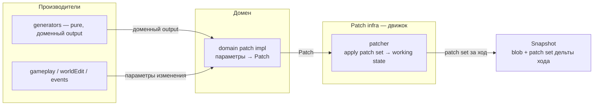

## Назначение

**Patch System** — общая инфраструктура движка для **всех изменений состояния**: мир (cells, regions, structures, …), игрок, сессия. Отдельный механизм — **не часть генератора и не часть конкретного домена**.

Мотивация: только домен знает семантику своих изменений, поэтому патч формирует реализация домена — patcher при этом может корректно обрабатывать набор патчей хода.

| Принцип | Смысл |
|---|---|
| **Patch = интерфейс** | Домен получает параметры изменения в своих терминах → **реализация домена** формирует `Patch` |
| **Один механизм на все состояния** | cells, region_states, player stats/inventory/history — один контракт, разные доменные реализации |
| **Patch set на ход** | За ход накапливается набор патчей, **секционированный по доменам** (не плоский blob) → применяется к рабочему состоянию → фиксируется в snapshot как дельта хода |
| **Rollback = branch, не discard** | Откаченные snapshot'ы не удаляются — ссылаются на ветку в другом временном отрезке (`parent_snapshot_id`, `ON DELETE RESTRICT`) |

**Статус:** target design ⬜

---

## Что это **не** является

| Сущность | Что это | Связь |
|---|---|---|
| `map_cell_patches` (SQL) | Таблица применённых дельт cells-домена | Один **доменный patch-формат**, не система; может стать persist-целью patches |
| `pending_patches` / `PatchApplier` (engine) | Ephemeral копии node_results LLM-фазы | Не patch-система; кандидат на удаление/замещение |
| `SessionSnapshot` | Resume пайплайна чата | Не modification snapshot |
| `WorldSnapshot` blob | Полный слепок состояния на ход | Commit-артефакт — **приёмник** patch set, не патч |

---

## Мутация и данные её планирования

Мутация — изменение состояния мира; patch — типизированное доменное
описание изменения. Данные планирования мутации и её materialization
различаются: первые служат входом для последующего воплощения изменения
в конкретных данных мира. Snapshot обязан сохранять данные планирования
мутаций; если materialization уже выполнена по запросу, сохраняются план
и соответствующий результат. Создание snapshot само по себе materialization
не запускает. Решение мастера 2026-10-26 и пояснение —
[`tz_world_snapshot.md`](./tz_world_snapshot.md), раздел «Мутация, её
планирование и materialization». Эта запись не приравнивает журнал патчей
к полному набору данных планирования мутации и не меняет владение доменными
форматами.

## Архитектура



**Инварианты:**

- **Snapshot immutable**: записанный snapshot никогда не мутируется. Любое изменение состояния — новый узел; «откат»/re-simulation — новая ветка, не правка существующей. Нарушение = баг хранилища (checksum это ловит).
- Patch — immutable, typed (Pydantic); не SQL-строка и не `MapCell`.
- Patch set секционирован по доменам (`sections`); patcher — диспетчер секций в доменные impl, а не универсальный интерпретатор payload.
- Порядок патчей внутри секции — ответственность домена; порядок секций — явная доменная зависимость; инфраструктура не переупорядочивает.
- Compose/merge полей (кто перекрывает чьё поле) — собственность домена-владельца поля, не generic-кода.
- Патчи — не источник состояния при restore: blob snapshot **authoritative**; patch set внутри snapshot — audit/diff/regen-вход (закрывает deferred «incremental vs full» из `tz_world_snapshot`).

## Контракт (черновик)

```python
class Patch(BaseModel):  # frozen
    domain: str        # владелец изменения
    target: ...        # адресат в терминах домена: cell (x,y,z) / region_uid / player path / …
    payload: ...       # доменная дельта — формат определяет владелец
    # meta: provenance (чем вызвано), revision tokens

class PatchSet(BaseModel):  # дельта одного хода
    turn_id: int
    # секционировано по доменам — НЕ плоский список:
    sections: dict[str, list[Patch]]   # climate | economy | npc | flora | war | politics | resources | …
```

**Зачем секции:** плоский набор патчей из всех систем (климат, экономика, NPC, флора, война, политика, ресурсы) — неконтролируемый blob. Секция = владение:

- **apply** — patcher диспетчит каждую секцию в patch impl её домена, а не разбирает чужие payload;
- **валидация** — домен проверяет только свою секцию;
- **diff/diff на restore** — «что изменилось в climate между N и N−1» читается без разбора всего набора;
- **аудит/диагностика** — патч всегда адресуем доменом, orphaned payload невозможен.

**Кросс-доменный порядок внутри patch set** — явная зависимость (domain-level `depends_on` / фиксированный порядок секций), не порядок записи. Независимые секции применяются независимо.

## Границы слоёв

| Слой | Делает | Не делает |
|---|---|---|
| generator | доменный output | patch, snapshot, SQL |
| domain patch impl | output/params → `Patch` | применение чужих патчей |
| patcher (infra) | сбор и apply patch set за ход | доменная семантика |
| snapshot service | serialize / commit / restore / branch | генерация, LLM payload |

См. правило `layer-boundaries.mdc` — persist и LLM не в генераторе; patch-система расширяет это до всех изменений состояния.

### World State CRUD: capabilities и atomic command (design 2026-10-25)

Целевая общая application boundary принадлежит worldState, вне generators.
WorldStateService делегирует WorldStateQueryFacade.read и
WorldStateMutationFacade.create/update/delete. Read/create/update/delete —
отдельные capabilities; read-only backend не реализует always-fail writer.
Unsupported operation, запрет домена/прав и storage failure — разные исходы.
Query читает existing merged state/metadata без скрытого materialize.

Атомарность охватывает целую typed domain command, не один repository метод.
Mutation facade открывает WorldStateUnitOfWork.transaction или явно
присоединяется через WorldMutationSession; один root владеет commit/rollback.
Handlers делегируют existing domain validators/writers, не коммитят отдельно.
Joined failure помечает root rollback-only даже при перехвате caller'ом.
SQL transaction не объявляется atomic publish для pack files.

Selective cell patch различает Keep/SetValue/ResetOverride; незатронутые
override сохраняются, scoped delete не удаляет base pack cell. Generic
INSERT OR REPLACE не является реализацией этого контракта. Fine_cell жидкости
— контрольный сценарий atomic/selective update, не готовая fluid model;
surface MapCellHydrology не расширяется попутно до runtime volume.
Точные class/method/path/port и matrix —
[WS-0A](../.cursor/plans/world-state-crud-capabilities-uow.md) §7–13.
Уточнение freeze review 2026-10-26: is_structural поддерживается в existing
structural-OR семантике (SetTrue/Reset, не false override); остальные legacy
payload columns вне первого mutable whitelist сохраняются. Удаление пустой
строки проверяет полный persistence payload, не read has_data. NOT NULL
поля вставляются из model/policy defaults. Ambient без session отклоняется
типизированно до BEGIN. Два семейства SQL-writer допустимы по selective
field last-committed-write-wins; live whole-row replace запрещает rollout
нового writer, а не объявляется безопасным из-за SQL lock. Точные masks,
predicate, class/method bindings и acceptance cases — WS-0A §10–13.
Статус design для приёмки; snapshot runtime и код реализации вне этой записи.

---

## Две цепочки snapshot — world и player

`world_snapshots` и `player_snapshots` — **параллельные цепочки**, синхронизированные по ходу (`turn_id`), но раздельные сущности.

**Причина разделения:** игрок отделён от мира ради **export/import** и **time travel** — переносится между мирами и ветками; его состояние не живёт внутри world blob.

**Односторонняя зависимость:** player state может ссылаться на world-факты; world никогда не ссылается на player state. World snapshot остаётся самодостаточным.

### Player state = memory + intrinsic

| Часть | Семантика |
|---|---|
| **memory** | История/события, в т.ч. других веток; timeline-агностична; переживает откат мира; опционально `origin_timeline` («трактирщик из другого мира») |
| **intrinsic** | Статы, скиллы, инвентарь — свойства персонажа, не привязки к миру |

**Placement (pos/location) не входит в player state** — это свойство привязки `player↔world`, владелец — **session** (world blob, секция «active session»). Export игрока = персонаж без места; attach создаёт привязку в целевом мире (spawn-анкор или reconcile координат — открыт).

Мир не знает player-историю из других веток; игрок её помнит. Ослабленная форма односторонней зависимости: **world знает session-bindings, но не знает player state**.

### Attach к раннему snapshot мира

`attach(player, world_snapshot)` — операция session-домена:

- memory + intrinsic переносятся как есть (против мира не валидируются — они не его собственность);
- создаётся session-binding: привязка игрока к целевому миру (позиция);
- результат оформляется **session-патчем** — та же машина изменений.

### Scope migration: player ↔ npc

Персонаж может пересекать границу цепочек: player переключился на другого персонажа → бывший становится NPC; обратный кейс — взять NPC под управление.

- **Identity сохраняется:** `character_uid` персонажа не меняется при миграции — ссылки (отношения, история, упоминания) остаются валидными.
- `demote_player_to_npc` = пара патчей в одном patch set хода:
  - `player` секция: завершение session-binding, player-цепочка персонажа запечатывается (terminal node — история сохраняется);
  - `npc` секция (world): adopt — player intrinsic → NPC state: stats → `character_sheet`, inventory → possessions, memory → биография/backstory (домен npc решает, что поглощать; полная memory остаётся в архиве player-цепочки).
- `promote_npc_to_player` — зеркально: NPC state → player intrinsic + новый session-binding.
- Мир и player-секции затронуты одним patch set — согласованность через существующую commit-семантику пары цепочек.

---

## Решённые вопросы

| Вопрос | Решение |
|---|---|
| Items/инвентарь | Часть player state — идут с игроком между ветками/мирами; provenance «из другой ветки» хранится как memory-метка (`origin_timeline`) |
| Reconcile на attach | Формирует **session-домен** (владелец placement): привязка создаётся/правится в целевом мире; player state reconcile не требует — его live-части нет |
| Patch set хранение | **Отдельная лёгкая таблица** (patch log, секционированная по доменам, keyed by snapshot/turn) + blob несёт ссылку — SQL-запросы по дельтам без распаковки blob (regen-diff, audit) |

## Открытые вопросы

| Вопрос | Статус |
|---|---|
| Владелец позиции игрока | **решено**: позиция — свойство привязки `player↔world`, владелец — **session** (world blob, секция «active session»). Player state = memory + intrinsic (stats, inventory); placement в него не входит |
| Точка входа при attach: spawn-анкор целевой ветки vs reconcile координат | открыт (зависит от владельца позиции) |
| Атомарность commit пары цепочек при сбое одной стороны | открыт |
| Версионирование формата патчей (читаемость старых snapshot) | открыт — мягкая деградация, пока blob authoritative |

### Timelines: нет cross-timeline sync

Решение по «синхронизации событий между таймлайнами» (было открыто в storage TZ):

- **Между ветками перемещается только игрок** — через свою `player_snapshots` цепочку (memory + intrinsic идут с ним).
- **Ветки не синхронизируются и не симулируются в фоне**: продвигается только тот таймлайн, где находится игрок. Заброшенная ветка заморожена на точке ухода.
- Время таймлайн-локальное (свой `turn_id`); общих часов между ветками нет.
- `attach` в ранний snapshot другой ветки — та же операция session-домена, цель просто в другой ветке.
- Следствие: изменения, которые игрок внёс в старой ветке, никуда не распространяются — они остаются историей ветки и memory игрока.

**Почему нет cross-timeline sync:**

- **Нет ретроактивного пересчёта.** Изменение события в прошлом = новая ветка от точки ответвления, а не переигровка N ходов зависимой истории. Пересчёт (а) дорог по ресурсам, (б) недостижим по точности — ходы содержат LLM/RNG-ветвления, replay не воспроизводит ту же историю.
- **Нет фоновой симуляции веток.** Замороженная ветка не тратит ресурсы — симулировать то, что игрок не видит, незачем. Тот же принцип, что lazy generation: мир существует только там, где игрок.
- Ветка при возврате продолжается со своей замороженной точки (её `turn_id` не тикал); «мир жил без игрока» — отдельный продуктовый кейс (lazy unfold на re-entry), не часть этой модели.

**Короткая дистанция — ветка пересчёта (re-simulation).** Time travel на небольшой промежуток (порядка игрового дня) может **переписать историю**, но исходная ветка при этом **не мутирует**: `restore(W_{N-k})` → k ходов переигрываются заново с изменённым контекстом (повторные LLM-вызовы, новые результаты) → результат оформляется **новой веткой** (recompute branch), исходная остаётся целиком.

**Safe по построению:** пересчёт пишет только в новую ветку — при сбое/неприемлемом результате она отбрасывается, исходная история не затронута. Player попадает в recompute-ветку только по явному выбору после завершения пересчёта.

**Граница — техническая, не концептуальная:** честный пересчёт N ходов стоит ~N повторных LLM-запросов (контекст каждого зависит от изменённого мира). Прыжок на день — приемлемо; на 1000 ходов — нет. Поэтому дальняя дистанция всегда = чистый branch без переигровки.

**Patch replay** (переигровка записанных patch sets поверх blob) — отдельно: воспроизводит старое будущее точно и дёшево (патчи — данные, не генерация), но это inspect/regen-diff, не переписывание.

---

## Связанные документы

- [`tz_world_snapshot.md`](./tz_world_snapshot.md) — snapshot service, blob, timelines
- [`project_data_storage_tz.md`](./project_data_storage_tz.md) — schema `world_snapshots` / `player_snapshots`
- [`tz_world_pack_storage.md`](./tz_world_pack_storage.md) — Patch Store (`map_cell_patches`) как доменный patch-формат cells; pack = immutable base
- [`tz_runtime_world_edit_policy.md`](./tz_runtime_world_edit_policy.md) — единый resolver/политика для доменных изменений


## PC-0 — planning cache и публикация изменений (2026-10-23)

[Норматив PC-0](./tz_terrain_generation.md#surface-planning-cache-pc0):
planning cache содержит только derived immutable envelopes. Edit сначала
меняет authoritative domain inputs, затем replan affected dependency closure;
L0/L2 материализуются по запросу. Cache eviction/restart не является edit и
не меняет UID/seed/geometry. Invalidation event не источник correctness:
expected keys/refs строятся от authoritative source projection.

Write-owner сверяет captured source revision под authoritative write guard
перед публикацией pack/manifest или соответствующей patch boundary. Mismatch
отклоняет write и требует replan; cache не выполняет commit и не публикует
stale как latest. PC-0 готовит caller seam для будущего WorldSnapshot/Patch
adapter, не реализует platform patch runtime. Immutable pack и terrain_delta/
climate_delta precedence сохраняются; генераторы не читают Patch Store сами.
