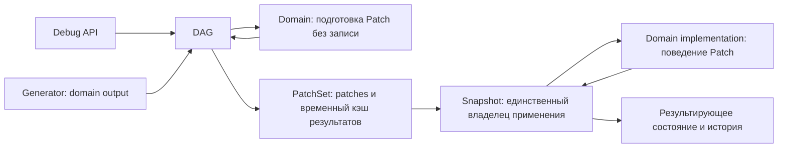

## Назначение

**Patch System** — общая инфраструктура движка для **всех изменений состояния**: мир (cells, regions, structures, …), игрок, сессия. Отдельный механизм — **не часть генератора и не часть конкретного домена**.

Мотивация: только домен знает семантику своих изменений, поэтому патч готовит реализация домена, а применяет подготовленные patches только Snapshot.

| Принцип | Смысл |
|---|---|
| **Patch = интерфейс** | Домен получает параметры изменения в своих терминах → **реализация домена** формирует `Patch` |
| **Один механизм на все состояния** | cells, region_states, player stats/inventory/history — один контракт, разные доменные реализации |
| **Patch set на ход** | За ход накапливается набор патчей, **секционированный по доменам** (не плоский blob) → передаётся Snapshot → только Snapshot применяет набор и фиксирует состояние/операции |
| **Rollback = branch, не discard** | Откаченные snapshot'ы не удаляются — ссылаются на ветку в другом временном отрезке (`parent_snapshot_id`, `ON DELETE RESTRICT`) |

**Append-only SQL/pack (мастер, 2026-10-27):** модификации состояния добавляют
новые SQL-записи/версии и новые immutable pack-артефакты. Исторические данные
не перезаписываются; доменный delete отражается новым изменением/маркером.
Patch хранит историчность перехода для SQL и pack: исходное состояние,
модификацию и результирующую версию/данные либо удерживаемые ссылки.
Только Snapshot оборачивает и применяет набор, фиксируя согласованное состояние.
Формат истории и append-only publication/head contract ещё согласуются;
прежняя SQL write реализация этим не объявляется совместимой.

**Staged artifacts и pack (мастер, 2026-10-27):** bake поставляет мир одним
замороженным pack; snapshot хранит patches тиков, которые читаются поверх
pack и его не перезаписывают. Объёмные результаты до публикации — staged
artifacts/rows, недостижимые из опубликованного состояния; их пишет доменная
операция materialization через staging port. Patch несёт content-hash ref,
не путь. Норматив — [`tz_world_snapshot.md`](./tz_world_snapshot.md)
§ «Staged artifacts и точки публикации».

**Владение двумя фазами (мастер, 2026-10-27):** домен реализует как
write-free CRUD preparation, так и запись своих SQL/pack данных. Подготовку инициирует DAG (в том числе по запросу Debug API, вызывающего
тот же граф); применение и запись инициирует только Snapshot.
Домен не запускает обе фазы самостоятельно и не переключает их автоматически.
Patch принимает prepared domain result без повторного изменяющего CRUD;
Snapshot вызывает domain storage contract, не реализуя его mapping/SQL/pack
логику. Запись не означает самостоятельный commit всего PatchSet.

**Статус:** target design ⬜

---

## Что это **не** является

| Сущность | Что это | Связь |
|---|---|---|
| `map_cell_patches` (SQL) | Таблица применённых дельт cells-домена | Один **доменный patch-формат**, не система; может стать persist-целью patches |
| `pending_patches` / `PatchApplier` (engine) | Ephemeral копии node_results LLM-фазы | Не patch-система; кандидат на удаление/замещение |
| `SessionSnapshot` | Resume пайплайна чата | Не modification snapshot |
| `WorldSnapshot` | Дельта тика поверх базового pack (patch set + refs), не полный слепок | Commit-артефакт — **приёмник** patch set, не патч |

---

## Мутация и данные её планирования

Мутация — изменение состояния мира; patch — типизированное доменное
описание изменения. Данные планирования мутации и её materialization
различаются: первые служат входом для последующего воплощения изменения
в конкретных данных мира. Snapshot обязан сохранять данные планирования
мутаций; если materialization уже выполнена по запросу, сохраняются план
и соответствующий результат. Создание snapshot само по себе materialization
не запускает. Решение мастера 2026-10-26 и пояснение —
[`tz_world_snapshot.md`](./tz_world_snapshot.md), раздел «Мутация, её
планирование и materialization». Эта запись не приравнивает журнал патчей
к полному набору данных планирования мутации и не меняет владение доменными
форматами.

## Владелец сбора патчей — только DAG (уточнение мастера, 2026-10-29)

Контракт Patch/PatchSet сохраняется. **Сбор доменных patches в PatchSet
и формирование набора разрешены только DAG.** Доменная patch implementation формирует
отдельный typed patch из доменного результата без изменения состояния.
Только Snapshot применяет собранный набор, вызывая доменные реализации
поведения, и сохраняет результирующее состояние/историю. Самостоятельного
общего patcher как второго входа применения нет. Snapshot набор не собирает.

PatchSet может временно кэшировать подготовленные результаты для передачи
в Snapshot. Кэш не является применением patch или зафиксированным состоянием;
владение, lifetime, соответствие patch/revisions и освобождение ресурсов
определяются общим контрактом до реализации.

Генератор возвращает доменный output. Он не формирует и не собирает patches,
не вызывает patcher/snapshot CRUD и не пишет через патчи напрямую в
snapshots. Подготовку и сбор организует DAG по публичным доменным контрактам.
Debug API — тонкий транспортный/диагностический вход к тому же DAG: может
передать параметры, scope и validate_only, запросить диагностический узел
через его DAG-контракт и получить результат, но не задаёт собственный порядок,
не собирает PatchSet и не вызывает Snapshot напрямую. Ни один из этих путей
не переносит сбор в генератор или доменный handler. Наличие общего контракта
не даёт генератору write capability к истории snapshots.

**Любой домен или внешний entry, обходящий DAG как владельца подготовки
и сборки PatchSet, создаёт критическую архитектурную ошибку. Исключений для
internal/debug/import/batch callers нет.** Это проверяется на каждом
шаге WS по writer/caller ledger и фактическим calls/imports: разрешённый
entry → DAG → подготовка/сбор PatchSet → Snapshot apply → domain implementation → storage. Вызовы storage внутри
этого сценария допустимы; самостоятельный альтернативный вход — нет.
Затронутый шаг не принимается при наличии обхода; весь WS не завершается,
пока остаётся хотя бы один обход в его scope. Проверка не откладывается
до итогового ревью или интеграции.

## Архитектура



**Инварианты:**

- **Snapshot immutable**: записанный snapshot никогда не мутируется. Любое изменение состояния — новый узел; «откат»/re-simulation — новая ветка, не правка существующей. Нарушение = баг хранилища (checksum это ловит).
- Patch — immutable, typed (Pydantic); не SQL-строка и не `MapCell`.
- Patch set секционирован по доменам (`sections`); Snapshot вызывает domain implementations при применении секций; доменный payload не интерпретируется общим кодом.
- Порядок патчей внутри секции — ответственность домена; порядок секций — явная доменная зависимость; инфраструктура не переупорядочивает.
- Compose/merge полей (кто перекрывает чьё поле) — собственность домена-владельца поля, не generic-кода.
- Гранулярность target задаёт домен: от минимальной изменяемой сущности (стена, блок, семантически адресуемый чанк) до целого объекта/агрегата. Часть и целое могут быть целями разных typed операций; их пересечение и конфликт определяет домен, а не generic Patch/Snapshot код.
- Частичная дельта перекрывает только явно затронутую часть, сохраняя остальные поля/части прежнего состояния; полная замена объекта допускается только как явная доменная операция. Для runtime target учитывается последний Snapshot, изменивший эту цель/область, для source — SourceRevision; общий CAS snapshot_head остаётся отдельной проверкой публикации.
- Состояние при restore = базовый pack + overlay patches цепочки (keyframe + дельты); отдельного authoritative blob мира нет (2026-10-27, [`tz_world_snapshot.md`](./tz_world_snapshot.md) § «Staged artifacts и точки публикации»). Patches — часть authoritative состояния.

## Контракты ядра — freeze шага 2 (2026-10-30)

**Статус: проект точных контрактов для приёмки.** Поведение P-1…P-8/L-1
принято в плане §8.1; определения ниже ещё не являются реализованным API
или разрешением переходить через implementation map. Это ядро, независимое
от будущих DTO нод GEN-DAG-1. Общие типы не импортируют concrete domain POJO.

### Общие правила типов и identity

Все сериализуемые data records — frozen strict Pydantic models: extra=forbid,
revalidate_instances=always; коллекции — tuple/frozenset, не изменяемые
dict/list внутри frozen оболочки. Bool не принимается как int.
Application contexts/capabilities — frozen runtime types своего слоя,
не serializable payload Patch и не часть canonical request.
Для перечисленных далее StrEnum без отдельного wire mapping значения
равны lowercase snake_case именам членов; неизвестные значения отклоняются.
`EntityUid` переиспользуется для world/timeline/player/snapshot/operation
identity. Новые runtime IDs выдаёт `app.ids.runtime_uid`, один раз на
операцию/новый snapshot, с сохранением при retry; это не generated world UID.
Порядковый `PatchOrdinal` — strict int >= 0, уникальный внутри секции.
`FormatVersion` — strict int > 0; semantic/source revisions им не заменяются.

`SectionKey = RegistryKey[PatchSectionRegistry]` и
`ArtifactFormatKey = RegistryKey[ArtifactFormatRegistry]` переиспользуют
общий механизм RegistryKey. Это разные номинальные реестры, объявленные
ядром; не строки domain tag и не world-authored N+1 registry. Их membership
определяет явная composition root registration, а не import side effects.
Общие metadata этих реестров содержат ключ/поддерживаемые format versions;
конкретные модели, codecs и handlers привязывает application registry.
Добавление домена не требует импорта его POJO в общий dataModel.

`RevisionHex` из validation/diagnostics/runtimeIssueContext переиспользуется
как уже существующий строгий 64-символьный lowercase SHA-256 hex value.
Его использование для hash не превращает значение в SourceRevision.
Для человекочитаемого текста diagnostics применяется существующий
`FieldPathError`; его path/message/code не используются для маршрутизации
секций, выбора outcome или вывода severity.

Исключения текстового wire-представления: UID — opaque identity по
`EntityUid`; registry key — открытый, но типизированный RegistryKey;
hash — `RevisionHex`; diagnostic message/path — `FieldPathError`.
Coerce выполняется на decode boundary с полной model validation.
Голый str для закрытой категории, артефактного kind или outcome запрещён.

### Frozen данные Patch и PatchSet

`PatchRef(operation_id: EntityUid, section_key: SectionKey,
ordinal: PatchOrdinal)` — адрес операции в наборе, не SQL row identity.
`PatchHeader(ref: PatchRef, format_version: FormatVersion,
depends_on: tuple[PatchRef, ...], artifacts: tuple[ArtifactRef, ...])` —
только общая metadata. Дубли refs и self-dependency запрещены.

Каждый concrete domain Patch объявляет отдельный frozen тип с `header`
и своими **typed target, expected, inputs, change, prepared**. Эти пять
типов связываются декларацией конкретной операции в domain dataModel,
а не произвольным pairing generic payload. Разные операции — отдельные
типы/дискриминаторы домена. Prepared содержит неизменяемый малый результат
или ArtifactRef плюс inputs/dependency stamps; не callback/repository/метод.
Общий код не читает эти пять доменных полей. Публичные доменные операции
и их concrete Patch classes проходят отдельный freeze до первого handler.

`SectionHeader(key: SectionKey, format_version: FormatVersion,
depends_on: tuple[SectionDependency, ...])` принадлежит общему контракту.
`SectionDependency` — typed union
`PreparedSectionDependency(section_key, section_fingerprint: RevisionHex)` либо
`PublishedSectionDependency(section_ref: SectionStateRef)` с общим
enum-дискриминатором `SectionDependencyKind.PREPARED/PUBLISHED`.
Prepared dependency должна предшествовать consumer в этом PatchSet;
published dependency удерживается и принадлежит выбранной исходной базе.
Core не заменяет одну другой и не сортирует набор.

`DomainSection[P]` содержит `header: SectionHeader` и `patches: tuple[P, ...]`,
где P — конкретный domain-owned union операций этой секции. Домен задаёт
concrete subclass, фиксирующий key, union P и format; пустая секция
отклоняется как malformed (пустой тик представлен пустым tuple секций).
Отсутствие patch для неизменяемой published dependency допустимо.

`PatchSet[S]` содержит **format_version, operation_id, preparation_fingerprint, world_uid,
timeline_id, turn_id, expected_world, expected_players, sections**:

- format_version — FormatVersion общей оболочки запроса;
- operation_id/world_uid/timeline_id — EntityUid; turn_id — strict int >= 1;
- preparation_fingerprint — RevisionHex исходного immutable запроса
  подготовки; он совпадает с binding lease, если staging использовался;
- expected_world — WorldPublicationRef; pack_hash в runtime обязателен;
- expected_players — tuple[PlayerHeadExpectation, ...], без повторов player_uid;
- sections — tuple[S, ...] в явном порядке, без повторов section key;
  S — concrete union секций, задаваемый composition root, не Any/raw dict.

Поле category результата задаёт общий **SnapshotApplyOutcomeKind(StrEnum)**:
`COMMITTED="committed"`, `CONFLICT="conflict"`, `REJECTED="rejected"`.
Новый enum принадлежит dataModel ядра Snapshot. Все typed consumers,
durable outcomes и logging contracts используют его; на SQL/JSON boundary
сохраняется `.value`, при чтении — проверяемое восстановление enum.

### Runtime target preconditions

Общие `RuntimeTargetVersion` — discriminated union по
`RuntimeVersionKind.PACK/SNAPSHOT` (StrEnum):

- `PackTargetVersion(pack_hash: RevisionHex, artifact: ArtifactRef)`;
- `SnapshotTargetVersion(snapshot: SnapshotRef)`.

`RuntimeTargetExpectation` — union `TargetAbsent` либо
`TargetVersionExpected(version: RuntimeTargetVersion, presence)`.
Дискриминатор — `TargetExpectationKind.ABSENT/VERSION`; presence —
`TargetPresence.PRESENT/DELETED` (оба StrEnum). TargetAbsent означает
отсутствие и в исходном pack, и в истории/overlay пересекающихся целей;
tombstone не удовлетворяет этому предусловию. Recreate после delete
требует ожидаемой версии tombstone и явной доменной операции.

Target identity и пересечение не входят в generic field path: они остаются
typed полями concrete Patch. Handler сверяет preconditions на captured
base, защищённой commit transaction. Композиция нескольких операций
внутри секции не требует snapshot stamp неопубликованного промежуточного
результата; домен проверяет их переходы и ссылки на prepared результаты.
Source preconditions не притворяются RuntimeTargetExpectation:
они добавляются domain binding только после source-versioning 2–3.

### DomainSectionHandler и явный реестр

`DomainSectionHandler[S]` — общий application port, S фиксируется
concrete секцией. Обязанности и сигнатуры:

- `validate(section: S, context: SnapshotValidationContext) -> SectionValidation`:
  async read-only проверка семантики, target versions, композиции и
  dependencies; никаких staging, planning, materialization или writes;
- `apply(section: S, context: SnapshotApplyContext) -> SectionApplyReceipt | SectionRefused`:
  async доменное apply уже подготовленного изменения, append новых
  доменных SQL/overlay/history версий через domain storage в переданной
  commit scope. При несовпадении precondition — typed refusal всего набора;
- `encode(section: S) -> bytes` / `decode(payload: bytes, version: FormatVersion) -> S`:
  pure domain codec; decode включает поддерживаемый read-upgrade и полную
  валидацию. Неизвестный формат — отказ, не partial decode;
- `restore(ref: SectionStateRef, context: SnapshotReadContext) -> S` **не вводится**:
  секция patches не является состоянием. Domain read/restore контракты
  остаются у домена; Snapshot использует отдельные domain-owned read/merge
  ports, согласуемые с concrete handler. Общего state DTO ядро не выдумывает.

`SectionValidation` — typed union `SectionAccepted` / `SectionRefused`.
Accepted не даёт права самостоятельной записи. Refused содержит
category: SnapshotApplyOutcomeKind (только CONFLICT/REJECTED) и
diagnostics: tuple[FieldPathError, ...], непустой. Producer выбирает
категорию в точке решения, не по diagnostic.code на стороне consumer.

`SectionApplyReceipt` содержит section_key,
history_refs: tuple[SectionHistoryRef, ...],
state_refs: tuple[SectionStateRef, ...], changed: tuple[PatchRef, ...],
retained_artifacts: tuple[ArtifactRef, ...]. Нет changed — domain state_ref
не меняется; history текущей операции всё равно может фиксировать no-op.
Refs сгруппированы по участвующим world/player snapshots; повтор пары
chain identity + section_key запрещён. Domain receipt не добавляет участника,
не объявленного в expected_players/world входа.
SectionStateRef/SectionHistoryRef содержат SnapshotRef + SectionKey +
FormatVersion; их payload и физическое хранение остаются у домена.
Ни receipt, ни SectionAccepted не означают COMMITTED до общего SQL commit.

SnapshotValidationContext предоставляет pinned исходные world/player refs
и refs предшествующих секций; он не общий query router к чужим таблицам.
SnapshotApplyContext добавляет назначенные world/player SnapshotRef и
`CommitScope` — непередаваемый другим tasks и недействительный вне
Snapshot transaction capability. Domain storage binding присоединяется
к этому scope; handler не получает BEGIN/COMMIT/ROLLBACK, connection,
publication pointer API или возможность самостоятельного открытия UOW.
Read context не содержит write capability. Точные storage bindings — шаг 3.

Application registry предоставляет
`register[S](contract: SectionContract[S], handler: DomainSectionHandler[S])`
и `resolve(section) -> BoundSectionHandler`. SectionContract фиксирует key,
concrete section model, supported format versions и canonical schema
manifest. Register проверяет соответствие key/model/handler, повтор key
запрещён. Bound handler проверяет точный тип секции перед typed dispatch.
Единственная проверяемая heterogeneous dispatch boundary находится внутри
реестра; публичные входы не используют Any, object payload или casts caller'а.
Core serializers не сериализуют concrete subtype как base Pydantic model
с потерей domain fields: encode/decode всегда делегируются bound codec.
SectionContract/codec — application binding; dataModel registry metadata
не содержит исполняемых codecs/handlers. Encode сохраняет заявленную
format version; manifests старых поддерживаемых форматов остаются доступны.
Canonical bytes проверяются до read-upgrade. Upgrade view не переписывает
сохранённый request binding и не вычисляет ему новый hash по новой схеме.

### Canonical request binding и no-op

Переиспользуется общий `application/encoding/CanonicalCodec` и его digest
с явным `CanonicalSchemaManifest`: новые enum/record IDs закрепляются
декларативно в шаге 3 и не зависят от Python module/class names.
Core canonical request включает все поля PatchSet, порядок секций,
canonical bytes каждой секции и refs; encode выполняют соответствующие
domain codecs. Hash секции пересчитывается, а не берётся на доверие из payload.
Транспортные request_id, elapsed time, лог-сообщения и server-created_at
в binding не входят. Одинаковый ID с другим binding не меняет старую запись.
Декодирование неканоничных/неизвестных данных отклоняется до domain writes.

Snapshot.apply — явный запрос фиксации тика: PatchSet с sections=()
или с одними domain no-op допустим при валидных turn_id/heads и создаёт
новый snapshot/историю операции. Автоматический commit пустого тика при
read/flush не вводится. Незатронутые target stamps/section state refs
остаются прежними; changed flags определяет домен, не сравнение общего head.
Повтор того же operation_id не создаёт второй snapshot даже для пустого тика.

## Исторический эскиз контракта (не целевой API)

Уточнение мастера 2026-10-27: **интерфейс Patch — общий поведенческий
контракт, передаваемый доменам на реализацию.** Схема полей ниже сама по себе
не определяет этот интерфейс. До реализации необходимо согласовать смысл
адресата/изменения, предусловия, validation, этапы применения/сохранения,
результаты, отказы, повторное применение, зависимости/effects и передачу
данных в snapshot. Общая семантика принадлежит интерфейсу, доменная логика
её выполнения — домену. Критерии отдельной приёмки —
[новый план, §3 и §8](../.cursor/plans/world-domain-patches-snapshots.md).

**Критическая приёмка каждого класса Patch (мастер, 2026-10-27):** при
изменении доменного CRUD с сохранением публичного контракта модификации
класс Patch, его типы/payload/format version не меняются. CRUD и сопоставление
модификации с физическими записями принадлежат домену. Проверка обязательна
для каждого конкретного класса, не только базового интерфейса или одного
patch на домен. Сценарий и evidence — новый план §3.4. Интерфейс требует
строгой связки domain/семантика/target/inputs/change/result от реализации.
Провал этой проверки означает дефект реализации. До его устранения и
повторной успешной проверки не принимаются затронутый шаг и план целиком;
отложенный долг или ослабление критерия не заменяют исправление.

Прямая запись мутации из Patch в обход Snapshot — критический дефект,
включая косвенный вызов existing CRUD writer/repository. Подготовка patch,
validation и кэш PatchSet не меняют authoritative state. Запись доменной
инфраструктурой допустима только внутри применения под владением Snapshot,
без независимого commit. Сохранить CRUD-изменение и затем добавить историю
snapshot недостаточно; версионирование не заменяет этот gate.

Схема ниже — исторический эскиз состава данных, не типизированный контракт
к реализации: bare domain string/raw payload не удовлетворяют этому требованию.

```python
class Patch(BaseModel):  # frozen
    domain: str        # владелец изменения
    target: ...        # адресат в терминах домена: cell (x,y,z) / region_uid / player path / …
    payload: ...       # доменная дельта — формат определяет владелец
    # meta: provenance (чем вызвано), revision tokens

class PatchSet(BaseModel):  # дельта одного хода
    turn_id: int
    # секционировано по доменам — НЕ плоский список:
    sections: dict[str, list[Patch]]   # climate | economy | npc | flora | war | politics | resources | …
```

**Зачем секции:** плоский набор патчей из всех систем (климат, экономика, NPC, флора, война, политика, ресурсы) — неконтролируемый blob. Секция = владение:

- **apply** — только Snapshot вызывает patch impl соответствующего домена; самостоятельного domain apply entry нет;
- **валидация** — домен проверяет только свою секцию;
- **diff/diff на restore** — «что изменилось в climate между N и N−1» читается без разбора всего набора;
- **аудит/диагностика** — патч всегда адресуем доменом, orphaned payload невозможен.

**Кросс-доменный порядок внутри patch set** — явная зависимость (domain-level
`depends_on` / фиксированный порядок секций), не порядок записи. Независимые
секции имеют собственную доменную обработку, но общий атомарный commit;
независимые commits секций запрещены.

## Границы слоёв

| Слой | Делает | Не делает |
|---|---|---|
| generator | доменный output | patch, snapshot, SQL |
| domain patch impl | подготовка Patch без записи; поведение своего patch по вызову Snapshot | самостоятельное применение, чужие доменные правила |
| DAG | сбор патчей и формирование patch set хода | доменная семантика payload, физическое хранение snapshot |
| debug API | вызов того же DAG с параметрами/диагностикой, без собственной сборки | pipeline, PatchSet assembly, прямой Snapshot apply, доменная семантика |
| snapshot service | единственный apply PatchSet через domain implementations; состояние/история, serialize / commit / restore / branch | сбор набора, генерация, доменные алгоритмы, LLM payload |

См. правило `layer-boundaries.mdc` — persist и LLM не в генераторе; patch-система расширяет это до всех изменений состояния.

### Доменное чтение, patches и WS (решение мастера, 2026-10-27)

DAG напрямую вызывает read и patch соответствующего домена. Контракт
чтения принадлежит домену; WS не задаёт общий read-контракт, не оборачивает
и не маршрутизирует domain.read. Прямой доступ WS к БД запрещён.
Прежние central CRUD, WS DB adapters и WorldStateUnitOfWork отменены.

Доменная patch implementation готовит изменение metadata/planning либо
результат materialization без записи состояния. Она реализует доменные
правила поведения patch, вызываемые только Snapshot при применении.
Generator возвращает domain output и сам patches не формирует/не применяет.

Только DAG собирает PatchSet. Набор может временно кэшировать
результат для передачи в Snapshot. Только Snapshot применяет patches и
сохраняет состояние/операции всех доменов; набор он не собирает, доменные
алгоритмы не воспроизводит и materialization не запускает.

Атомарность domain mutation, набора/хода и snapshot commit должна быть
определена архитектурой до реализации. Самостоятельные частичные commits
не доказывают атомарность сценария; SQL transaction не равна file publication.
Конкретные coordinator/UOW классы сейчас не выбираются.

Selective cell delta сохраняет Keep/SetValue/ResetOverride и незатронутые
поля, reset не удаляет base pack cell. Эти правила принадлежат cell-домену,
не общему WS storage adapter. Runtime fluid model этим не вводится.

[Актуальный новый план](../.cursor/plans/world-domain-patches-snapshots.md).
Прежний world-state-crud-transition.md помечен ARCHIVED / SUPERSEDED.
Прежние WS-0A/ledger — архив, не действующий контракт общего CRUD.

---

## Две цепочки snapshot — world и player

`world_snapshots` и `player_snapshots` — **параллельные цепочки**, синхронизированные по ходу (`turn_id`), но раздельные сущности.

**Причина разделения:** игрок отделён от мира ради **export/import** и **time travel** — переносится между мирами и ветками; его состояние не живёт внутри world blob.

**Односторонняя зависимость:** player state может ссылаться на world-факты; world никогда не ссылается на player state. World snapshot остаётся самодостаточным.

### Player state = memory + intrinsic

| Часть | Семантика |
|---|---|
| **memory** | История/события, в т.ч. других веток; timeline-агностична; переживает откат мира; опционально `origin_timeline` («трактирщик из другого мира») |
| **intrinsic** | Статы, скиллы, инвентарь — свойства персонажа, не привязки к миру |

**Placement (pos/location) не входит в player state** — это свойство привязки `player↔world`, владелец — **session** (world blob, секция «active session»). Export игрока = персонаж без места; политика attach определена ниже.

Мир не знает player-историю из других веток; игрок её помнит. Ослабленная форма односторонней зависимости: **world знает session-bindings, но не знает player state**.

### Attach к раннему snapshot мира

`attach(player, world_snapshot)` — операция session-домена:

- memory + intrinsic переносятся как есть (против мира не валидируются — они не его собственность);
- создаётся session-binding: привязка игрока к целевому миру (позиция);
- результат оформляется **session-патчем** — та же машина изменений.

**Решение мастера, 2026-10-27:** если в целевом snapshot существует binding
этого игрока, session-домен восстанавливает его с проверкой позиции. Если
binding отсутствует, session-домен создаёт его в spawn-анкоре целевой ветки.
Координаты из другой ветки или player-цепочки не подставляются. Поиск ближайшей
валидной точки требует отдельных правил и не входит в принятую политику.
Невалидная позиция или spawn-анкор дают явный отказ без публикации изменений.

### Атомарность world/player и совместимость форматов

**Решение мастера, 2026-10-27:** изменения world/player одного тика имеют
единый атомарный commit Snapshot. Цепочки остаются отдельными сущностями;
проверка исходных heads, новые записи обеих цепочек и продвижение обоих heads
входят в одну SQL-транзакцию. Конфликт или сбой любой стороны не публикует
изменения ни одной стороны. Это также относится к scope migration ниже.

Общая оболочка Snapshot и каждая доменная секция имеют отдельные format
versions, независимые от semantic revisions. Домен-владелец поддерживает
чтение своих старых форматов через upgrade при чтении; ядро отвечает за
читаемость общей оболочки. Сохранённые данные при этом не переписываются.
Старые snapshots обязаны оставаться читаемыми. Неподдерживаемый формат даёт
явный отказ чтения без пропуска секции, тихой деградации или подмены latest.

### Scope migration: player ↔ npc

Персонаж может пересекать границу цепочек: player переключился на другого персонажа → бывший становится NPC; обратный кейс — взять NPC под управление.

- **Identity сохраняется:** `character_uid` персонажа не меняется при миграции — ссылки (отношения, история, упоминания) остаются валидными.
- `demote_player_to_npc` = пара патчей в одном patch set хода:
  - `player` секция: завершение session-binding, player-цепочка персонажа запечатывается (terminal node — история сохраняется);
  - `npc` секция (world): adopt — player intrinsic → NPC state: stats → `character_sheet`, inventory → possessions, memory → биография/backstory (домен npc решает, что поглощать; полная memory остаётся в архиве player-цепочки).
- `promote_npc_to_player` — зеркально: NPC state → player intrinsic + новый session-binding.
- Мир и player-секции затронуты одним patch set — согласованность через существующую commit-семантику пары цепочек.

---

## Решённые вопросы

| Вопрос | Решение |
|---|---|
| Items/инвентарь | Часть player state — идут с игроком между ветками/мирами; provenance «из другой ветки» хранится как memory-метка (`origin_timeline`) |
| Reconcile на attach | Формирует **session-домен** (владелец placement): привязка создаётся/правится в целевом мире; player state reconcile не требует — его live-части нет |
| Patch set хранение | **Отдельная лёгкая таблица** (patch log, секционированная по доменам, keyed by snapshot/turn) + blob несёт ссылку — SQL-запросы по дельтам без распаковки blob (regen-diff, audit) |
| Точка входа при attach | Решено 2026-10-27: binding целевого snapshot с проверкой позиции; при отсутствии — spawn-анкор целевой ветки; невалидность — явный отказ |
| Атомарность commit пары цепочек при сбое одной стороны | Решено 2026-10-27: один атомарный commit Snapshot обеих цепочек, включая heads |
| Версионирование формата патчей (читаемость старых snapshot) | Решено 2026-10-27: отдельные версии оболочки/секций, upgrade при чтении владельцем, без перезаписи истории; неподдерживаемый формат — явный отказ |

## Открытые вопросы

| Вопрос | Статус |
|---|---|
| Владелец позиции игрока | **решено**: позиция — свойство привязки `player↔world`, владелец — **session** (world blob, секция «active session»). Player state = memory + intrinsic (stats, inventory); placement в него не входит |

### Timelines: нет cross-timeline sync

Решение по «синхронизации событий между таймлайнами» (было открыто в storage TZ):

- **Между ветками перемещается только игрок** — через свою `player_snapshots` цепочку (memory + intrinsic идут с ним).
- **Ветки не синхронизируются и не симулируются в фоне**: продвигается только тот таймлайн, где находится игрок. Заброшенная ветка заморожена на точке ухода.
- Время таймлайн-локальное (свой `turn_id`); общих часов между ветками нет.
- Активный timeline у мира один (2026-10-27): один активный overlay; переход в другую ветку пересобирает overlay от keyframe ([`tz_world_snapshot.md`](./tz_world_snapshot.md) § «Правила модели pack + overlay»).
- `attach` в ранний snapshot другой ветки — та же операция session-домена, цель просто в другой ветке.
- Следствие: изменения, которые игрок внёс в старой ветке, никуда не распространяются — они остаются историей ветки и memory игрока.

**Почему нет cross-timeline sync:**

- **Нет ретроактивного пересчёта.** Изменение события в прошлом = новая ветка от точки ответвления, а не переигровка N ходов зависимой истории. Пересчёт (а) дорог по ресурсам, (б) недостижим по точности — ходы содержат LLM/RNG-ветвления, replay не воспроизводит ту же историю.
- **Нет фоновой симуляции веток.** Замороженная ветка не тратит ресурсы — симулировать то, что игрок не видит, незачем. Тот же принцип, что lazy generation: мир существует только там, где игрок.
- Ветка при возврате продолжается со своей замороженной точки (её `turn_id` не тикал); «мир жил без игрока» — отдельный продуктовый кейс (lazy unfold на re-entry), не часть этой модели.

**Короткая дистанция — ветка пересчёта (re-simulation).** Time travel на небольшой промежуток (порядка игрового дня) может **переписать историю**, но исходная ветка при этом **не мутирует**: `restore(W_{N-k})` → k ходов переигрываются заново с изменённым контекстом (повторные LLM-вызовы, новые результаты) → результат оформляется **новой веткой** (recompute branch), исходная остаётся целиком.

**Safe по построению:** пересчёт пишет только в новую ветку — при сбое/неприемлемом результате она отбрасывается, исходная история не затронута. Player попадает в recompute-ветку только по явному выбору после завершения пересчёта.

**Граница — техническая, не концептуальная:** честный пересчёт N ходов стоит ~N повторных LLM-запросов (контекст каждого зависит от изменённого мира). Прыжок на день — приемлемо; на 1000 ходов — нет. Поэтому дальняя дистанция всегда = чистый branch без переигровки.

**Patch replay** (переигровка записанных patch sets поверх blob) — отдельно: воспроизводит старое будущее точно и дёшево (патчи — данные, не генерация), но это inspect/regen-diff, не переписывание.

---

## Связанные документы

- [`tz_world_snapshot.md`](./tz_world_snapshot.md) — snapshot service, blob, timelines
- [`project_data_storage_tz.md`](./project_data_storage_tz.md) — schema `world_snapshots` / `player_snapshots`
- [`tz_world_pack_storage.md`](./tz_world_pack_storage.md) — Patch Store (`map_cell_patches`) как доменный patch-формат cells; pack = immutable base
- [`tz_runtime_world_edit_policy.md`](./tz_runtime_world_edit_policy.md) — единый resolver/политика для доменных изменений


## PC-0 — planning cache и публикация изменений (2026-10-23)

**G0-S, 2026-10-27:** нижеследующий publication guard — current PC baseline,
не готовый target append-only/Snapshot-owned commit. Для GEO-1 заморожен
[input/revision seam](./tz_terrain_generation.md#geo-1-g0-s--source-revision-и-snapshot-seam):
caller передаёт coherent typed closure; cache/strategy не читает Patch Store,
не назначает source revisions и не применяет patches. Planning digest описывает
effective inputs, отдельно от SourceRevision и pinned snapshot revision set.
Future adapter меняет origin/provenance, сохраняя domain I/codec/ref contracts.
Применение инициирует только Snapshot по действующему
[внешнему плану](../.cursor/plans/world-domain-patches-snapshots.md), §6–7.2;
старый центральный WS CRUD/самостоятельный общий patcher не возвращаются.
Concrete capture/apply/staging/commit contracts того трека не реализуются G0-S.

[Норматив PC-0](./tz_terrain_generation.md#surface-planning-cache-pc0):
planning cache содержит только derived immutable envelopes. Edit сначала
меняет authoritative domain inputs, затем replan affected dependency closure;
L0/L2 материализуются по запросу. Cache eviction/restart не является edit и
не меняет UID/seed/geometry. Invalidation event не источник correctness:
expected keys/refs строятся от authoritative source projection.

Write-owner сверяет captured source revision под authoritative write guard
перед публикацией pack/manifest или соответствующей patch boundary. Mismatch
отклоняет write и требует replan; cache не выполняет commit и не публикует
stale как latest. PC-0 готовит caller seam для будущего WorldSnapshot/Patch
adapter, не реализует platform patch runtime. Immutable pack и terrain_delta/
climate_delta precedence сохраняются; генераторы не читают Patch Store сами.
