> **Архитектура нод:** terrain-ноды пишут в `state.terrain_context: TerrainContext`. См. `tz_engine_node_context.md`.

## Назначение

`TerrainGeneratorService` — **pure utility** (без репозиториев, без async).  
Вход: `(World, list[NamedLocation])` → выход: `list[MapCell]`.

**Задача (утверждено 2026-06):** multi-pass **terrain skeleton** — surface + subsurface columns (`z`, `system_terrain`), без climate fields на `generate-surface`. См. § «Multi-pass terrain skeleton».

**Климат** — отдельный модуль и **отдельный pass** в очереди генерации мира (`generate-climate`): `ClimateOrchestratorService` на cells в БД.

### Роли (не путать с «admin»)

| Роль | UI | Что делает с terrain |
|---|---|---|
| **Мастер мира** | JSON-редактор в **настройках мира** (`settings/world`) | import bundle, registries, anchors, pole — **объявляет** мир |
| **Игрок** | выбор мира → персонаж → игра | загружает мир; **материализация** skeleton/climate — через **engine DAG**, если cells ещё нет |

Отдельной роли «admin» в продукте **нет**.

**Production:** материализация мира (S → O → C → CL) — только **engine DAG**; frontend и игрок **не** вызывают HTTP generate-*.

**Debug:** `POST …/map/generate-*` в `map.py` — **постоянный** harness для точечных тестов (curl, изолированный pass). Те же generator/orchestrator функции, что и ноды; маршруты **оставляем**, но это не product path.

**Скриптовые smoke/integration-тесты** passes с persist — **только через HTTP** к running backend (`http://localhost:8000/api`), не через прямой import генераторов. Эталон: `scripts/debug_structure.py`, `scripts/debug_ladder.py`. Подробно — [`tz_world_generation_dag.md`](./tz_world_generation_dag.md) § «Три входа».

> **Код:** ✅ TR-1b + DBG-1 (2026-06). Legacy `assemble_full` — climate-only regen paths.

**Не задача terrain (как отдельного домена):**

- urban footprint и форма города — `SettlementAssembler`, явные `map_cells`, lazy occupancy;
- улицы, здания, заборы — settlement pipeline (см. `tz_city_generation.md`).

**Почему отделено от городов:** поселение может быть построено или уничтожено; климат и elevation региона не должны пересчитываться от списка городов.

**Why utility, not service:** нужен в engine-нодах (production) и в debug harness (`map.py`) без DI-контейнера.

---

## Multi-pass terrain skeleton (утверждено 2026-06)

> **Статус концепции:** ✅ **утверждено.** **Impl в коде:** ✅ TR-1 (2026-06) — § Impl queue, § План реализации.

### Принцип

1. **Мир объявлен мастером** (import bundle: registries, anchors, pole, `z_min`/`z_max`, …) — без этого skeleton **неконсистентен**.
2. **`generate-surface`** — **чистый terrain**: surface skeleton + subsurface strata. Без `temperature_base` / `rainfall`.
3. **Climate** — отдельный pass/API; **читает** terrain, **может модифицировать** верхние слои (см. ниже).
4. **Ores → caves** — отдельные ordered passes; merge rules не дают caves перезаписать ore.
5. **Liquid** — отдельный вопрос; зависит от climate + правил мира (не из `z_to_terrain` напрямую).

### Охват мира: две версии (обе фиксируем)

| Версия | Охват | Когда |
|---|---|---|
| **v1 — anchor bbox** | bbox static anchors ± `padding` | после import bundle мастером |
| **v2 — declared world** | явные границы мира (`world_bounds` / master rect / full grid extent) — **вся** заготовка skeleton | после появления поля границ или lazy chunk map |

**Инвариант v1:** города только расширяют bbox точкой anchor, не footprint.  
**Инвариант v2:** skeleton покрывает **всю** объявленную заготовку — «склад» основных сущностей до gameplay.

#### Форма мира = `world_bounds` (утверждено 2026-07-19)

**SoT формы мира** — extent мира, не набор уже запечённых pack-тайлов.

| Правило | Норматив |
|---|---|
| Геометрия | Всегда **ось-выровненный прямоугольник** (квадрат = частный случай `W == H`) |
| Wire v2 | `world.world_bounds`: `{ x_min, x_max, y_min, y_max }` (grid indices) |
| v1 fallback | anchors ± `grid_bbox_padding` тоже даёт **AABB** того же класса форм |
| Запрещено | трактовать AABB только уже запечённых тайлов (дыры до `full_bake`) как «непрямоугольный мир» |

**Заполнение ячеек внутри extent** — progressive bake ([`tz_world_pack_storage.md`](./tz_world_pack_storage.md) § Bake modes):

- `light_bake` — **все** macro-tiles с `named_locations` (тайлы с локациями);
- `full_bake` — **весь** `world_bounds` (полное заполнение прямоугольника мира). Смежность на краях задаёт `world_topology_mode` через `WorldTopology`; seam-пары и запись шва — [`tz_world_pack_storage.md` § Шов мира L0](./tz_world_pack_storage.md#шов-мира-l0). Шов **мира на макро-тайлах**. Не detailed grade; не magma antipode (§ Planet topology).

Отдельного product bake stage «wilderness» **нет**. Дыры на world map после light — **незапечённые** клетки внутри прямоугольника, не другая форма мира. Render/ASCII frame предпочтительно = declared/`resolved` bounds — [`tz_map_light_bake.md`](./tz_map_light_bake.md).

Lazy gameplay (`generate_z_slice`) в v2 может генерировать **тот же column API**, но порциями; eager materialization — весь declared extent (или bbox в v1).

##### Топология поверхности: `world_topology_mode`

`world_bounds` задаёт прямоугольный extent; `world.world_topology_mode`
задаёт **координатную карту соседей** на его краях. Это независимые части
контракта формы мира. Скаляр хранится на `worlds`, typed-контракт —
`WorldTerrainScalars`; wire-значения: `planar`, `wrapped`, `sphere`.
При отсутствии поля используется **`wrapped`** — текущее тор-поведение.
Миры без поля не требуют миграции данных; их старые паки остаются валидны.
Явно переданное неизвестное значение — ошибка валидации, не переключение
на другой режим.

`WorldTopology` (целевой домен `dataModel/topology/worldTopology.py`,
перенос из `dataModel/worldPack/wire/` — HY-11) владеет
режимом и разрешённым `WorldBounds`. Это единая точка lookup для seam,
halo, транзита, растеризации регионов, pathfinding/дистанций,
hydrology/z-continuity и climate field на краях. `grid_neighbor` и
`antagonist_tile` становятся делегатами; потребители не ветвятся по mode
и не вычисляют собственный wrap.

**Сервисы домена геометрии (HY-11 / TOPO-1).** Топология владеет геометрией
мира и поведением на швах. `WorldBounds` и `WorldTopology` находятся в
`dataModel/topology/`, `WorldTopologyMode` — в его `enums/`;
чистые геометрические сервисы от `WorldTopology` — в `topologyGeometry.py`.

| Сервис | Контракт |
|---|---|
| `topology.neighbor(x, y, facing)` | Кардинальный сосед: `NeighborResult{coord, edge_crossing, invert_dy}` либо `None` для planar void |
| `topology.canonicalize(x, y)` | Unrolled → каноническая координата; за bounds в `planar` → `None` |
| `topology.seam_pairs()` | Стабильные seam-пары для bake, включая ориентацию граней и `invert_dy` |
| `unrolled_images(topology, cell)` | Образы клетки: в `planar` один образ; в `wrapped` периодические сдвиги на `±w`, `±h`; в `sphere` также fold-образы со сдвигом x на `w/2` и инверсией Δy |
| `dist2(topology, p, q)` / `nearest_on_segment(topology, p, a, b)` | Минимум евклидова расстояния по образам; расстояние до отрезка и проекция определяются в одном unrolled-кадре |
| `centroid(topology, cells, weights, anchor)` | Каждая клетка разворачивается к ближайшему образу относительно anchor; результат — взвешенное среднее в этом unrolled-кадре |
| `canonical_frame(topology, points, anchor=...)` | Общий перенос unrolled-геометрии в кадр канонического anchor; сохраняет длины, связность и authored extent; при sphere-fold переносит весь кадр с инверсией Δy |
| `neighbors4_unrolled(cell)` | Четыре кардинальных шага в unrolled-кадре без канонизации; допустимость клетки проверяет потребитель через домен |
| Растеризация через шов | Отрезки/формы растеризуются в unrolled-координатах; каждая выходная клетка проходит `canonicalize` |
| `fine_topology(topology, tile_macro)` | Та же топология в fine-сетке; масштабирование extent выполняет домен, без собственного wrap в потребителе |

`nearest_on_segment` возвращает квадрат расстояния, unclamped-проекцию `t`,
образ query-точки с `invert_dy` и ближайшую точку отрезка в его unrolled-кадре.
Необязательный `tie_breaker(result)` выбирает минимальный ключ **только между
образами с одинаковым минимальным расстоянием**; без него и при оставшихся
равенствах порядок — `(y, x, invert_dy)`. Так application-политика разрешает
неоднозначность, не дублируя поиск образов или метрику домена.

**Модель потребителя: unrolled compute + canonical write.** Геометрия,
проекции, нормали и flood вычисляются в unrolled-координатах. Lookup и
запись в grid используют `topology.canonicalize`; `None` означает void.
Для heightmap проходимость задаётся как
`passable(c) = canonicalize(c) ∈ heightmap.surface_z`
(при `None` — `False`). Membership и дополнительные ограничения
проходимости принадлежат application-потребителю, координатная
арифметика и преобразование через шов — домену топологии.

**Запрет raw adjacency:** вне домена нельзя определять мировых соседей
сырыми `neighbors4`, считать расстояния/центроиды по каноническим мировым
координатам обычным евклидом или трактовать край bounds как void без
lookup топологии. Потребитель вызывает сервисы домена без ветвления по
`mode`; локальная геометрия в полученном unrolled-кадре допустима.
Перевод существующих консьюмеров идёт по треку TOPO-1: HY-11 покрывает
домен и гидрологию, остальные домены подключаются отдельными планами.

**Координатная карта.** Границы включительные;
`w = x_max - x_min + 1`, `h = y_max - y_min + 1`. `NORTH` направлен к
`y_max`, `SOUTH` — к `y_min`. Внутри extent кардинальный сосед — обычная
соседняя клетка во всех режимах.

| Режим | За краем x | За краем y |
|---|---|---|
| `planar` | соседа нет | соседа нет |
| `wrapped` | `x_max ↔ x_min`, тот же y | `y_max ↔ y_min`, тот же x |
| `sphere` | как у `wrapped` | каждый край сшит **сам с собой**: за северным/южным краем остаётся та же краевая строка, x сдвигается на половину ширины, Δy-intent инвертируется |

Для `sphere` северный сосед `(x, y_max)` равен `(x_half, y_max)`, южный
сосед `(x, y_min)` — `(x_half, y_min)`, где
`x_half = x_min + ((x - x_min + w/2) mod w)`. Это local-mod относительно
начала extent, корректный и при ненулевом/отрицательном `x_min`.
Виртуальной строки или отдельной edge-сущности нет; «полюс» в этой
топологии — шов-кромка, а `climate_pole` остаётся термином climate-домена.
В `wrapped`/`sphere` у каждой клетки четыре кардинальных соседа.

**Чётность sphere.** Ширина по x должна быть чётной для целочисленного
сдвига на `w/2`. При resolve `world_bounds` движок расширяет нечётный
extent на одну колонку (`x_max += 1`); мастер чётность не рассчитывает,
authored-ввод из-за неё не отклоняется. Нормализация выполняется до
создания `WorldTopology`, планирования bake и построения seam-пар.

**Typed lookup:** `neighbor(x, y, facing) -> NeighborResult | None`, где
`facing` — кардинальный `Facing`, а
`NeighborResult{coord: (x, y), edge_crossing: bool, invert_dy: bool}`.

- Внутренний шаг: координата соседа, оба флага `False`.
- Переход через край `wrapped` или x-край `sphere`: каноническая координата,
  `edge_crossing=True`, `invert_dy=False`.
- Переход через y-край `sphere`: координата на той же краевой строке со
  сдвигом x, оба флага `True`.
- За краем `planar`: `None` — **impassable void**, движение невозможно,
  ребра пути нет. Визуальное представление края не меняет этот контракт.

`invert_dy` — флаг, не метод преобразования intent. Потребитель сам меняет
знак своей Δy-компоненты; x-компонента сохраняется. Признак пересечения
края приходит из lookup, повторно детектировать его по координатам нельзя.
Транзит за край — обычный шаг по lookup, отдельного обязательного события
нет; наррационное `world_edge_crossing` опционально и ортогонально.

**Канонизация:** `canonicalize(x, y) -> (x', y') | None` переводит unrolled
координаты в тот же extent по той же карте соседей. Внутри extent это
тождественное преобразование; в `planar` координата за краем даёт `None`.
Для `wrapped` применяется local-mod по обеим осям:
`x' = x_min + ((x - x_min) mod w)`, аналогично для y. Для `sphere`
x заворачивается, а выходы по y подчиняются описанному самосшиванию
соответствующей кромки и сдвигу x на `w/2`, а не тор-переходу на
противоположную строку.

Геометрия `RegionShape` хранится в unrolled-координатах; канонизация
выполняется на границе rasterize/lookup, общей для L0 и fine-сетки.
Переиспользуются идиомы `wrap_owner_and_other` (canonical owner,
`frozenset`-identity пары) и `antipode_xy` (local-mod относительно начала
extent), без отдельного механизма wrap в потребителях. У seam-региона
одна identity и anchor на canonical owner-стороне.

`closed_planet_grid`, magma и антипод нижнего слоя — отдельная ось;
`world_topology_mode` их контракт не меняет. Смена режима у существующего
мира инвалидирует pack — правила full re-bake и worldEdit warning в
[`tz_world_pack_storage.md` § Шов мира L0](./tz_world_pack_storage.md#шов-мира-l0).

### Column semantics (surface + subsurface band)

PK `(world_uid, x, y, z)` — **вертикальная колонка** на `(gx, gy)`:

```
surface_z = f(climate elevation bias, noise, world z clamp)   ← exposed top cell
skeleton column: z = surface_z only on flat ground; cliffs extend down by Δ_cliff (gap compensation)
player/climate band (lazy scene load): отдельный контракт — см. § TR-LAZY-LOAD / `scene_z_below`; **не** дублирует skeleton N_base
magma band (skeleton): локальная глубина до magma horizon — **не** `z_min`; см. § Planet topology
```

**`N_base` (default 0)** — глубина **skeleton band** при `generate-surface`: на ровной местности одна ячейка на колонку; на обрывах `N_eff = max(N_base, Δ_cliff)`. Shallow underground для игрока/climate — **lazy load**, не полный pre-gen subsurface.

**Руды, пещеры, шахты** — **не** заполняются этим band целиком:

| Объект | Когда / где | Глубина |
|---|---|---|
| **Skeleton band** | `generate-surface` | `N_eff ≥ N_base` (cliff compensation) |
| **Ores** | **`generate-ores` — независимо** от skeleton depth | global/procedural pass; не привязан к N_base |
| **Caves / mine tunnels** | **lazy / local** вокруг входа (шахта, dungeon anchor) | target: **~20 cells radius** от точки входа; impl позже |
| **Settlement / cities** | settlement pipeline | не ниже player band без явного master-контракта |

**Решение:** **A — independent columns** ✅ (в пределах skeleton band). **B** — shared horizon — отложено.

### Planet topology: voxel grid, круглая планета (утверждено)

> **Magma + antipode teleport — edge case.** Контракт **зафиксирован**, чтобы не переизобретать; **impl и movement — отложены** (закрыть после core skeleton / climate / lazy geo). **Не блокирует** vertical slice: игрок и climate живут в **N_base band**; до magma большинство сессий не доходит.

**Хранение:** `map_cells` — **voxel grid** `(gx, gy, z)` (WORLD_SURFACE_GRID + elevation z).

**Модель:** планета **круглая** (product semantics). Grid — проекция/развёртка; **нет** «дна мира» на `z_min`.

**Magma (edge case)** — не нижняя граница мира, а **переходный слой** между «этой» стороной и **антиподальной** `(gx', gy')`.

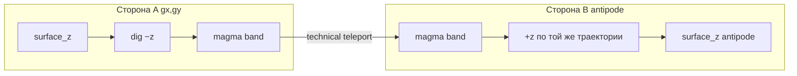

| Конcept | Правило |
|---|---|
| Движение до magma | траектория **вниз** (−z) в колонке `(gx, gy)` |
| **Пересечение magma** | **technical teleport** на **нижнем** z magma band (см. ниже) |
| После teleport | **+z** в `(gx', gy')`, старт с **`z_magma_bottom(gx', gy')`** antipode |
| `z_min` | **не** «конец планеты»; ниже `z_magma_bottom` в колонке cells **нет** |

#### Magma band: толщина и teleport (утверждено направление, edge case)

Magma — **не одна cell**, а **band** из нескольких z-уровней (как shallow terrain, но отдельный тип):

```
column (gx, gy):
  … rock …
  z_magma_top    …  } magma band (thickness ≥ 1, параметр мира)
  …              …  }
  z_magma_bottom …  }  ← deepest magma cell in this column
  (ниже — void в PK; продолжение только через antipode)
```

| Параметр | Смысл |
|---|---|
| `magma_band_thickness` | число z-слоёв magma (или `z_magma_top`…`z_magma_bottom` per column) |
| `z_magma_bottom(gx, gy)` | **нижний** z magma в колонке (max depth into planet at this xy) |
| `z_magma_top(gx, gy)` | верх magma band (граница с rock/solid выше) |

**Teleport (утверждено):** переход **с нижнего слоя magma** на стороне A **на нижний слой magma** antipode B — не с произвольной z внутри band и не «в одну cell».

```
(gx', gy') = antipode_xy(gx, gy)
z'         = z_magma_bottom(gx', gy')

teleport: (gx, gy, z_magma_bottom(gx,gy))  →  (gx', gy', z')
далее:    движение +z через magma band antipode → rock → surface antipode
```

**Пока внутри magma band (до bottom):** движение **−z** в колонке `(gx, gy)` через все magma cells сверху вниз. Teleport — см. **M-3** (movement resolver).

**Skeleton:** на каждой `(gx, gy)` и antipode `(gx', gy')` генерировать **весь magma band** (все z между top и bottom), не одну voxel.

#### M-3: movement resolver (контракт, impl ⬜)

> Детали resolver — [tz_locations.md § Magma antipode](tz_locations.md#magma-antipode-переход-через-планету-m-3). Здесь — триггер и flip ±z.

| Правило | Контракт |
|---|---|
| **Trigger teleport** | Персонаж на `(gx, gy, z_magma_bottom)` и intent **«глубже»** (Δz −1) **или** попытка шага на z без cell (void ниже bottom) → **не** ошибка pathfinding, а `magma_antipode_teleport` |
| **Teleport target** | `(gx', gy', z_magma_bottom(gx', gy'))` — bottom→bottom |
| **±z flip после teleport** | На стороне A «глубже» = **−z**. На стороне B resolver **инвертирует** vertical intent, пока `z ≤ z_magma_top(gx', gy')`: «глубже» → **+z** (к surface antipode); «выше» → **−z**. После выхода из magma band antipode — обычные правила z |
| **A\*** | Void под `z_magma_bottom` **не** edge графа; переход только через спец-правило magma |
| **LLM / UI** | Событие `magma_antipode_crossing` (from/to xy,z); narration — отдельный шаблон, не generic teleport |

**Antipode (контракт, impl TBD):**

```
(gx', gy') = antipode_xy(gx, gy, world_bounds)
```

- **v2 declared world:** противоположная точка на решётке мира (напр. отражение от центра bbox / `(gx + W/2) mod W` — фиксируется при `world_bounds`).
- **v1 anchor bbox:** antipode только если мир объявлен как **closed planet grid**; иначе magma → teleport требует v2 extent.

**Skeleton v1:** solid + **N_base band**; magma band — **опционально до M-2** (edge case, impl queue п.12).

**Закрытие edge case M-1…M-5:** antipode_xy · magma **band** on skeleton · movement: −z через band → teleport **bottom→bottom** · magma heat · v2 closed grid. Impl после TR-1 п.1–7.

**Gameplay / movement (edge case — impl ⬜):** movement resolver — M-3; terrain маркирует voxels `system_terrain: magma`.

### Terrain layers (вертикальная модель — утверждено направление)

Три **разных** семантики по z — не один monolith «subsurface»:

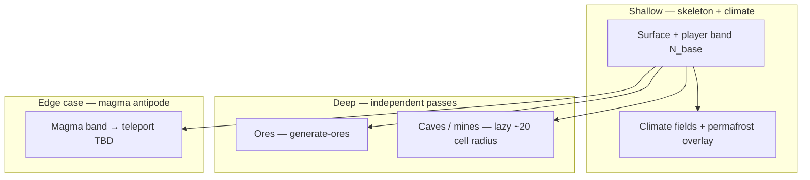

| # | Слой | Когда создаётся | Смысл | Ограничения |
|---|---|---|---|---|
| **1 Magma** *(edge case)* | skeleton *(отложено)* | Переходный band; antipode teleport | Temp ↑; см. § Planet topology | impl ⬜ M-1…M-5 |
| **2 Solid skeleton** | `generate-surface` pass 2 | surface + player/climate band + rock **до** magma band | solid only | без liquid |
| **3 Liquid** | **`generate-climate`** (вместе с climate pass) | Абстрактные **водоносные / fluid** слои (не «вода» буквально) | **Семантика от температуры:** ice / liquid / vapor / … через registry + `temperature_base` | не из `z_to_terrain`; overlay на существующие cells |
| **4 Ores** | `generate-ores` | Независимая генерация | `system_material` / deposit markers | caves не перезаписывают |
| **5 Caves** | lazy / `generate-caves` | Локально ~**20 cells** от входа | carve air/cave terrain; **cave hydrology** (подземные озёра/реки, U12) | после ores; не в magma |

**Magma band (контракт, edge case):** band **толщиной ≥1 z** ниже solid (`magma_band_thickness` / per-column top…bottom). Все cells = `system_terrain: magma`. Teleport: **`z_magma_bottom` → antipode `z_magma_bottom`**. Skeleton v1 может пропустить до M-2.

**Liquid + climate (утверждено):** liquid layer **не** на `generate-surface`; накладывается на **`generate-climate`** (или sub-pass orchestrator), потому что тип fluid **зависит от effective temperature** и правил мира (`precipitation_liquid`, registry). Shallow liquid (море, реки) — те же правила, surface z + climate.

> **Форма дна водоёмов и русел:** target — планирование геометрии и запись высот в terrain/relief, до column fill. Гидрология рассчитывает воду и маршруты рек, передаёт маршруты в повторный relief-вызов и читает готовые высоты. Норматив порядка — [Terrain/relief и гидрология](#terrain-relief-hydrology-planning).

**Не сейчас:** полная sim магмы; soil transition node; regional shared strata (B).

### Зазоры при крутых перепадах (Δz > N)

При фиксированных N слоях ниже `surface_z` **колонка не дотягивается** до уровня низкого соседа — в PK остаются «дыры» (нет `map_cells` на промежуточных z между обрывом и подошвой соседа).

**Пример** (N=20): колонка A `surface_z=30` → заполнено z=30…10; сосед B `surface_z=5`. На A нет z=9…6 — **зазор** относительно рельефа B, если нужна сплошная подземная масса / cliff volume.

**Поэтому `generate-surface` — двухфазный внутри одного endpoint:**

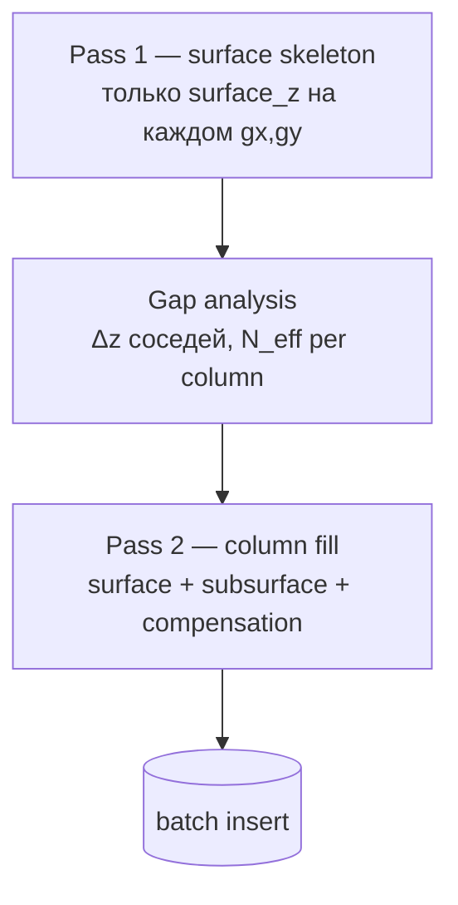

| Фаза | Выход | Зачем |
|---|---|---|
| **1 Surface skeleton** | `SurfaceHeightmap`: `surface_z[gx,gy]`, bbox, без subsurface | заранее видим все кейсы Δz > N |
| **Gap analysis** | `N_eff(gx,gy)` или явный `z_bottom(gx,gy)` | компенсация до согласованного покрытия |
| **2 Column fill** | `list[MapCell]` solid strata | детерминированная порода по z |

**Правило компенсации (утверждено):**

```
N_base = world.map_subsurface_depth ?? 0   # flat ground: one surface cell per column

# на каждой (gx, gy) после pass 1:
Δ_cliff = max(0, surface_z(gx,gy) - min(surface_z соседей))   # 4- или 8-neighborhood
N_eff   = max(N_base, Δ_cliff)   # если сосед ниже больше чем на N — углубляем колонку

z_top    = surface_z(gx, gy)
z_bottom = max(world.z_min, z_top - N_eff)

# заполнить все целые z ∈ [z_bottom, z_top] одной колонкой (PK уникален)
```

Инвариант: после pass 2 **нет «вертикальной дыры»** между `surface_z` соседних колонок, если разница высот ≤ покрытия (при необходимости `N_eff > N_base`). Cliff face на границе колонок — solid rock (`cliff` / `rock` — тип из registry, TBD).

**Лог / master preview (optional):** count ячеек с `N_eff > N_base`, max Δ_cliff — для мастера до ores/caves.

**Не в v1:** горизонтальный «мост» между далёкими колонками (только local neighborhood).

### Relief grade (поддомен Terrain — указатель)

**Поддомен Terrain** outdoor SLOPE / SHEER + facing + **шаблоны 1:1 buildings** (global `relief_templates` + world registry; `context` singular):  
→ [`tz_terrain_relief.md`](./tz_terrain_relief.md) (SoT generate: очереди, стрелки). Bake R36v / SQL / шаблоны — [`tz_terrain_relief_v1_superseded.md`](./tz_terrain_relief_v1_superseded.md).

Кратко: grade — **не** MaskDomain и **не** `N_eff`. Column gap (этот документ § Зазоры) = *объём* колонки; relief = *проходимость грани*.  
**Generate:** mill — DAG на сцене (1…N чанков) или ГМ `detailed_bake`; entry L2 — без mill. Per-chunk в `FineChunkRunner` pool ([`tz_terrain_relief_v1_superseded.md`](./tz_terrain_relief_v1_superseded.md) **R36v**). Повторный materialize/patch **сбрасывает** stale grade, не mill в том же проходе. Callers — [`tz_terrain_relief.md`](./tz_terrain_relief.md) § Caller. Consumers: горы, open land, shore, roads (`road_shoulder` T-10).

### Terrain ↔ ClimateData (разделение ответственности, физическая связь)

**Выбрано: вариант A** — terrain **физически зависит** от climate-related данных (pole field, `typical_elevation_z`, zone profile), но **модули разделены**:

| Слой | Кто | Пишет |
|---|---|---|
| Elevation bias / surface shape | terrain generator, **input:** `ClimatePoleField.sample` | `z`, base `system_terrain` (solid) |
| Player/climate band + solid to magma | terrain generator (`generate-surface`) | rock/soil до magma horizon |
| **Magma band** | terrain generator (`generate-surface`) | magma voxels; **transition**, antipode link at runtime |
| Climate fields | `ClimateOrchestrator` (`generate-climate`) | `temperature_base`, `rainfall` |
| **Liquid layer** | climate pass (same API) | fluid overlay; semantics from temp |
| **Climate → terrain overlay** | climate pass | permafrost и верхние z |
| **Ores** | `generate-ores` (independent) | deposit markers |
| **Caves / mines** | lazy ~20 radius / `generate-caves` | carve + **cave hydrology** (подземные озёра/реки, U12) |

**Не сейчас:** нода **soil transition** — отдельная фича.

**Убрано из skeleton:** `liquid_body` через `z_to_terrain` — liquid только § Terrain layers п.3.

### Ordered world generation passes (очередь)

**Очередь (строго):** `surface → ores → caves → climate` после того, как мир **объявлен** (import JSON мастером). Сборка — **только engine nodes (DAG)**; генераторы **не** вызывают соседние домены.

**Внутри `generate-surface` (target, Phase 9+ D HY):** Pass 1 → **hydrology (Pass 1.5)** → gap analysis → Pass 2 column fill. См. [`tz_terrain_hydrology.md`](./tz_terrain_hydrology.md).

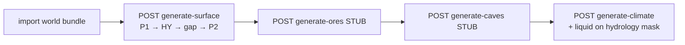

| # | Endpoint | Generator (pure) | Читает | Пишет |
|---|---|---|---|---|
| 1 | `generate-surface` | terrain passes + **hydrology (Pass 1.5)** | `World`, locations; **input:** `ClimatePoleField` от ноды | skeleton; river edges → `ConnectionPersistService` |
| 2 | `generate-ores` | `generate_ores` | `map_cells` | ore markers |
| 3 | `generate-caves` | `generate_caves` | `map_cells` | carve |
| 4 | `generate-climate` | climate passes | `map_cells` + **hydrology metadata** (`liquid_candidate`, role) | temp, rainfall, liquid |

#### Изоляция генераторов (утверждено)

| Правило | Смысл |
|---|---|
| Генераторы не знают друг о друге | нет import/call между `terrain/`, `climate/` passes, `ores`, `caves` |
| Сборка на нодах | pole → surface → persist → ores → caves → climate — deps DAG |
| Shared input | `ClimatePoleField`, bbox — **данные** в аргументах, не скрытый вызов чужого generator |
| Между pass | pass N+1 читает **DB**, не in-memory monolith |

**Код:** ✅ TR-1b (2026-06) — pole resolve в `MapCellService` / `map.py`; generator принимает `pole_field`. ⬜ `debug_settlement` pipeline — HTTP (DBG-1).

**Вне очереди materialization (другие вещи):**

| API | Смысл |
|---|---|
| `POST …/generate-z-slice` | lazy fill **одной колонки** `(gx,gy,z…)` — API ✅, engine node ⬜ |
| Lazy caves ~**20 cells** у входа | gameplay (**impl queue п.8 DEFERRED**) — **не** z-slice |

| Endpoint | Merge |
|---|---|
| `generate-surface` | upsert solid/magma |
| `generate-ores` / `generate-caves` | STUB — layer upsert |
| `generate-climate` | climate + liquid overlay |

> **Debug harness:** handlers `map/generate-*` — path **2**; **production orchestration:** ноды DAG (path **1**). См. [`tz_world_generation_dag.md`](./tz_world_generation_dag.md) § «Три входа».

`INSERT OR IGNORE` **недостаточен** для multi-pass — нужен **selective upsert** / patch по layer kind (terrain vs ore vs cave).

### Объём cells и запись в БД (рекомендация)

**Оценка объёма:**

```
cells ≈ columns × avg_depth
columns = (bbox_width × bbox_height)   # одна колонка = один (gx, gy)
avg_depth ≈ 1 + N_eff_mean             # surface + subsurface; N_eff ≥ N_base
```

Пример: bbox 200×200, N≈22 → до ~880k rows — норма для «заготовки», но не в один INSERT.

**Разделение слоёв (важно):**

| Слой | Где | Параллелизм |
|---|---|---|
| **Pure generator** | `TerrainGeneratorService` / column fill | stateless; chunk rect in → cells out |
| **Orchestrator job** | `MapCellService` / engine node | partition, workers, batch persist |
| **DB** | SQLite `map_cells` | **один writer**; batch `executemany` в транзакции |

Generator **не** знает про threads/SQL — только `(world, locations, rect, surface_heightmap?)`.

**Pass 1 (surface skeleton)** — лёгкий: держим **весь** `surface_z` grid в памяти (`int[gy][gx]`, для 500×500 ≈ 1 MB). Gap analysis — один sweep по grid (или по chunk с halo ±1 для соседей).

**Pass 2 (column fill)** — тяжёлый: **chunked** по rect без загрузки всего мира в RAM.

**Chunking (v1 impl):**

| Параметр | Рекомендация | Заметка |
|---|---|---|
| `chunk_columns` | **32×32** или **64×64** | 64×64 × depth 25 ≈ 100k cells/chunk |
| Halo | **±1 cell** при gap analysis на границе chunk | соседи для `N_eff` на edge |
| Persist | **1 transaction / N chunks** | `executemany` + selective upsert; см. § **TR-PERF** (impl ⬜) |
| Порядок chunks | row-major, deterministic | воспроизводимость |
| **Parallel v1 (текущий код)** | **нет** — sequential chunks | проще отладка; см. § «Многопоточность (TR-PAR)» |
| **Parallel v2 (target)** | `ChunkComputePool` generate + serial `save_pass` | ✅ impl — `TerrainBatchOrchestrator`, `ClimateBatchOrchestrator` |

### Многопоточность (TR-PAR)

> **Статус:** v2 ✅ chunk pool + serial persist (`ChunkComputePool`, `TerrainBatchOrchestrator`, `ClimateBatchOrchestrator`); facade `WorldSurfaceMaterializationOrchestrator`. **DAG wiring** — контракт ниже (impl ⬜).

#### Реализация (v2, код)

| Компонент | Путь | Роль |
|---|---|---|
| `MaterializationContext` | `application/worldData/materializationContext.py` | `free_cores` от caller; **TR-PERF-2:** `chunks_per_commit` (default 8); **TR-PERF-3:** `insert_only` |
| `ParallelPolicy` | `application/worldData/parallelPolicy.py` | `resolve_terrain_workers` / `resolve_climate_workers` |
| `ChunkComputePool` | `application/worldData/chunkComputePool.py` | Thread-pool generate (ProcessPool — backlog) |
| `TerrainBatchOrchestrator` | `terrainBatchOrchestrator.py` | coarse+hydro → fine chunks parallel, persist serial |
| `ClimateBatchOrchestrator` | `climateBatchOrchestrator.py` | anchor serial → weather/overlay parallel, persist serial |
| `WorldSurfaceMaterializationOrchestrator` | `worldSurfaceMaterializationOrchestrator.py` | S→CL, один `ctx` на stack |

**Debug HTTP (interim caller):** `map.py` — `resolve_materialization_context`; если query `free_cores` не передан → stub **`5`** (не probe). Production caller — **DAG** (probe, см. ниже).

#### Текущее поведение (до v2 / устаревшее описание v1)

`TerrainBatchOrchestrator._materialize_fine_tile` (legacy sequential reference):

1. macro-тайлы — **последовательно** (bootstrap: priority list; `mode=full`: весь bbox);
2. внутри тайла — `iter_fine_chunks` row-major, **32×32** fine-колонок (`terrain_chunk_columns`);
3. **v2:** `ChunkComputePool` → `generate_surface_chunk` parallel; `save_pass(terrain)` **strictly serial**;
4. **v1 (до TR-PAR):** синхронный chunk loop без pool.

`TerrainGeneratorService` — **pure sync**, без async и без знания о потоках.

#### Почему не параллелим persist

| Ограничение | Следствие |
|---|---|
| SQLite **single-writer** | параллельные `upsert` из нескольких потоков → lock contention / `database is locked` |
| SQLite **PRAGMA bulk session** | TR-PERF-4 PRAGMA только на `_bootstrap_conn`; OLTP на `_conn`; `asyncio.Lock` — § **TR-PAR-5** |
| Детерминизм smoke/regression | row-major + serial insert = воспроизводимый порядок строк |
| Отладка harness | один chunk за раз — проще bisect при битых cells |

**Инвариант v1:** не более **одного** активного terrain-writer на `world_uid`.

#### Target v2 — разделение generate / persist

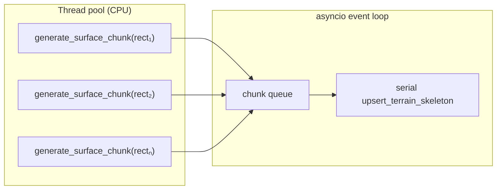

| Слой | Параллелизм v2 | Заметка |
|---|---|---|
| Pass 1 coarse + hydrology planning | **serial** | один `surface_z` / `coarse_hydro` на весь planning scope |
| Gap analysis (`N_eff`) | **serial per tile** | нужен полный `surface_z` тайла (или halo ±1 на границе chunk — допустимо) |
| Pass 2 column fill | **parallel** по `ColumnRect` | `ChunkComputePool` + `ThreadPoolExecutor` (ProcessPool — backlog при GIL) |
| Persist terrain | **strictly serial** | один writer; `save_pass(terrain)` под lock / single consumer |
| Climate cell weather + liquid overlay | **parallel batches** | `ClimateBatchOrchestrator`; persist climate serial |
| Climate pole + anchor | **serial** | global fields / surface index |

**Worker contract:** `(world_uid, rect, heightmap_blob, n_eff_rect, hydrology_rect) → list[MapCell]` — без repos, без RNG от порядка chunk (seed = `f(world_uid, gx, gy, pass_id)`).

**Orchestrator contract (batch facades, не generators):**

- caller передаёт **`MaterializationContext(free_cores=…)`** — число ядер под **generate** (не persist);
- `ParallelPolicy.resolve_*_workers(ctx, world)` → eff из `min(free_cores, parallel_workers_override?, world.terrain_parallel_workers?, world.climate_parallel_workers?)`, clamp ≥ 1;
- `ChunkComputePool(workers)` — partition rects / cell batches → parallel sync compute;
- persist — **один** serial path: `await map_cell_service.save_pass(...)` (bounded in-flight chunks ≈ `2 × workers`);
- progress (debug): `{chunks_done, chunks_total}` в HTTP response; SSE / `job_id` — backlog.

**Инвариант:** `TerrainGeneratorService` / climate passes **не** probe CPU — только orchestrator + `ParallelPolicy`.

#### DAG — передача `free_cores` (утверждено, impl ⬜)

> См. также [`tz_world_generation_dag.md`](./tz_world_generation_dag.md) § «MaterializationContext».

**Кто probe:** **один раз** на входе materialization subgraph (gate-нода или wrapper до `generate_surface`), **не** каждая pass-нода и **не** generators.

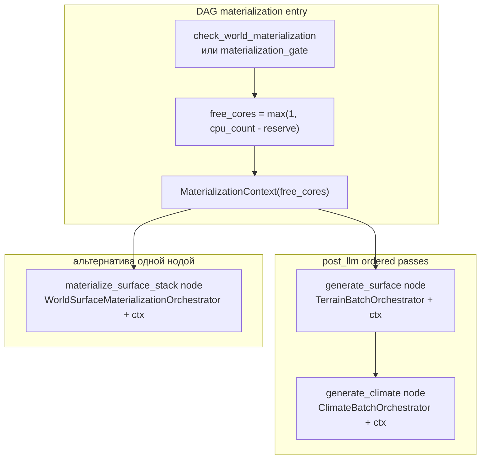

| Правило | Смысл |
|---|---|
| **Один `ctx` на run** | Весь S→CL (или S→O→C→CL) в одном materialization run делит **тот же** `MaterializationContext` |
| **Где хранить между нодами** | `ExecutionState` / `context["materialization_ctx"]`, выставляет gate; downstream ноды **читают**, не пересчитывают `cpu_count` |
| **`reserve`** | ≥ 1 для FastAPI/asyncio event loop; точное значение — настройка engine (не world row) |
| **World caps** | `terrain_parallel_workers`, `climate_parallel_workers` на `worlds` — верхняя граница поверх `free_cores` |
| **Debug override** | Query `parallel_workers` на HTTP — **только debug**; DAG **не** использует query override |
| **Не путать с DAG levels** | `asyncio.gather` на **разных нодах** DAG (chat orchestration) ≠ TR-PAR chunk pool внутри `generate_surface` |

**Target wiring нод (после gate G5 — только с мастером):**

| Node id | Вызывает (target) | `ctx` |
|---|---|---|
| `generate_surface` | `TerrainBatchOrchestrator.save_terrain_batch(..., ctx)` | из gate / parent |
| `generate_climate` | `ClimateBatchOrchestrator.apply_climate_batch(..., ctx)` | **тот же** объект, что surface |
| `materialize_surface` (optional) | `WorldSurfaceMaterializationOrchestrator.materialize_surface_stack(..., ctx)` | gate создаёт; одна нода на весь S→CL |

**Текущий код DAG (interim):** `GenerateClimateNode` ещё вызывает `ClimateOrchestratorService.apply_climate_pass` без `ctx` — **миграция** на `ClimateBatchOrchestrator` + shared `MaterializationContext` в backlog DAG.

**Debug vs DAG:**

| Caller | `free_cores` |
|---|---|
| `POST …/map/generate-*`, `materialize-stack` | stub `5` если query не передан; иначе query |
| Engine DAG (production) | `max(1, os.cpu_count() - reserve)` на gate |

#### Bootstrap и macro-тайлы

| Уровень | v1 | v2 (рекомендация) |
|---|---|---|
| Несколько bootstrap-тайлов | serial | **optional** parallel tiles — только если RAM позволяет (один fine-тайл `cell_m=3000` ≈ сотни MB heightmap + сотни M cells) |
| Chunks внутри одного тайла | serial | **parallel generate**, serial persist |
| `materialize-tile?gx=&gy=` | один тайл, serial | тот же chunk pool |

**Практика для `fine_cells_per_map_cell=3000`:** параллелить **chunks внутри тайла**, не весь bbox; bootstrap `max_tiles` ограничивает число тайлов.

#### Что не параллелить

- Coarse hydrology `apply` до fine materialize (единый `coarse_hydro` index).
- Declared meter river carve с глобальным merge в один проход (или partition по basin с merge barrier).
- `generate-climate` liquid overlay — parallel batches в `ClimateBatchOrchestrator` (pole/anchor serial); см. [`tz_climate.md`](./tz_climate.md) § CL-PAR.
- DAG `asyncio.gather` на **разных нодах** — оркестрация чата, не substitute для TR-PAR chunk pool **внутри** `generate_surface`.

#### Impl queue

| ID | Задача | Статус |
|---|---|---|
| **TR-PAR-1** | Chunk pool: `ChunkComputePool` + serial persist in `TerrainBatchOrchestrator` | ✅ |
| **TR-PAR-2** | Progress `{chunks_done, chunks_total}` in debug API response | ✅ |
| **TR-PAR-3** | `MaterializationContext.free_cores` + `terrain_parallel_workers` cap + API override | ✅ |
| **TR-PAR-4** | Stress test: bootstrap 1 tile, `cell_m=3000`, workers=4 vs serial | ⬜ |
| **TR-PAR-5** | Bootstrap DB connection: `_bootstrap_conn` + lock; PRAGMA на bootstrap conn | ✅ |
| **TR-PAR-6** | `BootstrapMapCellWriter` — explicit bulk persist port; убрать ContextVar routing | ✅ |
| **TR-PAR-DAG-1** | Gate probe `free_cores` → `context["materialization_ctx"]`; ноды `generate_surface` / `generate_climate` → batch orchestrators + shared `ctx` | ⬜ **gate** — только с мастером |

#### TR-PAR-5 — Bootstrap DB connection

> **Проблема:** TR-PERF-4 менял PRAGMA на единственном shared connection (§ TR-PERF-DEBT-2). **v1 (interim):** ContextVar routing на `db.conn` — superseded **TR-PAR-6**.

**Постоянная часть (impl):** [`Database`](backend/app/db/database.py) — два connection к одному файлу:

| Connection | PRAGMA | Назначение |
|---|---|---|
| `_conn` (main) | WAL + `foreign_keys` | OLTP: chat, CRUD, gameplay reads |
| `_bootstrap_conn` | + `synchronous=NORMAL`, `temp_store=MEMORY`, `cache_size=-64000` (один раз в `connect`) | bulk materialize через **TR-PAR-6** writer |

**Контракт v2 (TR-PAR-6):** `bulk_write_lock()` — только `asyncio.Lock`; repos получают `bootstrap_conn` **явно** через `BootstrapMapCellWriter`, не через `db.conn` magic.

**Приёмка PAR-5:** dual conn + lock + WAL visibility (см. `test_database_bootstrap_conn.py`).

#### TR-PAR-6 — BootstrapMapCellWriter

> **Проблема:** TR-PAR-5 v1 routing через `ContextVar` — неявный контракт (ambient conn). **Решение:** typed writer port.

**Файл:** [`bootstrapMapCellWriter.py`](backend/app/application/worldData/bootstrapMapCellWriter.py)

| Метод | Контракт |
|---|---|
| `session(*, enabled=True)` | `Database.bulk_write_lock()`; yield `self` |
| `write_terrain(cells, *, insert_only)` | INSERT или upsert на `bootstrap_conn` |
| `write_terrain_chunk_batch(chunks, *, insert_only)` | TR-PERF-2: одна txn на batch чанков |
| `write_climate(cells)` | `upsert_climate_fields` на `bootstrap_conn` |

**Границы:**

| Путь | Persist |
|---|---|
| `materialize-stack` | `BootstrapMapCellWriter` |
| OLTP (`save_z_slice`, lazy, settlement, debug) | `MapCellService` → `main_conn` |

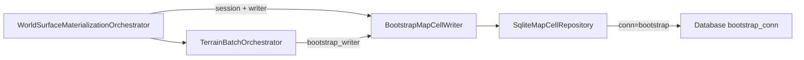

**Инварианты:** `insert_only` resolve до session; writer не трогает `main_conn`; один active lock.

**Приёмка:**

| ID | Критерий |
|---|---|
| PAR-6-1 | materialize не использует ContextVar / ambient `db.conn` routing |
| PAR-6-2 | `write_terrain` на bootstrap conn; main conn PRAGMA стабилен |
| PAR-6-3 | WAL: bootstrap writes видны с `main_conn` |

**Связь:** закрывает TR-PAR-DEBT-1; частично TR-PERF-DEBT-3/6.

--- 

**Приёмка v2:** тот же `world_uid` + seed → **идентичный** набор `(x,y,z, system_terrain, hydrology)` после serial v1 и parallel v2 (order-independent compare).

**Порог «всё в одном batch»:** если `columns × (1+N_base) < ~50_000` — можно один generate + один insert (малые миры / test); parallel v2 **не обязателен**.

**Progress UX (позже):** job id + `{chunks_done, chunks_total, cells_written}`; опционально SSE.

**Детерминизм:** RNG seed = `f(world_uid, gx, gy, pass_id)` — chunk order не влияет на содержимое ячеек.

**Lazy / v2 declared world:** тот же chunk API; eager прогоняет все chunks bbox/world_bounds, lazy — scene volume / column (§ **TR-LAZY-LOAD**).

### World Pack storage (TR-PACK) — target persist

> **Статус:** pack L0 + entry L2 — ✅ path; **light / full / detailed** bake API — ✅; climate fine на detailed — ✅ (tile fine + L2 z). **Продуктовое ТЗ:** [`tz_world_pack_storage.md`](./tz_world_pack_storage.md). **TR-PERF** (ниже) — interim на `map_cells`; для wilderness skeleton **заменяется** TR-PACK.

**Цель:** cold load ≤ 5 min; master offline bake (light / full / detailed) + lazy дозаполнение, если pack partial.

| Было | Станет |
|---|---|
| wilderness terrain → `map_cells` INSERT | **L0/L2** → World Pack (zstd tiles) |
| gameplay patches → `map_cells` | **`map_cell_patches`** SQLite |
| eager full bbox fine grid на bake | **LOD:** L0 world map + L1 pins; **L2** = refine L0 (detailed / entry-first) |

**LOD bake:** § Идея 1 + § Идея 2; `world_map_cells_per_tile = 32` (WP-10). Wire/API modes — ниже § **Bake modes (locations)**. Pack orchestration — [`tz_world_pack_storage.md`](./tz_world_pack_storage.md); L0 compose — [`tz_map_light_bake.md`](./tz_map_light_bake.md).

### Bake modes — terrain + hydrology + climate

> **Утверждено мастером 2026-07-19; job boundaries 2026-07-20.** Продуктовый процесс: `light_bake` → `full_bake` (**только L0**); `detailed_bake` — **L2** одной локации. Entry / rings (WP-13) — **отдельная джоба**, не фаза light/full. Cross-ref: [`tz_world_pack_storage.md`](./tz_world_pack_storage.md) § **Job boundaries**.

| Термин | LOD | Pipeline | Scope |
|---|---|---|---|
| **light_bake** | **только L0** (+ climate coarse) | surface → hydrology mask → climate coarse на light canvas | **Все** macro-tiles с `named_locations` **∪ declared hydro** |
| **full_bake** | **только L0** (+ climate coarse) | **Тот же** L0 pipeline | **Весь** `world_bounds` (AABB) |
| **detailed_bake** | **L2** `location_terrain` | refine L0 → fine terrain (+ hydro constraints из parent light) + climate fine по territory | **Одна** `location_uid` |

**Инварианты генераторов (все три режима):**

1. Generators pure: materialize geometry/masks; persist — Pack writer / orchestrator ([`layer-boundaries.mdc`](../.cursor/rules/layer-boundaries.mdc)).
2. L2 **не** invents world-map rivers/coast — только refine parent light ([`tz_world_pack_storage.md`](./tz_world_pack_storage.md) § Идея 2; hydrology — [`tz_terrain_hydrology.md`](./tz_terrain_hydrology.md)). Outdoor grade generate — [`tz_terrain_relief.md`](./tz_terrain_relief.md); подробности bake **R36u** — [`tz_terrain_relief_v1_superseded.md`](./tz_terrain_relief_v1_superseded.md).
3. Base climate на pack-мире — только через bake; `POST generate-climate` → 422 ([`tz_climate.md`](./tz_climate.md) § World Pack climate).
4. Product L0 process — только light → full; имена `wilderness_*` в pack I/O — storage legacy, не bake mode.
5. **L2 ∉ light_bake / full_bake.** После light caller **может** стартовать entry job (scene + bg у spawn) — это другая джоба, не часть `pack/bake?mode=light`.

#### Offline completeness (master package)

| Case | Pack state | Игрок получает |
|---|---|---|
| **1. light_bake complete** | L0 на всех location tiles; `locations_index` pins | World map по локациям; вне них — дыры до full; L2 — lazy / detailed |
| **2. full_bake complete** | L0 на **весь** `world_bounds` | Сплошная world map в прямоугольнике мира; L2 всё ещё lazy, если не было detailed |
| **3. full + all detailed_bake complete** | (2) + `location_terrain` на **каждую** pin-локацию | Тёплый старт по локациям; non-location L2 rings — runtime/optional |

**Partial pack — норма:** отсутствие prebake **не** ломает игру; ломает отсутствие resume / lazy path.

| Нехватка | Дозаполнение |
|---|---|
| Missing L0 location tiles | **light_bake** (или resume light) |
| Missing L0 вне локаций (case 1 → 2) | **full_bake** (весь bounds) |
| Missing `location_terrain` для uid | **detailed_bake(uid)** offline **или** entry-first / location_entry в runtime (WP-13) |
| Missing fine chunks вне локаций | Runtime rings / path queue — **не** обязательный offline case 3 |

#### Detect (нужно для resume)

`tiles_pct` по-прежнему = ready/total **среди manifest.tiles**. Offline case — отдельно: `pack_completeness` в `GET …/loading-progress` (`PackCompletenessClassifier`).

| Сигнал | light_complete | full_complete | full_detailed_complete |
|---|---|---|---|
| L0 baked ⊇ expected_light (**все** location tiles) | ✅ | — | — |
| L0 baked ⊇ expected_full (**весь** `world_bounds`) | — | ✅ | ✅ |
| `location_terrain` готов для всех pins в `locations_index` | — | — | ✅ |

Wire/API и классификатор — [`tz_world_pack_storage.md`](./tz_world_pack_storage.md) § **Bake modes** / § **Pack completeness**. Auto-resume loop (classify → bake) — caller.

#### Impl status (generators path)

| Mode | Status |
|---|---|
| light_bake | ✅ `POST …/map/pack/bake?mode=light` — все location tiles (cap только debug `max_tiles>0`) |
| full_bake | ✅ `mode=full` — весь resolved `world_bounds` AABB |
| detailed_bake | ✅ `mode=detailed&location_uid=` — L2 territory refine + climate fine |
### Persist performance (TR-PERF)

> **Статус:** ✅ TR-PERF-1…4 impl. **Scope:** bootstrap / `materialize-stack` / `save_terrain_batch` — **не** gameplay patch, **не** parallel persist.

**Проблема (код сейчас):** `SqliteMapCellRepository._upsert_partial` — цикл `execute` **на каждую ячейку** + `commit` после каждого чанка (~21k rows × ~8k commits на тайл 3000×3000 м).

**Цель:** init мира — быстрый bulk-write при сохранении инвариантов TR-PAR (один writer, serial persist, детерминизм содержимого ячеек).

#### TR-PERF-1 — `executemany` в транзакции

| Слой | Контракт |
|---|---|
| `SqliteMapCellRepository._upsert_partial` | один SQL-шаблон; `conn.executemany(sql, rows)`; **не** N×`execute` |
| `insert_bulk_ignore` | то же — `executemany` для lazy/minimal batch |
| Commit | только при выходе из транзакции (см. TR-PERF-2), если не вложенный `Database.transaction()` |

**Sub-batch (опционально):** при `len(cells) > 50_000` — несколько `executemany` по 2–5k строк **внутри одной** транзакции (лимит RAM / WAL).

**Selective upsert** — без изменений: `ON CONFLICT … DO UPDATE SET system_terrain = … WHERE system_building_element IS NULL`.

#### TR-PERF-2 — реже коммитить (multi-chunk transaction)

| Параметр | Default | Где |
|---|---|---|
| `chunks_per_commit` | **8** | `MaterializationContext` или константа orchestrator |
| Область транзакции | до **N** последовательных terrain-chunks (row-major) | `TerrainBatchOrchestrator._materialize_fine_tile` persist loop |
| Commit | 1× на N chunks (~8 × ~21k ≈ **168k rows** при `chunk_columns=32`) | `MapCellService.bulk_persist_session()` → `_in_transaction` |

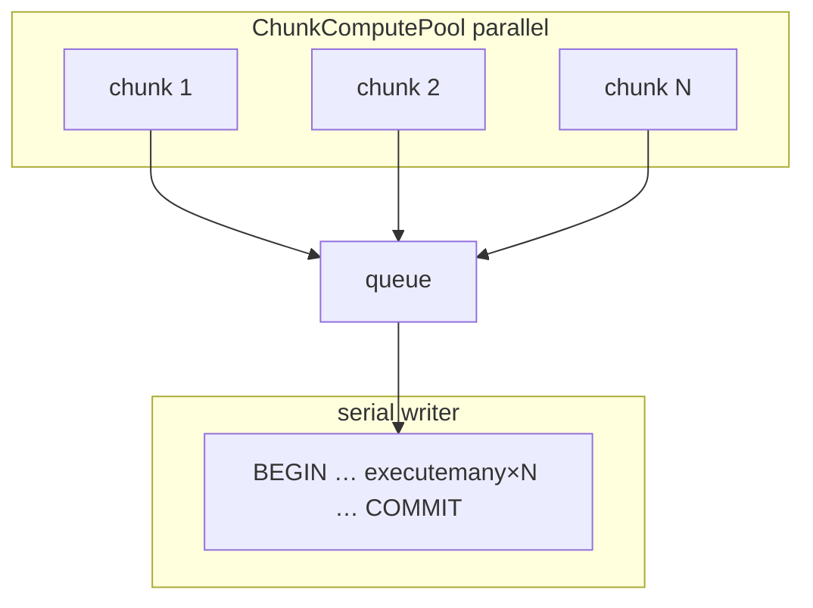

**Не делать:** одна транзакция на весь тайл 3000×3000 (≈189M rows) — риск WAL/RAM/rollback.

**Режим regen** (поверх существующих cells): тот же `executemany` + upsert; `chunks_per_commit` можно уменьшить (4) для короче lock.

#### TR-PERF-3 — init fast path (опционально, после PERF-1/2)

| Условие | SQL | Когда |
|---|---|---|
| `map_cells` для `world_uid` **пуст** (post-clear import) | plain `INSERT` / `executemany` без `ON CONFLICT` | первый `materialize-stack` |
| cells уже есть | `upsert_terrain_skeleton` (selective) | regen, climate overlay, patch |

Флаг: `MaterializationContext.insert_only` — `null` → auto по `has_world_cells`; `true`/`false` — явный override caller.

#### TR-PERF-4 — PRAGMA bulk session

На время `materialize_surface_stack` (один job): `synchronous=NORMAL`, `cache_size=-64000`, `temp_store=MEMORY`. Восстановление PRAGMA на выходе. Query `bulk_pragmas=false` отключает. **Не** `synchronous=OFF`.

#### Приёмка TR-PERF

| ID | Критерий |
|---|---|
| PERF-1 | `_upsert_partial` / `insert_bulk_ignore` используют `executemany` |
| PERF-2 | init tile: commits ≤ `ceil(chunks_total / chunks_per_commit)` |
| PERF-3 | Тот же world+seed → идентичный cell set до/после (как TR-PAR v2) |
| PERF-4 | Smoke: 1 bootstrap tile, `fine_cells_per_map_cell=1000`, persist быстрее serial execute (benchmark в TR-PAR-4) |

| ID | Задача | Статус |
|---|---|---|
| **TR-PERF-1** | `executemany` в `_upsert_partial` + `insert_bulk_ignore` | ✅ |
| **TR-PERF-2** | `bulk_persist_session` + `chunks_per_commit` в materialization | ✅ |
| **TR-PERF-3** | `insert_only` fast path для пустого `world_uid` | ✅ |
| **TR-PERF-4** | PRAGMA bulk session на `materialize-stack` | ✅ |

#### TR-PERF backlog (architecture debt)

> Impl TR-PERF-1…4 ✅; ниже — **не блокирует** debug bootstrap. См. также registry [`tz_generator_technical_debt.md`](./tz_generator_technical_debt.md) (TR-6, TR-7).

| ID | Severity | Проблема | Target fix | Код (ссылка) |
|---|---|---|---|---|
| **TR-PERF-DEBT-1** | medium | `MaterializationContext` смешивает caller input (cores), persist tuning (`chunks_per_commit`, PRAGMA), resolved state (`insert_only`) | Split: `MaterializationCallerInput` + `ResolvedMaterializationJob` или вынести persist в `PersistPolicy` / `TerrainPersistScope` | `materializationContext.py` |
| **TR-PERF-DEBT-2** | high (prod) | `Database.bulk_write_session` менял PRAGMA на shared connection | **TR-PAR-5** ✅ | `database.py` |
| **TR-PERF-DEBT-3** | medium | `insert_terrain_bulk` — blind `INSERT` без guard `system_building_element IS NULL`; explicit `insert_only=true` на непустом мире → PK error или перезапись | `TerrainPersistScope.BOOTSTRAP_EMPTY` + validate caller; отдельный `save_terrain_bootstrap()` вместо флага на `save_pass` | `mapCellService.save_pass`, `insert_terrain_bulk` |
| **TR-PERF-DEBT-4** | medium | Три insert-пути terrain (см. § **Insert path matrix** ниже) — исторически разные scope, сейчас дублируют executemany SQL | Единый `bulk_insert_cells(mode)` + scope enum; см. TR-7 | `mapCellRepository`, `mapCellService` |
| **TR-PERF-DEBT-5** | low | `bulk_write_session` на `IMapCellRepository` — infra SQLite, не домен map_cells | **TR-PAR-5** ✅ — только `Database` | `iMapCellRepository.py` |
| **TR-PERF-DEBT-6** | low | `WorldSurfaceMaterializationOrchestrator` получает `MapCellService` повторно (уже внутри `TerrainBatchOrchestrator`) | **TR-PAR-6** partial — writer для persist; `MapCellService` только probes | `worldSurfaceMaterializationOrchestrator.py` |
| **TR-PAR-DEBT-1** | medium | ContextVar ambient conn routing на `db.conn` (TR-PAR-5 v1) | **TR-PAR-6** ✅ — `BootstrapMapCellWriter` + explicit `conn` | `database.py`, repos |

##### Insert path matrix (почему три пути)

Три метода — **не случайное дублирование**, а три разных **persist scope** из § Persist cycle:

| Repo method | SQL | Service entry | Scope (ТЗ) | Семантика при конфликте PK |
|---|---|---|---|---|
| `insert_bulk_ignore` | `INSERT OR IGNORE` | `save_generated` | `minimal_repair` — lazy anchor, 1 cell | **Тихий skip** — idempotent repair, ячейка уже есть |
| `insert_terrain_bulk` | plain `INSERT` | `save_pass(terrain, insert_only=True)` | `surface_skeleton` bootstrap на **пустом** `world_uid` | **Ошибка** (PK violation) — caller обязан гарантировать пустоту |
| `upsert_terrain_skeleton` | `INSERT … ON CONFLICT DO UPDATE` + `WHERE building IS NULL` | `save_pass(terrain)` | regen / partial tile / climate overlay base | **Selective merge** — не трогает building cells |

**Почему не один метод:** `OR IGNORE` скрывает баги bootstrap (думали вставили 21k, вставили 0). Plain `INSERT` быстрее upsert на пустой таблице (TR-PERF-3). Selective upsert нужен при regen поверх settlement/structure.

**Почему smell остаётся:** все три строят SQL из `to_row` + `executemany` вручную; отличается только шаблон SQL. TR-PERF-DEBT-4 — конвергенция в один helper с `BulkInsertMode` enum, не слияние семантики в один SQL.

**DAG bypass:** `lazy_terrain` / `lazy_settlement` вызывают `map_cell_repo.insert_bulk_ignore` **напрямую**, минуя `MapCellService` — четвёртый вход в тот же путь (gate; агент не трогает ноды).

##### TR-PERF-DEBT-2 — PRAGMA на shared connection (история)

> **Target fix:** § **TR-PAR-5**. Ниже — описание проблемы до impl.

`Database` — singleton, одно `aiosqlite` соединение на процесс. `bulk_write_session` на время job выполнял:

```
PRAGMA synchronous=NORMAL
PRAGMA temp_store=MEMORY
PRAGMA cache_size=-64000
```

и восстанавливает прежние значения в `finally`.

**Риск:** FastAPI обрабатывает запросы конкурентно на одном event loop. Два overlapping `materialize-stack` (или materialize + обычный import):

1. Job A сохраняет PRAGMA, ставит NORMAL.
2. Job B сохраняет PRAGMA (уже NORMAL), ставит NORMAL.
3. Job A завершается, **восстанавливает** старые PRAGMA.
4. Job B ещё пишет bulk, но PRAGMA уже сброшены Job A → непредсказуемая durability / perf.

Для **single-user debug** риск низкий. Закрывается **TR-PAR-5** (bootstrap connection + lock).

---

### Gameplay load (TR-LAZY-LOAD)

> **Статус:** ⬜ impl. **Scope:** DAG `check_terrain` / `eager_terrain` / `lazy_terrain` + `MapCellService` read path. HTTP `POST generate-z-slice` уже есть — gameplay должен использовать тот же контракт через service/repo.

**Проблема (код сейчас):**

| Узел | Сейчас | Почему плохо |
|---|---|---|
| `check_terrain` | `has_cells_for_location(location_uid)` | после `materialize-stack` wilderness cells **без** `location_uid` → ложный `has_terrain=False` |
| `eager_terrain` | `get_by_location(location_uid)` | для **blocking** сцены — не scene volume / не «со стороны игрока»; для **фона** соседних локаций — OK (оставить) |
| `lazy_terrain` | `generate_minimal` (1 anchor) | repair OK; не подгружает колонку / scene volume |

#### Scene volume — что грузить в gameplay

**Единица blocking-запроса:** 3D bbox в **meter grid** `(world_uid, x±R, y±R, z_lo…z_hi)` — **со стороны игрока** (entry / ноги), не весь мир.

**Два режима загрузки локации (утверждено):**

| Режим | Единица | Когда |
|---|---|---|
| **Blocking** | `get_scene_volume` / refine от стороны входа | активная сцена игрока — ≤ **10 s** |
| **Фон** | `get_by_location(location_uid)` (вся локация / location terrain blob) | prefetch **соседних** локаций; не блокирует ход |

`get_by_location` **оставить** для фона. Blocking path **не** ждёт полный `location_uid`.

| Параметр | Default | Источник |
|---|---|---|
| `scene_xy_radius` | **20** | `SceneVolumePolicy` (`dataModel/terrain/sceneVolumePolicy.py`) |
| `scene_z_below` | `N_base(world)` | `worldMapSettings.n_base` — subsurface под ногами |
| `scene_z_above` | **6** | от `map_z` вверх (`SceneVolumePolicy.scene_z_above`) |
| `background_expand_radius_fine` | **60** | WP-13 / WP-PERF-10: фон enqueue rings, не весь tile |

Центр blocking: `(check_terrain.map_x, map_y, map_z)` из сцены / entry point.

```python
# MapCellService — target API
async def get_scene_volume(
    world_uid: str,
    x: int, y: int, z: int,
    *,
    xy_radius: int = SceneVolumePolicy.canonical_defaults().scene_xy_radius,
    z_below: int | None = None,
    z_above: int = SceneVolumePolicy.canonical_defaults().scene_z_above,
) -> list[MapCell]:
    z_lo = z - (z_below if z_below is not None else n_base(...))
    z_hi = z + z_above
    return await repo.get_z_slice(world_uid, x - R, x + R, y - R, y + R, z_lo, z_hi)
```

**Repo:** `get_z_slice` — PK `(world_uid,x,y,z)`; для bbox запрос достаточен. Индекс `idx_map_cells_location_z` — для settlement-by-location, **не** для wilderness scene load.

#### Проверка «terrain есть»

```python
async def has_column_cells(world_uid: str, x: int, y: int) -> bool:
    """Есть ли хотя бы одна cell в колонке (x,y) — materialized skeleton."""
```

`check_terrain.has_terrain` = `has_column_cells(world, map_x, map_y)` **OR** `has_cells_for_location` (indoor / settlement tagged).

#### Target flow — eager (cells уже в БД)

```
check_terrain → has_terrain=True
eager_terrain → MapCellService.get_scene_volume(world_uid, map_x, map_y, map_z)
terrain_context → cells в shared_context
```

#### Target flow — lazy (колонка пуста, wilderness)

```
check_terrain → has_terrain=False
lazy_terrain:
  1. column = get_z_slice(… одна колонка x,y, z_min…z_max)
  2. if пусто → TerrainGeneratorService.generate_z_slice(…) 
     → MapCellService.save_pass(terrain)  # executemany, 1 commit
  3. else → get_scene_volume(…)  # идемпотентно
  4. if всё ещё пусто → fallback generate_minimal (orphan repair)
```

**`generate_minimal`** остаётся для **orphan location** (нет geometry вообще), не заменяет z_slice для materialized мира.

#### Persist в lazy path

| Scope | Метод | Batch |
|---|---|---|
| `z_slice` | `save_pass(terrain)` | `executemany`, **1 commit** на колонку (~21 cell) |
| `minimal_repair` | `insert_bulk_ignore` | `executemany`, 1 commit |

#### Приёмка TR-LAZY-LOAD

| ID | Критерий |
|---|---|
| LAZY-1 | После `materialize-stack` — `get_scene_volume` через service/debug возвращает > 1 cell |
| LAZY-2 | Пустая колонка — `save_z_slice` / service persist + reload volume |
| LAZY-3 | Orphan — `generate_minimal` (1 cell), без регрессии |
| LAZY-DAG | Ноды terrain chain — **после gate**; приёмка та же, через gameplay DAG |

| ID | Задача | Статус |
|---|---|---|
| **TR-LAZY-LOAD-1** | `has_column_cells` + `get_scene_volume` в repo/service | ✅ |
| **TR-LAZY-LOAD-2** | Debug HTTP `GET has-column` / `scene-volume` + unit tests | ✅ |
| **TR-LAZY-LOAD-DAG** | `check_terrain` / `eager_terrain` / `lazy_terrain` → service API | ⬜ **gate** — только с мастером, после G1–G5 ([`tz_world_generation_dag.md`](./tz_world_generation_dag.md) § Gate) |

**DAG-ноды:** агент **не трогает** `application/engine/nodes/`. Контракт service/repo + debug HTTP — **до** gate; wiring в gameplay — **только совместно с мастером** после полного тестирования генераторов (TR-PERF, TR-LAZY-LOAD-1/2, D HY smoke, TR-PAR-4).

### Impl queue (код vs утверждённое ТЗ)

| # | Задача | Статус |
|---|---|---|
| 1 | Вынести heightmap/strata в `generators/terrain/` | ✅ |
| 2 | `generate-surface` = terrain only (без climate fields) | ✅ |
| 3 | `POST generate-climate` (orchestrator on existing cells) | ✅ |
| 4 | Subsurface **N_base** + **A** + `N_eff`; magma band + **antipode** contract | ✅ core; magma optional |
| 5 | Two-phase skeleton inside `generate-surface` | ✅ |
| 6 | `generate-ores` (independent) + `generate-caves` stubs | ✅ **STUB** |
| 7 | `generate-climate`: fields + **liquid layer** (not separate liquid endpoint) | ✅ |
| 8 | Lazy caves/mines ~20 cell radius | ⬜ **DEFERRED** gameplay (≠ z-slice) |
| 9 | Убрать `liquid_body` из skeleton `z_to_terrain` | ✅ |
| 10 | Chunk orchestration MapCellService | ✅ |
| 11 | `world_bounds` v2 | ✅ |
| 12 | **Edge case M-1…M-5:** magma band + antipode teleport + movement | ✅ skeleton + `antipode_xy`; M-3 movement ⬜ |
| 13 | **TR-PAR** — parallel chunk generate + serial persist (§ «Многопоточность»); DAG `free_cores` — TR-PAR-DAG-1 | ✅ HTTP; ⬜ DAG (**gate**) |
| 14 | **TR-PERF** — `executemany` + multi-chunk commit на init (§ TR-PERF) | ✅ |
| 15 | **TR-LAZY-LOAD** — scene volume load + z_slice lazy path (§ TR-LAZY-LOAD) | ✅ service; ⬜ DAG |

---

## План реализации (код → ТЗ)

> **Статус:** ✅ **Фазы 0–8** (generators + debug API) — 2026-06.  
> **Дальше без DAG:** § Phase 9+ блок «Сейчас». **Engine DAG / ноды** — см. [`tz_world_generation_dag.md`](./tz_world_generation_dag.md) § **Gate: DAG** (только с мастером, после полного теста генераторов).

### Принципы исполнения

1. **Generators first, DAG last** — pure generators до полной цепочки нод.
2. **`generate-surface` без climate fields** — `temperature_base` / `rainfall` только на `generate-climate`.
3. **Two-phase skeleton обязателен** — Pass 1 `surface_z`, gap `N_eff`, Pass 2 column fill.
4. **Multi-pass persist** — selective upsert по layer kind; не `INSERT OR IGNORE` для regen skeleton.
5. **Magma M-1…M-5** — после core (Фазы 0–4); не блокирует split climate.

### Фазы

| Фаза | Содержание | Impl queue | Приёмка |
|---|---|---|---|
| **0** | Модуль `generators/terrain/`; перенос surface/bbox/noise/terrainZ | п.1, часть п.9 | `surfacePass` → `SurfaceHeightmap`; climate heightmap compat |
| **1** | gap + column fill; `map_subsurface_depth`; split `generate-surface` | п.2, п.4 (без magma), п.5 | несколько z на колонку; без climate на surface |
| **2** | `upsert_terrain_skeleton`; `save_terrain_batch` 32×32 | п.10 | regen skeleton без затирания building cells |
| **3** | `POST generate-climate`; liquid overlay | п.3, п.7, п.9 | liquid только после climate pass |
| **4** | `POST generate-ores` / `generate-caves` stubs + merge | п.6 | S → O → C → CL; cave не затирает ore |
| **5** | `generate_z_slice` API + repo `get_z_slice` | *(не impl queue п.8)* | lazy column; engine node ⬜ |
| **6** | `world_bounds` v2 extent | п.11 | skeleton на declared bounds |
| **7** | Magma band + `antipode_xy` (M-1…M-5) | п.12, TR-M | STUB; M-3 movement DEFERRED |
| **8** | DAG: `generate_climate`, … | tz_climate § DAG | ✅ зарегистрировано; **новые ноды / wiring — отложено** (см. § Phase 9+) |

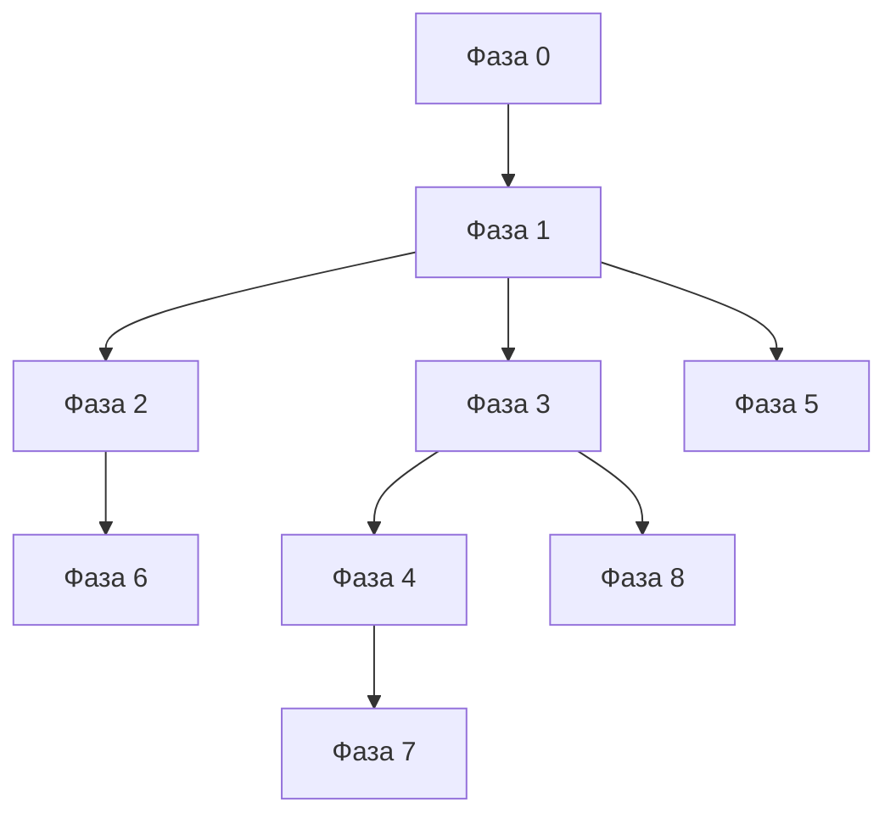

### Материализация мира (очередь passes)

**Target:** игрок загрузил мир → engine DAG прогоняет **S → O → C → CL**, если skeleton/climate ещё нет.

Pass-идентификаторы — те же шаги, что DAG; debug-дубликаты в `map.py` (см. § Роли):

```
POST …/map/generate-surface   ← debug harness only
POST …/map/generate-ores      → STUB
POST …/map/generate-caves     → STUB
POST …/map/generate-climate   ← debug harness only
```

Regen: clear map → снова **S → O → C → CL**.

### Definition of Done

- [x] Очередь **S → O → C → CL** (generators + debug handlers / DAG target)
- [x] Impl queue п.1–11; п.12 partial; п.8 DEFERRED
- [x] TR-1 closed в `tz_generator_technical_debt.md`
- [x] Phase 9+ «Сейчас» — TR-1b, DBG-1 (§ ниже)
- [ ] Phase 9+ **D HY** — surface hydrology H-1…H-7a (§ ниже; **до DAG**)
- [ ] Phase 9+ «DAG» — **gate**; снятие только мастером после полного теста генераторов

---

## Phase 9+ — план (2026-06)

> **Baseline:** generators + `map.py` debug harness ✅.  
> **Решение:** **engine DAG и ноды не трогаем** до gate (§ Gate в `tz_world_generation_dag.md`): полное тестирование генераторов + **явное** снятие gate **мастером**. Сейчас — generators, persist, debug API, smoke-скрипты.  
> **Следующий блок до DAG:** **D HY** — surface hydrology ([`tz_terrain_hydrology.md`](./tz_terrain_hydrology.md)); агент-план — [`.cursor/plans/hydrology-pre-dag.md`](../.cursor/plans/hydrology-pre-dag.md).

### Сейчас (без DAG)

| Фаза | Содержание | Приёмка |
|---|---|---|
| **9 TR-1b** | Pole **вне** `TerrainGeneratorService`: `generate_surface(..., pole_field)`; `build_surface_heightmap` — то же. Caller: **`map.py` / `MapCellService`** (path 2), не нода | mock `ClimatePoleField` in unit; `run_pole_resolve_pass` только в orchestration layer (route/service) |
| **A DBG-1** | `debug_settlement` pipeline smoke → HTTP; `debug_api_helpers.py` | те же asserts; backend running; этalon `debug_structure` / `debug_ladder` **не менять** |
| **D HY** | **Surface hydrology** — pure generators + wire в `generate-surface` + debug route; **без DAG-нод** | см. § «D HY — surface hydrology» ниже |
| **E TR-PERF** | Bulk persist init: `executemany` + `chunks_per_commit` (§ TR-PERF) | benchmark 1 tile; commits ↓; cell set идентичен |
| **F TR-LAZY-LOAD** | Scene volume + z_slice: **service/repo + debug HTTP** (§ TR-LAZY-LOAD-1/2) | LAZY-1…3 без нод |
| **B Ores/caves** *(опционально)* | Замена STUB в `oresGenerator` / `cavesGenerator`; **cave hydrology U12** — вместе с caves, не в D HY | debug `POST generate-ores/caves`; merge rules в repo |
| **C Regen doc** | § «Регенерация при fine_cells_per_map_cell» — явный manual path через debug API до DAG | ТЗ + `WorldService` warning; auto re-run — только после DAG |

**Порядок:** `9 TR-1b` ✅ → `A DBG-1` ✅ → **`E TR-PERF`** → **`F TR-LAZY-LOAD`** (service only) → **`D HY`** → smoke G1–G4 → **gate снят мастером** → DAG wiring. **Агент не правит ноды** до явного снятия gate.

### D HY — surface hydrology (до DAG)

> **Scope:** H-1…H-7a из [`tz_terrain_hydrology.md`](./tz_terrain_hydrology.md). **Вне scope:** DAG node `apply_hydrology`, U13 LLM naming, cave hydrology U12 (→ Phase B).

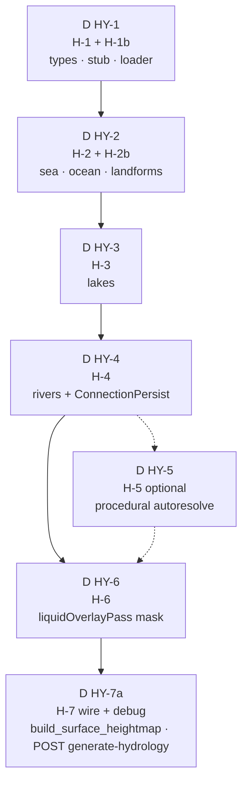

| Подфаза | TZ | Deliverable | DoD / smoke |
|---|---|---|---|
| **D HY-1** | H-1, H-1b | `types`, stub, `load_hydrology_from_world` | unit: policy tabs U16; bands clamp 1–99; loader reads [`world_template.json`](../fixtures/world_template.json) |
| **D HY-2** | H-2, H-2b | `SeaBasinGenerator`, `OceanBasinGenerator`, `CoastalLandformClassifier` | shore + deepening до 20 (sea); declared + autoresolve |
| **D HY-3** | H-3 | `LakeBasinGenerator` + `DeepeningBandCarver` | shoreline profile U15; 1–5 bands |
| **D HY-4** | H-4 | classify + carver + `riverConnectionEmit` | U17/U18; persist in orchestration; declare river = `declared_rivers[]` (U27) |
| **D HY-5** | H-5 *(optional)* | Procedural lakes/rivers при autoresolve ON | deterministic на `world_seed`; skip если все `autoresolve.*: false` |
| **D HY-6** | H-6 | `liquidOverlayPass` + **`map_cells.hydrology`** (U19) | **нет** global `z≤0`; ice/water по temp + C3 river_bed rule |
| **D HY-7a** | H-7 (pre-DAG) | Wire: `build_surface_heightmap` = P1 → `HydrologyGeneratorService.apply` → gap → P2; `MapCellService` передаёт `HydrologyResult` в climate pass | `POST …/map/generate-hydrology?scope=…` preview; full `POST generate-surface` на `world_template` — sea + lake + river bed + liquid после climate |

**Инварианты D HY:**

| Правило | Смысл |
|---|---|
| Pure generators | без repos/async; persist — `MapCellService` / `ConnectionPersistService` |
| Не DAG | ноды `apply_hydrology`, `llm_name_*` — **после** D HY-7a + ревью [`tz_world_generation_dag.md`](./tz_world_generation_dag.md) |
| Не LLM | `materialize_named_locations: false` default; generators не пишут `NamedLocation` |
| Debug path 2 | smoke через HTTP к running backend; этalon `debug_structure` / `debug_ladder` не ломать |
| Реки = connections | bed в heightmap; graph — `ConnectionEdge` (`river`, `mountain_river`) |

**Definition of Done (D HY):**

- [ ] HY-1 closed в [`tz_generator_technical_debt.md`](./tz_generator_technical_debt.md)
- [ ] D HY-1…D HY-7a по таблице выше
- [ ] `generate-surface` debug: P1→HY→gap→P2→persist; `generate-climate`: liquid по mask
- [ ] Smoke: import `world_template` → manual `generate-surface` + `generate-climate` — declared sea/lake/river visible

### Потом — DAG (только с мастером, после gate)

> Спека и impl **только после** § Gate в [`tz_world_generation_dag.md`](./tz_world_generation_dag.md): полное тестирование генераторов (G1–G4) + **явное** снятие gate мастером. Ниже — **target**, не backlog для агента.

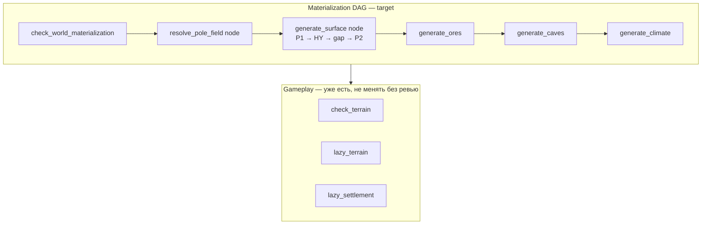

| Блок | Содержание |
|---|---|
| Gate | `check_world_materialization` |
| Nodes | `generate_surface` (внутри HY — impl **D HY**), `generate_ores`, `generate_caves`, chain `generate_climate`; опционально `apply_hydrology` как отдельная нода — **только если** не встроено в `generate_surface` node |
| Wiring | trigger первого входа игрока; deps; `supported_tasks` |
| Regen | auto re-run materialization после `fine_cells_per_map_cell` |
| Hydrology LLM (U13) | `collect_geography_naming_candidates` → `llm_name_procedural_locations` — **после DAG gate**, не в D HY |

**Vertical slice (после DAG-сессии):** новый мир → первый chat turn → S→O→C→CL в БД без ручного curl.

### Backlog (не блокирует «Сейчас» / D HY)

| ID | Задача |
|---|---|
| **HY-2 / U12** | Cave hydrology — с Phase B (caves STUB) |
| **HY-3 / U13** | LLM naming autoresolved geography — DAG only |
| impl queue **п.8** | Lazy caves/mines ~20 cells |
| **TR-M / M-3** | Magma movement resolver |
| **NC-1c** | Grid coords в `generate_minimal` |
| **`world_map_version`** | После materialization |
| **`generate_z_slice` node** | Lazy column в gameplay |
| **TR-PAR** | Parallel chunk generate + serial persist — § «Многопоточность»; DAG wiring TR-PAR-DAG-1 |

### Definition of Done

**Сейчас:**

- [x] TR-1b — pole не внутри `TerrainGeneratorService`
- [x] DBG-1 — pipeline smoke через HTTP

**D HY (до DAG):**

- [ ] D HY-1…D HY-7a — см. § «D HY — surface hydrology»

**DAG (после D HY + сессии с мастером):**

- [ ] Очередь S→O→C→CL на path **1**
- [ ] `lazy_terrain` остаётся repair, не подменяет materialization
- [ ] `tz_world_generation_dag.md` — карта нод согласована

---

## Terrain ↔ Climate (разделение процессов)

Eager climate, recalculate и runtime weather — **три разных процесса** ([`tz_climate.md`](./tz_climate.md) § «Три процесса»). Terrain **не пишет** `temperature_base` / `rainfall` на `generate-surface`. После hydrology — partial column resolve в dirty bbox ([`tz_terrain_hydrology.md`](./tz_terrain_hydrology.md) C14); Climate LOD — [`tz_climate.md`](./tz_climate.md) § Climate LOD.

### Утверждённая очередь materialization


Сборка — **engine DAG nodes**, не внутри generator facade.

| Entry | Вызывает | Пишет |
|---|---|---|
| `generate-surface` | terrain two-phase skeleton | `z`, `system_terrain`, subsurface |
| `generate-climate` | `ClimateOrchestrator` on DB heightmap | `temperature_base`, `rainfall`, optional permafrost overlay |
| `lazyTerrainNode` | `generate_minimal` | repair column (отдельный контракт) |

Elevation bias: terrain **читает** `ClimatePoleField.sample` (typical_elevation_z) — физическая связь, разная ответственность (см. § Multi-pass).

### Код vs ТЗ (2026-06 impl)

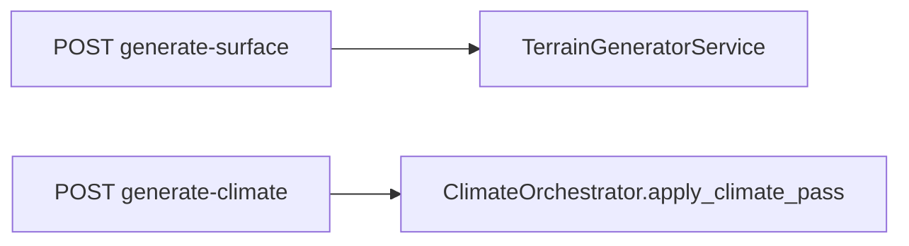

| Entry | Код |
|---|---|
| `TerrainGeneratorService.generate_surface` | surfacePass → gap → columnFill |
| `POST …/map/generate-surface` | `save_terrain_batch` 32×32 upsert |
| `POST …/generate-climate` | `apply_climate_pass` + liquid overlay |
| `POST …/generate-ores` / `generate-caves` | stub generators + layer upsert |
| `lazyTerrainNode` | `generate_minimal` (без изменений) |

Heightmap compat: `heightmapPass` → `terrain.passes.surfacePass`.

### DAG

| Node | Вызывает | Статус |
|---|---|---|
| `generate_climate` | `ClimateOrchestrator.apply_climate_pass` | ✅ |
| `recalculate_climate` | `recalculate(request)` | ✅ |
| `resolve_weather` | `ClimateRuntimeAssembler` | ✅ |

См. [`tz_world_generation_dag.md`](./tz_world_generation_dag.md) (черновик).

### `generate_minimal` — отдельный контракт

**Не** процесс 1 (full eager). Одна anchor-ячейка для repair / lazy bootstrap.

```python
def generate_minimal(world, location, uid_map?) -> list[MapCell]  # len == 1
```

| | `generate_surface` (утверждено) | `generate_surface` (код interim) | `generate_minimal` |
|---|---|---|---|
| Pipeline | terrain two-phase skeleton | `ClimateOrchestrator.full_surface` | `ClimateGeneratorService` напрямую |
| Climate fields | ❌ отдельный pass | ✅ в том же вызове | упрощённый walk-up |
| Pole / tier elevation bias | ✅ input | ✅ | ❌ |
| Caller | engine DAG (production) | `map.py` debug harness | `lazyTerrainNode` |

**Ограничение:** minimal не отражает pole/tier v2 — для orphan repair достаточно; полный климат региона — только eager/recalc.

---

## Расположение в проекте

```
app/application/worldData/generators/
  terrain/                             ← surface skeleton, subsurface, column fill (target)
    terrainGeneratorService.py
  assemblers/climateAssembler/         ← climate passes (heightmapPass → migrate to terrain)
  climate/                             ← pole, tier, precipitation, weather
  coordinates/                         ← convert hub (grid ↔ meters)
  assemblers/settlementAssembler/      ← urban (не terrain)

app/api/routes/map.py                  ← debug harness: POST …/generate-* (не product path)
```

**Tech debt / smells:** `tz_generator_technical_debt.md`  
**Coordinate implementation plan:** `.cursor/plans/coordinate-spaces-done.md`

---

## Terrain vs Settlement

| Слой | Кто генерирует | Когда | `MapCell` semantics |
|---|---|---|---|
| Terrain skeleton (surface + subsurface) | `TerrainGeneratorService.generate_surface` | `POST generate-surface` | grid; `z`, `system_terrain` only |
| Ores / caves | ordered passes | `POST generate-ores` → `generate-caves` | markers / carve |
| Climate fields | `ClimateOrchestrator` | `POST generate-climate` | `temperature_base`, `rainfall` |
| Climate recalc | `ClimateOrchestrator.recalculate` | DAG ⬜ | partial upsert |
| Anchor repair | `generate_minimal` | `lazy_terrain` | одна cell |
| Urban / settlement | `SettlementAssembler` | `lazy_settlement` | meters + urban |

**Приоритет источников формы города:**

1. **Явные** `map_cells` в БД / fixture — канон (любая форма).
2. **Lazy settlement** — occupancy + geometry при первом входе.
3. **Terrain** — **не** участвует в urban.

`save_generated` использует `INSERT OR IGNORE` — явные ячейки не перезаписываются при повторном `generate-surface`.

---

## Три кейса использования

### 1. Материализация мира (master bake + generation pipeline)

**Мастер** — JSON-редактор в **настройках мира** (`settings/world`): import bundle, registries, anchors. **Не** отдельный «admin»-интерфейс.

**Offline bake (pack, утверждено):** § **Bake modes (locations)** — `light_bake` → optional `full_bake` → optional `detailed_bake` per location. Игрок может получить любой из трёх offline cases; недоделанное дозаполняется resume / lazy.

**Игрок** — выбирает мир → сессия. Если pack partial / нет L2 — **engine DAG** + entry-first (WP-13); legacy `map_cells` skeleton — только до полного cutover.

**Target flow (ноды, после gate):**

```
world_load / first_need
  └─ pack completeness classify → resume light|full|detailed as needed
  └─ pole_resolve_node
  └─ (pack path) entry refine / detailed — не eager full bbox
  └─ (legacy interim) generate_surface → hydrology → climate
```

**Interim (код):** `POST …/map/pack/bake?mode=light|full|detailed` (+ entry refine WP-13); handlers `POST …/map/generate-*` — legacy/debug.

**Pass implementation (generators + MapCellService / Pack writer):**

---

### 2. Lazy init (gameplay) — частично

**Задумка:** при входе в регион — загрузить **scene volume** вокруг `(map_x, map_y, map_z)`; если L2 / колонка нет — refine from L0 (`detailed_bake` semantics) или `generate_z_slice` (legacy).

**Сейчас (код):**

- Pack: entry refine / scene + path (WP-13) — ✅; master `detailed_bake(location_uid)` — ✅ (+ climate fine)
- `check_terrain` → `has_cells_for_location` (не видит wilderness skeleton)
- `eager_terrain` → `get_by_location` (не scene volume)
- `lazy_terrain` → `generate_minimal` (только orphan repair)
- HTTP `POST …/generate-z-slice` + `TerrainBatchOrchestrator.save_z_slice` — ✅ есть, gameplay **не** wired

**Целевой flow:** § **TR-LAZY-LOAD** + pack entry-first — сначала service/debug; ноды — после gate.

```
check_terrain → has_column_cells OR has_cells_for_location OR pack chunk present
eager_terrain → get_scene_volume(…)          # blocking: со стороны игрока
             → optional bg: get_by_location  # соседние локации целиком
lazy_terrain  → refine/generate_z_slice if empty → get_scene_volume
             → generate_minimal fallback (orphan)
lazy_settlement → без изменений (SettlementGeneratorService)
```

---

### 3. Broken location repair (gameplay)

**Триггер:** named_location без единой `map_cell` / без pack L2 (orphan-tolerant design, `tz_locations.md`).

**Flow:** `lazyTerrainNode` → `generate_minimal` → upsert одной anchor cell.  
Climate: **не** full eager — `resolve_climate` + `weather_at_elevation` (см. § «generate_minimal»).
На pack-мире предпочтителен **detailed_bake** / entry refine от L0, а не orphan minimal, если parent light есть.

---

## Алгоритм `generate_surface` (утверждённая модель)

> **Код:** пока делегирует в `ClimateOrchestrator.full_surface` — см. § «Код vs ТЗ». Ниже — **утверждённое** ТЗ + legacy noise из текущего `HeightmapPass`.

### Двухфазный pipeline (утверждено)

См. § «Multi-pass terrain skeleton» — Pass 1 `surface_z`, gap `N_eff`, Pass 2 column fill, chunked persist.

### Surface elevation (Pass 1)

1. **Anchors** — `static_map_anchors`; bbox ± `padding` (v1) или `world_bounds` (v2).
2. **`surface_z(gx,gy)`** — pole `typical_elevation_z` + детерминированный noise + clamp `[z_min, z_max]`.
3. **Gap analysis** — `N_eff = max(N_base, Δ_cliff)`; см. § «Зазоры».

### Noise (из текущего impl, переносится в terrain)

```python
h = (world_seed ^ (gx * 73856093) ^ (gy * 19349663)) & 0xFFFFFFFF
noise = (h % (2 * amplitude + 1)) - amplitude  # amplitude=1
z = clamp(base_z + noise, z_min, z_max)
```

**Pack L2 plains/forest:** этот белый `±1` на клетку **не** SoT микрорельефа. Холмы — L2 helper; частота = шум consumer (`default_plains` / `default_forests`) — [`tz_world_pack_storage.md`](./tz_world_pack_storage.md) § L2 open-land hills. Coarse/L0 planning может сохранить pole+noise; leftover равнина после гор на detailed — через helper, не через `amplitude=1` на метр.

### Terrain от z (skeleton — solid only)

| z (relative / band) | terrain (приоритет) |
|---|---|
| surface | forest / plains / tundra по elevation |
| subsurface | rock / soil (registry TBD) |

**Утверждено:** `liquid_body` **не** из skeleton `z_to_terrain` — liquid pass отдельно.

**Legacy (код interim):** `z ≤ −1 → liquid_body` в `climate/terrainZ.py` — удалить при impl queue п.7.

### Climate (отдельный pass — не generate-surface)

`temperature_base`, `rainfall`, permafrost overlay — [`tz_climate.md`](./tz_climate.md) + `POST generate-climate`.

---

## `generate_minimal` (отдельный контракт)

Одна anchor cell для repair. Координаты: **`map_x`, `map_y`, `map_z` как в БД**.

```python
climate_zone   = ClimateGeneratorService.resolve_climate(world, uid_map, location)
temp, rainfall = weather_at_elevation(world, climate_zone, z)
system_terrain = z_to_terrain(z, terrain_registry)
```

Wilderness `system_terrain` от z — **не urban**. Urban — settlement или explicit import.

| Свойство | Значение |
|---|---|
| Pipeline | без `ClimateOrchestratorService` |
| Pole / tier | не используется |
| Use case | orphan location repair (`lazy_terrain`) |
| vs `full_surface` | не заменяет eager generate региона |

**Ограничения:** NC-1c (grid index vs raw anchor); климат упрощённый — для pole/tier мира см. eager/recalc.

---

## Система координат

### Три оси (не смешивать)

| Ось | Суть |
|---|---|
| `measurement_system` | imperial/metric — **только display/LLM**; generators не ветвятся |
| `FINE_CELL_SIZE = 1` | шаг fine-сетки = 1 int — **константа движка**, не настройка мира |
| **Coordinate spaces** | разная семантика одного `int` в разных слоях |

### Coordinate spaces (v1)

```
┌─────────────────────────────────────────────────────────────┐
│  WORLD_SURFACE_GRID                                          │
│  MapCell.x/y при eager terrain + occupancy                 │
│  gx, gy = индекс coarse tile (0, 1, 2, …)                   │
│  один tile покрывает fine_cells_per_map_cell² fine-клеток   │
└─────────────────────────────────────────────────────────────┘
         │  gx = map_x // map_cell     (convert hub)
         ▼
┌─────────────────────────────────────────────────────────────┐
│  WORLD_FINE_GRID                                             │
│  NamedLocation.map_x/y — anchor на карте (поселение, гора, озеро, …) │
│  Settlement: districts, streets, gates, barriers, buildings  │
│  ConnectionNode.x/y — fine cells                             │
└─────────────────────────────────────────────────────────────┘
```

### Кто пишет какие координаты

| Generator | x/y space | z | Notes |
|---|---|---|---|
| `generate_surface` (wilderness) | grid index | elevation (z cells) | zone climate |
| `plan_footprint_occupancy_cells` | grid index | surface | urban occupancy |
| `SettlementAssembler` geometry | world fine grid | z cells | after translate |
| `generate_minimal` | raw anchor (repair) | anchor map_z | NC-1c |
| `_non_surface_anchor_cells` (climate eager) | **world fine** (`map_x`, `map_y`) ❌ | anchor `map_z` | **NC-1c bug** — см. § Smoke regression |

---

## Smoke regression — `world_test_all` (2026-07)

**Fixture:** [`fixtures/world_test_all.json`](../fixtures/world_test_all.json) (`world-test-all-001`) — merge gameplay + template; `map_cells: []` at import; surface via `initialize_world.py` → `POST …/map/pack/bake`.

**Прогон (2026-07):** import → `generate-surface` → `generate-hydrology` (stub) → `generate-climate`.

| Метрика | Значение |
|---|---|
| Terrain skeleton cells | 5460 — `x/y` в **WORLD_SURFACE_GRID** (≈ −2…17 при `fine_cells_per_map_cell: 3000`) |
| Extra anchor cells | **2** — `x/y` в **WORLD_FINE_GRID** (6000, 42000) |
| Surface tops (grid) | 260 columns, z≈3…7, `tundra` |
| False `liquid_body` | 2 — только extra anchors; overworld без воды |

### NC-1c — подтверждённый дефект координат

**Симптом:** в одной таблице `map_cells` coexisting grid index и meter anchors на том же PK `(world_uid, x, y, z)`.

**Источник:** `ClimateSurfaceAssembler._non_surface_anchor_cells` пишет:

```python
x=anchor.map_x, y=anchor.map_y, z=anchor.map_z  # meters
```

Skeleton `run_column_fill` пишет `x=gx, y=gy` (grid index). Конверсия `fine_to_grid_x/y` **не** применяется.

**Триггер в fixture:** единственные локации с `map_z != 0` — dungeon (`map_z: -1`) и underground city (`map_z: -3`). Остальные anchors `map_z: 0` → extra cell не создаётся.

**Target fix (NC-1c):**

- Либо **не persist** point-anchor в `map_cells` (weather-only / volume layer TBD),
- Либо grid-normalize: `x=fine_to_grid_x(map_x)*cell_m` **или** хранить grid `(gx, gy)` с явным `coordinate_space` (NC-1a),
- Либо отдельный контракт «repair cell» только для `generate_minimal` / lazy, без merge в eager surface batch.

**Cross-ref:** interim `liquid_body` на этих ячейках — [`tz_terrain_hydrology.md`](./tz_terrain_hydrology.md) § Interim bug; climate pass — [`tz_climate.md`](./tz_climate.md) § Smoke regression.

---

## Named locations — роль в terrain

**`NamedLocation`** — optional overlay для имени и declare. География существует в `map_cells` / connections **без** location (`location_uid = null` на cells и edges — норма). См. [`tz_locations.md`](./tz_locations.md) § «Именованные объекты карты».

| Поле | Terrain usage |
|---|---|
| `display_name` | LLM / glossary; «Гора Белая», «Степь Кyzyl» |
| `map_x/y` | anchor → grid index для bbox; zone → Voronoi center |
| `map_z` | `0` = surface (wilderness loop); `!= 0` → extra anchor cell |
| `system_location_type` | `geographic.*` → hydrology/relief declare; zone types → climate Voronoi; settlements → bbox point |
| `system_location_subtype` | `peak`, `plain`, `lake`, `sea`, … — routing в generator loaders |
| `system_climate_zone` | на zone / в иерархии для `_resolve_climate` |
| `parent_location_uid` | walk-up для climate на non-surface anchors |
| `is_mobile` | true → static anchor не создаётся |

### Якорная cell (minimal / non-surface)

```python
if location.map_z is not None and not location.is_mobile:
    if map_z != 0:
        create anchor at (map_x, map_y, map_z)
```

| Локация | `map_z` | Terrain |
|---|---|---|
| Город на поверхности | `0` | wilderness tile в bbox (urban — settlement) |
| Шахта | `-20` | ✓ extra anchor |
| Подземный город | `-1000` | ✓ extra anchor |

---

## DB — индексы

```sql
CREATE INDEX idx_map_cells_location_z ON map_cells (world_uid, location_uid, z);
```

PK `(world_uid, x, y, z)` — точечные запросы; индекс по location — lazy load / scene.

---

<a id="terrain-relief-hydrology-planning"></a>

## Terrain/relief и гидрология: порядок планирования

**Решение мастера 2026-10-22, target; production cutover ещё не выполнен.**
Terrain/relief владеет планированием геометрии и изменением высот гор,
оврагов, дна моря/океана/озера и речных русел. Гидрология владеет
расчётом заполнения водой, физических объединений водоёмов, речных
маршрутов и водных фактов. Общий placement разрешает размещение и
конфликты по доменным intents/constraints; его роль не переносится в relief.

Порядок фаз:

1. **Terrain/relief, первый вызов:** исходная поверхность → планировка
   гор и оврагов, дна морей/океанов/озёр → согласованный pre-river рельеф.
   Это один общий этап планирования, не требование одного цикла по клеткам.
   Внутренние вычисления выполняются по готовности входов. Дно может
   использовать authored water intents, уровни и результаты общего
   placement; не требует предварительного гидрологического fill.
2. **Гидрология:** по готовому рельефу рассчитывает заполнение водоёмов,
   их физические объединения и маршруты рек. Геометрия рельефа и surface_z
   этим расчётом не переписываются.
3. **Terrain/relief, повторный вызов:** принимает готовые речные маршруты,
   планирует геометрию русел и применяет её к высотам. Горы, овраги и дно
   водоёмов при этом не выбираются и не прорезаются заново.
4. **Гидрология:** получает post-river поверхность и рассчитывает итоговые
   водные факты. Source search читает pre-river поверхность; итоговая
   прорезка не возвращается в собственные исходные условия того же run.

Междоменный порядок задаёт world-surface application composition, вне
generators. Она передаёт typed результаты между доменами. Обращение
гидрологической стадии к relief не передаёт ей владение геометрией или
persist. Это последовательные вызовы с явными phase/dependency refs,
не неявный цикл до сходимости. Все результаты относятся к одному
согласованному набору source inputs; pre/post-river refs не смешиваются.

**Одна планировка, несколько проекций.** Горы выбираются один раз:
authored/anchor/auto sources, размещение, форма, стороны из templates и
параметры высоты разрешаются в их terrain/relief домене до гидрологии.
Coarse-проекция нужна для водных расчётов; light/fine — для L0/L2.
Последующие гидрология, landcover и список bake tiles не запускают новый
выбор гор или изменение их геометрии. Исходные высоты, климат и authored
ограничения допустимы как входы planning. Овраги и дно также имеют
готовое planning решение; materializers только применяют его проекцию.

**Контракт гор меняет доставку, не пайплайн.** Выбор остаётся внутри
первого relief этапа (порядок mountain → ravine → basin сохраняется);
новые фазы, provider pairs и dependency edges не добавляются.
Единственное изменение — один frozen output вместо независимых выборов
в L0/materialize путях: единый mountain layout хранится в frozen
relief-плане и обязан покрывать входы всех его consumers
(MountainContributor, MountainMaskMaterializer.collect,
collect_mountain_entries_for_coarse). Если consumer'у не хватает поля —
расширяется контракт layout, не появляется второй selection path.
Смешанное состояние запрещено: consumers переводятся на frozen layout
одним cutover, интервал «часть читает план, часть пересчитывает объекты»
недопустим. Формула identity гор, входы и алгоритм выбора не меняются.
Точный набор полей mountain layout замораживается в GEO-1 PC-0.

L0/L2 материализуются по запросу из согласованных планов. Full/partial,
порядок tiles и cache HIT/MISS не меняют выбранные объекты. Используемые
template inputs фиксируются immutable projection и участвуют в input
fingerprints; live World/registry/template accessor в cached recipe нет.
Это правило не заменяет отдельный grade/mill контракт и parent-light
storage/read contract.

**Приёмка:** один mountain selection; согласованные coarse/light/fine
identity/geometry; независимость от tile scope; replan при значимом template
edit; единственный владелец записи высот terrain/relief; отсутствие
double carve; final hydro читает post-river ref, source search — pre-river;
все named mountain consumers читают один frozen layout, второго selection
path нет. Точные schemas и activation ledger синхронизируются в GEO-1
PC-0 до кода; первоначальные baseline bindings не объявляются готовым
target. Реализация fine source-search HY-RIV-1 остаётся отдельным треком.

## Persist cycle & DAG modification (terrain)

**Контракт:** `MapCellService` — persist-слой terrain (аналог `SettlementPersistService` для города).  
`TerrainGeneratorService` / `ClimateOrchestrator` — **только generate**; DAG и debug API вызывают **одни и те же** persist-методы; DAG — **в обход HTTP**.

> **Два режима.** (1) **Bootstrap / materialization** — S→O→C→CL на declared bbox / `full` init (широкий, но не «перегенерить весь мир каждый ход»). (2) **Runtime modification** — **строго локальный patch** в явных границах; см. § «Локальная модификация» ниже.

#### Связь с доменными ТЗ

| Тема | Где описано |
|---|---|
| Multi-pass skeleton S→O→C→CL | § Multi-pass terrain skeleton; [tz_world_generation_dag.md](./tz_world_generation_dag.md) § три входа |
| Selective upsert по layer kind | § Multi-pass persist; `save_pass(layer)` |
| Climate recalc (partial) | [tz_climate.md](./tz_climate.md) — `recalculate_climate`; **`output_bbox` обязателен**; snapshot vs column resolve (C9); hydrology → C14 |
| Дорога меняет terrain cells | [tz_structure_connections.md](./tz_structure_connections.md) §3.5, `connection_edge_cells` — **коридор ребра**, не весь мир |
| Excavation / construction | [tz_world_generation_dag.md](./tz_world_generation_dag.md) — `excavate`; [tz_construction.md](./tz_construction.md) |
| Катаклизмы → мутация карты | [project_data_storage_tz.md](./project_data_storage_tz.md) — `world_history`, `system_event_type=cataclysm` |
| Settlement vs terrain | § Terrain vs Settlement — urban не перезаписывает explicit cells |

#### Scopes — bootstrap (широкий контекст)

| Scope | Generate | Persist | DAG / debug | Примечание |
|---|---|---|---|---|
| `surface_skeleton` | `generate_surface` (+ pole caller) | `save_terrain_batch` | `generate_surface`; `POST generate-surface` | bbox / world_bounds при init |
| `ores` | `generate_ores` | `save_pass(ore)` | `generate_ores` | pass по существующим cells |
| `caves` | `generate_caves` | `save_pass(cave)` | `generate_caves` | pass; lazy gameplay — local radius |
| `climate` | `apply_climate_pass` | `save_pass(climate)` | `generate_climate` ✅ | eager на materialization |
| `z_slice` | `generate_z_slice(gx,gy,z…)` | `save_pass(terrain)` | `generate_z_slice` ✅ HTTP; gameplay ⬜ TR-LAZY-LOAD | **одна колонка** — lazy wilderness |
| `minimal_repair` | `generate_minimal` | `insert_bulk_ignore` (`executemany`) | `lazy_terrain` ✅ | **одна anchor cell** — orphan only |

Удобная обёртка `persist_materialization(world)` = S→O→C→CL — только **`full` init / world load**, не gameplay loop.

#### Локальная модификация (runtime — event / action driven)

**Слой процесса (locked):** это **modification** поверх уже запечённого Pack, не четвёртый bake mode и не `POST pack/bake` на `complete` тайл. `full_bake` / `detailed_bake` пишут immutable snapshot; взрыв, раскопки, локальный климат, катаклизм в bounds — **Patch Store** (`terrain_delta` / `climate_delta`), merge WP-20. Перепечь pack = смена версии мира (мастер / генератор / seed), не ход игрока. SoT pack: [`tz_world_pack_storage.md`](./tz_world_pack_storage.md) § Слой модификации мира.

**Инвариант:** gameplay **не** вызывает `generate-surface` на весь мир. Меняются только ячейки в **`patch_bounds`** (bbox, radius, corridor polyline, z-band).

| Триггер | Пример | `patch_kind` | Типичные bounds | DAG node (target) |
|---|---|---|---|---|
| **Катаклизм** | метеорит, наводнение, вулкан | `cataclysm` | `center + radius_cells` из event payload | `modify_terrain` ← EventBus / `world_history` |
| **Бой** | взрыв, обвал, magic crater | `combat` | bbox сцены / radius вокруг impact | `modify_terrain` ← combat post_llm |
| **Раскопки** | игрок / NPC копает, туннель | `excavate` | column или small 3D box | `excavate` → `modify_terrain` |
| **Стройка дороги** | bed под `ConnectionEdge` | `road_bed` | polyline + `width_cells` коридор | `connect_road` + local terrain patch |
| **Климат (regional)** | pole shift, локальный эффект | `climate_recalc` | `ClimateRecalcRequest.output_bbox` | `recalculate_climate` |

Запись в историю: patch persist сопровождается `world_history` / action ref ([project_data_storage_tz.md](./project_data_storage_tz.md)).

**Контракт generate (target):**

```python
@dataclass
class TerrainPatchRequest:
    patch_kind:   str          # cataclysm | combat | excavate | road_bed | …
    bounds:       SurfaceGridRect | MeterRect   # обязательно; whole-world запрещён в gameplay
    event_uid:    str | None   # world_history / EventBus
    actor_uid:    str | None   # player / NPC action
    z_lo: int | None = None    # excavate / combat depth
    z_hi: int | None = None

class TerrainPatchGeneratorService:
    def apply_patch(
        self,
        world: World,
        existing: list[MapCell],   # только cells в bounds (loader)
        request: TerrainPatchRequest,
    ) -> list[MapCell]:
        """Pure. Возвращает **только изменённые** cells ⊆ bounds."""
```

**Grade после patch:** смена `z` / terrain в bounds → **сброс** stale outdoor grade этого объёма (pack column, sidecar, SQL `cell_refs`). **Не** mill в том же проходе (R41). Вернуть grade: DAG на сцене, если рельеф снова необходим, или ГМ `detailed_bake`. SoT — [`tz_terrain_relief.md`](./tz_terrain_relief.md) § Caller. **Не** отдельный bake mode и **не** L0 sample.

**Контракт persist:**

```python
# MapCellService
async def persist_terrain_patch(
    self,
    cells: list[MapCell],
    *,
    bounds: SurfaceGridRect,     # guard: reject if len(cells) >> bounds area
    patch_kind: str,
) -> ImportResult:
    """Upsert только patch cells; skip building_element; idempotent by (world_uid,x,y,z)."""
```

Debug harness: `POST …/map/patch-terrain` с телом `TerrainPatchRequest` — mirror DAG `modify_terrain` (TBD).

#### Scopes — modification (локальный patch)

| Scope | Generate | Persist | DAG |
|---|---|---|---|
| `terrain_patch` | `apply_patch`; сброс stale grade в bounds | `persist_terrain_patch` + wipe grade | `modify_terrain`, `excavate` |

#### Idempotency

- Bootstrap regen: selective upsert по layer kind — **не** blind `INSERT OR IGNORE` для multi-pass ([§ Multi-pass persist](#multi-pass-terrain-skeleton)).
- `minimal_repair`: `INSERT OR IGNORE` (1 cell).
- **`terrain_patch`:** upsert **только** cells из `apply_patch`; `building_element` — skip; повтор event с тем же `event_uid` — idempotent merge.

#### Debug API (harness)

`map.py` `POST …/generate-*` — path **2**; те же scopes, что DAG path **1**. См. [tz_world_generation_dag.md](./tz_world_generation_dag.md) § «Три входа».

#### Checklist (terrain persist для DAG)

- [x] `save_pass` / `save_terrain_batch` — partial impl
- [ ] **TR-PERF** — `executemany` + multi-chunk transaction + insert_only + bulk PRAGMA (§ TR-PERF) ✅
- [ ] **TR-LAZY-LOAD** — `get_scene_volume`, `has_column_cells`, debug smoke (§ TR-LAZY-LOAD-1/2)
- [ ] **TR-LAZY-LOAD-DAG** — gameplay ноды — **gate**, только с мастером
- [ ] `TerrainPersistScope` enum + единый `persist(cells, scope)` facade
- [ ] DAG nodes: `generate_surface`, `generate_ores`, `generate_caves`, `generate_z_slice` (wire к service)
- [ ] `TerrainPatchGeneratorService` + `TerrainPatchRequest` (local bounds only)
- [ ] `persist_terrain_patch` — guard по bounds
- [ ] `modify_terrain` / `excavate` — cataclysm, combat, dig (event/action driven)
- [ ] DAG wire — **gate G5**, только с мастером после G1–G4

---

## Реализовано / не покрыто

| Элемент | Статус |
|---|---|
| **Концепция multi-pass terrain skeleton** | ✅ утверждено + impl 2026-06 |
| Two-phase skeleton + N_eff gap | ✅ |
| `generate-surface` terrain-only | ✅ |
| `POST generate-climate` / ores / caves | ✅ |
| Chunked persist + selective upsert | ✅ TR-PERF-1…4 |
| TR-PERF bulk init (`executemany`, multi-chunk commit, insert_only, PRAGMA) | ✅ § TR-PERF |
| TR-LAZY-LOAD service + debug (без нод) | ✅ § TR-LAZY-LOAD-1/2 |
| TR-LAZY-LOAD-DAG (gameplay ноды) | ⬜ gate — только с мастером |
| Liquid pass on `generate-climate` | ✅ |
| `generate_z_slice` API | ✅ `POST …/generate-z-slice` |
| `world_bounds` v2 | ✅ `world.world_bounds` |
| Magma band + `antipode_xy` (M-1,M-2) | ✅ optional `magma_band_thickness` |
| M-3 movement resolver | ⬜ см. tz_locations |
| Lazy caves/mines ~20 cell radius | ⬜ gameplay |
| `generate_minimal`, lazy_terrain, lazy_settlement | ✅ |
| Pole/tier elevation bias in surface pass | ✅ |
| Terrain decoupled from cities | ✅ |
| Coordinate convert hub | ✅ |
| DAG: `generate_climate`, `recalculate_climate`, `resolve_weather` | ✅ |
| NC-1c minimal grid coords | ⬜ **подтверждено** smoke `world_test_all` (2026-07) |
| `world_map_version` после generate | ⬜ |

---

## Многопоточность

Без изменений: детерминизм + upsert-семантика + IRepository. Generators pure, без SQL.

---

## Регенерация при изменении `fine_cells_per_map_cell`

**Триггер:** `WorldService.update()` — старое ≠ новое.

**Поведение (не реализовано полностью):** предупреждение → `MapCellService.clear` → повторный `generate-surface`.

---

## Открытые вопросы

- `generate_z_slice` API: bounds vs `location_uid + z`.
- Non-city anchors: grid index vs meter anchor на surface PK.
- Zone без `map_x/y`: только `default_climate_zone` для Voronoi (нет полигонов).
- Option B: normalize all surface cells to meter corners `(gx * cell_m, gy * cell_m)`.

---

## Changelog

| Дата | Изменение |
|---|---|
| 2026-08-20 | **Pack L2 hills:** белый `cell_z_noise ±1` не SoT plains/forest; helper + consumer frequency — [`tz_world_pack_storage.md`](./tz_world_pack_storage.md) |
| 2026-08-16 | **Modification layer:** patch ≠ force-rebuild detailed/full; Pack snapshot, deltas в Patch Store |
| 2026-08-14 | **Шов мира:** `full_bake` L0 — край AABB ↔ антагонист на макро-тайлах; не detailed / не magma antipode |
| 2026-07-29 | Relief: storage 1:1 buildings + `context` singular — [`tz_terrain_relief.md`](./tz_terrain_relief.md) R11/R17/R18 |
| 2026-07-29 | Pointer: outdoor grade + relief templates — [`tz_terrain_relief.md`](./tz_terrain_relief.md) R9–R16 |
| 2026-07-27 | Домен **relief** → [`tz_terrain_relief.md`](./tz_terrain_relief.md); здесь — указатель (не SoT grade) |
| 2026-07-19 | § Охват мира: форма = `world_bounds` AABB (квадрат/прямоугольник) |
| 2026-07-20 | § Bake modes invariant: L2 ∉ light/full; entry после light — отдельная джоба (см. pack storage Job boundaries) |
| 2026-07-19 | **Bake modes — контракт мастера:** light = тайлы с локациями; full = весь `world_bounds`; без product wilderness stage |
| 2026-07-16 | Bake modes / TR-PACK **impl status sync:** light/full/detailed ✅; classifier detect ✅; climate fine на detailed ⬜; incremental skip / auto-resume ⬜ |
| 2026-07-15 | § **Bake modes (locations):** light / full / detailed; offline cases; detect+resume; TR-PACK status sync |
| 2026-06 | § Persist cycle — **локальная** runtime modification (cataclysm, combat, excavate); bootstrap vs patch |
| 2026-06 | § Phase 9+ **D HY** — surface hydrology H-1…H-7a в план до DAG |
| 2026-06 | § Phase 9+ — production DAG materialization (план после TR-1) |
| 2026-06 | § Роли: production DAG vs debug harness vs script tests через HTTP |
| 2026-06 | § План реализации (код → ТЗ) + TR-1 impl (Фазы 0–8) |
| 2026-06 | **M-3:** movement resolver — trigger на bottom/void, **±z flip** на antipode; см. tz_locations |
| 2026-06 | Magma band: thickness ≥1 z; teleport **z_magma_bottom → antipode z_magma_bottom** (edge case) |
| 2026-06 | Magma/antipode — **edge case**, контракт зафиксирован, impl отложено (M-1…M-5) |
| 2026-06 | Planet topology: round planet on voxel grid; magma ≠ world bottom |
| 2026-06 | Terrain layers: N_base vs deep geology; liquid with climate; ores independent |
| 2026-06 | **Утверждена** multi-pass terrain skeleton; ordered world generation passes |
| 2026-06 | Climate split; Terrain ↔ Climate interim documented |
| 2026-07 | § «Многопоточность (TR-PAR)» — v2 impl; § DAG `free_cores` / `MaterializationContext` (TR-PAR-DAG-1) |
| 2026-07 | § Smoke regression `world_test_all`: NC-1c meter vs grid в `_non_surface_anchor_cells` |
| 2026-06 | NC-1 coordinate spaces rework |

---

## Связанные документы

- [`tz_world_pack_storage.md`](./tz_world_pack_storage.md) — Pack L0/L2; **Bake modes** light / full / detailed
- [`tz_world_generation_dag.md`](./tz_world_generation_dag.md) — generators ↔ DAG (lazy terrain, generate_climate target)
- [`tz_terrain_hydrology.md`](./tz_terrain_hydrology.md) — моря / озёра / реки как carve heightmap (target)
- [`tz_climate.md`](./tz_climate.md) — три процесса, orchestrator, recalc contracts, **Climate LOD**
- `tz_city_generation.md` — settlement, occupancy, urban
- `tz_locations.md` — named_location fields
- `tz_generator_technical_debt.md` — NC-1, smells
- [`tz_terrain_relief.md`](./tz_terrain_relief.md) — generate SoT (очереди, стрелки). Bake R36 / шаблоны — [`tz_terrain_relief_v1_superseded.md`](./tz_terrain_relief_v1_superseded.md) (горы/shore/open_land/`road_shoulder` = consumers)
- [`tz_logging.md`](./tz_logging.md) — sinks; консьюмер `terrain/terrainParallelLog`
- [`tz_map_light_bake.md`](./tz_map_light_bake.md) — L0 light-grid compose; горы consumer SideFill
- [`tz_mountain_architecture.md`](./tz_mountain_architecture.md) — PassBuilder topology (не Relief grade)
- [`tz_locations.md`](./tz_locations.md) — `system_facing` / staircase chain (аналог uphill facing)
- `project_data_storage_tz.md` — map_cells schema


<a id="surface-planning-cache-pc0"></a>

## Surface planning/cache — норматив PC-0 (2026-10-23)

Статус: schemas и activation contract зафиксированы; runtime implementation
и PC-12 ещё не выполнены. Delivery SoT —
[geo-1-designed-water](../.cursor/plans/geo-1-designed-water.md), §6.25–6.33.
Общие records и исходные input projections ниже читаются вместе с final
freeze: его точные дополнения заменяют прежние baseline bindings и
signatures. Это один согласованный contract. Cross-domain composition
находится вне generators; cache не источник current revision мира.

### SurfacePlanSlot — словарь surface pipeline

**DESIGN_CLOSED, реализация DONE (2026-10-23):** после инвентаризации
существующих контрактов согласован SurfacePlanSlot(StrEnum). Existing
PlanSlot = NewType("PlanSlot", str) остаётся общим opaque identifier;
PlanDependency/PlanDependencyContract остаются единственными POJO связи
и declaration metadata. Surface enum создан шагом PC-6S.

Owner — междоменное world surface planning, слой dataModel, точный путь
`backend/app/dataModel/surfacePlanning/surfacePlanSlot.py`. Новый namespace
с __init__.py содержит 2 файла. Enum импортирует только stdlib; generic
planning/cache не импортируют surfacePlanning. Domain providers и
application/worldData/planning/composition используют этот vocabulary.
PlacementPhase PRE_RELIEF/DEPENDENT и GradePipelineStages mill/paint
сохраняют свои отдельные назначения.

Восемь PC members: CLIMATE_BASE="climate_base", TERRAIN_BASE="terrain_base",
WATER_PLACEMENT="water_placement", RELIEF="relief",
HYDROLOGY_ROUTES="hydrology_routes", RIVER_RELIEF="river_relief",
HYDROLOGY="hydrology", CLIMATE_LOCAL="climate_local". GEO-1 owning steps
расширяют тот же enum уже предусмотренными slots TERRAIN_REGIONS="terrain_regions",
COASTLINE_BOUNDARIES="coastline_boundaries", SURFACE_SUPPORT="surface_support",
COATING="coating"; PC-6S их bindings не создаёт и не активирует.

Application boundary: `PlanSlot(SurfacePlanSlot.TERRAIN_BASE.value)` для
dependency declarations/requests/require; logical dependency error path —
`(SurfacePlanSlot.TERRAIN_BASE.value, ...)`. Surface registration использует
те же values в surface.pc.<slot>/surface.envelope.pc.<slot>; общий registry
не парсит ids и не ограничивается этим enum. Actual schema field paths
остаются именами JSON/POJO полей, generic/foreign domain slots сохраняют
свои declarations. Bundle/input field names не переименовываются.
Enum не попадает в canonical records: PlanSlot остаётся str, manifest
entry для SurfacePlanSlot не добавляется. Values/ids/versions, dependency
sort order, canonical bytes и fingerprints до/после замены одинаковы.
Порядок исполнения — explicit assembler calls, не iteration enum.

Delivery: новый атомарный PC-6S после PC-6W и до PC-7 (§6.33/§7 плана).
Он создаёт enum и переводит existing PC-5/6/6W surface literals в provider
dependency calls, logical diagnostics и domain test fixtures. PC-7/8/8C/9A
используют enum с первого implementation. Приёмка: exact members/values,
старые строки и canonical fingerprints равны, providers/contracts suites,
pyright valid/invalid, отсутствие surface imports в generic engine.
PC-6S выполнен: providers и domain fixtures используют enum; generic
records/engine и schema field names сохранены. Providers55/contracts59 —
114 tests OK; pyright valid0, negative25 expected code/location. Actual
input/output fingerprints и hashes encoded envelopes трёх domain fixtures
совпали с сохранёнными до правок значениями; generic import boundary
и отсутствие enum в canonical manifest проверены. PC-7 — следующий шаг.
Исторические DONE/evidence PC-5/6/6W сохраняются.

### PC-0 — общие records и API

**PC-7 реализован 2026-10-23:** ReliefPlanProvider в
application/worldData/generators/terrain/relief/planning/reliefPlanProvider.py
читает climate_base/terrain_base/water_placement через typed handles и
SurfacePlanSlot. Upstream refs, extent и world z bounds проверяются;
structural mismatch → PlanBuildFailure. Один frozen mountain layout
выбирается coarse collector и stamp; light не выполняет новый selection.
Prepared adapters existing collect/reliefSidesStamp/templatePick принимают
resolved inputs/policy/template projections, без World в provider.
Missing template → ERROR без effects данного объекта; independent entries
сохраняются; None recipe существующего member сохраняет Mode D.
Coarse mountain/ravine/basin и mountain reservation используют прежние
height kernels. Полный light base воспроизводит existing contributor;
absolute mountain z/facing и full-extent ravine effects входят в ReliefPlan.
Ravine detector не добавляет wrap-соседей; terrain color не меняет высоты.
Mutable buffers local, нет pack writes/L2 mill или cache внутри provider.
Frozen collector получает row-major TerrainPlan cells; legacy wrapper
сохраняет прежний set iteration до PC-9. Сверка world_test_004 с HEAD
подтвердила полное равенство legacy mountain selection (4 entries).
Unified selection/height-color delta принимается отдельно PC-10/12.
Проверки providers72/contracts59/regression79 — 210 tests OK;
pyright valid0, negative27 exact code/location. Baseline coarse/light,
reservations, no-wrap ravines, one selection, HIT/rebuild/single-worker,
partial delivery, template/seed/ref edits, range fields и canonical
round-trip проверены. Production registration/callers — PC-9A/PC-9.
RiverReliefPlanProvider реализован этим же PC-7 (§PC-D/PC-E) в том же
модуле. Exact pre-river relief + готовые routes дают RiverReliefPlan;
первый relief не перезапускается. river_bed_spec перемещён в terrain
riverBedZ.py, прежний hydrology symbol — identity-preserving re-export.
Coarse/fine профили вычисляются от untouched pre-river base; receiver
исключён из профиля своей реки. Existing writer объединяет overlapping
absolute targets через min, без повторного subtraction. Bed records
связаны по river_uid в каждом space и содержат actual итоговые z;
coarse surface полная, fine сохраняет весь sparse sample set.
No-river case сохраняет поверхность, missing bed/receiver heights —
PlanBuildFailure. Identity/replay/overlap/z_min/fine sample round-trip
проверены; route/final hydrology providers остаются задачей PC-8.

**PC-6W реализован 2026-10-23:** WaterPlacementPlanProvider находится в
application/worldData/generators/terrain/planning/waterPlacementPlanProvider.py.
Frozen WaterPlacementInput + exact terrain_base envelope поступают в общий
run_prepared_water_placement existing waterPlacementPass.py; projection,
prepare, resolve и BasinSpec mapping сохраняют baseline, без carve/fill.
Snapshot UID сохраняет phase-формулу; required snapshot_revision:
OutputFingerprint от terrain ref проходит Context/Preparation/Batch/Result,
mapper проверяет world/snapshot/revision + exact prepared equality.
Batch JSON кодирует 32-byte revision в hex; missing/wrong revision rejected.
До PC-9 legacy wrapper вычисляет revision actual surface projection existing
canonical codec/output_fingerprint с local explicit manifest трёх records;
это compatibility projection, не plan registration/current-world revision.
Provider никогда не подменяет terrain dependency этим legacy digest.
ResolveContext.collect_only=True собирает факты без логирования и без смены
validate_only policy; флаг наследуется child/root adapters. Projection/prep
failures и unresolved placements — ERROR без effects; existing warnings
с declared partial/priority fallback — FALLBACK. Context failure даёт
PlanBuildFailure. Disabled/empty water — корректный пустой typed plan.
Проверки: providers55/contracts56/placement86/import13/regression54 —
264 tests OK; pyright valid0, negative24 expected codes/locations.
Production registration/caller activation — PC-9A/PC-9; GEO-1 не активирован.

**PC-6 реализован 2026-10-23:** TerrainPlanProvider находится в
application/worldData/generators/terrain/planning/terrainPlanProvider.py.
Принимает typed climate base contract; build читает готовый climate_base
envelope и TerrainBaseInput, использует ClimatePlanSampler/cell_z_noise,
возвращает полный immutable TerrainPlan с clamp по captured z bounds.
World/registry lookup, climate rebuild и materialization внутри provider
отсутствуют. Legacy heights равны при всех трёх topology modes; topology
не входит в baseline base-height projection. Seed/bbox/z/grid/dependency
edits меняют key; HIT/rebuild/fresh worker и full/partial delivery сохраняют
refs/heights/diagnostics, mutable consumer buffers независимы от plan.
Проверки: providers45/contracts56/regression59 — 160 tests OK;
pyright valid 0 errors/warnings, negative23 expected diagnostics.
Production registration/caller activation — PC-9A/PC-9; water placement — PC-6W.

**PC-5 реализован 2026-10-23:** ClimateBasePlanProvider и ClimatePlanSampler
находятся в application/worldData/generators/climate/planning. Frozen inputs
порождают poles/profiles/blend и immutable diagnostics; sampling не читает
World/registry. Legacy pole builders/sampling используют те же pure kernels.
Rich enums canonical codec кодирует через explicit wire_value, если объявлен,
иначе value; ClimatePolePreset round-trip не сериализует builtin metadata.
Проверки: providers37/contracts56/encoding7/pack_climate16 — 116 tests OK;
pyright valid 0 errors/warnings, negative22 expected diagnostics.
Domain registration/caller activation остаётся PC-9A/PC-9, local climate — PC-8C.

**PC-3E и PC-4 реализованы 2026-10-23:** canonical manifest/codec и три
fingerprint-функции находятся в dataModel/encoding, application/encoding
и application/planning/service/planFingerprints.py по §6.32 delivery-плана.
RegisteredPlanContract дополнен required manifest:CanonicalSchemaManifest;
registry проверяет identity зарегистрированного handle, dependency reader —
exact selected refs/world/scope/phase. PlanningService проверяет inputs/key/
output digest на HIT/MISS и исполняет bounded single-flight. Отмена/timeout
waiter не отменяет общий worker; failed build допускает retry; shutdown
прекращает admission и не публикует cancelled результат. Cache не определяет
current revision мира. Shared singleton factories доступны в WorldDataWiring;
production domain registration/caller/lifecycle activation остаётся PC-9.
Проверки: encoding7/providers27/contracts56/cache20 — 110 tests OK;
pyright valid 0 errors/warnings, negative 21 ожидаемых diagnostics.

**PC-3 реализован 2026-10-23:** bounded process-local MemoryCache в
application/cache/backends/memoryCache.py разделяет один LRU/byte budget
между typed namespaces; clear/evict/replacement освобождают accounting.
CacheService admission и backend используют общий retained_entry_bytes
(service/cacheService.py): visited identity внутри entry, instance storage
и key metadata; RAM не сохраняет encoded copy. Admission берёт максимум
codec estimate и graph cost. Это retention accounting, не process RSS.
PlanningRuntimeSettings требует CachePolicy и PlanningExecutionPolicy;
AppSettings.planning=None означает отсутствие TOML секции. ConfigManager
нормализует [planning.cache]/[planning.execution] через POJO, без числовых
defaults; None не сериализуется в TOML. WorldDataWiring создаёт один RAM
backend/service на container и проверяет required configuration перед первым
запуском planning path; production activation остаётся PC-9.
Проверки: cache 20 tests и contracts 56 tests OK; pyright valid — 0 ошибок,
negative — 17 ожидаемых diagnostics. Single-flight/registry — PC-4.

**PC-1 реализован 2026-10-23:** общие immutable contracts находятся в
`dataModel/planning`, `dataModel/cache`, `dataModel/validation`. Typed
metadata entries — PlanContractMetadata/CacheContractMetadata; executable
bindings, canonical codec, cache/service admission и domain providers
реализуются следующими PC шагами. Старые pure issue symbols из
application/jsonValidation/types.py реэкспортируются с сохранением identity.
Приёмка: 110 tests OK; pyright positive — 0 errors/warnings, negative —
8 ожидаемых diagnostics; source imports не зависят от application.

Этот раздел уточняет §6.21–6.24. Ниже TARGET specification, а не
утверждение о наличии классов в коде. Поля без указанного default обязательны;
`X | None` означает обязательное nullable поле, а не разрешение пропустить
его. Внутренние resolved contracts не применяют wire defaults повторно.
Авторские JSON по-прежнему разбираются существующей POJO boundary.

**Типы идентичности и версии.** В `dataModel/planning/identity/planKey.py`:
`InputFingerprint`, `OutputFingerprint` и `StateViewRevision` — разные opaque NewType над
32-byte SHA-256 digest; `AlgorithmVersion`, `SchemaVersion` — разные
NewType над strict positive int (bool запрещён). `PlanSlot` — opaque
nonempty identifier declaration, не свободная строка выбора алгоритма.
Закрытые domain choices остаются enum. Контракт регистрируется заранее;
неизвестный slot/contract — ошибка, не динамическое создание partition.
Neutral UID value contract переносится PC-0U в
`dataModel/identity/uid.py::EntityUid` (existing StrictStr/nonempty/
trimmed constraints без изменения). Existing PlacementUid в
placement/common.py остаётся alias/re-export EntityUid, не второй
definition. Общие planning/cache/validation типы не импортируют домен
placement ради world UID. Generation identity formulas app.ids не меняются.

`PlanContractId = RegistryKey[PlanContractRegistry]` объявляется в
`dataModel/planning/contracts/planContract.py`; это расширяемый реестр
деклараций providers, а не enum всех доменов внутри общего engine.
`PlanContractRegistry` содержит tuple metadata entries с уникальными id:
`id: PlanContractId`, `schema_version: SchemaVersion`,
`algorithm_version: AlgorithmVersion`. Executable codecs/providers живут
в application, не в dataModel. Для cache аналогично
`CacheContractId = RegistryKey[CacheContractRegistry]` в
`dataModel/cache/contracts/cacheContract.py`; metadata entry:
`id`, `schema_version: CacheSchemaVersion`; CacheSchemaVersion —
cache-owned strict positive int type, не импорт planning версии.
Ни registry не хранит current revision мира.

**Полные общие records:**
- `PlanScope` в `identity/planKey.py` — tagged union:
  `WorldPlanScope(kind=WORLD)` либо `RegionPlanScope(kind=REGION,
  region_uid: EntityUid)`. Discriminator `PlanScopeKind` — enum.
  Tile/LOD не входят в scope мирового layout; запроса другого tile
  недостаточно для нового размещения. Существующие scopes потребителей
  не преобразуются в строки и не смешиваются с этой осью.
- `PlanKey` там же: `world_uid: EntityUid`, `scope: PlanScope`,
  `contract_id: PlanContractId`, `schema_version: SchemaVersion`,
  `algorithm_version: AlgorithmVersion`, `input_fingerprint: InputFingerprint`.
- `PlanRef` в `identity/planRef.py`: `key: PlanKey`,
  `output_fingerprint: OutputFingerprint`. Digest имеет тот же 32-byte
  format, но отдельный nominal type от fingerprint входа.
- `PlanDependency` в `contracts/planDependency.py`:
  `slot: PlanSlot`, `ref: PlanRef`. Tuple dependencies уникален по slot,
  канонический порядок — лексикографический UTF-8 slot. Отсутствующая
  обязательная dependency — ошибка до provider build.
- `PlanRequest[I]` в `contracts/planRequest.py`:
  `key: PlanKey`, `inputs: I`, `dependencies: tuple[PlanDependency, ...]`.
  I — конкретный immutable domain input, указанный при регистрации.
  ORM World, NamedLocation, live registry, callback, ResolveContext,
  request cancellation и `dict[str, Any]` запрещены в I.
- `PlanEnvelope[T]` в `contracts/planEnvelope.py`:
  `ref: PlanRef`, `dependencies: tuple[PlanDependency, ...]`, `payload: T`,
  `diagnostics: tuple[PlanDiagnostic, ...]`. Timestamp/current-world
  pointer/source-view revision сюда не входят: один и тот же артефакт
  может быть переиспользован из другого coherent view при тех же inputs.
- `PlanBuildResult[T]` там же: `payload: T`,
  `diagnostics: tuple[PlanDiagnostic, ...]`. Provider не назначает refs
  и не меняет ключ: envelope/ref вычисляет общий PlanningService.
- `CacheContract[T]` в `cache/contracts/cacheContract.py`:
  `id: CacheContractId`, `schema_version: CacheSchemaVersion`.
  Invariant generic T связан с application binding, а не угадывается
  из JSON или имени namespace.
- `CacheKey[T]` в `cache/identity/cacheKey.py`:
  `contract: CacheContract[T]`, `item_key: CacheItemKey`.
  CacheItemKey — opaque validated 32-byte digest в том же cache module.
  Planning binding вычисляет его из canonical PlanKey; cache domain
  не импортирует planning и допускает других typed consumers.
  Начальное применение backend — planning; pack decode cache сюда
  не мигрирует. Envelope validator сверяет ref.key с expected PlanKey.
- `CacheEntry[T]` в `cache/contracts/cacheEntry.py`:
  `key: CacheKey[T]`, `value: T`. Времена LRU/cost — private backend
  metadata, они не меняют equality/value и domain fingerprint.
- `CacheLookup[T]` в `cache/contracts/cacheLookup.py` — tagged union
  `CacheHit[T](status=HIT, entry: CacheEntry[T])` и
  `CacheMiss(status=MISS)`, discriminator `CacheLookupStatus` — enum.
  MISS не имеет nullable entry. Failure не вариант MISS.

**Неизменяемость и строгая admission validation.** Public payload maps —
sorted tuple of `(typed key, typed value)` с уникальными keys; sets —
frozenset immutable элементов. Ordered полилинии/правила сохраняют свой
порядок; их нельзя сортировать ради fingerprint. Temporary mutable maps
разрешены только внутри build/materializer с отдельным владением.
Consumer index строится request-local из immutable tuple и не получает
права менять shared payload. Cache не хранит MappingProxy над чужим dict.

`application/cache/contracts/cacheBackend.py` содержит generic
`CacheBinding[T]`: `contract: CacheContract[T]`,
`codec: CachePayloadCodec[T]`; codec methods:
`validate(value: object) -> T`, `encode(value: T) -> bytes`,
`decode(encoded: bytes) -> T`, `retained_bytes(value: T) -> int`.
Validation рекурсивно проверяет actual поля даже существующих dataclass/
BaseModel instances, включая instances, созданные через construct/copy.
Приёмки только по isinstance либо TypeAdapter без instance revalidation
недостаточно. Обязательны enum membership, strict числовые типы/ranges,
обязательные поля, discriminator, отсутствие лишних полей, координатные
единицы, дубликаты ключей и cross-field invariants. Domain validator
не применяется к отсутствующим fields путём тихого default/fallback.

Canonical encoding использует явные type tags, UTF-8 strings, integer
encoding без bool/int слияния, finite floats с одной canonical encoding,
порядок declared fields, sorted unordered sets/maps. NaN/inf запрещены.
Полный codec schema version участвует в ключе; repr, pickle, Python hash,
порядок dict и pointer identity не являются fingerprint protocol.
Для RAM сохраняется immutable validated T; codec не становится второй
domain-моделью. HIT повторно проверяет entry против expected key/binding,
не доверяет одному header backend. Ошибка encode/decode/admission —
`CacheFailure` с enum reason CONTRACT_MISMATCH / INVALID_PAYLOAD /
BACKEND_FAILURE; не MISS и не молчаливый обход кэша.

Общий canonical encoder — `application/encoding/canonicalCodec.py`,
декларации type ids — `dataModel/encoding/schemaManifest.py`
(`CanonicalSchemaManifest`/`RegisteredTypeEntry`: unique `type_id`,
kind RECORD|ENUM, стабильные при переносе Python-модуля). Encoder —
общий механизм слоя, не сабдомен planning; он не импортирует
planning-типы и потребляется envelope codec bindings и domain payload
codec'ами. Fingerprint формулы — единая реализация
`application/planning/service/planFingerprints.py`, используемая
`RegisteredPlanContract.fingerprint_inputs` и `PlanningService`;
binding подаёт свой manifest, копий формул в доменах нет.
Реализация — шаг PC-3E плана geo-1-designed-water до PC-4.

**Общий sync API и ошибки.** В application:
- `CacheBackend.get[T](key: CacheKey[T]) -> CacheLookup[T]`,
  `put[T](entry: CacheEntry[T]) -> None`,
  `evict[T](key: CacheKey[T]) -> None` остаются protocol backend.
- `CacheService.get[T](binding: CacheBinding[T], key: CacheKey[T])
  -> CacheLookup[T]`; `put[T](binding, entry) -> CacheAdmission`,
  `evict[T](binding, key) -> None`. `CacheAdmission` enum:
  STORED / SKIPPED_OVERSIZE. Oversize — штатное решение resource policy,
  не повреждение payload и не потеря вычисленного результата.
- `PlanProvider[I,T].build(request: PlanRequest[I],
  dependencies: PlanDependencyReader, control: PlanBuildControl)
  -> PlanBuildResult[T]`. Provider получает готовые dependency envelopes
  только объявленных slots, не вызывает другой provider/PlanningService.
  `PlanDependencyReader.require[I,T](slot: PlanSlot,
  contract: RegisteredPlanContract[I,T]) -> PlanEnvelope[T]`
  проверяет exact ref и payload binding. Consumer cast запрещён.
  I выводится из typed contract handle; reader не вызывает его provider
  и не требует consumer-side cast для стирания input типа.
- `PlanRegistry.register[I,T](contract: RegisteredPlanContract[I,T],
  provider: PlanProvider[I,T]) -> None`; duplicate registration — ошибка.
  `RegisteredPlanContract[I,T]` в `application/planning/providers/planProvider.py`
  связывает pure metadata, input validator/fingerprinter и
  `CacheBinding[PlanEnvelope[T]]`. Его fields: `metadata`,
  `validate_inputs: Callable[[object], I]`,
  `fingerprint_inputs: Callable[[EntityUid, PlanScope, I, tuple[PlanDependency, ...]], InputFingerprint]`,
  `dependency_contracts: tuple[PlanDependencyContract,...]`, `cache_binding`.
  Уточнение PC-3E/PC-4: required `manifest:CanonicalSchemaManifest`;
  fingerprints используют единственную реализацию planFingerprints.py.
  PlanDependencyContract — exact slot/id/schema/algorithm requirements §6.31-A.
  Нет current-world accessor.
- `PlanningService.get_or_build[I,T](contract: RegisteredPlanContract[I,T],
  request: PlanRequest[I], dependencies: PlanDependencyReader,
  *, wait: PlanWaitControl) -> PlanEnvelope[T]`. Повторно вычисляет
  input fingerprint и сверяет request.key; проверяет slots/refs до lookup.
  На HIT/MISS возвращает один тип и одинаковую domain диагностику.
  Отмена waiter — `PlanWaitCancelled`, deadline — `PlanWaitTimeout`;
  provider failure — `PlanBuildFailure(issues: tuple[FieldPathError,...])`;
  неверный binding/ref/request — `PlanContractFailure`. Технические ошибки
  не превращаются в valid empty plan, stale plan или domain fallback.

Failure classes принадлежат тому же service module, что соответствующий
API: CacheFailure — cacheService.py, остальные — planningService.py.
CacheFailure fields: `reason: CacheFailureReason` (перечисленные выше
три enum values), `issues: tuple[FieldPathError,...]`; PlanContractFailure:
`reason: PlanContractFailureReason` enum UNKNOWN_CONTRACT / INVALID_INPUT /
DEPENDENCY_MISMATCH / KEY_MISMATCH, `issues: tuple[FieldPathError,...]`.
PlanBuildFailure issues nonempty; остальные terminal exception types
PlanWaitCancelled/PlanWaitTimeout/PlanningBusy не несут domain payload.
Exception traceback/cause не сериализуется в envelope.

`PlanBuildControl` и `PlanWaitControl` — application-only protocols в
`application/planning/service/planningService.py`:
первый `raise_if_shutdown() -> None`, второй
`raise_if_cancelled() -> None`, `remaining_seconds() -> float | None`.
Existing CancellationToken адаптируется на request side через
`is_cancelled()`; asyncio.Event не переносится в cached данные/worker.
Sync core соответствует current sync callers; async UOW/network/pack
orchestration остаётся снаружи. Этот block не переписывает API в async.

**Single-flight и ресурсы.** Shared service имеет один bounded executor
и таблицу in-flight по exact CacheKey; обе существуют на срок жизни
container. Состояния одного build: ABSENT → BUILDING → READY либо FAILED.
Один worker вычисляет immutable результат; все waiters получают его или
ту же причину failure. FAILED удаляется из in-flight после доставки,
не сохраняется как plan; следующий запрос может повторить build.
Отмена/timeout отдельного waiter удаляет только его ожидание. Даже
отмена initiating waiter не отменяет общий worker. Shutdown останавливает
admission новых builds, будит waiters и отменяет shared work через
PlanBuildControl. Recursive dependency request из worker запрещён;
assembler передаёт готовые dependencies и не создаёт executor deadlock.

`CachePolicy` в `dataModel/cache/policy/cachePolicy.py`:
`max_retained_bytes: strict positive int`,
`max_entry_bytes: strict positive int <= max_retained_bytes`,
`eviction: CacheEvictionPolicy = LRU`, `ttl_seconds: None = None`.
`PlanningExecutionPolicy` там не размещать: это planning responsibility,
путь `dataModel/planning/policy/planningExecutionPolicy.py`, fields
`max_workers: strict positive int`, `max_pending_builds: strict positive int`.
Оба limits — обязательные application configuration inputs без выдуманного
числового fallback. Missing/invalid config — startup validation error.
LRU evicts до admission, entry сверх max_entry не кэшируется. Cost равен
размеру retained object graph (visited identity исключает двойной счёт
внутри entry) плюс retained encoded bytes, если backend их сохраняет.
Между entries shared объекты можно считать повторно: это консервативный
accounting limit, не обещание точного process RSS. In-flight resources
ограничиваются separately max_workers/max_pending_builds; cache byte
budget не объявляется лимитом всей памяти генерации мира. При полной
очереди `PlanningBusy` возвращается как техническая ошибка без изменения
геометрии/coverage. TTL изначально отключён, freshness определяется ключом.

**Revision и отсутствие второй истины.** SurfacePlanningView в
application/worldData/planning/contracts/surfacePlanningView.py — union
ReadySurfacePlanningView/NoExtentSurfacePlanningView с поимёнными
полями §6.28. Generic input bag в TARGET отсутствует.
Revision — SHA-256 canonical projection всех inputs bundle; каждый PlanKey
использует только свой input closure плюс exact dependency refs/versions.
Source revision не входит в domain key, если данный artifact не изменился.

`SurfacePlanBundle` в `.../contracts/surfacePlanBundle.py`:
`view_revision: StateViewRevision`, `world_uid: EntityUid`,
`climate_base: PlanEnvelope[ClimateBasePlan]`,
`terrain_base: PlanEnvelope[TerrainPlan]`,
`water_placement: PlanEnvelope[WaterPlacementPlan]`,
`relief: PlanEnvelope[ReliefPlan]`,
`hydrology_routes: PlanEnvelope[HydrologyRoutesPlan]`,
`river_relief: PlanEnvelope[RiverReliefPlan]`,
`hydrology: PlanEnvelope[HydrologyPlan]`,
`climate_local: PlanEnvelope[ClimateLocalPlan]`.
Все keys принадлежат одному world/scope; coherence проверяется refs
dependencies, а не равенством fingerprints разных доменов. Внешний write
orchestrator перед существующим pack/patch commit повторно проверяет
authoritative projection revision в том же UOW/guard, где защищает write.
Mismatch → отказаться от write/replan, не публиковать stale bundle.
PlanningService не владеет transaction и не выполняет commit check.

### PC-0 — доменные payloads

**PC-1T реализован 2026-10-23:** terrain/planning хранит immutable
TerrainBaseInput/TerrainPlan и WaterPlacementInput/WaterPlacementPlan;
SurfaceGridSettings принадлежит spatial/grid. Surface полностью покрывает
inclusive bbox, ключи unique и row-major. Water records/specs соединяются
по source_uid и согласуют footprint/level/kind/liquid в coarse surface space.
BasinSpec имеет единственное определение в terrain/relief/bathymetry;
старый application path — re-export. Перенос досрочно включён в PC-1T
по согласованию мастера; остальной PC-1R остаётся отдельным шагом.
Проверки: 120 tests OK; pyright positive 0 errors/warnings, negative
10 ожидаемых diagnostics. Domain providers/runtime wiring ещё впереди.

**Замороженный порядок PC после §6.30 — §6.31-E.** Восемь concrete
bindings: climate_base → terrain_base → water_placement → relief →
hydrology_routes → river_relief → hydrology → climate_local. Mountain
selection остаётся внутри relief. Поля ниже дополняются exact schemas
§6.31-B/C/D; текущая legacy реализация не выдаётся за готовый target.
Domain provider не исполняет общий dependency graph: явные calls делает
SurfacePlanningAssembler через PlanningService, без нового generic DAG.

**Climate.** `dataModel/climate/planning/climatePlan.py` содержит два
payload types: `ClimateBasePlan(poles: tuple[ClimatePolePoint,...],
bbox: GridBBox | None, default_zone: ClimateKey,
profiles: tuple[ResolvedClimateProfile,...], blend: ClimatePoleBlendDefaults)`
и `ClimateLocalPlan(anchors: tuple[ClimateAnchorPoint,...])`.
`ClimatePlan` — alias union этих payloads для inventory, не T для
sampler/registration: каждая binding имеет конкретный payload type.
`ClimateKey = RegistryKey[WorldClimateZoneRegistry]`; registry позволяет
custom keys, поэтому ClimateZone enum не заменяет этот тип.
Profiles unique по key и включают default и все pole keys;
неполная/невалидная ссылка разрешается на input boundary с diagnostic,
не через live lookup внутри sampler. `ResolvedClimateProfile` в том же
climatePlan.py: `key: ClimateKey`, `values: ClimateZoneProfileData`.
Existing ClimateZoneProfileData переиспользуется целиком: его пять scalar
fields сохраняются (temperature/elevation/rainfall и variances).
Existing builtin ClimateZoneProfile с system_climate:str не изменяется:
input adapter переносит resolved key и значения в typed projection;
вторая таблица enum defaults не создаётся.
Blend defaults берутся из существующего CLIMATE_POLE_BLEND POJO.

Pure point definitions перемещаются в
`dataModel/climate/planning/climatePoints.py`: ClimatePolePoint сохраняет
gx,gy,base_temperature,weight,location_uid,source,system_climate_zone,
pole_kind; типы gx/gy GridX/GridY, weight finite positive float,
location_uid EntityUid|None, source existing PoleSource,
pole_kind existing PoleKind, system_climate_zone ClimateKey.
ClimateAnchorPoint сохраняет gx,gy,system_climate_zone,location_uid,source;
source — перемещённый existing AnchorSource enum, без копии.
Existing application modules реэкспортируют те же классы.
`ClimatePlanSampler.sample(plan: ClimateBasePlan, gx: GridX, gy: GridY)
-> PoleClimateSample`: не принимает World; sample definition переносится
в тот же climatePoints.py с ClimateKey/EntityUid types и existing
elevation/temperature fields. ClimateAnchorField nearest читает только
ClimateLocalPlan. Frozen base не включает anchors, зависящие от воды.

**Terrain / water placement.** `dataModel/terrain/planning/terrainPlan.py`:
`TerrainPlan(bbox: GridBBox, surface_z:
tuple[tuple[SurfaceGridCoord,FineZ],...])`; ключи unique, внутри bbox,
полное покрытие inclusive GridBBox, значения в resolved world z bounds.
World UID/topology/revisions не копируются из envelope в каждый cell.
`.../planning/waterPlacementPlan.py`:
`WaterPlacementPlan(coordinate_space: CoordinateSpace, topology: WorldTopology,
records: tuple[ResolvedWaterPlacement,...], basin_specs: tuple[BasinSpec,...])`.
Empty records/specs — нормальный результат отключённой/необъявленной воды,
не ошибка build. Диагностика в envelope, preparation/ORM/ResolveContext
не кэшируются. Records/specs имеют одно и то же множество source_uid;
каждый spec связывается с record по source_uid, не по позиции tuple;
пара footprint/level/kind/liquid совпадает у record и spec.
Baseline coordinate_space строго WORLD_SURFACE_GRID; произвольное
enum value здесь rejected cross-field validator, не interpreted fine.
`WaterPlacementPlanProvider` находится в
`application/worldData/generators/terrain/planning/waterPlacementPlanProvider.py`.
Это baseline wrapper существующего common placement path; новый GEO-1
SourceUnion ещё требует §6.29-B, PC baseline schema его не подменяет.

**Relief.** `dataModel/terrain/relief/planning/reliefPlan.py`:
`ReliefPlan(surface_z: tuple[tuple[SurfaceGridCoord,FineZ],...],
mountain_layout: MountainLayout,light:LightReliefPlan)` —
полная post-mountain/ravine/basin, pre-river coarse поверхность;
mountain_layout — единый frozen выбор гор для всех consumers по §6.30
(exact record fields заморожены в §6.31-B/C).
Dependencies хранятся в envelope, включая WaterPlacementPlan.
BasinSpec переносится в `dataModel/terrain/relief/bathymetry/basinSpec.py`
с существующими 7 fields: source_uid EntityUid, kind BasinKind,
liquid MaterialKey, footprint frozenset[Coord], z_water_level int,
floor_z int, bands HydrologyBands. В этом baseline Coord именно
coarse WorldTopology XY. В current pre-1.4 pass объявленные fine данные
проектирует project_declared_hydrology ДО preparation/resolver;
record.footprint_cells уже coarse, хотя alias в common record называется
FineCell. basinSpecFactory лишь передаёт этот же footprint, повторной
проекции не делает. WaterPlacementPlan явно помечает actual coordinate
space; получать его records как fine coordinates без conversion запрещено.
Validator требует непустой footprint,
floor_z < z_water_level, корректные kind/liquid/bands, world z bounds.
Generated profile extension — будущий GEO-1 contract GAP-FIELD,
его нельзя выдать за существующий scalar BasinSpec.

**Hydrology.** `dataModel/hydrology/planning/hydrologyPlan.py`:
`HydrologyPlan(coarse_surface_z:
tuple[tuple[SurfaceGridCoord,FineZ],...], coarse_hydro:
tuple[tuple[SurfaceGridCoord,MapCellHydrology],...], sparse_fine_hydro:
tuple[tuple[FineXY,MapCellHydrology],...], fine_z_overrides:
tuple[tuple[FineXY,FineZ],...], water_bodies: tuple[WaterBody,...],
physical_unions: tuple[PhysicalWaterUnion,...],
declared_paint: DeclaredWaterPaint)`.
FineXY — alias tuple[FineX,FineY] в shared coordinateTypes.py; existing
FineGridCoord с z не используется как ключ XY-колонки.
MapCellHydrology/WaterBody/PhysicalWaterUnion переиспользуются целиком с
recursive validation. DeclaredWaterPaint — frozen L0 declared-geometry
payload (typed records, без ссылок на World/locations); producer/
consumer контракт — §6.29-M, consumer cutover — PC-10. Поверхность
полная, hydro/overrides sparse и unique.
HydrologyPlan не содержит mutable HydrologyResult/heightmap/landforms Any.
River geometry, drainage и waterfall, нужные materialization, уже
представлены final surface/MapCellHydrology; неиспользуемый legacy result
не сериализуется «на всякий случай». RiverRouteDiagnostic конвертируется
в envelope diagnostics. Если caller inventory обнаружит отдельного
consumer river_segments/landforms результата surface preparation,
PC-0 обязан добавить typed payload до cutover, не сохранять Any.

**Producer → consumer сравнение полей baseline:**
- ClimateBasePlan полностью закрывает sample: poles,bbox,default_zone,
  profiles,blend; live World/profile_for в sampler удаляются.
- TerrainPlan выдаёт именно surface_z+bbox, читаемые water pass;
  materializer получает отдельный mutable working copy при необходимости.
- WaterPlacementPlan выдаёт tuple[BasinSpec] и topology для relief;
  здесь record и spec оба coarse, declared fine → coarse conversion
  уже выполнен project_declared_hydrology. Проверка сравнивает actual
  space/value, а не название FineCell alias. Новый GEO-1 fine placement
  не подключается к этому baseline binding без явного adapter.
- ReliefPlan выдаёт pre-river surface для coarse hydro и fine carve;
  последнее не читает уже carved surface. HydrologyPlan coarse_surface_z
  выдаёт final surface для anchors и fine upsample.
- Bundle → legacy SurfaceTerrainContext: pole_field из climate_base;
  local_field из climate_local; coarse_hm и coarse_surface_z из hydrology;
  coarse_relief_z из terrain_base (existing поле означает PRE-1.4 base,
  несмотря на имя); остальные hydro fields — из HydrologyPlan.
  Нельзя подставить ReliefPlan.surface_z в coarse_relief_z: это изменит
  current L0 baseline/double-rise semantics.
- water_bodies/physical_unions сохраняются в bundle через HydrologyPlan;
  старый eight-field context остаётся compatibility view, не единственным
  storage этих данных. Legacy mutable dicts — отдельные copies, не cache T.

### PC-0 — исходные input projections и capture

Нормативное уточнение TARGET от 2026-10-22: полная схема input projections
и capture API для §6.25–6.27. Это
спецификация будущего кода; она не выдаёт текстовую сверку за выполненный
runtime/typecheck. Все поля ниже required; nullable указан явно.

**Повторное использование POJO без mutable вложений.** Не вводить
FrozenWorld/универсальный JSON tree/вторую копию WorldHydrology. Для
передаваемых source POJO использовать существующие модели с immutable
collection fields. Отдельный prerequisite PC-0I переводит:
- `spatial/regionShape.py`: PolygonShape.vertices и CorridorShape.path
  в tuple[Point,...]; остальные формы, EdgeNoise уже scalar/frozen.
- `hydrology/declaredCoastline.py::DeclaredCoastline.path`,
  `declaredLake.py::DeclaredLake.shoreline` — tuple[HydrologyWaypoint,...].
- `hydrology/declaredRiver.py::DeclaredRiver.route_location_uids` — tuple[str,...],
  segments — tuple[DeclaredRiverSegment,...]. Вложенные waypoint/mouth/
  segment models сохраняют existing поля и frozen semantics.
- `terrainMasks/mountain/specs.py`: MountainSpec.sides — tuple[ReliefSideSpec,...];
  MountainRangeSpec.spine — tuple[Point,...], peaks — tuple[MountainSpec,...],
  peak_spacings_m — tuple[int,...], saddles — tuple[MountainSaddleSpec,...].
- `terrainMasks/worldTerrainMasks.py::MountainsCategoryPolicy.sides` —
  tuple[ReliefSideSpec,...]. Form/side/range-side/ObjectReliefPickPolicy
  уже состоят из scalar/frozen fields и переиспользуются, не клонируются.

Это изменения внутреннего collection contract, а не wire schema: JSON
arrays остаются arrays, missing/null/default ограничения сохраняются.
Annotation policies DefaultWhenMissing/StrictOnWire не заменяются общим
приведением. Там, где алгоритм требует list, он создаёт собственный list
из tuple; spec не мутируется. Методы resolved_sides/constructor helpers
обновляются в том же шаге. Общие spatial формы остаются своим единственным
контрактом, в planning не создаётся вторая PolygonShape. City/location
cache/planner не меняется. Wire/list round-trip и все mutating call sites
этих конкретных полей входят в PC-0I acceptance; новые root файлы не нужны.

**Новые input records и владельцы (dataModel):**
- `spatial/grid/gridSettings.py::SurfaceGridSettings`:
  `fine_span: strict positive int`, `light_side: strict positive int`.
  fine_span — fine XY cells на coarse cell; light_side — light cells
  на coarse cell. Значения получаются existing coordinate/settings
  resolver, не из констант cache. Папка grid: 5 файлов с init.
- `climate/planning/inputs/climateBaseInput.py::ManualPoleInput`:
  `location_uid: EntityUid`, `position: FineXY`, `kind: PoleKind`,
  `zone: ClimateKey | None`. ClimateBaseInput:
  `seed: int`, `bbox: GridBBox | None`, `fine_span: int`,
  `mode: ClimatePoleMode`, `preset: ClimatePolePreset`,
  `peak_min: int`, `peak_max: int`, `default_zone: ClimateKey`,
  `manual_poles: tuple[ManualPoleInput,...]`,
  `profiles: tuple[ResolvedClimateProfile,...]`,
  `blend: ClimatePoleBlendDefaults`. profiles включает default/manual/
  preset keys с resolved values; builder не читает registry. Порядок
  manual_poles сохраняется: current first-pole fallback зависит от него.
- `climate/planning/inputs/climateLocalInput.py::ClimateLocalInput`:
  `manual: tuple[ClimateAnchorPoint,...]`,
  `admin: tuple[ClimateAnchorPoint,...]`,
  `feature_policy: ClimateFeaturePolicy`.
  ClimateFeaturePolicy в том же файле: `scale: ProminenceScale`,
  `peak_min: int`, `basin_min: int`, `liquid_min: int`,
  `max_features: int`, `manual_exclusion_grid: int`.
  ProminenceScale/ProminenceThresholds pure definitions перемещаются из
  anchorDetect.py с re-export; existing METRIC/50/25/10/32/2 defaults
  объявляются единственным POJO в этом domain file и потребляются
  обоими путями. Не менять значения при cache migration. Inputs содержат
  только declared manual/admin points; auto anchors создаёт provider
  из final surface dependency, capture не выполняет feature detection.
- `terrain/planning/inputs/terrainBaseInput.py::TerrainBaseInput`:
  `seed: int`, `bbox: GridBBox`, `z_min: FineZ`, `z_max: FineZ`,
  `grid: SurfaceGridSettings`. z_min <= z_max; bbox inclusive.
- `terrain/planning/inputs/waterPlacementInput.py::WaterAnchorInput`:
  `source_uid: EntityUid`, `position: FineXY`,
  `subtype: GeographicSubtype | None`.
  WaterPlacementInput: `enabled: bool`, `resolution_mode: ResolutionMode`,
  `default_water_level: FineZ`,
  `seas: HydrologySeasPolicy`, `lakes: HydrologyLakesPolicy`,
  `basins: tuple[DeclaredBasin,...]`,
  `coastlines: tuple[DeclaredCoastline,...]`,
  `declared_lakes: tuple[DeclaredLake,...]`,
  `anchors: tuple[WaterAnchorInput,...]`, `topology: WorldTopology`,
  `grid: SurfaceGridSettings`, `z_min: FineZ`, `z_max: FineZ`,
  `liquid_keys: frozenset[MaterialKey]`.
  Это baseline PC input, до добавления GEO-1 source union §6.29-B.
  Seas/lakes policy POJO и их bands/shore состоят из frozen scalar
  values; весь WorldHydrology с mutable root lists сюда не передаётся.
- `terrain/relief/planning/inputs/reliefPlanInput.py::MountainAnchorInput`:
  `location_uid: EntityUid`, `position: FineXY`.
  ReliefPlanInput: `seed: int`, `masks_enabled: bool`,
  `mountains: MountainsCategoryPolicy`, `ravines: RavinesCategoryPolicy`,
  `declared_mountains: tuple[MountainDeclareEntry,...]`,
  `anchors: tuple[MountainAnchorInput,...]`,
  `grid: SurfaceGridSettings`, `z_min: FineZ`, `z_max: FineZ`,
  `mountain_templates:tuple[MountainTemplateInput,...]`,
  `mountain_pick:ReliefContextPickPolicy`,
  `terrain_merge:tuple[TerrainMergeEntry,...]`. Exact leaf fields §6.31-B.
  Category_enabled и автораcстановка исполняются существующим mountain
  kernel, не capture. Basin specs/topology приходят из dependency.
- `hydrology/planning/inputs/hydrologyPlanInput.py::HydrologyAnchorInput`:
  `location_uid: EntityUid`, `position: FineXY | None`, `z: FineZ | None`,
  `subtype: GeographicSubtype | None`.
  HydrologyPlanInput: `enabled: bool`, `seed: int`,
  `resolution_mode: ResolutionMode`,
  `scopes: frozenset[HydrologyScope]`,
  `default_water_level: FineZ`, `seas: HydrologySeasPolicy`,
  `lakes: HydrologyLakesPolicy`, `rivers: HydrologyRiversPolicy`,
  `declared_rivers: tuple[DeclaredRiver,...]`,
  `coastlines: tuple[DeclaredCoastline,...]`,
  `declared_lakes: tuple[DeclaredLake,...]`,
  `anchors: tuple[HydrologyAnchorInput,...]`,
  `topology: WorldTopology`, `grid: SurfaceGridSettings`,
  `z_min: FineZ`, `z_max: FineZ`, `liquid_keys: frozenset[MaterialKey]`,
  `change_uid: EntityUid`.
  scopes — existing bootstrap set, не LANDFORMS; новый scope нельзя
  активировать без отдельного typed output contract. HydrologyScope
  переносится из application/types.py в ранее указанную enums/planning/.
  ResolutionMode: RUNTIME / VALIDATE_ONLY в общих validation/enums;
  не domain generation behavior HydrologyExecutionMode.
  Разница legacy reroute допустима только как explicit mode-dependent
  river policy, оба режима имеют разные keys. ResolveContext в I нет.

Отдельные inputs/ подпапки имеют максимум 3 файла с init. Baseline
поля `seas/lakes` сохраняют existing значения; §6.29 задаёт последующую
атомарную замену old flags на generation channels, не обратный импорт
новых nullable полей в старые bool consumers. `MaterialKey` membership
проверяется на capture boundary; список жидкостей fingerprinted там,
где наличие material влияет на допустимость declared inputs.

**Source → input полевая карта, без скрытого World accessor:**
- seed — только `app.ids.seed_int(world)`, current MD5 projection
  seed_root(world)=world_uid сохраняется. Cache digest не становится
  новым generation seed. name/created_at/current_tick/pack timestamps
  и UI labels не читаются этими kernels и не входят в domain keys.
- bbox — existing grid_bbox_from_locations: declared WorldBounds либо
  AABB статических map_x/map_y с resolved grid_bbox_padding; is_mobile
  нужен только при выборе статических anchors. Готовый bbox и span
  входят в inputs, сырые ORM locations не сохраняются.
- grid — resolved global_cell_size_m/fine_cells_per_map_cell через
  existing map_cell_fine_span и world_map_cells_per_tile/light side
  resolver. Источники настроек разрешаются один раз, не двумя truthiness
  цепочками. topology — resolved world_topology_mode + WorldBounds.
- manual poles — только static climate_pole location_uid/map_x/map_y/
  system_location_subtype/system_climate_zone; subtype превращается в
  existing PoleKind через existing infer policy. Manual/admin anchors —
  existing type filters, координаты, climate key и source enum.
- mountains — WorldTerrainMasks.enabled/default_mountains/default_ravines/
  declared_mountains, geographic mountain/peak anchors. Лишние roads/
  landcover настройки не попадают в coarse relief key.
- water — WorldHydrology.enabled/default_water_level/default_seas/
  default_lakes/declarations, geographic anchors; canonical coarse
  projection делается внутри placement provider, не дважды на capture.
- rivers — только WorldHydrology.default_rivers/declared_rivers,
  геометрия coastlines/lakes для existing legacy loader, anchors всех
  location_uid, которые могут быть source/mouth/via refs, sea/lake
  policy для basin classification. RiverTypeClassify уже вложен в
  rivers policy. Connection graph не источник: buildHydrologyMasterInput
  явно игнорирует nodes/edges. Эти ORM rows не входят в fingerprint.
- Source UID/topology/phase поля dependency проверяются по refs; ни
  hydration current pack, ни сохранённый предыдущий carve не источник.

Проверенные места: poleResolve.py::resolve_pole_field;
terrain/passes/{bbox,surfacePass}.py; mountains/collect.py;
hydrology/load/{buildHydrologyMasterInput,loadDeclaredHydrology}.py;
riverNetworkAssembler.py; shore/fineHydrologyIndex.py;
climate/{anchorCollect,anchorAssign}.py. PC-5/7/8 выделяют typed kernels
из этих функций: не создают synthetic ORM World внутри provider и не
вызывают old worldRow accessor по скрытому World.

**Полный capture API и view.** В
`application/worldData/planning/composition/surfacePlanningCapture.py`
класс SurfacePlanningCapture, domain world-surface orchestration,
application layer. Единственный метод:
`capture(world: World, locations: Sequence[NamedLocation], *,
mode: ResolutionMode,mountain_templates:tuple[MountainTemplateInput,...],
resolve_ctx: ResolveContext) -> SurfacePlanningView`.
Он нормализует/валидирует POJO, разрешает refs и координатные настройки,
строит перечисленные projections; НЕ строит poles/heightmap/mountains/
placements/fill/auto anchors и не читает cache/SQL/Pack. Caller передаёт
world/locations из одной draft либо transaction read view. Root query
adapter отвечает за coherent read и loader order.

В `contracts/surfacePlanningView.py` SurfacePlanningView — union:
- ReadySurfacePlanningView: `kind=READY`, `world_uid: EntityUid`,
  `revision: StateViewRevision`, `climate_base: ClimateBaseInput`,
  `terrain_base: TerrainBaseInput`, `water_placement: WaterPlacementInput`,
  `relief: ReliefPlanInput`, `hydrology: HydrologyPlanInput`,
  `climate_local: ClimateLocalInput`, `river_relief:RiverReliefInput`,
  `hydrology_final:HydrologyFinalInput`,
  `capture_diagnostics: tuple[PlanDiagnostic,...]`.
- NoExtentSurfacePlanningView: `kind=NO_EXTENT`, `world_uid`, `revision`,
  `capture_diagnostics`. Discriminator SurfacePlanningViewKind enum
  в том же application contract file. Отсутствие bbox не подменяется
  фиктивной terrain grid. prepare(NoExtent...) возвращает None.

Значения nullable сохраняют authored смысл. Capture issues, зависящие
только от wire/default/reference provenance, публикуются через request
ctx при КАЖДОМ capture, включая будущий HIT. Они не привязываются к
чужому envelope. Provider diagnostics зависят только от frozen I и
dependencies и кэшируются в envelope. Так одинаковые resolved значения
не переносят неправильный authored/default path из другого запроса.
Raw field-presence metadata не требуется в cache key, если оно влияет
только на capture diagnostics. Если provenance меняет domain policy
действие, это explicit typed поле resolved policy input, fingerprinted.

SurfacePlanningAssembler.prepare принимает union выше. Старые free
functions получают required `planning: SurfacePlanningAssembler` и
`capture: SurfacePlanningCapture`, optional existing resolve_ctx; mode
адаптируется из ctx.validate_only в ResolutionMode на boundary.
nodes/edges остаются optional compatibility args, но не provider inputs;
hydrology_generator удаляется по §6.27. Container injects обе зависимости,
без global locator. composition/ содержит assembler/planProviders/capture
и init: 4 файла. Capture не является вторым planning coordinator.

**Exact fingerprint closure.** Для всех восьми PC bindings:
`F = SHA256(canonical(contract_id, input_schema_version,
algorithm_version, world_uid, scope, inputs I, sorted dependencies))`.
Input schema version — зарегистрированная schema_version PlanKey,
не поле JSON мира. Cache key проверяет exact полный PlanKey.
Output digest — SHA256(canonical(payload, dependencies, diagnostics)):
не включает timestamps/view revision/cache-hit marker. Обе функции
используют codec §6.25. Typed NewTypes InputFingerprint/OutputFingerprint
различны, оба 32 bytes; PlanRef.output_fingerprint — OutputFingerprint.

Binding ledger:
- climate_base: весь ClimateBaseInput; dependencies empty.
- terrain_base: весь TerrainBaseInput + climate_base ref.
- water_placement: весь WaterPlacementInput + terrain_base ref.
- relief: весь ReliefPlanInput + climate_base/terrain_base/water_placement refs.
- hydrology_routes: весь HydrologyPlanInput + relief/water_placement refs.
- river_relief: весь RiverReliefInput + relief/hydrology_routes refs.
- hydrology: весь HydrologyFinalInput + relief/hydrology_routes/river_relief refs.
- climate_local: весь ClimateLocalInput + climate_base/hydrology refs.
Скрытых global constants, меняющих ответ без algorithm/schema version,
быть не должно. Legacy algorithm constants остаются именованными
domain POJO/declarations, а изменение их значения меняет соответствующую
version. Если constant разрешён как world policy knob — он входит в I.

StateViewRevision = digest канонической source projection всех восьми
inputs, кроме resolution_mode и request-local capture diagnostics: mode — request policy,
не revision authoritative world state. При guard source пере-capture
выполняется с тем же mode; состояние сравнивается без mode. Не сравнивать
digest только effective hydro result с authoritative source revision.
Эквивалентные неупорядоченные наборы сортируются по UID; ordered paths,
manual anchor order и списки с first-match semantics сохраняют порядок.
Перестановка двух manual poles НЕ считается эквивалентным входом,
пока действует legacy first-only fallback. Validation выявляет multiple
poles; runtime сохраняет fallback с обязательным existing issue/log.

**Контроль совместимости PC (design-level PASS):**
1. Provider registry имеет ровно I/T pairs:
   ClimateBaseInput→ClimateBasePlan; TerrainBaseInput→TerrainPlan;
   WaterPlacementInput→WaterPlacementPlan; ReliefPlanInput→ReliefPlan;
   HydrologyPlanInput→HydrologyRoutesPlan; RiverReliefInput→RiverReliefPlan;
   HydrologyFinalInput→HydrologyPlan; ClimateLocalInput→ClimateLocalPlan.
2. Каждый consumed dependency slot §6.26 имеет ровно такой output type;
   bbox/scale/topology и z units не восстанавливаются из opaque UID.
3. Все world/settings/anchor reads перечисленных kernels покрыты I
   или refs; landforms scope отключён в baseline, nodes/edges ignored.
4. Different execution modes не используют общий river result cache entry;
   unrelated UI edit не меняет I, geometry/policy/registry edit меняет.
5. Existing 7-field BasinSpec mapper сохраняет coarse units; source
   projection и cached output не переопределяют физический WaterBody.
PASS здесь — ручная field/type/semantics сверка TARGET specification.
Executable positive/negative checks выполняются при PC implementation;
они не объявлены запущенными для ещё не созданных modules.

### PC-0 — окончательный фазовый freeze

**Нормативная фиксация PC-0, без runtime implementation.** Этот раздел
заменяет baseline схемы §6.25–6.29 ровно в перечисленных ниже полях,
bindings, signatures и activation points; остальные полные contracts
§6.25–6.28 сохраняются. Варианты «или phased envelope» из §6.30 закрыты:
выбраны отдельные типизированные envelopes. PC-0 не закрывает PC-12.

#### PC-A. Общие API, canonical encoding и версии

Все общие records, CacheBackend/CacheService/PlanningService API, failures,
single-flight, resource policies, diagnostics и immutable admission из
§6.25/6.27 заморожены. Следующее уточнение устраняет неявный world accessor:
RegisteredPlanContract.fingerprint_inputs имеет signature
`(world_uid:EntityUid,scope:PlanScope,inputs:I,
dependencies:tuple[PlanDependency,...])->InputFingerprint`.
PlanDependencyContract в dataModel/planning/contracts/planDependency.py:
`slot:PlanSlot,contract_id:PlanContractId,schema_version:SchemaVersion,
algorithm_version:AlgorithmVersion`. RegisteredPlanContract дополнительно
имеет required dependency_contracts:tuple[PlanDependencyContract,...].
Slots unique; generic service перед lookup проверяет exact set slots и
metadata каждого ref, PlanDependencyReader — exact selected envelope ref
и registered payload codec. Extra/missing/wrong phase dep rejected на HIT
так же, как на MISS. Списки deps §6.31-E задают эти declarations; engine
не знает названий world domains. Registry принимает один registered handle
на contract id; подмена validate/codec при совпавшем id не разрешается.
Metadata версии берутся из зарегистрированного handle. Service передаёт
world/scope из проверенного request.key и пересчитывает digest до lookup.
Input fingerprint не используется как собственный вход.

Canonical codec v1 — бинарный TLV: tag один byte; длина payload unsigned
64-bit big-endian; payload. Tags: 0=None, 1=bool (один byte 0/1), 2=int
(sign byte 0/1 + минимальная big-endian magnitude; zero — sign byte 0
и один magnitude byte 0, negative zero/leading zeroes rejected),
3=float (IEEE754 binary64 big-endian, finite, -0 нормализуется к +0),
4=UTF-8 str, 5=bytes, 6=enum, 7=record, 8=ordered tuple, 9=frozenset.
Enum payload — codec tuple (registered enum type id, wire value); record —
codec tuple (registered schema type id, tuple(field-name,value) в declared
field order). Tuple payload — concatenation TLV элементов. Set payload —
та же concatenation после lexicographic sort encoded elements. Type ids
задаются binding schema manifest; перенос Python-модуля сам по себе их
не меняет. Maps представлены sorted tuple pairs, grid order (y,x), light
order (gy,gx,ty,tx); paths/manual anchors/first-match rules сохраняют order.
Bool не принимается как int; NaN/inf, duplicate map keys, unknown type ids,
noncanonical encodings и trailing bytes rejected. Bytes digest ровно 32.

F = SHA256(codec((contract_id,schema_version,algorithm_version,world_uid,
scope,I,dependencies_sorted_by_slot))). OutputFingerprint =
SHA256(codec((payload,dependencies,diagnostics))). CacheItemKey =
SHA256(codec(PlanKey)). Не использовать repr/pickle/Python hash либо
legacy JSON state_fingerprint как замену этому encoding. Generation seed
по-прежнему app.ids.seed_int(world), UID formulas unchanged.

Первое исполнение уточнённых PC bindings: schema=1, algorithm=1,
cache envelope codec=1. Старые six-binding schemas никогда не активировались
и не получают runtime compatibility namespace. GEO изменённые I/T bindings
сохраняют отдельную schema=2, algorithm=1; неизменённые используют PC handle.
Phase — registered contract id/slot, не свободное строковое поле payload.
Wire values новых enums: PlanScopeKind WORLD=world/REGION=region;
CacheLookupStatus HIT=hit/MISS=miss; CacheEvictionPolicy LRU=lru;
CacheAdmission STORED=stored/SKIPPED_OVERSIZE=skipped_oversize;
PlanDiagnosticDisposition ERROR=error/FALLBACK=fallback/NOTICE=notice;
ResolutionMode RUNTIME=runtime/VALIDATE_ONLY=validate_only;
SurfacePlanningViewKind READY=ready/NO_EXTENT=no_extent.
CacheFailureReason и PlanContractFailureReason кодируются lower_snake_case
именами перечисленных §6.25 members (contract_mismatch/invalid_payload/
backend_failure и unknown_contract/invalid_input/dependency_mismatch/
key_mismatch). Existing доменные enum wire values не меняются.
CachePolicy TTL=None, LRU; byte/worker/queue limits только required config
из PlanningRuntimeSettings (§6.29-M), числовых fallback нет.

#### PC-B. Единый mountain layout и frozen источники

В `dataModel/terrain/relief/planning/reliefPlan.py`:
- `MountainTemplateInput(template_uid:EntityUid,context:ReliefContext,
  side_recipe:MountainSideRecipe|None)` — projection library member body.
  Передаются mountain-context members, sorted unique по member UID.
  Отсутствующий required template — issue/unresolved, не пустая recipe.
  None recipe на существующем member сохраняет existing Mode D.
- `MountainLayout(entries:tuple[MountainDeclareEntry,...],
  templates:tuple[MountainTemplateInput,...],
  world_pick:ReliefContextPickPolicy,terrain_key:TerrainKey)`.
  Entries — окончательно merged/stamped specs. Для single peaks и peaks
  внутри range sides полностью разрешены; длина равна form_side_count.
  Полные MountainSpec/MountainRangeSpec fields сохраняются, включая form,
  kind, range sides, spine, peaks, spacing, saddles, location_uid и
  object relief_pick_policy. Consumer не восстанавливает потерянное поле.
  Entries unique по прежнему identity_key и сохраняют canonical selection
  order; templates соединяются по UID, не по позиции entries.

Единственный selection kernel — existing
`collect_mountain_entries_for_coarse` с frozen input adapter: enumerate
полного TerrainPlan.bbox row-major, existing coarse ridge candidates,
declared > anchor > auto merge и existing seeded passBuilder. Затем один
template stamp теми же pick/kindRoll/Form/SideFill algorithms. Это
канонический выбор объектов; light `autoresolve_mountain_specs` больше
не выбирает отдельный набор. Seed/identity formulas не меняются.
Новый mountain provider/slot не добавляется: output принадлежит relief.
Light-результат от удаления прежнего отдельного selection — явное изменение
baseline, принимаемое через PC-10/12, а не обещание побитового равенства
обоим несовместимым прежним наборам гор.

В `dataModel/terrain/relief/planning/inputs/reliefPlanInput.py` к полному
ReliefPlanInput §6.28 добавляются required
`mountain_templates:tuple[MountainTemplateInput,...]`,
`mountain_pick:ReliefContextPickPolicy`,
`terrain_merge:tuple[TerrainMergeEntry,...]`.
`TerrainMergeEntry(key:TerrainKey,merge_rank:int)` в том же input file —
resolved projection existing TerrainRegistryEntry.merge_rank; strict int,
unique sorted registry keys. Membership и canonical engine fallback
разрешаются capture, не cached consumer. Existing terrain merge helper
получает typed projection вместо повторного World lookup; отдельный
resolver приоритетов не создаётся.

PC-0I дополнительно переводит **только**
MountainSideRecipe.side_kinds в tuple[ReliefSideKind,...]|None,
с прежними XOR/default/JSON-array semantics. Полный ReliefTemplate с
conditions/structure_refs lists не кэшируется и не мигрирует ради PC.
Existing ReliefContextPickPolicy и ObjectReliefPickPolicy уже scalar/frozen;
member references проверяются capture; их string storage не становится
новым свободным selector в planning API.

#### PC-C. Coarse/light relief outputs и declared-water paint

`LightCellRef` единственным определением переносится из
application/worldData/masks/footprint.py в
dataModel/spatial/grid/coordinateTypes.py в PC-0G2; old module re-exports
тот же class с прежними gx/gy/tx/ty и as_absolute. Strict integer fields;
boundary проверяет 0<=tx,ty<grid.light_side и macro cell внутри bbox.
Это light coordinate record, не FineGridCoord и не WorldBounds.

В reliefPlan.py дополнительные frozen records:
- `LightMountainCell(cell:LightCellRef,surface_z:FineZ,facing:Facing|None)`.
- `LightRavineCell(cell:LightCellRef,surface_z:FineZ)`.
- `LightReliefPlan(base_surface_z:tuple[tuple[LightCellRef,FineZ],...],
  mountain_cells:tuple[LightMountainCell,...],
  ravine_cells:tuple[LightRavineCell,...],ravine_terrain:TerrainKey,
  terrain_merge:tuple[TerrainMergeEntry,...])`.
- `ReliefPlan(surface_z:tuple[tuple[SurfaceGridCoord,FineZ],...],
  mountain_layout:MountainLayout,light:LightReliefPlan)`.

Coarse surface полная post-mountain/ravine/basin pre-river. Light base
полная на том же bbox с grid.light_side² cells на macro cell. Она
воспроизводит existing ReliefContributor base+noise/clamp из terrain_base
и seed. Mountain sparse absolute z/facing проецируются из того же
MountainLayout Form/SideFill/max-rise. Ravine detection выполняется на
полном immutable light base+mountain field, existing NEIGHBORS_8/
min_drop/min_neighbors, с соседями внутри полного extent, без wrap
добавления, которого current detector не делает. Результаты unique,
sorted, z в bounds. False masks/category/autoresolve дают empty effect
tuple, не фиктивный рельеф. Temporary full light buffers — planning RAM,
не L0 pack writes и не full fine-world array; oversize admission следует
общей resource policy без clipping геометрии.

Landcover/terrain paint не выбирают горы и не меняют выбранный height
effect. Contributors читают frozen absolute relief z, а terrain color
проходит existing merge helper; отклонённый color не запускает другой
mountain/ravine selection. Этот target устраняет legacy зависимость z
от успешности mountain paint и проверяется как явный baseline delta.

В `dataModel/hydrology/planning/hydrologyPlan.py`:
- `LakePaint(location_uid:EntityUid|None,
  shoreline_segments:tuple[tuple[FineXY,FineXY],...])`.
- `CoastlinePaint(location_uid:EntityUid|None,
  segments:tuple[tuple[FineXY,FineXY],...])`.
- `SegmentRiverPaint(edge_uid:EntityUid,location_uid:EntityUid|None,
  segment:tuple[FineXY,FineXY],width_fine:FineDelta)`; width strict >0.
- `IntentRiverPaint(river_uid:EntityUid,path:tuple[FineXY,...],width_wire:int)`;
  path >=2; width из existing HydrologyMaskWire clamp, strict valid wire int.
- `DeclaredWaterPaint(lakes:tuple[LakePaint,...],
  coastlines:tuple[CoastlinePaint,...],segments:tuple[SegmentRiverPaint,...],
  intents:tuple[IntentRiverPaint,...])`.

Producer hydrology_routes из authored frozen inputs разрешает location
refs и path exactly как legacy loader/L0 intent adapter. Geometry order
сохраняется. Segment width fine→light dilation и intent width_wire без
dilation сохраняют разные current semantics. Нет живых locations в T.
Invalid/missing geometry даёт deterministic diagnostic без synthetic path.
HydrologyPlan.declared_paint переносится из этого output без нового loader.
HydroContributor делает только fine→light raster/paint, сохраняет порядок
river corridors → lake/coastline → coarse open water и river preservation.

#### PC-D. River routes → terrain riverbed → final water

**PC-8 DONE (2026-10-23): реализация принята мастером.**
R1–R4 разделили planning-обвязку и domain owners по карте PC-D1;
R5 подтвердил реализацию и baseline/cache contracts; приёмка пройдена,
PC-8C открыт.
Текущее состояние реализации:
`application/worldData/generators/hydrology/planning/hydrologyPlanProvider.py`
содержит HydrologyRoutesPlanProvider и HydrologyFinalPlanProvider.
Routes используют frozen inputs + exact relief/water_placement refs,
existing fill/level/union/routing/fallback kernels и pre-river fine sampling.
Route feasibility не вычисляет profiles; claims используют pre-z, запись
русел остаётся RiverReliefPlanProvider. Final соединяет actual bed records
с routes по river UID в каждом space, проверяет refs/coverage/receiver
identity и публикует immutable roles/drainage/final heights/declared paint.
Bodies/unions/levels сохраняются, нового discovery/reroute/carve в final нет.
Legacy callers пока не переключены: registration PC-9A, activation PC-9.
Pure prepared helpers получают UID/span/policy/anchor map, без live World.
Shared water/river diagnostic sinks учитывают collect_only; water paths —
typed tuple. Retained kind/level fallback — FALLBACK, world-ocean — NOTICE,
route rejection — ERROR, redirect — FALLBACK; final не копирует upstream issues.


Все новые records immutable, required fields, no default injection.
`S` ниже — invariant coordinate parameter с двумя зарегистрированными
bindings: SurfaceGridCoord либо FineXY; union разных spaces внутри route
запрещён. Records в hydrology/planning/hydrologyPlan.py:
- `RiverPathSegment[S](path:tuple[S,...],connection_type:HydrologyConnectionType,
  edge_uid:EntityUid|None,location_uid:EntityUid|None,declared:bool)`.
- `RiverRoute[S](river_uid:EntityUid,segments:tuple[RiverPathSegment[S],...],
  receiver_cell:S,drainage:RiverDrainageLink)`; path order и segment order
  meaningful; минимум один land-bed cell; receiver terminal, не bed.
  Drainage existing receiver_cell остаётся fine diagnostic coordinate,
  typed receiver_cell S — рабочая координата. UID/receiver/rooted-drainage
  proof обязательны; ранее отклонённые routes остаются diagnostics.
- `HydrologyRoutesPlan(coarse_open_water:
  tuple[tuple[SurfaceGridCoord,MapCellHydrology],...],
  water_bodies:tuple[WaterBody,...],physical_unions:tuple[PhysicalWaterUnion,...],
  coarse_routes:tuple[RiverRoute[SurfaceGridCoord],...],
  fine_routes:tuple[RiverRoute[FineXY],...],
  fine_base_surface_z:tuple[tuple[FineXY,FineZ],...],
  declared_paint:DeclaredWaterPaint)`.

Provider routes не пишет z и вызывает доменный assembly API §PC-D1.
Доменные владельцы переиспользуют existing fill/route validation/
fallback/drainage-order semantics из assemble_rivers/prepare_river_requests
и fineHydrologyIndex. Route feasibility проверяется на pre-river relief;
проверка наличия land-bed cells — проверка path/receiver/missing heights,
а не запись профиля. Fine base — existing sparse terrain sampling тех же
pre-river heights, покрывает все accepted fine route cells и receiver.
Coarse routes используют coarse_open_water; fine sampling учитывает
принятые coarse route occupancy/drainage claims без чтения post-carve z.
Это baseline routing; HY-RIV-1 fine procedural source search не включается.

В dataModel/terrain/relief/planning/inputs/reliefPlanInput.py:
`RiverReliefInput(z_min:FineZ,z_max:FineZ,grid:SurfaceGridSettings,
topology:WorldTopology,channel_depths:
tuple[tuple[HydrologyConnectionType,int],...])`.
Depths strict positive и полностью покрывают типы existing policy;
capture получает их через HydrologyRiversPolicy.channel_depth_for,
не копирует defaults. В reliefPlan.py:
- `RiverBedRecord[S](river_uid:EntityUid,bed_z:tuple[tuple[S,FineZ],...])`.
- `RiverReliefPlan(surface_z:tuple[tuple[SurfaceGridCoord,FineZ],...],
  fine_surface_z:tuple[tuple[FineXY,FineZ],...],
  coarse_beds:tuple[RiverBedRecord[SurfaceGridCoord],...],
  fine_beds:tuple[RiverBedRecord[FineXY],...])`.

RiverReliefPlanProvider — terrain-owned profile computation и single
writer; existing river_bed_spec переносится из hydrology/rivers/
riverBedProfile.py в terrain/reliefObjects/riverBed/riverBedZ.py,
old symbol — compatibility re-export до атомарного cutover. Writer и
RiverBedSpec остаются existing single definitions. Snapshot working copies
создаются из relief.surface_z и routes.fine_base_surface_z. Profile
z=min(pre_z,max(z_min,pre_z-depth)), actual receiver исключён, все specs
вычисляются от pre-river base; overlapping targets merge min один раз,
не последовательный повторный depth subtraction. Не меняются receiver
floors, mountains/basins заново не строятся. Route/bed join по river_uid
внутри space, не zip/entry index. Complete coarse surface и sparse fine
surface включают unchanged sampled cells: legacy fine_z_overrides
передаёт полный sampled output, не только changed bed cells.

Final provider не ищет routes, не делает carve и не открывает новый auto
water discovery. Он сохраняет принятые bodies/unions из routes-stage,
строит river roles/drainage/waterfall facts по actual post-river bed и
передаёт DeclaredWaterPaint. Заполнение/классификация не создают нового
набора водоёмов из post-river minima. Existing HydrologyPlan §6.26 fields
сохраняются: coarse_surface_z из river_relief.surface_z;
fine_z_overrides из river_relief.fine_surface_z; coarse/sparse_fine hydro
из accepted routes+actual beds. Диагностика предыдущих stages не
копируется в новый envelope, request собирает её по ref каждого stage.
Unexpected incomplete bed/receiver mapping — contract/build failure,
не поздний silent reroute. No-river case выдаёт те же complete coarse
heights, empty route/bed tuples; disabled water не выключает terrain.

В hydrology/planning/inputs/hydrologyPlanInput.py новый
`HydrologyFinalInput(enabled:bool,grid:SurfaceGridSettings,
topology:WorldTopology)`; policy decisions/routes/water identities уже
приходят dependencies и повторно не разрешаются. В ReadySurfacePlanningView
добавляются river_relief:RiverReliefInput и hydrology_final:HydrologyFinalInput;
существующее hydrology:HydrologyPlanInput — input routes-stage. Они derived
из того же captured source, не второй read. WaterPlacementInput дополняется
z_max:FineZ для полной world z validation specs. ClimateFeaturePolicy
включает оба TerrainKey поля из §6.29-M.

<a id="pc8-responsibility-boundaries"></a>

#### PC-D1. PC-8 — согласованные границы классов, методов и контрактов

**R5 — DONE (2026-10-23): техническая проверка пройдена, реализация принята мастером.**
Карта всех восьми owning classes/methods/contracts подтверждена; размеры
классов: routes provider20, final provider26, routes assembler27, facts
assembler70, water planner58, coarse planner43, fine planner42, paint
projector60 строк. Providers не содержат domain helpers; domain owners
не получают planning envelopes/requests/refs/cache. Facts используют
river_bed_roles без собственного расчёта ролей, assembler объединяет
producer diagnostics без классификации по code.
Providers118/contracts69/cache20/regression59 OK. Два новых acceptance
cases проверяют полную карту восьми owners и nonempty ERROR/FALLBACK
outcomes в runtime/preview: HIT без build, clear с rebuild, codec roundtrip,
новая composition с новыми owners и max_workers=1 вместо 2 сохраняют
весь envelope (geometry/UID/ref/diagnostics). Final не копирует upstream
issues. TTL остаётся отключённым по CachePolicy.ttl_seconds: None.
Pyright valid0; negative42 exact code/location: 30 reportArgumentType,
1 reportIndexIssue, 11 reportReturnType. Пять обязательных baseline suites
прошли; extended hydrology241/242, единственный прежний list/tuple failure
в BasinContractTests.test_loader_and_master_preserve_fine_geometry_and_explicit_floor
(test_hydrology_hy12_contract.py:103). Тест и контракт не менялись.
Cache20 повторён вне sandbox после PermissionError временного config.toml;
detailed-bake regression также вне sandbox по известному socketpair boundary.
Новые cache ids/versions, GEO algorithms, production wiring/activation,
SQL/DAG и commits не добавлены. PC-8 принят мастером, DONE (2026-10-23);
PC-8C открыт. Детализация переименована в
geo-1-pc8-responsibility-refactor-done.md.

**Implementation R4 (2026-10-23), состояние до R5:** оба provider переключены атомарно.
HydrologyRoutesAssembler получает WaterBodyPlanner, CoarseRiverPlanner,
FineRiverPlanner и DeclaredWaterPaintProjector через constructor DI; вызывает
их public API в порядке water → coarse → fine → paint, проверяет shutdown
между фазами и объединяет готовую диагностику без чтения code/disposition.
HydrologyFactsAssembler проверяет coverage, actual beds и receiver identity;
единственный расчёт ролей — existing river_bed_roles. Сборщик не маршрутизирует,
не ищет воду и не изменяет высоты. Providers содержат только dependency
require, exact-ref checks и делегирование assemble с immutable payloads.
Все прежние domain helpers удалены из hydrologyPlanProvider.py; новые
assembly owners находятся в planning/assembly/ (3 файла с init).
Providers116/contracts69/regression59 OK; pyright valid0/negative42 exact
(30 argument, 1 index, 11 return). Шесть новых boundary tests проверяют
порядок/передачу public DTO, producer severity/dedup, остановку фаз,
provider delegation/ref rejection, kernel roles и структурные ограничения.
Extended hydrology241/242: прежний list/tuple failure в
BasinContractTests.test_loader_and_master_preserve_fine_geometry_and_explicit_floor.
R4 выполнен; R5 и общая приёмка PC-8 остаются, PC-8C не открыт.

**Implementation R3 (2026-10-23), состояние до R4:** CoarseRiverPlanner и FineRiverPlanner
реализованы в rivers/planning/; public results — CoarseRiverPlan и
FineRiverPlan. Private PreparedRiver/profile switch не выходят из route
preparation owner. plan_prepared_routes возвращает immutable routes/claims
и ready diagnostics; входные claims копируются, heights не меняются,
profile/carve не выполняются. prepare_procedural_river_requests владеет UID,
classification и request conversion; legacy/frozen producers используют
единый owner kernel. Fine sampling/retained set находится в FineRiverPlanner,
использует pre-river heights и coarse occupancy/drainage claims, без HY-RIV-1.
River diagnostic disposition выбирается producer после фактического
решения: ERROR при отказе, FALLBACK после принятого redirected land route.
Неудачная подготовка redirect не публикует FALLBACK; formatter не читает
code для классификации. Legacy diagnostic/profile пути сохранены.
Providers110/regression59 OK, pyright valid0/negative40 exact; extended
hydrology241/242, прежний list/tuple failure. Existing providers ещё не
переключены: R4–R5 и общая приёмка PC-8 остаются.

**Implementation R2 (2026-10-23), состояние до R4:** WaterBodyPlanner и
DeclaredWaterPaintProjector реализованы в owner paths карты ниже.
Water planner выдаёт OpenWaterPlan из existing water kernel; paint projector
выдаёт DeclaredWaterPaint из prepared loader geometry. Mutable buffers,
AssembledWater/LoadedDeclaredHydrology не выходят за их public границы.
Все 9 water_issue call sites передают explicit disposition в ветке domain
решения. Callback emit доставляет PlanDiagnostic без двойного report/log;
без callback сохранены legacy collect/preview/runtime sinks. Inventory
включает единственный water_issue в hydrologyGeneratorService.py (ERROR),
без изменения его pipeline. Подключение новых owners к обоим providers
остаётся атомарному R4, поэтому прежний provider code ещё не соответствует
целевой границе. Providers96/regression59 OK, pyright valid0/negative37 exact;
extended hydrology241/242, прежний list/tuple failure остаётся учтённым.
R4–R5 и общая приёмка PC-8 не завершены; R3 описан выше.

**DESIGN_ACCEPTED (2026-10-23), implementation НЕ ЗАВЕРШЕНА.**
Зафиксировано по указанию мастера после разбора смешанных ответственностей.
Данный норматив уточняет размещение и API PC-8 поверх PC-D/E/F;
фазовый граф, registered ids/versions и конечные cached payloads не меняются.
Два provider class остаются в прежнем module; доменная работа распределяется
по owning classes ниже. Формулировка «provider выполняет hydrology» в PC-D
означает вызов доменного API, а не размещение алгоритмов в Provider.build.
Полный delivery-план: [geo-1-pc8-responsibility-refactor-done.md](../.cursor/plans/geo-1-pc8-responsibility-refactor-done.md).
Архитектура принята; R1–R5 реализованы, проверены и приняты мастером.

**Implementation R1 (2026-10-23), состояние до R4:** intermediate OpenWaterPlan,
RiverRouteBatch[S]/CoarseRiverPlan и FineRiverPlan реализованы в stages/
по карте ниже. Required strict/frozen contracts проверяют canonical maps,
unique UIDs, exact accepted-bed claims с route identity/edge/drainage и
fine sample coverage включая receiver. Receiver исключается только из
своих claims; shared segment boundary сохраняет последнее опубликованное
edge metadata. Retained fine samples могут включать unchanged/rejected-route
cells. Generic PlanBuildResult/PlanDiagnostic переиспользованы; новые cache
registrations/codec ids/versions не добавлены. Contracts69 OK, pyright valid0,
negative34 exact code/location. Domain owners/providers ещё не разделены;
R4–R5 и приёмка PC-8 остаются; R2/R3 описаны выше.

##### 1. Архитектурная граница

Provider владеет только адаптацией общего planning lifecycle к доменному
API: require dependency envelopes, проверка exact upstream refs, вызов
одного доменного assembly API. Cache/keys/refs остаются общему engine и
provider boundary; тело доменного алгоритма не получает PlanRequest,
PlanDependencyReader, RegisteredPlanContract, PlanEnvelope или PlanRef.

Доменная assembly знает порядок публичных операций, но не их реализацию.
Она не получает PreparedRiver, FineRiverSampling, SurfaceHeightmap,
AssembledWater или MaterializedWater, не назначает UID, не фильтрует
BasinSpec по policy, не выбирает retained samples/receiver/roles.
Владельцы операций возвращают immutable typed results.

PlanBuildResult[T] переиспользуется как существующий immutable result
(payload, diagnostics). Это осознанный общий return contract application
сборки, не cache envelope. Новый одинаковый Result[T] не создаётся.
Использование PlanBuildResult не даёт доменному компоненту доступа к
registry/cache/key/ref. Промежуточные results не регистрируются в cache.
PlanBuildControl используется только как публичный cancellation contract.

##### 2. Точная карта исполняемых классов

Все application пути ниже относительно
backend/app/application/worldData/generators/.
Конструкторы получают перечисленные collaborators через DI. World/SQL/
pack чтение запрещено. Существующие алгоритмы переиспользуются.

###### 2.1 HydrologyRoutesPlanProvider — существующий, изменить

Файл: hydrology/planning/hydrologyPlanProvider.py.
Слой application, владелец hydrology planning integration.
Ответственность: подключение routes-stage к общему planning protocol.

Методы:
- __init__(relief: RegisteredPlanContract[ReliefPlanInput, ReliefPlan],
  water_placement: RegisteredPlanContract[WaterPlacementInput, WaterPlacementPlan],
  assembler: HydrologyRoutesAssembler).
- build(request: PlanRequest[HydrologyPlanInput],
  dependencies: PlanDependencyReader, control: PlanBuildControl)
  -> PlanBuildResult[HydrologyRoutesPlan].
- _require_refs(relief: PlanEnvelope[ReliefPlan],
  water: PlanEnvelope[WaterPlacementPlan]) -> None: exact upstream ref check.

build вызывает require(RELIEF), require(WATER_PLACEMENT), _require_refs,
assembler.assemble(world_uid=request.key.world_uid, inputs=request.inputs,
relief=relief.payload, placement=water.payload, control=control).
Возвращает готовый PlanBuildResult без domain postprocessing.

###### 2.2 HydrologyFinalPlanProvider — существующий, изменить

Тот же файл и слой; ответственность: final-stage integration.
Методы:
- __init__(relief: RegisteredPlanContract[ReliefPlanInput, ReliefPlan],
  hydrology_routes: RegisteredPlanContract[HydrologyPlanInput, HydrologyRoutesPlan],
  river_relief: RegisteredPlanContract[RiverReliefInput, RiverReliefPlan],
  assembler: HydrologyFactsAssembler).
- build(request: PlanRequest[HydrologyFinalInput],
  dependencies: PlanDependencyReader, control: PlanBuildControl)
  -> PlanBuildResult[HydrologyPlan].
- _require_refs(relief: PlanEnvelope[ReliefPlan],
  routes: PlanEnvelope[HydrologyRoutesPlan],
  river: PlanEnvelope[RiverReliefPlan]) -> None:
  exact relief/routes refs, без cell/geometry проверок.

build вызывает require трёх slots, _require_refs, затем
assembler.assemble(inputs=request.inputs, relief=relief.payload,
routes=routes.payload, river=river.payload, control=control).

###### 2.3 HydrologyRoutesAssembler — новый

Файл: hydrology/planning/assembly/hydrologyRoutesAssembler.py.
Слой application; владелец: гидрология, последовательность routes-stage.
Ответственность: согласовать результаты публичных hydrology operations.

Методы:
- __init__(water: WaterBodyPlanner, coarse: CoarseRiverPlanner,
  fine: FineRiverPlanner, paint: DeclaredWaterPaintProjector).
- assemble(*, world_uid: EntityUid, inputs: HydrologyPlanInput,
  relief: ReliefPlan, placement: WaterPlacementPlan,
  control: PlanBuildControl) -> PlanBuildResult[HydrologyRoutesPlan].

Последовательность: water.plan -> coarse.plan -> fine.plan -> paint.project.
Параллелизм не вводится. На границах фаз — control.raise_if_shutdown().
Собирает HydrologyRoutesPlan из готовых полей intermediate payloads,
объединяет их уже классифицированные diagnostics в этом порядке,
дедупликация existing issue semantics. Диагностика не читает наружный ctx.
Чтение именованных публичных DTO fields — часть контракта; раскрытие
внутренних buffers/jobs/samplers запрещено.

###### 2.4 WaterBodyPlanner — новый

Файл: hydrology/water/planning/waterBodyPlanner.py.
Слой application; владелец hydrology water bodies.
Ответственность: получить принятый open-water plan на pre-river surface.

Методы:
- plan(*, world_uid: EntityUid, inputs: HydrologyPlanInput,
  surface_z: tuple[tuple[SurfaceGridCoord, FineZ], ...],
  placement: WaterPlacementPlan, control: PlanBuildControl)
  -> PlanBuildResult[OpenWaterPlan].
- _select_specs(inputs, specs: tuple[BasinSpec, ...]) -> tuple[BasinSpec, ...]:
  единственный владелец existing scopes/enabled/category admission этого path.
- _require_surface(surface_z, topology, z_min, z_max) -> None:
  canonical/full extent и world z validation.

plan строит собственный local SurfaceHeightmap, вызывает existing
assemble_water_bodies с existing policy projection. Только этот класс
разворачивает AssembledWater/MaterializedWater в OpenWaterPlan. Disabled/
исключённые scopes дают корректный пустой OpenWaterPlan, а не fake terrain.
UID/levels/unions algorithms остаются existing water kernels, не копируются.

###### 2.5 CoarseRiverPlanner — новый

Файл: hydrology/rivers/planning/coarseRiverPlanner.py.
Слой application; владелец coarse river route planning.
Ответственность: принятые coarse routes и их occupancy/drainage claims.

Методы:
- plan(*, world_uid: EntityUid, inputs: HydrologyPlanInput,
  surface_z: tuple[tuple[SurfaceGridCoord, FineZ], ...],
  water: OpenWaterPlan, control: PlanBuildControl)
  -> PlanBuildResult[CoarseRiverPlan].

plan вызывает public prepared declare/request/route kernels, затем
baseline procedural producer и route kernel для auto candidates.
Владение policy последовательностью declare-before-auto — здесь.
Procedural UID/classification принадлежат existing
hydrology/autoresolve/proceduralRiverAutoresolve.py: новый pure public
prepare_procedural_river_requests(world_uid, seed, policy, surface,
occupied, topology, span) -> tuple[RiverRouteRequest, ...].
Он объединяет existing plan_prepared_river_network, classification,
UID formula и request conversion. Формула UID не находится в planner.

Existing riverPrepare.py получает public route-only API
plan_prepared_routes[S](..., to_coordinate: Callable[[Coord], S],
control) -> PlanBuildResult[RiverRouteBatch[S]].
Его typed inputs перечисляются ниже; PreparedRiver и build_profiles=False
становятся внутренними деталями route owner. Вызвавший planner не читает
job.segments/specs и не формирует claims вручную.

###### 2.6 FineRiverPlanner — новый

Файл: hydrology/rivers/planning/fineRiverPlanner.py.
Слой application; владелец fine river route planning.
Ответственность: fine routes и retained pre-river samples на заданном extent.

Методы:
- plan(*, world_uid: EntityUid, inputs: HydrologyPlanInput,
  surface_z: tuple[tuple[SurfaceGridCoord, FineZ], ...],
  water: OpenWaterPlan, coarse: CoarseRiverPlan,
  control: PlanBuildControl) -> PlanBuildResult[FineRiverPlan].

Последовательность принадлежащих fine planning действий: fine_topology,
sample_prepared_fine_river_input -> prepared_declared_river_requests ->
FineRiverSampling.sample_requests -> plan_prepared_routes[FineXY] ->
FineRiverSampling.output_heightmap. Working sampler известен только этому
владельцу. Retained set сохраняет existing accepted + rejected authored
route samples и unchanged cells; не только изменённые river beds.
Coarse claims читаются через CoarseRiverPlan, без post-carve высот.
Fine процедурный source search/HY-RIV-1 не включаются.

###### 2.7 DeclaredWaterPaintProjector — новый

Файл: hydrology/load/paint/declaredWaterPaintProjector.py.
Слой application; владелец authored hydrology geometry projection.
Ответственность: authored declarations -> immutable declared paint.

Методы:
- project(*, rivers: tuple[DeclaredRiver, ...],
  coastlines: tuple[DeclaredCoastline, ...], lakes: tuple[DeclaredLake, ...],
  anchors: tuple[HydrologyAnchorInput, ...])
  -> PlanBuildResult[DeclaredWaterPaint].
- _intent_path(river, anchors: Mapping[EntityUid, FineXY])
  -> tuple[FineXY, ...] | None: полный authored anchor path, без reroute.
- _segments(loaded: LoadedDeclaredHydrology, ctx: ResolveContext)
  -> tuple[SegmentRiverPaint, ...]: width/segment projection;
  ctx принадлежит вызову project и собирает issues локально.

Existing load_prepared_declared_hydrology используется только за public
project/plan boundary; assembler/provider не получает LoadedDeclaredHydrology.
Именно сюда переезжает _paint; public result содержит typed diagnostics.
Geometry order/closure/fine-width/wire clamp остаются прежними.

###### 2.8 HydrologyFactsAssembler — новый

Файл: hydrology/planning/assembly/hydrologyFactsAssembler.py.
Слой application; владелец final hydrology facts.
Ответственность: сформировать согласованные final water facts из принятых
routes и actual river relief. Не выбирать routes/bodies/levels заново.

Методы:
- assemble(*, inputs: HydrologyFinalInput, relief: ReliefPlan,
  routes: HydrologyRoutesPlan, river: RiverReliefPlan,
  control: PlanBuildControl) -> PlanBuildResult[HydrologyPlan].
- _require_coverage(inputs, relief, routes, river) -> None:
  full coarse/sampled fine coverage, canonical coordinates.
- _river_roles[S](routes: tuple[RiverRoute[S], ...],
  beds: tuple[RiverBedRecord[S], ...], surface: tuple[tuple[S, FineZ], ...],
  to_xy: Callable[[S], Coord], control: PlanBuildControl)
  -> dict[Coord, MapCellHydrology]: UID join, actual bed validation и роли.
- _require_receivers[S](routes: tuple[RiverRoute[S], ...],
  occupied: Mapping[Coord, MapCellHydrology],
  to_xy: Callable[[S], Coord]) -> None:
  actual receiver identity, включая coarse->fine projection внутри assemble.

Сюда переходят _final_roles, _receivers и domain часть final build.
Внутри _river_roles existing river_bed_roles остаётся единственным kernel
ролей; RiverSegment/RiverBedSpec — local adapters, не публичный результат.
Класс остаётся единым: coverage/UID join/receiver validation/roles/output —
операции одной ответственности, получения согласованного final state.
_require_* проверяют соответствие уже принятым данным, не выбирают новые
receiver/kind/level/flow/fallback. _river_roles только адаптирует accepted
path + actual bed к existing river_bed_roles; собственная формула ролей,
ручное создание альтернативных role rules, reroute и carve запрещены.
Если existing kernel не покрывает требуемое правило, сначала меняется
контракт/kernel его владельца, assembler не достраивает правило локально.
Structural test: patched river_bed_roles выдаёт контрольный результат,
assembler переносит его без пересчёта; contract mismatch fail-fast, без
repair/reroute. Нет автоматического дробления класса по числу методов.
Consistency failure -> PlanBuildFailure с existing FieldPathError, без
нового error taxonomy. Final не копирует upstream diagnostics.

###### 2.9 Серьёзность диагностики принадлежит producer доменного решения

HydrologyDiagnosticsAdapter исключён из целевой карты. Домен возвращает
готовый PlanDiagnostic с явным disposition в момент принятия решения.
Ни один внешний компонент не восстанавливает policy по строке code.
PlanDiagnostic переиспользуется как существующий neutral immutable DTO;
параллельный DiagnosticFact(issue, disposition) не создаётся.

Точные владельцы решений:
- water/waterMaterialize.py: materialize_water решает retain/reject и
  выпускает соответствующий disposition в той же ветке решения.
- waterBodyAssembler.py: assemble_water_bodies выпускает собственные
  world/terrain-resolution diagnostics с явным disposition.
- rivers/riverPrepare.py: prepare_river_from_inputs/его diagnostic helper
  выпускают ERROR при отказе или FALLBACK при реально принятом redirect.
- load/paint/declaredWaterPaintProjector.py: projector выпускает ERROR
  одновременно с исключением некорректной authored-геометрии.

Разрешён общий formatting helper: принимает FieldPathError и уже выбранный
PlanDiagnosticDisposition, создаёт PlanDiagnostic, не читает code для
выбора disposition. Класса ради этой упаковки нет.
Existing water_issue получает keyword-only required
`disposition: PlanDiagnosticDisposition` и optional
`emit: Callable[[PlanDiagnostic], None] | None = None`.
Call sites явно передают disposition из ветки доменного решения. Existing
assemble_water_bodies/materialize_water получают тот же optional emit и
передают без интерпретации. Route preparation получает collector аналогично;
legacy RiverRouteDiagnostic сохраняется, его severity наружный adapter не
угадывает. Новые prepared paths используют collect-only и callback; existing
legacy reporting сохраняет свой sink и не получает двойного emission.
Запрещён hidden shared collector singleton или расширение ResolveContext
ради локального severity storage. Каждый вызов владеет собственным collector.

Providers и HydrologyRoutesAssembler только передают/объединяют готовые
PlanDiagnostic. Request reporter интерпретирует explicit disposition для
показа/лога, не переопределяет domain outcome. Code остаётся идентификатором
ситуации, не источником серьёзности. Новые call-site параметры и emission
проверяются на всех existing water_issue usages до изменения сигнатуры.

##### 3. Новые промежуточные POJO — точные поля и владельцы

Все strict/frozen, без injected defaults; только dataModel и validators.
Не public cache schemas; версии/ids frozen PC bindings не меняются.

backend/app/dataModel/hydrology/planning/stages/openWaterPlan.py:
OpenWaterPlan(coarse_open_water: tuple[tuple[SurfaceGridCoord, MapCellHydrology], ...],
water_bodies: tuple[WaterBody, ...], physical_unions: tuple[PhysicalWaterUnion, ...]).
Producer WaterBodyPlanner; consumers CoarseRiverPlanner/FineRiverPlanner/
HydrologyRoutesAssembler.

backend/app/dataModel/hydrology/planning/stages/riverRoutePlans.py:
- RiverRouteBatch[S](routes: tuple[RiverRoute[S], ...],
  claims: tuple[tuple[S, MapCellHydrology], ...]).
- CoarseRiverPlan — type alias RiverRouteBatch[SurfaceGridCoord], не второй POJO.
- FineRiverPlan(routes: tuple[RiverRoute[FineXY], ...],
  base_surface_z: tuple[tuple[FineXY, FineZ], ...]).
Producer route kernel/CoarseRiverPlanner/FineRiverPlanner; consumers fine
planner/routes assembler. Claims содержат river occupancy/drainage, не z.

Существующие конечные HydrologyRoutesPlan, HydrologyPlan, RiverReliefPlan,
RiverRoute/RiverPathSegment/RiverBedRecord и generic planning contracts
не меняют полей/семантики. Validators intermediate POJO: unique canonical
coordinate maps, space parameter invariant, unique routes per river UID,
claims согласованы с принятыми routes, fine paths/receiver имеют samples.

Pure plan_prepared_routes[S] принимает world_uid: EntityUid, span: int,
heightmap: SurfaceHeightmap (local caller-owned), requests:
Sequence[RiverRouteRequest], claims: dict[Coord, MapCellHydrology],
topology: WorldTopology, policy: HydrologyRiversPolicy,
water_bodies: Sequence[WaterBody], resolution_mode: ResolutionMode,
z_min: FineZ, space: CoordinateSpace, to_coordinate: Callable[[Coord], S],
control: PlanBuildControl; результат PlanBuildResult[RiverRouteBatch[S]].
Kernel создаёт local diagnostic collector; classification уже принадлежит
веткам domain decisions, возвращаемый result содержит готовые diagnostics.
Private bridge сохраняет existing prepare_river_requests_from_inputs и
ResolveContext collect-only; explicit diagnostic emission собирается внутри
boundary без code-to-severity mapping. Legacy prepare_river_requests profile path делегирует прежнему
kernel и не переводится на route-only result.

##### 4. Целевой граф вызовов

PlanningService -> PlanRegistry -> HydrologyRoutesPlanProvider.build
 -> HydrologyRoutesAssembler.assemble
    -> WaterBodyPlanner.plan -> existing assemble_water_bodies
    -> CoarseRiverPlanner.plan -> prepared declare/procedural/route APIs
    -> FineRiverPlanner.plan -> sampling + prepared route APIs
    -> DeclaredWaterPaintProjector.project -> prepared declaration loader
 -> PlanBuildResult[HydrologyRoutesPlan] -> общий envelope/cache.

Отдельная внешняя terrain стадия RiverReliefPlanProvider создаёт
RiverReliefPlan. Hydrology assembler/provider её не вызывает.

PlanningService -> PlanRegistry -> HydrologyFinalPlanProvider.build
 -> HydrologyFactsAssembler.assemble -> existing river_bed_roles
 -> PlanBuildResult[HydrologyPlan] -> общий envelope/cache.

Providers получают assembly collaborators в конструкторах. В PC-8
фактические вызовы собираются fixture composition; production factory
injection новых collaborators относится к PC-9A. Запрещено создавать
новые planners/samplers/cache внутри Provider.build.

##### 5. Полная судьба текущих helpers hydrologyPlanProvider.py

_failure -> локальный planning failure helper у provider; domain cell
failures создаёт owning domain module, без импорта provider helper.
_coarse/_fine -> conversion helpers внутри owning domain modules;
общеиспользуемые aliases/convert уже существуют, новые классы ради них нет.
_heightmap -> private WaterBodyPlanner surface adapter для water kernel;
river planners используют собственные caller-owned heightmap adapters
с existing SurfaceHeightmap (не получают mutable water planner buffer).
_routes/_claims -> existing rivers/riverPrepare.py route-only public boundary.
_paint -> DeclaredWaterPaintProjector.project/_intent_path/_segments.
_final_roles -> HydrologyFactsAssembler._river_roles.
_receivers -> HydrologyFactsAssembler._require_receivers.
Provider.build scopes/spec filtering -> WaterBodyPlanner._select_specs.
Provider.build coarse declare/auto -> CoarseRiverPlanner.plan.
Provider.build UID formula/classification -> existing procedural owner API.
Provider.build fine sampling/retained-set -> FineRiverPlanner.plan.
Provider.build severity/code mapping -> удаляется; severity принадлежит
producer ветке domain decision по §2.9, наружу идёт готовый PlanDiagnostic.
Provider.build immutable output assembly -> HydrologyRoutesAssembler /
HydrologyFactsAssembler. Planning refs остаются только providers.

##### 6. Композиция и scope

Application hydrology/planning: 2->2 flat files, добавляются подпапки
assembly (init + 2 = 3). Отдельной diagnostics подпапки/adapter нет.
water10->10, rivers15->15, load9->9 flat files; новые подпапки
water/planning2, rivers/planning3, load/paint2. Existing autoresolve2->2.
DataModel hydrology/planning2->2; новая stages3 (init + 2).
WARN existing water10/rivers15/load9 обязателен перед implementation;
переполненные roots не расширяются. Каждый executable class <=250 строк
по требованию мастера; разделение по responsibility, не по половинам файла.
Метод не превышает границу своей ответственности за счёт свободных
функций в том же module; helpers также принадлежат указанному owner.
PC-7 RiverReliefPlanProvider остаётся external typed boundary; его
внутренняя архитектура не объявляется проверенной или автоматически
исправленной этим PC-8 планом. GEO strategies/HY-RIV-1/caller activation,
SQL/DAG/backend start/commits вне scope.


#### PC-E. Exact bindings, bundles, capture и coherence

SurfacePlanSlot из §SurfacePlanSlot — словарь surface pipeline задаёт
slot values; общие PlanSlot records получают прежнюю str через member.value.

Все paths ниже относительно backend/app. Register function остаётся
application/worldData/planning/composition/planProviders.py.
Восемь PC registrations: local slot указан ниже, contract id —
`surface.pc.<slot>`, cache id — `surface.envelope.pc.<slot>`.
Различные payload contracts не делят один CacheContract id; общий backend
один. Указанные dotted ids — registered opaque declarations, не parsed
domain switches внутри generic engine.
1. climate_base: ClimateBaseInput→ClimateBasePlan, deps=();
   climate/planning/climatePlanProvider.py::ClimateBasePlanProvider.
2. terrain_base: TerrainBaseInput→TerrainPlan, deps=(climate_base);
   terrain/planning/terrainPlanProvider.py::TerrainPlanProvider.
3. water_placement: WaterPlacementInput→WaterPlacementPlan,
   deps=(terrain_base); terrain/planning/waterPlacementPlanProvider.py::
   WaterPlacementPlanProvider.
4. relief: ReliefPlanInput→ReliefPlan,
   deps=(climate_base,terrain_base,water_placement);
   terrain/relief/planning/reliefPlanProvider.py::ReliefPlanProvider.
5. hydrology_routes: HydrologyPlanInput→HydrologyRoutesPlan,
   deps=(relief,water_placement);
   hydrology/planning/hydrologyPlanProvider.py::HydrologyRoutesPlanProvider.
6. river_relief: RiverReliefInput→RiverReliefPlan,
   deps=(relief,hydrology_routes);
   terrain/relief/planning/reliefPlanProvider.py::RiverReliefPlanProvider.
7. hydrology: HydrologyFinalInput→HydrologyPlan,
   deps=(relief,hydrology_routes,river_relief);
   hydrology/planning/hydrologyPlanProvider.py::HydrologyFinalPlanProvider.
8. climate_local: ClimateLocalInput→ClimateLocalPlan,
   deps=(climate_base,hydrology);
   climate/planning/climatePlanProvider.py::ClimateLocalPlanProvider.
Provider paths имеют application/worldData/generators/ prefix.
Specs/roles computations не вызывают соседний provider: порядок задаёт
SurfacePlanningAssembler.prepare через общий PlanningService.

SurfacePlanBundle сохраняет все поля §6.25 с теми же concrete T и добавляет
required hydrology_routes:PlanEnvelope[HydrologyRoutesPlan],
river_relief:PlanEnvelope[RiverReliefPlan]. relief всегда pre-river;
hydrology всегда final. GeoSurfacePlanBundle добавляет те же два required
поля с уточнением geo routes output:
`GeoHydrologyRoutesPlan(base:HydrologyRoutesPlan,source_mapping:SourceBodyMapping,
classification_decisions:tuple[tuple[WaterGenerationCategory,
HydrologyGenerationDecision],...])` в hydrologyPlan.py. Его input —
GeoHydrologyPlanInput. Mapping и classification decisions вычисляются в
route-stage по accepted geo placement/fill, не capture и не final rerun.
Geo final input — HydrologyFinalInput, output GeoHydrologyPlan. Geo bundle
hydrology_routes — PlanEnvelope[GeoHydrologyRoutesPlan]; river_relief —
PlanEnvelope[RiverReliefPlan]. Final переносит source_mapping/decisions
из geo routes без повторного policy resolution. Geo routes deps=
(relief,water_placement); geo final deps=(relief,hydrology_routes,river_relief).
Geo routes/final/river_relief registrations имеют schema2 и отдельные ids
`surface.geo.<slot>` / `surface.envelope.geo.<slot>`; прежние PC metadata
entries не перерегистрируются под тем же id. Geo river wrapper в том же
reliefPlanProvider.py::GeoRiverReliefPlanProvider получает exact geo handle,
явно передаёт payload.base в общий terrain profile kernel. Аналогично geo
final wrapper в hydrologyPlanProvider.py::GeoHydrologyFinalPlanProvider.
Нет cast/subclass override invariant PlanEnvelope[T]. Geo relief также
имеет schema2 id surface.geo.relief и wrapper GeoReliefPlanProvider в том
же reliefPlanProvider.py: exact GeoWaterPlacementPlan envelope читается
через geo handle, его payload передаётся common terrain kernel как
WaterPlacementPlan value. Неизменённые стадии переиспользуют PC
registrations; water_placement GEO имеет свой schema2 id.
GEO порядок: climate_base→terrain_base→terrain_regions→water_placement→
relief→hydrology_routes→river_relief→hydrology→climate_local→boundary/support→
coating. SurfaceSupportDependencies сохраняет relief:PlanEnvelope[ReliefPlan]
и добавляет river_relief:PlanEnvelope[RiverReliefPlan]; hydrology — только
final GeoHydrologyPlan. ReliefPlan не переобозначается post-river cast.

Capture signature baseline:
`capture(world:World,locations:Sequence[NamedLocation],*,mode:ResolutionMode,
mountain_templates:tuple[MountainTemplateInput,...],resolve_ctx:ResolveContext)
->SurfacePlanningView`. Templates required, пустой tuple означает
действительно пустой loaded member set, не отсутствие loader. Caller
загружает library members и world/locations из coherent authoritative
read/draft view, проецирует UID/context/recipe; capture не делает selection.
capture_geo дополнительно к §6.29-M принимает тот же required
mountain_templates projection; Geo view добавляет river_relief и
hydrology_final. NoExtent вид сохраняется без synthetic terrain grid.
Source revision включает resolved template values/member UIDs и все
новые inputs, исключая только конкретные resolution_mode поля и capture
diagnostics; ClimateBaseInput.mode остаётся включённым. Per-artifact keys
содержат весь собственный I и exact refs списка выше. River depth edit
меняет routes/river_relief/final/local, template edit relief и downstream;
climate_base остаётся HIT при неизменных собственных inputs.

Legacy SurfaceTerrainContext остаётся eight-field working view по §6.26:
pole/local из climate envelopes; coarse_relief_z из terrain_base, не relief;
coarse_hm/coarse_surface_z и hydro/fine fields из final hydrology. New L0
consumers читают bundle.relief.light и mountain_layout, не eight-field
view как единственный носитель новой layout. L2 получает тот же bundle
и parent-light из pack: parent-light SoT/patch precedence неизменны.

#### PC-F. Activation ledger и размещение

PC-1R определяет все relief records B–D в existing planned reliefPlan.py
и inputs/reliefPlanInput.py; PC-1H — все water/route records в hydrologyPlan.py
и FinalInput в existing hydrologyPlanInput.py. PC-7 реализует оба relief
providers в одном planned reliefPlanProvider.py; PC-8 — routes/final
providers в hydrologyPlanProvider.py. PC-8C читает final hydrology.
PC-9A регистрирует ровно восемь PC handles, PC-9 переключает callers;
новых implementation steps и standalone mountain provider нет.
PC-0G2 дополнен переносом LightCellRef; PC-0I — tuple recipe.side_kinds.

Production caller ledger PC-9 (пути относительно application/worldData):
- materialize/terrainBatchOrchestrator.py::plan_bootstrap_tiles;
- materialize/worldSurfaceMaterializationOrchestrator.py::
  plan_bootstrap_tiles, materialize_pack_detailed;
- pack/bake/packMaterializationOrchestrator.py::_materialize_l0_pack;
- pack/bake/worldMapBakeOrchestrator.py::bake_tiles, bake_tile;
- pack/bake/packCompletenessClassifier.py::classify;
- pack/read/wildernessRegionReadService.py::outline;
- api/routes/map.py direct require calls (3) — injected capture/planning
  через existing container, не route-local build/cache. Это backend/app/api.
DI transit: core/container/worldData.py и packs.py,
pack/read/packReadServices.py::build_pack_read_services,
pack/read/packLoadingProgressFacade.py. Existing Container lifetime,
один CacheService/MemoryCache/PlanRegistry/PlanningService/assembler/capture
на process; shutdown build control подключается к container lifecycle.

PC-10 атомарно переводит lightGrid/bakeContext.py и contributors
relief.py,climate.py,mountain.py,ravine.py,hydro/{hydro,declaredBasins,
declaredRivers,coarseOpenWater}.py на frozen plans. MountainMaskMaterializer
load/collect получает layout без нового selection/stamp; old public
helper при необходимости делегирует frozen kernel, live World пути в
переключённом path нет. Coarse helper уже provider-only после PC-7/9;
PC-10 не оставляет второго light selection. PC-11 переводит
TerrainBatchOrchestrator.build_tile_surface_state и detailed/entry callers
на bundle refs; зёрна fine detail/parent light storage остаются прежними.
PC-9 shim принимает обязательные keyword-only planning и capture;
hydrology_generator удалён, nodes/edges compatibility-only, None extent
и require ValueError сохраняются. SurfaceTerrainContext type и old
spatial/diagnostic symbols — единственные definitions/re-exports.

Authoritative commit guard — write-owner, не cache. В
PackMaterializationOrchestrator._materialize_l0_pack/WorldMapBakeOrchestrator
и detailed owner WorldSurfaceMaterializationOrchestrator входной source
revision сверяется с authoritative projection под существующим writer/UOW
guard до публикации pack/manifest. Pure helper в том же
composition/surfacePlanningCapture.py:
`require_current_source(captured:SurfacePlanningView,current:SurfacePlanningView)
->None`; проверяет world_uid и revision, при mismatch поднимает
`SurfacePlanningStale(ValueError)` с required expected/actual:
StateViewRevision. Helper не перечитывает source, не открывает SQL и не
получает свой counter. Current view caller получает под authoritative
publication guard; этот же guard не допускает source edit между check
и публикацией. Existing file writer сам по себе такую транзакционность
не обещает: caller обязан обеспечить guard на capture/check/publication
boundary, а не выполнять незашищённый check-then-write.
Изменившийся source → write rejected,
request требует replan; нет автоматического неограниченного retry и нет
публикации stale как latest. Чтение frozen результата допустимо лишь в
его historical scope. Future snapshot/patch adapter заменяет caller source
view и guard, не API cache/providers; platform WorldSnapshot не создаётся.

Новых flat files в legacy roots нет. Новые leaf paths — §6.29-M, плюс
ни одного нового module для records этого freeze; несколько связанных
classes помещаются в owning planned modules. Counts с init:
surfacePlanning2 (PC-6S); spatial/grid5; relief/planning2, inputs2; hydrology/planning2 PC (3 GEO),
inputs2 PC (3 GEO); composition4; application climate/planning3,
terrain/planning3, terrain/relief/planning2, hydrology/planning2;
planning/{identity3,contracts5,diagnostics2,policy3};
cache/{identity2,contracts4,policy2}; validation/{diagnostics3,enums2};
application planning/providers3,service2; cache/contracts2,service2,backends2.
Tests contracts4/cache4/providers5/consumers5/typing5 по §6.27.
При implementation пересчитывать counts фактических existing dirs;
лимит класса 300 строк не оправдывает смешение orchestration и codec.

PC-0G1 non-city import ledger (application/worldData prefix):
generators/climate/{climatePoleField,poleResolve}.py,
generators/terrain/{types,passes/bbox}.py,
generators/coordinates/{worldTile,antipode}.py,
generators/hydrology/{types,hydrologyGeneratorService,riverNetworkAssembler,
shore/fineRiverSampling}.py и pack/climate/climateCoarseBake.py.
Old climate/terrain GridBBox import symbols остаются same class re-export;
GridBBox inclusive bounds/diagonal и WorldBounds/topology contracts не
объединяются. PC-0G2 generators/coordinates/{space,types}.py и
masks/footprint.py — re-exports shared definitions, convert/rect algorithms
остаются application. Tests old import paths сохраняют identity checks.

#### PC-G. Проверки и evidence PC-0

Exact future suites/commands §6.27 сохраняются. В существующие planned
test files добавляются cases: MountainLayout complete sides/ranges/
template edit/single selection; light full↔partial fixed extent; route
space mismatch; missing bed by UID; receiver preserved; pre/post refs;
no double carve; final provider не reroute; eight registrations; dependency
closure и stale guard. Positive/negative pyright cases включают coarse
route под fine key, ReliefPlan вместо RiverReliefPlan и final/routes
envelope mismatch. Domain-specific input DTO additions проверяются теми
же configs, не отдельной новой typecheck системой.

Evidence 2026-10-23: runtime Python и local node_modules/.bin/pyright.cmd
доступны (прежнее замечание §6.27 о missing executable историческое).
Typecheck новых modules не объявляется выполненным до их создания.
Текущий baseline проверяется пятью named regression suites §6.27;
результаты: test_water_placement_pass — 5 OK;
test_relief_objects_z — 12 OK; test_hydrology_hy12_rivers — 10 OK;
test_pack_bake_modes — 20 OK; test_detailed_bake_c11 — 12 OK.
Итого 59 existing tests OK. Detailed suite в sandbox зависал в Python
asyncio socketpair до исполнения test body; bounded faulthandler trace
подтвердил environment boundary, повтор той же suite вне sandbox PASS.
Code/test bodies при этом не изменялись. Проверка новых schemas
сейчас документальная producer/consumer/units/dependency сверка, не
runtime приёмка target. SQL/schema/DAG/backend start/commits не входят
в PC-0; города и pack decode caches не мигрируют.
