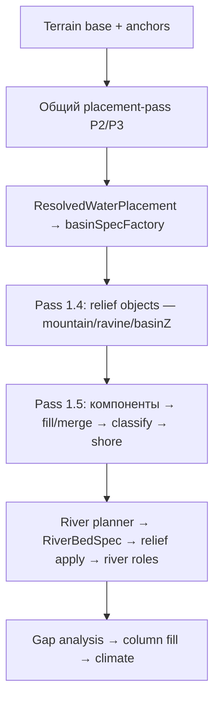
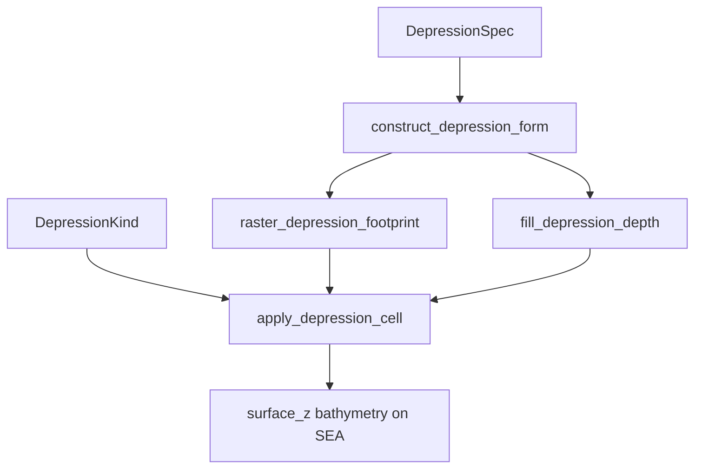
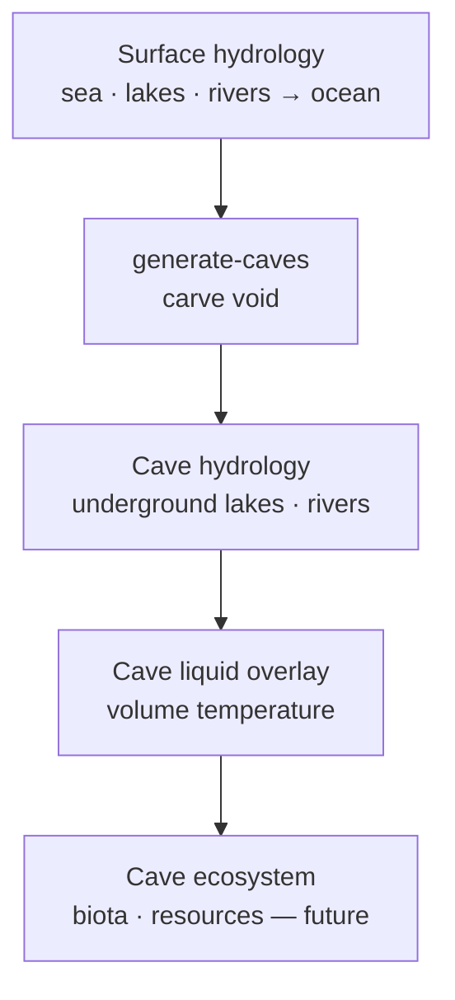
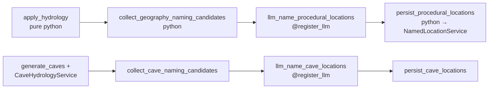

> **Статус 2026-10-21:** HY-12 шаги 1–4 реализованы: declare/placement → relief basin carve → компоненты, spill/physical union, strict fill, classify и dry shore. Профильная регрессия — 344 tests OK; offline world_test_004 подтверждает уровни/UID через wrapped-шов и детерминизм. Реки (шаг 5), финальная cleanup/HTTP-приёмка (шаг 6), W/L runtime/history/persist и HY-10 остаются открытыми.
> **Связь:** дополняет [`tz_terrain_generation.md`](./tz_terrain_generation.md) § Terrain layers п.3; **не** заменяет climate liquid overlay.

## GEO-1 — designed water и граница HY-12

**G0 target, 2026-10-27; production switch только G10-A.**
До switch действуют existing HY-12/baseline declare/placement и old policy
defaults. В частности, приведённые ниже baseline zero-priority coastline
и category autoresolve defaults не являются target GEO-1 правилами.
Полный норматив — [GEO-1](./tz_terrain_generation.md#geo-1--нормативный-контракт-designed-water).

Source settings живут в existing world.hydrology и body/category generation
POJO; physical resolved WaterBody не является источником authored overrides.
G3 contracts-only: reusable BodyGenerationFields содержит embedded
BodyWaterGenerationSettings; isolated composition с тремя existing Declared*
сохраняет location_uid, authored geometry/floor и existing validators. Поле
generation подключается к active source owners только в G10-A; новый persisted
source settings object или отдельный body resolver не вводится.
G4-S добавляет body-only generation_region_uid:EntityUid|None (не cascade
channel) и isolated ProceduralWaterSource с required source_uid,
generation_region_uid, BasinKind и MaterialKey. Дублирование region binding
в generation процедурного source запрещено даже при равных UID.
WaterDesignSource — derived union wrappers существующих basin/lake/coastline
и procedural source; WaterSourceMetadata несёт готовые uid/kind/liquid/level,
bands, source_path и positive default_depth. Mapper выполняется вне моделей.
G5-C1: DeclaredCoastline.purpose использует CoastlinePurpose (enum рядом с POJO):
WATER_SOURCE="water_source" по DefaultEnumWhenMissing для отсутствующего поля,
BODY_BOUNDARY="body_boundary" требует target_source_uid:EntityUid.
Water source не принимает непустой target; None означает отсутствие связи.
Явный null/неизвестное значение purpose не заменяется default. Target — strict
nonempty opaque source UID, без trim/coercion, не physical WaterBody UID lookup.
Разрешение существования/допустимости target выполняют G5-CP/G5-C3 по actual
source/placement/final-body facts; этот шаг проверяет wire форму и комбинации.
Existing kind/liquid/path/closed/water_side contracts сохраняются.
is_water_source — единая structural classification property, без terrain query,
admission или priority rules. BODY_BOUNDARY исключён из source wrapper, body
merge и legacy body load/guards; bulk body projection не меняет его absolute
path. В persisted declared_coastlines boundary сохраняется до dependent стадии.
Новая persisted коллекция не вводится; подключение generation к active
Declared* — только G10-A.
WorldHydrology.enabled=False — абсолютный запрет; autoresolve=False для
допущенной гидрологии выбирает DECLARED_ONLY, True — AUTORESOLVE.
HydrologyExecutionMode (DISABLED/DECLARED_ONLY/AUTORESOLVE) — computed domain
enum, отдельный от общего ResolutionMode и от cascade scope.
Domain definition связывает enabled с ObjectAdmissionPolicyDefinition,
общий PolicyResolver выбирает execution mode; generator/adapter не повторяет
bool gates и не реализует свой resolve. Value-selection mode не требует
placement priority; object admission/strategy — отдельная operation.

G5-CP: WaterSourcePlacementFields (hydrology/placement/placementFields.py)
владеет nullable authored placement_specificity для basin/coastline/lake/procedural;
WaterCategoryPlacementFields — nullable category priority, default0 до G10-A.
None категории наследует общий terminal0. Общие bands остаются в category.py,
прежний priority рек принадлежит rivers.py с прежним default0.
Readonly policy projections этих же owners получают actual значения явно.
HydrologyPlacementGateInputs содержит required world_enabled/category_enabled;
HydrologyPlacementBehaviorInputs — required resolved strategy. Metadata EnabledFor
и SelectByValue компилируются общим compiler; решение принимает PolicyResolver.
HydrologyPolicySnapshot — captured world_uid, supports, hydrology envelope,
SourceBodyMapping и mapping_hydrology_ref; все поля required, отсутствие evidence
передаётся None. Mapping связан с тем же world/ref; empty entry — authoritative
source dry, отсутствующая accepted entry — unknown. Mapping владеет final fill,
не policy provider. G5-CP добавляет контракт, production producer подключается позже.
HydrologyPolicyFacts наблюдает purpose/category/target_has_water: source получает
Known(None), boundary читает explicit mapping и actual liquid cells физических
body UID. Совпадение source UID с body UID не является mapping. Pending/failed/
missing/disabled support обрабатывает общий resolver; unknown evidence не dry.
Domain policy содержит enum case keys и typed predicates; target UID связывается
только с RequireSupportEffect. Application hydrologyPolicyFacts только собирает
факты, hydrologyPlacementBinding только связывает inputs и компилирует spec.
Ни один из этих объектов не выполняет admission/placement или live World lookup.

G5-CP implementation clarification: field metadata сохраняет identity основного
placement descriptor. Target-bound compound support case компилируется отдельно
с explicit priority/facts models (без field metadata); его RequireSupport rule
добавляется к основному compiled spec. Оба используют compile_admission_policy;
verifier identity checks и executor не меняются, rule IDs создаёт compiler.

В G10-A HydrologySeasPolicy и HydrologyLakesPolicy читают POJO default
placement_specificity=1; authored 0 остаётся DISABLED. Terminal priority=0
общий, без duplicate auto/effective priority и without-water special case
в PreparedPlacement. Water source и dependent shoreline boundary имеют разные
typed purpose; отсутствующий/failed support не является dry/disabled.
Settings None наследует по ROOT/WORLD/CATEGORY/WATER_BODY; terminal defaults
water_fraction=0.60, autoresolve=False, strategy=continental_noise.

G5-C2-G: terrain/designedWater/input.py владеет generic WaterDesignInput[S]
с общими ready inputs. AuthoredWaterDesignInput[S] допускает существующие
basin/lake/coastline источники, Noise/Plate/PlateNoiseWaterDesignInput[S] —
ProceduralSource либо CoastlineWaterSource. Допустимость проверяется bounds
статически и валидаторами runtime, включая десериализацию/специализации.
Source identity/path сохраняются. WaterStrategyInput — закрытый union
специализаций по strategy; generic base не используется вместо dispatch
validation. Recipes остаются строго связаны с соответствующим strategy.
ProceduralWaterDesignDraft описывает алгоритм результата, поэтому допускает
PROCEDURAL и COASTLINE source_kind с сохранением исходной metadata.
Этот контракт не реализует применение coastline constraints и adapter wiring.

Design использует terrain-owned region extent и pre-hydrology facts,
общий budget/preparer и один P2 batch. Accepted metadata/footprint/floor
превращаются в BasinSpec, применяемый existing relief writer ровно один раз.
SeaLevelPolicy/default_water_level, declared per-body z_water_level,
strict fill z<level, spill/merge и derived shore остаются HY-12 owners.
Generated floor — абсолютный Z, depth — Z cells, coverage budget — fine²;
нельзя смешивать noise score, elevation и coarse/fine площади.
Final source→physical-body mapping учитывает merge/split/dry; dependent
boundary не выбирает произвольный body/уровень по source UID.

Shore coating читает typed substrate evidence и decision общего policy:
unknown обязательного материала — issue, не fabricated sand/stone.
Runtime применяет только declared fallback с сохранением issue/provenance
и WarningError через existing sink; validate_only не материализует fallback.
Generated ocean design не переносит mountain generation в plate strategy.
Natural-only classify сохраняется; конкурирующее old sea/ocean discovery
из post-carve surface удаляется в том же G10-A switch.
Fine river search/manifest pre-river base — отдельный HY-RIV-1 R1/R2 gate,
не coarse fallback и не deliverable GEO-1.

## Утверждено (2026-06)

| # | Решение |
|---|---|
| U1 | Гидрология — **отдельный домен** pure-generators между Pass 1 и gap analysis |
| U2 | **Море** = coastal sea («большое у берега»); **океан** = coastal ring + open ocean mass; один `liquid_body`, роли в metadata |
| U3 | **Озеро** — локальная впадина; **inland_sea** — замкнутый крупный водоём. У каждого тела свой `z_water_level`; океанский дефолт — `default_water_level`. См. § Level-fill + компоненты |
| U4 | **Остров / полуостров** — топология после carve (`CoastalLandformClassifier`) |
| U5 | **Река:** возвышенность → устье; edge **`river`** / **`mountain_river`** — autoresolve по terrain (U17) |
| U6 | **Русло** — bootstrap carve; **поток / оттепель** — runtime (`season_changed`), без regen heightmap |
| U7 | `liquid_body` — climate overlay на `liquid_candidate` из hydrology, **не** глобальный `z≤0` |
| U8 | **Declare (optional):** водоёмы / рельеф — **`NamedLocation`** только если мастер объявляет; иначе autoresolve без location |
| U9 | **Реки:** declare — `declared_rivers[]` (U27); bed carve + **routing graph** — `ConnectionEdge` после emit (U18). **`NamedLocation` optional** — только для имени |
| U10 | **Default: autoresolve** если в template не объявлено; **отключение** — `hydrology.enabled` или `default_<category>.enabled: false` |
| U10b | **Единая mask-policy** (hydro + terrain + road): `enabled` default true; `DefaultOnWire`→DB; `IgnoreOnWire` overrides; empty declare ≠ off — [`tz_map_light_bake.md`](./tz_map_light_bake.md) § Surface mask domains |
| U11 | **`NamedLocation`** — optional: geometry **не требует** location; master declare — всегда вручную |
| U12 | **Подземные реки и озёра** — в **cave systems** (`generate-caves`), **не** surface hydrology; **своя экосистема** (volume climate, без surface rain/pole) |
| U13 | **`materialize_named_locations`** в **шаблоне мира** (default **OFF**); при **ON** — отдельная **LLM-нода DAG** придумывает `display_name` из контекста; python-нода persist |
| U14 | **Река — polyline как connection** (длина, ширина, повороты); **max turn ≤ 45°** между соседними сегментами — острые углы запрещены; planner/validator **smooth** |
| U15 | **Берег + bands:** N из **`default_<category>.bands`**; класс клетки — `shore_river` / `shore_mountain_river` / `shore_lake` / `shore_sea`. `default_rivers.mountain_shore` для U17. World-level `default_shore` — **deprecated** |
| U16 | **Именование `default_*`:** baseline мира (`default_rivers`, `default_lakes`, …), переопределяемый локально; **`hydrology.enabled`** — global без префикса |
| U17 | **`river` vs `mountain_river`:** разные **`system_connection_type`**; горная — **подтип** (круче, **пороги**); autoresolve **классифицирует по terrain** heightmap, не только по тегу истока |
| U18 | **River pipeline layers:** `classify_river_segments` → `list[RiverSegment]` (pure); **`riverConnectionEmit`** → `ConnectionEdge`; persist — **вне** generators (`MapCellService` / orchestration) |
| U19 | **`liquid_candidate` persist (v1):** mask и роли hydrology — **metadata на `map_cells`** при `save_terrain_batch`; climate и downstream читают из БД; нужно для «где реки/озёра/море» без sidecar между HTTP-вызовами |
| U20 | **Declare озеро:** `world.hydrology.declared_lakes[]` — `location_uid` + `shoreline[]` waypoints (fine-клетки, замкнутый контур) |
| U21 | **Declare воды:** `declared_basins[]` — форма + `kind` + дно; `declared_coastlines[]` — линия + явный `kind`, из неё достраивается бассейн. Все входы проходят общий placement → единый carve/fill |
| U22 | **`type_classify`:** missing использует defaults POJO; supplied null/invalid отклоняется общим import/runtime resolver, без локального fallback. Normalize записывает явные значения в bundle — см. § Import validator |
| U23 | **Smoke fixture:** [`fixtures/world_template.json`](../fixtures/world_template.json) — declare в `world.hydrology.declared_*` (hard cut от connection graph для hydrology) |
| U24 | **River bed:** hydrology ставит **`system_terrain: liquid_body`** в channel; **`role: river_bed`** в metadata |
| U28 | **Простая модель воды (2026-06):** hydrology → **`liquid_body`** в русле; **`generate-climate`** → **состояние** уже liquid cells (семантика состояния — [`tz_climate.md`](./tz_climate.md), **не** в этом ТЗ). Hydrology **не** выбирает лёд/вода/steam |
| U25 | **Lake vs inland_sea:** authored kind выражает намерение; физическая классификация читает post-carve компоненты, уровень и размер. Несоответствие диагностируется, отдельного carver по subtype нет |
| U26 | **Coast segment (Q4):** `geographic.coast` — **waypoint** на цепочке `coastline` моря (`ConnectionNode.location_uid`); не отдельная геометрия |
| U27 | **Реки (Q5):** `declared_rivers[]` — режимы `endpoints` / `via_locations` / `segments` + `system_role`; segments на import; endpoints/via на generate (A3); classify 1/2 по terrain (B2); global autoresolve не перезаписывает declare |

## Назначение

Зафиксировать **отдельный домен гидрологии** в генерации terrain: **surface** — моря, озёра и реки на heightmap; **caves** — подземные озёра и реки внутри cave volume (отдельный pass, отдельная экосистема).

**Проблема текущего interim (код):**

| Объект | Сейчас | Должно быть |
|---|---|---|
| Море | `z ≤ 0` + climate overlay | **Coastal sea** — «большое у берега» (carve + mask) |
| Океан | то же | **Open ocean mass** + coastal ring; не отдельный terrain type |
| Остров / полуостров | не моделируются | Топология суша vs water после carve (`CoastalLandformClassifier`) |
| Озеро | побочный эффект шума elevation | Локальная впадина заданной формы |
| Река | нет terrain-impl | Узкий канал (bed) от истока к устью / морю |
| Подземное озеро / река | не моделируются | В cave volume после `generate-caves`; volume hydrology + ecosystem |

**Не задача этого ТЗ:** gameplay-симуляция стока, erosion over time, dams — только **bootstrap materialization** мира (eager / declared extent).

---

## Принципы

1. **Hydrology — pure generators** (как `TerrainGeneratorService`): без repos, без async. Persist — `MapCellService` / DAG.
2. **Геометрию и высоту планирует terrain/relief:** первый этап до hydrology включает горы, овраги и дно моря/океана/озера. Hydrology рассчитывает воду и маршруты рек; готовые маршруты передаются в повторный relief-вызов для геометрии и прорезки русел. Затем hydrology читает post-carve поверхность для итоговых водных фактов до gap analysis и column fill. `BasinSpec` / `RiverBedSpec` — данные междоменной передачи, не основание переносить планирование геометрии в hydrology. Fill/classify/shore высоту не меняют. Норматив: [порядок planning](./tz_terrain_generation.md#terrain-relief-hydrology-planning).
3. **Liquid semantics — climate pass:** после carve hydrology выставляет **кандидатов** (`liquid_candidate` / metadata); **`liquid_body` на cells** — по температуре в `generate-climate` (см. [`tz_climate.md`](./tz_climate.md)).
4. **Детерминизм:** `world_seed(world)` + `(gx, gy, pass_id)` — как в terrain noise.
5. **`NamedLocation` optional (U11).** Generators — только geometry. Master **declare** → location из import. **Autoresolve** → без location. **U13:** `materialize_named_locations: true` в **world template** → цепочка DAG: collect candidates → **`llm_name_procedural_locations`** → persist (generators pure).
6. **Connections отдельно:** persist графа — [`tz_structure_connections.md`](./tz_structure_connections.md) + `ConnectionPersistService`; hydrology выдаёт маршрут/polyline для русла и edges, геометрию дна материализует terrain/relief.
7. **Surface ≠ caves:** U1–U11 — **surface** heightmap (Pass 1.5). Подземная вода — **cave hydrology** в `generate-caves` (U12); не смешивать masks и invariants.

---

## Место в pipeline



Общий placement-pass выполняется после готовности terrain base и anchors, до применения spec в Pass 1.4. Coastline-footprint читает один pre-carve снимок; `anchor_radius` использует готовые anchors. Гидрология не размещает объекты собственным resolver. Шаг 3 HY-12 требует P2 и водный adapter P3, включая authored absolute footprint.

Pass 1.4 применяет абсолютные `surface_z` из `terrain/reliefObjects/bathymetry/basinZ.py`. Pass 1.5 читает готовое дно: размечает впадины, разрешает физические уровни, заливает, классифицирует, выводит берег. Затем river planner эмитит `RiverBedSpec`, relief применяет русло, гидрология ставит роли и факт устья. River bed apply — отдельный вызов relief после планирования; fill тел из-за него повторно не запускается.

Метаданные (`WaterBody`, уровень, UID, роль) соответствуют материализации на клетках в том же результате. Persist остаётся application/repository-слою; динамические системы и lifecycle — отдельные W/L-треки. Gap analysis видит итоговое дно и русла, climate определяет состояние жидкости. DAG wiring в HY-12 не меняется.

## Концептуальная модель

### Таксономия воды (HY-12)

`BasinKind` = `sea | ocean | inland_sea | lake`. Тип задаёт контекст профиля и классификации; размер и глубина переопределяются настройками. `coastal_sea`, `open_ocean`, `inland_sea`, `lake` — роли материала воды на клетках, `SHORE` — роль сухого берега. Один океан включает прибрежную и открытую воду; отдельный terrain type на каждый kind не создаётся.

### Sea level (reference)

Глобальный океанский дефолт — `WorldHydrology.default_water_level: DefaultWhenMissing[int] = 0`. `resolve_z_sea() = 0` — legacy, который мигрирует в шаге 2. На каждом теле и его клетках используется **`z_water_level`**. Несвязанные тела могут иметь разные уровни; непосредственное физическое слияние зеркал разрешает общий уровень, связь через реку сохраняет разницу высот.

Вода тела существует строго при **`surface_z < z_water_level`**. Клетка **`surface_z == z_water_level` — суша**; при соседстве с водой может стать `SHORE`. Heightmap показывает дно, уровень зеркала хранится отдельно. `is_land` в контексте уровня включает равенство; отсутствие воды нельзя определять одним глобальным сравнением с нулём.

### Суша, острова, полуострова

Появляются **после** carve моря/океана и **до** climate overlay — из топологии **суша vs `liquid_candidate`**:

| Форма | Определение (grid, 4/8-neighborhood) |
|---|---|
| **Суша (land)** | клетка вне итогового water fill, включая `surface_z == z_water_level` своего соседнего тела |
| **Остров** | connected component **суши**, не касающийся «материковой» суши (outer bbox land или master `mainland_mask`) |
| **Полуостров** | суша, connected к материку, с **≥3 сторон** — `coastal_sea` / `open_ocean` (не считая diagonal-only v1: 4-neighbor) |
| **Материк** | largest land component (или master `mainland_mask`) |

**Зачем в hydrology:** порты (`adjacent_terrain: liquid_body`), `river_linear` layout, LLM («островная крепость»), world routes (`sea_route` только по water cells), auto anchors.

**Класс (target):** `CoastalLandformClassifier` — read-only на `SurfaceHeightmap` + `HydrologyResult` → `islands[]`, `peninsulas[]`, `coastline_polylines[]`. **Не** mutates heightmap.

**Мастер:** явные `island` / `coast` NamedLocation anchors переопределяют auto-detect для narrative; geometry всё равно из heightmap.

### Берег и углубление (U15 — HY-12)

Берег выводится после fill: сухая клетка с 4-соседом воды получает `SHORE`. Соседство и расстояния предоставляются `dataModel/topology`. Берег не записывает `surface_z = level`; равенство уровню допускается, но высокая сухая клетка у воды тоже берег.

`HydrologyBands` переиспользуется как `rim`: ширины зон профиля дна и ограничение борта. Сначала relief строит профиль от фактического `z_land(rim)` к `floor_z`; затем вода определяется строгим уровнем. `deepening_index` — квантование расстояния/глубины профиля, а не счётчик, который превращает все первые N клеток воды в сушу.

`bands.min` — предпочтительная ширина, не обязательная сухая полоса. В узком footprint профиль сжимается: если есть клетка ниже уровня, она остаётся водой. `bands.max` задаёт ширину slope-зоны distance-профиля, не ограничение перепада z. По решению мастера HY-12/3 гора иммутабельна: поднятые mountainZ клетки передаются в basinZ как reserved, исключаются из footprint и остаются островами с обычным профилем дна вокруг них. Разрешение precedence mountain × shore остаётся HY-7.

Настройки: `default_seas.bands` (существующий default 1…20), `default_lakes.bands` / `default_rivers.bands` (1…5); локальный `rim` заменяет профиль своего тела. Валидатор: `1 <= min <= max <= 99`. Ширины интерпретируются в контракте рабочей сетки; отдельного масштаба гидрологии нет.

**Единый контракт bands (HY-S-6).** Используется только POJO
`dataModel/hydrology/bands.py:HydrologyBands`. Category policy и
`DeclaredBasin.rim` передают его потребителям напрямую; runtime dataclass-дубль
и неиспользуемый `resolveHydrologyBands` / `clamp_bands` удалены.
Missing whole-category bands использует default категории; явно переданный
partial bands разбирается по defaults самого HydrologyBands (в частности,
missing max — 5, а не legacy 99). Потребитель не clamp-ит supplied значения
и не заменяет их локальными defaults. Валидация остаётся на POJO и общем
import/runtime resolver, порядок rim проверяется DeclaredBasin. Legacy
raw `local_profile` API не сохраняется; локальный профиль тела задаётся typed rim.

Материал сухого берега берётся из `default_seas.shore` (`shore_sea`), `default_lakes.shore` (`shore_lake`), `default_rivers.shore` (`shore_river`) или `mountain_shore` (`shore_mountain_river`). World-level `default_shore` deprecated. Grade берега принадлежит relief, не `bands`. Подводный solid-профиль остаётся дном; `liquid_candidate`/water-role определяются fill. Полная передача band/metadata в L0 — HY-10, coarse-профиль её не подтверждает.

### Ocean bathymetry / Depression forms (HY-12)

Дно любого водоёма — relief object в `generators/terrain/reliefObjects/bathymetry/`. `ResolvedWaterPlacement` мапится через `hydrology/basinSpecFactory.py` в `BasinSpec`; общая очередь Pass 1.4 применяет его рядом с mountain/ravine spec. Собственного z-writer у sea/lake/ocean нет.

Footprint — существующий `RegionShape`: bbox, ellipse, polygon, anchor_radius и новый общий CORRIDOR (`path: list[Point]`, положительная `width`, круглые caps). Corridor растеризуется доменным расстоянием до сегментов `<= width/2` в unrolled-кадре. `edge_noise` переиспользуется из spatial; новый shape-DSL для воды не вводится.

Профиль — piecewise по multi-source BFS distance field от rim/waterline: **shelf → slope → floor**. `ocean` задаёт широкий shelf и переход к abyss; `sea` — более узкий shelf; `inland_sea`/`lake` — чашу. `kind` выбирает форму профиля, не обязательную глубину. Явное дно берётся из `DeclaredBasin.floor_z`, coastline получает глубину из `HydrologySeasPolicy.basin_depth` (см. ниже).

Carve записывает **абсолютное** `z = profile(d)` с учётом `z_min`, пропуская reserved-клетки гор (HY-12/3). Повторный bake использует тот же terrain-base снимок и те же spec; повторное применение не вычитает глубину ещё раз. На выходе `surface_z` — дно; для воды требуется `surface_z < z_water_level`. Полоса на уровне зеркала — суша.

Прежний **Scope A** «только DepressionSpec внутри open ocean» и gate D4 по готовому `open_ocean_mask` сняты: бассейн создаёт впадину **до** fill. Дополнительные `DepressionSpec` (котловины/желоба внутри уже созданного дна, Form + Kind + width/length/depth) остаются отдельным будущим расширением и в HY-12 не реализуются.

`HydrologySeasPolicy.stub_drop_fraction_of_span` и legacy `resolve_open_water_surface_z` удалены в HY-12/6. `coarseOpenWater` копирует готовый `coarse_surface_z` без вычисления глубины и без привязки к глобальному уровню: высокое озеро сохраняет своё дно. При отсутствующей высоте z не изобретается; declared river-клетки сохраняются. Light writer не получает своего алгоритма батиметрии; HY-12 smoke проверяет coarse heightmap + hydro index. Полный L0-профиль — HY-10.

#### Дополнительные впадины дна — будущее расширение

Следующий сохранённый Form/Kind/Spec-контракт относится **только к дополнительным котловинам и желобам внутри уже вырезанного дна**, вне HY-12. Его gate D4 по open-water/abyss остаётся ограничением этих дополнительных объектов; для основного `BasinSpec` он не применяется. `z_sea` в сохранённых формулах означает уровень конкретного принимающего тела (`z_water_level`). Само применение depth выполняет relief, гидрология лишь предоставляет контекст.

#### Оси формы (width / length / depth)

| Ось | Смысл | Где в модели |
|---|---|---|
| **Width** | поперечный размер footprint | `EllipseForm.semi_minor_fine` / `CorridorForm.half_width_fine` |
| **Length** | продольный размер | `EllipseForm.semi_major_fine` / длина `CorridorForm.spine_fine` |
| **Depth** | вертикаль (drop от `z_sea`) | `DepressionKind` → knobs + DepthFill profile |

**Инвариант разделения:** Form **не** знает depth; Kind **не** знает polygon / spine math (зеркало Mountain Form vs KindElevation).

#### Sum type Form + Kind + Spec

```text
DepressionForm =
  | EllipseForm   { semi_major_fine, semi_minor_fine, yaw_rad }
  | CorridorForm  { spine_fine: list[(x,y)], half_width_fine }
  | …             # новый variant = PR: construct + raster (+ optional depth profile hook)

DepressionKind   # builtin append-only table (как MountainKind)
  | SHELF_BASIN   # мелкая котловина
  | ABYSSAL       # глубокая котловина
  | TRENCH        # узкий глубокий желоб (часто с CorridorForm)
  | …

DepressionSpec
  form: DepressionForm
  kind: DepressionKind
  # origin для Ellipse — центр эллипса в fine-клетках (поле Spec или convention construct)
  # Corridor: spine уже в form
  # optional: declare uid, seed
```

**Неверно:** плоский `{radius_cells, depth}` как единственная модель.
**Верно:** discriminated union Form + отдельный Kind.

#### EllipseForm / CorridorForm (норматив метрик)

**EllipseForm** — котловина:

- length = `2 · semi_major_fine`, width = `2 · semi_minor_fine`
- `yaw_rad` — поворот major axis
- `depth_fraction`: 1 в центре, 0 на контуре (elliptical radius → smoothstep)

**CorridorForm** — желоб:

- length = длина polyline `spine_fine`
- width = `2 · half_width_fine`
- `depth_fraction`: 1 на spine, 0 на боковых краях; optional taper на концах spine

#### Engine interface дополнительных DepressionSpec

```text
construct_depression_form(form, …) → DepressionFormGeometry
  # fine-клетки; без light grid — vertices / SDF / spine+offset по variant

raster_depression_footprint(geometry, scale) → set[Cell]
  # Ellipse: inclusion; Corridor: stadium / capsule along spine

fill_depression_depth(geometry, footprint, kind) → {(cell, depth_fraction)}
  # fraction ∈ [0, 1]; 1 = deepest (axis / center)

apply_depression_cell(base_z, z_sea, z_min, kind, depth_fraction) → z
  drop = resolve_drop(kind, z_sea, z_min)   # Kind table / POJO DefaultOnWire
  z    = max(z_min, z_sea - round(drop * depth_fraction))
  # только клетки SEA / open_ocean (или становящиеся ими); никогда не поднимает сушу

resolve_depression / apply_depression_spec(spec, …)  # facade для generators / light hydro
```



| # | Инвариант интерфейса |
|---|---|
| D1 | Generator / light hydro contributor зовёт **facade** (`resolve_depression` / `apply_depression_spec`), не math внутри contributor |
| D2 | Новый form = новый variant + `construct_*` + `raster_*`; **запрещён** `if form ==` в hydro contributor |
| D3 | Новый kind = строка в Kind table + depth knobs; без смены FormGeometry |
| D4 | Scope gate: footprint ∩ **open_ocean_mask** (или SEA open mass); суша и coastal-only shelf **не** углубляются DepressionSpec (shelf = U15) |
| D5 | Один Spec — single-writer на клетку внутри apply; merge нескольких Spec на одной клетке = **min z** (глубже побеждает) |

#### POJO / wire

Под `world.hydrology.default_seas` (`HydrologySeasPolicy`; позже соседний `default_seas.bathymetry` при росте Kind table):

| Поле / область | Статус | Смысл |
|---|---|---|
| `stub_drop_fraction_of_span` | **removed HY-12/6** | uniform stub снят; `BasinSpec` + relief writer и готовая coarse-высота |
| `depression_autoresolve` | target | procedural DepressionSpec внутри open ocean |
| `default_form` / `default_kind` | target | defaults для autoresolve / declare без явной form |
| Kind table | target | `max_drop` **или** `drop_fraction` vs `(z_sea - z_min)` — DefaultOnWire; **заменяет** stub knob |
| `declared_depressions[]` | target | hydrology declare рядом с `declared_coastlines` (fine-клетки); **не** `connection_edges` (U23) |

**Autoresolve v1 (target, не блокер контракта):** seed field внутри open ocean → Ellipse и/или Corridor с random yaw / aspect; clamp размера к bbox воды.

### Подводный мир — сцены на дне океана (утверждено семантически 2026-10-19)

**Продуктовое решение:** дно моря/океана — **полноценная игровая поверхность**, как суша. Подводные локации — затонувший корабль, подводный данж, подводный город с живыми жителями — обычные локации/структуры на floor-клетках, **не** отдельный слой мира.

| Аспект | Механика |
|---|---|
| Дно как surface | `surface_z` = дно (§ Ocean bathymetry); колонка под дном — solid fill до `z_min` (`run_column_fill`), тот же что под сушей → cave/tunnel под дном = существующий cave domain / `undergroundTunnel` |
| Локация | terrain-агностична: `location_complex` subtype (напр. `sunken_ship`), `settlement` subtype `underwater_city` (parallel `underground_city`) с `is_inhabited`; parent `geographic.sea` / `ocean` / `inland_sea` — [`tz_locations.md`](./tz_locations.md) |
| Интерьер | `liquid_body` только на surface `liquid_candidate` (C3/U28); комнаты/трюм/данж — **сухие** (воздушный пузырь, купол), отдельной механики не надо. Затопленный интерьер — material/state уровня комнаты (future) |
| Размещение | v1 — **declare-якорь** мастера (`NamedLocation` / `geographic.*` parent на водной клетке). `adjacent_terrain` проверяет внешнее кольцо, **не** «клетка IS water»; placement-условие на воде при autoresolve — v2 |

**Толща воды (граница v1/v2):**

- v1: вода над дном — role + `liquid_body` на одной surface-клетке; **клеток между дном и зеркалом нет**.
- Сцены на дне и под дном используют heightmap дна; плавание в толще между дном и `z_water_level` тела требует будущих water-column cells в column fill (§ Sea level).

**Построенные подводные магистрали:**

`sea_route` — абстрактное мировое ребро без физических клеток ([`tz_structure_connections.md`](./tz_structure_connections.md)). **Построенная** магистраль — отдельный `system_connection_type` (напр. `undersea_tunnel`), два варианта геометрии:

| Вариант | Что | Переиспользование |
|---|---|---|
| A — тоннель под дном | corridor на `z < floor` | `undergroundTunnel` / corridor pipeline; не требует водного столба |
| B — труба/мост на дне | structure на floor-клетках | building/corridor materialize, как `bridge` на суше |

**Инварианты:**

1. Локация на дне не меняет батиметрию и не carve воду — SoT дна остаётся post-carve heightmap, который пишет relief.
2. Подводное поселение — тот же settlement generate на floor-клетках; footprint/district machinery без спец-кейсов «под водой».
3. Физические подводные связи — новый `system_connection_type`; не перегружать `sea_route` (нет контакта/клеток) и не `river`/`mountain_river` (гидро carve).

**Антипаттерны:**

- `liquid_body` внутри интерьера «потому что под водой» — интерьер не surface.
- Отдельный `underwater` terrain key — вода это `liquid_body` + roles, не новый класс рельефа.
- Размещать подводную локацию через `adjacent_terrain` — условие про соседство, не про саму клетку.

**Зависимости:** HY-BATH-1 (uniform stub floor — локации на дне валидны уже сейчас; «в желобе/котловине» ждёт DepressionSpec); water-column cells — v2; subtypes в `location_type_registry` и `undersea_tunnel` — data-level добавление, не новый слой движка.

**Зеркальный домен:** воздушный слой над `surface_z` — тот же класс «слой за пределами суши», отдельный документ [`tz_aerial.md`](./tz_aerial.md).

### Lake

Озеро — локальная впадина с собственным уровнем, которая проходит общий basin pipeline. `DeclaredLake.shoreline` сохраняется как wire-контракт, нормализуется в basin intent с bowl-профилем; отдельного lake carver нет. `default_lakes` использует существующий `HydrologyLakesPolicy`; его целевое поле `basin_depth: DefaultWhenMissing[int] = 5` (`>0`, Z) задаёт дно при отсутствии явного `DeclaredBasin.floor_z`. При отсутствии собственного уровня применяется общий default, физическое ограничение — pour-point впадины.

`SHORE` выводится по фактической воде. Река может впадать в озеро выше океанского уровня; endorheic озеро не обязано иметь outflow. Динамическая сеть outlet/системы — отдельный W-трек. Неоднородные DepressionSpec внутри дна остаются будущим расширением для всех kind.

### River

**Инвариант:** река течёт из возвышенности к принимающему водоёму (озеро, море или океан), используя уровень этого тела.

| Узел | Правило |
|---|---|
| **Исток (source)** | Любая возвышенность (peak v1; lowland v2). **Тип segment** — `classify_river_segments` (U17) |
| **Русло** | monotonic non-increasing `surface_z` вдоль polyline (D8 v1) |
| **Повороты (U14)** | **Плавные:** угол между соседними сегментами polyline **≤ 45°**; **> 45° запрещён** (declare и autoresolve). При необходимости — цепочка waypoint + дуга (см. [`tz_structure_connections.md`](./tz_structure_connections.md) § river curve) |
| **Устье (mouth)** | первая клетка принимающего тела с `z < z_water_level` либо open-water ролью, включая озеро; произвольная низина без resolved water body не является устьем |
| **Озеро** | side sink (впадает, может остановиться); **не** заменяет море как финальная цель world-scale river network v1 |

- **River bed** — carve вдоль polyline: channel + **U15 shore/deepening** перpendicular к оси (обе стороны).
- **Geometry** — **`ConnectionEdge` polyline** (как дорога: длина, ширина, повороты); **не** disk/radius от anchor. `NamedLocation` (`geographic.river`) — optional **имя**; форма и shore override — edges.
- **Order:** `COASTAL_SEA` → `OPEN_OCEAN` → `LAKES` → `RIVERS` → optional `LANDFORMS`.

### Типы рек: `river` и `mountain_river` (U17 — утверждено)

Два **`system_connection_type`** — **не** один тип с флагом. **`mountain_river`** — подтип (круче, **пороги**), отдельный edge type для routing / travel / melt.

| | **`river`** | **`mountain_river`** |
|---|---|---|
| **Рельеф** | равнина, пологий склон | гора, peak, крутой descent |
| **Bed** | пологий step | **круче**; **пороги** (Δz > threshold) |
| **Runtime** | rainfall | + melt (`season_changed`) |

**Autoresolve (U17):** `classify_river_segments` — terrain Pass 1 + Δz; split at foothill → `list[RiverSegment]`. Config: `default_rivers.type_classify`. Declare — skip (U18).

**Классификация (autoresolve, по terrain):**

1. Исток / path на `mountain` terrain или subtype `peak` / `mountain`.
2. `surface_z` истока ≥ `mountain_min_source_z`.
3. Δz step > `rapid_drop_threshold_m` → **порог** (waypoint metadata).
4. Ниже foothill → `system_connection_type: river`.

| | Bootstrap | Runtime |
|---|---|---|
| **Кто** | planner, `classify_river_segments`, carver, `riverConnectionEmit` | climate / weather |

**Инвариант (U17):** тип segment — **только через terrain** (`classify_river_segments`), не tag `kind: mountain` alone.

**Берег grade:** segment `mountain_river` красит **`shore_mountain_river`**. Крутизна русла (U17) и пол берега (R37, θ 20–70°) — связанные, но разные оси.

**Путь mountain segment:** steep bed + пороги; ниже foothill → edge type `river`.

### Сезон, оттепель и сток (не bootstrap)

**Постоянное русло ≠ постоянный поток.** При **оттепели** (spring, положительный `season_temp_offsets` на горных ячейках) «лишняя» вода **логически** стекает по **уже вырезанным** горным рекам к морю — **без** перегенерации heightmap.

**Смена сезона — `ClimateChangeEvent(kind="season_changed")`** → нода `recalculate_climate` (partial weather) + опционально v2 `flow_level` на `river_cells` из [`tz_climate.md`](./tz_climate.md).

| Сезон | Эффект на горные реки (target) |
|---|---|
| Зима | dry bed / ice на `mountain_cells` |
| Оттепель | melt → `flow_level` ↑ |
| Лето | базовый сток + rainfall на peaks |

**Граница слоёв:** hydrology **не** слушает season; climate **не** carve bed.

---

## Level-fill + компоненты (HY-12)

### Компоненты и уровни

Вход — полный разрешённый topology-контекст, post-carve elevation и нормализованные basin intents. Сначала размечаются впадины, затем multi-source priority-flood разрешает уровни и connected-component fill. Смежность — 4-связная через домен топологии, lookup/write — canonical, вычисления — unrolled. Частичный bake не создаёт физический борт на границе загруженной области: данных компоненты/борта должно хватать для resolve, иначе unresolved с причиной, без догадки об уровне.

Запрошенный уровень тела — явный declare либо `default_water_level`. Свой удерживаемый уровень (`WaterBody.declared_level`) = `min(requested_level, pour_point)`. Pour-point — первая по высоте rim-клетка с выходом в более низкую внешнюю область; dead-end rim, за которым нет спуска, уровень не ограничивает. Frontier упорядочен по `(z,y,x)`, граница компоненты учитывает доменную топологию. `z=level` на spillway остаётся сухой клеткой. При отсутствии конечного spill ограничителя применяется requested level; граница planar void считается выходом, шов wrapped/sphere — обычной связью, не сливом.

**Planar ocean boundary (решение мастера 2026-10-21).** Для открытого океана мировая planar-граница является продолжением воды с `default_water_level`, а не сливом в void. Подводный край `z=-10` при default=0 остаётся водой с уровнем 0. Это граничное условие мирового океанского резервуара, не изменение elevation и не принудительное затопление суши: strict fill сохраняется. Для остальных бассейнов planar void остаётся выходом; граница частичного bake не является мировой границей и не получает ни одного из этих условий. Wrapped/sphere швы остаются обычными связями. Для natural-only ocean-кандидата условие применяется при разрешении default-level воды, до финальной классификации; оно не должно зависеть от результата уже выполненного void-слива.

Fill включает только клетки **`z < effective z_water_level`**. `floor_z >= pour_point` означает «basin cannot hold water»: тело не создаётся, пишется warning. Запрошенный уровень выше удерживаемого даёт warning «level exceeds pour point». Берег не дописывает воду и не корректирует высоту.

### Физический merge и каскад

При непосредственном контакте водных фронтов A и B образуется физическое объединение S. **`S.level = min(max(L_a,L_b), min_rim_z(union))`**, где минимум rim берётся по pour-point-клеткам внешнего борта объединения; внутренний борт и dead-end rim исключаются. Отсутствие конечного pour-point не ограничивает `max(L_a,L_b)`. Простого соседства сухих footprint или связи через реку для физического merge недостаточно.

Дети сохраняют UID/kind и собственный `declared_level`, получают effective `z_water_level` от физического родителя. Nested union наследует уровень каскадом по всей цепочке `PHYSICAL_MERGE`; `RIVER_LINK` в каскад не входит. `declared_level != effective_level` — warning «level superseded» один раз на тело. Например, L_a=20, L_b=5 и pour-point union=8 дают S.level=8; оба тела наследуют 8.

**Lifecycle участников (согласовано мастером 2026-10-21).** Член физического union сохраняет собственные UID и lifecycle; вступление в родительскую систему не закрывает lifecycle участника. Родительская система имеет отдельные UID и lifecycle. У сохранившегося участника меняется ссылка `parent_system_uid`, effective уровень наследуется каскадом. При последующем merge/split замещаемые родительские системы становятся историческими, новые ссылаются на них как на предшественников; lifecycle сохранившихся участников продолжается. Исчезновение самого участника — отдельное изменение его lifecycle, не следствие одного членства.

Resolver доводит fill до итогового уровня затронутого union: при повышении расширяет заливку, при понижении исключает клетки `z >= level` из итоговой воды/ролей. Вычисленный уровень и материализация не могут расходиться. Обработка фронта/union детерминирована; глобальные повторные обходы мира для каждого merge не допускаются. Бюджет priority-flood — O(W log W) по затронутой воде и борту; отдельные scan+label/distance-field — линейные по своим клеткам.

HY-12 выдаёт физические факты union, уровней и связей. Общую identity/lifecycle системы и динамическое membership определяют W/L-домены, не локальные replacements в pure-генераторе. Выбор primary по kind/объёму не влияет на формулу уровня. Разные `liquid` фиксируются как факт; разрешение смешения материалов — отдельный домен.

### Производитель физического union и identity (HY-12/4, 2026-10-21)

Общий identity helper — `app/ids/waterSystemIdentity.py`, тег `UidKind.WATER_SYSTEM`. Формула: `entity_uid(world_uid, WATER_SYSTEM, change_uid=change_uid, members=state_fingerprint(tuple(sorted(unique_member_uids))), system_kind=kind)`. `WaterSystemKind` (`dataModel/hydrology/enums/waterSystemKind.py`) = `PHYSICAL_MERGE | CONNECTED`: одинаковый состав физического родителя и системы речной связности не даёт один UID. Уровень/объём/порядок обхода в identity не входят. Повтор одной операции/состава возвращает тот же UID; восстановление после засухи с новой операцией создаёт нового родителя.

`change_uid` — opaque identity операции application/lifecycle caller; он передаётся в `HydrologyGeneratorService.apply(change_uid=...)`. Чистый первый bake/preview использует общий `initial_water_change_uid(world_uid)` = DET-1 с `UidKind.LIFECYCLE_CHANGE`, `scope=hydrology`, `origin=bootstrap`: это одна логическая начальная операция, воспроизводимая при retry/re-bake чистого снимка. Этот default не применяется к persisted runtime-изменениям, засухе/наполнению и merge/split истории: их caller обязан передать identity соответствующей новой операции. Pure генератор не хранит и не закрывает lifecycle. Выделенного журнала операций/W/L writer этот шаг не создаёт.

HY-12 отдаёт `PhysicalWaterUnion` (`dataModel/hydrology/physicalWaterUnion.py`, frozen, extra=forbid): `water_system_uid: StrictOnWire[str]`, `member_uids: StrictOnWire[tuple[str,...]]` (конечные участники в каноническом порядке), `child_system_uids: StrictOnWire[tuple[str,...]]` (непосредственные вложенные физические объединения), `z_water_level: StrictOnWire[int]` (effective после каскада), `parent_system_uid: DefaultWhenMissing[str | None]=None`. Все UID здесь — осознанные opaque string refs на объекты/системы общего identity, а не ключи реестров. Это producer-факт для W/L, не вторая модель динамической системы или lifecycle. `WaterBody.parent_system_uid` содержит реальный UID ближайшего физического родителя, его запись присутствует в том же результате. Вложенные родители сохраняются, effective level доведён до верхнего физического предка. Участники сохраняют собственные UID/kind/liquid; смешение жидкостей здесь не разрешается.

`HydrologyResult` расширен `water_bodies: tuple[WaterBody,...]`, `physical_unions: tuple[PhysicalWaterUnion,...]`, `water_areas: dict[str,int]`, `water_floors: dict[str,int]`. Ключи двух словарей — opaque water_body_uid. Площадь в клетках рабочей сетки, дно в world Z; для declared применяется `BasinSpec.floor_z`, для auto — минимум материализованного дна. Счётчики/минимумы собираются при fill/эмиссии клеток, отдельного объёмного скана нет. Индекс клеток имеет одного владельца с tie distance→UID→(y,x); совпадающие declared-объекты сохраняются в water_bodies даже при нулевой выделенной им доле клеток. Исключение двойного учёта и перевод coarse площади в м² остаются W0; нулевая выделенная доля не означает уничтожение объекта.

`waterBodyAssembler` — единственный production-проход тел. Он читает post-1.4 snapshot и именно те resolved `BasinSpec`, которые использовал relief, без повторного placement по изменённому рельефу. Сначала elevation-ordered union-find размечает иерархию впадин; equal-height plateaus активируются атомарно. Seedless нижняя внешняя ветвь даёт pour-point, dead-end ступень — нет. Frontier bags объединяются small-to-large; непосредственный контакт мокрых фронтов создаёт физического родителя, сухой sill на `z==level` не объединяет тела. Final labelled fill расширяет/сужает воду до effective уровня, затем classify/shore. Промежуточные procedural minima одного connected fill нормализуются в одно auto-тело; они не становятся фиктивными durable участниками системы.

Hydrology facade больше не вызывает `generate_coastal_sea`, `autoresolve_sea_basins`, `generate_open_ocean`, `generate_lakes`: независимые sea/ocean/lake paint-carve проходы отключены от production. Их старые standalone helpers ещё используются историческими geometry/unit regression и не являются вторым production-механизмом. River pass пока прежний — миграция шага 5. При неполном topology snapshot — `WATER_TERRAIN_UNRESOLVED` в общий runtime/validate_only sink, без искусственного борта. Прямой вызов facade без resolved specs не материализует authored-воду и диагностируется `WATER_PLACEMENT_REQUIRED`.

### Пересыхание и восстановление водоёма (решение мастера 2026-10-21)

Временное отсутствие воды — доменное состояние существующего водоёма, а не уничтожение объекта и не завершение его lifecycle. При полном пересыхании озеро сохраняет собственный UID, lifecycle, котловину и authored-параметры; текущий объём воды равен нулю, мокрый footprint пуст, open-water роли отсутствуют. Факт сухости не удаляет и не засыпает рельеф. Изменение или уничтожение самой котловины/объекта — отдельная операция, не неявное следствие засухи.

Действующая система описывает фактически соединённую воду. Полностью сухое озеро исключается из её текущего водного состава, но сохраняется в каталоге самих объектов и в истории. Инвариант «каждый текущий участник принадлежит одной активной системе» относится к текущим водным участникам, а не ко всем существующим географическим объектам. У сухого объекта нет действующего физического родителя воды; прежнее членство доступно из исторических записей. Пустая котловина, старое русло и прежний parent не доказывают действующую связь. Река не считается пересохшей автоматически из-за пересыхания одного озера: producer отдельно подтверждает её воду и сохранившиеся соединения.

Удаление сухого озера из текущего состава и утрата его связей затрагивают только соответствующую компоненту. Если оставшиеся два озера и речка соединены, они образуют одну систему-преемник; если сухое озеро было связующим звеном, образуется несколько систем-преемников. При изменении состава прежняя система историзируется, преемники получают новые UID и ссылки на непосредственных предшественников даже при сохранении одной связной компоненты. Если меняются только объём/уровень без изменения состава и связности, это не само по себе основание для нового UID системы. Исчезновение всей действующей воды историзирует прежнюю систему без создания пустой активной системы. Lifecycle сохранившихся водных объектов не закрывается вместе с lifecycle системы.

При повторном наполнении возвращается то же озеро с прежним UID и продолжающимся lifecycle. Producer восстанавливает фактические воду/роли и подтверждённые соединения. Восстановление состава либо объединение компонент создаёт новые системы с новыми UID и ссылками на текущих непосредственных предшественников; исходная историческая система не реактивируется, даже если состав полностью совпал. Связь с исходной системой прослеживается по цепочке истории. Повтор той же операции/retry не создаёт ещё одну систему; новое наполнение после засухи — новая операция, а не retry исходного создания.

Пример приёмки: система S0={L1,L2,L3,R}; L2 пересыхает → L2 существует с прежними UID/lifecycle, но без мокрых клеток и текущего водного членства; S0 историческая, оставшаяся вода образует S1 либо несколько преемников по фактическим связям. L2 наполняется → тот же L2; при восстановлении исходной связности создаётся S2={L1,L2,L3,R}, S2≠S0 по UID, S0 остаётся исторической. Отдельно проверяется вариант с полной потерей воды и последующим восстановлением без пустых систем.

Это согласованный целевой контракт, не уже реализованные поля состояния. W0/W1 обязаны типизировать состояние воды и различие каталога объектов/текущих участников до реализации consumer; `EntityLifecycle.is_active` не используется как флаг наличия воды. HY-12 не создаёт WaterBody и open-water роли из пустого fill, но отсутствие записи в результате fill не является командой уничтожить durable-объект. Для истории используются существующие durable identity; позиционный `auto-*` bootstrap UID этим решением не становится durable — его привязка к сохраняемому объекту остаётся W/L-границей.

### Классификация и минимальная масса

Классификатор читает готовые компоненты, authored kind и их уровень. Явный kind сохраняет намерение объекта; несоответствие subtype/физике диагностируется. Для natural-only autoresolve ocean-кандидат имеет океанский default-уровень и наибольшую водную массу среди таких компонентов. В planar достижение **мировой** границы — дополнительный океанский признак; достижение bake-bbox не используется. В wrapped/sphere отсутствие края не мешает классификации: используются уровень и масса, не edge flood. Крупнейшее горное озеро не становится океаном только из-за размера.

Остальные замкнутые компоненты — `inland_sea` либо `lake` по относительной площади и контексту впадины. Целевой параметр `HydrologySeasPolicy.inland_sea_min_area_fraction: DefaultWhenMissing[float] = 0.01` (`0 < value <= 1`) задаёт порог относительно площади полного мира. Авторский kind не переписывается только из-за этого procedural-порога.

Минимальный размер водного объекта — целевое поле **`min_water_cells: DefaultWhenMissing[int] = 2`** (`>=1`) существующих `HydrologySeasPolicy` и `HydrologyLakesPolicy`, для соответствующей категории. Это фильтр speckle в клетках coarse-индекса; он не является географическим extent-лимитом. Компонента меньшего размера — puddle: без `WaterBody` и open-water ролей, с единичной диагностикой. Состояние локальной лужи — вне bootstrap-контракта. Счётчики площади и минимум дна собираются тем же fill, выделенный второй проход ради объёма не вводится.

### Derived shore, записи и identity

`shoreDerive` после окончательного fill назначает `SHORE` сухим 4-соседям воды, включая `z==level`; z остаётся исходным post-carve. Wet-клетки сохраняют water-role; `deepening_index` — факт профиля, не основание объявить мокрую клетку сухой. На стыке нескольких тел берутся факты фактически смежной воды в стабильном порядке resolve; grade/terrain precedence остаётся своей ответственностью, HY-7 не закрывается.

Целевой **`WaterBody`** (`dataModel/hydrology/waterBody.py`, frozen): `water_body_uid: StrictOnWire[str]`, `location_uid: DefaultWhenMissing[str | None] = None`, `kind: StrictOnWire[BasinKind]`, `liquid: DefaultWhenMissing[StrictOnWire[MaterialKey]] = "water"`, `declared_level: StrictOnWire[int]`, `z_water_level: StrictOnWire[int]`, `declared_basin_uid: DefaultWhenMissing[str | None] = None`, `parent_system_uid: DefaultWhenMissing[str | None] = None`. UID-поля — непрозрачные строковые ссылки существующей identity/remap-инфраструктуры; новый локальный формат UID для систем не вводится. `parent_system_uid` — ближайший физический родитель, effective уровень разрешается по цепочке; до общего system identity не подставляется UID победившего ребёнка.

`MapCellHydrology` расширяется `z_water_level: DefaultWhenMissing[int | None] = None`. Вода и её derived shore несут `water_body_uid` и уровень соответствующего тела; `surface_z` хранит дно/сушу, не зеркало. Downstream читает уровень из записи, не восстанавливает его по role или глобальному нулю. `HydrologyCellIndex`/`HydrologyResult` получают факты тел/уровней через существующий POJO-контракт.

Identity источники: declared → `location_uid` (включая DeclaredBasin/Lake/Coastline); morph/event → durable `region_uid`; policy-enabled autoresolve → существующий позиционный `auto-{role}-{x}x{y}` helper. Якорь моря — min-cell в каноническом порядке `(y,x)`, озера — существующий feature center. Auto UID не durable и не применяется как identity history/store. Open ocean при relabel наследует UID своего тела. UID union-системы принадлежит общему lifecycle/W-контракту.

Для W-consumer объём — простое приближение **`V ≈ A_water * (z_water_level - z_floor)`**, коэффициент по умолчанию 1. A_water и min floor аккумулируются в fill; при явном spec применяется его дно. Дополнительный scan или интеграл запрещён. Точная локальная гидростатика — будущий игровой домен; исключение двойного учёта членов и выбор primary остаются W0.

### Детерминизм, швы и дегенераты

Канонический scan-order — `(y,x)`, heap tie — `(z,y,x)`, стабильные UID завершают равенство источников. Геометрия использует общий canonical frame, `nearest_on_segment`, `centroid`, domain neighbors; sphere-fold через y-шов переносит x на полуширину и учитывает ориентацию. Seed/edge-noise переиспользует существующий spatial-канал и identity spec; новый `hash()`/глобальный RNG не вводится. Повторный bake тех же входов даёт те же z/footprint/уровни/UID/роли.

- Мир целиком `z >= level` без carve — воды нет; сам факт all-land не ошибка. При включённом ocean-autoresolve отсутствие океанской впадины диагностируется отдельно, GEO-1 не эмулируется.
- Все `z == level` — суша; вода не создаётся ни paint, ни присваиванием role.
- `floor_z >= resolved requested_level` — невалидный declare; post-carve footprint без клеток ниже уровня либо с дном выше spill — warning без фиктивного WaterBody.
- Разные уровни несвязанных тел допустимы; непосредственный merge разрешает уровень и предупреждает о superseded значениях.
- Footprint больше мира, а в compact-мире покрытие >=50% уникальных клеток — warning «мир — океан», не повторный счёт топологических образов.
- Достижение area/extent cap, empty water-side, неоднозначная closed-loop или отсутствие данных для полного борта диагностируются с UID и причиной; bounds не расширяются молча.
- Puddle ниже min_water_cells не становится озером/морем. Узкий footprint выше порога не исчезает из-за bands.min.

Warning/WarningError передаются существующим generation log через доменные именованные `log_*` и diagnostic extra (`activity`, `world_uid`, UID тела/источника), один раз на условие на тело за проход. `warnings: list[str]` на POJO не создаётся. Requested/declared/effective уровни остаются проверяемыми typed-фактами; канал unresolved для общих систем принадлежит W-контракту.

Приёмка HY-12: coarse heightmap + hydro index для `world_test_004` и отдельного declared basin, planar/wrapped/sphere seams, strict waterline, merge/spill, puddle, river mouth и детерминированный re-bake. HY-10 L0 bands, GEO-1, W/L runtime/persist, климат и precedence гор не объявляются выполненными. Backend агент не стартует.

## Подземная гидрология (cave systems) — U12

**Утверждено:** реки и озёра **могут существовать под землёй** внутри **cave systems** — отдельно от surface hydrology (U1–U7). Там **своя экосистема**: иной климат, нет прямого surface rain/pole, отдельные правила жидкости и биоты (future).

### Два домена

| | **Surface hydrology** | **Cave hydrology** |
|---|---|---|
| **Когда** | Pass 1.5 — между surface pass и gap analysis | **`generate-caves`** — после carve air/cave cells |
| **Где** | `SurfaceHeightmap`, дно отдельно от `z_water_level` тела | Ячейки внутри cave volume (`z < surface_z`, carved void) |
| **Озеро** | Basin на heightmap со своим `z_water_level` | Подземное озеро — локальная низина пола пещеры |
| **Река** | Исток → устье в **море/океан** (U5) | **Подземная река** — по floor cave; устье в **подземное озеро**, sump, или **выход** (spring/sinkhole) |
| **Mask** | `liquid_candidate` (surface sidecar) | **`cave_liquid_candidate`** — не merge с surface mask |
| **Climate** | pole + `liquidOverlayPass` на surface field | **Volume climate** — см. [`tz_climate.md`](./tz_climate.md) § volume; без pole Voronoi по `(gx,gy)` |
| **NamedLocation** | optional (U8, U11) | optional; чаще без имени |



**Инвариант:** surface river network **не обязан** продолжаться в caves. Связь surface ↔ cave — **optional v2** (sinkhole, spring); **не в scope** текущих работ — см. Q13.

### Cave ecosystem (граница доменов)

Подземная вода — часть **cave system**, не поверхностной биомы:

| Аспект | Surface | Cave system |
|---|---|---|
| Осадки | rainfall, melt с peaks | **нет** прямого rain; пополнение: springs, seepage, optional link с surface |
| Температура | pole + lapse + season | **стабильнее**; geothermal / depth; volume resolver |
| `liquid_body` | surface `liquid_candidate` + temp | **`cave_liquid_candidate`** + volume temp |
| Flora / fauna / ресурсы | terrain + climate zones | **отдельный набор** (glow fungi, blind fish, …) — future TZ / registry |
| Lazy extent | eager surface bbox | **~20 cells** от входа в пещеру + connected cave volume ([`tz_terrain_generation.md`](./tz_terrain_generation.md)) |

Climate **не** применяет surface `liquidOverlayPass` к cave water cells «по z»; нужен **cave liquid pass** (или volume branch в `run_liquid_overlay`) после cave hydrology.

### Declare · autoresolve · opt-out (caves)

Аналог U10, scope **`worlds.caves.hydrology`** (draft):

```json
{
  "caves": {
    "hydrology": {
      "autoresolve": {
        "underground_lakes":  true,
        "underground_rivers": true
      },
      "materialize_named_locations": false
    }
  }
}
```

- **Declared:** master polyline / basin в cave template или `NamedLocation` (optional) + cave connection spec.
- **Autoresolve:** `CaveHydrologyGenerator` внутри lazy cave radius.
- **Disabled:** явный `autoresolve.*: false`.
- **`materialize_named_locations`:** в **world template**; default **false**; при **true** — LLM-нода DAG + persist (U13).

### Connections (подземные реки)

- Bed carve в cave floor cells.
- Graph: `ConnectionEdge` с metadata **`hydrology_domain: cave`** (или `graph_level: cave`) — **Todo / вне текущего scope**; cave connection graph **не трогаем** до Phase B caves + отдельное решение в connections TZ.
- Types v1: reuse `river` + domain tag; v2 optional `underground_river` в registry.
- Persist: тот же `ConnectionPersistService`; subgraph не смешивается с world highways без portal/sinkhole link.

### Target classes (cave pass)

```
generators/terrain/caves/
  caveHydrology/
    types.py                 # CaveLakeSpec, CaveRiverPolyline, CaveHydrologyResult
    caveLakeGenerator.py
    caveRiverPlanner.py
    caveRiverBedCarver.py
    caveHydrologyService.py  # apply after void carve, before cave liquid overlay
```

**Wire:** `generate_caves` → carve void → **`CaveHydrologyService.apply`** → cave liquid overlay → (future) cave ecosystem markers.

**Вне scope H-1…H-7:** surface hydrology impl. Cave hydrology — **Phase C** вместе с заменой caves STUB ([`tz_terrain_generation.md`](./tz_terrain_generation.md) Phase B).

---

## Расположение кода (target HY-12)

Pure facade — `generators/hydrology/hydrologyGeneratorService.py`: порядок passes/scopes/dirty-bbox. `waterBodyAssembler.py` собирает тело через `BasinKind`; `riverNetworkAssembler.py` — речную сеть. Per-kind assemblers не создаются; `generators/assemblers/` принадлежит settlement-домену.

- `hydrology/load/`: parse и нормализация declare; `basinSpecFactory.py`: resolved placement → доменный `BasinSpec`.
- `terrain/reliefObjects/bathymetry/`: `basinSpec.py`, `floorProfile.py`, `distanceField.py`, `basinZ.py` — единственный writer дна.
- `hydrology/water/`: `componentLabel.py`, `levelFill.py`, `waterBodyResolver.py`, `waterClassifier.py`, `shoreDerive.py` — post-carve физика и роли.
- `hydrology/rivers/`: planner, spec emission, классификация и DTO emit; `terrain/reliefObjects/riverBed/`: `RiverBedSpec` и writer русла.
- `hydrology/waterfalls/`: факты перепадов от river segments, rim spillway и authored drops; z не пишет.
- `hydrology/shore/waterSideFootprint.py`: owning-сегмент/водная сторона, вход footprint; самостоятельного создания воды нет.
- `dataModel/hydrology/`: existing policies + `DeclaredBasin`, `WaterBody`, enums. Общие shapes — `dataModel/spatial/`, геометрия — `dataModel/topology/`.
- `application/worldData/placement/` + `dataModel/placement/`: общий resolver/контракты P; `application/worldData/hydrology/systems/` + `dataModel/hydrology/systems/`: W-домен; общий lifecycle — свой L-домен.

Новые пути — target, не утверждение об уже существующем коде. Facade работает с typed master input/result; persist, SQL и LLM в pure generators отсутствуют. Из существующих `seaBasinGenerator`/`oceanBasinGenerator`/`lakeBasinGenerator` удаляются отдельные carvers/flood после перевода callers на единый путь.

## Классы (ответственность)

### `SeaLevelPolicy`

Читает `WorldHydrology.default_water_level` для default-контекста, а для конкретного тела — его resolved `z_water_level`. Хардкод `return 0` удаляется в шаге 2; default `0` принадлежит POJO. Сухая клетка в контексте тела имеет `surface_z >= z_water_level`.

### `SeaBasinGenerator` (coastal sea)

Целевой вход — resolved placement и post-carve heightmap; выход — физические факты тела/клеток. `waterBodyAssembler` делегирует в `water/`: один механизм для моря, океана и озера. Legacy line→paint/flood удалён в HY-12/6; HY-6 water-side геометрия остаётся входом rim, HY-11 topology geometry сохраняется.

Coastline с purpose `water_source` создаёт намерение водоёма с явным `kind`/`liquid`. Открытая линия получает bounded downhill footprint на pre-carve z и относительные лимиты политики; петля — topology-aware interior/exterior по `water_side`. `body_boundary` не создаёт водоём и передаётся dependent стадии по `target_source_uid`. Алгоритмы и POJO описаны в § Declare: бассейн, озеро и coastline.

Owning-сегмент, проекция `t`, нормаль `n(K)` и `(C-K)·n(K)>0` вычисляются в одном unrolled-кадре через доменные `nearest_on_segment`/`centroid`. При равном расстоянии — max dot, затем стабильный порядок `(y,x)` и сегментов. Seeds, water-side и rim используют ту же нормаль; raw adjacency, локальный wrap и евклид на канонических мировых координатах запрещены.

Открытая coastline на wrapped/sphere сама по себе не означает безграничный flood: caps применяются к footprint до carve. Planar void не расширяет мир; неполные bake-данные не превращаются в физический борт. Ошибки footprint диагностируются один раз на тело. Отсутствие воды понижает effective placement specificity до `0` с `WarningError`; механизм общего resolve и отсутствие цикла описаны ниже.

### `OceanBasinGenerator` (open ocean + inland sea)

Самостоятельного bbox-edge flood и z-writer нет. После общего carve → fill → merge классификатор читает компоненты и их уровни. `open_ocean` обозначает открытую часть океанской массы, `coastal_sea` — прибрежную; замкнутые тела классифицируются по размеру/уровню/declare. В wrapped/sphere края океана не существует; существующий ocean uid сохраняется при назначении open-water ролей.

Autoresolve HY-12 — natural-only: классификация существующих впадин. Если впадин нет, океан не синтезируется; при включённом ocean autoresolve пишется диагностика. Процедурное размещение океанского дна — GEO-1, не локальная эвристика hydrology.

### `CoastalLandformClassifier`

**Read-only** после sea + ocean passes.

```python
@dataclass
class CoastalLandforms:
    islands:           list[LandComponent]   # uid, cells, bbox
    peninsulas:        list[LandComponent]
    mainland_uid:      str | None
    coastline_edges:   list[tuple[tuple[int,int], tuple[int,int]]]  # land–water
```

Используется: settlement port probe, debug preview, LLM payload (DAG, позже).

### `LakeBasinGenerator`

`DeclaredLake.shoreline` нормализуется в общий basin intent с `kind=lake`; wire-форма озера сохраняется. Результат следует тому же пути placement → `BasinSpec` → relief carve → fill → classify → shore. Отдельный lake carver и обязательные сухие bands удалены в HY-12/6.

Natural autoresolve использует существующие локальные впадины и политику `default_lakes`; bowl-профиль и уровень — контекст общего механизма. Озеро может иметь уровень выше океанского; river mouth использует уровень именно этого озера.

### `RiverNetworkPlanner`

Вход: post-1.4 heightmap, water bodies/индекс уровней и world policies. Выход — маршрут source→mouth; DTO `ConnectionEdge` создаётся отдельно. D8-соседство предоставляет `dataModel/topology` (`neighbors8_unrolled` при необходимости); локальный `_neighbors8` снимается в шаге 5.

Устье — первая клетка принимающего тела с `surface_z < z_water_level` **либо** open-water ролью. Проверка уровня ограничена resolved extent/индексом этого тела; она не делает водой любую мировую клетку ниже глобального default. До river roles planner эмитит `RiverBedSpec`, relief применяет абсолютный профиль русла, затем гидрология вычисляет роли и connections. Deflection <=45° сохраняется; явно отмеченные перепады z передаются `waterfalls/`, smoothing их не стирает.

**Контракты шага 5 HY-12 (2026-10-21).** `RiverBedSpec.bed_z` — immutable tuple `(Coord, absolute_z)` вырезаемых клеток до первой клетки принимающей воды. Эмиссия читает единый pre-bed snapshot, нижняя граница — общий `world_z_min(world)`; запись выполняет только `reliefObjects/riverBed/riverBedZ.apply_river_bed_z`. Повторное применение того же spec идемпотентно; пересекающиеся specs выбирают минимальный абсолютный z. Устье и последующие клетки принимающего тела не вырезаются. Роли выдаются после relief apply; повторный fill тел не запускается.

D8-соседство — `topologyGeometry.neighbors8_unrolled` / `canonical_neighbors8`; void, self и повторные canonical образы исключены. Направление поворота считается в локальной unrolled-системе, включая sphere-fold. Смещение к воде задаёт multi-source D8 distance field по загруженному snapshot; истоки — локальные максимумы post-carve поверхности с существующей policy высоты/числа рек. Сухой derived shore не блокирует путь к устью. Генератор новых continental/river-source полей этим не вводится. Authored segments сохраняют unrolled протяжённость; endpoints/via используют прямые authored legs через ближайший topology-образ опоры. Классификатор не удаляет вершины готового маршрута и его перепады.

`HydrologyResult.waterfall_drops: tuple[WaterfallDrop, ...]` переносит физические факты вертикальных ступеней в отдельный `hydrology/waterfalls/`: `upper_cell/lower_cell: Coord`, `upper_z/lower_z: int` (строго `upper_z > lower_z`), вычисляемая `height`, `liquid: MaterialKey` (default water для текущего river-контракта), `connection_edge_uid: str | None`. Последнее поле — осознанный opaque UID существующего connection edge, не enum/ключ реестра; отсутствие допустимо для сегмента без edge. На устье `lower_z` — уровень принимающего тела, не его дно. Факты не объявляют наклонный участок отдельным игровым waterfall-объектом: классификация/render/persist и basin-sill/authored-drop producers подключаются отдельно. `rapid_drop_threshold_m` остаётся policy классификации порогов, не фильтром потери физических фактов. Writer не сглаживает профиль.

Fine river caller передаёт `base_space: CoordinateSpace` явно: production использует `WORLD_SURFACE_GRID`, standalone fine callers — `WORLD_FINE_GRID`. При coarse-входе профиль строится только для fine-клеток declare, с выборкой z из соответствующей coarse-клетки и защитой принимающей воды из `coarse_hydro`. Недостающая высота не заменяется выдуманным нулём. Это запись русла через тот же relief writer; полноценная L0 вода/bands остаётся HY-10.

### River review-debt: согласованные решения (2026-10-21)

Контракт утверждён мастером для исправления review-debt шага 5/6
([план](../.cursor/plans/hy-12-step5-review-debt-done.md)). R-1…R-6 реализованы
шагами 1–5; шаг 6 фиксирует сверенные семантики. Уточнения раунда 2 ниже
реализованы шагом 7 (2026-10-22). Review-debt шаги 1–7 завершены.
R-1 реализован 2026-10-21: caller разрешает topology один раз, river geometry
требует явный POJO, fine получает доменный lift от caller. R-4 реализован
шагом 2: поле глубины и расчёт через POJO подключены к coarse/fine.
Шагом 3 реализованы coarse R-3/R-5 и общий mouth query R-6. Шагом 4
подключены fine planning с resolved водой и общий prepare/diagnostic job.
Шагом 5 реализованы POJO with_* с сохранением полей и валидации. Итоговая
сверка документов выполнена шагом 6; согласованные уточнения раунда 2
(UID, притоки, error boundary, metadata) реализованы шагом 7.

**Topology (R-1).** Caller один раз разрешает `WorldTopology` из мира.
Нижележащие river-функции, выполняющие геометрические операции, требуют её
явно; тесты также передают режим. Неявный PLANAR-fallback и повторный resolve
внутри planner/helpers удалены. Отсутствие topology — ошибка входа,
не основание молча переключаться на planar или выбирать runtime-fallback.
Read-only helpers готового canonical индекса без геометрии не требуют
фиктивного topology-параметра.

**Fine planning (R-2).** Resolved водный индекс доступен fine intents до
построения маршрута. Защитное усечение `RiverBedSpec` на первой клетке воды
сохраняет её дно, но не заменяет поиск принимающей воды при planning.
Доступ к coarse воде в fine координатах не требует полного разворачивания мира.

Кодовый контракт review-debt шага 4: fine helper принимает отдельный
`fine_hydro` для fine-входа либо `coarse_hydro` для coarse-входа, а также
готовые `water_bodies` и `ResolveContext` для общего prepare/diagnostic job.
Возврат сохраняет пару `(fine roles, hm.surface_z)`; aliases на локальные
dict не являются контрактом writer. Shared request/prepare helpers получают
явный `CoordinateSpace`, authored fine-координаты сохраняются в диагностике.
Для coarse input рабочая зона включает authored paths, окна возле mouth
из `mouth_search_radius_fine` и область потенциального fallback от истока
из `max_path_cells`. Клетки канонизируются доменным topology; нет полного
разворачивания coarse мира в fine. После mouth-snap новые клетки маршрута
досэмплируются из pre-river snapshot до классификации. Классификация типа
возвращается отдельной функцией без пересоздания геометрии. Сначала готовятся
все принятые профили, затем один relief apply, затем роли. Исходные elevation
и water index не мутируются. Coarse bed той же authored-реки не считается
чужим руслом при fine-уточнении; reservations между fine-объектами сохраняются.

**Результат и runtime-fallback (R-3).** `river_segments` содержит фактически
материализованные принятые участки, а не все кандидаты planner. Сегмент
публикуется, только если его подготовленный RiverBedSpec содержит клетки русла.
Терминальная клетка принимающей воды может присутствовать в polyline, но не
в bed_z: её дно, роль и UID сохраняются. Роли публикуются после relief apply.
Отказавший объект не исчезает молча:
обязательны явная диагностика и `WarningError` в логе. Runtime сначала пытается
достичь заданной authored-цели; если это не удалось, разрешено перенаправить
объект в ближайший **достижимый** водоём, включая другой водоём. Ближайший
недостижимый кандидат не останавливает поиск достижимого. Выбор использует
topology, соблюдает правила маршрута/спуска и детерминирован при равенстве
кандидатов. UID перенаправленного объекта сохраняется, authored-цель
не переписывается молча. Import/validate-only не маскируют ошибки
runtime-перенаправлением.

`WarningError` успешного перенаправления содержит полную информацию:

- world UID;
- UID и тип перенаправленного объекта;
- исходную цель: UID водоёма и/или authored-координаты;
- конкретную причину, по которой исходная цель не достигнута;
- UID и тип водоёма, куда объект перенаправлен;
- фактическую клетку устья.

Если в мире **нет водоёмов**, материализовать объект нельзя: он пропускается,
выпускается отдельный `WarningError` с UID/типом объекта, исходной целью и
причиной «нет водоёмов». Если водоёмы есть, но **ни один не достижим**, объект
также не материализуется, с отдельным `WarningError` и отличимой причиной.
Генерация остальных объектов продолжается. Фиктивная вода, завершённое русло
или частично материализованный отказавший объект не подставляются вместо отказа.

Несколько рек могут иметь общую клетку принимающей воды: terminal mouth
исключён из interior-проверки пересечений, а русла до него резервируются между
объектами. Шагом 7 добавлено терминальное слияние с подтверждённой принимающей
рекой; транзит через чужой RIVER_BED запрещён. Сухой SHORE не блокирует путь и сам по себе не исключает
кандидатный исток; остальные требования к высоте и маршруту сохраняются.

Пустой rasterized leg отклоняет candidate polyline вместо пропуска участка.
Shared prepare проверяет связность и обязательную геометрию до writer;
неудачная исходная попытка допускает описанный runtime-fallback.
`plan_path_to_target` не имеет production callers: helper может закончиться
на принимающей воде до target, но это не задаёт семантику declared intents.
Их production-путь — rasterization → shared validate/prepare → relief apply.
Дефекты UID и ранней границы ошибки типа исправлены шагом 7.

**Притоки и слияние рек — решение мастера по Q-2 раунда 2.**

Реализовано шагом 7 review-debt: принимающие реки подготавливаются раньше
притоков; до записи relief проверяется подтверждённая цепочка стока до бассейна.
Геометрический prepass сохраняет координатное устье на будущей реке, но не
выдаёт права на чужое русло: claims получают только принятые объекты.

Одна река — отдельный объект со своим UID, истоком и непрерывным направленным
маршрутом. Приток — другая река со своим UID. Его конечная клетка может
принадлежать руслу принимающей реки: такое завершение является допустимым
слиянием. Принимающая река продолжает сток к водоёму. Вход в чужое русло
как промежуточный участок маршрута остаётся запрещённым.

Связь «UID притока → UID принимающей реки» фиксируется явно; цепочка стока
проверяется на циклы. Принимающая река сохраняет своё русло и UID в точке
слияния. Атомарность материализации применяется к каждой реке отдельно:
отказ притока не отменяет успешную материализацию принимающей реки.

Типизированные данные маршрута и диагностики должны различать приёмник-реку
и приёмник-бассейн. Существующий `BasinKind` сам по себе реку не представляет;
выбор кодового контракта требует инвентаризации существующих river/system
POJO до реализации. Правило слияния не делает любой `RIVER_BED` open-water
клеткой и не отменяет проверку достижимости и направления стока.

**Метаданные приёмника — решение мастера по Q-4 раунда 2.** Сохраняется
`RiverRoutingFailure.RECEIVER_METADATA`. Причина возвращается, когда fallback
не может завершиться именно из-за отсутствия метаданных достижимого приёмника.
Поиск остальных кандидатов продолжается: корректный альтернативный приёмник
позволяет успешно завершить fallback. Недостижимый кандидат без метаданных
сам по себе не является основанием для этой причины. Каждый отброшенный
кандидат отдельно не логируется; итоговая диагностика сохраняет также
конкретную причину отказа исходной попытки по R-3/log. Реализовано шагом 7:
отказ поиска хранится в fallback_reason отдельно от reason исходной попытки.

**Идентичность цели — решение мастера по Q-1 раунда 2.** Authored
`HydrologyMouth.location_uid` остаётся UID локации. Разрешённый UID принимающего
тела хранится отдельно в типизированных данных маршрута и диагностики;
равенство location UID и body UID не требуется. Устье в указанной локации
может принадлежать auto-водоёму с другим UID. Mouth-snap и WRONG_BODY
используют разрешённую идентичность тела. Исходная authored-цель и фактический
приёмник fallback сохраняются раздельно. Для проверки принимающей воды
используется реальный surface_z, включая ветку strict z < z_water_level;
пустой словарь не подменяет доступный рельеф. Реализовано шагом 7.

**Ошибка типа объекта — решение мастера по Q-3 раунда 2.** Невалидный
connection_type приводит к явной диагностике и WarningError конкретного
объекта, остальные объекты продолжают материализацию. Граница обработки
ошибочного типа охватывает сборку request, включая request_from_segments,
и подготовку профиля; исключение на раннем этапе не должно обрывать весь apply.
Отказ не оставляет частичного русла, невалидный тип не заменяется допустимым
default. Реализовано шагом 7: RIVER_INVALID_CONNECTION_TYPE с object_type=None
и rejected_connection_type (исходная отклонённая строка). См. typed-контракт ниже.

**Глубина (R-4).** `world.hydrology.default_rivers.channel_depth_cells` —
положительное целое поле POJO с default **3 cells**, вертикальная ось Z.
Генератор читает модель; локального fallback-литерала нет. Имя
`channel_depth_step_m` из прежнего примера ТЗ заменяется; метры не используются.
Mountain-множитель `mountain_bed_steepness_factor` применяется к базовой глубине
с текущим округлением `max(1, round(depth * factor))`: 3 × 1.5 даёт 4 cells.
Это настройка глубины русла, не эвристика классификации типа реки. Добавление
override глубины отдельной authored реки данным решением не утверждено.

Реализовано шагом 2 review-debt: `HydrologyRiversPolicy.channel_depth_for` —
публичный typed API расчёта глубины по `HydrologyConnectionType.RIVER` /
`MOUNTAIN_RIVER`. Значение поля — strict int > 0; missing использует default
из POJO, supplied null/ноль/отрицательное/boolean/string/float отклоняются
общим import/runtime resolver, без локальной подстановки глубины. Оба
materializer читают `hydrology(world).default_rivers`. Spec/role emission
находится в `rivers/riverBedProfile.py`; прежний приватный depth-helper и
модуль с именем Carver удалены. Writer остаётся в relief.


**Specs (R-5).** Наружное поле `AssembledRivers.bed_specs` удалено: код и ТЗ
не содержат его внешнего потребителя, relief apply уже выполняется внутри
assembler. Это лишний новый выходной контракт шага 5, а не legacy-требование.
Сам `RiverBedSpec` остаётся обязательным внутренним этапом
planner → specs → relief apply → роли.

**Допуск authored mouth (R-6).** Допуск поиска принимающей воды возле
authored-точки задаётся настраиваемой policy в **world-fine cells**, с одинаковым
физическим смыслом в coarse/fine проходах. Default, согласованный мастером, —
**200 world-fine cells** (размер клетки L2). Coarse-проход пересчитывает это
расстояние в свою сетку; это не 200 coarse/L0-клеток. Старый литерал 24
заменён. Метрика — topology Euclidean distance (сравнение квадратов расстояний),
а не Manhattan-кольца. Равные кандидаты упорядочиваются по координатам.
Этот локальный допуск и выбор
другого тела при runtime-fallback — разные операции.

**Сохранение поведения при рефакторинге.** River carve не должен поднимать уже
низкий рельеф: при входе `z < z_min` нельзя безусловно заменять
`min(z, max(z_min, z-depth))` на `max(z_min, z-depth)` без нового входного
инварианта. POJO `with_*` должны сохранять все поля и валидацию обновлений;
голый `model_copy(update=...)` конструкторную валидацию не заменяет.

Кодовый контракт review-debt шага 5: `with_*` у PhysicalWaterUnion,
WaterBody и MapCellHydrology сериализуют полную модель в Python round-trip
форме с `by_alias=True`, обновляют только запрошенные поля и вызывают
`type(self).model_validate`. Сохраняются alias новых полей; API совместим
с заявленным Pydantic >=2.7, wire parsing policy не меняется.
Сохраняются тип подкласса и его поля; field/model validators выполняются
повторно. Не используются ручное перечисление неизменённых полей и
невалидируемый model_copy(update=...). Имена и аргументы методов сохраняются.
Тестовый apply_test_river требует явный z_min от caller; скрытого floor=0 нет.

### River routing: кодовые контракты review-debt шага 3

Инвентаризация не обнаружила готового river routing diagnostic POJO. Используются
существующие `HydrologyMouth`, `Coord`, `HydrologyConnectionType`, `BasinKind`,
`WaterBody`, `ResolveContext` и sinks `FieldPathError`/`log_issues`/`report_issues`.
Новый `dataModel/hydrology/riverRouting.py` содержит только диагностические
контракты, не resolver размещения, persistence или lifecycle.

`RiverRoutingCode` — закрытый enum: `RIVER_REDIRECTED`, `RIVER_NO_WATER_BODIES`,
`RIVER_NO_REACHABLE_WATER`, `RIVER_TARGET_UNREACHABLE`, `RIVER_INVALID_SOURCE`, `RIVER_INVALID_CONNECTION_TYPE`.
`RiverRoutingFailure` — закрытый enum причин: невалидный тип, цикл стока, отсутствующая геометрия/опора/клетка
рельефа, разрыв маршрута, подъём, недопустимый поворот, занятое русло, сухой конец,
другое принимающее тело, превышение бюджета пути, исток уже в воде, отсутствие
идентичности/типа принимающей воды. `RiverRouteDiagnostic` — frozen POJO:
`world_uid`, `object_uid` (opaque существующие UID, осознанно `str`),
`object_type: HydrologyConnectionType | None`, `requested_mouth: HydrologyMouth | None`,
`requested_receiver_uid: str | None` (opaque UID разрешённого приёмника),
`rejected_connection_type: str | None` (исключение для отклонённой строки типа),
`fallback_reason: RiverRoutingFailure | None` (отказ поиска отдельно от исходного),
`code: RiverRoutingCode`, `reason: RiverRoutingFailure`,
`source_cell/failure_cell/receiver_cell: Coord | None` (world-fine координаты),
`receiver_uid: str | None` (opaque UID), `receiver_kind: BasinKind | HydrologyConnectionType | None`,
`receiver_level: int | None`. Только перенаправление требует заполненных
receiver UID/kind/cell. Для coarse-входа координаты диагностики проецируются
через общий coordinate hub; исходные fine-координаты authored mouth сохраняются,
если они присутствуют в declare. У геометрических edges без исходного fine-record
логируется fine-проекция известной coarse-цели, не выдуманная точная позиция.

`AssembledRivers.diagnostics` и `HydrologyResult.river_diagnostics` содержат tuple
этих фактов. `river_segments` содержит только принятые материализованные части.
Диагностика отправляется в общий WarningError sink как JSON из POJO, без ручной
сборки/потери полей. Runtime сохраняет identity и исходную цель объекта.

Одна authored река с несколькими segments принимается атомарно: до relief apply
проверяется полный обязательный маршрут. Отказ не оставляет частичного bed/roles.
Исходный прямой маршрут усечён на первой воде; для явно указанного UID требуется
именно это тело, для геометрического mouth без UID допускается первая вода на
пути. Отсутствующие обязательные anchors не пропускаются. Shared mouth допускается,
перекрытие чужого interior river bed запрещено. Сухой SHORE не блокирует путь.

Fallback заново ищет маршрут от прежнего истока по D8-соседям домена topology,
по готовому pre-bed terrain: без подъёма, с существующим ограничением поворота,
без транзита через чужое русло; подтверждённая река может стать конечным
приёмником. Для входа в воду используется уровень тела, если
известен, а не глубокое дно. Ранжируются только достижимые принимающие клетки:
минимальная topology `dist2` от исходной цели (при неизвестной координате цели —
от истока), затем `(y, x, body_uid)` для детерминизма. Для каждой клетки путь
находится по состояниям `(previous, current)`, чтобы отказ одного поворота
не скрывал другой допустимый подход. Устье не используется как транзит в другое
тело. Приёмник fallback должен иметь существующий UID и известный тип:
`BasinKind` из `WaterBody`/однозначной open-water роли или `HydrologyConnectionType`
из подтверждённого RiverDrainageLink. Метаданные не выдумываются. Отсутствие
метаданных у достижимого кандидата отражается в fallback_reason=RECEIVER_METADATA,
только если не найден корректный альтернативный приёмник; reason сохраняет
исходную причину, отдельные кандидаты не логируются.

В `HydrologyRiversPolicy` заданы `mouth_search_radius_fine` (strict int ≥0,
default **200**) и `max_path_cells` (strict int ≥2, default **128** — перенос
существующего алгоритмического лимита planner в POJO). Старый лимит planner
не становится вторым SoT. Допуск привязки authored mouth сравнивается в единой
fine-метрике: query сохраняет authored fine-позицию, coarse-кандидаты
проецируются через coordinate hub, topology поднимается доменным fine_topology.
Радиус не округляется до целой coarse-клетки. Fallback по всему входному
resolved индексу не ограничивается этим локальным допуском.

Runtime-fallback разрешён только при runtime context без `validate_only`.
Import/preview возвращают `RIVER_TARGET_UNREACHABLE` для исходной попытки,
без перенаправления. При отсутствии resolved принимающей воды во входном
мировом индексе — `RIVER_NO_WATER_BODIES`; если вода есть, но пути или полных
метаданных приёмника нет — `RIVER_NO_REACHABLE_WATER`. Это факты доступного
snapshot, не догадка о неизвестной части мира. Исток вне готового terrain,
уже в воде или на чужом bed — `RIVER_INVALID_SOURCE`. Независимые объекты продолжаются.
Диагностика покрывает каждый запрос материализации, переданный assembler,
включая неудачные declared intents. Отброшенные candidate sources внутреннего
процедурного planner ещё не являются объектами; их отбор остаётся HY-RIV-1.

Application modules `riverRouteRequests`, `riverRouteSearch`, `riverReceivers`,
`riverRequestOrder`, `riverRouteDiagnostics`, `riverPrepare` разделяют подготовку входов, геометрию,
реакцию на факты и эмиссию профилей. Assembler только оркестрирует их.
На момент шага 3 fine cutover оставался впереди. Шагом 4 та же схема
подключена к fine planning; уточнения раунда 2 реализованы шагом 7.
Модуль геометрии/поиска переименован из riverRouting в riverRouteSearch;
dataModel/hydrology/riverRouting остаётся владельцем диагностических POJO.

### `RiverTypeClassifier` (U17 + U18)

**Pure read-only** (как `CoastalLandformClassifier`): **не** mutates heightmap, **не** persist, **не** строит `ConnectionEdge`.

```python
@dataclass
class RapidWaypoint:
    gx: int
    gy: int
    drop_m: float

@dataclass
class RiverSegment:
    polyline: RiverPolyline
    connection_type: Literal["river", "mountain_river"]
    rapids: list[RapidWaypoint]

def classify_river_segments(
    polyline: RiverPolyline,
    heightmap: SurfaceHeightmap,
    *,
    terrain_context: RiverTerrainContext,
    policy: RiverTypeClassifyPolicy,
) -> list[RiverSegment]:
    """Split at foothill; rapids from Δz > rapid_drop_threshold_m."""
```

**Вход:** smoothed polyline + Pass 1 terrain / `surface_z`. **Выход:** `list[RiverSegment]`.  
**Config:** `default_rivers.type_classify`. **Declare** edges в bundle — classifier **skip** (решение в `HydrologyGeneratorService.apply`, U18).

### `RiverBedProfile`

**Вход:** `SurfaceHeightmap`, `list[RiverSegment]` (или polyline + parallel type list), shore/bands policy.  
**Не** принимает `ConnectionEdge`.

| v1 | |
|---|---|
| Эмиссия `RiverBedSpec` на сегменты; запись z — только relief `riverBedZ`; `mountain_river` использует policy, отмеченные перепады не сглаживаются | |

**Параметры channel (world / edge override):**

```json
{
  "river_width_cells": 1,
  "channel_depth_cells": 3,
  "max_turn_angle_deg": 45
}
```

`bands` и `shore` — из **`world.hydrology.default_rivers`** (`bands` + `shore.system_terrain=shore_river`) + optional local override (U16). Не world-level `default_shore`.

**Metadata:** `HydrologyResult.river_cells`, `shore_cells`, `river_segments: list[RiverSegment]`.

### `RiverConnectionEmit` (U18)

**Единственное** место hydrology → **`ConnectionNode` / `ConnectionEdge`** DTO (без persist).

```python
def emit_river_connections(
    segments: list[RiverSegment],
    *,
    declared_names: dict[str, str] | None = None,
) -> tuple[list[ConnectionNode], list[ConnectionEdge]]:
    """Map RiverSegment → graph rows; location_uid optional; no DB."""
```

Persist: **`MapCellService`** / debug route → **`ConnectionPersistService.persist_graph`** — **вне** `generators/`.

### River pipeline (orchestration, U18)

`riverNetworkAssembler`: sources/declared path → planner → smoothing с сохранением drops → classify segments → `RiverBedSpec` → relief `riverBedZ` → river roles/mouth → `riverConnectionEmit`. Facade обеспечивает порядок и scopes. `RiverBedCarver` мигрирует в spec emission, прямого z-writer в hydrology нет. Сохранение connections выполняет `ConnectionPersistService` вне pure generators. Факты waterfall принадлежат отдельному `waterfalls/`, не теряются при smoothing.

### `HydrologyGeneratorService`

Оркестратор scopes (аналог `SettlementPersistScope`):

```python
class HydrologyScope(StrEnum):
    COASTAL_SEA = "coastal_sea"   # «море у берега»
    OPEN_OCEAN  = "open_ocean"    # массив воды + inland_sea masks
    LAKES       = "lakes"
    RIVERS      = "rivers"
    LANDFORMS   = "landforms"      # classify only, no carve

HYDROLOGY_BOOTSTRAP_SCOPES = frozenset({
    HydrologyScope.COASTAL_SEA,
    HydrologyScope.OPEN_OCEAN,
    HydrologyScope.LAKES,
    HydrologyScope.RIVERS,
})
```

**Порядок физики HY-12:** общий resolved placement → basin spec/relief apply → компоненты/fill/merge → classify/shore → river planner/spec/relief/roles → optional landforms. Scopes фильтруют категории, не создают независимые sea/ocean/lake carve pipelines.

**Alias scope `ocean` (debug):** `COASTAL_SEA` + `OPEN_OCEAN`.

---

## World template (N+1) — утверждено

### Принцип: `default_*` · global off · declare · autoresolve · bands · materialize

**Именование (U16):** ключи с префиксом **`default_`** — baseline мира, **переопределяемый** локально (`hydrology_profile`, edge metadata). Без префикса — **только global policy**, не override per feature: `enabled`, `materialize_named_locations`.

**Kill switches** — в **`world.hydrology`**:

| Флаг | Эффект |
|---|---|
| **`hydrology.enabled: false`** | **Вся surface-вода** — skip `HydrologyGeneratorService.apply` |
| **`default_rivers.enabled: false`** | Нет autoresolve рек; declared edges — carve |
| **`default_lakes.enabled: false`** | Нет autoresolve озёр; declared specs — carve |
| **`default_seas.enabled: false`** | Нет autoresolve морей/океанов; declared — carve |

`default_<category>.enabled: true` + `autoresolve: false` → только declare, без procedural.

**Bands (U15)** — внутри каждого **`default_<category>`**:

```json
"bands": { "min": 1, "max": 99 }
```

Validator: `1 ≤ min ≤ max ≤ 99`. Эталон: `default_rivers` / `default_lakes` `max: 5`, `default_seas` `max: 20`.

**Две независимые оси** (не путать):

| Ось | Кто | Default | Настройка |
|---|---|---|---|
| **Geometry** | pure generators | `default_*` **enabled** + **autoresolve** ON | `hydrology.default_rivers` … |
| **`NamedLocation`** | LLM DAG + persist | не создавать | `materialize_named_locations: false` |

| Режим | Когда | Geometry | `NamedLocation` |
|---|---|---|---|
| **Declared** | Мастер положил location / connection в import | из template | **из template** (master) |
| **Autoresolve** | Нет declare; category autoresolve ON | procedural (deterministic seed) | **нет** (default U11) |
| **Autoresolve + materialize (U13)** | geometry autoresolve ON **и** `materialize_named_locations: true` в template | procedural | **LLM names** → persist `NamedLocation` |
| **Disabled** | `hydrology.enabled: false` **или** `default_<category>.enabled: false` | категория не autoresolve | — |

**Default:** geometry autoresolve ON; **`materialize_named_locations: false`** в шаблоне мира. Generators **никогда** не пишут в `named_locations` и **не** вызывают LLM.

**Чтение autoresolve policy (HY-S-8).** Production facade/assembler получают
`default_seas`, `default_lakes`, `default_rivers` напрямую из канонического
`WorldHydrology` через общий typed reader. POJO владеют defaults и валидацией;
отдельные `SeasAutoresolvePolicy`, `LakesAutoresolvePolicy`,
`RiversAutoresolvePolicy` и локальные fallback True не используются.
Существующая оркестрация применяет global/category enabled, scopes и
autoresolve-флаги. Удаление неиспользуемых обёрток эти условия не меняет.

**DAG (target)** — только если `materialize_named_locations: true` в **world template** (import JSON):



| Нода | Тип | Роль |
|---|---|---|
| `collect_*_naming_candidates` | python | Собрать unnamed features из `HydrologyResult` / cave pass; **skip** если `materialize_named_locations: false` |
| **`llm_name_procedural_locations`** | **llm** | Batch-imena: `display_name` (+ optional `display_description`) **из контекста мира** |
| `llm_name_cave_locations` | **llm** | То же для подземных озёр/рек (U12); отдельная нода или scope в одной — impl choice |
| `persist_*` | python | Upsert `NamedLocation`, link `ConnectionEdge.location_uid`; **не** перезаписывает master declare |

**LLM payload (draft):** world glossary, `state_uid`, climate zone, соседние declared locations, feature kind (`lake`, `peak`, `river`, `underground_lake`, …), anchor, размер/роль (`coastal_sea`, `mountain_river`), polyline summary для рек. **Не** сырой `map_cells` grid.

**Контракт LLM-ноды:** `contract_json` + validator (`feature_id` ref, non-empty `display_name`, unique в batch) + repair loop — см. [`tz_engine_flow.md`](./tz_engine_flow.md).

**Debug path 2:** без LLM — persist **не** runs (или placeholder `display_name` только в smoke — не product).

### World template — `hydrology` / `caves` (draft JSON)

Настройка **только в шаблоне мира** (import bundle / editor мастера), не hardcode в generators.

```json
{
  "hydrology": {
    "enabled": true,
    "default_rivers": {
      "channel_depth_cells": 3,
      "enabled": true,
      "autoresolve": true,
      "bands": { "min": 1, "max": 5 },
      "shore": { "system_terrain": "shore_river", "system_material": "sand" },
      "mountain_shore": { "system_terrain": "shore_mountain_river", "system_material": "stone" },
      "type_classify": {
        "mountain_min_source_z": null,
        "path_mountain_fraction": 0.5,
        "rapid_drop_threshold_m": 3,
        "mountain_bed_steepness_factor": 1.5,
        "foothill_gradient_threshold": null
      }
    },
    "default_lakes": {
      "enabled": true,
      "autoresolve": true,
      "bands": { "min": 1, "max": 5 },
      "shore": { "system_terrain": "shore_lake", "system_material": "sand" }
    },
    "default_seas": {
      "enabled": true,
      "autoresolve_coastal_sea": true,
      "autoresolve_open_ocean": true,
      "bands": { "min": 1, "max": 20 },
      "shore": { "system_terrain": "shore_sea", "system_material": "sand" }
    },
    "default_landforms": {
      "enabled": true,
      "autoresolve": true
    },
    "materialize_named_locations": false
  },
  "caves": {
    "hydrology": {
      "enabled": true,
      "autoresolve": {
        "underground_lakes":  true,
        "underground_rivers": true
      },
      "materialize_named_locations": false
    }
  }
}
```

**Локальный override (на declare-объекте):**

```json
{
  "location_uid": "loc-template-lake-declared",
  "system_location_subtype": "lake",
  "hydrology_profile": {
    "bands": { "min": 2, "max": 12 },
    "shore": { "system_terrain": "shore_lake", "system_material": "gravel" }
  }
}
```

Loader: `resolve_hydrology_bands(category, world, local?)` → `world.hydrology.default_<category>.bands`; local `hydrology_profile` → **warning**.

### Import validator — `type_classify` (U22, HY-S-7)

> **Контракт:** [`tz_json_validation.md`](./tz_json_validation.md) § Normalize. Единственный тип и источник defaults — `dataModel/hydrology/rivers.py:RiverTypeClassify`.

Missing section/field использует defaults существующего POJO. Явно переданный
null или другое невалидное значение отклоняется общим import/runtime resolver;
consumer не подставляет вместо ошибки локальный default. Import normalize
записывает разрешённые значения в bundle/world record. Это фиксация действующего
POJO-контракта; прежний текст о consumer fallback при null устарел.

`resolve_river_type_classify` — typed accessor к
`hydrology(world).default_rivers.type_classify`. Planner/classifier/coarse/fine
получают этот POJO напрямую, без runtime dataclass, ручной проекции полей,
повторного parse/coerce и локальных defaults. Формулы классификации и расчёта
mountain depth не меняются.

| Поле | Default POJO | Примечание |
|---|---|---|
| `mountain_min_source_z` | `40` | клетки Z `surface_z`; override мастером |
| `path_mountain_fraction` | `0.5` | доля сегмента в mountain terrain |
| `rapid_drop_threshold_m` | `3` | порог rapids (Δz между cells) |
| `mountain_bed_steepness_factor` | `1.5` | множитель carve для `mountain_river` |
| `foothill_gradient_threshold` | `0.12` | gradient (Δz/cell) — split `mountain_river` → `river` |

Таблица описывает defaults POJO, а не отдельную таблицу подстановок loader. При изменении настроек источником остаётся POJO.

`materialize_named_locations` — не `default_*`: world-wide, не override per location.

**Эталон bundle:** [`fixtures/world_template.json`](../fixtures/world_template.json).

### Именованные объекты на карте

Единая модель **`NamedLocation`** — см. [`tz_locations.md`](./tz_locations.md) § «Именованные объекты карты». Ниже — типы, которые читает hydrology / terrain.

| `system_location_type` / subtype | Роль | Generator |
|---|---|---|
| `geographic.mountain` | Массив / хребет; narrative + optional elevation bias | terrain surface (future), river source context |
| `geographic.peak` | Вершина; исток **горной реки** | `RiverNetworkPlanner` source bind |
| `geographic.plain` | Именованная равнина; flat bias / zone label | terrain surface (future) |
| `geographic.lake` | Inland lake basin | `LakeBasinGenerator` |
| `geographic.sea` | Coastal sea / залив у берега | `SeaBasinGenerator` |
| `geographic.ocean` | Open ocean mass | `OceanBasinGenerator` |
| `geographic.inland_sea` | Замкнутый крупный водоём со своим уровнем | общий basin pipeline + role `inland_sea` |
| `geographic.island` / `coast` | Narrative override landform classifier | `CoastalLandformClassifier` |
| `geographic.river` | **Имя** русла | geometry — `declared_rivers[]` (U27); routing — `ConnectionEdge` после carve/**emit** (U9/U18) |

**Declare geometry (U20/U21/U27, U23):** имя — **`NamedLocation`**; **форма** — **`world.hydrology.declared_*`** в import bundle. Anchor-only location без `declared_*` entry — **invalid** для declare lake/sea/river (validator future); autoresolve без declare — OK.

**Loader:** `loadDeclaredHydrology(world, locations)` → fine-cell segments / `LakeSpec` / `DeclaredRiverEdge` / deferred `DeclaredRiver` intents; `build_hydrology_master_input` **не** читает hydrology declare из `connection_edges` (hard cut U23). Geographic locations — filter `system_location_type == "geographic"` для subtype routing (U25) и `via_locations` anchors.

#### Declare: бассейн, озеро и coastline (U20/U21, HY-12)

Все declare находятся в `world.hydrology`; connection graph не является источником hydrology declare (U23). `location_uid` — ссылка на geographic-локацию; procedural тела не требуют NamedLocation.

**`DeclaredBasin`** (`dataModel/hydrology/declaredBasin.py`, frozen, extra=ignore): `location_uid: StrictOnWire[str]`, `footprint: StrictOnWire[RegionShape]`, `kind: StrictOnWire[BasinKind]`, `liquid: DefaultWhenMissing[StrictOnWire[MaterialKey]] = "water"`, `floor_z: StrictOnWire[int]`, `z_water_level: DefaultWhenMissing[int | None] = None`, `rim: DefaultWhenMissing[HydrologyBands | None] = None`, `placement_specificity: DefaultWhenMissing[int | None] = None`. `None` уровня означает `WorldHydrology.default_water_level`, `None` rim — policy категории. Load проверяет `floor_z < resolved z_water_level`, предел `z_min` и допустимость liquid в `WorldMaterialRegistry.liquid_keys`.

`WorldHydrology` расширяется `declared_basins: DefaultWhenMissing[list[DeclaredBasin]] = []` (factory) и `default_water_level: DefaultWhenMissing[int] = 0`. `BasinKind` — отдельный enum `sea/ocean/inland_sea/lake`; `WaterSide` — `interior/exterior`. Bare str для kind/liquid не вводится: liquid использует существующий `MaterialKey`; строковые UID — осознанные непрозрачные ссылки, разрешаемые существующим import/remap-контрактом.

**`DeclaredCoastline`** сохраняет `location_uid` и `path: tuple[HydrologyWaypoint,...]` (JSON array), обязательный `kind: BasinKind`, `liquid: MaterialKey` с default water, `closed: bool = False`, `water_side: WaterSide | None = None`. G5-C1 добавляет typed `purpose: CoastlinePurpose` и `target_source_uid: EntityUid | None`. Отсутствующий purpose означает `water_source`; `body_boundary` требует target, а source не принимает target. Это разные роли одной декларации, не два persisted списка. Target указывает source identity, а не physical body и не spatial lookup. `closed=True` по-прежнему требует явного water_side. Невырожденная открытая линия содержит >=2 различных точек; петля >=3, повтор первой точки не обязателен. Waypoints — существующий fine-контракт; поле waypoint.z не подменяет уровень всего водоёма.

**Открытая линия:** P3 adapter строит bounded downhill footprint на pre-carve снимке. Seeds — водная сторона HY-6; BFS идёт через доменную 4-смежность. Допустимая клетка удовлетворяет `z < resolved_level` **или** остаётся внутри extent-бюджета от owning-сегмента, причём hard area/extent caps действуют в обоих случаях. Все смещения считаются в одном unrolled-кадре; на шве используются доменные образы. Детерминированный frontier `(distance,y,x)` исключает зависимость от порядка входных записей. `edge_noise` деформирует границу до hard caps, если задан существующим spatial-контекстом.

**Петля:** footprint = interior либо exterior по water_side, через общий topology-aware rasterizer. Неоднозначная неразделяющая петля на компактной поверхности не получает случайного bbox-interior: unresolved с UID и причиной, автор может указать явный `DeclaredBasin.footprint`. Деформация пути `CoastlineForm` относится к HY-9 и не меняет семантику closed/water_side.

**`DeclaredLake`** сохраняется как wire-вход с `location_uid + shoreline + liquid (MaterialKey, default water, как у DeclaredBasin/DeclaredCoastline)`; closed footprint нормализуется в единый basin intent (`kind=lake`) с политикой `default_lakes`. Уровень озера terrain-derived: максимум pre-carve z по соседям footprint вне footprint (legacy rim); дегенеративный контур → footprint = клетки контура с notice; U25-несоответствие subtype и kind — notice adapter'а, kind не меняется. Все тела идут через общий P-resolver. Adapter возвращает `ResolvedWaterPlacement {footprint_cells,z_water_level,kind,liquid,source_uid}`; `basinSpecFactory` добавляет floor/rim-контекст и выдаёт `BasinSpec`. Resolver/adapter не создаёт bathymetry spec и не пишет z. Метаданные исходного intent доступны factory по source_uid.

**Pre-1.4 проход воды (HY-12/3b).** Declared basins/coastlines/lakes проецируются из world fine в coarse surface grid (`fine_to_grid`, `RegionShape.projected(map_cell)`), подготавливаются водным adapter и разрешаются общим placement resolver на pre-carve coarse snapshot; принятые записи → `basinSpecFactory` → `BasinSpec` → relief Pass 1.4 (`basinZ`, после `mountainZ`/`ravineZ`, клетки гор reserved — гора иммутабельна относительно моря). Auto-specificity воды — `default_seas.placement_specificity` / `default_lakes.placement_specificity` (`DefaultWhenMissing[int] = 0`, `≥ 0`). Дно — piecewise distance-профиль по `d` от границы footprint (`bands.min` shelf, `bands.max` slope, далее floor; `BasinKindProfile`: ocean/sea — shelf, inland_sea/lake — bowl); carve — абсолютная запись z, один carve: после него `waterBodyAssembler` читает высоты и выдаёт физические роли (шаги 4–6 выполнены).

`HydrologySeasPolicy` — существующий POJO `dataModel/hydrology/seas.py`, владелец `world.hydrology.default_seas`. Для coastline целевые поля: **`basin_depth: DefaultWhenMissing[int] = 20`** (`>0`, единицы Z), **`max_area_fraction: DefaultWhenMissing[float] = 0.25`**, **`max_extent_x_fraction: DefaultWhenMissing[float] = 0.5`**, **`max_extent_y_fraction: DefaultWhenMissing[float] = 0.5`** (каждая доля `>0, <=1`). Это начальные настраиваемые defaults шага 1, не универсальные географические константы. `floor_z = resolved_level - basin_depth`; явный `DeclaredBasin.floor_z` имеет приоритет. Несовместимое с z_min дно диагностируется до spec-apply, не исправляется скрытой подстановкой.

Площадь cap = `floor(max_area_fraction * L_x * L_y)` в рабочей сетке, с физическим минимумом одной доступной клетки при непустом мире. Extent-кандидат проверяется по обеим осям от owning-проекции линии: `abs(dx) <= max_extent_x_fraction * L_x`, аналогично Y; extent не подменяет длину authored линии. Эти лимиты ограничивают достроение открытой coastline, не обрезают явно заданный `DeclaredBasin.footprint`. Достижение cap диагностируется один раз на тело.

**Гидрология размеры мира не вычисляет:** читает `topology.bounds.width/height` в готовом рабочем пространстве. Общий topology/placement-слой предоставляет полные bounds и перевод единиц; для partial bake используются те же размеры мира. Конверсия fine/coarse сохраняет географический масштаб ограничений; площадь исходного intent для placement вычисляется до clipping. Wire-значения политики разрешаются через POJO; defaults в генераторах не дублируются.

**Coastline без воды:** общий placement получает факт о существующей воде из pre-carve снимка/входных фактов, без чтения будущего fill. Если воды нет, effective `placement_specificity=0` независимо от authored значения, исходное значение сохраняется; `WarningError` с UID и причиной — один раз на coastline за проход. Это не отменяет создание basin intent: кандидат строится до resolve, его будущая вода не становится его опорой. Когда вода уже существует, применяется обычный общий placement priority. Общие POJO/входные сигнатуры этого факта принадлежат P1, не локальному resolver hydrology.

#### Topology fallback — lake vs inland_sea (U25)

Один физический pipeline обслуживает все kind. Классификатор использует уровень, массу и authored intent на post-carve данных (§ Level-fill + компоненты). Наличие закрытого контура на океанском default само по себе не превращает озеро в море. Несовпадение geographic subtype с явным kind или итоговой физикой даёт warning; UID локации сохраняется. Уровни объединённых детей наследуются независимо от их исходных kind.

### Реки — declare POJO + routing graph (U9, U27)

1. **Declare geometry:** `world.hydrology.declared_rivers[]` — см. режимы ниже (U27, модель **A3**).
2. **Terrain:** `RiverBedCarver` (bed в heightmap).
3. **Routing graph:** autoresolve → `riverConnectionEmit` → `ConnectionPersistService` (U18). Declare `segments` — тип на leg в POJO; **emit не обязателен** (geometry уже в template).
4. **Types:** `river`, `mountain_river` в `connection_type_registry` — для travel/routing, не для declare wire.
5. **Название (optional):** `NamedLocation` (`geographic.river`) по `location_uid` на declare entry.
6. **Повороты (U14):** между соседними сегментами **≤ 45°**; см. connections TZ § river curve.

#### `declared_rivers[]` — режимы геометрии (U27)

| `declare_mode` | Мастер задаёт | Момент фиксации | Классификация `river` / `mountain_river` |
|---|---|---|---|
| **`segments`** | `segments[]` — legs с `from`/`to` + `connection_type` | **import** (JV + `loadDeclaredHydrology`) | мастер на каждом leg (U18 skip) |
| **`endpoints`** | `source` + `mouth` (`location_uid` или coords) | **generate** (`resolveDeclaredRiverPath`) | terrain classifier (B2) |
| **`via_locations`** | `route_location_uids[]` ≥ 2 | **generate** | terrain classifier (B2) |

| `system_role` | Геометрия |
|---|---|
| **`system`** | контейнер бассейна; **`river_system_topology: "basin"`** обязателен; **без** `declare_mode` и без geometry |
| **`stem`** / **`tributary`** | один из `declare_mode`; tributary — `parent_location_uid` обязателен; **`river_system_topology` запрещён** |

#### Топология речных систем A / B (U27)

| Топология | Wire | Структура declare |
|---|---|---|
| **A — `confluence`** (default) | Нет `system_role=system` в группе | `stem` без `parent_location_uid` — корень; `tributary` → `parent_location_uid` = **stem** |
| **B — `basin`** | Запись `system_role=system` + **`river_system_topology: "basin"`** | `system` — абстракция бассейна, **без geometry**; `stem` → parent = system; `tributary` → parent = stem |

**Default:** если в `declared_rivers[]` **нет** `system` — confluence (A). В одном мире допустимы **смешанные** группы: несколько basin-`system` + отдельные confluence-stem.

**Runtime:** `loadDeclaredHydrology` строит `RiverSystemIndex` (`by_location_uid`, `topology_by_system_uid`, `children`) в `HydrologyMasterInput`; carve v1 **не** зависит от топологии.

**Autoresolve:** planner → smooth → classify → carve → **emit** (DTO) → persist. **U27:** declare **не заменяется** autoresolve для того же `location_uid` / edge set.

См. § «Связь с settlement и connections» ниже.

### Loader → `HydrologyMasterInput`

```python
@dataclass
class HydrologyCategoryPolicy:
    enabled:    bool = True
    autoresolve: bool = True          # rivers / lakes / landforms
    bands:      tuple[int, int] = (1, 5)  # (min, max), validator 1..99
    shore:      dict = field(default_factory=lambda: {
        "system_terrain": "shore_river", "system_material": "sand",
    })  # lakes → shore_lake; seas policy → shore_sea

@dataclass
class HydrologySeasPolicy:
    enabled:                 bool = True
    autoresolve_coastal_sea: bool = True
    autoresolve_open_ocean:  bool = True
    bands:                   tuple[int, int] = (1, 20)
    shore:                   dict = field(default_factory=lambda: {
        "system_terrain": "shore_sea", "system_material": "sand",
    })

@dataclass
class HydrologyWorldPolicy:
    enabled:          bool = True          # global; not default_* — not overridable per feature
    # default_shore — deprecated; paint from default_<category>.shore
    default_rivers:   HydrologyCategoryPolicy = field(default_factory=HydrologyCategoryPolicy)
    default_lakes:    HydrologyCategoryPolicy = field(default_factory=lambda: HydrologyCategoryPolicy(
        bands=(1, 5),
        shore={"system_terrain": "shore_lake", "system_material": "sand"},
    ))
    default_seas:     HydrologySeasPolicy = field(default_factory=HydrologySeasPolicy)
    default_landforms: HydrologyCategoryPolicy = field(
        default_factory=lambda: HydrologyCategoryPolicy(bands=(1, 1)),
    )

@dataclass
class HydrologyLocalProfile:
    bands: tuple[int, int] | None = None
    shore: dict | None = None

@dataclass
class HydrologyNamedLocationPolicy:
    materialize_autoresolved: bool = False   # U13

@dataclass
class HydrologyMasterInput:
    world_uid:              str
    hydrology_enabled:      bool
    scopes:                 frozenset[HydrologyScope]
    connection_graph:       LoadedConnectionGraph   # roads/settlement; hydrology declare — не отсюда (U23)
    geographic_locations:   list[NamedLocation]
    declared_coastline_segments: list[tuple[tuple[int,int], tuple[int,int]]]  # U21
    declared_lake_specs:         list[LakeSpec]                               # U20
    declared_river_edges:          list[DeclaredRiverEdge]                    # U27 segments @ import
    declared_river_intents:        list[DeclaredRiver]                        # U27 endpoints/via @ generate
    river_system_index:            RiverSystemIndex | None                    # U27 topology A/B
```

Policy POJO (`WorldHydrology` в `dataModel/hydrology/worldHydrology.py`): `enabled`, `default_*`, `materialize_named_locations`, **`declared_lakes`**, **`declared_coastlines`**, **`declared_rivers`**.

**Deprecated wire:** flat `autoresolve.*`, nested `defaults.shore`, declare через `connection_edges` (`lake_shoreline` / `coastline` / river declare edges) — U23.

**Resolve bands:**

```python
def resolve_hydrology_bands(
    category: Literal["rivers", "lakes", "seas"],  # maps to hydrology.default_<category>
    world_policy: HydrologyWorldPolicy,
    local: HydrologyLocalProfile | None,
    *,
    log: logging.Logger,
    feature_ref: str,
) -> tuple[int, int]:
    """World default → clamp 1..99; local override → same clamp + log warning."""
```

---

## Связь с climate (liquid overlay)

| Слой | Кто решает «это вода» геометрически | Кто решает «жидкость vs лёд» |
|---|---|---|
| Hydrology | carve + `liquid_candidate` mask | — |
| Climate | — | `liquid_precipitation_mult(temperature)` |

**Изменение `liquidOverlayPass` (target):**

- **Было:** `z ≤ 0` AND temp OK → `liquid_body`
- **Станет (U19):** `map_cell.hydrology.liquid_candidate == true` (persist при terrain batch) AND temp OK → `liquid_body`
- **U28 (U24):** hydrology → `liquid_body` в русле; состояние — climate TZ

**Persist mask (U19):** при `save_terrain_batch` после hydrology — на каждую затронутую cell:

```json
"hydrology": {
  "liquid_candidate": true,
  "role": "coastal_sea | open_ocean | inland_sea | lake | river_bed | …",
  "connection_edge_uid": "…"
}
```

Climate pass (`generate-climate`) читает metadata из БД — **не** in-memory sidecar. Downstream (settlement port, routes, debug) — те же поля.

**Frozen / vapor:** та же material registry; overlay может ставить `system_material=ice` без смены carve depth.

**Cross-ref:** [`tz_terrain_generation.md`](./tz_terrain_generation.md) § Terrain layers п.3; [`tz_climate.md`](./tz_climate.md) § precipitation liquid.

### Interim bug — smoke [`fixtures/world_test_all.json`](../fixtures/world_test_all.json) (2026-07)

**Статус:** подтверждено прогоном `initialize_world.py` / `api_pack_bake` на `world-test-all-001` (ранее — `api_materialize_surface_stack`). Фикстура **корректна** — выявляет дефект генерации, не ошибку JSON мастера.

| Наблюдение | Ожидание (target) | Факт (interim) |
|---|---|---|
| Declared lake/sea/coast (`world.hydrology.declared_*`, `loc-template-lake-declared`, …) | после **D HY-7a** — carve + `hydrology.liquid_candidate` на surface grid | partial wire; smoke acceptance HY-7a open |
| `liquid_body` на overworld (260 surface columns, z≈3…7) | 0 до hydrology persist | **0** ✅ |
| `liquid_body` всего в `map_cells` | только hydrology mask + climate phase | **2** ❌ — ложные озёра |

**Цепочка (не hydrology carve):**

1. Climate `_non_surface_anchor_cells` — две локации с `map_z != 0`: `loc-template-settlement-dungeon` (`map_z: -1`), `loc-template-settlement-underground` (`map_z: -3`).
2. Interim `liquidOverlayPass`: `z ≤ 0` AND `liquid_precipitation_mult > 0` → **`liquid_body`** без `hydrology.liquid_candidate`.
3. У `water` в fixture нет `cool_temp`/`heat_temp` → mult **= 1.0** при любой температуре (в т.ч. −5 °C у dungeon).

**Ложные ячейки (fine coords, вне surface grid — см. NC-1c в [`tz_terrain_generation.md`](./tz_terrain_generation.md)):**

| x, y, z | `location_uid` | Почему не вода |
|---|---|---|
| 6000, 24000, −1 | `loc-template-settlement-dungeon` | underground POI, не lake/sea declare |
| 42000, 18000, −3 | `loc-template-settlement-underground` | underground POI, не hydrology carve |

**Закрытие (acceptance после D HY):**

| Шаг | Критерий |
|---|---|
| **D HY-7a** | declared lake/sea/river из `world_test_all` дают `liquid_candidate` на **WORLD_SURFACE_GRID** cells |
| **D HY-6** | `liquidOverlayPass` **не** ставит `liquid_body` по global `z≤0`; только mask + temp phase |
| **Regression** | после full pipeline на `world-test-all-001`: **0** `liquid_body` на `(6000,24000)` / `(42000,18000)`; вода только у declare geography |

**Cross-ref:** HY-1 в [`tz_generator_technical_debt.md`](./tz_generator_technical_debt.md); climate anchor path — [`tz_climate.md`](./tz_climate.md) § «Smoke regression».

---

## Связь с settlement и connections

| Потребитель | Что читает |
|---|---|
| `SettlementAssembler` port / `adjacent_terrain: liquid_body` | top surface cells после full pipeline |
| `DistrictAssembler` `river_linear` layout | соседство с `river_cells` / `liquid_body` |
| **`ConnectionPersistService`** | **`ConnectionEdge`** `river` / `mountain_river` после hydrology (U9) |
| `WorldRouteGenerator` `sea_route` | connected `liquid_body` (море), не substitute реки |
| `detect_terrain_features` | `liquid_body` **после** climate — anchors only |
| Подводные локации (§ Подводный мир) | declare-якорь на дне: `surface_z` < `z_water_level` тела — обычная surface-сцена; построенная магистраль — `undersea_tunnel` (коридор под дном / structure на дне), **не** `sea_route` |

**Persist cycle (rivers, target):**

```
HydrologyGeneratorService.apply
  → bed carve (generators)
  → riverConnectionEmit → ConnectionNode + ConnectionEdge DTO
MapCellService / debug orchestration
  → ConnectionPersistService.persist_graph(nodes, edges)
  → save_terrain_batch (bed geometry)
```

Declared river в template = `declared_rivers[]` в `world.hydrology` (U27); routing `ConnectionEdge` — только после **emit** autoresolve (U18).

**Порядок bootstrap мира (DAG target, утверждено):**

```
run_surface_pass (P1)
  → apply_hydrology (coastal_sea → open_ocean → lakes → rivers)
  → run_gap_analysis + run_column_fill (P2)
  → generate-ores / generate-caves
  → generate_climate (cell_weather + liquid overlay)
```

Settlement outdoor persist — **после** regional terrain exists (как сейчас lazy terrain).

---

## Контракты имплементации (2026-06)

> Детальный backlog задач: [`.cursor/plans/hydrology-pre-dag.md`](../.cursor/plans/hydrology-pre-dag.md).

### Координаты (C1)

| Пространство | Единицы | Где |
|---|---|---|
| `ConnectionNode.x/y`, `NamedLocation.map_x/y`, `HydrologyWaypoint.x/y` | **fine cells** (`WORLD_FINE_GRID`) | import bundle, graph, `loadDeclaredHydrology` |
| `SurfaceHeightmap` keys `(gx, gy)` | **grid cells** | carve, gap, column fill |
| `surface_z`, `z_water_level`, node `z` | **метры** (1 z = 1 m) | heightmap |

```python
from app.application.worldData.generators.coordinates.convert import (
    map_cell_fine_span, fine_to_grid_x, fine_to_grid_y,
)
map_cell = map_cell_fine_span(world)
gx = fine_to_grid_x(node.x, map_cell)
gy = fine_to_grid_y(node.y, map_cell)
```

Declared hydrology: `loadDeclaredHydrology` отдаёт **fine** (pack / light grid / `fineHydrologyIndex`). Coarse pass получает coarse view из `build_hydrology_master_input` (`fine_segments_to_grid`). `resolve_declared_river_intents(..., space=)` — `WORLD_SURFACE_GRID` (coarse `riverBedCarver`) или `WORLD_FINE_GRID` (`apply_declared_fine_river_carves`).

Polyline declare → rasterize (**Bresenham**) по grid в bbox heightmap.

### Persist `map_cells.hydrology` (C2, U19)

Колонка **`hydrology`** (JSON, nullable) на **surface-top** cell колонки `(gx, gy)`.

```json
{
  "liquid_candidate": false,
  "role": "shore",
  "deepening_index": 0,
  "shore_kind": "lake | sea | river | mountain_river",
  "connection_edge_uid": "ce-sea-west-mid",
  "water_body_uid": "loc-sea-west"
}
```

| `role` | `liquid_candidate` (after HY) | Climate v1 |
|---|---|---|
| `coastal_sea`, `open_ocean`, `inland_sea`, `lake` | `true` (open water band) | hydrology или climate → `liquid_body`; climate — **фаза** |
| `shore` | `false` | solid shore terrain; **`shore_kind`** → `default_<category>.shore` / `mountain_shore` (не `default_shore`) |
| `river_bed` | optional metadata | hydrology уже **`liquid_body`**; climate — **состояние** (см. climate TZ) |

Subsurface cells колонки **не** дублируют hydrology v1.

**Домен динамических водных систем (решение мастера 2026-10-20).** Водные системы — отдельный домен внутри гидрологии, в отдельной папке. Общие POJO системы и её состояния: `backend/app/dataModel/hydrology/systems/`. Доменный consumer и обновление системы: `backend/app/application/worldData/hydrology/systems/`. Это целевые пути; реализация ещё не создана. Consumer получает изменения водных объектов и их соединений и актуализирует состав, связность и основной объект системы. Система динамическая: появление, исчезновение и изменение соединений могут объединять и разделять системы; результат не фиксируется навсегда при bake. При равном типе и объёме основной объект не выбирается. Pure-генераторы в `backend/app/application/worldData/generators/hydrology/` производят доменные данные для системы; runtime consumer не помещается внутрь pure-генераторов. Общий placement resolver в `backend/app/application/worldData/placement/` продолжает разрешать размещение всех объектов; домен систем потребляет его результат и гидрологические факты, не создавая собственного resolver размещения. Persist остаётся на границе application-сервисов/repositories. Контракты входных изменений, состояния, identity при merge/split и подключения U27 нужно описать в отдельном плане домена до реализации.

**Единая водная система по связности (решение мастера 2026-10-20):** все водные объекты, соединённые друг с другом непосредственно или через другие водные объекты, входят в одну систему — океаны, моря, озёра и реки. Тип и объём не ограничивают членство: связь транзитивна, отдельная несвязанная группа образует другую систему. Система объединяет участников с их собственными UID; она не заменяет их одним объектом. Иерархия `ocean > sea > lake` и сравнение объёмов определяют основной объект внутри системы; при одинаковом типе и объёме победителя нет. Объединение в систему не требует одинакового уровня воды у всех участников: река может соединять водоёмы на разных высотах; физическое слияние зеркал и разрешение уровней остаются отдельным доменным правилом. Существующая U27-топология рек должна быть согласована с общей системой, а не образовывать параллельную независимую систему всей воды. Общий контракт системы, её identity, критерий соединения и адаптация U27 требуют фиксации до реализации; текущий `RiverSystemIndex` не считается готовой общей системой.

**Общий домен устаревания (решение разработчика 2026-10-20):** актуальность, замещение и ссылки на предшественников вынесены в [единый lifecycle](./tz_entity_lifecycle.md). Целевые папки: `backend/app/dataModel/lifecycle/` и `backend/app/application/lifecycle/`. Гидрологический consumer рассчитывает новые системы и использует общий lifecycle; собственного механизма устаревания не создаёт. Проекты общих POJO `EntityLifecycle` и `LifecycleReplacement` описаны в профильном ТЗ.

**Жизненный цикл систем при merge/split (решено мастером 2026-10-20):** результат — новые системы с новыми UID и параметрами, со ссылками на предшественников; старые системы сохраняются в историческом неактивном статусе. Это применение общего принципа жизненного цикла сущностей, не очистка истории. Прецеденты: `tz_states.md` § states (`is_active=false`, сохранение для нарратива), `tz_locations.md` § cell_states (`ended_at`, история сохраняется), `tz_structural_mutations.md` §7 (typed mutation, before-image, ссылка на `world_history`). Эти прецеденты подтверждают принцип хранения истории; готовый универсальный POJO merge/split систем при инвентаризации не найден. Предлагаемый `is_active` переиспользует существующую семантику активности; новый локальный enum жизненного цикла не вводится.

### Контракты домена динамических водных систем — проект

Статус: конкретный проект POJO для ревью до реализации, а не уже созданные Python-модели. Домен находится в `dataModel/hydrology/systems/`; consumer — `application/worldData/hydrology/systems/`. Этот раздел — SoT контрактов; план HY-12 ссылается на него.

Инвентаризация: `DeclaredRiver`/`RiverSystemIndex` описывают authored-топологию только рек; `MapCellHydrology.water_body_uid` — ссылку клетки на водный объект; `RegionState` — состояние другого домена; `ReliefGradeSystem` — систему рельефа. Ни одна модель не покрывает динамическую связность всей воды. Переиспользуются `GeographicSubtype`, `StrictOnWire` и существующий result/report механизм runtime/worldEdit. Новый параллельный enum видов воды для системы не вводится.

Предлагаемые POJO (`BaseModel`, frozen, extra=forbid; коллекции — tuple, обязательные входы без error defaults):

```python
# waterSystemMember.py — факт о водном объекте, не копия его declare/геометрии
class WaterSystemMember:
    water_body_uid: StrictOnWire[str]
    subtype: StrictOnWire[GeographicSubtype]
    volume_m3: StrictOnWire[Decimal]  # конечное, >= 0

# waterSystemConnection.py — факт существующего водного соединения
class WaterSystemConnection:
    first_water_body_uid: StrictOnWire[str]
    second_water_body_uid: StrictOnWire[str]

# waterSystem.py — одна компонента связности, включая одиночный объект
class WaterSystem:
    water_system_uid: StrictOnWire[str]
    lifecycle: StrictOnWire[EntityLifecycle]  # общий dataModel/lifecycle, не локальная копия
    members: StrictOnWire[tuple[WaterSystemMember, ...]]  # параметры участников этой версии
    connections: StrictOnWire[tuple[WaterSystemConnection, ...]]
    principal_member_uids: StrictOnWire[tuple[str, ...]]

# waterSystemsSnapshot.py — согласованное состояние домена одного мира
class WaterSystemsSnapshot:
    world_uid: StrictOnWire[str]
    revision: StrictOnWire[int]  # >= 0
    members: StrictOnWire[tuple[WaterSystemMember, ...]]
    connections: StrictOnWire[tuple[WaterSystemConnection, ...]]
    systems: StrictOnWire[tuple[WaterSystem, ...]]

# waterSystemsChange.py — атомарный вход consumer
class WaterSystemsChange:
    world_uid: StrictOnWire[str]
    expected_revision: StrictOnWire[int]  # >= 0
    upsert_members: StrictOnWire[tuple[WaterSystemMember, ...]]
    remove_member_uids: StrictOnWire[tuple[str, ...]]
    add_connections: StrictOnWire[tuple[WaterSystemConnection, ...]]
    remove_connections: StrictOnWire[tuple[WaterSystemConnection, ...]]

# waterSystemsUpdate.py — результат без persist внутри consumer
class WaterSystemsUpdate:
    before_revision: StrictOnWire[int]
    snapshot: StrictOnWire[WaterSystemsSnapshot]
    lifecycle_replacements: StrictOnWire[tuple[LifecycleReplacement, ...]]
```

Исключения `str`: все `*_uid` — opaque-ссылки на существующие world/location/region/auto identity или identity системы, не ключи реестров. Они сохраняются без изменения регистра и нормализации на входной границе; непустота, принадлежность миру и разрешение ссылок проверяются общим механизмом. Отдельный `RegistryKey` для UID не вводится. `Decimal` нужен для точного сравнения равных объёмов; единица — м³, NaN/Infinity и отрицательные значения запрещены, bool не принимается как число. Вычисление объёма принадлежит гидрологии, consumer получает готовый факт; отсутствие измерения нельзя превращать в 0.

Инварианты и поведение consumer:

- Допустимые subtype участника: `OCEAN`, `SEA`, `INLAND_SEA`, `LAKE`, `RIVER`. Coastline — контракт создания воды, не самостоятельный объём воды и не участник системы.
- Соединение для членства неориентированное: пара UID канонически упорядочена; self-link и дубликаты запрещены. Направление течения остаётся в речном graph. Соединение передаётся производителем как факт; близость bbox или общий parent не доказывают водную связь.
- `WaterSystem.members` непустой, UID участников уникальны; каждый текущий участник принадлежит ровно одной активной системе. Исторические системы сохраняют прежний состав и параметры. Система содержит полную транзитивную компоненту связности; endpoints всех connections должны существовать в итоговом snapshot.
- `principal_member_uids` хранит всех равноправных претендентов после сравнения типа и объёма. Один UID означает единственный основной объект; несколько — отсутствие единственного победителя. Каноническая сортировка нужна только для сериализации и не выбирает победителя. Положение `INLAND_SEA` и роль `RIVER` в сравнении основных объектов ещё требуют решения; новый ранг молча не вводится.
- В каждой системе нет единого обязательного water level: уровни остаются на водных объектах/клетках. При объединении систем identity участников сохраняется.
- Consumer проверяет world/revision и весь пакет до публикации результата. Один UID не может одновременно удаляться и upsert-иться; одна связь не может одновременно добавляться и удаляться. Удаление участника удаляет его инцидентные связи; остальные dangling refs — unresolved, без частичного изменения snapshot.
- После применения пакета consumer пересчитывает компоненты затронутых систем и основные объекты. Удаление связи может разделить систему, добавление — объединить; изменение объёма может изменить основной объект без изменения состава. Полный эквивалентный пересчёт должен давать тот же результат независимо от порядка входа.
- При ошибке используется существующий unresolved/report runtime/worldEdit, а не новый локальный статус. Успешный update передаётся application writer для проверки revision и атомарного persist; consumer не пишет в БД/Pack.
- `water_system_uid` не равен UID основного объекта. **Merge/split (решено мастером 2026-10-20):** создаются новые системы с новыми UID и актуальными параметрами; каждая новая система содержит `lifecycle.predecessor_uids`. При merge — ссылки на все объединённые системы; при split — каждая новая часть ссылается на исходную систему. Старые системы переводятся в неактивный исторический статус (`lifecycle.is_active=false`), не удаляются и сохраняют собственные параметры, состав, связи и UID. `WaterSystemsSnapshot.systems` содержит активные и исторические записи; проверка компонент применяется только к активным. Смена статусов и создание преемников публикуются атомарно. Повтор одного и того же изменения не создаёт новые преемники: проверяются revision и identity операции. Формула UID/identity операции требует технической фиксации по DET-1; само решение о новых UID и сохранении предшественников закрыто.
- U27 `stem`/`tributary` и basin-контейнер сохраняют authored-роли. Адаптер переводит подтверждённые соединения речного graph в `WaterSystemConnection`; отсутствие geometry у U27 system-контейнера не делает его водным участником. Общая система связности включает эти реки вместе с морями/озёрами/океанами.

До кода отдельный план должен разложить контракты → pure consumer → producers/U27 adapter → writer/read integration → проверки merge/split, равного объёма, revision conflict и runtime/worldEdit parity. Расчёт объёма, критерий физического соединения, техническая формула UID/identity операции и два незаданных ранга остаются открытыми. Семантика merge/split и сохранения исторических систем решена мастером; повторно не согласуется.

**Иерархия водоёмов при объединении (решение мастера 2026-10-20):** `ocean > sea > lake`. Если типы одинаковые (например, два `sea`), выигрывает водоём с большим **объёмом**, а не площадью footprint. Это правило выбора основного водоёма внутри системы; его применяет consumer домена водных систем к результату общего placement и гидрологическим фактам. Идентичность системы и идентичности её участников различаются. Выбор основного объекта не подменяет физическое разрешение общего уровня воды. **При одинаковом типе и равном объёме победителя нет: соединяющиеся водоёмы составляют одну систему**, без выбора победителя по UID или порядку обхода (решение мастера 2026-10-20). Члены системы сохраняют собственную идентичность; равенство не является поглощением одного другим. Прецедент — § «Топология речных систем A / B (U27)» в `tz_terrain_hydrology.md`: контейнер `system` отделён от геометрии участников. Существующий `RiverSystemIndex` описывает только реки; общий контракт системы водоёмов и его identity ещё требуется определить. Расчёт объёма и положение `inland_sea` в иерархии также требуют формализации до реализации.

**`water_body_uid`** — идентичность водоёма на каждой carve-клетке (включая `shore`/deepening-клетки тела; `connection_edge_uid` остаётся edge-уровнем рек). Иерархия источников: declared → `location_uid` (`DeclaredLake`/`DeclaredCoastline`/`DeclaredRiver`, durable); event/morph (будущий T-1) → `region_uid` (durable); procedural autoresolve → `auto-{lake|sea|river}-{gx}x{gy}` — позиционная, **не durable**: re-bake перевыпускает, persist/`region_states` на неё не опираются. Якорь `auto-*` — детерминированный факт геометрии: feature center бассейна (lakes), min-клетка flood (seas; один flood = одно тело), первая клетка polyline (rivers). `auto-*` стампуется только внутри policy-enabled autoresolve-веток; open ocean при relabel **наследует** uid моря, не минтует новый. Light wire (`WorldMapCellWire.hydrology_role`/`width`) uid не несёт — L2 читает HydrologyWorkingFields из готового bundle (coarse + sparse fine hydro POJO); legacy `surface_planning` удалён PC-11.7.

### Partial climate recalc после hydrology (C14)

Hydrology меняет `surface_z`, roles, `liquid_body` в dirty rect — **не** pole/anchor.

| Шаг | Действие |
|---|---|
| Snapshot | **без изменений** (C9) |
| Column resolve | `ClimateRecalcRequest`: `run_cell_weather=True`, `output_bbox` = hydrology dirty rect (+ pad) |
| Liquid overlay | `run_liquid_overlay=True`, тот же или расширенный bbox; U28: river bed уже `liquid_body` — только phase/state |

Cross-ref: [`tz_climate.md`](./tz_climate.md) § «Climate LOD», § «Partial recalc».

### Climate и `liquid_body` (C3, U28)

**Разделение:**

| Pass | Ответственность |
|---|---|
| **Hydrology** | geometry (`surface_z`), **`system_terrain: liquid_body`** на воде/русле, `map_cells.hydrology` roles |
| **Climate** | **`temperature_base`**, **`rainfall`**, **состояние `liquid_body`** — по контракту [`tz_climate.md`](./tz_climate.md) (`liquidOverlayPass`, material registry, …) |

Hydrology **не** задаёт лёд/вода/steam — это не домен этого ТЗ.

**v1 impl note:** текущий `liquidOverlayPass` ещё interim (`z<=0` + ставит `liquid_body`). Target D HY-6: для cells **уже** `liquid_body` от hydrology — climate pass **обновляет состояние**, не дублирует «создание» terrain. Детали состояния — править в **climate**, не дублировать здесь.

**Не использовать** `z <= 0` как критерий воды после D HY.

### Connections import (C5)

Bundle keys **`connection_nodes`**, **`connection_edges`** — import/export в `WorldBundleService` (после `locations`) для **дорог, settlement gates, sea_route**, и **emit** autoresolved river edges (U18).

**Hydrology declare geometry (U23):** только `world.hydrology.declared_*` → `loadDeclaredHydrology` → `build_hydrology_master_input`. Connection graph repos **не** источник declare lake/sea/river.

**`location_uid` на routing graph (C4):** v1 на **`ConnectionNode`** для дорог/портов; declare hydrology — `location_uid` на POJO entry (`declared_lakes[]`, …).

### Declare vs autoresolve (C6, U27)

Per `HydrologyScope`: **declared edges/specs first** → carve; затем autoresolve если `default_<category>.autoresolve` и edge_uid не в declared set.

### Procedural sea (C7/C7b, HY-12)

Natural-only autoresolve классифицирует существующие post-carve впадины и не достраивает воду от bbox-edge или за padded declare-bbox. Выделение designed ocean и изменение continental-поля — GEO-1. Для повторного bake источником carve остаётся один pre-hydrology snapshot, не результат предыдущего carve.

### River bed и climate (U28)

Hydrology: **`liquid_body`** в channel + `role: river_bed`. Climate: **состояние** liquid — см. [`tz_climate.md`](./tz_climate.md).

---

## Persist и debug

| Scope | Generate | Persist |
|---|---|---|
| `hydrology` (metadata only) | `HydrologyResult` in memory / debug JSON | ⬜ optional `world_hydrology` table — **не v1** |
| `map_cells` geometry | lower `surface_z` in column fill | existing `save_terrain_batch` |
| `liquid_body` | climate overlay | existing `save_pass climate` |

**Debug harness (target):**

```
POST /api/worlds/{world_uid}/map/generate-hydrology?scope=ocean|lakes|rivers|full
```

Тонкая оболочка: `run_surface_pass` → `HydrologyGeneratorService.apply` → gap + fill → return preview JSON (heightmap diff + river polylines). **Не product path** — mirror DAG.

---

## DAG nodes (контракт, impl отложено)

| Node id | Phase | Calls |
|---|---|---|
| `generate_surface_skeleton` | pre_llm / world init | `run_surface_pass` |
| `apply_hydrology` | после skeleton | `HydrologyGeneratorService.apply` |
| `fill_terrain_columns` | после hydrology | gap + `run_column_fill` + persist |
| `generate_climate` | после fill | orchestrator + liquid overlay |

Deps: `apply_hydrology` → `fill_terrain_columns` → `generate_climate`.

---

## Pack bake modes — hydrology (утверждено 2026-07-15)

Кросс-срез с [`tz_terrain_generation.md`](./tz_terrain_generation.md) § **Bake modes (locations)** и [`tz_world_pack_storage.md`](./tz_world_pack_storage.md).

| Mode | Hydrology role | Impl |
|---|---|---|
| **light_bake** | Rasterize declared / resolved hydro на L0 light canvas **priority tiles** (cap). Пустая L0 hydro при declared rivers — broken contract (Идея 1). | ✅ |
| **full_bake** | Тот же L0 hydro pipeline на **все** location tiles (+ hydro tiles в bootstrap scope без location cap). | ✅ |
| **detailed_bake** | L2 refine **не invents** world-map rivers/coast; читает parent light `hydrology_role` / width. Cave hydrology (U12) — отдельно, не surface L0. | ✅ parent-light refine |

**Resume:** missing L0 hydro mask на location tile → full_bake (или light tile bake того tile); missing fine carve в territory → detailed_bake / entry refine.

---

## Фазы реализации

> **План до DAG:** Phase **D HY** (D HY-1…D HY-7a) — [`tz_terrain_generation.md`](./tz_terrain_generation.md) § Phase 9+ «D HY»; агент — [`.cursor/plans/hydrology-pre-dag.md`](../.cursor/plans/hydrology-pre-dag.md).  
> **После DAG:** H-7b (`apply_hydrology` node), U13 LLM naming, cave hydrology U12 (Phase B caves).

| Фаза | Deliverable | DoD | Pre-DAG |
|---|---|---|---|
| **H-0** | Этот документ + cross-links | ✅ семантика U1–U13 | — |
| **H-1** | `types`, `SeaLevelPolicy`, `HydrologyGeneratorService` stub | unit: z_sea resolve | **D HY-1** |
| **H-1b** | `load_hydrology_from_world` + `HydrologyAutoresolvePolicy` | declared locations + autoresolve flags | **D HY-1** |
| **H-2** | `SeaBasinGenerator` + `OceanBasinGenerator` | declared `sea`/`ocean` locations + autoresolve | **D HY-2** |
| **H-2b** | `CoastalLandformClassifier` | island / peninsula detect on fixture | **D HY-2** |
| **H-3** | `LakeBasinGenerator` + master `lake_specs` | 1 lake in fixture world | **D HY-3** |
| **H-4** | planner + `classify_river_segments` + carver + **`riverConnectionEmit`** | U17/U18; persist в orchestration | **D HY-4** |
| **H-5** | Procedural lakes/rivers (optional) | deterministic on `world_seed` | **D HY-5** *(optional)* |
| **H-6** | `liquidOverlayPass` reads hydrology mask | no global `z≤0` rule | **D HY-6** |
| **H-7a** | Wire in `build_surface_heightmap` + `POST generate-hydrology` | full surface pipeline via debug API | **D HY-7a** |
| **H-7b** | DAG node `apply_hydrology` | wiring materialization path **1** | ⬜ **после DAG** |

**Вне H-1…H-7a:** dynamic hydrology (cataclysm flood), [`tz_terrain_generation.md`](./tz_terrain_generation.md) § local terrain patch.  
**U12 cave hydrology:** Phase B (caves STUB), не D HY. **U13 LLM naming:** H-7b / DAG only.

---

## Открытые вопросы

| # | Вопрос | Решение (утверждено) |
|---|---|---|
| Q1 | Уровень воды | HY-12: `z_water_level` на тело, `default_water_level=0` — POJO default мира |
| Q2 | River width meters vs grid cells | grid cells v1 |
| ~~Q3~~ | `liquid_candidate` storage | **U19:** persist на **`map_cells` metadata** v1 |
| Q4 | Underwater subsurface terrain | dry rock band v1; **cave water** — отдельный домен U12, не surface hydrology |
| Q5 | Closed planet ocean wrap | defer |
| ~~Q6~~ | `inland_sea` vs large lake | U25/HY-12: authored intent + post-carve уровень/масса; physical mismatch диагностируется |
| Q7 | Peninsula neighbor rule | 4-neighbor v1 |
| Q8 | Mountain source detection | peak feature v1 |
| ~~Q9~~ | Melt flow storage | **U19/U24:** hydrology roles on `map_cells`; season `flow_level` — **v2** (climate events), не sidecar |
| ~~Q10~~ | Declare vs autoresolve vs disable | **U10/U16:** global `enabled`; `default_<category>.enabled`; declare when bundle explicit |
| ~~Q11~~ | River data model | **connections** like roads; `river` / `mountain_river` types |
| ~~Q12~~ | Footprint format for sea/lake on map | **U20/U21 (U23):** declare = `world.hydrology.declared_lakes` / `declared_coastlines` waypoints (fine-клетки); **U15** bands inward from shoreline |
| Q15 | `type_classify` null → explicit values | **U22:** runtime fallback на schema defaults; **import validator (future)** — normalize + write explicit values в bundle |
| Q13 | Surface ↔ cave water link; cave connection graph | **вне scope сейчас**; isolated cave hydrology U12; link + graph — Phase B / v2 |
| ~~Q14~~ | Имена для materialize | **U13:** LLM-нода DAG из контекста; не name pool / seed |

---

## Checklist

### Семантика (утверждено)

- [x] TZ reviewed — семантика 2026-06
- [x] Sea / ocean: coastal sea + open ocean mass
- [x] Islands / peninsulas via `CoastalLandformClassifier`
- [x] Mountain river: bootstrap bed vs seasonal flow boundary
- [x] Template policy: declare on map · autoresolve default · explicit opt-out
- [x] Rivers as connections (persist cycle)
- [x] NamedLocation optional for geography (unnamed autoresolve OK)
- [x] U13: `materialize_named_locations` in world template → LLM DAG node + persist; default OFF
- [x] U16: `default_*` naming; local override + warning
- [x] U18: RiverSegment pure classify; riverConnectionEmit; persist outside generators
- [x] U17: `river` vs `mountain_river`; autoresolve by terrain; rapids; split segments
- [x] U15: shore + bands from world category settings; local override
- [x] U19: liquid_candidate + hydrology roles on map_cells metadata
- [x] U20/U21: declare lake/sea geometry via `world.hydrology.declared_*` (U23 hard cut)
- [x] U27: river declare modes `segments` / `endpoints` / `via_locations` + `system_role`
- [x] U25: lake/inland_sea — subtype + topology fallback
- [x] U26: coast = waypoint on sea coastline
- [x] U28: liquid_body in river bed on hydrology; climate phase only
- [x] C14: partial climate recalc — column resolve in hydrology dirty bbox only
- [x] Cave hydrology U12: underground lakes/rivers, separate ecosystem

### Impl

- [ ] `HydrologyGeneratorService` + scopes
- [ ] `SeaBasinGenerator` + `OceanBasinGenerator`
- [ ] `CoastalLandformClassifier` (islands, peninsulas)
- [ ] `LakeBasinGenerator`
- [ ] `classify_river_segments` + `RiverSegment` types (U17/U18)
- [ ] `riverConnectionEmit` (DTO only; no persist in generator)
- [ ] `RiverNetworkPlanner` + `RiverBedCarver`
- [ ] Integrate between surface pass and gap analysis
- [ ] Update `liquidOverlayPass` contract
- [ ] `CaveHydrologyService` + cave liquid overlay (U12)
- [ ] `collect_geography_naming_candidates` + **`llm_name_procedural_locations`** + `persist_procedural_locations` (U13)
- [ ] Cave chain: `llm_name_cave_locations` + persist (U12 + U13)
- [ ] MapCell hydrology metadata persist (U19)
- [ ] Import validator: `type_classify` null → explicit defaults (U22, future)
- [ ] Debug route + smoke script
- [ ] Wire in `build_surface_heightmap` + `POST generate-hydrology` (H-7a / D HY-7a)
- [ ] DAG node `apply_hydrology` (H-7b — **после DAG**)
- [ ] Cross-update `tz_terrain_generation.md` liquid § (remove interim `z≤0` as final)

---

## Changelog

2026-10-20 — HY-12 шаг 1: согласованный declare/placement/relief/fill/shore/river контракт, per-body уровни, относительные X/Y лимиты и поля существующих POJO политики. Реализация шагов 2–6 остаётся отдельной.

| Дата | Изменение |
|---|---|
| 2026-10-19 | § **Подводный мир:** дно океана = игровая surface-сцена (корабль/данж/город на floor); интерьер сухой (`liquid_body` только surface); построенная магистраль — `undersea_tunnel`, `sea_route` остаётся абстрактным ребром; толща воды — v2 `z_floor` |
| 2026-08-17 | **U15 paint:** column fill читает `default_rivers.shore` / `mountain_shore`, `default_lakes.shore`, `default_seas.shore`. `MapCellHydrology.shore_kind`. `default_shore` не красит. JV REF-W на четыре category.shore + closed-set R34 |
| 2026-08-17 | **`shore_lake` grade:** как `shore_river` (L≥2, SHEER/SLOPE, дно бассейна); отдельный paint `default_lakes.shore` |
| 2026-08-17 | **U15 shore class:** `shore_river` / `shore_mountain_river` / `shore_lake` / `shore_sea`. Bands ≠ ontology grade. `mountain_river` красит `mountain_shore`. `default_shore` deprecated |
| 2026-07-19 | § **Ocean bathymetry / Depression forms** (scope A): Ellipse/Corridor Form + Kind + Spec; engine interface; U15 ≠ Depression |
| 2026-07-19 | § **Interim stub shipped:** `stub_drop_fraction_of_span` + light R5b writer; mapping stub → target Depression pipeline (mountain-rise analog) |
| 2026-07-15 | § **Pack bake modes — hydrology:** light / full / detailed; L2 не invents L0 rivers |
| 2026-07-12 | **Layout:** `generators/hydrology/{load,basins,rivers,shore,geom,autoresolve}` — peer climate; убран flat `terrain/hydrology/` |
| 2026-07 | **U27 topology:** `river_system_topology` on `system_role=system` (basin); default confluence без system nodes; `RiverSystemIndex` в loader |
| 2026-07 | **U23 TZ sync:** declare geometry — канон `world.hydrology.declared_*`; connection-edge declare deprecated; loader/code hard cut |
| 2026-06 | **C14:** partial climate recalc после hydrology dirty rect; cross-ref Climate LOD |
| 2026-06 | Q13 / cave graph — вне текущего scope; Phase B |
| 2026-06 | **U28:** liquid_body в русле на hydrology; climate — только фаза; C7b/C11/C12 |
| 2026-06 | § Контракты имплементации C1–C7; agent plan D HY-0…7a |
| 2026-06 | **U25–U27:** lake/inland_sea hybrid; coast waypoint; river declare + autoresolve |
| 2026-06 | **U28:** liquid_body в русле на hydrology; состояние — climate TZ |
| 2026-06 | **U23/U24:** declare edges in world_template smoke |
| 2026-06 | **U19–U22:** liquid_candidate on map_cells; lake/sea declare via connections; type_classify validator deferred |
| 2026-06 | **U18:** RiverSegment + riverConnectionEmit; classifier pure; persist outside generators |
| 2026-06 | **U17:** river vs mountain_river; classify by terrain; rapids |
| 2026-06 | **U15:** shore + bands; world template defaults |
| 2026-06 | **U14:** river turns ≤ 45° per segment; polyline = connection geometry; Q12 split river vs lake/sea |
| 2026-06 | Initial draft — классы hydrology, pipeline между P1 и gap analysis, границы climate/connections |
| 2026-06 | Sea vs ocean semantics: coastal sea + open ocean mass; rivers peak→sea; islands/peninsulas |
| 2026-06 | Mountain rivers: peak sources, seasonal melt via `season_changed` (runtime, not carve) |
| 2026-06 | U8–U10: template declare (map locations), rivers=connections, autoresolve default, explicit opt-out |
| 2026-06 | U11: NamedLocation optional — geometry without name; declare only when master adds location |
| 2026-06 | U12: underground lakes/rivers in cave systems; separate volume ecosystem; not surface hydrology |
| 2026-06 | U13: world template `materialize_named_locations`; LLM DAG node names features from context; python persist |
| 2026-07-29 | Pointer: береговой grade → [`tz_terrain_relief.md`](./tz_terrain_relief.md) context `shore` |
| 2026-07 | § Interim bug — smoke `world_test_all`: 2 false `liquid_body`; declare hydrology 0 until D HY-7a |

---

## Связанные документы

| Документ | Роль |
|---|---|
| [`tz_terrain_generation.md`](./tz_terrain_generation.md) | Multi-pass skeleton, gap analysis, layers; **Bake modes (locations)** |
| [`tz_climate.md`](./tz_climate.md) | Liquid overlay, temperature phase, **Climate LOD**, partial recalc |
| [`tz_world_pack_storage.md`](./tz_world_pack_storage.md) | Pack L0/L2; light / full / detailed bake |
| [`tz_structure_connections.md`](./tz_structure_connections.md) | `sea_route`, world routes |
| [`tz_city_generation.md`](./tz_city_generation.md) | Port, `river_linear`, `adjacent_terrain` |
| [`tz_locations.md`](./tz_locations.md) | `z=0` sea level, coordinates |
| [`tz_generator_technical_debt.md`](./tz_generator_technical_debt.md) | Registry smells (interim liquid overlay); **HY-BATH-1** |
| [`tz_map_light_bake.md`](./tz_map_light_bake.md) | Light compose; R5b bathymetry z on hydro paint |
| [`tz_terrain_relief.md`](./tz_terrain_relief.md) | **Shore grade** (SLOPE/SHEER + facing): context `shore` → relief template; hydro пишет role/bands, не SoT grade |
| `.cursor/rules/layer-boundaries.mdc` | generate ≠ persist ≠ LLM |

## Планы placement, lifecycle и динамических систем

Физическая вода — [HY-12](../.cursor/plans/hy-12-sea-elevation-contract-done.md); размещение объектов — [generator-placement.md](../.cursor/plans/generator-placement.md); общий жизненный цикл — [entity-lifecycle.md](../.cursor/plans/entity-lifecycle.md); динамическая связность — [hydrology-water-systems.md](../.cursor/plans/hydrology-water-systems.md). Карта и точные входные gates: [plan-dependency-graph.md](../.cursor/plans/plan-dependency-graph.md). Это разные delivery-треки: физический fill не закрывает динамические системы, а HY-12 coarse smoke не закрывает HY-10 L0 bands.

### Coastline: приоритет при отсутствии воды (HY-12 / P1)

Решение мастера: effective priority `0` независимо от authored `placement_specificity`, `WarningError` в лог. Правило pre-carve входного факта, сохранение исходного intent и отсутствие цикла зафиксированы в [declare-контракте](#declare-бассейн-озеро-и-coastline-u20u21-hy-12); общий порядок — [Placement priority](./tz_map_light_bake.md#placement-priority).

### Открытая coastline: относительный размер мира (HY-12)

Гидрология читает готовые `topology.bounds.width/height`; сама размеры не разрешает и не конвертирует. Площадь ограничивается относительно X×Y, расширение — отдельно относительно каждой оси. [Поля политики и defaults](#declare-бассейн-озеро-и-coastline-u20u21-hy-12): `max_area_fraction=0.25`, `max_extent_x_fraction=0.5`, `max_extent_y_fraction=0.5`. Это defaults POJO, переопределяемые миром; partial bake не меняет размеры мира.

### Глубина coastline: поле POJO (HY-12)

Используется существующий **`HydrologySeasPolicy`** (`dataModel/hydrology/seas.py`) внутри `WorldHydrology.default_seas`. Целевое поле **`basin_depth: DefaultWhenMissing[int] = 20`**, строго `>0`, в единицах Z; wire — **`world.hydrology.default_seas.basin_depth`**. `floor_z = z_water_level - basin_depth`. Явное `DeclaredBasin.floor_z` имеет приоритет, настройки мира разрешаются через POJO, при отсутствии настройки используется модельный default. `kind` задаёт профиль, отдельной обязательной таблицы глубин по kind нет. Interim `stub_drop_fraction_of_span` удалён в HY-12/6; второго fallback глубины нет.

Шаг 2 HY-12 реализован 2026-10-20: POJO, policy fields, strict floor/level validation, liquid REF-W, parse declared_basins в fine-геометрии и передача в master input. CORRIDOR использует unrolled-сервис домена топологии (расстояние и геометрическая площадь union сегментов); существующий regionRasterizer канонизирует выход, edge_noise поддерживает новый вариант. Четыре bundle-фикстуры мигрированы на обязательный coastline.kind, world_test_004 содержит явный бассейн. Carve/fill ещё legacy: материализация новых basin-полей начинается шагом 3 после P2+водного P3; W/L и HY-10 остаются отдельными.


### HY-12: coarse-приёмка и cleanup (2026-10-21)

Шаги 1–6 физического трека завершены. `backend/scripts/smoke_hydrology_hy12.py --render` читает fixture без импорта в БД, выполняет production SurfacePlanningEntry capture/prepare и повторный расчёт через domain working views, сохраняет физические факты в `.local/map-render/hy12-coarse/acceptance.json` и диагностический `coarse.svg`. На `world_test_004`: 11 водных клеток и 10 сухих shore; UID/уровни и горы по обе стороны wrapped-шва сохранены, replay совпадает. Два ожидаемых warning — cap открытой coastline и намеренный дубль basin+coastline UID; fixture не исправляется в обход edge case.

Удалены самостоятельные sea/ocean/lake generators, bbox-edge autoresolve, deepening paint-carver и bathymetry stub. Fine river caller сначала собирает все абсолютные профили на одном pre-bed snapshot, затем применяет общий relief writer: пересекающиеся сегменты не углубляются дважды. `riverBedCarver` оставляет только spec/role эмиссию; orchestrator — `riverNetworkAssembler`. Геометрические HY-6/HY-11 regression-проверки обращаются к сохранённому `waterSideFootprint`; paint-only expectations заменены проверками общего placement/carve/fill, natural-only и per-body identity.

`LakeSpec` и `HydrologyMasterInput.declared_lake_specs` временно сохраняются как **геометрия кольца** для pack tile collection/L0 и совместимых читателей, без kind-resolver/carve/физического уровня. Поле `open_water_role` снято. Их окончательное удаление зависит от миграции L0 в HY-10, которым текущая приёмка не является. `DeclaredLake` wire сохраняется и участвует в общем placement adapter.

Приёмка: 523 tests OK (hydrology, landcover, topology, placement, bathymetry, terrain, pack bake/wire, DET-1 и SQLite schema), включая межпроцессный replay `PYTHONHASHSEED=0/1/42` с полными coarse-фактами fixture. HTTP/L0 full bake этим offline smoke не заявлены; backend агентом не запускался. HY-7/HY-9/HY-10, дополнительные Depression forms, GEO-1, HY-RIV-1, HY-WF-1 и W/L остаются отдельными треками.

### Уточнение typed-контрактов раунда 2 (2026-10-22)

Факт стока — frozen RiverDrainageLink: river_uid, river_type: HydrologyConnectionType, receiver_uid (opaque str UID), receiver_kind: BasinKind | HydrologyConnectionType, receiver_cell: Coord в world-fine. AssembledRivers.drainage_links и HydrologyResult.river_drainage_links содержат tuple фактов; MapCellHydrology.river_drainage хранит optional тот же POJO, включая fine/persist путь. Это направленный сток, не authored parent/system group. Слияние допустимо только терминально с подтверждённым стоком принимающей реки до бассейна; транзит и циклы запрещены. Зависимости разрешаются до применения relief на одном pre-bed snapshot.

RiverRouteDiagnostic.requested_receiver_uid хранит разрешённый UID отдельно от authored requested_mouth.location_uid. receiver_kind принимает BasinKind | HydrologyConnectionType. При невалидном типе object_type=None, rejected_connection_type: str | None сохраняет исходную строку: осознанное исключение для диагностики отклонённого wire-входа, без enum-подстановки. Код RIVER_INVALID_CONNECTION_TYPE, reason invalid_connection_type; fallback запрещён. При неуспешном поиске fallback_reason сохраняет самостоятельную причину (в том числе RECEIVER_METADATA), reason остаётся исходной. Исток на чужом bed — RIVER_INVALID_SOURCE с reason blocked_river_bed. Единый runtime-предикат: mode RUNTIME и не validate_only; вне runtime используются validation sinks. Helpers планирования требуют явную HydrologyRiversPolicy.


## PC-0 — routes и final water contracts (2026-10-23)

Exact fields и registrations — [норматив PC-0](./tz_terrain_generation.md#surface-planning-cache-pc0),
PC-C…PC-F. HydrologyRoutesPlan выдаёт open-water facts/bodies/unions,
coarse/fine RiverRoute records, pre-river sparse fine heights и
DeclaredWaterPaint. Route coordinates типизированы по space, receiver
явный, rooted drainage и object identity сохранены. Build не пишет z.

World-surface composition передаёт routes в terrain RiverReliefPlanProvider,
затем запускает HydrologyFinalPlanProvider. Final читает actual post-river
surface/bed, выпускает roles/drainage/waterfalls и переносит уже принятые
bodies/unions, не делает carve, новый route search или auto body discovery.
Полный HydrologyPlan содержит final coarse heights и sampled fine overrides;
pre-river refs не подменяются final refs. No-river и disabled-water cases
не выключают terrain и не требуют фиктивных routes.

DeclaredWaterPaint сохраняет fine lake/coastline segments и river corridor
geometry с разрешёнными anchors. L0 не загружает заново authored hydrology;
segment fine width и intent wire width остаются разными typed variants.
PC-1H определяет records, PC-8 разделяет existing route/final computations,
PC-10 переключает L0 consumers. HY-RIV-1 procedural fine source search
этой подготовкой не включается. GEO source mapping/classification decisions
передаются через отдельный GeoHydrologyRoutesPlan, без consumer cast.

**PC-1H реализован 2026-10-23:** immutable inputs, declared paint,
route-stage/final outputs находятся в `dataModel/hydrology/planning`.
Generic route coordinates разделяют coarse и fine; accepted routes
сохраняют terminal receiver и drainage proof до known water root, fine
pre-river heights покрывают path и receiver. Final payload сохраняет
body/union identity, levels и geometry без live World/working buffers.
HydrologyScope/bootstrap set имеют единственные definitions в
`enums/planning/hydrologyScope.py`; old-path imports сохраняют identity,
LANDFORMS в planning input не активируется. Segment fine width и intent
wire width остаются разными контрактами; wire bounds берутся из
HydrologyMaskWire. Приёмка: 123 tests OK, pyright positive 0 errors/warnings,
negative 14 ожидаемых diagnostics. Runtime cutover остаётся PC-8/9/10/11.
