> **План имплементации агента:** [`.cursor/plans/world-data-storage-migration-done.md`](../.cursor/plans/world-data-storage-migration-done.md)

## Назначение

**GEO-1 G0-S (target, 2026-10-27):** planning input revision не равна pack
content hash или manifest cache stamp `(mtime_ns,size)`. L0/L2 доставляются
из coherent typed refs; parent light остаётся persisted L0 SoT, не live compose.
Current publication guard не объявляется Snapshot-owned append-only commit.
Future source pinning, staged L0→C23 handoff и snapshot/SQL/pack/history commit
замораживаются внешним [snapshot-планом §7.2](../.cursor/plans/world-domain-patches-snapshots.md#72-первичная-materialization-обязательная-сверка-light_bakefull_bake),
без early publish ради чтения следующей стадией. Это boundary будущего cutover,
не изменение storage/runtime в GEO-1 G0-S; [input/ref contract](./tz_terrain_generation.md#geo-1-g0-s--source-revision-и-snapshot-seam).

Зафиксировать **целевую архитектуру хранения** procedural мира и переход с монолитной таблицы `map_cells`.

**Цели продукта:**

| Цель | Метрика |
|---|---|
| Cold load сессии | **≤ 5 мин** (attach pack + DB; **не** ожидание L2) |
| **Первый ход игрока (WP-14)** | **≤ 30 s** от spawn (цель **≤ 15 s**); § **UX: время до gameplay** |
| Bake light world map + скелеты локаций | **≤ 2 мин** на типичном мире (`light_bake`) |
| Offline `full_bake` / all `detailed_bake` | допустим дольше; **только** master/CI, не gameplay |
| Детализация при приближении | chunk lazy от точки входа; **фон**, без блокировки чата |

### UX: время до gameplay (непереговорно)

**Текстовая RPG:** игрок пришёл **играть**, а не ждать materialize мира. Держать его **20–30 минут** (или даже **5+ минут**) на blocking генерации — **непростительно** и **запрещено** в gameplay path.

| Фаза | Допустимое ожидание UI | Запрещено |
|---|---|---|
| Cold load сессии | ≤ 5 min | decode всех L2 tiles; wilderness INSERT |
| **Старт / spawn → первый ответ LLM** | **≤ 30 s** (p95); цель ≤ 15 s | blocking refine **целого** macro-tile |
| Переход macro-tile | **≤ 10 s** blocking (scene volume) | ждать полный соседний tile |
| Вход в локацию | **≤ 10 s** (scene + entry) | eager `SettlementLayout` всего города |
| Фон | не блокирует input | — |

**Пока L2 chunk не готов:** narration и механика опираются на **L0 + L1 + patches** (грубая геометрия); уточнение подгружается **без** остановки сессии.

**Допустимые «долгие» пути (не gameplay hot path):** master offline `light_bake` / `full_bake` / `detailed_bake` (и опциональная добивка wilderness L2). Partial pack у игрока — норма; дозаполнение — resume bake или runtime WP-13.

**Антипаттерн (hard reject):** `ensure_tile(entire_tile)` blocking; bootstrap `materialize-stack` на gameplay spawn; любой UX «генерация мира… 45%» дольше **30 s** без возможности играть.

**Не в scope этого ТЗ:** world history / civ simulation (см. сравнение с DF в § «Почему медленно сейчас»); DAG wiring — [`tz_world_generation_dag.md`](./tz_world_generation_dag.md) § Gate.

### Обязательный переход (не опциональная оптимизация)

**Без миграции Pack + Patch Store цель load ≤ 5 min недостижима** — ни при каком LOD.

| Подход | Cold load | Почему |
|---|---|---|
| `map_cells` + TR-PERF (текущий interim) | **часы** | даже 1 tile = миллионы INSERT; attach БД ≠ быстрый старт |
| LOD «только меньше tiles», но persist в SQLite | **всё ещё долго** | L2 lazy tile = снова ~9M rows INSERT на tile |
| **World Pack + Patch Store** | **≤ 5 min** | mmap manifest + L0 ~1 MB; L2 по запросу в zstd, не OLTP |
| Pack + LOD bake | **≤ 5 min** старт + lazy L2 | **целевое состояние** |

**LOD** — стратегия *что* materialize на bake; **Pack** — *как* хранить и грузить. Оба входят в один переход; LOD без Pack не заменяет архитектуру.

**TR-PERF** (`executemany`, `chunks_per_commit`) — временный долг на legacy path; **не продлеваем** как основной путь после старта TR-PACK.

---

## Проблема текущей модели

Весь terrain skeleton (миллионы–миллиарды ячеек) пишется в OLTP `map_cells`:

| Проблема | Следствие |
|---|---|
| Fine grid 1 m × macro-tile 3000 m → **9M колонок/tile** | bootstrap 16 tiles ≈ **144M SQL rows** |
| ~20 колонок на row, большинство NULL | раздувание БД, медленный INSERT |
| Persist serial после generate | **~60%** времени — SQLite, не генератор |
| **Blocking eager tile** | **20–30 мин** до gameplay — **неприемлемо** для текстовой RPG (→ WP-14) |
| Climate per-cell upsert | второй полный проход по rows |
| Нет distributable артефакта | нельзя «скопировать мир» за минуты |

### Почему Dwarf Fortress быстрее на «географии»

| | DF worldgen | Наш `materialize-stack` (сейчас) |
|---|---|---|
| Разрешение карты мира | **~17k region cells** (Medium 129×129) — 2D поля | **144M+** fine columns (bootstrap) |
| 3D voxels на весь мир | **нет** — только при embark | eager fine skeleton |
| Хранение geography | in-memory heightmap → save | **SQLite INSERT** per cell |
| Долгий этап | **история** (симуляция лет) | **persist** (у нас истории нет) |

**Вывод:** узкое место — **масштаб materialization + SQLite**, не качество алгоритма рельефа. **Обязательный** выход — **World Pack + Patch Store**; LOD bake — часть того же перехода, не замена.

---

## Целевая архитектура: Pack + Patches

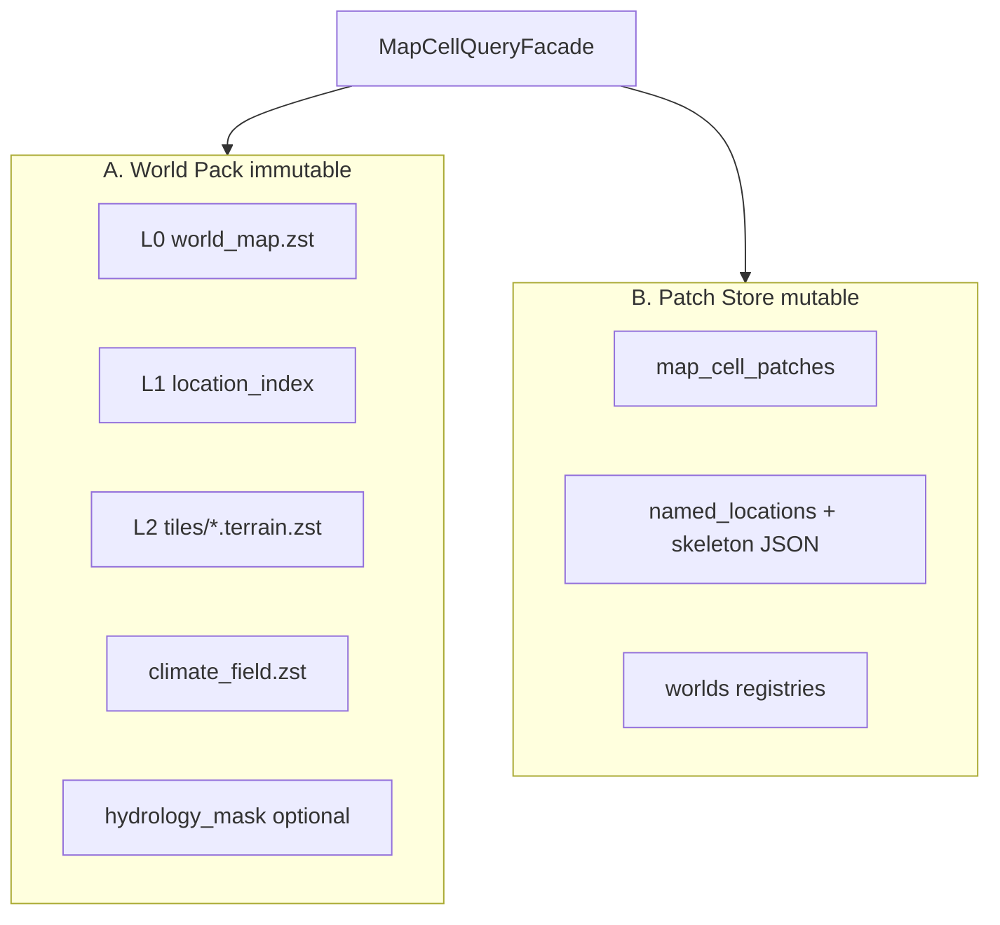

| Хранилище | Содержимое | Мутации |
|---|---|---|
| **World Pack** | L0–L2 skeleton, climate field, hydro mask, **authored outdoor city** (`l.{uid}.settlement.zst`) | bake / master outdoor generate |
| **Patch Store** | gameplay deltas, ore/cave lazy, growth/explosion | каждый ход |
| **Derived** | tile LRU, merge view | RAM |

**Единая точка чтения:** `MapCellQueryFacade` → `merge_layers` (WP-20: patch → player scene → path → **city structure** → location → wilderness → L0).

### Инварианты

| ID | Правило |
|---|---|
| WP-1 | Generators **не** пишут в pack/SQLite — только typed layout на выходе pass |
| WP-2 | До gameplay DAG вызывает доменную операцию публикации подготовленного Pack. Единственная точка активации V2 — общий world CAS с передачей holds. Существующий `WorldPackWriter` обслуживает legacy-путь до cutover. |
| WP-3 | Persist **gameplay** — только `PatchStoreService` / `save_pass(layer_kind)`. **Authored outdoor city** (master) — pack city layer (`CITY_STRUCTURE` / `l.{uid}.settlement.zst`), не патчи — [`tz_settlement_outdoor.md`](./tz_settlement_outdoor.md) |
| WP-4 | Patch **>** pack на `(world_uid,x,y,z)`; `system_building_element IS NOT NULL` не затирается regen |
| WP-5 | Climate read: `field.sample(x,y)` + patch override |
| WP-6 | `world_snapshots` хранит `pack_content_hash` + patch revision, **не** дублирует L2 blob |
| WP-7 | Determinism: world + seed + pack_version → идентичный bake |

**Целевое уточнение (мастер, 2026-10-27):** bake (`light`/`full`/`detailed`)
поставляет мир **одним pack**; опубликованный pack заморожен — blobs
content-addressed, manifest immutable и адресуется hash, файлы не
перезаписываются (`os.replace` по координатному пути — legacy). Snapshot не
пишет pack: мутации тиков — patches, читаемые поверх (WP-4, WP-6). До
публикации pack новые blobs — staged artifacts, недостижимые из
опубликованного состояния; их пишет доменная операция materialization через
staging port, а не generator и не Snapshot. Граница — старт gameplay: при активации общий CAS проверяет ожидаемую публикацию и условие `gameplay_started == false`. До старта
`light` → `full` → `detailed` дописывают один pack новыми версиями manifest;
после старта всё — full_bake поверх light, detailed, runtime L2 (WP-13, lazy
refine), правки локаций — уходит в snapshot, pack игры не меняется. Норматив —
[`tz_world_snapshot.md`](./tz_world_snapshot.md) § «Staged artifacts и точки публикации».

**Граница активации V2 (целевой контракт).** Hydrology и другие владельцы данных готовят доменные факты и ссылки. Spatial предоставляет общие типизированные контракты чтения. DAG выбирает, когда вызвать операцию World Pack с подготовленным кандидатом и ожидаемой публикацией. Pack проверяет кандидат, а publication coordinator обеспечивает одну физическую транзакцию для CAS и передачи удержаний. Конфликт возвращается caller. Ошибка передачи удержаний после CAS требует rollback, при котором другая транзакция продолжает видеть прежнюю версию. Решение заново подготовить кандидат и запустить следующую попытку принимает DAG.

Приёмка должна подтвердить, что конфликт и сбой handoff не запускают вложенный bake, а прежний pin сохраняет доступ к своим артефактам. При cutover на V2 удаляются V1-паки и обходные пути активации, включая legacy writer и finalizer, по реестру SP-P-V1-REMOVE. Границу публичного OpenPipeline и его DAG caller согласуют после проверки typed Input/Output/Error и вложенных вызовов. [План Spatial, §§15.70–15.75](../.cursor/plans/spatial-distribution-domain.md#1575-spatial-и-активация-pack--callers-и-граница-операции)

---

### Публичная операция активации World Pack V2

**Проект для совместной приёмки World Pack и publication owner, 2026-11-09.** Одна операция активирует одну подготовленную неизменяемую версию одного мира до старта игры. Предлагаемая публичная сигнатура и основания выбора приведены ниже. Решение о конкретной вызывающей ноде принимает пользователь после приёмки доменного контракта. Состояние зависимости — [PACK-ENTRY-CONTRACT, §3](../.cursor/plans/world-generation-plan-dependency-graph.md).

#### Что уже реализовано и используется при переходе на V2

| Ответственность | Действующая реализация | Граница переиспользования |
|---|---|---|
| Состав и сохранение pack | V1 хранит индексы и ссылки в manifest, проверяет версию и мир, вычисляет логический `content_hash`, атомарно заменяет файл и затем обновляет строку мира. [Writer](../backend/app/application/worldData/pack/io/worldPackWriter.py) · [Manifest store](../backend/app/application/worldData/pack/io/packManifestStore.py) · [Finalizer](../backend/app/application/worldData/pack/bake/finalize/packBakeFinalize.py) | V2 использует общие поля manifest. Строгий допуск версии 2.0.0 и сериализация кандидата уже реализованы. Для идентичности BLOB используется digest точных сохранённых байтов. [Модели](../backend/app/dataModel/worldPack/meta/worldPackManifest.py) · [Кодек](../backend/app/application/worldData/pack/encoding/packManifestCodec.py) |
| Идентичность и повтор операции | Общий publication core хранит operation ID, fingerprints и terminal, предоставляет claim и recovery. [OperationRecord](../backend/app/dataModel/artifacts/lifecycle/operation/record.py) · [OperationLedger](../backend/app/application/publication/service/operationLedger.py) | Для Pack требуется закрепить состав fingerprint запроса активации и отображение отказа/отмены при replay. |
| Конкуренция и результат публикации | Существуют сравнение полной ожидаемой публикации, типы ACTIVE/READY_INACTIVE, ошибки busy/unknown commit и передача удержаний в scope владельца транзакции. [CAS](../backend/app/db/repositories/sqlite/snapshotCore/publications/worldPublicationStore.py) · [Результаты](../backend/app/dataModel/worldSnapshot/results/publication.py) · [Ошибки](../backend/app/application/publication/errors.py) · [Holder store](../backend/app/db/repositories/sqlite/artifacts/holderStore.py) | Для V2 задан один commit для CAS, handoff и terminal. Остаётся связать эти операции публичным методом и проверить их совместно на зарегистрированном production-формате. |

#### Вход и передача подготовленного кандидата

**Измерение перед выбором лимита manifest (2026-11-10).** На текущем кодеке измерены синтетические V2 manifest с `world_uid="measurement"`, пустыми `spatial_roots` и обычными записями тайлов без чанков, климатических ссылок и остальных индексов. Для тайла с номером `i` заданы `gx=i%64` и `gy=i//64`. Размер — длина результата `encode_candidate_manifest`. Пик — байты Python-аллокаций по `tracemalloc` за один `decode_manifest` после `gc.collect()`, исходные bytes выделены до измерения.

| Тайлы | Размер manifest, байт | Пик Python-аллокаций при чтении, байт |
|---:|---:|---:|
| 0 | 535 | 11 377 |
| 256 | 51 953 | 420 987 |
| 4 096 | 826 649 | 6 557 395 |

**Замер с заполненными индексами.** Тот же кодек и метод измерения, Python 3.14.4, Pydantic 2.13.4. В каждом тайле заданы путь и hash карты, fine climate ref и четыре чанка (координаты 2×2, роль, hash, размер). На каждые 16 тайлов добавлены одна запись location terrain и одна settlement structure с объёмом, путём, hash и размером. В manifest один coarse climate ref. Списки регионов и spatial roots пусты. Климатические refs синтетические, измерение охватывает только manifest. После декодирования проверено равенство всей модели с исходной.

| Тайлы | Чанки | Локации / поселения | Размер manifest, байт | Пик Python-аллокаций при чтении, байт |
|---:|---:|---:|---:|---:|
| 256 | 1 024 | 16 / 16 | 375 278 | 2 677 210 |
| 1 024 | 4 096 | 64 / 64 | 1 499 690 | 10 663 947 |
| 4 096 | 16 384 | 256 / 256 | 6 001 514 | 42 583 153 |

В этой серии объём JSON и пик аллокаций растут примерно пропорционально числу тайлов при постоянном составе одного тайла. Пик составляет примерно 7,1 размера JSON. Это наблюдение для указанного состава и версий библиотек. Для решения о разбиении остаётся сопоставить расход с доступной памятью и числом одновременных чтений.

**Решение пользователя, 2026-11-10.** Домен не задаёт максимального размера мира или предельного количества тайлов, чанков, локаций и регионов. Замеры выше описывают стоимость конкретных примеров. Значение `100000` используется в тесте execution pins. Предложение для технической приёмки — измерять размер и память декодирования на растущих manifest с наполненными индексами. Если вводится фиксированный предел одного BLOB, потребуется поддержать миры, превышающие его, например через версионированные части индекса. Выбор предела и схемы разбиения остаётся открытым. [Варианты бюджета](../.cursor/plans/spatial-distribution-domain.md#L4653) · [Модель manifest](../backend/app/dataModel/worldPack/meta/worldPackManifest.py)

Предлагаемый immutable POJO `PackActivationInput` содержит следующие обязательные поля. Внешняя граница передаёт значения и ссылки; lease, fence, SQL connection и commit scope принадлежат внутренним портам.

| Поле | Тип | Кто задаёт и что проверяет Pack |
|---|---|---|
| `operation_id` | `EntityUid` | Идентификатор одной попытки, под которым завершена подготовка `PACK_ACTIVATION`. При потере ответа DAG повторяет тот же запрос с тем же ID. |
| `expected` | `WorldPublicationRef` | DAG передаёт закреплённую исходную публикацию A целиком. `expected.world_uid` определяет мир операции. Первый bake использует уже инициализированную pregame-публикацию, у которой допустим `pack_hash=None`. |
| `manifest` | `ArtifactRef` | Результат подготовки B. Точный sealed BLOB manifest V2, включая format key, version, размер и digest. Это выход подготовки и вход активации. |
| `preparation_fingerprint` | `RevisionHex` | Берётся из завершённой подготовки. Мир, kind, fingerprint и manifest сверяются с записью этой операции и её защищённым набором артефактов. |

Идентичность запроса на публикацию вычисляет сервис. Предлагаемый состав canonical fingerprint — версия контракта, kind, operation_id, полный expected, manifest и preparation_fingerprint. До реализации владелец encoding утверждает схему, порядок полей и контрольный вектор. Смена expected или manifest при прежнем ID означает ошибку идентичности операции. Для активации относительно нового head требуется новая операция с подтверждённым владением кандидатом. [OperationRecord](../backend/app/dataModel/artifacts/lifecycle/operation/record.py) · [OperationLedger](../backend/app/application/publication/service/operationLedger.py)

К моменту вызова подготовка уже завершила запись и seal manifest, roots и shards, сохранила воспроизводимый состав версии и закончила работу writers. Pack допускает только кандидат своего мира с зарегистрированным форматом V2, корректной версией, допустимым размером, проверенным digest точных bytes и валидными ссылками. Для пространственного root проверяется соответствие доменного descriptor формату; полный набор дочерних refs должен оставаться защищённым до передачи удержаний, включая общий shard двух версий. Домен-владелец отвечает за содержание своих данных. Точные production binding формата, byte cap и источник списка дочерних refs должны иметь утверждённые значения до реализации admission. [Кодек кандидата](../backend/app/application/worldData/pack/encoding/packManifestCodec.py) · [Условия admission и cold resolution, §§15.70–15.72](../.cursor/plans/spatial-distribution-domain.md)

#### Предлагаемая сигнатура и передача данных между владельцами

**World Pack, предложение.** В модуле `application/worldData/pack/packActivationPipelineOpenPipeline.py` открыть конкретный класс `PackActivationPipelineOpenPipeline` с методом `async def activate(self, request: PackActivationInput) -> PackActivationResult | PackActivationRefusal | OperationCancelled`. При выделении интерфейса его имя — `IPackActivationPipelineOpenPipeline`. Вход разместить в `dataModel/worldPack/activation/input.py`, отказ — в `dataModel/worldPack/activation/refusal.py`. Имена и пути обозначают предлагаемую реализацию. Метод принадлежит Pack, поскольку только этот домен проверяет содержание manifest V2 и полноту публикуемой версии. Суффикс следует правилу открытых pipeline. [Граница Pack](../.cursor/plans/spatial-distribution-domain.md#1575-spatial-и-активация-pack--callers-и-граница-операции) · [Правило DAG](../.cursor/rules/dag-generator-interface.mdc)

**Подготовка → DAG → Pack.** Реализованный результат внутренней подготовки — `PreparedPackCandidate(operation_id: EntityUid, manifest: ArtifactRef, preparation_fingerprint: RevisionHex)` в `dataModel/worldPack/activation/candidate.py`. Доменная подготовка знает, какой ref она записала как manifest. Существующий `ArtifactStagingService.finish_preparation(lease, refs) -> OperationRecord` подтверждает завершение подготовки; из record берутся operation_id и preparation_fingerprint, а выделенный manifest должен принадлежать подтверждённым refs этого мира. Причина отдельного POJO — `leased_artifacts` содержит набор refs и сам по себе не обозначает роль manifest. DAG передаёт эти три поля без преобразования плюс исходный `expected` в описанный выше плоский `PackActivationInput`. Перед выдачей POJO Pack сверяет READY, kind, мир, идентификатор, fence, fingerprint и полный набор refs с подтверждением staging. Manifest собирает Pack из материализованных результатов. Внешний вход для DAG остаётся открытым до определения связи этих результатов с capture и проверки полноты состава версии. Идентификатор операции сам по себе не передаёт эти данные. Внутренний staging port уже существует. [Artifacts — staging](../backend/app/application/artifacts/contracts/stagingPort.py) · [Artifacts — запись операции](../backend/app/dataModel/artifacts/lifecycle/operation/record.py)

**Решение пользователя, 2026-11-09.** Единственный публичный вход активации V2 для DAG принадлежит World Pack. Snapshot 4D3 обеспечивает транзакционную часть той же атомарной операции через общий publication core. Публичный OpenPipeline строго линейный: принимает запрос → один раз вызывает внутреннюю реализацию активации → передаёт исход или ошибку в DAG. В OpenPipeline запрещено ветвление, в том числе по claim, disposition, отказу или исключению. Все решения о следующем действии, повторном запуске, выборе нового expected и подготовке нового кандидата принимает DAG. [Snapshot 4D3](../.cursor/plans/world-domain-patches-snapshots.md) · [Правило DAG](../.cursor/rules/dag-generator-interface.mdc)

| Внутренний порт реализации атомарной активации | Ответственность, эффект и проверка границы |
|---|---|
| `OperationLedger.claim_publication(kind, operation_id, world_uid, preparation_fingerprint, request_fingerprint) -> OperationClaim` | Publication выдаёт OWNER с lease, TERMINAL с историческим результатом или BUSY. Повтор с terminal должен завершиться до CAS; внешний caller не получает lease. [Ledger](../backend/app/application/publication/service/operationLedger.py) · [Варианты claim](../backend/app/dataModel/artifacts/lifecycle/operation/claim.py) |
| `IPublicationCommitStore.transaction(operation_id)` → `CommitScope`; `IWorldPublicationStore.compare_append(scope, expected, next_publication) -> WorldCasResult` | Publication coordinator владеет физической транзакцией. Store сверяет весь expected. APPLIED создаёт одну запись, MISMATCH возвращает observed без создания записи этой операции. Второе соединение проверяет исход после commit или rollback. [Координатор](../backend/app/application/worldSnapshot/storage/commitStore.py) · [Порт CAS](../backend/app/application/worldSnapshot/storage/publicationStore.py) |
| `IArtifactHolders.handoff(scope, lease, snapshots, retained_refs) -> None`; `OperationLedger.record_terminal(scope, outcome) -> None` | Artifacts передаёт удержания, ledger сохраняет исход в том же scope. Для pregame snapshots пусты. Handoff требует действительного владельца для каждой передаваемой ссылки. Отдельно подтвердить удержание самого manifest при READY_INACTIVE и событие снятия: holder дочернего ref ссылается на manifest, что само по себе не удерживает manifest. Признак нарушения — видимый ACTIVE после сбоя handoff или доступный terminal READY_INACTIVE при доступном для GC manifest. [Порт удержаний](../backend/app/application/artifacts/contracts/holderPort.py) · [Типы владельцев](../backend/app/dataModel/artifacts/lifecycle/holders.py) · [Проверка terminal](../backend/app/db/repositories/sqlite/snapshotCore/operations/publicationEvidence.py) |

#### Что получает DAG

| Исход | Публичный результат и действие caller |
|---|---|
| Активировано | Существующий `PackActivationResult(operation_id, request_fingerprint, manifest, ACTIVE, publication)`. Возвращается после commit. `publication` — новая публикация этого мира, `gameplay_started=False`, `pack_hash == manifest.content_hash`. Последующий потребитель получает точную публикацию для закрепления/чтения версии. Snapshot tick при активации отсутствует. |
| Устаревший expected, в том числе проигрыш гонки со стартом игры | По действующему ТЗ Snapshot готовый кандидат сохраняется с `READY_INACTIVE`. В результате `manifest` идентифицирует B, `publication` — фактически наблюдённый head. Caller использует `disposition` перед передачей результата на чтение. Удержание manifest и его детей и terminal обязательны для такого ответа. |
| Доменный отказ после получения OWNER | Предлагается `PackActivationRefusal(operation_id: EntityUid, request_fingerprint: RevisionHex, diagnostics: tuple[PackActivationIssue, ...])` с непустыми diagnostics. Предлагаемый `PackActivationIssue` — конкретный доменный подкласс `FieldPathError` для причин pregame/admission. Пример — передан expected с уже начавшимся gameplay. Для durable refusal предлагается существующий `SnapshotApplyResult(category=REJECTED, committed=None, diagnostics=...)` и `OperationLedger.record_refusal(claim, outcome)` по правилам ниже для соответствующей фазы. При replay Pack восстанавливает тот же публичный отказ. Причина такого отображения — ledger уже поддерживает этот terminal. До freeze проверить сохранение и восстановление конкретного типа issue в terminal codec. [Форма durable refusal](../backend/app/dataModel/worldSnapshot/results/apply.py) · [Ledger](../backend/app/application/publication/service/operationLedger.py) |
| Отменённая операция | Предлагается вернуть существующий исторический `OperationCancelled(operation_id, reason)` из terminal. При повторе вернуть те же поля, не приобретая новый claim владельца. [Artifacts — terminal операции](../backend/app/dataModel/artifacts/lifecycle/operation/record.py) |
| Операция занята | `OperationBusyError`. Caller решает, когда снова обратиться с тем же запросом. |
| Сбой хранилища или передачи удержаний | `PublicationInfrastructureError` при установленном исходе. При неопределённом исходе commit — `UnknownCommitOutcome`; recovery по исходному operation_id обязателен до новой попытки или записи отказа. |

**Обязательный исход MISMATCH для готового кандидата — READY_INACTIVE.** Он действует и при смене pregame head, и при проигрыше гонки со стартом gameplay. Pack возвращает наблюдённую публикацию и ссылку на удерживаемый кандидат. [ТЗ Snapshot](./tz_world_snapshot.md) · [Модель результата](../backend/app/dataModel/worldSnapshot/results/publication.py)

**Срок жизни READY_INACTIVE — решение пользователя, 2026-11-09.** World Pack отвечает за срок жизни кандидата B. Artifacts обеспечивает долговременное удержание самого manifest B и доступность всех его дочерних refs. Эти гарантии действуют с момента commit результата READY_INACTIVE, в том числе после рестарта и cancel исходной операции. Оснований для снятия удержания кандидата два:

1. Другая операция приняла тот же manifest и подтвердила долговременное владение версией. Pack снимает прежнее удержание только после подтверждения передачи. При сбое передачи B остаётся доступен по прежнему удержанию.
2. DAG явно передал решение отказаться от B в отдельную операцию World Pack. Pack идемпотентно освобождает удержание этого кандидата. Artifacts сохраняет все независимые удержания, включая закреплённые читателями версии и shards, общие с другими версиями.

#### Освобождение неактивного кандидата

Решение об отказе от B принимает DAG отдельным вызовом World Pack. Предлагаемая сигнатура конкретного класса в `application/worldData/pack/inactiveCandidateReleasePipelineOpenPipeline.py` — `async def release(self, request: InactiveCandidateReleaseInput) -> InactiveCandidateReleased | InactiveCandidateReleaseRefusal`. Имя класса — `InactiveCandidateReleasePipelineOpenPipeline`. Три именованных POJO принадлежат Pack; предлагаемый модуль — `dataModel/worldPack/activation/release.py`. Публичный метод один раз вызывает атомарную реализацию и возвращает её результат в DAG.

- Вход содержит `world_uid: EntityUid`, `activation_operation_id: EntityUid`, `manifest: ArtifactRef`. Эти три поля обозначают конкретное удержание кандидата. Две операции с одинаковым digest могут иметь независимые удержания.
- Результат `InactiveCandidateReleased` возвращает ту же тройку после commit и подтверждает прекращение удержания этой попыткой. Повтор после успешного release или подтверждённой передачи возвращает тот же результат, в том числе после GC. Ошибка `InactiveCandidateReleaseRefusal` содержит переданную тройку и типизированную причину: неизвестная активация, несовпадение идентичности либо исход активации, отличный от READY_INACTIVE. Отсутствие файла само по себе не доказывает release.
- Внутри одной транзакции проверить durable terminal активации, принадлежность миру и точное равенство manifest; сериализовать release с передачей владения; зафиксировать прекращение собственного удержания и долговременное свидетельство для повтора. Если передача уже завершилась, сохранить права нового владельца. Если отказ от кандидата завершился первым, последующая передача обязана заново проверить владение. Общие дочерние связи снимаются только после ухода последнего владельца версии. При неопределённом commit сверить durable состояние до следующей мутации.
- Критерий приёмки: отказ по чужой тройке сохраняет все holds; конкурентные release и передача дают результат, соответствующий одному порядку commit; повтор после рестарта сохраняет head и удержания остальных владельцев. Конкретное представление удержания и свидетельства должен подтвердить владелец Artifacts. [Типы удержаний](../backend/app/dataModel/artifacts/lifecycle/holders.py) · [Порт handoff](../backend/app/application/artifacts/contracts/holderPort.py)

#### Внутренняя реализация одной атомарной активации

**Источник кандидата — обязательная зависимость от World Source Versioning.** При capture-finalize владелец source проверяет ревизии объектов и состав коллекций, атомарно закрепляет тела и регистрирует holder под общей защитой с мутациями и prune. После commit все чтения подготовки, включая ленивые, идут по этому capture. При активации Pack должен проверить связь конкретного кандидата, его частей и preparation с удерживаемым capture и в общем commit обеспечить передачу source pins опубликованному или сохранённому кандидату. Передача и проверка владения сериализуются с освобождением. Изменение latest после capture допустимо. CAS по публикации защищает смену head. Fingerprint подготовки сам по себе не удостоверяет ни состав capture, ни живое удержание. До freeze требуется typed binding владельца source: выход capture, его связь с кандидатом и per-artifact stamps, scoped-проверка и передача pins. Форму поля запроса закрепить при приёмке binding. Legacy require_fresh сохраняет свои гарантии до полного перехода. [Решение о freeze in-flight](../.cursor/plans/world-source-versioning.md#freeze-in-flight--snapshot-isolation-решение-мастера-2026-10-24) · [Legacy guard](../backend/app/application/worldData/planning/guards/sourcePublication.py) · [Сценарий Snapshot §7.2](../.cursor/plans/world-domain-patches-snapshots.md#72-первичная-materialization-обязательная-сверка-light_bakefull_bake)

#### Требования Pack к входу prepare из DAG

**Публичная граница записи V2 для согласования.** Единственный caller — DAG. Обе операции принадлежат World Pack. Каждый открытый pipeline принимает один immutable POJO, один раз вызывает свою внутреннюю реализацию и возвращает результат. Повтор, выбор следующей операции и решение освободить неактивного кандидата принадлежат DAG.

| Метод Pack | Вход | Выход и момент выдачи |
|---|---|---|
| `async prepare(request: PackPreparationInput) -> PreparedPackCandidate` | Идентичность подготовки, закреплённый источник, типизированные результаты материализации и состав версии по таблице ниже. Предлагаемый класс — `PackPreparationPipelineOpenPipeline`. | [PreparedPackCandidate](../backend/app/dataModel/worldPack/activation/candidate.py) после seal manifest и подтверждения READY для точного набора удерживаемых refs. Head сохраняется. Ошибка допуска не выдаёт кандидата. Конкретный тип ошибки подготовки и её диагностические коды входят в freeze Pack. |
| `async activate(request: PackActivationInput) -> PackActivationResult \| PackActivationRefusal \| OperationCancelled` | [PackActivationInput](../backend/app/dataModel/worldPack/activation/input.py) содержит три поля кандидата и **полный** `expected: WorldPublicationRef`, закреплённый для этой попытки. `from_candidate(candidate, expected)` сохраняет их при передаче. | ACTIVE, READY_INACTIVE, типизированный отказ или отмена по матрице исходов выше. Busy и ошибки инфраструктуры передаются отдельно. Успешный ответ и повтор после потери ответа подтверждаются durable terminal. |

**Проект полей `PackPreparationInput`.** Указаны значения и владельцы. Имена ещё отсутствующих типов предлагаются для согласования, их wire-схемы пока открыты.

| Поле | Тип или требование к типу | Кто формирует и что проверяет Pack |
|---|---|---|
| `operation_id`, `world_uid`, `preparation_fingerprint` | `EntityUid`, `EntityUid`, `RevisionHex` | DAG передаёт идентичность одной подготовки. Pack сверяет её с долговременной записью операции PACK_ACTIVATION. Подмена мира или fingerprint при прежнем ID даёт конфликт. |
| `capture` | Immutable ссылка владельца World Source Versioning на завершённый capture | DAG передаёт ссылку, выданную владельцем source. Проверяемые свойства — мир, закреплённые ревизии и коллекции, идентичность живого удержания. |
| `base_publication` | `WorldPublicationRef` исходной версии | Определяет версию, из которой разрешается наследовать части. Для первого bake допустима инициализированная pregame-публикация с пустым `pack_hash`; у такого запроса отсутствуют унаследованные части. |
| `parts` | Immutable последовательность типизированных записей частей | У каждой записи — роль, логический адрес своего типа, точный `ArtifactRef` и свидетельство зависимостей. Для новой части источник — capture подготовки; для унаследованной — закреплённая базовая версия и исходное свидетельство этой части. Pack проверяет однозначность адресов, покрытие заявленного состава и совместимость зависимых частей. Одинаковый ref допускается у нескольких адресов с отдельными свидетельствами. |
| Данные сборки версии | Pack-owned immutable POJO параметров и индексов по карте компонентов ниже | Pack определяет поля, необходимые для сборки и проверки полного manifest для данного bake scope. DAG передаёт готовые типизированные данные. Реестр форматов, сериализация, lease, fence и commit scope остаются внутри реализации. |

##### Проект POJO подготовки Pack — детализация 2026-11-11

**Основа проектирования — проверка текущих POJO и их назначения.** Перед добавлением типа сверяются существующий модуль, владелец, смысл полей, единицы/координаты, lifecycle (authored settings / resolved value / preparation input / stored descriptor / payload / read result), constraints, вложенная изменяемость и callers. Различие строгости или list/tuple само по себе не обосновывает второй доменный тип. Общие значения и правила имеют одну декларацию; новая оболочка допустима при отдельной ответственности. Сначала инвентарь ниже, затем изменение существующей модели или обоснование новой. Эта сверка — обязательный вход архитектурного шага Pack.

| Текущая модель и назначение | Предложение V2 | Решение после сверки |
|---|---|---|
| [PackTileRef](../backend/app/dataModel/worldPack/bake/packTilePlan.py) — координаты macro tile, без storage ref | PackTileAddress(gx, gy) | Прямой дубль исключён. В scope/coverage использовать PackTileRef. Строгую валидацию уточнить у существующего типа/на границе с проверкой callers; новый alias-класс не вводить. |
| [PackTilePlan](../backend/app/dataModel/worldPack/bake/packTilePlan.py) — вычисленное множество L0 tiles и cap metadata | PackL0PreparationScope | Scope подготовки может ссылаться на результат планирования и добавлять evidence; не объявлять второй planner result. Сохранить различие полного expected и capped selection. Existing list требует доработки для immutable границы. |
| [DetailedBakeRequest](../backend/app/dataModel/worldPack/bake/detailedBakeScope.py) — выбор задания, debug cap, grade flags | PackLocation/WildernessPreparationScope | Не прямой дубль: scope подготовки описывает уже разрешённую область результата. Использовать существующие определения режимов/политик; не копировать выбор задания, defaults и callbacks в новый scope. |
| [ChunkRef, TileManifestEntry, LocationTerrainEntry, SettlementStructureEntry](../backend/app/dataModel/worldPack/meta/worldPackManifest.py) — строки сохранённого manifest, включающие metadata и storage fields | PackChunk/Tile/Location/SettlementAssembly | Это проекции, а не точные эквиваленты. До кода выделить общую декларацию metadata в owning model и использовать её в preparation и stored representation. Самостоятельное повторение полей и validators в четырёх Assembly-классах запрещено. Существующий path/hash/bytes не передавать в новый assembly input. |
| [WorldGridSettings](../backend/app/dataModel/worldPack/meta/worldGridSettings.py) — authored размер macro cell | fine_cells_per_map_cell в assembly | Переиспользовать смысл и constraints существующего владельца (strict integer, минимум/кратность). Просто положительный int недостаточен. В manifest фиксируется effective captured значение. |
| [WorldMapResolutionSettings](../backend/app/dataModel/worldPack/meta/worldMapResolutionSettings.py) — nullable authored override; [WorldMapCellsPerTilePolicy](../backend/app/dataModel/worldPack/wire/worldMapCellsPerTile.py) — resolve effective side | world_map_cells_per_tile в assembly | Разные стадии одного значения. None override не равен отсутствующей разрешённой сетке. Producer передаёт effective side по существующей policy; Pack не копирует resolver/default. Settings POJO не подставлять вместо resolved value. |
| [TerritoryVolume](../backend/app/dataModel/worldPack/wire/territoryVolume.py) — inclusive XYZ bounds в fine grid | territory_volume | Переиспользовать модель и семантику нормализации bounds. Проверить строгий вход через существующий STRICT_BOUNDS; новый AABB с другим порядком полей не вводить. |
| [WildernessRegionEntry](../backend/app/dataModel/worldPack/meta/wildernessRegionEntry.py) — строка регионального индекса | wilderness_regions | Переиспользовать с существующей проверкой parent/UID; immutable внешняя коллекция не требует копии строки. |
| [GradeSlotSidecar](../backend/app/dataModel/terrain/relief/gradeSlot.py), [ClimateFieldWire](../backend/app/dataModel/worldPack/wire/climateFieldWire.py), [FineTerrainChunkWire](../backend/app/dataModel/worldPack/wire/fineTerrainChunkWire.py), [SettlementStructureWire](../backend/app/dataModel/worldPack/wire/settlementStructureWire.py), [LocationsIndexWire](../backend/app/dataModel/worldPack/wire/locationsIndexWire.py) — тела данных | T в read_part и parts payload | Переиспользовать owning payload schemas. Grade имеет tuple-поля; climate/fine/settlement/locations имеют вложенные lists и пока не удовлетворяют deep immutable read. Миграция коллекций/строгого admission выполняется у владельца с проверкой wire и callers. Новый набор «V2 payload» только ради frozen не вводить. |
| [SpatialDomainRootRef](../backend/app/dataModel/worldPack/meta/spatial/domainRoot.py) — typed domain + ArtifactRef с format validation | PackSpatialRootAddress + PackPartInput | Адрес без ref и stored descriptor имеют разные назначения. Переиспользовать SpatialDatasetKind и единую проверку допустимого root format; не поддерживать две независимые таблицы domain→format. |
| [ManifestPinRead](../backend/app/dataModel/worldPack/read/pinnedManifest.py) и внутренний PinIntent — identity invocation/pin, request budget | PackPinnedReadIdentity | Общую pin identity следует извлечь из текущих типов и переиспользовать. Полная publication и budget принадлежат запросу чтения. Не сохранять две независимые декларации store/execution/invocation/logical key/pin/world; DB PinIntent не становится public POJO. |
| [ArtifactRef](../backend/app/dataModel/artifacts/references.py), [WorldPublicationRef](../backend/app/dataModel/worldSnapshot/identity/publication.py), PreparedPackCandidate, PackActivationInput | Read/preparation/activation wrappers | Переиспользовать без локальных копий идентичности. Новая оболочка связывает существующие значения, а не переобъявляет их constraints. |
| [PackCompletenessSnapshot](../backend/app/dataModel/worldPack/bake/packCompleteness.py) — summary/progress, bounded missing lists | PackWilderness/SettlementCoverage | Не дубли: summary не доказывает полный состав обработанных областей и источники. Новые coverage records нужны для admission; не заменять существующий UI/progress контракт без отдельной миграции. |
| [PackReadPolicy](../backend/app/dataModel/worldPack/bake/packReadPolicy.py) — LRU capacities | PackPartReadBudget | Не дубли: request IO limits отличаются от RAM retention policy. Не переносить defaults LRU в byte limits. |
| CacheContract/Registry и ArtifactFormatContract | PackPartReadContract/Binding | Сходная форма не означает общего владельца. Cache namespace, storage format и read payload schema — разные контракты. Переиспользовать RegistryKey/FormatVersion и паттерн регистрации; объединение в универсальный service registry не требуется. |

Новые preparation/stored provenance и coverage proof не имеют подтверждённого аналога в проверенных моделях V1. Они остаются новыми только в пределах своей отдельной ответственности. Ниже приведён логический состав предложенных Assembly/pin POJO, а не разрешение создавать дублирующие классы: физическая раскладка общих типов и миграция callers должны пройти этот инвентарь до реализации.

**Проверка существующих capture/coverage/dependency моделей по замечаниям P1-2/P1-3.** Повторная сверка 2026-11-11 проверяет назначение, а не совпадение названия. Следующие типы уже существуют, но не закрывают полный контракт доказательств Pack:

| Существующий POJO | Назначение и допустимое переиспользование | Чего не подтверждает для Pack |
|---|---|---|
| [WorldPhysicsSettingsRef/View](../backend/app/dataModel/physics/settings/settingsCapture.py) | Содержимое Physics settings и его world-bound content revision; может быть конкретной зависимостью результата Physics. | Модуль явно отличает эти значения от publication-pinned capture. Нет общего захваченного множества объектов/коллекций мира и source retention. |
| [TimeCapture/HistoricalTimeCapture](../backend/app/dataModel/time/reads/capture.py) | Точка времени в publication/snapshot. | Не является freeze исходных данных bake; TimeCapture требует gameplay publication. |
| [TimeSettingsCapture/HistoricalTimeSettingsCapture](../backend/app/dataModel/world/settings/timeOperations/read.py) | Settings и версии календарей для одного source publication/snapshot. | Охватывает календарные данные, а не все зависимости Pack. Generic source parameter не делает этот POJO общим capture мира. |
| [CapturedPlacementGeometry](../backend/app/dataModel/placement/prepared.py) | Prepared placement geometry, intent, candidates и pre_hydrology PlanRef в fine-grid coordinates. | Не содержит durable retention closure исходных объектов и не удостоверяет итоговое materialization coverage Pack. |
| [RegionCoverage/CoverageSpan](../backend/app/dataModel/terrain/regions/coverageGeometry.py) | Геометрическое покрытие региона half-open fine-cell интервалами; может быть частью конкретного spatial evidence. | Не различает expected/completed materialization и не связывает outcomes с artifact refs. Геометрия покрытия не является свидетельством выполнения. |
| [WaterCoverageBudget](../backend/app/dataModel/terrain/designedWater/coverage/budget.py) | Распределение площади воды между источниками и остаточный бюджет. | Не удостоверяет сохранённые Pack chunks/settlement districts и их источник. |
| [PlanDependency/PlanRef](../backend/app/dataModel/planning/contracts/planDependency.py) | Типизированный slot → completed plan revision; canonical порядок slots уже определён. Переиспользовать для зависимостей от Planning, если они входят в producer evidence. | Fingerprint плана не доказывает удержание source bodies, revision состава коллекций или доступность артефакта после GC. Нельзя объявлять PlanRef эквивалентом durable source proof. |
| [Prepared/PublishedSectionDependency](../backend/app/dataModel/patch/sections/dependency.py) | Различает подготовленную секцию patch и опубликованное состояние секции. | Это зависимости Snapshot sections, а не общий источник pregame Pack. |
| [PolicyProvenance](../backend/app/dataModel/policy/policyDecision.py) | Объясняет происхождение решения policy: origin, source_path, rule_id. | Не имеет source revision/retention и не удостоверяет происхождение immutable payload. |

**Точный незакрытый результат владельцев.** Source должен предъявить concrete immutable capture result, admission proof и durable proof с собственными codec/проверками: world identity; revisions объектов и состава коллекций; subject address + ArtifactRef либо metadata projection; перечень требуемых immutable source refs; контракт удержания и передачи в общий commit. Planning зависимости внутри такого evidence используют существующие PlanDependency/PlanRef, если применимы; Pack не создаёт их копии. Владелец materialization предъявляет expected/completed coverage и связь outcomes с refs, captured settings и policy. Наличие одного из перечисленных выше POJO не позволяет автоматически заполнить placeholder proof. Проверка mapping между этими выходами и PackPreparationBody обязательна до приёмки связанного маршрута.

P1-2 и P1-3 остаются OPEN: эта сверка исключает ошибочное переиспользование похожих типов, но не создаёт недостающие внешние контракты. Разрабатывать внутренние metadata/read модели Pack можно в собственном архитектурном шаге; принимать сквозной prepare с локальной заглушкой Source нельзя. Принцип удержания унаследованных частей и исходных stamps уже закреплён в [плане Source Versioning](../.cursor/plans/world-source-versioning.md#частичный-refine--provenance-частей-решено); конкретные внешние типы и scoped binding ещё должны его реализовать.

Ниже — проект конкретных Pack-owned типов для архитектурной приёмки. Они ещё не реализованы. Предлагаемое размещение — `backend/app/dataModel/worldPack/preparation/`: `input.py`, `addresses.py`, `parts.py`, `assembly.py`, `errors.py`. Каждый POJO глубоко immutable: strict-поля, запрет лишних полей, frozen, коллекции `tuple`, повторная валидация вложенных экземпляров. Нельзя передавать изменяемый `WorldPackManifest`, `dict`, callbacks, codec или storage service. Основание — [действующий manifest](../backend/app/dataModel/worldPack/meta/worldPackManifest.py) и [правила границы контракта](../.cursor/rules/dag-generator-interface.mdc#обязательная-приёмка-плана-любого-домена).

**`input.py` — `PackPreparationInput`.** Полный проект полей: `operation_id: EntityUid`, `preparation_fingerprint: RevisionHex`, `body: PackPreparationBody`. Единственная декларация смысловых данных — `PackPreparationBody(world_uid: EntityUid, capture: <принятый immutable capture ref владельца Source>, base_publication: WorldPublicationRef, scope: PackPreparationScope, parts: tuple[PackPartInput, ...], assembly: PackAssemblyInput, assembly_provenance: tuple[PackAssemblyProvenanceEntry, ...])` в том же модуле. Все описания полей подготовки далее относятся к `request.body`; верхняя оболочка содержит только identity операции, заявленный digest и body. Обозначение в угловых скобках — незакрытый внешний тип, его нельзя реализовать как `Any`, строку или локальную копию source-схемы. Lease/fence определяет внутренняя реализация. Повтор того же ID с отличающимся валидированным body обязан дать конфликт; состав fingerprint и семантика повторов определены ниже, регистрация canonical schema остаётся gate Encoding.

**`addresses.py` — адреса частей.** Предлагается discriminated union `PackPartAddress`. Literal `kind` отличает адреса; один адрес обозначает одно использование артефакта в версии. Числовые координаты — strict `int`, допустимый диапазон проверяется по принятой сетке, без произвольного ограничения размера мира.

| POJO | Поля | Основание и проверка |
|---|---|---|
| `PackMapTileAddress` | `kind: Literal["map_tile"]`, `gx: int`, `gy: int` | V1 `world_map_tile_path(gx, gy)`; один L0 payload на адрес. |
| `PackChunkAddress` | `kind: Literal["wilderness_chunk"]`, `gx: int`, `gy: int`, `cx: int`, `cy: int` | V1 `wilderness_chunk_path`; локальные chunk-координаты проверяются по действующей геометрии. |
| `PackLocationTerrainAddress` | `kind: Literal["location_terrain"]`, `location_uid: EntityUid` | V1 `LocationTerrainEntry`; наличие UID в индексе версии. |
| `PackSettlementAddress` | `kind: Literal["settlement"]`, `location_uid: EntityUid` | V1 `SettlementStructureEntry`; отдельная роль при том же UID локации. |
| `PackCoarseClimateAddress` | `kind: Literal["climate_coarse"]` | Один coarse field на версию; payload обязан быть coarse. |
| `PackFineClimateAddress` | `kind: Literal["climate_fine"]`, `gx: int`, `gy: int` | Payload fine, origin соответствует адресу. |
| `PackLocationsIndexAddress` | `kind: Literal["locations_index"]` | Один immutable descriptor вместо перезаписываемого `locations_index.json`. |
| `PackSpatialRootAddress` | `kind: Literal["spatial_root"]`, `domain: SpatialDatasetKind` | Переиспользуется [тип домена spatial root](../backend/app/dataModel/worldPack/meta/spatial/domainRoot.py). Shards достижимы через root; DAG не перечисляет внутренний layout. |
| `PackTileGradeSlotsAddress` | `kind: Literal["tile_grade_slots"]`, `gx: int`, `gy: int` | Полный sidecar wilderness slots этого тайла; принадлежность клеток подтверждается результатом producer. |
| `PackLocationGradeSlotsAddress` | `kind: Literal["location_grade_slots"]`, `location_uid: EntityUid` | Полный sidecar slots этой локации; UID должен присутствовать в закреплённом индексе версии. |

Источник адресов — [WorldPackPaths](../backend/app/application/worldData/pack/io/worldPackPaths.py). Grade sidecars включены двумя отдельными адресами после подтверждения render consumers; требования к формату приведены ниже. Их production binding и producer/read-контракты остаются OPEN. Добавление будущей роли требует зарегистрированного типизированного контракта; свободный `kind: str` не допускается.

**`parts.py` — состав и происхождение.** `PackPartInput` содержит `address: PackPartAddress`, `artifact: ArtifactRef`, `provenance: PackPartProvenance`. Предлагаемый union происхождения:

**Приоритетное уточнение пользователя 2026-11-12 — сохранение старой логики:** DAG передаёт закреплённую базу и готовые результаты выбранных операций. Pack внутри одной подготовки применяет их к базе по прежним правилам WorldPackWriter и получает полный итоговый manifest. Требование ниже о полном итоговом составе относится к результату сборки, а не к входному списку новых результатов; прежняя обязанность caller передать полный состав отменена. Отсутствие нового результата не разрешает удалить базовую часть. Обновление по адресу сохраняет остальные записи; переданный полный locations/regions index заменяет соответствующий индекс, как раньше. Незатронутые refs и полный provenance сохраняются. DAG не выполняет сборку manifest, а Pack не выбирает/запускает внешние операции. Подробная [граница и критерии](../.cursor/plans/pack-v2-domain-contract-spec.md#принятая-граница-сборки-состава-2026-11-12). Конкретная схема входа обновлений и внутренний класс сборки ещё требуют приёмки; текущие объявления input не являются окончательным контрактом этого решения.

- `PackNewPartProvenance(kind: Literal["new"], provenance: PackStoredProvenance)` — полный provenance новой части связывается с зависимостями capture текущей подготовки.
- `PackInheritedPartProvenance(kind: Literal["inherited"], provenance: PackStoredProvenance)` — ref, адрес и весь исходный provenance, включая planning, подтверждаются закреплённой `base_publication` и сохраняются неизменными.

**Решение пользователя 2026-11-12:** `PackStoredProvenance` содержит `source_proof: <durable proof владельца Source>` и `planning: tuple[PlanDependency, ...]` (существующий `dataModel/planning/contracts/planDependency.py`). Оба варианта используют эту общую модель; address/artifact объявлены только в PackPartInput. Отдельный PackProducedPartEvidence с повтором этих полей не вводится. При сохранении части признак new/inherited снимается, полный provenance переносится без изменений. Проверка корректной передачи результата producer принадлежит согласованному mapping через DAG, а не сравнению дублирующих caller-полей. Конкретный source_proof разрабатывается отдельно; placeholder запрещён в runtime. Это уточнение состава PackStoredProvenance применяется также к сохранённой схеме § «4. Сохранённая схема версии» ниже; схема proof и полная приёмка остаются открытыми.

Типы proof и их проверка принадлежат [World Source Versioning](../.cursor/plans/world-source-versioning.md#capture-и-артефакты). Pack проверяет соответствие роли зарегистрированному формату/версии, миру и адресу, seal и удержание, уникальность адресов, совместимость частей. Для одинакового ref у разных адресов сохраняются отдельные provenance-записи; дедупликация refs допустима только для storage/retention. При пустом базовом pack унаследованные части запрещены. `parts` описывает полный итоговый состав версии, включая сохраняемые части базы; отсутствие адреса не означает скрытое чтение latest или автоматическое наследование. Проверка допустимого удаления/отсутствия опирается на заявленный scope и индексы.

**`assembly.py` — параметры и индексы.** Предлагаемый `PackAssemblyInput`:

**Последующее поручение пользователя 2026-11-12 — открытая последовательность изменений:** самостоятельные операции изменения состава должны иметь конкретные публичные Pack-контракты, вызываемые DAG. [Проект методов и disposition V1 writer](../.cursor/plans/pack-v2-public-write-operations.md) описывает передачу immutable состояния между вызовами. PackManifestAssembler получает конечное проверенное состояние и формирует manifest; финальный prepare завершает staging/seal/READY. Предложение ниже исполнять все обновления одним assembler-вызовом отозвано в части исполнения последовательности операций. Каждый отдельный метод сохраняет старую локальную семантику; DAG определяет порядок вызовов, Pack не запускает следующий метод самостоятельно. Это проект границы по поручению пользователя, не приёмка всех DTO, state lifecycle или новых DAG-нод.

**Уточнение пользователя 2026-11-12:** ниже описан полный состав metadata результата. Вход обновлений должен отдельно сохранять наличие изменения: отсутствие обновления сохраняет базовое значение, явно переданный пустой region index заменяет индекс пустым. Для settlement сохраняется семантика старого publish_settlement_structure: omitted/None packed_district_uids сохраняет прежний список, явно пустой список очищает его; omitted/None structure_status сохраняет статус. При отсутствии базовой записи сохраняются прежние owning defaults. В immutable контрактах используются tuple, без потери указанного различия. Полная схема обновлений ещё не принята. Сборку полного manifest из проверенной базы и типизированных обновлений выполняет PackManifestAssembler (`preparation/assembler.py`) одним pure-вызовом; отдельный класс сборки не требуется. PackPreparationOperation получает базу и выполняет storage lifecycle; assembler не делает IO, не запускает producers и не выбирает следующие операции. [Ответственность и критерии](../.cursor/plans/pack-v2-domain-contract-spec.md#принятая-граница-сборки-состава-2026-11-12).

| Поле | Тип | Значение и владелец проверки |
|---|---|---|
| `last_l0_mode` | `PackBakeMode` | Значение `bake_mode` будущего manifest. Для detailed совпадает с закреплённой базой; detailed не становится третьим manifest-режимом. |
| `registry_hash` | предлагаемый `RevisionHex \| None` | В V1 найдена только декларация строки manifest. Состав fingerprint, источник и условия None не подтверждены; тип и семантика требуют freeze по аудиту ниже. |
| `fine_cells_per_map_cell`, `world_map_cells_per_tile`, `fine_cell_size` | effective значения существующих моделей сетки, strict `int` | Constraints и единицы сохраняются от владельцев; для fine_cells_per_map_cell действуют минимум и кратность WorldGridSettings. Side разрешается WorldMapCellsPerTilePolicy. Fine cell size сверяется с существующей единицей сетки. Числовые defaults в новом входе не вводятся. |
| `map_subsurface_depth` | неотрицательный strict `int` | Эффективное N_base из captured Terrain settings; 0 означает surface-only. Передаётся уже разрешённое значение, как в `worldMapSettings.n_base`; Pack не читает latest World и не выбирает defaults. Источники приведены в аудите полей ниже. |
| `tiles` | `tuple[PackTileAssembly, ...]` | Индекс тайлов и их состояний, включая ещё не материализованные; уникальные `(gx, gy)`. |
| `locations` | `tuple[PackLocationAssembly, ...]` | Метаданные terrain по уникальному `location_uid`. |
| `settlements` | `tuple[PackSettlementAssembly, ...]` | Метаданные структур по уникальному `location_uid`. |
| `wilderness_regions` | `tuple[WildernessRegionEntry, ...]` | Переиспользуется [индекс регионов](../backend/app/dataModel/worldPack/meta/wildernessRegionEntry.py) с проверкой UID и parent; источник индекса должен быть подтверждён capture. |

Вложенные POJO имеют следующие поля:

- `PackTileAssembly(gx: int, gy: int, climate_status: ClimateBakeStatus, wilderness_refine_status: WildernessRefineStatus, chunks: tuple[PackChunkAssembly, ...])`.
- `PackChunkAssembly(cx: int, cy: int, refine_role: ChunkRefineRole | None)`.
- `PackLocationAssembly(location_uid: EntityUid, territory_volume: TerritoryVolume, climate_status: ClimateBakeStatus, z_band: str | None)`.
- `PackSettlementAssembly(location_uid: EntityUid, territory_volume: TerritoryVolume, structure_status: SettlementStructureStatus, packed_district_uids: tuple[EntityUid, ...])`.

Названия status/role и их значения взяты из действующего manifest; новые варианты не вводятся. `TerritoryVolume` использует существующие inclusive bounds в fine grid; на V2-входе требуется строгая проверка координат. Для `z_band` сохраняется форма V1 до решения владельца terrain о конкретном типизированном значении; свободная строка не закрывает freeze этого поля. Ссылки находятся только в `parts`: метаданные не повторяют path/hash/bytes. Pack связывает каждый материализованный элемент индекса с адресом части и проверяет согласованность status, наличия payload и покрытия. Точные правила complete/partial и отсутствующих частей по scope входят в оставшийся архитектурный gate; один флаг complete не доказывает покрытие.

**Поля, которые формирует Pack.** `pack_version`, `codec_version` и `payload_format` определяются зарегистрированным manifest binding. Решение пользователя 2026-11-11: все три поля пока сохраняются в существующем POJO и wire; их удаление не входит в текущую реализацию. Отложенный переход codec_version/payload_format не блокирует остальную работу сам по себе; находка WP-CODEC-01 не считается исправленной. Поля не становятся новыми параметрами публичного prepare или ответственностью DAG за внутренний codec. Вход не содержит `content_hash`, относительных путей и самостоятельно рассчитанных размеров; digest и nbytes получаются из сохранённых bytes. `world_map_cells` и `wilderness_chunks_baked` вычисляются по итоговому составу, сохраняя смысл [V1 recalc_manifest_counters](../backend/app/application/worldData/pack/io/worldPackWriter.py). Для `wilderness_tiles_total` до freeze проследить все V1 writers и определить единый источник; механически считать его равным числом payload нельзя. Количество локаций и поселений не ограничивается числом 256.

**`errors.py` — ошибки подготовки.** `PackPreparationError(reason: PackPreparationFailureReason, issues: tuple[PackPreparationIssue, ...])` — immutable POJO с непустым issues. `PackPreparationIssue` — именованный конкретный подкласс `FieldPathError[PackPreparationIssueCode]`, наследующий `code`, `path: ValidatedFieldPath`, `message`; [существующий carrier](../backend/app/dataModel/validation/diagnostics/fieldPathError.py). Метод prepare выбрасывает `PackPreparationFailure(error: PackPreparationError)` — доменное исключение из предлагаемого `application/worldData/pack/preparation/errors.py`. Успешный return остаётся `PreparedPackCandidate`. Предлагаемые enum reason: `INVALID_INPUT`, `IDENTITY_CONFLICT`, `SOURCE_UNAVAILABLE`, `DEPENDENCY_MISMATCH`, `ARTIFACT_UNAVAILABLE`, `MANIFEST_OVERSIZE`, `OPERATION_CLOSED`. Issue codes: `DUPLICATE_ADDRESS`, `MISSING_PART`, `UNEXPECTED_PART`, `FORMAT_MISMATCH`, `ADDRESS_MISMATCH`, `SOURCE_PROOF_MISMATCH`, `BASE_PUBLICATION_MISMATCH`, `STATUS_MISMATCH`, `IDENTITY_MISMATCH`, `HOLD_MISSING`, `ARTIFACT_UNSEALED`, `MANIFEST_LIMIT_EXCEEDED`, `SOURCE_HOLD_MISSING`, `OPERATION_CLOSED`, `METADATA_PROOF_MISSING`, `OUT_OF_SCOPE_CHANGE`. Все enum и POJO объявляются в `dataModel/worldPack/preparation/errors.py`.

Причина определяется этапом отказа: неверная durable identity → IDENTITY_CONFLICT; закрытый lifecycle → OPERATION_CLOSED; структурная валидация → INVALID_INPUT; недоступный capture/его hold → SOURCE_UNAVAILABLE; несогласованные proofs, база, scope или покрытие → DEPENDENCY_MISMATCH; недоступный sealed ref/его hold → ARTIFACT_UNAVAILABLE; превышенный manifest budget → MANIFEST_OVERSIZE. Внутри этапа независимые issues собираются через ValidatorAggregationHelper в порядке полей входа и исходных индексов tuple; недоступная предпосылка исключает только зависимые проверки. Следующий эффект не запускается при ошибках этапа. IO failure, busy и неизвестный commit сохраняют инфраструктурные типы. Ошибка prepare сама по себе не означает durable REJECTED активации. Восстановление и cleanup принадлежат lifecycle операции; чужие holds не освобождаются.

##### Уточнения по ревью контракта подготовки

**1. Scope и полнота.** Предлагаемый модуль `preparation/scope.py` содержит discriminated union `PackPreparationScope`:

- `PackL0PreparationScope(kind: Literal["l0"], mode: PackBakeMode, expected_tiles: tuple[PackTileRef, ...])`, где PackTileRef — существующий адрес тайла из packTilePlan.py. Множество ожидаемых тайлов подтверждается результатом планирования для capture; пустой/урезанный список нельзя считать доказательством полного bake только по mode. Новая декларация PackTileAddress исключена как дубль.
- `PackLocationPreparationScope(kind: Literal["location"], location_uid: EntityUid)` — detailed одной локации.
- `PackWildernessPreparationScope(kind: Literal["wilderness"], tiles: tuple[PackTileRef, ...])` — явно выбранное множество тайлов detailed; значение «все» разрешается до вызова в конкретный набор.

Режим операции определяется только scope: для l0 используется его mode light/full, location/wilderness означают detailed. Отдельное поле request_mode исключено из входа и сохраняемой assembly. Последний режим L0 остаётся в last_l0_mode: detailed его не изменяет. Основание — [PackTilePlan](../backend/app/dataModel/worldPack/bake/packTilePlan.py) и [DetailedBakeRequest](../backend/app/dataModel/worldPack/bake/detailedBakeScope.py). Debug max_tiles не является способом заявить полноту мира. Location scope включает terrain/settlement указанного UID, materialized части в подтверждённом покрытии его territory и fine climate покрывающих тайлов при включённой политике. Прежнее ограничение только двумя location-ролями было неполным: см. аудит V1 ниже. Для wilderness локальные изменения ограничены выбранными тайлами и доказанными результатами materialization в них. Для l0 набор ролей установлен ниже; автоматическая инвалидизация L2 из V1 не подтверждается.

Pack сравнивает полный итоговый состав с закреплённой базой. Адреса и метаданные вне разрешённой области сохраняют значение и provenance. Пропажа такого адреса — OUT_OF_SCOPE_CHANGE. Внутри области удаление допустимо только по подтверждённому составу источника и правилу роли; отсутствие во входном tuple само по себе не разрешает удаление. Complete проверяется по ожидаемому покрытию владельца результата; partial сохраняет точный фактический набор. Конкретный typed proof покрытия, включая settlement districts и wilderness chunks, остаётся требованием к producer-контрактам, а не новым алгоритмом DAG.

**Аудит V1 для scope, покрытия и счётчиков (2026-11-11).** Это подтверждённые эффекты существующего пути; прямые вызовы его orchestrators не переносятся в V2.

| Режим / компонент | Подтверждённый V1 эффект | Требование V2 и основание |
|---|---|---|
| light/full L0 | Coarse climate, locations index, все запланированные L0 tiles; fine climate по политике. Перед этим возможен drain старых refine jobs. | [PackMaterializationOrchestrator](../backend/app/application/worldData/pack/bake/l0/packMaterializationOrchestrator.py): Pack принимает готовые результаты через DAG. Scope L0 не разрешает скрытый drain или вычисление Climate внутри prepare. Результаты отдельного drain должны иметь собственную подтверждённую область изменения. |
| Метаданные L0 | Заменяется wilderness region index; синхронизируется сетка; записывается последний light/full bake_mode. | [WorldMapBakeOrchestrator](../backend/app/application/worldData/pack/bake/l0/worldMapBakeOrchestrator.py): индекс регионов и header требуют собственного provenance. Fine climate не считается обязательным для каждого L0 tile без соответствующей политики. |
| Повторная запись L0 | Writer заменяет world_map_path/hash данного tile через model_copy, сохраняя остальные поля tile, включая chunks. | [WorldPackWriter.write_world_map_tile](../backend/app/application/worldData/pack/io/worldPackWriter.py): автоматическое удаление L2 не является доказанным поведением V1. В V2 наследование требует совместимости dependencies; несовместимый набор отклоняется, Pack не удаляет и не пересчитывает L2 самостоятельно. Решение о новой подготовке принимает DAG. |
| detailed location | Scope рассчитывает покрывающие territory тайлы и пересекающие его rects; при включённой detailed_include_climate_fine обновляется fine climate этих тайлов. | [Scope](../backend/app/application/worldData/pack/bake/detailed/detailedBakeScope.py) · [Detailed orchestrator](../backend/app/application/worldData/pack/bake/detailed/packDetailedBakeOrchestrator.py). До freeze `PackLocationPreparationScope` должен получить concrete immutable coverage/policy evidence от producer через DAG. Одного location_uid недостаточно для проверки всех допустимых адресов. Pack не вызывает геометрический planner. |
| detailed wilderness | Выбираются L0-baked tiles без complete; explicit tile тоже пропускается при complete. При известном expected count пересчитывается status. | [wilderness_tiles и refine](../backend/app/application/worldData/pack/bake/detailed/detailedBakeScope.py) · [refine_detailed_tiles](../backend/app/application/worldData/pack/bake/detailed/detailedBakeRefine.py). Выбор работы относится к DAG/подготовленному входу. Пустой выбранный набор не разрешает удалить имеющиеся части. |
| Статус wilderness | При нуле chunks — absent; при положительном expected и baked >= expected — complete; иначе partial. Без expected положительное число даёт partial. | [Политика V1](../backend/app/dataModel/worldPack/bake/wildernessRefineStatus.py). V2 дополнительно требует уникальности адресов и доказательства ожидаемого покрытия: одно равенство количества не выявляет неправильные координаты. Сохраняется смысл статуса, не слабость счётной проверки. |
| Счётчики | world_map_cells = число записанных L0 tiles × side²; wilderness_chunks_baked = сумма числа chunks в tiles. | [recalc_manifest_counters](../backend/app/application/worldData/pack/io/worldPackWriter.py). V2 вычисляет их по итоговым refs и уникальным адресам; счётчики не заменяют coverage proof. |
| wilderness_tiles_total | По поиску в backend/app и frontend обнаружена декларация поля с default 0; writer вычисленного значения и reader этого поля не найдены. | [Поле manifest](../backend/app/dataModel/worldPack/meta/worldPackManifest.py) объявлено в общем `_ManifestFields` и присутствует также в текущем `WorldPackManifestV2`. Это унаследованное поле действующей V2-схемы. Его целевая семантика либо удаление требуют отдельного решения при freeze; отсутствие writer не означает V1-only. Не задавать новое значение по догадке. |
| Grade sidecars | Записываются для tile/location, читаются WorldPackReader и передаются render facade в slots. | [Writer/reader](../backend/app/application/worldData/pack/io/worldPackReader.py) · [Render facade](../backend/app/application/worldData/pack/read/packRenderReadFacade.py). Они имеют действующих consumers. Для паритета render требуется immutable descriptor с tile/location address и полный lifecycle; исключение допустимо лишь вместе с явно принятым изменением соответствующего публичного read-контракта. Название debug в path-helper не доказывает отсутствие использования. |

**Оставшиеся точные входы scope.** Требуется immutable evidence адресов materialization и политики fine climate для location, а также ожидаемого chunk/district покрытия. Scope не должен получать callbacks `rects_for_tile` и `expected_chunks_for_status` из V1 `DetailedScopePlan`. Адреса grade sidecars описаны в `PackPartAddress`; зарегистрированный codec и concrete producer output ещё требуется реализовать и проверить. Описанный `PackLocationPreparationScope` пока не содержит concrete coverage evidence. Порядок L2 → settlement materialization и остальные утверждённые стадии не меняются.

**Уточнение полей по V1.** `map_subsurface_depth` — эффективная глубина Terrain: [WorldTerrainScalars](../backend/app/dataModel/terrain/worldTerrainScalars.py) и [n_base](../backend/app/application/worldData/generators/terrain/worldMapSettings.py). Существующее поле World и одноимённый default manifest сами по себе не доказывают значение, использованное materialization. Proof header связывает переданное значение с captured settings и результатами. Поиск `registry_hash` в backend/app выявил только декларацию manifest; вычисление его значения не найдено. Поэтому предложенный `RevisionHex | None` остаётся проектом V2, не доказанным fingerprint-контрактом V1. `LocationTerrainEntry.z_band: str | None` читается в fine terrain facade, но writer location terrain его не заполняет. Его нельзя отождествлять с числовым `ParentLightRefinePolicy.z_band`: это разные поля, и такого преобразования V1 не содержит. До freeze для registry_hash и location z_band требуется определить смысл либо согласовать исключение из целевой схемы; вычислять их из похожих настроек запрещено.

**Проект данных покрытия — подготовка контракта producer → DAG → Pack.** Предлагаемый модуль Pack `dataModel/worldPack/preparation/coverage.py` задаёт следующие записи потребителя:

| POJO | Поля и смысл |
|---|---|
| `PackChunkCoverageEntry` | `address: PackChunkAddress`, `result: PackChunkCoverageResult` — исход обработки ожидаемой chunk-области. |
| `PackChunkMaterialized` | `kind: Literal["materialized"]`, `outputs: tuple[PackPartAddress, ...]` — непустые ссылки на части итогового состава, произведённые при обработке области. |
| `PackChunkWithoutPayload` | `kind: Literal["without_payload"]` — область обработана, но сохраняемого payload не возникло; факт удостоверяет producer proof. |
| `PackWildernessCoverage` | `expected: tuple[PackChunkAddress, ...]`, `completed: tuple[PackChunkCoverageEntry, ...]`, `proof: <durable coverage proof producer/source>` — ожидаемое и фактически обработанное множество. |
| `PackSettlementCoverage` | `location_uid: EntityUid`, `expected_districts: tuple[EntityUid, ...]`, `packed_districts: tuple[EntityUid, ...]`, `proof: <durable census/result proof>` — census и фактически включённые в структуру районы. |

`PackChunkCoverageResult` — union двух конкретных вариантов. Expected не выводится из completed; producer удостоверяет его связь с captured grid/scope. Все адреса уникальны, completed является подмножеством expected; outputs разрешаются в parts. Несколько chunk-областей могут участвовать в одном location terrain ref, поэтому множество outputs не является взаимно однозначным chunk→BLOB. `without_payload` не служит разрешением удалить базовую часть; изменение состава по-прежнему проверяется по scope и базе.

Основание — [fineChunkGeom](../backend/app/application/worldData/pack/refine/fine/chunk/fineChunkGeom.py) задаёт ожидаемые rects, а [partition_chunk_cells / FineChunkPersist](../backend/app/application/worldData/pack/refine/fine/chunk/fineChunkPersist.py) разделяет результат по XYZ между wilderness и locations и пишет wilderness BLOB только при непустом wilderness. Следовательно, проверка «expected chunks == число wilderness refs» не доказывает обработку и может ошибочно отвергнуть корректный результат. Полное обработанное покрытие определяется совпадением expected/completed при валидных proofs. Оно не переопределяет автоматически существующий `wilderness_refine_status`: отображение coverage в этот legacy status должно быть явно согласовано при freeze, поскольку V1 использует число BLOB.

Для settlement сохраняется [V1 правило](../backend/app/dataModel/worldPack/wire/settlementStructureStatus.py): пустой packed → absent; непустой census, равенство множеств packed/census и наличие полного payload → complete; иначе partial. V2 дополнительно отвергает дубликаты и неподтверждённые UID, проверяет достижимость полного immutable structure ref и соответствие его содержимого заявленным districts. Заявленный список packed без проверки payload не доказывает complete. Census принадлежит владельцу settlement; Pack не запускает C23 и не собирает census из live SQL.

Эти POJO являются предложенным требованием потребителя, а не объявленными output-типами действующих producers. До включения в `PackPreparationInput` предъявить конкретные producer-классы/методы, их POJO результата и mapping каждого поля, а также представление сохранённого proof в версии. Вход и schema fingerprint изменяются вместе после этой сверки. DAG только передаёт значения; он не рассчитывает coverage. Ноды этим разделом не назначаются.

Приёмка coverage: одинаковые counts с разными адресами; пропущенный expected; duplicate completed; обработанный rect без wilderness payload; один location ref от нескольких rects; ложный without_payload; частичный census; packed UID вне census; complete при отсутствующем structure ref. Для каждого отказа head сохраняется, READY не выдаётся. Положительный случай наследует незатронутые parts и их proofs.

**Сверка фактических producers и входов Pack (2026-11-11).** Таблица фиксирует AS-IS и недостающие результаты; существующие signatures не объявляются принятыми публичными V2-контрактами. Реализация чужих доменов в этом срезе не меняется.

| Владелец / существующий метод | Что действительно доступно | Что требуется на входе Pack |
|---|---|---|
| Pack L0 planning — [PackTilePlanner.plan](../backend/app/application/worldData/pack/bake/plan/packTilePlanner.py): `(world: World, locations: list[NamedLocation], *, scope: PackTilePlanScope, max_tiles: int | None = None) -> PackTilePlan` | scope, список координат, capped/cap_applied. World и NamedLocation — mutable DB models; [PackTilePlan](../backend/app/dataModel/worldPack/bake/packTilePlan.py) содержит list и не содержит capture proof. | `scope.expected_tiles` получает точные координаты из результата по captured inputs; producer должен удостоверить исходный scope и применение cap. Нельзя принимать capped selection за доказательство полного expected. Контракт immutable captured input/output и error до реализации ещё нужен на стороне Pack. |
| L2 — [FineChunkRunner.refine_rects](../backend/app/application/worldData/pack/refine/fine/chunk/fineChunkRunner.py) → [FineRefineResult](../backend/app/application/worldData/pack/refine/fine/fineRefineResult.py) | Вход включает writer, World, locations, rects, volumes, planning context. Результат содержит rect_count, wilderness_chunks_written, persist counts, mutable fine_surface_z, grade tuples и timings. Запись выполняется внутри через V1 writer. | `PackWildernessCoverage.completed`: адрес каждой обработанной области, materialized outputs либо without_payload, доказательство связи с expected; `parts`: точные refs и proofs. Счётчики не преобразуются в эти записи без новых данных. `fine_surface_z` не является proof покрытия. Требуется публичный immutable materialization result владельца L2; полный V1 signature остаётся по ссылке и не переносится в Pack API. |
| Settlement — [SettlementOutdoorOrchestrator.plan_topology(world_uid: str) -> TopologyBatchResult](../backend/app/application/worldData/settlementOutdoor/settlementOutdoorOrchestrator.py) | Результат содержит списки [TopologyResult](../backend/app/application/worldData/settlementOutdoor/settlementOutdoorContract.py) со status и числом districts; census UID загружаются и используются внутри. | `PackSettlementCoverage.expected_districts`: полный упорядоченный набор UID census, связанный с миром, location и captured source. Число districts не восстанавливает этот набор. Требуется результат владельца topology с durable census proof. |
| Settlement — [SettlementOutdoorOrchestrator.materialize](../backend/app/application/worldData/settlementOutdoor/settlementOutdoorOrchestrator.py): `(world_uid: str, location_uid: str, *, skip_if_initialized: bool = True, district_uid: str | None = None, at_x: int | None = None, at_y: int | None = None) -> MaterializeResult` | Mutable result с location_uid/status, числом districts/buildings и прочими счётчиками. Метод сам получает writer и публикует V1. | Полный structure ArtifactRef, точный packed district set, territory metadata, source/census proof, подтверждение полноты payload и передачи удержаний. `status="skipped"` не преобразуется в новый ref; сохранение версии подтверждается её базой. |
| Relief slots / Pack storage — [merge_grade_cell_slots](../backend/app/dataModel/terrain/relief/gradeSlot.py), [merge_grade_slot_sidecar](../backend/app/application/worldData/pack/io/gradeSlotSidecar.py) | Первый helper чисто объединяет клетки; второй читает/перезаписывает файл V1. Ни один не возвращает ref/proof/transfer receipt. | Полный grade sidecar как typed результат producer с pinned base identity и доказательством merge. Pure helper пригоден внутри реализации; файловый helper не является публичным V2 методом. Назначение concrete публичного producer остаётся OPEN, новый домен для helper не создаётся. |
| Pack read — [PinnedManifestReader.read_verified(request: ManifestStorageRead) -> VerifiedManifestBytes \| ManifestReadRefusal](../backend/app/application/worldData/pack/read/pinnedManifestReader.py) | Проверяет pin, identity и bytes manifest. Метод не разрешает address grade sidecar и не возвращает GradeSlotSidecar. | Собственный публичный Pack read для части по pinned publication, logical address и бюджету; результат содержит точный ref, полный typed payload и identity закреплённой версии. Требуются конкретные Input/Output/Error и проверка live hold до физического read. Manifest reader сам по себе эту зависимость не закрывает. |

**Обязанности до подключения.** Pack завершает собственные input/read/assembly контракты и выдаёт владельцам L2, Settlement, Source и Artifacts требования к полям результата. Владелец producer подтверждает конкретный публичный класс/метод, POJO и ошибки, связь с source и staging. После этого сверяется mapping output → Pack input без чтения чужих внутренних stores. Публичные вызовы и перенос результатов выполняет DAG; конкретные ноды согласуются с пользователем отдельно. Отсутствующие producer-контракты блокируют соответствующий исполняемый маршрут, но не работу над публичными контрактами Pack и не дают оснований менять чужие домены в этом плане.

Приёмка этой связи требует теста с реальным typed output producer: все адреса/ref/proofs переходят в Pack без реконструкции по counts, обращения к V1 writer или live SQL. Тест с искусственно собранными refs может проверить Pack локально, но не закрывает producer → DAG → Pack binding. До предъявления указанных контрактов строки таблицы остаются OPEN; ни один из перечисленных V1 orchestrators не разрешён как обход публичного V2 пути.

**Grade sidecar при частичном refine.** `parts` принимает ref полного итогового sidecar. Ref дельты нельзя выдавать за полное значение. Сборка выполняется на стороне producer `GradeSlotSidecar` до передачи результата в prepare: новые slots имеют приоритет по `(x, y, position)`, незатронутые slots закреплённой базы сохраняются. Используется существующий pure [merge_grade_cell_slots](../backend/app/dataModel/terrain/relief/gradeSlot.py); исходный порядок групп — incoming, затем base, как в [V1 merge_grade_slot_sidecar](../backend/app/application/worldData/pack/io/gradeSlotSidecar.py). Отсутствие ключа в incoming не означает удаления. Empty incoming сохраняет base; отсутствие sidecar в подтверждённой базе даёт пустую исходную коллекцию; ошибка чтения существующего ref не превращается в пустую базу.

DAG передаёт producer данные sidecar, прочитанные через публичный Pack read по закреплённой публикации, и новый результат materialization. Producer не читает Pack напрямую. Pack prepare проверяет итоговый ref, адрес и свидетельство сборки, связывающее полный payload с точной базой и новыми данными. Source dependencies сохранённых slots входят в evidence результата наряду с новыми зависимостями. Внутри prepare повторный merge не запускается. Конкретный публичный producer-класс/метод, Pack read binding и тип evidence должны быть предъявлены до реализации; существующий файловый helper не является таким контрактом. Это требование к границе данных, не согласование DAG-ноды.

Приёмка: base содержит A/B, incoming заменяет A и добавляет C — итог содержит новый A, прежний B и C; empty incoming сохраняет весь base; при изменении latest используется прежняя pinned база; restart/GC сохраняет оба sidecar разных версий; неверная base identity и недоступный base ref отклоняются. Политику явного удаления slots этот контракт не вводит.

**Формат grade sidecar для V2 — проект Pack binding.** Переиспользуется тело [GradeSlotSidecar / GradeCellSlots](../backend/app/dataModel/terrain/relief/gradeSlot.py) из [закреплённого ТЗ](./tz_terrain_relief_consume.md#тело-sidecar-locked): `schema_id = GRADE_SLOT_SCHEMA_ID`, `cells`, у клетки `x`, `y`, ровно `GRADE_SLOT_COUNT` кодов в существующем порядке направлений. Значения кодов и их смысл берутся из модели владельца Relief. Pack не вычисляет slopes, seams и принадлежность клетки wilderness/location по одному XY: V1 разделяет их с учётом высоты и territory, отсутствующих в sidecar. Это подтверждает producer evidence.

Предлагаемые constants в `dataModel/worldPack/meta/gradeSlotsStorageFormat.py`: `GRADE_SLOTS_FORMAT_KEY: ArtifactFormatKey` со значением `world_pack.grade_slots.json`, `GRADE_SLOTS_STORAGE_VERSION = 1`. Это ID registered storage format, а не проверка имени потребителя в DAG/Cache. Предлагаемый `application/worldData/pack/encoding/gradeSlotsFormat.py` объявляет `grade_slots_format(max_bytes: int) -> ArtifactFormatContract[bytes]` и pure `decode_grade_slots(payload: bytes) -> GradeSlotSidecar`. Storage kind — BLOB, обе address-роли используют один формат. Pack регистрирует binding через composition root до приёма ref. Численный бюджет задаётся явно конфигурацией; новый default и лимит числа клеток не вводятся.

Требования к codec: вход — точные UTF-8 JSON bytes, текущий schema_id, только объявленные поля объекта и клеток, целочисленные x/y/slots без bool или преобразования строк, восемь допустимых кодов на клетку, уникальные `(x, y)`, отсутствие повторных JSON-ключей. Существующие POJO используют extra=ignore и допускают coercion; одной model_validate недостаточно для V2 admission, нужна строгая wire-проверка до построения POJO. Проверка не изменяет числовую семантику кодов. Зарегистрированные encode/decode для bytes возвращают исходные валидированные bytes; digest и nbytes относятся к ним. Порядок cells в валидном полном payload сохраняется, JSON formatting не нормализуется задним числом. Повтор подготовки использует сохранённый ref, а не повторное кодирование эквивалентного объекта.

Максимальная длина проверяется до JSON decode/reservation; verified read использует меньший из лимита binding и бюджета вызова. Пустой `cells` допустим как явно сохранённый пустой sidecar; отсутствие роли в manifest означает отсутствие sidecar. Повреждённый или отсутствующий BLOB при существующем ref — типизированный отказ чтения, не пустой результат. Legacy helper, который возвращает пустое значение для старой схемы `rays[]`, не используется для V2 admission. Приёмка codec: валидный V1 current-schema payload сохраняет точные bytes; неверный schema_id, bool/строковый код, лишнее поле, duplicate cell/JSON key, семь/девять slots и превышенный бюджет отклоняются; round-trip после restart сохраняет клетки и коды. Строгий отказ malformed payload относится к новой V2-границе, поведение legacy reader этой документацией не меняется.

Pack-owned приёмка этих refs дополнительно проверяет role/address, sealed storage, точный hold, producer evidence полного merge и source dependencies. После публикации manifest удерживает sidecar и его provenance closure; общие bytes разных версий остаются до освобождения последнего владельца. Готовность формата не закрывает producer/read bindings или публичный prepare. Реализация перечисленных модулей ещё отсутствует.

##### Публичное чтение части закреплённой версии — проект контракта

Предлагаемый конкретный класс `PackPartReadPipelineOpenPipeline` в `application/worldData/pack/read/packPartReadPipelineOpenPipeline.py` предоставляет один метод `async read_part[T: BaseModel](request: PackPartReadInput[T]) -> PackPartReadResult[T] | PackPartAbsent | PackPartReadRefusal`. T — конкретный глубоко immutable POJO зарегистрированного payload-контракта. Generic связывает входной descriptor с выходным payload; runtime соответствие проверяет binding registry. Единственный caller — DAG. Pipeline линейно делегирует одному внутреннему `PackPartReadOperation.read_part` из `read/packPartReadOperation.py`. Наличие вариантов результата не разрешает ветвление открытого pipeline.

Предлагаемые публичные POJO в `dataModel/worldPack/read/part.py` (strict/frozen/extra forbid, повторная проверка вложенных объектов):

| POJO | Поля |
|---|---|
| `PackPinnedReadIdentity` | `store_id: UUID`, `execution_id: ExecutionIdValue`, `invocation_id: InvocationIdValue`, `logical_read_key: непустая strict str`, `pin_id: непустая strict str`, `publication: WorldPublicationRef`. Поля привязки переиспользуют смысл [ManifestPinRead](../backend/app/dataModel/worldPack/read/pinnedManifest.py); world_uid берётся из publication. |
| `PackPartReadContract[T]` | Наследует поля `PackPartReadContractMetadata`: `id: RegistryKey[PackPartReadContractRegistry]`, `version: FormatVersion`. Только immutable идентичность схемы ответа; никаких type объектов, callback, codec или backend в POJO. T инвариантен. |
| `PackPartReadContractMetadata` | `id: RegistryKey[PackPartReadContractRegistry]`, `version: FormatVersion`; версия положительная, ID непустой. |
| `PackPartReadInput[T]` | `pin: PackPinnedReadIdentity`, `address: PackPartAddress`, `contract: PackPartReadContract[T]`, `budget: PackPartReadBudget`. Caller выбирает logical address, а не произвольный дочерний ArtifactRef. |
| `PackPartReadBudget` | `max_manifest_bytes`, `max_index_bytes`, `max_payload_bytes`, `max_total_bytes`: положительные strict int. Index budget суммарный для всех открытых промежуточных индексов; total ограничивает сумму bytes manifest/index/payload одного вызова. Повторные физические чтения также расходуют total. |
| `PackPartReadResult[T]` | `publication: WorldPublicationRef`, `manifest: ArtifactRef`, `address: PackPartAddress`, `contract: PackPartReadContract[T]`, `artifact: ArtifactRef`, `value: T`, `provenance: PackStoredProvenance`. Это полный payload адресованной части и её durable provenance. |
| `PackPartAbsent` | `publication: WorldPublicationRef`, `manifest: ArtifactRef`, `address: PackPartAddress`. Адрес отсутствует в успешно проверенном полном индексе pinned версии. |
| `PackPartReadRefusal` | `pin_id: непустая strict str`, `publication: WorldPublicationRef`, `address: PackPartAddress`, `reason: PackPartReadReason`, `artifact: ArtifactRef | None`. Artifact — известный точный ref, на котором отказано; None допустим до разрешения адреса. |

`PackPartReadReason` — конкретный StrEnum с вариантами `INVALID_PIN`, `CLOSED_PIN`, `PUBLICATION_MISMATCH`, `CONTRACT_MISMATCH`, `MISSING_HOLD`, `UNSEALED`, `BUDGET_EXCEEDED`, `INVALID_MANIFEST`, `INVALID_INDEX`, `MISSING_ARTIFACT`, `INVALID_PAYLOAD`, `INVALID_PROVENANCE`. Это возвращаемый доменный отказ. Неисправность инфраструктуры сохраняет существующий тип infrastructure error; cancelled task распространяется после закрытия stream/guard. Валидационные ошибки malformed Python/JSON запроса не подменяются ABSENT. Недоступный storage не доказывает отсутствие части.

**Внутренний binding и границы ответственности.** Предлагаемый `PackPartReadBindingRegistry` в `application/worldData/pack/read/partReadBindings.py` регистрируется composition root и по exact `(contract.id, version)` связывает допустимые типы адреса, artifact format/version, concrete T и pure decode/validation. Неизвестный ID, версия либо несоответствие роли отклоняются; registry не выводит контракт по имени вызывающего домена. Grade tile/location используют один payload contract и decoder по описанному выше формату. Остальные форматы подключаются по собственным зарегистрированным binding, без climate-specific публичного метода. Generic annotation сама по себе не заменяет runtime validation T. Codec не вызывает публичные методы доменов, Cache или DAG.

**Конкретизация внутреннего реестра.** По образцу [CacheContract](../backend/app/dataModel/cache/contracts/cacheContract.py) и [CacheBindingRegistry](../backend/app/application/cache/service/cacheBindingRegistry.py) публичный descriptor отделён от executable binding. Предлагаемый immutable `PackPartReadBinding[T]` в `partReadBindings.py` содержит `contract: PackPartReadContract[T]`, `address_types: tuple[type[BaseModel], ...]` (конкретные варианты PackPartAddress), `artifact_format: ArtifactFormatKey`, `artifact_versions: frozenset[FormatVersion]`, `payload_type: type[T]`, `decoder: PackPartPayloadDecoder[T]`, `max_payload_bytes: положительный int`. Эти type/decoder объекты доступны только composition и внутренней реализации. `PackPartPayloadDecoder[T]` — внутренний pure port с `decode(payload: bytes, format_version: FormatVersion) -> T` и `validate(value: T) -> T`; validate возвращает проверенное глубоко immutable значение, без IO и скрытого обращения к домену. Storage format version и версия typed read contract независимы.

Методы внутреннего реестра: `__init__(bindings: tuple[PackPartReadBinding, ...])`, `resolve[T](contract: PackPartReadContract[T]) -> PackPartReadBinding[T]`. Метод metadata() и публичный каталог схем исключены из обязательного контракта: потребитель такого каталога не предъявлен. `PackPartReadContractRegistry(entries: tuple[PackPartReadContractMetadata, ...])` сохраняется только как schema owner для RegistryKey и проверяемая модель composition, не результат публичной операции; пары `(id, version)` уникальны. Неоднородность внутренних bindings не переносится в публичные `Any`/dict payload. Composition отклоняет duplicate `(id, version)`, пустые address_types/versions, неконкретный или изменяемый payload type и неположительный budget. Registry immutable после создания; добавление версии выполняется при новой композиции. `resolve` проверяет descriptor, зарегистрированную пару и согласованность конкретной generic специализации при Python-вызове; неверно специализированный descriptor не может изменить выбранный decoder. При wire admission типизированный запрос восстанавливается через зарегистрированный descriptor; произвольное имя Python-класса от caller не принимается. Проверка decoded payload всегда использует зарегистрированный concrete payload_type.

Первый предлагаемый read descriptor — `GRADE_SLOTS_READ_CONTRACT: PackPartReadContract[GradeSlotSidecar]`, ID `world_pack.grade_slots`, read version 1. Он допускает только `PackTileGradeSlotsAddress` и `PackLocationGradeSlotsAddress`; storage format — GRADE_SLOTS_FORMAT_KEY с версиями зарегистрированного codec. Descriptor объявляется в `dataModel/worldPack/read/gradeSlotsContract.py`, executable binding создаётся в composition из чистого decoder и явного бюджета. Наличие generic не разрешает вернуть ClimateFieldWire под этим ID. Конкретные constraints GradeSlotSidecar дополнительно проверяются decoder, включая поддельные model_construct/model_copy экземпляры; frozen на верхнем объекте не заменяет глубокую проверку.

`PackPartReadOperation` разрешает logical address в verified manifest/contents и читает один полный payload. Он не рассчитывает геометрию, не выполняет merge, prepare, materialization и не выбирает следующую доменную операцию. `PinnedPartGuard` (предлагаемый SQLite adapter `db/repositories/sqlite/worldPack/pinnedPartGuard.py`) проверяет durable pin identity, полный publication, manifest hold и точное удержание каждого открываемого объекта; использует общий coordinator с close/release/GC. `ExecutionPins` сохраняет одну ответственность — lifecycle pin; новый reader не добавляет в него decode/read методов. Storage backend отвечает за bounded verified bytes, binding — за чистое декодирование в T и проверку схемы. Роли основаны на [PinnedManifestGuard](../backend/app/db/repositories/sqlite/worldPack/pinnedManifestGuard.py) и [PinnedSpatialReader](../backend/app/db/repositories/sqlite/worldPack/pinnedSpatialReader.py), но существующий spatial reader не считается готовой generic реализацией.

Уточнение limits binding: max_payload_bytes ограничивает encoded payload. Конкретный decoder фиксирует existing DecodeLimits при constructor/factory composition; его pure decode/validate сигнатуры не меняются и не принимают caller-owned исполняемые настройки. Для compressed форматов DecodeLimits.max_bytes ограничивает decompressed input, для framed — суммарно все records; структурные limits реально применяются при декодировании, а не только после полной материализации. Existing hydrology profiles переиспользуются. Read и final prepare используют согласованный decoder/profile; LRU/debug settings не превращаются в byte caps. [Источники и ограничения reuse](../.cursor/plans/pack-budget-enforcement.md#конкретный-контракт-лимитов-bindingdecoder). Числовые значения новых profiles этим уточнением не назначаются.

**Гарантии чтения.** Полный publication запроса должен совпасть с закреплённой pin записью, а manifest hash — с pack_hash этой публикации. Head/latest не перечитывается как замена pinned версии. Разрешение дочернего ref подтверждается contents/индексом именно этого manifest; внешний ref не позволяет обходить membership. Для каждого физического open допуск проверяется под guard, удерживаемым до закрытия stream. Если CLOSED победил до следующего open, возвращается отказ без частичного payload; если IO начался раньше, close ждёт drain. Подтверждение source/provenance выполняется по сохранённым данным версии, без проверки равенства latest.

Бюджеты запроса дополнительно ограничиваются лимитами production bindings. До decode проверяются descriptor size и доступный остаток; oversized intermediate index не обходится высоким payload budget. Выданное T проверяется на глубокую неизменность. Pin не приобретает и не освобождает этот read-метод; lifecycle остаётся отдельной операцией. Наличие объекта в RAM не отменяет проверок полномочий, membership и pin lifetime. Публичный метод не обращается к Cache; отдельный cached admission path этим проектом не вводится.

**Время жизни результата и лимиты.** Возвращённый value полностью материализован в памяти и не содержит stream, lazy loader, memory map или callback; закрытие guard после чтения не делает этот POJO недоступным. ArtifactRef и provenance в результате не являются новым retention receipt. Если следующий шаг намерен читать BLOB по ref или переносить source ownership, ему требуется действующий pin либо подтверждённое acquisition/adoption до release исходного владельца. Сохранение результата в checkpoint само по себе не продлевает удержания. Чтение не подтверждает пригодность stale ref после CLOSED.

Byte budgets ограничивают encoded IO, но не заявляют эквивалентного ограничения RAM decoded POJO. Каждый decoder должен предъявить ограничение/оценку расширения данных и измерение пикового потребления для своего максимального payload; до этого production бюджет конкретного binding не считается принятым. Для сжатых форматов отдельно ограничивается decompressed output до его выделения. Для JSON проверяется размер encoded bytes до parse; отсутствие compression не устраняет накладные расходы объектов. Бюджеты не ограничивают общий размер мира и количество локаций.

Дополнительные acceptance-кейсы реестра и lifetime: неверный T при верном ID; duplicate registration; неподдерживаемая storage version при допустимом read contract; decoder вернул другой тип или вложенный mutable объект; read завершён, guard закрыт — value читается без IO; pin освобождён — повторный read старого ref запрещён; передача refs в новую подготовку требует отдельного успешного adoption. Публичный descriptor сериализуется без class/callback/backend объектов. Отдельная операция перечисления зарегистрированных схем не требуется. Все перечисленные классы и методы пока являются проектом контракта, не evidence реализации.

**ABSENT и sidecar base.** Для grade sidecar только PackPartAbsent по проверенной базе разрешает producer использовать пустую исходную коллекцию. Если ref имеется, но BLOB отсутствует, corrupt или hold утрачен — refusal. Успешный результат содержит точную publication и provenance, которые DAG переносит в merge input producer. Выбор дальнейшего действия по result/absent/refusal принадлежит DAG; узлы и ветви этим документом не проектируются.

**Приёмка.** Один registered контракт читает grade sidecar по tile и location address; неизвестный контракт и неверная роль отклоняются. Проверить A pinned → B active → read A; чужую publication при действующем pin; ref с теми же bytes вне адресного состава; отсутствующий адрес против отсутствующего BLOB; лимиты manifest/index/payload/total; corruption; CLOSED между index и payload; отмену во время IO с drain; restart; неизменность возвращённого T и сохранение конкретных provenance types. Проверка ответственности отклоняет pipeline с ветвлением, callback в public input, domain-call из decoder, чтение через legacy paths и mutable payload. Контракт остаётся проектом: concrete registry metadata, codecs всех ролей, contents schema и production wiring требуют реализации/приёмки. Он закрывает детализацию read этой части; общий CRUD Pack не считается принятым.

**2. Получение удержаний.** Входной ref не доказывает владение. До чтения и до READY Pack через внутренний artifact port приобретает hold текущей операции на каждую часть и транзитивный ref. Для нового результата проверяется выданное producer-операцией свидетельство передачи; для наследуемого — закреплённая база и достижимость адреса/ref. Если существующего source proof недостаточно для такой проверки, владельцы Artifacts/producer должны предоставить отдельный immutable transfer receipt через DAG; нельзя подменять его lease/fence в публичном входе Pack.

Требование к Artifacts: проверка исходного живого владельца, seal, writable target lease и приобретение target hold сериализуются с release/GC. Приобретение не снимает исходное удержание. Повтор той же передачи идемпотентен, чужая identity отклоняется. В leased_artifacts должны попасть все refs, которые затем передаются в finish_preparation; этот метод уже требует точного равенства набора ([проверка READY](../backend/app/db/repositories/sqlite/artifacts/leaseStore.py)). Текущий [acquire](../backend/app/db/repositories/sqlite/artifacts/holderStore.py) сам по себе не удостоверяет происхождение от producer или базы. Конкретная сигнатура atomic adoption и transfer receipt остаётся gate владельца Artifacts; этот текст не объявляет порт реализованным. Проверки: конкурентный release базы, GC между чтением ref и adoption, повтор после сбоя посреди набора, чужой ref, два независимых target owners.

**3. Происхождение метаданных.** `PackAssemblyProvenanceEntry(address: PackAssemblyAddress, provenance: PackPartProvenance)` — новый POJO в `preparation/assembly.py`. `PackAssemblyAddress` — union конкретных frozen адресов: `PackAssemblyHeaderAddress(kind="header")`, `PackTileMetadataAddress(kind="tile", gx, gy)`, `PackChunkMetadataAddress(kind="chunk", gx, gy, cx, cy)`, `PackLocationMetadataAddress(kind="location", location_uid)`, `PackSettlementMetadataAddress(kind="settlement", location_uid)`, `PackRegionMetadataAddress(kind="region", region_uid)`. Каждый kind — свой Literal, координаты strict int, UID — EntityUid. Header охватывает параметры сборки вне коллекций. Tile proof охватывает только собственные поля тайла без `chunks`; каждый `PackChunkAssembly` имеет отдельный proof по полному адресу chunk. Остальные адреса охватывают полную соответствующую строку. На header, каждый tile, каждый chunk и остальные элементы требуется ровно одна запись provenance; лишние и дубликаты запрещены. Proof связывает canonical value именно этой проекции с источником; proof payload не заменяет proof его метаданных. Соответствие состава chunks индексам частей и покрытию проверяется Pack отдельно от происхождения строк.

Наследуемая запись сверяется с базой целиком и сохраняет старое свидетельство; изменение её поля требует new provenance. Scope текущей операции входит в fingerprint запроса, но не переписывает происхождение неизменных строк. Уточняется требование к source proof: он должен представлять subject как artifact use либо typed metadata value. Конкретный внешний тип согласуется с Source, локальный свободный dict не допускается. Это устраняет неявное предположение, что capture верхнего уровня автоматически удостоверяет все метаданные.

Уточнение выбранного пользователем открытого порядка metadata: требование полного provenance относится к готовому manifest и final prepare. start_empty получает initial_assembly без initial_provenance, а вычисляющие write-операции не требуют proof будущего результата во входе. В промежуточном state изменённые/новые projections могут не иметь proof; stale record удаляется, незатронутые записи сохраняются. Pack describe_metadata формирует exact subjects, DAG передаёт evidence в отдельный bind_metadata_provenance, final prepare проверяет полноту и не выполняет эти публичные операции сам. Payload parts сохраняют обязательный полный provenance. Точные [сигнатуры, named part specializations и правила инвалидирования](../.cursor/plans/pack-v2-public-write-operations.md) являются актуальным проектом этой границы; Planning mapping отложен пользователем и не блокирует текущий объём Pack. Это синхронизация контракта, не утверждение выполненной runtime-миграции.

Для tile слово «запись» означает проекцию без chunks. Замена одного chunk не меняет proofs остальных chunks. Если при этом изменился status тайла, новый proof требуется только для tile-проекции и изменённых chunks. Проверка паритета: два chunks A/B из базы, обновляется A — B и его proof остаются идентичны; подмена proof B или отсутствие отдельного chunk proof отклоняется.

**4. Сохранённая схема версии.** Полный authoritative состав размещается непосредственно в существующем `WorldPackManifestV2`: `world_uid: EntityUid`, `parts: tuple[PackStoredPart, ...]`, `assembly: PackAssemblyInput`, `assembly_provenance: tuple[PackStoredAssemblyProvenance, ...]`. Отдельные `PackVersionContents`, `meta/versionContents.py` и contents ArtifactRef не требуются. [Конкретизация контракта](../.cursor/plans/world-pack-v2-single-manifest-contract.md) фиксирует карту переиспользования и изменения codec/read границ. `PackStoredPart(address: PackPartAddress, artifact: ArtifactRef, provenance: PackStoredProvenance)` и `PackStoredAssemblyProvenance(address: PackAssemblyAddress, provenance: PackStoredProvenance)` отделены от входных записей подготовки. `PackStoredProvenance(source_proof: <durable proof владельца Source>)` не содержит относительных признаков new/inherited. Это проект эволюции существующего manifest, не утверждение готовности текущей модели или формата.

Обязательное требование к durable proof: он самостоятельно идентифицирует мир, subject (полный ref и адрес либо canonical metadata projection), точный revision/dependency set, collection membership и все immutable source refs, необходимые для проверки после restart. Они разрешаются через сохранённые зависимости и удержания версии без исходного запроса, временного capture holder или чтения latest. При наследовании Pack переносит существующий durable proof неизменным после проверки принадлежности части базе. При новой части принимает durable proof producer и проверяет связь с capture подготовки. Если proof ссылается на отдельный immutable объект, его ref и вся необходимая closure удерживаются версией. Цепочка ссылок на прежние операции подготовки не допускается.

`capture`, `base_publication` и new/inherited остаются контекстом admission входа; durable proof не может требовать их восстановления из исчезнувшего запроса. Конкретный тип и codec такого proof остаются обязательством Source до freeze. Operation_id, fence и временные receipts не входят в content identity версии. Приёмка дополнительно удаляет доступ к исходному запросу и освобождает его временные holds: после restart наследуемая часть и её proof разрешимы за счёт новой версии; освобождение старой версии не ломает новую.

Manifest содержит полный состав без второго объекта хранения. Дублирующие path-based поля не могут служить альтернативным V2 reader path; refs и metadata имеют единственное authoritative представление. Производные индексы вычисляются либо проверяются против него. Текущий decode через преобразование WorldPackManifestV2 в WorldPackManifest и exact-type проверка encode требуют согласованной доработки: новые поля не должны теряться. Выбор формата, storage/schema version, canonical schema IDs и политика прежних bytes остаются OPEN; миграция, перекодирование, удаление или обязательная поддержка прежних bytes здесь не утверждаются. Binding требует измерения размера полного состава с proofs и проверки всех V2 readers, без молчаливой подмены зарегистрированного формата. Проверка: encode → сохранение → restart → decode возвращает все адреса, refs, метаданные и конкретные типы provenance; затем две версии проходят GC и читают собственные bytes.

**5. Fingerprint и replay.** Независимый POJO `PackPreparationIdentity` исключён. Fingerprint — digest canonical encoding нормализованного `request.body: PackPreparationBody` с зарегистрированной schema version. Encoder использует единственную декларацию body целиком, без вручную поддерживаемого второго списка смысловых полей. Сам fingerprint и operation_id находятся во внешней оболочке и исключены из digest; разные операции могут готовить один состав, но их удержания независимы. Pack пересчитывает digest и сверяет с переданным и durable значением. Transport receipts, lease/fence, timestamps и расположение файлов исключены; semantic source identity и зависимости включены. Новое смысловое поле добавляется в body и schema manifest с обязательным контрольным вектором; отдельного заполнения identity DTO не существует.

**Оставшийся wire-gate.** [Контракт envelope](../.cursor/plans/world-pack-v2-single-manifest-contract.md#минимальный-wire-envelope--конкретное-предложение) сохраняет существующий класс, четыре поля доменного тела и обязательную `pack_version` как wire semver. Решение 2026-11-11: предложение удалить pack_version отозвано; она не дублирует storage version в ArtifactRef или версию бинарного codec. Decoder проверяет точную разрешённую пару wire/storage versions, без default V1 и legacy fallback; encode проверяет ту же wire-версию. Точное значение pack_version для новой схемы остаётся OPEN, прежнее 2.0.0 автоматически не переносится. Исключение codec_version/payload_format остаётся отдельным предложением до проверки bindings/consumers. Signatures pure encode/decode, deterministic JSON и import/export требуют завершения wire-gate; сохранение pack_version не означает его закрытия.

Критерии исправлений по независимому ревью: detailed при неизменных effective параметрах сохраняет header value и его proof базы, поскольку scope операции не входит в assembly; last_l0_mode также сохраняется. Изменение каждого смыслового поля body меняет digest, перестановки нормализуемых множеств не меняют его; изменение operation_id при прежнем body не меняет preparation digest. Diagnostic paths соответствуют новой форме запроса (`body` и путь поля внутри него). Эти требования проверяются при реализации, документальная правка не является результатом теста.

##### P1-4 — карта перехода текущего manifest binding

Статическая сверка 2026-11-11 выявила следующие точки изменения. Это единый срез смены представления V2; readiness не подтверждается одной новой моделью contents. Старый V1 путь удаляется отдельным шагом, согласованным в плане.

| Текущая точка | Зависимость от существующей схемы | Требование при смене binding |
|---|---|---|
| [decode_manifest / encode_candidate_manifest](../backend/app/application/worldData/pack/encoding/packManifestCodec.py) | Decode проверяет WorldPackManifestV2, затем возвращает общую WorldPackManifest; encode ожидает именно общую модель и её поля. | Целевая ветка V2 возвращает единственную принятую immutable модель версии. Не выполнять обратную проекцию в mutable legacy model для обхода миграции. V1 dispatch учитывается отдельно до его удаления. |
| [manifest_format](../backend/app/application/worldData/pack/encoding/manifestFormat.py), [manifestStorageFormat](../backend/app/dataModel/worldPack/meta/manifestStorageFormat.py) | Storage version 1 принимает JSON pack_version 2.0.0, без self-hash, с явным byte budget. | Изменение incompatible wire требует явного решения о format/version и судьбе прежних bytes. Нельзя молча принять другую схему под прежним контрактом. Storage version и pack wire version учитываются раздельно. |
| [finish_pack_preparation](../backend/app/application/worldData/pack/encoding/preparedManifest.py) | Собирает refs из spatial_roots, climate_artifacts и other_members. | Набор удержаний выводится из полного authoritative состава и зарегистрированных closure contracts, включая индексы/provenance; caller не компенсирует пропущенные роли ручным other_members. Проверить точный READY live-set. |
| [StagedClimateFields](../backend/app/application/worldData/pack/encoding/stagedClimateFields.py) | Берёт coarse/fine refs из отдельных manifest fields и tile rows. | Разрешать refs и адреса из единого состава; проверки coarse/fine и origin сохраняются. Не поддерживать второй самостоятельно записываемый climate index. |
| [climateRetention](../backend/app/db/repositories/sqlite/worldPack/climateRetention.py) | Получает children через manifest.climate_artifacts(). | Retention использует те же refs, что read/admission. Typed climate validation сохраняется; отдельное вычисление состава не должно пропускать другие роли или их proofs. |
| [PinnedSpatialReader](../backend/app/db/repositories/sqlite/worldPack/pinnedSpatialReader.py) | Membership root берётся из spatial_roots; shard membership — из domain root. | Pack root membership идёт из нового состава, domain shard layout остаётся у владельца формата. Сохранить live-pin guard для каждого open. |
| [ExecutionPins](../backend/app/db/repositories/sqlite/worldPack/executionPins.py) | Проверяет decoded world/version/self-hash при acquire. | Согласовать validation с новой моделью и budget; не расширять lifecycle-класс до универсального reader/assembler. |
| [PinnedManifestReader](../backend/app/application/worldData/pack/read/pinnedManifestReader.py) | Cold/cached admission проверяет текущую decoded модель, мир и version. | Один binding/schema для cold и cached bytes; cache hit не обходит schema/pin validation. Cached bytes старой несовместимой версии не принимаются новым binding. |
| [PackManifestStore / WorldPackReader](../backend/app/application/worldData/pack/io/worldPackReader.py) | Общий decoder способен принять V2, затем reader разрешает части через filesystem paths и mtime-cache. | Сам факт decode V2 не разрешает использовать этот путь для целевого V2 read. При cutover явный dispatch/отказ исключает legacy path fallback; потребители переходят на принятый публичный Pack read через DAG. |

**Принятое решение о хранении и переходе, 2026-11-11.** Единственный WorldPackManifestV2 хранит полный состав inline; отдельный PackVersionContents/contents ArtifactRef исключён. Ключ формата остаётся `world_pack.manifest.json`, целевая storage version повышается с 1 до 2. После переключения действует один encoder/decoder новой схемы без legacy fallback. Окончательный wire envelope и schema IDs фиксируются отдельно; версии payload codecs не меняются автоматически. [Контракт перехода](../.cursor/plans/world-pack-v2-single-manifest-contract.md#принятое-решение-о-формате-и-переходе) требует инвентаря heads/pins/snapshot history и разрешения живых ссылок до переключения. Отсутствующие source proofs не восстанавливаются из старого JSON: требуется новая подготовка либо отдельно доказуемая миграция. Исторические публикации не подменяются новым bake. Это решение не удаляет данные и не переключает runtime. Явный бюджет одного manifest сохраняется, его измерение включает реальные proofs.

**Проверяемая приёмка среза.** Для каждой строки предъявить изменённый caller и тест. Один manifest адресует версии A/B с разными refs; все read/retention/admission пути видят одинаковый состав. Противоречащий дублирующий индекс отвергается либо отсутствует в wire. При отсутствии нового ref legacy path не читается. Restart и GC сохраняют index/provenance closure; ошибка в середине handoff не делает неполную версию доступной. Отдельно проверить чтение прежних bytes согласно явно принятой политике cutover и бюджет максимально принятой конфигурации. Полная карта API/import/export consumers и физический binding ещё OPEN: найденные внутренние точки не являются доказательством полного cutover.

До кодирования и сравнения identity уникальность проверяется до сортировки. Parts сортируются по canonical bytes адреса, provenance метаданных — по canonical bytes metadata address; tiles — по `(gx, gy)`, chunks — `(cx, cy)`, locations/settlements — UID, regions — region_uid, scope tiles — `(gx, gy)`. Packed district UID трактуются как уникальное множество и сортируются по UID. Вложенный proof нормализует его владелец; Pack не переставляет неизвестные поля proof. Это правило применяется также при формировании сохраняемого contents. Diagnostic paths при ошибке указывают исходные индексы запроса. Schema roster/type IDs и контрольные векторы для перестановок и изменения каждого значимого поля обязательны до реализации; используется [общий CanonicalCodec](../backend/app/encoding/canonicalCodec.py).

| Durable состояние той же операции | Повтор prepare с той же identity |
|---|---|
| PREPARING | Возобновить собственную подготовку с действующими полномочиями; при занятом owner вернуть busy. Не создавать вторую операцию. |
| READY | Вернуть сохранённый PreparedPackCandidate после проверки его точного manifest и действующих holds. Manifest повторно не собирать. |
| APPLYING / RECOVERY_REQUIRED | Передать busy/неопределённый исход по publication-контракту; сначала recovery, без новой подготовки. |
| TERMINAL, включая ACTIVE, READY_INACTIVE, REJECTED, CANCELLED | OPERATION_CLOSED. Исторический исход активации восстанавливается через её контракт; prepare не обещает новый живой кандидат после terminal или release. |

Любая отличающаяся identity при том же ID даёт IDENTITY_CONFLICT до нового эффекта. Для повторной подготовки после terminal нужен новый operation_id. Требуется durable связь READY с точным candidate ref и нормализованной identity; один fingerprint без такой записи не позволяет восстановить результат. Тесты должны потерять ответ сразу после READY, затем повторить после рестарта, активации и release.

**6. Ответственность и приёмка изменений.** Предлагаемый `application/worldData/pack/packPreparationPipelineOpenPipeline.py::PackPreparationPipelineOpenPipeline.prepare(request: PackPreparationInput) -> PreparedPackCandidate` делегирует один раз `PackPreparationOperation.prepare` из `preparation/operation.py`. Operation владеет только lifecycle одной подготовки, использует внутренние artifact/publication ports и Pack validation/assembly. `PackPreparationValidator` из `preparation/validator.py` проверяет typed input и готовые свидетельства без IO; `PackManifestAssembler` из `preparation/assembler.py` строит canonical contents/manifest из проверенных данных без IO; `PackPreparationIdentityCodec` из `preparation/identityCodec.py` отвечает за нормализацию и digest по зарегистрированной схеме. Это предложенный roster, не существующие классы.

Отказ в приёмке: pipeline выбирает стадии; validator/assembler читает latest или вызывает домен; codec получает lease/storage; operation запускает Climate/Source/Cache публично или коммитит head; assembler подменяет producer proof своим вычислением; caller управляет lease/fence либо внутренними стадиями. Внутреннее атомарное приобретение holds не становится отдельной DAG-нодой. Кодовый gate остаётся OPEN до concrete внешних типов, adoption port, coverage contracts и storage binding. Закрытие требований этого раздела документально не закрывает реализацию публичных методов и общий CRUD-гейт.

**Критерии следующей приёмки.** Предъявить mapping каждого поля V1 → V2, concrete source/proof types, полный roster зарегистрированных форматов частей, правила scope/покрытия и canonical ordering. Проверить mutation вложенных коллекций, повтор адреса, один ref на двух адресах с разными proofs, наследование из чужой базы, подмену координат climate, несколько независимых ошибок, partial refine с сохранением старых stamps и превышение бюджета до выдачи READY. Полная схема immutable manifest должна сохранить все эти ссылки и свидетельства после restart; текущие path-based L0/L2/settlement поля эту гарантию ещё не реализуют. До закрытия перечисленного проект POJO остаётся OPEN, кодовый gate публичного prepare не закрыт.

**Что должны предъявить владельцы до реализации сквозного маршрута.**

| Владелец | Требуемый контракт | Проверяемое свидетельство |
|---|---|---|
| World Source Versioning | Конкретный публичный метод для DAG, тип capture и тип свидетельства части; внутренний порт проверки и передачи source pins в общем commit. | После рестарта capture A остаётся разрешимым при latest B. Чужой мир, подменённая ревизия, изменённый состав захваченной коллекции или освобождённое удержание распознаются. [План source](../.cursor/plans/world-source-versioning.md#capture-и-артефакты) |
| Artifacts | Долговременный владелец отдельного кандидата, привязанный к операции, миру и точному manifest. Получение, передача и release под общей транзакционной защитой; восстановление очистки staging после REJECTED. | Две операции с одинаковым manifest независимо освобождают свои удержания. Повтор release после рестарта сохраняет чужие удержания. [Раздел об освобождении](#освобождение-неактивного-кандидата) |
| Snapshot / publication (4D3) | Один внутренний транзакционный вызов для сравнения полного expected, передачи удержаний и фиксации terminal. Pack владеет публичным activate. | На втором соединении после ошибки handoff виден прежний head. При CAS-конфликте кандидат удерживается как READY_INACTIVE. После неопределённого commit результат восстанавливается по исходному ID до новой мутации. [Ledger](../backend/app/application/publication/service/operationLedger.py) · [План Snapshot](../.cursor/plans/world-domain-patches-snapshots.md) |
| Encoding и publication | Зафиксировать схему и контрольный вектор fingerprint запроса активации; согласовать durable представление доменного отказа, его диагностики и обратное преобразование. | Изменение expected или manifest при том же ID даёт конфликт. Потерянный ответ восстанавливается после рестарта с исходными типами, полями и диагностикой, без второго CAS. [Terminal codec](../backend/app/db/repositories/sqlite/snapshotCore/operations/terminalCodec.py) |
| World Pack | Схема `parts` и параметров сборки, полный охват компонентов, доменные проверки и ошибки, подключение обоих публичных методов. | Интеграционный тест вызывает `candidate = await prepare(request)`, затем `await activate(PackActivationInput.from_candidate(candidate, expected))`. Тест получает manifest от Pack; staging, создание удержаний и запись head выполняет рабочая реализация. Повторить для успеха, конфликта двух кандидатов, отказа и потери ответа. |

Pack собирает manifest по типизированным результатам материализации. DAG передаёт значения между публичными операциями. Для связи с источником Pack требует следующие данные и гарантии. Названия полей внешнего POJO и представление source-ссылок остаются за совместной приёмкой контракта.

| Что получает или проверяет Pack | Владелец и критерий допуска |
|---|---|
| Мир и идентичность подготовки | Pack сверяет мир кандидата, `operation_id` и `preparation_fingerprint` с долговременной привязкой операции. После завершения staging выдаёт `PreparedPackCandidate` только при подтверждённом READY и точном наборе удерживаемых refs. [Внутреннее завершение подготовки](../backend/app/application/worldData/pack/encoding/preparedManifest.py) |
| Ссылка на завершённый capture | World Source Versioning удостоверяет мир, закреплённые ревизии объектов, состав прочитанных коллекций и действующее удержание. Для новой части Pack требует доказуемую связь зависимостей именно с этим capture. DAG переносит ссылку без самостоятельной сборки свидетельства. [Capture и артефакты](../.cursor/plans/world-source-versioning.md#capture-и-артефакты) |
| Состав версии и происхождение каждой части | Pack связывает роль и логический адрес части с точным `ArtifactRef` и свидетельством её зависимостей. При частичном refine унаследованная часть сохраняет исходный ref и stamp из закреплённой базовой версии. Совпадение bytes у двух частей допускает общее хранение, но каждое использование должно быть подтверждено для своего адреса и зависимостей. [Частичный refine](../.cursor/plans/world-source-versioning.md#частичный-refine--provenance-частей-решено) |
| Передача удержаний при активации | Перед commit проверяются совместимость зависимых частей и сохранность требуемых source pins. Проверка и передача pins общим publication core происходят под одной транзакционной защитой с release. Внешние методы Pack возвращают результат DAG. |

**Сценарии приёмки.** (1) Latest меняется после capture, удержание и зависимости сохранны — кандидат допускается к дальнейшей проверке. (2) Чужой мир, пропущенная часть либо stamp, подмена revision set или состава коллекции — prepare отклоняет запрос до выдачи кандидата. (3) При частичном refine сохранённая часть A удерживает исходное свидетельство, новая часть B получает своё; при несовместимости нового L2 с базовым L0 активация отклоняется. (4) После READY освобождение source pins конкурирует с активацией — проигравшая активация не меняет head и не фиксирует успешный terminal.

**Открытая граница реализации.** Текущий `finish_pack_preparation` сверяет staging-удержания и состав операции. Долговременную идентичность capture и проверку stamp каждой части должен предоставить контракт World Source Versioning. Формат свидетельства и способ его scoped-проверки ещё требуется принять; до этого внутренний метод не удовлетворяет требованиям публичного `prepare`.

**Что требуется от владельца World Source Versioning для freeze входа Pack.** Предъявить конкретный публичный метод для DAG и типизированный результат, по которому после перезапуска можно проверить три связи:

1. Мир и операция подготовки → идентичность завершённого capture и действующий владелец удержания. Два независимых удержания одного capture должны различаться при release.
2. Логический адрес компонента Pack и точный `ArtifactRef` → исходный capture и dependency stamp этого использования. Для новой части подтвердить ревизии объектов и состав использованных коллекций. Для унаследованной части подтвердить связь с закреплённой базовой версией.
3. Кандидат → полный состав таких использований. Один BLOB может обслуживать несколько логических адресов; перечень уникальных storage refs для GC и перечень адресов для проверки происхождения имеют разную кратность.

Проверка со стороны Pack: подготовить A, изменить latest, перезапустить процесс и предъявить удерживаемое свидетельство A — проверка происхождения проходит. Затем для того же запроса отдельно подменить мир, удалить свидетельство одного адреса или предъявить освобождённое удержание — во всех случаях кандидат не выдаётся. Для активации владелец source также должен предъявить scoped-проверку действующего удержания и его передачу в общем commit. Предварительно полученный DAG результат не защищает от гонки с release. Приёмка этого внешнего контракта открыта. [Основание для dependency stamps](../.cursor/plans/world-source-versioning.md#частичный-refine--provenance-частей-решено)

**Проверка существующих реализаций.** [SurfacePlanningCapture](../backend/app/application/worldData/planning/composition/surfacePlanningCapture.py) формирует view из переданных значений. [SourcePublicationGuard.require_fresh](../backend/app/application/worldData/planning/guards/sourcePublication.py) повторно читает текущее состояние мира и локаций и сравнивает ревизии. При изменении latest этот V1-путь отклонит и всё ещё удерживаемый capture A. Для V2 нужен сохраняющийся после рестарта ответ владельца source о конкретном capture A и зависимостях каждой части. На стороне Pack перед переходом в READY [проверяется](../backend/app/application/worldData/pack/encoding/preparedManifest.py) тип, версия, размер и digest возвращённого staging-дескриптора относительно фактически закодированного manifest.

**Удержания одинакового manifest — предложение владельцам Pack и Artifacts (P1, OPEN).** Для кандидата предлагается durable ключ владельца `(world_uid, activation_operation_id)` с неизменяемой привязкой к полному manifest ref. При первом READY_INACTIVE точный новый holder должен войти в live-set Artifacts в том же физическом CommitScope, что и terminal. Порядок: подтвердить seal и исходные holds → приобрести удержание manifest данным владельцем и обеспечить дочерние связи → снять передаваемые operation holds → записать terminal. Ошибка откатывает все эффекты. Предлагается scoped-операция Artifacts для установки и снятия такого holder с проверкой identity и журналом для replay. Текущий `ArtifactRetentionHolder(artifact=manifest)` годится для связи manifest с ребёнком; два кандидата с одним manifest имеют одинаковую такую связь. Действующий handoff ожидает уже установленного владельца. При release снимается ровно связь данного operation с manifest; связи версии с детьми снимаются только после ухода последнего владельца. До принятия представления, scoped-порта и проверки двух независимых release гарантия остаётся открытой. [Варианты holders](../backend/app/dataModel/artifacts/lifecycle/holders.py) · [Ключ и handoff SQLite](../backend/app/db/repositories/sqlite/artifacts/holderStore.py)

**Очистка после REJECTED (P1, предлагаемый контракт).** Publication сохраняет durable refusal; Artifacts отвечает за очистку оставшихся staging holds по идентичности отвергнутой операции и её fence. После подтверждённого terminal и закрытия допуска writers повторяемый cleanup сверяет kind/world/terminal, отсутствие живых writer claims и снимает только точные OperationHolder этой попытки. Для восстановления нужен durable перечень кандидатов на cleanup, например выборка REJECTED с незакрытыми operation holds. Удаление последнего такого hold и отметка завершения (если она хранится отдельно) должны переживать повторный запуск без пропуска очистки. При неизвестном commit сначала recovery. Для READY_INACTIVE действует собственный lifecycle. Повтор cancel после terminal возвращает record; вызова cancel для этой очистки недостаточно. Владельцам Artifacts/publication требуется согласовать порт и способ возобновления, включая очистку source pins после остановки workers. [Terminal и cancel](../backend/app/db/repositories/sqlite/artifacts/leaseStore.py) · [Refusal](../backend/app/db/repositories/sqlite/snapshotCore/operations/operationStore.py)

#### Состав immutable Pack для приёмки storage V2

Для каждого присутствующего компонента подготовка должна выдать точный immutable descriptor в составе manifest или в достижимом из него версионированном индексе. Из pinned publication после рестарта читатель разрешает manifest, адрес компонента и сохранённые bytes; GC учитывает всю достижимую версию. Запись следующего bake создаёт новую версию. Ниже инвентарь действующих источников; конкретная схема дескрипторов и регистрация форматов требуют согласования. [Поля manifest](../backend/app/dataModel/worldPack/meta/worldPackManifest.py) · [Вычисляемые пути](../backend/app/application/worldData/pack/io/worldPackPaths.py)

| Компонент | Что включить в карту версии и проверить при холодном чтении |
|---|---|
| Manifest и встроенные индексы | Точный ref manifest; встроенные wilderness entries, статусы и счётчики защищены его digest. Отдельный locations_index требует собственного descriptor. |
| Карта L0 | Координаты тайла → точный ref world map tile. Сверить содержимое одной координаты в двух закреплённых версиях. |
| Wilderness L2 и location terrain | Ключ tile/chunk и location_uid → refs соответствующих payload. Учитывать отсутствующие по bake scope чанки и их статусы. |
| Climate | Отдельные coarse field и climate tile по координатам; часть путей сегодня вычисляется вне manifest. |
| Settlement | location_uid → ref опубликованной структуры со всеми кадрами; временные файлы подготовки имеют staging lifecycle. |
| Spatial | Домен → root ref → полное множество shard refs; общий shard защищён до освобождения последней использующей его версии. |
| Grade sidecars | Для tile и location точно установить потребителей. Для сохраняемого чтения закрепить ref, для debug-only данных оформить исключение из версии с проверкой отсутствия зависимого V2 API. |

Приёмка полного Pack требует сравнить этот инвентарь со всеми фактическими writer/reader/import/export путями, включая производные имена файлов. Для каждой строки проверить две версии после restart и GC; тест только с Hydrology не закрывает остальные строки. Заморозка полной схемы хранения и cutover остаются OPEN.

#### Требования Pack к климатическим данным версии

В V1 Pack получает готовый `ClimateFieldWire`. Один coarse field адресуется миром. Каждый fine field дополнительно адресуется координатами тайла `(gx, gy)`. Оба writer кодируют поле как climate BLOB и возвращают hash записанных bytes. При записи fine writer также отмечает тайл в manifest. Reader проверяет тип BLOB и восстанавливает поле. [V1 writer](../backend/app/application/worldData/pack/io/worldPackWriter.py#L339) · [V1 reader](../backend/app/application/worldData/pack/io/worldPackReader.py#L133)

| Что требует Pack V2 | Критерий приёмки со стороны Pack |
|---|---|
| Сохранить адрес и роль каждого присутствующего поля в составе конкретной версии мира. | По закреплённому manifest однозначно разрешаются coarse и каждый включённый fine по координатам тайла. Для отсутствующего fine последняя версия другого bake не подставляется. |
| Проверить соответствие записанного поля адресу при подготовке. | До записи manifest Pack под guard проверяет seal и удержание климатического BLOB текущей операцией, читает bytes по точному ref и декодирует поле. Для coarse обязателен статус coarse. Для fine обязательны статус fine и origin в fine-координатах указанного макротайла. Подмена роли или тайла оставляет подготовку открытой. [Проверка](../backend/app/application/worldData/pack/encoding/stagedClimateFields.py) · [SQLite-сценарий](../backend/tests/spatial_pack/test_climate_field_format.py) |
| Сохранить смысл существующего формата поля. | После чтения совпадают `climate_status`, `origin_x/y`, `width/height`, `sample_step_fine` и упорядоченные samples с `temperature_base` и `rainfall`. У coarse координаты начала заданы в macro grid, у fine — в fine cells. [Контракт поля V1](../backend/app/dataModel/worldPack/wire/climateFieldWire.py) |
| Включить точный immutable ref климатического BLOB в достижимый из manifest состав версии. | Для двух версий одного мира с разными данными по одному адресу pinned A после публикации B, перезапуска и GC возвращает bytes A. Проверяются формат, размер и digest по descriptor. |

Результат `ClimateBasePlanProvider.evaluate` относится к вычислению плана. Для записи Pack требуется материализованное поле с адресом либо его точная ссылка в согласованном формате. DAG передаёт вход публичной операции Pack. Расчёт климатических значений, fallback и диагностики остаются у Climate. Общая операция активации получает подготовленный manifest целиком. В manifest V2 поле `climate_coarse_ref: ArtifactRef | None` адресует coarse BLOB мира. В записи тайла `climate_fine_ref: ArtifactRef | None` адресует fine BLOB этой координаты и требует статуса fine. При отсутствии ссылки поле опускается при сериализации. Оба поля принимают BLOB формата `world_pack.climate_field.zstd`, версия 1. Pack проверяет заголовок TileCodec и климатическое поле, сохраняя исходные bytes V1. [Формат](../backend/app/application/worldData/pack/encoding/climateFieldFormat.py) регистрируется при сборке реестра методом [PacksWiring.register_climate_field_format](../backend/app/core/container/packs.py). Подтверждены staging и повторное открытие файлов и SQLite. Внутренний [шаг завершения подготовки](../backend/app/application/worldData/pack/encoding/preparedManifest.py) включает климатические refs из manifest в сверку всех удержаний операции. В области транзакции публикации [привязка дочерних BLOB](../backend/app/db/repositories/sqlite/worldPack/climateRetention.py) проверяет подготовленный manifest и удержания операции до создания связей с детьми. [SQLite-сценарий](../backend/tests/spatial_pack/test_climate_field_format.py) проверяет откат связей, чтение закреплённой A после публикации B, перезапуска и GC. Сценарий использует зарегистрированный формат manifest. Подключение публичной подготовки при старте приложения остаётся открытым. [Контракт подготовки и активации](#вход-и-передача-подготовленного-кандидата)

**Регистрация формата manifest V2.** [PacksWiring.register_manifest_format](../backend/app/core/container/packs.py) получает реестр, корень артефактов, хранилище lease и явный положительный `max_bytes`. Формат `world_pack.manifest.json` имеет storage version 1 и принимает JSON World Pack wire version 2.0.0 без вложенного self-hash. Хешируется точная исходная последовательность bytes. При staging проверка длины и схемы предшествует reservation. При физическом чтении применяется меньший из переданного бюджета и бюджета зарегистрированного backend. При старте приложения после проверки схемы SQLite контейнер регистрирует форматы manifest и климатического поля, если в секции TOML [world_pack] задан положительный manifest_max_bytes. Для прежней конфигурации только с manifest_cache сохраняется прежний режим. Корень файлов — каталог artifacts рядом с файлом базы. В сборке теста pin и допуск RAM используют бюджет того же backend. Значение deployment-бюджета и возможная схема частей индекса остаются открытыми. [Контракт](../backend/app/application/worldData/pack/encoding/manifestFormat.py) · [Проверка границы](../backend/tests/spatial_pack/test_manifest_format.py)

#### Последовательность исполнения активации

1. Pack проверяет вход и получает claim у `OperationLedger.claim_publication(PACK_ACTIVATION, ...)`. Для совпавшего terminal возвращается сохранённый исход, даже если head уже продвинулся. Replay не требует повторной подготовки или ещё одного CAS. Busy возвращается caller; владелец claim продолжает под своим fence. Для исторического READY_INACTIVE возвращаются первоначальные manifest и observed publication. Replay не открывает B, не создаёт hold и не продлевает доступ после release. Доступность байтов определяется текущим владением.
2. Pack проверяет подготовку, формат и байты защищённого кандидата до короткой транзакции. На этапе commit повторно проверяются условия, зависящие от владения и актуальности. Решение о сборке другой версии, повторном bake и выборе нового expected принадлежит DAG. При доменном отказе под OWNER до открытия транзакции публикации можно записать REJECTED через record_refusal в отдельной bookkeeping-транзакции: доменные записи ещё не начинались. Если транзакция публикации началась, записать доменный отказ можно только после подтверждённого rollback. При неизвестном исходе commit сначала выполнить recovery; инфраструктурная ошибка сама по себе не является REJECTED. [Publication store](../backend/app/db/repositories/sqlite/snapshotCore/operations/operationStore.py)
3. Внутренняя реализация входит в `IPublicationCommitStore.transaction(operation_id)`. Координатор выдаёт scope одной физической транзакции. В нём выполняется один `compare_append(scope, expected, next_publication)`. Новая запись указывает на digest B, сохраняет pregame-состояние и lineage мира. Сравнивается полный expected. Конкурирующий старт игры участвует в том же CAS.
4. При APPLIED в этом же scope выполняются handoff на владельцев опубликованной версии и запись terminal ACTIVE. При MISMATCH применяется согласованная ветка из таблицы. Долговременные удержания устанавливаются до release передаваемых operation holds. Старые pins и snapshot history сохраняют свои права на прежнюю версию. Для известного сбоя после APPLIED rollback восстанавливает прежние head и holds; успешный terminal отсутствует. Ответ выдаётся после завершения транзакции.
5. При неизвестном исходе сверить durable record через `OperationLedger.recover(operation_id)`. Восстановленный terminal воспроизводится целиком. Незавершённая операция следует правилам lease/fence общего publication owner. Отдельный вызов CAS, подмена expected, создание snapshot, публикация legacy manifest и запуск другого домена внутри операции запрещены.

World Pack отвечает за смысл кандидата, его проверку и состав удерживаемой версии. Publication coordinator отвечает за транзакцию; publication store сравнивает и добавляет head; holders переносят удержания в выданном scope; ledger владеет claim, terminal и recovery. `WorldPackWriter` остаётся учтённым V1 caller до переноса и удаления по V1-01…07. [Реальный CAS](../backend/app/db/repositories/sqlite/snapshotCore/publications/worldPublicationStore.py) · [Порядок 4D3/4E2](../.cursor/plans/world-domain-patches-snapshots.md)

#### Приёмка реализации

**Статус публичной записи — OPEN.** Результат подготовки, вход активации и регистрация формата manifest реализованы. Проект границ обоих публичных методов, поля входа подготовки, обязательства владельцев и сквозной критерий приёмки зафиксированы в [требованиях к prepare и activate](#требования-pack-к-входу-prepare-из-dag). До freeze остаются схема типов частей и свидетельств источника, идентичность независимых удержаний, scoped-контракт 4D3, fingerprint и replay отказа. Для эксплуатации требуется явно заданный бюджет одного manifest. Итоговая приёмка требует вызова обоих рабочих методов через их публичный API.

**Приёмка всего домена — OPEN отдельно от активации.** Требуется карта чтения, записи, обновления и удаления отдельно для данных Pack и для настроек Pack: конкретный публичный класс и модуль, метод и полная сигнатура, POJO входа/результата/ошибки, для настроек также POJO настроек, владельцы и callers. Владение настройками конкретных смежных доменов надо сверить до назначения методов. [Критерий конкретности CRUD](../.cursor/rules/dag-generator-interface.mdc#конкретность-публичного-crud-контракта)

**legacyRoute V1 — OPEN (V1-03/V1-04).** В [HTTP-роутере карты](../backend/app/api/routes/map.py) четыре POST-обработчика под `/worlds/{world_uid}/map` напрямую получают `world_pack_writer_for(world)`. При cutover проверить каждый вход:

| Суффикс маршрута | Действующий вызов с V1 writer |
|---|---|
| `/pack/bake` | `bake_world_pack → stack.bake_pack`; при L0 публикацию выполняет `PackBakePublisher`. |
| `/refine-from-entry` | `refine_from_entry_route → entry_orch.refine_from_entry`; обработчик также может вызвать `schedule_chunk_refine` и финализирует pack через `finalize_pack_on_world`. |
| `/refine-chunk` | `refine_chunk_route → rect_drain.refine_queued_chunk →` финализация pack из обработчика. |
| `/schedule-chunk-refine` | `schedule_chunk_refine_route → entry_orch.schedule_chunk_refine →` финализация pack из обработчика. |

**Порядок перехода (решение пользователя). Сначала перенести все API World Pack на V2. Только после завершения этого переноса удалять V1.** Четыре POST-маршрута выше составляют часть инвентаризации. Для каждого публичного и debug-входа World Pack, включая чтение, запись, импорт и экспорт, зафиксировать V2-путь и проверить его через точку входа. Для записи до gameplay действует контракт публикации Pack, после старта изменения проходят через PatchSet/Snapshot. Когда каждый API переведён и проверен, выполнить общий шаг удаления V1 по SP-P-V1-REMOVE, включая legacy reader, writer, finalizer и прежние пути хранения. [Реестр удаления §15.50](../.cursor/plans/spatial-distribution-domain.md) · [Правило переноса API](../.cursor/rules/dag-generator-interface.mdc)

| Проверка через публичный метод | Наблюдаемое после вызова |
|---|---|
| Две независимые активации удерживают идентичный manifest; release первой с потерей ответа, reopen и GC | После повторного release первой вторая сохраняет доступ ко всей версии. После release второй GC учитывает другие heads/pins. Ошибка между acquire и handoff на другом соединении оставляет прежнее владение. |
| Изменение terrain settings и добавление локации после capture, head тот же | Часть B, вычисленная позже, видит прежние значения и прежний состав. Проверены stamps и удержания capture после commit и рестарта. Смешанные ревизии или отсутствующий pin блокируют публикацию. |
| prepare → claim → admission REJECTED → restart → cleanup → GC | Уникальные staging refs собираются; чужие holds и общие bytes сохранены. Прерывание и повтор cleanup оставляют тот же terminal и результат очистки. |
| Линейность OpenPipeline | Для ACTIVE, READY_INACTIVE, replay, отказа, busy и ошибки проверяется одна и та же цепочка: один вызов внутренней активации и передача исхода caller. При ревью проверить тело метода и вложенные вызовы: выбор иной операции, callback, скрытый повтор или запуск bake отклоняет реализацию. |
| Bootstrap → B; затем B → C | Для каждой операции один ACTIVE и одна публикация. После перезапуска открывается точный manifest по сохранённой публикации; ранее закреплённый B читает прежние root и shard после GC. |
| Два кандидата с одним expected; отдельно активация одновременно со стартом gameplay | Один победитель CAS. Для проигравшего подтверждены согласованный исход, наблюдённый head и полный набор обещанных удержаний. Повторного CAS внутри вызова нет. |
| READY_INACTIVE → cancel исходной операции → рестарт → GC manifest B, root и shards | B полностью читается. Затем явно освободить B отдельной операцией, повторить release и GC. Артефакты без владельцев доступны для сборки, A/C и общий shard читаются под своими удержаниями. Replay исходной активации возвращает исторический terminal, head и число holds неизменны. |
| Передача B новому владельцу и сбой передачи | После commit B читается под новым удержанием. При rollback прежнее удержание сохраняется и GC оставляет B доступным. |
| Доменный отказ под OWNER до открытия транзакции и после её rollback; отдельно потеря подтверждения commit | В первом случае durable отказ записан без rollback; во втором — только после rollback; в третьем — до сверки marker новый terminal не записывается. |
| Ошибка handoff либо записи terminal после APPLIED | Второе соединение видит A, прежние holds и отсутствие ACTIVE для B. После reopen recovery согласуется с этим состоянием. |
| Потеря ответа после commit, повтор с тем же ID, конкурентный claim, смена manifest при том же ID | Исторический результат идентичен, число публикаций неизменно; busy и нарушение идентичности различимы. Неопределённый commit проверяется recovery. |
| V1, чужой мир, битый digest, cap+1, отсутствующий seal/hold, пропавший дочерний ref | Публикация и удержания действующей версии сохранены. При граничном размере cap корректный кандидат проходит admission. |
| Перенос production и debug входов | По полному перечню API World Pack подтверждена работа на V2. Для активации согласованная нода вызывает публичную операцию один раз; тесты исключают вложенный bake. Удаление V1 начинается только после проверки последнего API. |

Существующий [тест rollback](../backend/tests/spatial_pack/test_manifest_activation_rollback.py) проверяет примитивы с fixture-регистрацией BLOB. Для закрытия SP-P2W нужны проверки через реализацию публичной операции и production binding. Для реализации остаются представление удержания и проверка предложенного контракта освобождения, конкретный refusal/replay, fingerprint schema, production manifest binding/cap и транзакционный интерфейс 4D3. После приёмки доменного метода пользователь определяет ноду; для SP-P3W требуется проверка реального вызова из DAG.

**Публичная граница Spatial.** Spatial предоставляет только открытые типизированные контракты чтения: запрос окна, результат, диагностику и привязку к ревизии. Доменный reader реализует этот контракт для своих данных. При интеграции владелец доменной операции может использовать контракт в своём OpenPipeline. Отдельный `SpatialOpenPipeline` в этой архитектуре отсутствует. Чтение байтов root/shard выполняется через artifact-порты, активация подготовленной версии принадлежит World Pack.

**Read pin для возобновляемого чтения V2.** У каждого независимого чтения есть сохраняемый pin с собственной идентичностью и явным владельцем. Для задачи DAG владелец сохраняет связь задачи с pin. World Pack при закреплении активной версии атомарно фиксирует выбранную публикацию и удержание manifest. После рестарта по тому же pin читается та же версия. Для первого среза pins всех invocation удерживаются до подтверждённого окончательного terminal всего execution. DAG подтверждает прекращение дальнейших проходов, retry и дочерних вызовов. После terminal новые открытия BLOB запрещены, включая обращения с ранее полученным ref. Уже допущенное чтение одного BLOB завершается либо отменяется с закрытием файла под guard до идемпотентного release. При остановке между root и shard запрос окна завершается отказом без частичного результата. Падение процесса и истечение времени сами по себе не снимают удержание. Артефакты остаются защищёнными, пока они нужны head, истории или другому pin. [Решение и критерии холодного восстановления, §15.87](../.cursor/plans/spatial-distribution-domain.md#1587-сохраняемый-read-pin-с-явным-владельцем)

## Продуктовые идеи (утверждено)

Две связанные идеи задают LOD bake и отличают продукт от «eager fine grid на весь мир».

### Идея 1 — Light bake для корректной world map

**Формулировка:** на bake materialize **не** fine meter grid, а **light-карту per macro-tile** с низкой точностью — достаточной, чтобы **корректно отображать глобальную карту мира**.

**Что записываем per tile (`world_map.zst`):**

| Категория | Содержание | Точность |
|---|---|---|
| **Рельеф** | `surface_z` (уровень горы / высота) | light grid, см. `world_map_cells_per_tile` § WP-10 |
| **Гидрология** | `hydrology_role`, `hydrology_width` — где море, река, озеро, берег | те же light cells; declared polyline rasterize |
| **Локации** | pins + optional coarse footprint сёл/точек интереса | проекция L1 anchors на light grid |
| **Biome / climate** | `dominant_terrain_id`, `climate_zone_id` | для оттенка карты |

**Чего нет на Идее 1:**

- fine `map_cells` / meter grid;
- полный hydrology carve (русло в 1 m);
- `SettlementLayout`, district cells;
- outdoor grade (`system_grade_uid` / SLOPE\|SHEER) — **R36u**, только detailed_bake geometry.

**Потребители:** world map UI (мастер и игрок), travel overview, far LLM context (L0 + L1), constraints для Идеи 2.

**Критерий успеха:** на карте видно *примерно* — где хребет, где протекает река, где стоит село/локация — **без** L2 и без часового bake.

### Идея 2 — Детализация как refine light bake

**Формулировка:** при приближении (вход в macro-tile, scene load) **не генерировать мир заново**, а **детализировать и рассчитывать** на основе уже записанного light bake — теми же passes (surface → hydrology → gap → column fill), что и сейчас, но с **L0 как входным чертежом**.

**Контракт refine:**

```
L2_tile = refine(
  L0_world_map_tile,      # elevation + hydro mask + pins
  declared_hydro,         # L1 / import bundle
  world_seed,
)
```

| Аспект | Поведение |
|---|---|
| Рельеф | upsample L0 `surface_z` → fine `SurfaceHeightmap` + детерминированный high-freq noise; **macro-форма** (хребты, долины) не меняется. Outdoor grade — не L0-carry: generate [`tz_terrain_relief.md`](./tz_terrain_relief.md); **R36u** — [`tz_terrain_relief_v1_superseded.md`](./tz_terrain_relief_v1_superseded.md) |
| Реки / море | `HydrologyGeneratorService` **в коридоре** L0 `hydrology_role`; fine bed уточняет, не смещает русло на карте |
| Детерминизм | тот же seed + тот же L0 → тот же L2 hash (WP-7) |
| Persist | L2 **chunks** в World Pack (`partial` → `complete` per tile), не SQLite wilderness |
| **Порядок** | **от точки входа** наружу (§ WP-13), не целый tile blocking |

**Связь идей:** Идея 1 — **чертёж**; Идея 2 — **исполнительная документация** в meter scale. World map и gameplay **согласованы** (WP-8).

#### Parent light SoT (утверждено 2026-07-15)

Единственный источник parent light для refine — **baked pack blob** `tiles/r.{gx}.{gy}.world_map.zst` (`WorldMapCellWire` после L0 compose).

| Правило | Контракт |
|---|---|
| **SoT** | Disk wire после successful write — не live `LightGridCompose`, не пересборка маски из planning/domain working views |
| **Load** | `load_parent_light(gx, gy)` → wire / typed `ParentLightTile` (+ `side`, `light_span`) |
| **Cache** | Process-local `{(world_uid, gx, gy) → ParentLightTile}` после successful `write_world_map_tile` **или** первого decode; **miss → disk**. Cache = latency, **не** второй SoT |
| **Cache scope** | Один pack session / process bake→refine; **не** глобальный singleton без `world_uid`; cold / другой process / restart → только disk |
| **Same bake** | Write → disk + `cache.put`; refine в том же process бьёт в cache |

```text
write_world_map_tile → disk + cache.put
load_parent_light(gx,gy) → cache.get OR read_zst → cache.put
```

**Антипаттерн (запрещено):** передать в refine сырой `LightGridCompose` в обход writer; строить L2 constraints заново из coarse planning, игнорируя baked mask.

#### Parent light refine contracts (утверждено 2026-07-15)

Числовые defaults и knobs — **будущий** POJO `dataModel/worldPack/` (напр. `ParentLightRefinePolicy` + `canonical_defaults()`); application только читает POJO. Не дублировать литералы в generators/orchestrator ([`dataModel-no-hardcode`](../.cursor/rules/dataModel-no-hardcode.mdc)).

**Upsample (`surface_z`):**

| Правило | Контракт |
|---|---|
| **Input** | L0 `surface_z` per light cell `(tx, ty)` из `ParentLightTile` |
| **Output** | Fine `SurfaceHeightmap` (meter grid) |
| **Base** | Resample light→meter (nearest или bilinear — knobs на POJO; default **bilinear**) |
| **Detail** | Детерминированный band-limited noise от `world_seed` + light cell; **не** новый macro-рельеф (хребты/долины L0). **Не** микрорельеф plains/forest — § **L2 open-land hills** |
| **Z-band** | После upsample (до холмов) fine `z` в **± `z_band`** от resampled L0 формы; default **`z_band = 1`**. Clamp **не** действует на `Δz` холма |
| **Запрещено** | `build_fine_surface_tile` только из одного coarse macro-z как SoT формы tile |

**Hydro corridor:**

| Правило | Контракт |
|---|---|
| **Mode** | **Hard corridor** — fine river/sea/lake/shore **только** внутри light cells с соответствующим L0 `hydrology_role` (и dilate по `hydrology_width` → fine cells через `light_span`) |
| **Role bridge** | L0 → fine только через `WorldMapHydrologyRole.to_fine_role()` (SoT enum) |
| **Outside mask** | Не писать river/sea bed вне corridor; Pass 1.5 уточняет bed **внутри**, не смещает русло на карте |
| **Declared** | Master declared уже отражён в L0; L2 не «перерисовывает» declared вне mask |
| **Пустая L0 hydro** | Broken contract (см. MLB / Идея 1) — refine не invents world-map rivers |

**Cache / I/O knobs (не алгоритм):** capacity / TTL при необходимости — `PackReadPolicy` или поле рядом с refine в `PackBakeDefaults`; не смешивать с upsample/hydro Field в одном «god» defaults без разделения ответственности.

**Антипаттерн (запрещено):** независимый `run_surface_pass` на fine grid без L0 → река на карте и в сцене в разных местах.

#### L2 open-land hills (locked 2026-08-20)

Column fill (уточнение 10b по замечанию мастера): subsurface/magma terrain
выбирается по TerrainRegistryEntry.fill_roles и fill_priority. Ни materialize,
ни pack read не сравнивают ключи с earth/magma; оба получают typed registry
мира. MAGMA без кандидата использует SUBSURFACE, отсутствие SUBSURFACE
диагностируется WarningError без произвольной подстановки terrain-ключа.

**Cutover 10b (2026-10-18):** runtime holder — TerrainRegistryEntry.hills.
Старые default_plains/default_forests.hills — read aliases, преобразуемые
в одну LandcoverRegionsCategoryPolicy.terrain_policies и разрешаемые на
world boundary. Самостоятельных forest/plains policy-классов и mask-доменов
больше нет. Явный registry hills (включая null) приоритетнее alias;
этот приоритет применяется до canonical registry dump при импорте.
Фон для read tombstone и L0/L2 — default_landcover.fallback_terrain.
Локационный hills override сохраняется.

Холм — **утилита / pure helper**. Не mask domain, не L0 contributor, не ReliefContext / не writer `system_grade_uid`.

**Только L2** (meter grid на `detailed_bake` / entry refine). L0 light compose **не** ставит холмы и **не** солит равнину/лес под них ([`tz_map_light_bake.md`](./tz_map_light_bake.md)).

| Роль | Делает | Не делает |
|---|---|---|
| **Helper «холм»** | Построить **один** холм по spec: кольца/`Δz` с шагом 1 | Частоту, `system_terrain`, world JSON, clip |
| **Consumer** | `plains` и `forest` — **независимо**; каждый задаёт частоту, размер, геометрию | Реализацию колец |

**Вход helper:** origin (world meters) + geom spec (`radius`, `height`, `shape`, ось) + `host_cells`.  
**Выход:** карта `Δz` на подмножестве host **или reject целиком**.

**Вместимость (жёстко):** стопа ⊆ host consumer. Host = meter cells с nearest-carry `system_terrain` consumer **и** без L0 hydro-роли (река/море/озеро/берег). Любая клетка вне (гора, овраг, дорога, чужой landcover, L0 hydro, край текущего L2 surface — tile или location volume) → **весь холм skip**, без обрезки. Частота не втискивает форму, которая не влезает. Граница plains/forest: холм не сидит на двух доменах; каждый consumer вызывает helper сам.

**Шум consumer = посадка холмов с `min_spacing`**, не `cell_z_noise` `amplitude=1` на каждую метровую клетку. Одиночный `±1` — тот же helper с минимальным geom, если consumer так задал смесь; не второй канал белого шума.

**Политика knobs — consumer, не домен холмов.** Helper не читает JSON. Wire **совпадает** с POJO `HillPolicy`. Runtime holder — `TerrainRegistryEntry.hills`; legacy policy-поля читаются через alias (§ Cutover 10b выше). Модель — [`hillPolicy.py`](../backend/app/dataModel/terrainMasks/hillPolicy.py). Нет `MaskDomainId.HILLS`.

**Target (2026-10-17, регионы покрытия):** holder переезжает на **ключ** — `TerrainRegistryEntry.hills: HillPolicy | None` (world data, N+1): `place_hills` выбирает политику по `system_terrain` клетки, а не по паре `plains_key`/`forest_key`, иначе клетка `steppe`/`swamp` холмов не получает. `default_plains.hills` / `default_forests.hills` остаются wire-совместимым источником для builtin-ключей до миграции данных мира (план wilderness шаг 7b); canonical defaults реестра — тот же единственный литерал. Локационный override не меняется.

**Уточнение 7b (2026-10-17):** физическая `terrain_category` не определяет
open-land grade. `TerrainRegistryEntry.supports_open_land_grade: bool = False`
задаёт допуск; `open_land_profile: Literal["plains", "forest"] | None = None`
выбирает существующие envelope и condition шаблона. Допуск true требует профиль,
false — отсутствующего профиля. Canonical plains/forest включены со своими
профилями; остальные builtin выключены. N+1 явно выбирает профиль, без
неявного unrestricted envelope. Hills и допуск grade независимы: отсутствие
hills не запрещает grade на существующих перепадах. Профиль не переписывает
system_terrain и identity grade. Discover и pick используют одинаковый профиль.
Явное hills в записи реестра (включая null) приоритетнее transitional default_*.hills;
если поле опущено, builtin получают политику из default_* по их system_terrain.
Числа canonical остаются только в HillPolicy. Локационный override не меняется.

`HillPolicy` (встроена в `default_plains` / `default_forests` как `hills`; тот же объект на локации):

| Поле | Смысл | Единица |
|---|---|---|
| `min_spacing` | минимальная дистанция между центрами холмов (шум consumer) | метры |
| `radius` | размер **всей** стопы (bounding); целиком ⊆ host | метры |
| `height` | ступени по 1 от пола (пик / пики) | world-z |
| `shapes` | палитра фигур; повтор = вес | массив enum |

```json
"hills": { "min_spacing": 500, "radius": 40, "height": 2, "shapes": [] }
```

**`shapes` (locked):** массив wire-токенов `HillShape`. Выбор **на каждый холм** (не один на мир): индекс = hash(`world_uid`, origin) по палитре. Ориентация овала / двойной формы — 2 оси сетки (X или Y), тот же hash, **не** wire.

| Wire | Пул |
|---|---|
| `[]` / ключ опущен | весь каталог (рандом от `world_uid` + origin) |
| `["circle"]` | только круги |
| `["circle", "oval"]` | смесь; дубликаты разрешены как вес |

Каталог (закрыт, без «и т.д.»):

| `shape` | Стопа | Формула (`R=radius`, `H=height`, origin `O`, `dx,dy` от центра доли) |
|---|---|---|
| `circle` | диск | `dx²+dy² ≤ R²`; `dist=isqrt(dx²+dy²)`; `Δz = H - min(H-1, (dist·H)//R)` |
| `oval` | эллипс 2:1 | ось X: `dx² + 4 dy² ≤ R²`; ось Y: `4 dx² + dy² ≤ R²`; `dist=isqrt(…)`; `Δz` как у круга. `R<2` → `circle` |
| `double_circle` | два диска (арахис) | `s=max(1, R//3)`, `r=R-s`; центры `O±s` по оси; доля = `circle` радиуса `r`; `Δz = max` двух долей. `r<1` → `circle` |
| `double_oval` | два эллипса | те же `s,r` и центры; доля = `oval` радиуса `r` вдоль той же оси; `Δz = max`. `r<1` или `R<2` → `circle` |

Вместимость: любая клетка **объединения** вне host → skip целиком (как раньше).

```text
клетка ∈ объём локации L:
  L.hills.{plains|forest}            # IgnoreOnWire, частичный patch тех же ключей
    → parent_location_uid …
      → world.terrain_masks.default_plains.hills | default_forests.hills
        → POJO canonical_plains() / canonical_forest()
```

**Мир — полный template** (числа = POJO defaults; опущенный ключ на import → POJO). `terrain_masks: {}` допустим — то же, что этот блок после normalize:

```json
"terrain_masks": {
  "default_plains": {
    "hills": { "min_spacing": 500, "radius": 40, "height": 2, "shapes": [] }
  },
  "default_forests": {
    "hills": { "min_spacing": 500, "radius": 25, "height": 2, "shapes": [] }
  }
}
```

**Локация — только patch** (нет ключа → мир; не копировать весь `terrain_masks`):

```json
"hills": {
  "plains": { "min_spacing": 2000 }
}
```

| Слой | Где | Правило |
|---|---|---|
| **POJO** | `HillPolicy` на **consumer** plains/forest (`hills`) | единственный литерал default; generator **не** дублирует; не mask domain |
| **Мир** | `default_plains.hills` / `default_forests.hills` | мастер; omit → POJO |
| **Локация** | `hills.plains` / `hills.forest` | **перекрывает мир**; частичный patch. Shape ≠ `default_plains.hills` |

Частичный patch: только `min_spacing` → `radius` / `height` / `shapes` с мира/POJO. Consumer читает resolved policy; helper частоту не видит. Ребёнок с ключом бьёт родителя.

**Запрещено:** другие ключи на wire холмов; `shapes` не массив (скаляр `"circle"`); `hills: { min_spacing }` на корне локации (без `plains`/`forest`); список override на `terrain_masks` вместо поля локации; литералы в generator; L0 читает `hills` локации; параллельный dict в `world_template`, расходящийся с POJO.

**Порядок L2** (tile/location prep, **до** chunk pool / grade): upsample `surface_z` (`z_band` к L0) → nearest `system_terrain` → **hills** → hydro corridor → gap → column fill → outdoor grade discover ([`tz_terrain_relief.md`](./tz_terrain_relief.md); z готов — архив **R36v** [`tz_terrain_relief_v1_superseded.md`](./tz_terrain_relief_v1_superseded.md)). Холм **до** hydro, чтобы русло видело форму. Raster холмов — **на всём текущем L2 surface** (не per-chunk: иначе кромка чанка режет стопу).

**`system_terrain` не меняется.** Discover `open_land` видит получившийся z: plains `stamp_min_abs_dz=1`, forest `=2` (R37) без смены конверта.

**Запрещено:** `MaskDomainId` для холмов; L0 light-cell холмы; clamp холма в `z_band`; белый `±1` как SoT равнины/леса; один холм на стыке plains+forest; обрезать стопу по маске.

#### Terrain mask carry (`system_terrain`) — ✅ закрыто 2026-07-23 (было WP-PERF-22-OPEN-1)

**Статус:** ✅ контракт + impl + smoke.  
**Было:** write/refine игнорировал parent `system_terrain` → `surface_biome_terrain(default_zone)` → сплошной forest. Read fallback уже брал wire.  
**Приёмка:** `world-test-003` tile `(-2,-2)` — L2 surface ASCII: plains / mountain / ravine согласованы с L0 light (не all `f`).

**Контракт (вариант A — hard stamp nearest):**

| Правило | Контракт |
|---|---|
| **SoT surface-типа** | nearest parent `WorldMapCellWire.system_terrain` (`ParentLightTile.fine_to_tx_ty`) |
| **Resample** | **только nearest** (`categorical_resample`; categorical); bilinear / majority **запрещены** |
| **Fallback** | тот же resolve, что read (`resolve_world_map_terrain`) — empty wire → plains |
| **Hydro** | hard corridor override **после** landcover stamp (shore / river_bed / liquid) |
| **Climate fine** | denser climate **field** ([`tz_climate.md`](./tz_climate.md)); **не** SoT `system_terrain`; elevation не выбирает zone |
| **Chunk partition** | WP-19 без изменений — не резать chunks по light cells / climate zones |
| **Запрещено** | второй compose / declare rematerialize; `surface_biome_terrain(default_zone)` на pack refine path |

**Outdoor grade uid:** **не** этот контракт. `system_grade_uid` **не** nearest-carry с L0 (**R36u** / ~~PAR-G8~~). Writer = `FineChunkRunner` + rect-scoped generate **в том же chunk pool** (**R36v**); стык ленты на воркере (**R36w**) — подробности bake [`tz_terrain_relief_v1_superseded.md`](./tz_terrain_relief_v1_superseded.md). Job uid wire — [`PackJobUid`](../backend/app/dataModel/worldPack/packJobUid.py); **не** pack/entity uid и не дерево очереди `tile→chunk` (pack-path `c.{cx}.{cy}` ≠ chunk job uid). Родители **грани** = chunk uid этого тайла (1\|2) — там же, clearance. **Не** tile-wide serial pre-pass; **не** L0 Δz-кандидаты.

**Не смешивать имена (R36u lock):** «terrain mask carry» = **только** `system_terrain`. Hydro hard corridor, `system_facing` upsample и `surface_z` upsample — **соседние** parent-light контракты (WP-PERF-22 / facing), не mask carry; R36u их тоже не меняет.

```text
(x_fine, y_fine) → fine_to_tx_ty → wire.system_terrain → columnFill z_top
         → hydro corridor may recolor
```

**Архитектура классов (impl):**

| Модуль | Ответственность |
|---|---|
| `ParentLightTile` / `ParentLightRefinePolicy` | wire SoT; knobs (`categorical_resample=nearest`, alias legacy `terrain_resample`; отдельно от z `resample`) |
| `resolve_world_map_terrain` | wire → registry key; **один** helper для read + refine |
| `upsample_terrain_from_parent_light` | pure: parent → `dict[(xm,ym), str]` |
| `upsample_from_parent_light` | pure: только `surface_z` (без terrain) |
| `TileSurfaceState` | `heightmap` + `n_eff` + `hydrology` + `surface_terrain` |
| `TerrainBatchOrchestrator.build_tile_surface_state` | собрать state из parent |
| `TerrainGeneratorService.generate_surface_chunk` / `columnFillPass` | surface из `surface_terrain`; hydro после |
| `FineChunkRunner` / detailed / entry | тонкие callers — без landcover logic |
| `WorldMapPackReader` | read через тот же resolve |
| `ClimatePackBakeOrchestrator` | climate fine blob — **рядом**, не в fill |

**Не путать:** WP-PERF-22 z+hydro; этот контракт = **terrain mask carry**. Climate mottling forest/plains на L2 (вариант B) — будущий optional, не этот контракт.

---


## LOD bake (утверждено)

Три уровня детализации. **Bake по умолчанию** — **Light bake (L0 per tile) + L1**; **L2 — refine** при приближении.

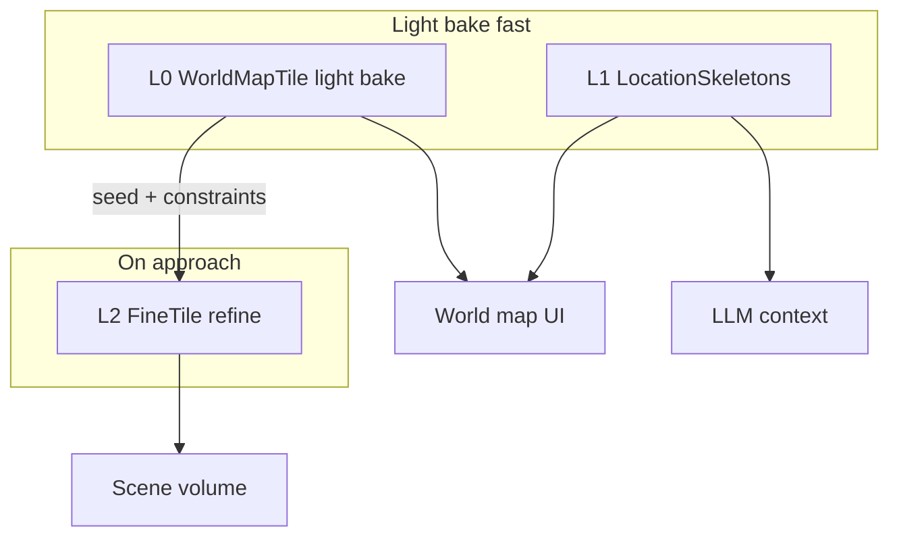

**Ключевой принцип:** см. § **Идея 1** + § **Идея 2** выше.

| Инвариант | Смысл |
|---|---|
| **WP-8** | L2 tile = `refine(L0_tile, world_seed, declared_hydro)` — реки/озёра/рельеф **согласованы** с world map |
| **WP-9** | Локации на world map: L1 anchors + optional coarse footprint; L0 хранит **pins**, не дублирует `NamedLocation` целиком |
| **WP-10** | `world_map_cells_per_tile = 32` (константа маски); `light_span = fine_cells_per_map_cell / 32` — масштаб light-cell плывёт с размером tile; manifest фиксирует `side` |
| **WP-11** | L2 соседей — фон **по одному tile**; очередь **path-first** (heading + tile cross), не burst кольцом |
| **WP-12** | Восстановление refine: **chunk manifest + atomic chunk commit**; прерванный chunk — redo; tile `partial` \| `complete` |
| **WP-13** | L2 gameplay: **от точки входа**; blocking **только** scene volume; **никогда** blocking целого tile |
| **WP-14** | **Time-to-play:** spawn → playable ≤ **30 s** (p95); переход tile ≤ **10 s** blocking — hard product gate |
| **WP-15** | Прогресс: `tiles_pct` / `locations_pct` / `wilderness_pct` (0…100); UI push **каждые 10 s** (TODO frontend) |
| **WP-16** | **Heading:** movement **intent** (DAG) → fallback вектор последних позиций; без обоих — expand от anchor без prefetch вперёд |
| **WP-17** | `path_ahead_depth` — user setting в `config.toml` (`[world_loading]`), default **2** |
| **WP-18** | Climate L2: **сначала A** (coarse sample, fast); **B** (per-tile fine) — в фоне, когда есть время |
| **WP-19** | L2: **file-per-location** (territory) + **file-per-tile chunk** (wilderness); overlap — **mask на write**, **priority на read** |
| **WP-20** | **Layer priority:** patch → **player scene** → **player path** → **city structure** → **location** → **wilderness** → L0 |
| **WP-21** | Location territory — **3D volume** `(x,y,z)`; на одном macro-tile — **несколько** локаций на **разных z**; mask/merge по `(x,y,z)`. Settlement map-site: **LOC-T-3** occupancy (больше footprint / раньше в `locations[]`), не 422 |
| **WP-22** | **Stale L0 regen (A):** patches + location files сохраняем; wilderness regen **от координат/границы location** наружу — anti-seam |
| **WP-23** | **Cutover:** **без** dual-read / interim slice на `map_cells`; сразу целевая загрузка мира (Pack + WP-13…21) |
| **WP-24** | **Уровни импорта** — registry → skeleton → light pack → pack; patches только local session |
| **WP-25** | **Сессия** = world + character; персонаж — **`POST /characters/import` (✅)**; `starter_characters[]` / `npcs[]` — **backlog spec**, не impl в Pack migration |
| **WP-26** | **Legacy freeze:** `map_cells` / `materialize-stack` / TR-PERF — **вне scope** Pack migration; только bugfix; новые фичи — L1…L7 |
| **WP-27** | ✅ **Bake modes (контракт мастера 2026-07-19):** `light` = тайлы с локациями; `full` = весь `world_bounds`; `detailed` = L2 одной локации — см. § **Bake modes** |
| **WP-28** | ✅ detect (`pack_completeness`); resume — caller `POST pack/bake` (incremental skip / auto-loop — ⬜); classifier fields → sync к новому scope (impl ⬜) |

### Bake modes (утверждено мастером 2026-07-19; контракт city 2026-09-06)

Продуктовый **процесс** pack. Bake jobs — **консьюмеры** генераторов, не их имплементация. Смена L0-compose / L2 refine / C23 planner / C11 packing **не** меняет тело bake — только вызовы контрактов.

| Термин | Wire `mode` | Pack'ает | Scope |
|---|---|---|---|
| **light_bake** | `light` | **только L0** + climate coarse | **Все** macro-tiles с `named_locations` **∪ declared hydro** |
| **full_bake** | `full` | **L0** всего `world_bounds` + **C23 topology** (не L2, не здания) | AABB мира |
| **detailed_bake** | `detailed` + `scope` (+ `location_uid` при `scope=location`) | **детальный эталон локации** (или wilderness topping) | см. контракт ниже |

#### Контракт `full_bake` (locked)

Консьюмер. Порядок **обязателен**:

1. L0 compose на весь `world_bounds` (тот же pipeline, что light) + **шов мира** на краях AABB.
2. **`plan_topology`** (C23) — районы + `settlement_gate` + city-коридоры в SQL. Не C22, не `settlement.zst`.

| Делает | Не делает |
|---|---|
| L0 pack, climate coarse, topology freeze | L2 / `location_terrain`; C11 здания; интерьеры; entry refine |

#### Контракт `detailed_bake` (locked)

**Pack-job локации**, не «terrain_bake». Консьюмер **двух** интерфейсов. Порядок **обязателен**:

1. **Сначала** генерация terrain L2 (refine facade / `FineChunkRunner`) — земля под локацией (`location_terrain`). Mill/paint default **off**.
2. **Затем** если `scope=location` и uid settlement-like — генерация поселения **поверх** этой земли: тот же C11 `materialize` **без якоря** (очередь районов до complete, **C24**). Debug с якорем — один район.

`scope=wilderness` — только шаг 1. Интерьеры — не этот mode. Topology **не invent** здесь (C23 — шаг full). Freeze нет → C11 **409**, caller сначала `plan_topology`.

Без шага 2 город после detailed **неиграбелен**. HTTP generate-settlement — другой caller того же C11, не второй product-job. Хук шага 2 в коде — ✅.

| Делает | Не делает |
|---|---|
| L2; C11 поверх L2 на городе | L0; шов мира; алгоритм C22 / FineChunk внутри оркестратора detailed; C11 на wilderness |

#### Job boundaries (утверждено мастером 2026-07-20; city-слой 2026-09-06)

**Инвариант:** `light_bake` и `full_bake` **не** включают L2. L2 — шаг 1 `detailed_bake` и/или runtime/entry (WP-13). Topology — шаг 2 `full_bake`, не compose L0.

| Job | Делает | Не делает |
|---|---|---|
| **light_bake** | L0 на location∪hydro tiles; `locations_index`; climate coarse; finalize pack | L2 `location_terrain` / wilderness chunks; blocking `refine_from_entry`; **settlement_topology** (соседние тайлы большого footprint могут отсутствовать) |
| **full_bake** | L0 на весь `world_bounds` + шов мира. **Шаг 2 того же job:** `plan_topology` (C23). Не внутри `SettlementContributor` | L2; entry refine; C11 / `settlement.zst`; occupancy-flood |
| **detailed_bake** | **Шаг 1:** L2 refine (консьюмер terrain). **Шаг 2** если `scope=location` settlement-like: C11 `materialize` **поверх** L2. Mill/paint default **off**. C23 уже в SQL — L2 по footprint | L0; шов мира; invent topology отдельным алгоритмом; C22 внутри bake; интерьеры; C11 на wilderness |
| **entry / WP-13** | scene volume + background rings/path у spawn. **Без** mill/paint (игрок не ждёт grade generate) | часть `POST …/pack/bake?mode=light\|full`; mill/paint |
| **C24 (не bake)** | packing **одного** района (якорь) или очереди (`detailed_bake` без якоря) в тот же `settlement.zst` | clip layout по макро-тайлу; новый файл на район; inline C23 внутри `materialize` |
| **on-demand grade (не bake)** | Product: DAG **только** когда сцена требует grade и в pack нет — 1…N чанков (не тайл/мир; mill спекулятивно **дорого**). Debug: `POST …/refine-chunk`. Тот же `FineChunkRunner` (R41) | mill на каждый scene/entry; GradeBakeOrchestrator; `generate_detailed_grade` + ручная запись pack; `detailed_bake` `max_tiles=1` как «один чанк» |
| **modification** (не bake job) | Patch Store: `terrain_delta` / `climate_delta` в `patch_bounds`. Повторный materialize / patch на объёме с grade → **сброс** stale relief ([`tz_terrain_relief.md`](./tz_terrain_relief.md) § Caller). Не mill в том же fill-only проходе | `POST pack/bake`; rewrite `complete` tile; четвёртый `mode=`; stamp старого grade на новые колонки |

**Шов мира L0** задаётся режимом `world_topology_mode`, а не безусловным
тором: пары, facings, partial bake и invalidation определены в
[§ Шов мира L0](#шов-мира-l0). Координатная карта и typed lookup —
[`tz_terrain_generation.md` § Форма мира](./tz_terrain_generation.md#форма-мира--world_bounds-утверждено-2026-07-19).
**`detailed_bake` шов мира не считает и не пишет.**

**Технический шов (chunk / tile rim / `ColumnRect`) — не продукт.** Нарезка джоб и pack-blob. Климат, полотно дороги, **локация/город** и шаг сетки **проходят** ребро как один мир ([`tz_terrain_relief_v1_superseded.md`](./tz_terrain_relief_v1_superseded.md) **C29**). `territory_volume` **может** пересекать макро-тайлы: один `locations/l.{uid}.terrain.zst`, wilderness mask на каждом пересечённом тайле. WP-19 — куда писать клетку, не стена и не второй `location_uid`. Шов мира (антагонисты) — другая топология; внутри AABB сосед = `grid_neighbor`.

**После light (отдельный шаг процесса, не фаза bake):** caller **может** стартовать entry job — **другая джоба**, не продолжение `light_bake`. Full не обязан ждать entry. Topology — **внутри** `full_bake` (шаг 2), не отдельный клик мастера. World routes на `settlement_gate` — после C23, не L0 compose.

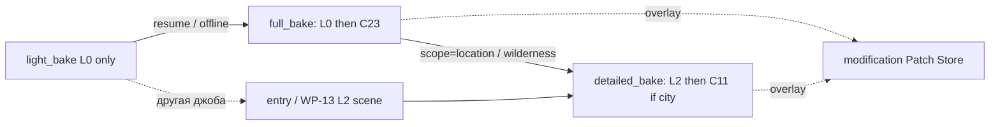

**Инвариант процесса (мастер):** отдельного product bake mode «wilderness» **нет**. Полное заполнение прямоугольника мира L0 = `full_bake`. L2 wilderness topping = `detailed&scope=wilderness` (тот же product mode `detailed`, не третий bake mode).

#### Слой модификации мира (не bake mode) — locked 2026-08-16

Игровые изменения рельефа / природы / климата (взрыв, обвал, раскопки, локальный климат, катаклизм в bounds) — **не** `light`/`full`/`detailed` и **не** force-rebuild `complete` тайла.

Pack (`world_map.zst`, wilderness chunks, `location_terrain`) = **immutable snapshot** bake. Дельта живёт в **Patch Store**; read = WP-20 (`patch` выше wilderness/L0).

| Слой процесса | Что пишет | Когда |
|---|---|---|
| **full_bake** | L0 pack + C23 topology | мастер / init мира |
| **detailed_bake** | L2, затем C11 на городе; wilderness = L2 | детализация локации / topping |
| **entry / WP-13** | L2 scene (без C11, без mill) | gameplay spawn **земли** |
| **C24 district packing** | один район в тот же `settlement.zst` | gameplay spawn **города** (после C23); не bake |
| **modification** | `map_cell_patches` (`terrain_delta` / `climate_delta` / …) | ход: взрыв, природа, климат в `patch_bounds` |

| Можно | Нельзя |
|---|---|
| `TerrainPatchRequest` + обязательный `patch_bounds` | `POST pack/bake` чтобы «взорвать» клетку |
| сброс stale grade в bounds при materialize/patch ([`tz_terrain_relief.md`](./tz_terrain_relief.md) § Caller) | mill в том же fill-only проходе; stamp старых uid на новые колонки; новый bake mode `modify` / `force=true` на complete tile |
| `world_history` / `event_uid` рядом с patch | whole-world `generate-surface` в gameplay |
| мастерский **новый pack version** (смена генератора / seed, WP-7) | путать smoke-rebake генератора с взрывом в игре |

Skip `complete` (WP-12) остаётся **resume** incomplete L2. Invalidate+перепечь pack — рычаг мастера/offline (версия мира), не runtime mod.

**Rebake — только до старта gameplay и для dev-fixtures** (решение мастера 2026-10-27). После старта gameplay перепечки нет: запечённое остаётся, допустимо только расширение — новые тайлы/локации на wilderness без patches, patch в snapshot; rebase цепочки на другой pack отвергнут ([`tz_world_snapshot.md`](./tz_world_snapshot.md) § «Правила модели pack + overlay», п. 6, 12).

SoT generate/persist patch: [`tz_terrain_generation.md`](./tz_terrain_generation.md) § Локальная модификация. DAG: [`tz_world_generation_dag.md`](./tz_world_generation_dag.md) `modify_terrain` ⬜.

**Не путать:**

| Устаревший / несогласованный текст | Контракт мастера |
|---|---|
| `light` = capped priority subset локаций | `light` = **все** тайлы с локациями |
| `full_bake` = только все location L0 | `full_bake` = **весь** `world_bounds` L0 |
| P2 / «wilderness L0» как третий bake stage | **не** product mode; остаток bounds входит в `full_bake` |
| L2 / entry refine **внутри** light или full bake | **запрещено** product-контрактом; L2 = detailed \| entry job |
| `refine_scene` вшитый в `pack/bake?mode=light` | ✅ закрыто (WP-PERF-50): параметр убран из L0 bake; entry = отдельная джоба |
| Имена файлов `wilderness_chunk` / layer `wilderness` | **storage/impl legacy** — см. § ниже; не путать с bake process |
| Runtime rings | L2 дозаполнение у игрока; **не** замена `full_bake` L0 |
| Взрыв / климат / природа = перепечь detailed/full | **modification layer** = Patch Store; pack не мутировать с хода |

#### Offline package cases

| Case | Pack | Игрок |
|---|---|---|
| **1. light_bake complete** | L0 на **всех** location tiles; pins в `locations_index` | World map по локациям; вне них — дыры до full; L2 lazy |
| **2. full_bake complete** | L0 на **весь** `world_bounds` | Сплошная world map в прямоугольнике мира; L2 lazy |
| **3. full + all detailed_bake complete** | (2) + `location_terrain` на каждый pin + **`settlement.zst` на settlement-like** | Тёплый старт: земля и outdoor город |

**Инвариант:** все три — валидные master packages. Partial → **определять и дозаполнять** (WP-28), не требовать case 3. Игрок **может** войти после light (не ждать full).

#### Pack completeness (detect + resume)

`GET …/map/loading-progress`: `tiles_pct` = ready/total **среди manifest.tiles**. Offline case — поле `pack_completeness`.

| Поле / сигнал | Смысл (target) | Статус |
|---|---|---|
| `expected_l0_light` | все macro-tiles с `named_locations` (+ declared hydro) | ✅ |
| `expected_l0_full` | все macro-tiles, покрывающие `world_bounds` (resolved AABB) | ✅ |
| `l0_baked` | tiles с `world_map_path` | ✅ |
| `locations_expected` | pins в `locations_index` | ✅ |
| `locations_detailed` | `location_terrain_entries` с `terrain_path` | ✅ |
| `pack_completeness` | `light_complete` \| `full_complete` \| `full_detailed_complete` \| `partial` | ✅ wire; семантика light/full → sync |

| Нехватка | Resume | Статус |
|---|---|---|
| `l0_baked` ⊊ `expected_l0_light` | `POST pack/bake?mode=light` | ✅ |
| `l0_baked` ⊊ `expected_l0_full` | `POST pack/bake?mode=full` | ✅ |
| `locations_detailed` ⊊ `locations_expected` | `POST pack/bake?mode=detailed&scope=location&location_uid=` / runtime entry | ✅ single uid; batch — ⬜ |
| L2 fine chunks вне локаций absent | runtime rings / path — **не** блокирует case 2→3 | ✅ rings path |

**Impl vs ТЗ:** wire `mode=light\|full\|detailed` ✅; `PackTilePlanner` scope ✅; classifier uses planner ✅; `--max-tiles` / query = debug override only (0 = uncapped).  
**Job boundary:** L0 bake path без `refine_scene` ✅ (WP-PERF-50); entry — `POST …/refine-from-entry` / `initialize_world --entry`, не внутри bake.

#### Storage name `wilderness_*` (не product bake mode)

Имена в pack I/O и merge (`wilderness_chunk`, layer priority «wilderness», `wilderness_pct`) — **legacy/storage labels** для fine chunks **вне** `location_terrain` volumes. Это **не** третий offline bake mode и **не** этап между light и full.

| Слой | Смысл |
|---|---|
| Product process | только `light_bake` → `full_bake` → (`detailed_bake` scope location\|wilderness) |
| Storage / read merge | `wilderness_chunk` = L2 (или fine) данные вне location files — WP-19/20 |
| Rename | optional later; до rename в ТЗ процесса использовать нейтрально «tiles вне локаций» / «non-location L2» |

### L0 — WorldMapTile (Идея 1)

**Назначение:** корректная **world map UI** — где горы, реки, море, сёла/локации *примерно*; far climate; вход для L2.

| Параметр | Значение |
|---|---|
| Unit | **1 macro-tile** (`fine_cells_per_map_cell`, default 1000 m) |
| Разрешение внутри tile | **`world_map_cells_per_tile = 32`** (константа маски L0) |
| Физический шаг light cell | `light_span = fine_cells_per_map_cell // 32` — **масштаб** маски плывёт с размером tile |
| Файл pack | `tiles/r.{gx}.{gy}.world_map.zst` + глобальный `climate_coarse.zst` |

#### Шов мира L0

Seam — стык **макро-тайлов на краях `world_bounds`**, общий контракт
`light_bake`/`full_bake` с разным bake-scope. Пары и facings определяет
`WorldTopology` (`dataModel/worldPack/wire/worldTopology.py`);
`grid_neighbor`/`antagonist_tile` — делегаты. Координатная карта,
`NeighborResult`, чётность ширины для sphere и `canonicalize` заданы в
[`tz_terrain_generation.md` § Форма мира](./tz_terrain_generation.md#форма-мира--world_bounds-утверждено-2026-07-19).
Стороны задаются typed `Facing`; собственного mode/wrap-ветвления в
writer нет. Идентичность тайла остаётся существующей pack tile identity.

**Пары и грани:**

| Режим / край | Пара тайлов | Соответствие rim |
|---|---|---|
| `wrapped`, x | `(x_min, gy) ↔ (x_max, gy)` | `WEST ↔ EAST` |
| `wrapped`, y | `(gx, y_min) ↔ (gx, y_max)` | `SOUTH ↔ NORTH` |
| `sphere`, x | как у `wrapped` | `WEST ↔ EAST` |
| `sphere`, север | `(gx, y_max) ↔ (x_half, y_max)` | **`NORTH ↔ NORTH`** |
| `sphere`, юг | `(gx, y_min) ↔ (x_half, y_min)` | **`SOUTH ↔ SOUTH`** |
| `planar`, любой край | пары нет | seam — no-op |

Здесь `x_half = x_min + ((gx - x_min + w/2) mod w)`,
`w = x_max - x_min + 1`, после нормализации чётности sphere.
В `wrapped` и на x-краях `sphere` грань партнёра — `opposite(facing)`;
на y-краях `sphere` это **та же** грань, применять `opposite` нельзя.
Оба facings приходят из topology, writer не выводит второй сам.

**Canonical owner → antagonist.** Для каждой seam-пары переиспользуется
идиома `wrap_owner_and_other`: неупорядоченная identity пары — `frozenset`
двух координат тайлов; owner — минимальная координата `(gx, gy)`,
`other` (antagonist) — вторая. Источник rim всегда owner, получатель —
antagonist. Набор bake-тайлов не меняет owner.
`WorldSeamCopy` переносит существующие `surface_z` и `system_terrain`;
климат, гидрология и grade этим seam-копированием не перезаписываются.
Это не magma antipode и не технический стык fine chunks / `ColumnRect`.

**Pull-строчка частичного bake** (тот же контракт для light и full):

- Оба тайла входят в bake-scope: owner-rim из текущего compose копируется
  в соответствующий rim antagonist в том же scope.
- Запекается только `other` (antagonist): caller читает owner-rim из пака
  и применяет его `WorldSeamCopy` **к себе**; владение записью остаётся
  у запекаемого тайла. Чтение чужого tile state — по идиоме detailed halo.
- Запекается только owner: он ничего не строчит за пределами scope;
  его rim — источник. Antagonist подтянет owner при собственном bake
  (self-healing).

**Pack-write за пределы bake-scope не вводится.** Направление owner →
antagonist не разворачивается ради partial bake; per-tile persist
ownership сохраняется.

**Смена `world_topology_mode` — pack invalidation.** Меняется карта
соседей, поэтому seam-пары и halo **всех** уже испечённых тайлов становятся
невалидны. Требуется **full re-bake**; частичный light/detailed bake не
восстанавливает валидность всего пака. При worldEdit смены режима мастер
получает warning об этой invalidation и необходимости full re-bake,
как при смене размеров мира. Это изменение версии/настроек мира,
не игровая дельта Patch Store.

Отсутствующее поле сохраняет default `wrapped`: это текущее тор-поведение,
а не смена режима; такие старые миры и паки не инвалидируются самим
добавлением скаляра.

#### Масштаб light grid (утверждено 2026-07-15)

**Инвариант WP-10:** форма маски L0 **всегда** `32×32` light-cells на macro-tile. Размер tile мира динамический → меняется только **метры на light-cell**, не число ячеек.

```
side     = 32                                 # WORLD_MAP_CELLS_PER_TILE (константа)
light_span = fine_cells_per_map_cell // side            # физический шаг light-cell
```

| Константа / поле | Default | POJO / код |
|---|---|---|
| `WORLD_MAP_CELLS_PER_TILE` / `side` | **32** | `WorldMapCellsPerTilePolicy` — единственный SoT |
| `light_span` | `fine_cells_per_map_cell // 32` | вычисляется при bake; не хранить параллельный литерал |
| Master override `worlds.world_map_cells_per_tile` | optional | редкий тумблер; default = 32 |

Typed world wire: `WorldMapResolutionSettings.world_map_cells_per_tile` —
nullable override, missing/null сохраняют отсутствие настройки. Supplied
значение приводится существующим policy-преобразованием `int(value)`; новых
strict/min ограничений этот перенос не добавляет. Runtime side по-прежнему
`max(1, int(override))`, отсутствие override использует policy default 32.
Финализация L0 сохраняет фактический side manifest обратно в world, как прежде.
Path/hash принадлежат отдельному nullable `WorldPackMetadata`; size G-1
и `terrain_pack_version` финализатор не меняет.

**Примеры:**

| `fine_cells_per_map_cell` | `side` | `light_span` | Light cells / tile |
|---:|---:|---:|---:|
| 1000 | 32 | 31 m | 1024 |
| 3000 | 32 | 93 m | 1024 |
| 6000 | 32 | 187 m | 1024 |

**Manifest:** при bake писать `world_map_cells_per_tile = 32` (или override); при load **не** пересчитывать из старой ∝-формулы.

**Зачем:** стабильный бюджет blob/UI (`1024` cells/tile); динамический `fine_cells_per_map_cell` без формулы `3000↔32` / clamp 8…48.

**Consumers (ASCII / grid):** pack render default = **light-mask mosaic** `32×32` per tile (WP-10 ✅). Macro one-symbol-per-tile (`render_macro`) — debug-only, не SoT world map. Frame — [`tz_map_light_bake.md`](./tz_map_light_bake.md) MLB-12. **SoT уровней ASCII** (L0 map/height **без** outdoor grade; L2 `surface_grade` / `grade_{n}`): [`tz_pack_ascii_render.md`](./tz_pack_ascii_render.md) · grade writer — [`tz_terrain_relief_v1_superseded.md`](./tz_terrain_relief_v1_superseded.md) **R36u**.

#### Приоритет L0 bake (утверждено мастером, WP-15 / WP-27)

**Не ждать** `full_bake` (весь `world_bounds`) перед входом игрока.

**Форма мира** — всегда `world_bounds` (AABB квадрат/прямоугольник); см. [`tz_terrain_generation.md`](./tz_terrain_generation.md) § Охват мира / Форма мира. Bake **не** меняет форму: заполняет tiles/cells **внутри** bounds.

| Mode | Что bake | Blocking для входа |
|---|---|---|
| **light_bake** | L0 на **всех** тайлах с `named_locations` **∪ declared hydro** + `locations_index` / climate coarse | да — минимум для map с локациями |
| **full_bake** | L0 на **весь** `world_bounds` (тот же L0 pipeline) | master offline; у игрока — если pack уже full |

**Покрытие bounds (прогресс заполнения):**

| Stage | Покрытие внутри `world_bounds` |
|---|---|
| light complete | все location tiles; вне них — дыры (ещё не baked) |
| full complete | **весь** прямоугольник `world_bounds` |

**Инвариант:** игрок **входит в мир** после light (или attach готового pack); недостающее — `full_bake` / resume / lazy L2 (WP-28). Partial pack у игрока допустим; SoT формы всё равно bounds.  
**Cross-ref:** L2 — § WP-13 + **detailed_bake**; generators — [`tz_terrain_generation.md`](./tz_terrain_generation.md) § Bake modes.

**L2 не зависит:** fine grid всегда `fine_cells_per_map_cell × fine_cells_per_map_cell` fine cells; L0 всегда `32×32`, меняется только `light_span`, не детализация gameplay.

**Данные на light cell `(tx, ty)` внутри tile:**

| Поле | Тип | Зачем |
|---|---|---|
| `surface_z` | i16 quantized | уровень рельефа / «высота горы» на карте |
| `dominant_terrain_id` | u8 | цвет/иконка biome |
| `hydrology_role` | u4 enum | none / sea / river / lake / shore — [`HydrologyCellRole`](./tz_terrain_hydrology.md) |
| `hydrology_width` | u4 optional | грубая «ширина» русла / берега в light cells |
| `climate_zone_id` | u8 optional | зона для UI |
| `location_pin` | u16 optional | index → `locations_index` (село, dungeon anchor) |

**Локации на карте** — реализация Идеи 1:

- **L1** остаётся source of truth (`named_locations`, `map_x/map_y`, `CitySkeleton`).
- При light bake: для каждой видимой на map локации — **pin** на ближайшую light cell + optional **coarse footprint** (круг/rect в light-grid cells, не метры).
- UI world map рисует: elevation shading + hydro mask + pins/footprints — без L2.

**Гидрология на L0** — реализация Идеи 1:

- Declared rivers/coastlines → rasterize на **light grid** (не 1 m).
- Река = полилиния + `hydrology_role=river` + `hydrology_width` в light cells.
- Море/озеро = connected component на light grid.
- Полный carve **не** делается — только маска и coarse `surface_z` для визуализации и constraints.

**Compose / укладка маски L0 (утверждено):** единый light-grid canvas + contributors (relief, landcover, hydro, settlement, climate) — [`tz_map_light_bake.md`](./tz_map_light_bake.md). Write-path wire только из compose; macro-only sample на весь tile — запрещён.

**Bake pipeline L0:**

```
pole + world_seed
  → run_surface_pass на light grid (per tile или world batch)
  → hydrology light rasterize (declared + autoresolve coarse)
  → project L1 location pins + coarse footprints
  → write world_map.zst per tile
```

(Детальные контракты compose — [`tz_map_light_bake.md`](./tz_map_light_bake.md).)

**Объём (bbox 19×19 tiles):** 361 × 32² ≈ **371k** light cells → **< 1 MB** zstd — **не зависит** от `fine_cells_per_map_cell` (всегда `side=32`).

### L1 — LocationSkeletons (скелеты локаций, без fine cells)

**Назначение:** LLM и UI знают *что* есть в мире, без materialize района на метрах.

| Данные | Где | Детализация |
|---|---|---|
| Дерево `named_locations` | SQLite (как сейчас) | полные metadata |
| **CitySkeleton** поля | `NamedLocation` / JSON | [`tz_city_generation.md`](./tz_city_generation.md) §3 |
| Территория | `map_x,map_y` anchor + optional `territory_radius_m` / bbox | **без** fine `map_cells` |
| Settlement occupancy | **не** materialize на bake | только флаг `has_fine_cells: false` |
| Declared hydro / poles | import bundle | как сейчас |

**Инвариант:** LLM на дистанции читает L0 + L1 + `CitySkeleton` — **не фантазирует** города, которых нет в дереве.

**Не дублировать:** полный `SettlementLayout` / district cells в SQLite wilderness — L2 локации в pack (WP-19) + gameplay deltas в patch ([`tz_city_generation.md`](./tz_city_generation.md) фазы 2–3 lazy).

### L2 локации + wilderness tile (WP-19…21, утверждено)

**Гибрид location file + tile chunks** с mask/priority — под locations-first и WP-14. **На одном macro-tile** могут сосуществовать **разные локации на разных z-уровнях** (поверхностный город, подземелье ниже, верхний район на z>0) — отдельный `locations/l.{uid}.terrain.zst` на каждую `named_location`.

**Одна локация на нескольких тайлах** — норма (**C29**): `territory_volume` пересекает `gx|gx+1` (или грань чанка). File-per-location **не** file-per-tile: клетки volume со всех тайлов → **тот же** `l.{uid}.terrain.zst`. Wilderness chunk каждого тайла mask’ит `inside_location`. Запрещено резать поселение по сетке bake или заводить второй uid «для половины за швом».

**Смешивание файлов — безопасно**, если:

1. **На read** — layer priority WP-20 по **(x,y,z)**.
2. **На write** — wilderness mask по **3D territory**, не только XY.

Иначе — дублирование и конфликт геометрии (layout vs L0 refine).

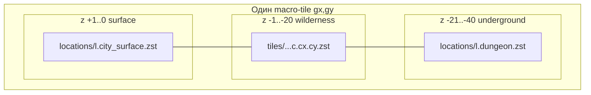

#### 3D territory (WP-21)

| Поле | Смысл |
|---|---|
| `territory_volume` | AABB `(x0,y0,z0)…(x1,y1,z1)` в meter grid; из `territory_radius_m` / layout bbox + `map_z` anchor. **Может** пересекать макро-тайлы / chunk faces (C29) |
| **Span XY нескольких тайлов** | **норма:** один location file; wilderness mask на каждом tile ∩ volume |
| **Overlap XY, разный Z** | **норма** для pack, если Z-интервалы **с запасом** (**LOC-T-3**): два location file на одном tile; wilderness заполняет **z-диапазоны вне** всех location volumes |
| **Settlement map-site, XYZ без запаса / встык** | import **200**; ERROR лог; карту занимает победитель **LOC-T-3**. Проигравший в SQL, не L0/C11. SoT [`tz_locations.md`](./tz_locations.md) |
| **Прочие named_locations, overlap XYZ** | leftover: validator warning; tie-break: выше `graph_level` / меньший `location_uid`; master разводит bbox |

**Mask на write (3D):**

```
inside_location(cell) =
  ∃ location L: cell ∈ L.territory_volume   // x,y,z — все три

wilderness_chunk.cells = refine_chunk(...)
  .filter(cell => !inside_location(cell))
```

На **(x,y)** wilderness может быть на `z=-5`, а location file — только на `z=0…-2`: конфликта нет.

#### Формат (file-per-unit)

| Слой | Файл | Unit |
|---|---|---|
| **Location L2** | `locations/l.{location_uid}.terrain.zst` | **3D** `territory_volume` локации |
| **Wilderness L2** | `tiles/r.{gx}.{gy}.c.{cx}.{cy}.zst` | fine chunk macro-tile |
| **Player scene / path** | *не отдельный тип файла* | те же chunks/tiles, но **выше в очереди** генерации и при read |

Wilderness — **file-per-tile-chunk**, не file-per-whole-tile на gameplay path (partial tile). Offline `r.{gx}.{gy}.terrain.zst` merged — только bake `tile|full`.

#### Grade 8-slots (pack, not FineTerrain)

Outdoor 8 слотов **не** колонка и **не** bake `occ`/`seam`. После `detailed_bake` — sidecar: 8 **int-кодов** на клетку ([`tz_terrain_relief.md`](./tz_terrain_relief.md) § Pack-слот). Не Unicode, не mill `Facing`. Не тело×8 Instance. SoT чтения: [`tz_terrain_relief_consume.md`](./tz_terrain_relief_consume.md) слой 2.

| Слой | Файл | Зерно |
|---|---|---|
| Wilderness tile | `tiles/r.{gx}.{gy}.grade_rays.json` | `SCH-GRADE-CELL-SLOTS`: `{x, y, slots[8]}` int |
| Location L2 | `locations/l.{uid}.grade_rays.json` | то же; клетка ∈ location volume |

Рендер ASCII **не** invent слот. Не SQL catalog (R43) и не `.zst` chunk. Тело — [`tz_terrain_relief_consume.md`](./tz_terrain_relief_consume.md) § Тело sidecar. Старый `rays[]` не SoT.

#### Layer priority (WP-20, утверждено)

На каждую `(x,y,z)` — **первый попавший** слой:

| # | Слой | Источник | Заметка |
|---|---|---|---|
| 0 | **patch** | `map_cell_patches` | **modification layer:** взрыв / природа / локальный климат; не rewrite pack |
| 1 | **player scene** | scene volume вокруг `(map_x,map_y)` | highest pack layer; blocking P0 |
| 2 | **player path** | chunks/tiles на path corridor впереди | prefetch; ниже scene, выше city |
| 3 | **city structure** | `locations/l.{uid}.settlement.zst` | клетки здания (геометрия дома C8); [`tz_settlement_outdoor.md`](./tz_settlement_outdoor.md) |
| 4 | **location** | `locations/l.{uid}.terrain` если `(x,y,z) ∈ territory_volume` | земля volume; не стены города |
| 5 | **wilderness** | `tiles/...c.{cx}.{cy}.zst` | только **вне** masked bbox локаций |
| 6 | **L0** | `upsample world_map` | fallback |

> **Статус impl merge:** § **Merge backlog (WP-MERGE)** v2 + § **WP-FIX** (фиксы) + § **WP-FIX-DEBT** + § **WP-FIX-REVIEW** (приоритеты code review).

**Очередь генерации** следует тому же порядку (WP-13, WP-16, WP-17): сначала scene под игроком, потом path, потом location L2 при входе, потом wilderness fill.

#### Exclusion mask на write (анти-дубликат)

```
wilderness_chunk.cells = refine_chunk(L0, rect)
  .filter(cell => !inside_any_location_volume(cell))  // WP-21: x,y,z
```

| Ситуация | Поведение |
|---|---|
| Location L2 **готов** | wilderness **не пишет** в её `territory_volume` |
| Тот же `(gx,gy)`, **разный z** | surface city + underground — **разные** location files; wilderness между ними по z |
| Location L2 **ещё нет**, wilderness в volume | location **перекрывает** при появлении; orphan wilderness bytes — допустимо v1 |
| Две **settlement** overlap XYZ / встык / Z-зазор меньше порога | occupant = победитель **LOC-T-3**; проигравший не маскирует wilderness и не пишет L0 pin |
| Две **не-settlement** overlap **XYZ** | leftover: manifest tie-break; validator warning |

**zstd:** каждый файл сжимается **на write** (`TileCodec`); отдельный batch-compress не нужен.

**`worldMapLoading`:** `locations_pct` — доля локаций с `l.{uid}.terrain.zst` от pins в `locations_index`.

**Крупный город:** bbox > лимита → sub-chunks `l.{uid}.c.{i}.zst` (backlog); v1 — один файл.

### L2 — FineTile (Идея 2)

**Назначение:** gameplay scene, точное русло, cliff gap, narration из геометрии.

**Реализация Идеи 2:** L2 **не** «с нуля», а **refine** light bake того же tile (§ Идея 2). **Не materialize целый macro-tile blocking** (~10–20 мин) — только объём вокруг игрока; остальное расширяется **от точки входа** (WP-13).

| Параметр | Значение |
|---|---|
| Unit persist | **fine chunk** `terrain_chunk_columns × terrain_chunk_columns` (default 32×32 m), см. [`tz_terrain_generation.md`](./tz_terrain_generation.md) § TR-PAR |
| Unit tile | macro-tile `fine_cells_per_map_cell`; статус `absent` \| `partial` \| `complete` |
| **Точка входа (anchor)** | `(entry_x, entry_y)` — откуда начинается/продолжается refine **внутри** tile |
| Триггер anchor | см. § **Генерация от точки входа** |
| Триггер соседних tiles | фоновая очередь path-first, § **Фоновый refine** |
| **Вход** | L0 `world_map` tile + L1 declared hydro + `world_seed` |
| Persist | wilderness: per-chunk blobs; **локации:** `locations/l.{uid}.*.zst` (§ WP-19) |
| Cache | LRU decoded chunks + location blobs + L0 sample |

### Генерация от точки входа (WP-13, утверждено)

**Граница с Transition:** источник входов переходит на единый
[контракт переходов](./tz_location_transitions.md) §4/§8.
Упоминания `location_entry_points` в этом разделе — прежний источник.
Выбор якоря/ближайшего входа и discovery policy — контекст session/scene,
отдельная работа WP-13; они не являются задачами генератора или условием
приёмки текущего generator/storage/CRUD плана.

**Принцип:** генерация **не** «весь tile разом», а **от точки, где игрок появился или вошёл**, кольцами наружу. При переходах — **новый anchor** = точка входа на границе / в локации.

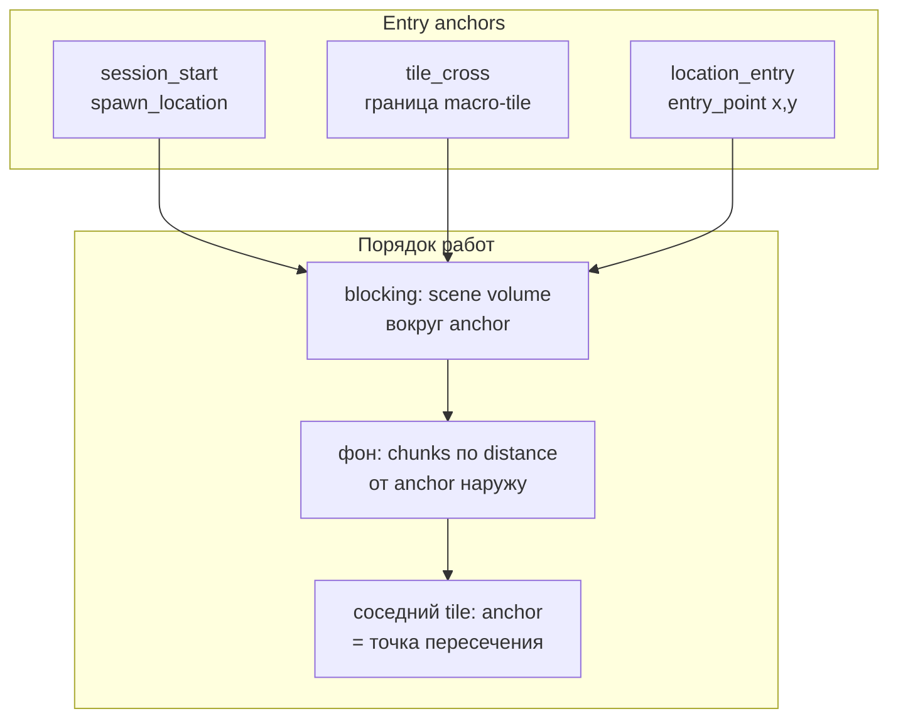

| Событие | Anchor `(entry_x, entry_y)` | Blocking |
|---|---|---|
| **Старт сессии** | `spawn_location` персонажа (`map_x`, `map_y`) | `scene_xy_radius` вокруг spawn — **секунды**, не минуты |
| **Переход macro-tile** | координата **пересечения** границы (где игрок вошёл в tile) | scene volume вокруг **ног** |
| **Вход в локацию** | `location_entry_points` (ближайший discovered entry) или сторона входа со стороны игрока | scene volume от **стороны игрока** / entry — **не** blocking весь `location_uid` |
| **Движение внутри tile** | anchor **не сбрасывается**; фон достраивает chunks по distance от **текущей** позиции + старый anchor |

**Загрузка локации (два режима, утверждено):**

| Режим | API / единица | Когда |
|---|---|---|
| **Blocking (игрок)** | scene volume от **стороны входа** / ног (`get_scene_volume`, refine rings от entry) | вход в локацию, spawn, tile cross — ≤ **10 s** |
| **Фон (соседи)** | `get_by_location(location_uid)` / целиком `locations/l.{uid}.terrain.zst` | prefetch **соседних** локаций; **не** блокирует ход |

Антипаттерн только для **blocking** path: eager весь город / весь `location_uid` до первого ответа LLM. Фоновая догрузка соседних локаций целиком — **разрешена**.

**Порядок chunks внутри tile:**

1. Все chunks, пересекающие `scene_xy_radius` вокруг anchor — **P0, blocking** (первый playable).
2. Остальные chunks того же tile — **по возрастанию** distance(chunk_center, anchor); при движении игрока — пересортировка head очереди от `(map_x, map_y)`.
3. Соседний macro-tile на path corridor — после P0 текущего; **его anchor** = predicted entry point на границе (или фактический при cross).

**Чтение до готовности chunk:** `MapCellQueryFacade` → merge(**L2 chunk if present**, else **L0 upsample** sample, patches). Gameplay **не блокируется** на весь tile.

**Cross-ref:** scene volume defaults — [`tz_terrain_generation.md`](./tz_terrain_generation.md) § TR-LAZY-LOAD; POJO [`SceneVolumePolicy`](../backend/app/dataModel/terrain/sceneVolumePolicy.py) (`scene_xy_radius`, `scene_z_above`, `background_expand_radius_fine` for WP-PERF-10 rings). Read: `get_scene_volume`. Blocking entry: `refine_from_entry` (**без** mill). Background rings/path-ahead: `schedule_chunk_refine`. Outdoor grade: [`tz_terrain_relief.md`](./tz_terrain_relief.md) § Caller — DAG mill 1…N чанков когда сцена требует grade и в pack нет; ГМ может залить pack заранее; не mill на entry.

#### WP-13 — статус impl и открытый backlog

**Сделано (service / debug, без DAG):**

| Кусок | Код |
|---|---|
| Blocking scene + path | `EntryRefineOrchestrator.refine_from_entry` → `FineTerrainRefineOrchestrator` (facade) |
| L2 chunk generate + persist | `FineChunkRunner.refine_rects` (parent light → pool → wilderness / location_terrain) |
| Фон rings + path-ahead (predicted border entry) | `schedule_chunk_refine` → `chunkSchedule.schedule_tile_background` / `schedule_path_ahead_tiles` |
| Path corridor rect select | `pathCorridorSelect.select_path_corridor_rects` |
| Виды якоря (лейблы) | `AnchorKind`: `session_start` \| `tile_cross` \| `location_entry` |
| Light bake spawn | `kind=session_start` + schedule |
| Debug HTTP | `POST …/refine-from-entry`, `POST …/schedule-chunk-refine`, `POST …/refine-chunk` |
| WP-PERF-10 rings (не full-tile enqueue) | ✅ `background_expand_radius_fine` |
| Read ≠ write | § Read path / Entry load — два потока |

#### L2 refine module layout (утверждено)

**Маршрут записи через WorldPackWriter на схеме — V1 / AS-IS.** Для V2 после старта gameplay применяются доменные patches и commit Snapshot.

Разрез application-слоя L2 (не меняет wire/контракты parent light / WP-13 entry-first):

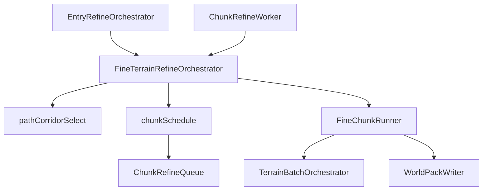

| Модуль | Ответственность | Запреты |
|---|---|---|
| `FineTerrainRefineOrchestrator` | Thin facade: scene / path / rect / queued chunk; делегирует schedule и helpers | Нет `ChunkComputePool`; нет прямой записи blobs |
| `FineChunkRunner` | thin: `prepare_fine_tile` (upsample + **hills** + hydro) → **pool** `compute_rect` (column fill + **grade R36v**, per rect) → `FineChunkPersist`. Стадии mill/paint — [`GradePipelineStages`](../backend/app/dataModel/worldPack/gradePipelineStages.py) | Нет enqueue в `ChunkRefineQueue`; нет serial tile-wide grade; нет L0 холмов; нет второго grade pipeline / GradeBakeOrchestrator |
| `chunkSchedule` | Free functions: rings / path-ahead enqueue | Не пишет pack blobs; не generate cells |
| `pathCorridorSelect` | `select_path_corridor_rects` → `ColumnRect[]` | Не persist |
| `packMapHelpers.tile_for_anchor` / `entryRingGeom` | Coord / scene chunk indices | — |

**Публичный entry:** debug HTTP / bake → `EntryRefineOrchestrator` → facade; background worker / scene / path → `refine_queued_chunk` / `refine_rects` с `stages=off()`. Product mill — DAG на сцене (gate) тем же `refine_queued_chunk(stages=full())`; debug `POST …/refine-chunk`. ГМ pack mill — `detailed_bake`. Не новый оркестратор.

**Открыто (зафиксировано; не смешивать с «контракт утверждён»):**

| ID | Задача | Контракт / заметка | Caller |
|---|---|---|---|
| **WP-13-OPEN-1** | **Wiring `tile_cross`** | Фактический cross границы macro-tile → `refine_from_entry(kind=tile_cross)` с координатой **пересечения** (не predicted); затем `schedule_chunk_refine` | Session/movement service → entry orchestrator; **DAG — gate** |
| **WP-13-OPEN-2** | **Wiring `location_entry`** | Выбор anchor из `location_entry_points` (ближайший discovered) или сторона подхода; blocking scene от entry — **не** весь `location_uid` | Service resolve entry → `refine_from_entry(kind=location_entry)`; **DAG — gate** |
| **WP-13-OPEN-3** | **Пересортировка очереди при движении** | Внутри tile якорь не сбрасывается; head очереди — distance от **текущей** `(map_x, map_y)` + старый entry | `ChunkRefineQueue` re-prioritize / session tick |
| **WP-13-OPEN-4** | **Prefetch соседней локации** | Фон: `get_by_location` / `l.{uid}.terrain.zst` целиком — **не** blocking path | Отдельный bg job (не внутри `refine_from_entry`) |
| **WP-13-OPEN-5** | **Тонкий debug HTTP** | Исторический baseline: routes сами готовили legacy context + `finalize_pack`; после PC-11.7 старого entry нет | Тонкая делегация в service/facade |
| **WP-13-OPEN-6** | **Session scope entry state** | `EntryRefineOrchestrator` (anchors/queue) — singleton на process в Container | Явный per-session / per-world scope при multi-player / DAG |
| **WP-13-OPEN-7** | **DAG terrain chain** | `check_terrain` / `eager_terrain` / `lazy_terrain` → `get_scene_volume` + entry refine; blocking не `get_by_location` | Только с мастером после gate — [`tz_world_generation_dag.md`](./tz_world_generation_dag.md), [`tz_terrain_generation.md`](./tz_terrain_generation.md) § TR-LAZY-LOAD-DAG |
| **WP-13-OPEN-8** | **WP-PERF backlog** | PERF-11…13 (persist/drain/surface_ctx), PERF-20…22 (partial L2), см. § WP-PERF | Отдельный трек производительности |
| **WP-13-OPEN-9** | **DAG mill когда сцена требует grade** | 1…N чанков если pack без актуального grade; **не** каждый scene read. ГМ pack → только read. Не mill на entry | Gate; SoT [`tz_terrain_relief.md`](./tz_terrain_relief.md) § Caller |

**Порядок (рекомендация):** OPEN-1/2 (helper `on_tile_cross` / `on_location_entry` на service, debug smoke) → OPEN-3 → OPEN-4 → OPEN-5/6 → OPEN-7/9 (gate) ; OPEN-8 параллельно по профилю.

**Антипаттерн (hard reject):** blocking `refine(entire_tile)`; materialize 9M columns до scene volume; **любой** gameplay wait **> 30 s** на старте сессии.

**Refine pipeline L2 (target):**

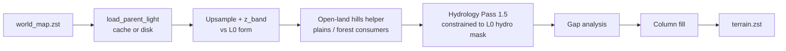

| Шаг | Контракт |
|---|---|
| **Load parent** | `load_parent_light(gx,gy)` = process cache **или** decode `world_map.zst`; ключ cache `(world_uid,gx,gy)`; вход UP/HY **только** из wire (см. § Parent light SoT) |
| **Upsample** | L0 `surface_z` → fine heightmap: resample + band-limited noise; fine z в **± `z_band`** от L0 формы **до** холмов — § Parent light refine contracts |
| **Hills** | Только L2; helper + consumers plains/forest — § **L2 open-land hills** |
| **Hydro constrain** | **Hard corridor:** реки/море L2 только в L0 `hydrology_role` (+ width→meters); bridge `to_fine_role()`; вне маски — нет bed |
| **Declared override** | master declared river/coast **сильнее** autoresolve; L0 уже отражает declare |
| **Gap + fill** | как [`tz_terrain_generation.md`](./tz_terrain_generation.md) |
| **Climate** | field per tile; liquid overlay на read |

**Idempotent:** chunk в manifest → read; иначе `refine_chunk(L0, rect)` → write. Повтор того же chunk → тот же hash (WP-7). Tile `complete` когда все chunks в macro-tile записаны (offline `full` / добивка фоном).

**Генераторы:** orchestration contract — `SurfaceHeightmap` per tile в RAM (или tile strip cache); column fill **по chunk rect**; `parent_light_map` / `hydro_mask` в typed context.

### Фоновый refine (утверждено)

Два уровня фона: **(A) chunks внутри текущего tile** от anchor; **(B) соседние macro-tiles** по path corridor. Оба — **≤ 1 active chunk job** (single writer).

**Продуктовая модель:** после blocking scene volume gameplay идёт сразу; фон **достраивает** кольца chunks и tiles **по пути**, не burst кольцом из 8 сторон.

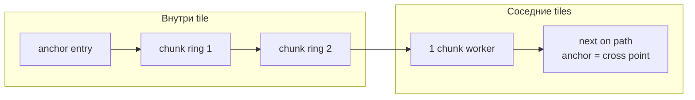

| Правило | Контракт |
|---|---|
| **Один worker** | ≤ 1 active chunk refine+persist |
| **Не burst** | не materialize все 8 соседних tiles при border cross |
| **Внутри tile** | chunks по distance от anchor; при движении — head очереди ближе к `(map_x, map_y)` |
| **Между tiles** | path corridor **`path_ahead_depth`** tiles вперёд (WP-17); новый tile стартует с **entry point** на границе |
| **Смена направления** | reorder corridor; не отменять active chunk mid-commit |
| **Повтор** | chunk уже в manifest — skip |

**Приоритет очереди (path-first + entry):**

| Приоритет | Когда |
|---|---|
| **P0** | chunks scene volume вокруг **ног** (если ещё нет) — единственный blocking |
| **P1** | chunks текущего tile по distance от anchor / позиции |
| **P2** | следующий tile на луче пути — **с entry на границе** |
| **P3** | +1…+`path_ahead_depth` tiles на луче (см. `[world_loading]` в `config.toml`) |
| **P4** | боковые tiles (idle + стоянка) |
| **P5** | master / debug |

**Foreground vs background:**

| Ситуация | Поведение |
|---|---|
| **Старт сессии** | blocking P0 вокруг spawn; фон — кольца от spawn |
| **Переход tile** | новый anchor = точка входа; P0 scene volume; фон — chunks от входа + path ahead |
| **Вход в локацию** | anchor = entry point; L2 = WP-13; packing города = outdoor **C24** (район ног), не clip тайла, не eager весь `SettlementLayout` |
| **Движение** | gameplay на L2+L0 fallback; фон достраивает впереди по пути |
| **Стоянка** | 1 chunk из head, idle |
| **Телепорт** | новый anchor; partial queue reorder |

**Компоненты:**

| Модуль | Слой |
|---|---|
| `ChunkRefineQueue` | priority: chunk jobs `(gx,gy,cx,cy)` + tile corridor |
| `ChunkRefineWorker` | `refine_chunk(L0, rect)` → `WorldPackWriter.write_chunk` |
| `EntryAnchorTracker` | spawn / tile_cross / location_entry → `set_anchor` |
| `TileRefineScheduler` | path corridor; heading WP-16; depth из `AppSettings.path_ahead_depth` |

#### Heading (WP-16, утверждено)

| Шаг | Источник | Условие |
|---|---|---|
| 1 | **Movement intent** | DAG / intent detection вернул направление или целевую точку |
| 2 | **Fallback (b)** | вектор по последним **5** позициям `(map_x, map_y)` в сессии |
| 3 | **Нет heading** | только expand chunks от anchor; **без** prefetch tiles впереди |

Intent **переопределяет** траекторию, пока актуален (до нового intent или смены цели).

#### `path_ahead_depth` (WP-17, утверждено)

Настройка пользователя в **`backend/config.toml`** (через `ConfigManager` ↔ `AppSettings`):

```toml
[world_loading]
path_ahead_depth = 2   # macro-tiles впереди по heading в фоновой очереди; default 2
```

| Поле | Default | Диапазон |
|---|---|---|
| `path_ahead_depth` | **2** | 1…4 (валидация при load settings) |

**Не** поле `worlds` / POJO мира — глобальная настройка клиента, как `repair_iterations`.

**Оценка:** blocking P0 ≈ 1–3 fine chunks + scene depth — **секунды**; полный tile — фон, часы только в offline `full`.

**Антипаттерн:** blocking entire tile; burst 8 neighbors; refine от центра tile вместо entry point.

### Восстановление фонового refine (WP-12)

Если генерация **остановилась** — восстановление на уровне **chunk**, не целого tile.

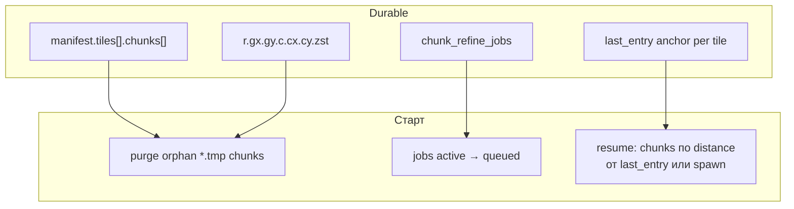

#### Что считается «готово»

| Вопрос | Ответ |
|---|---|
| Chunk готов? | Запись в `manifest.tiles[].chunks[{cx,cy}]` + файл на диске |
| Tile `complete`? | Все chunks macro-tile в manifest (или offline `full` bake) |
| Tile `partial`? | Есть ≥1 chunk, не все |
| Неготовая зона | L0 upsample на read |
| Вход refine | L0 `world_map.zst` + **anchor** `(entry_x, entry_y)` |

#### Atomic commit — **chunk** (граница восстановления)

| Шаг | Действие |
|---|---|
| 1 | `refine_chunk(L0, rect)` → cells |
| 2 | encode → `r.{gx}.{gy}.c.{cx}.{cy}.zst.tmp` |
| 3 | fsync; rename |
| 4 | append `manifest.tiles[].chunks[]`; если все chunks tile — `wilderness_refine_status=complete` |
| 5 | delete `chunk_refine_jobs` row |

**Crash mid-chunk:** purge `.tmp`; chunk не в manifest → **redo chunk** (WP-7, тот же hash). **Не** терять уже записанные соседние chunks.

#### Очередь после остановки

```sql
chunk_refine_jobs (
  world_uid TEXT NOT NULL,
  gx INTEGER NOT NULL,
  gy INTEGER NOT NULL,
  cx INTEGER NOT NULL,
  cy INTEGER NOT NULL,
  status TEXT NOT NULL,   -- queued | active
  priority INTEGER NOT NULL,
  source TEXT NOT NULL,   -- scene_blocking | entry_expand | path_ahead | manual
  entry_x INTEGER,
  entry_y INTEGER,
  enqueued_at TEXT NOT NULL,
  PRIMARY KEY (world_uid, gx, gy, cx, cy)
);
```

| Событие | Поведение |
|---|---|
| **Старт сессии** | `active`→`queued`; purge tmp; P0 = scene chunks вокруг **spawn** |
| **Resume partial tile** | недостающие chunks сортируются от `last_entry` или текущей позиции |
| **Переход tile** | новый anchor; jobs старого tile ниже приоритетом (не удалять готовые chunks) |

**Ответ «с чего начинать»:**

1. **Готовые chunks** — читать из pack.
2. **Прерванный chunk** — redo только его.
3. **Новая сессия на partial tile** — P0 scene volume → фон от **spawn** или **last_entry**.
4. **Новый tile cross** — anchor = точка входа; P0 scene → кольца от входа.

#### Stale L0 / regen (WP-22, утверждено)

Master rebake light pack (только до старта gameplay / dev-fixtures — оговорка «Rebake» выше) → `l0_parent_hash` L2 ≠ текущий `world_map.zst`. Политика **A (skip + anchor-outward)**:

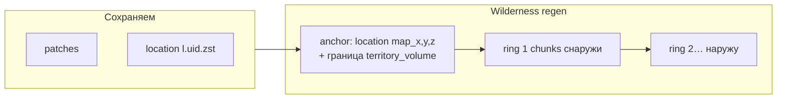

| Что | Действие |
|---|---|
| **`map_cell_patches`** | **не трогать** (WP-4) |
| **`locations/l.{uid}.terrain`** | сохранить; regen location file **только** если нет structure/settlement patch в volume (иначе skip + master warning) |
| **Wilderness chunks** со stale hash | удалить из manifest + диск |
| **Wilderness regen** | **не** row-major по tile; **от location anchor** `(map_x,map_y,map_z)` и **наружу** от `territory_volume` — кольца chunks по distance (тот же принцип, что WP-13 entry-first) |

**Anti-seam:** новый wilderness примыкает к **уже согласованной** геометрии location/patch; порядок записи — от границы локации наружу, чтобы не оставлять «остров» старого L2 внутри свежего кольца.

**Порядок jobs после stale:**

1. Halo chunks **соприкасающиеся** с `territory_volume` любой локации на tile (вне volume, z-совместимые).
2. Дальше — по возрастанию distance от ближайшего location anchor на tile.
3. Player scene / path — как WP-20 (выше приоритетом, если игрок на tile).

**Skip:** ячейка с patch или внутри сохранённого location volume — wilderness writer **не** regen.

**Не делать:** full wipe tile целиком, если есть location/patch (старый § «удалить все chunks» — только для **пустого** wilderness tile без locations).

#### API / observability

| API | Назначение |
|---|---|
| `get_chunk_materialize_state(gx,gy,cx,cy)` | `absent` \| `queued` \| `active` \| `ready` |
| `get_tile_wilderness_refine_status(gx,gy)` | `absent` \| `partial` \| `complete` + `chunks_done/total` |
| `get_entry_anchor(gx,gy)` | последний anchor tile |
| `tile_refine_status` | aggregate jobs + corridor + partial progress |

**Приёмка WP-A8:** kill mid-chunk → готовые chunks сохранены; прерванный redo → stable hash. **WP-A9:** старт сессии — playable scene volume ≤ **30 s** от spawn.

### Режимы bake

| Режим | Что materialize | Время (ориентир) | Когда |
|---|---|---|---|
| **`light`** (default) | L0 per-tile world_map + L1 + climate coarse | **секунды–2 мин** | import, world map UI |
| **`tile`** | L2 **все chunks** одного tile из L0 | offline ~20–40 мин/tile | debug, master |
| **`full`** | все tiles L2 в `world_bounds` | часы offline | дистрибуция, CI golden |

**Gameplay** использует только **entry-first chunk** path (WP-13) + optional runtime detailed; master offline — § **Bake modes** (`light` / `full` / `detailed`). Wilderness tile-complete — optional offline, не gameplay.

Cold load **`light` pack:** **≤ 5 min** (validate + mmap; decode L0 для viewport).

---

## Климат и гидрология по LOD

Генераторы **не меняются**; меняется **что persist-ится** на каждом уровне.

### Гидрология

| LOD | Поведение |
|---|---|
| **L0** | light grid: `hydrology_role`, `hydrology_width`, coarse `surface_z`; declared polyline rasterize; **без** fine bed carve |
| **L1** | declared metadata + connection graph; pins на map |
| **L2** | **refine:** `HydrologyGeneratorService` с **mask constraint** от L0; полный carve + gap + column fill |

См. [`tz_terrain_hydrology.md`](./tz_terrain_hydrology.md) — liquid_candidate на L2; liquid_body overlay на climate read.

### Климат

| LOD | Поведение |
|---|---|
| **L0** | `SurfaceClimateField` coarse — pole + zone blend на macro grid → `climate_coarse.zst` |
| **L1** | sample coarse field в anchor локации; `CitySkeleton` не требует per-cell climate |
| **L2 gameplay** | **двухуровневый** read (WP-18): см. ниже |
| **Gameplay near** | per-cell resolve при необходимости — [`tz_climate.md`](./tz_climate.md) § Climate LOD C6–C13 |

**Запрещено на L0/L1:** upsert `temperature_base`/`rainfall` на каждую fine cell.

#### Climate L2 v1 — tier A + tier B (WP-18, утверждено)

При загрузке L2 нужны **и скорость, и точность**. Не «или-или», а **сначала быстрое, потом точное**.

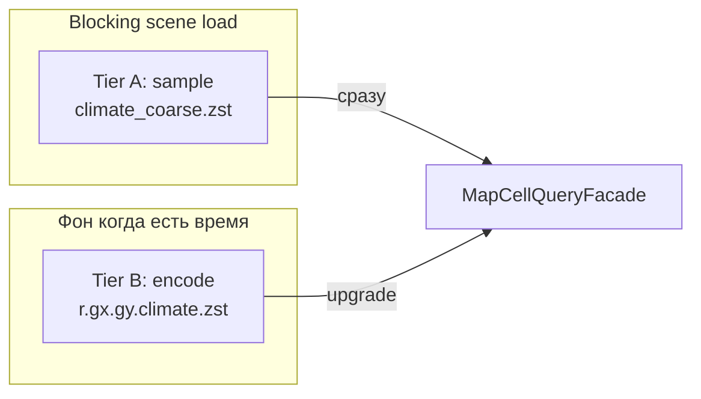

| Tier | Источник | Когда | Точность | Стоимость |
|---|---|---|---|---|
| **A (fast)** | глобальный `climate_coarse.zst` → `field.sample(x,y)` + patch override | **всегда** при read; **blocking** path не ждёт B | coarse (достаточно для старта сцены) | decode coarse 1× на сессию; sample — O(1) |
| **B (fine)** | `tiles/r.{gx}.{gy}.climate.zst` per macro-tile | **фон** после terrain chunks tile / при idle worker | fine horizontal field для tile | encode+persist **отдельный** файл на tile; **не** блокирует WP-14 |

**Read contract (WP-5):**

```
effective_climate(x,y) =
  if tile(gx,gy) has climate.zst (tier B ready):
    sample B field
  else:
    sample A coarse field
  + patch climate_delta if any
```

**Очередь B:** тот же `ChunkRefineWorker` или sibling job **после** terrain chunks текущего tile; приоритет **ниже** P0 scene terrain, **выше** wilderness prefetch. Tile без terrain chunks — **не** считать B.

**`localGridLoading` дополнение:** `climate_status`: `coarse_only` \| `fine_ready` (агрегат готовности pack climate).

**Offline `tile`/`full` bake:** B materialize сразу вместе с terrain (не gameplay path).

**Backlog v2:** per-chunk climate blob — только если coarse+B tile недостаточно на границах chunk.

---

## Генерация мира остаётся

Меняется **persist**, не pipeline генераторов.

| Компонент | Статус после перехода |
|---|---|
| Import JSON мастером | без изменений |
| `TerrainGeneratorService` / hydrology / climate passes | pure, без repos |
| `WorldSurfaceMaterializationOrchestrator` | вызывает `WorldPackWriter` вместо terrain SQLite |
| Ordered queue S→O→C→CL | без изменений deps |
| `generate-z-slice` / lazy column | L2 on demand → pack tile или patch |
| DAG nodes | wiring после gate с мастером |

---

## Именование (LOD ↔ код)

В **продуктовом ТЗ** уровни **L0 / L1 / L2** — термины LOD bake. В **коде и wire** используются читаемые идентификаторы; **не** именовать API, классы и поля manifest буквами `L0` / `L2`.

| TZ LOD | Назначение | Код / wire | Файлы pack (примеры) |
|---|---|---|---|
| **L0** | Light world map per macro-tile | `world_map`, `WorldMapCellWire`, `world_map_path`, `world_map_hash`, `world_map_cells` | `r.{gx}.{gy}.world_map.zst`, `WorldMapBakeOrchestrator`, `WorldMapPackReader` |
| **L1** | Location skeleton (pins, anchors) | SQLite `named_locations`; mirror `locations_index.json` (`LocationsIndexWire` / `LocationsIndexPin` в `dataModel/worldPack`) | не blob в pack |
| **L2 wilderness** | Fine terrain chunk в tile | `wilderness_chunk`, `FineTerrainChunkWire`, `wilderness_refine_status`, `wilderness_chunks_baked` | `r.{gx}.{gy}.c.{cx}.{cy}.zst`, `FineTerrainRefineOrchestrator` + `FineChunkRunner` |
| **L2 location** | Fine terrain территории локации | `location_terrain`, `LocationTerrainEntry`, `location_terrain_entries[]`, `terrain_path`, `terrain_hash` | `locations/l.{uid}.terrain.zst` |
| **Merge fallback** | Coarse cell при отсутствии fine | `MapLayerKind.WORLD_MAP` | `merge_layers` / `MapCellQueryFacade` |

### Locations index — тип ключа локации

`LocationsIndexPin.system_location_type` —
`DefaultWhenMissing[LocationTypeKey | None]`, где
`LocationTypeKey = RegistryKey[WorldLocationTypeRegistry]`. JSON остаётся
строкой; исторические пропуск и `null` допустимы. `system_location_subtype`
сохраняет текущий строковый контракт до дизайна parent→namespace.

Граница построения нового индекса — `build_locations_index`: membership
проверяется через REF-W по разрешённому `location_types(world)` (включая
пользовательские ключи и engine-типы). Вызов без мира допускает только
engine-типы. Неизвестный ключ даёт `REF_W_UNKNOWN`, без подстановки типа.
`WorldPackWriter` сериализует подготовленный индекс.

Чтение `locations_index.json` — snapshot-семантика: принадлежность ключа
сегодняшнему реестру не проверяется; удалённый или переименованный тип
не делает старый pack нечитаемым. Read-overlay SQL identity повторно
разбирает `LocationsIndexPin`, сохраняя номинальный тип, без live-membership.
SQL-модели и wire-имена полей не меняются. Тип генерируемой комнаты берётся
из `WorldLocationTypeRegistry.SYSTEM_TYPE_ROOM`.

**Payload kinds (`tileCodec`):** `PAYLOAD_KIND_WORLD_MAP` (0), `PAYLOAD_KIND_FINE_TERRAIN` (1).

**Debug read API:** `GET …/map/pack/fine-terrain-read` — probe merged fine terrain; **не** `l2-probe`.

**Прогресс загрузки:** `tiles_pct`, `locations_pct`, `wilderness_pct` (WP-15); диагностика — ready/total + `wilderness_chunks_baked`.

**Логи (`packBakeLog`, JSON):** в `msg` и поле `activity` — **не** `L0`/`L2`/`l0`/`l2`. Соответствие LOD → log:

| TZ LOD | `activity` (примеры) | `blob_kind` / префикс `msg` |
|---|---|---|
| L0 | `world_map_bake_start`, `world_map_tile_write`, `pack_write_world_map` | `world_map` |
| L2 wilderness | `wilderness_chunk_generate`, `wilderness_chunk_persist_pack`, `pack_write_wilderness_chunk` | `wilderness_chunk` |
| L2 location | `location_terrain_persist_pack`, `pack_write_location_terrain` | `location_terrain` |
| C11 packing | `settlement_c11_start`, `settlement_c11_done` | — |
| C23 topology | `settlement_topology_start`, `settlement_topology_done`, `settlement_topology_batch_*` | — |
| Orchestration | `fine_terrain_phase_start`, `fine_terrain_plan_parallel`, `drain_persisted_job` | — |

Структурированные поля на каждой строке: `worker_thread`, `worker_tid`, `cpu_core`, `pool_workers` (см. `config.toml` `[logger_levels]` → `app.application.worldData.pack`).

**Legacy wire (до rebake):** старые ключи `l0_path`, `l2_status`, `locations_l2[]` — **не** читать; manifest пересоздаётся при следующем bake.

---

## Wire format (Pack v1)

```
{data_dir}/worlds/{world_uid}/pack/
  manifest.json
  registries.snapshot.json
  locations_index.json         # pins для world map (mirror L1)
  climate_coarse.zst
  locations/
    l.{location_uid}.terrain.zst   # L2 fine territory локации (zstd on write)
    l.{location_uid}.climate.zst   # tier B climate bbox локации (optional)
  tiles/
    r.{gx}.{gy}.world_map.zst       # L0 light bake per tile
    r.{gx}.{gy}.c.{cx}.{cy}.zst     # L2 fine chunk (partial tile)
    r.{gx}.{gy}.terrain.zst         # optional merged tile (offline full / tile bake)
    r.{gx}.{gy}.climate.zst         # tier B fine (optional until bg bake)
```

### `manifest.json` (POJO `WorldPackManifest`)

| Поле | Назначение |
|---|---|
| `pack_version` | wire semver |
| `world_uid`, `content_hash`, `registry_hash` | validation |
| `bake_mode` | last completed master bake: `light` \| `full` (detailed не меняет mode; смотри `location_terrain_entries`) |
| `fine_cells_per_map_cell` | из `worlds` |
| `world_map_cells_per_tile` | resolved при bake, см. § L0 |
| `map_cell_fine_span`, `map_subsurface_depth` | из `WorldTerrainScalars` / `worlds` |
| `location_terrain_entries[]` | per-location L2 terrain — см. § `LocationTerrainEntry` |
| `settlement_structure_entries[]` | per-settlement city structure — см. § `SettlementStructureEntry` |
| `wilderness_region_entries[]` | индекс регионов покрытия (uid/entry_type/current_type/bbox/status) — см. § `WildernessRegionEntry`; состояние — § Region state store |
| `tiles[]` | per macro-tile — см. § `TileManifestEntry` |
| `world_map_cells`, `wilderness_tiles_total`, `wilderness_chunks_baked` | progress |

#### `TileManifestEntry` (`tiles[]`)

Один macro-tile `(gx, gy)`. Поля именуются по **LOD-слою**, не generic `storage_path` / `content_hash`.

| Поле | Тип | Смысл |
|---|---|---|
| `gx`, `gy` | int | координаты macro-tile |
| `world_map_path` | str? | относительный путь к L0 `tiles/r.{gx}.{gy}.world_map.zst` |
| `world_map_hash` | str? | SHA-256 zstd-blob L0 world map |
| `wilderness_refine_status` | enum | `absent` \| `partial` \| `complete` — **wilderness L2 chunks** на tile (не location terrain) |
| `climate_status` | str | `coarse` на tile; `fine` когда denser climate blob готов |
| `chunks[]` | `ChunkRef[]` | wilderness L2 chunks `tiles/r.{gx}.{gy}.c.{cx}.{cy}.zst` |

#### `LocationTerrainEntry` (`location_terrain_entries[]`)

Fine terrain **одной** `named_location` (file-per-location, WP-19).

| Поле | Тип | Смысл |
|---|---|---|
| `location_uid` | str | uid локации |
| `territory_volume` | AABB | 3D bbox в meter grid (WP-21) |
| `terrain_path` | str? | `locations/l.{uid}.terrain.zst` |
| `terrain_hash` | str? | SHA-256 location terrain blob |
| `climate_status`, `z_band`, `bytes` | | climate LOD / z-band / размер blob |

#### `SettlementStructureEntry` (`settlement_structure_entries[]`)

Authored outdoor city (**C15** / **C24**). Оглавление packed-районов — здесь, не в сжатом `settlement.zst`. Как `wilderness_refine_status` + `chunks[]` у тайла.

| Поле | Тип | Смысл |
|---|---|---|
| `location_uid` | str | uid поселения |
| `territory_volume` | AABB | footprint volume |
| `structure_path` | str? | `locations/l.{uid}.settlement.zst` |
| `structure_hash` | str? | SHA-256 контейнера |
| `bytes` | int? | размер blob |
| `structure_status` | enum | `absent` \| `partial` \| `complete` — **C14** |
| `packed_district_uids` | list[str] | `named_locations.location_uid` районов, уже в blob (пустой packed район всё равно здесь) |

Очередь packing = SQL-перепись C23 − `packed_district_uids`. Не decompress zst. SoT: [`tz_settlement_outdoor.md`](./tz_settlement_outdoor.md) **C24**.

#### `ChunkRef` (`tiles[].chunks[]`)

| Поле | Тип | Смысл |
|---|---|---|
| `cx`, `cy` | int | fine chunk внутри macro-tile |
| `refine_role` | enum? | `scene` \| `background` \| `path` |
| `content_hash`, `bytes` | | hash и размер wilderness chunk blob |

#### `WildernessRegionEntry` (`wilderness_region_entries[]`) — target (2026-10-17)

Spatial index resolved coverage-регионов (контракт — [`tz_map_light_bake.md`](./tz_map_light_bake.md) § Регионы покрытия). **Индекс, не SoT**: resolved Specs derive-on-read из world data; записи переписываются при bake.

| Поле | Тип | Смысл |
|---|---|---|
| `region_uid` | str | `entity_uid(world_uid, UidKind.REGION, …)` — стабилен при правке shape/смене типа |
| `entry_type` | str | вид декларации / выведенный вид autoresolve на момент bake |
| `current_type` | str | ключ состояния на момент bake (snapshot; актуальное — `region_states`) |
| `bbox` | AABB | пространство мира (fine-координаты), seam-aware |
| `status` | enum | `declared` \| `anchor` \| `autoresolved` \| `sublocation` |
| `parent_region_uid` | str? | для `sublocation` — регион-родитель |
| `spec_fingerprint` | str? | fingerprint spec на момент bake — быстрый revision-check без чтения store |

**Шаг 8 (2026-10-18):** bake заменяет индекс целиком из world-scoped collect,
включая при partial bake; отсутствие anchor в конкретном мире допустимо.
Все UID уникальны между регионами и саблокациями. Sublocation требует
существующего родителя другого UID; parent не может быть саблокацией.
Дубликаты и некорректные ссылки отклоняются до замены индекса и при чтении/
сохранении manifest. При отказе публикации старый manifest остаётся целым.
`bbox` — `{x_min,y_min,x_max,y_max}` в canonical fine cells; для разорванного
швом footprint один AABB консервативно включает все части. Это индекс, не контур.
`current_type` — snapshot, `entry_type` сохраняет первоначальный тип collect,
даже если state snapshot его уже изменил. Fingerprint declared/anchor —
`state_fingerprint(spec_wire)`; autoresolve включает исходный claim и entry_type.
Поле называется `spec_fingerprint`; `app.ids.state_fingerprint(value)` — общая
hash-утилита, не имя поля. Старый ключ `state_fingerprint` принимается только
при чтении исторического manifest; новая сериализация пишет `spec_fingerprint`.
Hydro-наблюдения без достоверных UID/типа/геометрии не превращаются в coverage entries.

**Типизация покрытия (WR-TD-1, 2026-10-18):** `entry_type` и `current_type`
в resolved/index-моделях — обязательные `TerrainKey = RegistryKey[WorldTerrainRegistry]`;
wire остаётся строковым. `entry_type` фиксирует исходный ключ, а не live state.
Collect и построение нового индекса проверяют оба ключа по разрешённому реестру
мира через REF-W (`REF_W_UNKNOWN`), без подстановки ошибочных значений. State override
меняет только current_type и не отменяет проверку исходного ключа. Отсутствующий/
null исходный ключ не создаёт ResolvedRegion. Старый manifest читается как
исторический snapshot без проверки membership по сегодняшнему реестру.

Debug HTTP: `GET /worlds/{world_uid}/map/regions/{region_uid}` возвращает
`{snapshot:true,entry:WildernessRegionEntry}`; нет мира/индекса/UID → 404.
`GET .../{region_uid}/outline` пересобирает collect/rasterize из world data,
возвращает `{region_uid,source:"derived_world_data",resolution:"L0",outline}`.
ASCII `#` — контур, `.` — внутренность. Отсутствующий в текущих данных регион
при наличии baked snapshot → 409 (устаревший индекс), без выдумывания Spec из bbox.

#### Region state store (target, 2026-10-17)

`RegionState` — runtime-эволюция поверх authored declaration. Хранится в SQL-таблице **`region_states`**, keyed by `(world_uid, region_uid)` — **entity-store рядом с Patch Store, не WP-20** (`map_cell_patches` — дельты клеток `(x,y,z)`; состояние сущности туда не ложится). Схема — `0001_initial.sql` + `db/models/regionState.py` + repo; массовая запись — `app.db.bulkSql`.

Поля: `current_type`, `pending_target`, `progress`, `last_eval_tick`, `overrides` (JSON), `history` (JSON append-only: `{from_type, to_type, cause, at}`), `spec_fingerprint`, `tombstone`. **Единый writer — `StateChangeConsumer`** (не генератор, не bake). Revision-check: при bake/refine тайла `state_fingerprint(spec_wire)` ≠ сохранённому → клетки региона **в этом тайле** перекрашиваются; немедленной перепечки всего мира нет. `remove` declared → `tombstone` + чистка при следующем чтении/bake; rename → новая сущность (старый state — orphan → tombstone).

Контракт 9b: `RegionState` — frozen Pydantic в `dataModel/regions/`;
`region_uid: str` (opaque identity), `current_type`/`pending_target` и
`history.from_type`/`to_type` — `TerrainKey`. `progress` — конечное число
0..1, `last_eval_tick >= 0`. `RegionStateOverrides` содержит только optional
`density` (конечное число 0..1); применение density override — вне 9b.
История — JSON-массив, в POJO immutable tuple frozen-переходов: writer
сохраняет старый префикс и добавляет новые записи. `RegionTransitionCause` —
закрытый enum `drift | declared_edit | event`; `at: str | int` — явная
временная заглушка до доменов событий/времени (строка — временная метка или
opaque event reference). `spec_fingerprint: str | None` — opaque revision
token; NULL существующих строк 9a означает неизвестную ревизию и mismatch.
Пустой SQL overrides `{}` соответствует отсутствию overrides; JSON читается
через typed модели, неизвестные поля/причины отклоняются.

Async owner L0/L2 читает repo один раз перед compute и передаёт snapshot в
collect; отсутствующий repo/строка означает отсутствие override. Collect
проверяет исходный/текущий ключи через REF-W. Fingerprint вычисляется из
исходного spec wire до резолва anchor (для auto — также claim и entry_type),
одинаково для collect и нового manifest. `ResolvedRegion.spec_fingerprint`
и `revision_changed` — read-only сигнал следующему writer; mismatch не
меняет store. Материализация уже всегда выводит footprint из текущего Spec;
для anchor `authored_anchor_shape` сохраняет исходную ссылку формы до
резолва координат, чтобы индекс пересчитывал токен по authored wire даже
при дальнейшей правке density/прочих параметров resolved Spec.
matching fingerprint не меняет state/type/геометрию. Shape-edit сохраняет
current_type, reset progress/pending выполняет writer 10a; type-edit reset
к новому entry_type и history `declared_edit` также выполняет только writer.
Tombstone не материализуется; в L2 старое region-покрытие parent восстанавливается
policy-фоном даже при отсутствии других живых регионов. Геометрия/paint
ограничены scope bake/refine, глобальный re-bake не запускается. Historical
manifest остаётся snapshot и при чтении не получает live state.

#### Region state overlay (read, target 2026-10-17)

Pack остаётся immutable snapshot. Клетка L0 (`WorldMapCellWire`) и колонка L2 (`FineTerrainColumnWire`) при bake получают **`region_uid`** победителя (optional поле) и `system_terrain` = paint на момент bake (snapshot самодостаточен для raw-читателей). На read — **один фасад** overlay:

```text
cell.region_uid is None            → system_terrain как в pack
state(region_uid).tombstone        → policy-fallback ключ (LandcoverRegionsCategoryPolicy)
state.current_type != baked key    → current_type
иначе                              → system_terrain как в pack
```

Применяется ко всем слоям Layer priority **ниже `patch`**: `terrain_delta` (взрыв, раскопки) остаётся сверху. Overlay подменяет только `system_terrain`; доменные эффекты морфинга (роль воды, bed carve, z) — при materialize/refine чанков, не на read.

**Известный gap — overlap re-rank:** клетка в двух регионах, у одного из которых сменился `current_type`, не пересчитывает победителя (overlay по uid, не по геометрии) до ближайшего refine чанка / re-bake тайла. По согласованию 2026-10-18 диагностирует read-overlay шага 9c: при отличии ключа живого состояния от baked ключа и `current_type` manifest-записи логируется `region_state | overlap_rerank_deferred | world_uid=… region_uid=… neighbors=…` при пересечении bbox по индексу. Один WARNING на изменившийся UID за batch-запрос; соседи упорядочены по UID, baked-победитель сохраняется. Эмиттер — `regions/regionStateLog.py`, общий фасад `loggingConfig`, sink `logs/region_state/regionStateLog.log`; событие не выводится на stdout (L8). Writer 10a не дублирует это read-событие.

Контракт чтения 9c: `IRegionStateRepository.get_many(world_uid, region_uids)` возвращает строки запрошенных UID, включая tombstone, с batch SQL и изоляцией мира. Общая точка overlay — перед `merge_layers`, для всех слоёв ниже `patch`; scene/bbox/footprint/export загружают один snapshot на batch, без постоянного кэша state. `CellContribution.region_uid: str | None` — opaque pack membership metadata, не поле результата field-wise merge. Raw sync pack/debug/render читатели сохраняют snapshot-семантику. До cutover 10b tombstone использует `WorldTerrainMasks.default_plains.system_terrain` как transitional policy-fallback; подмена ключа typed `TerrainKey`, без хардкода.

Отвергнуто (2026-10-17): re-bake тайлов на смену типа (мастерский рычаг WP-7 — симуляция невидима); flood `terrain_delta` на footprint (10⁶ строк на регион, WP-FIX-DEBT-1); геометрия на read (дублирует bake-paint).

### Fine terrain column (внутри zstd)

`(lx, ly)` + z-runs + **`system_terrain`** / **`system_material`** (registry keys, строки) + **`region_uid?`** (target, § Region state overlay). Legacy wire с `terrain_id: u8` — мигрируется при read (`FineTerrainZRun._migrate_legacy_wire`). См. `dataModel/worldPack/wire/fineTerrainChunkWire.py`.

---

## Patch Store (SQLite)

**Процесс:** игровые правки terrain/climate после bake — слой **modification** (§ Слой модификации мира), не `pack/bake`.

Таблица **`map_cell_patches`** — только отличия от pack:

```sql
map_cell_patches (
  world_uid, x, y, z,
  layer_kind TEXT NOT NULL,  -- structure | settlement | terrain_delta | climate_delta | ore | cave
  ...
  PRIMARY KEY (world_uid, x, y, z)
);
```

**POJO:** `dataModel/worldPack/mapCellPatchLayerKind.py` (`MapCellPatchLayerKind`) — единственный источник wire-значений и mapping `save_pass(layer)` → `layer_kind`.

**Read (v2):** `PatchStoreService` строит `CellContribution` **по полям**, соответствующим `layer_kind` (climate patch не затирает terrain на read).

**Write (известный gap, WP-FIX-DEBT-1):** PK одна строка на `(x,y,z)` — overlay нескольких `layer_kind` на write требует merge-on-upsert в repo или composite PK; см. § **Fix debt (WP-FIX-DEBT)**.

`worlds` дополнение:

| Поле | Назначение |
|---|---|
| `terrain_pack_path` | путь к pack |
| `terrain_pack_hash` | fast validate |
| `terrain_pack_version` | wire version |

**Scoped L0 finalization (2026-10-16):** light/full orchestration владеет
короткой SQL UOW. Finalizer загружает свежий World через repository, проверяет
world/writer/manifest identity, готовит три authored поля через facade-slice
POJO и делает один repository update без мастерского WorldService.update.
Посторонние колонки не ревалидируются и не перезаписываются старым bake snapshot.
`terrain_pack_version` не меняется. Путь сохраняет actual writer root:
существующая корректная ссылка сохраняется, managed root использует переносимую
ссылку, иной custom root — абсолютную. Общий path resolver остаётся источником
round-trip семантики.

`PackManifestStore.save` публикует JSON через временный файл в том же каталоге
и replace; до replace прежний manifest остаётся читаемым. File-first порядок
сохраняется: после успешного manifest save сбрасываются caches actual/old root,
в том числе при последующей ошибке SQL. Это не общий атомарный FS+SQLite commit:
rollback SQL не откатывает опубликованный manifest. Success-log финализатора
следует за успешным repository update.

**`map_cells` удаляется** при cutover (один PR с кодом + `0001_initial.sql`).

---

## Read path / Entry load

**Не смешивать:** Query facade только **читает** (merge). Generate/entry — отдельно (`refine_from_entry` / `schedule_chunk_refine`).

### Manifest cache (reader)

**V2 — DAG вызывает типизированный контракт Cache.** Для проверенных bytes manifest Pack определяет требования к формату bytes и идентичность по полному `ArtifactRef`. Предлагаемый `CacheItemKey` — 32-байтовый digest его канонического представления. DAG передаёт ключ в get и запись в create; Cache сам разрешает зарегистрированный binding и проверяет версию; CacheService и MemoryCache обеспечивают admission, учёт памяти и LRU. Размер допустимого запроса чтения проверяет Pack. Для manifest V2 контейнер предоставляет отдельный экземпляр Cache со своей стартовой CachePolicy и LRU. Planning использует другой экземпляр; вытеснение записей ограничено бюджетом своего кэша. [Контракт изоляции](../.cursor/plans/cache-public-contracts.md#конфигурация-экземпляра-cache). При включении manifest Cache V2 обязательна секция `[world_pack.manifest_cache]` в `config.toml` с явными `max_retained_bytes` и `max_entry_bytes`. Отсутствие секции блокирует включение V2; для сценариев только V1 она необязательна.

#### Контракты чтения manifest через Cache — проект для приёмки владельцами

За жизненный цикл закреплённой публикации отвечает `ExecutionPins`. При выдаче pin он проверяет пригодность manifest и фиксирует его точный ref. На время использования pin он сериализует доступ с закрытием. Публичные операции `resolve/read_verified/admit_cached` реализует отдельный `PinnedManifestReader`. Его SQLite-адаптер `PinnedManifestGuard` применяет формат и бюджет внутри области действия pin. Чтение из RAM повторно сверяет ключ, pin, holder, seal, бюджет, digest и семантику manifest. Пространственные root и shard читает `PinnedSpatialReader`. Интеграционные проверки связывают эти компоненты с физическим manifest. Подключение production caller остаётся отдельным шагом. [Методы Pack](../backend/app/application/worldData/pack/read/pinnedManifestReader.py) · [Допуск manifest](../backend/app/db/repositories/sqlite/worldPack/pinnedManifestGuard.py) · [Пространственное чтение](../backend/app/db/repositories/sqlite/worldPack/pinnedSpatialReader.py) · [Проверки](../backend/tests/spatial_pack/test_pinned_manifest_reader.py)

**Источник ключа.** До lookup Pack получает точный manifest через внутренний `ExecutionPins.hold_open(PinIntent)`. Он читает сохранённую привязку, проверяет holder и seal и удерживает writer scope до конца операции. Закрытый или неизвестный pin даёт отказ. После смены head прежний pin разрешается в прежний manifest. [Привязка pin](../backend/app/db/repositories/sqlite/worldPack/executionPins.py) · [Идентичность ArtifactRef](../backend/app/dataModel/artifacts/references.py)

**Публичный класс Pack** — `PinnedManifestReader` в `application/worldData/pack/read/pinnedManifestReader.py`. Immutable POJO находятся в `dataModel/worldPack/read/pinnedManifest.py`. Ветвь hit/miss выбирает DAG; Pack проверяет допуск для каждого фактического чтения.

| Предлагаемый метод | Вход, результат, эффекты и критерий отказа |
|---|---|
| `async resolve(self, request: ManifestPinRead) -> ManifestAddress \| ManifestReadRefusal` | `ManifestPinRead` содержит полную идентичность текущего PinIntent (store_id, execution_id, invocation_id, logical_read_key, pin_id, world_uid) и положительный max_bytes. Pack проверяет привязку и допустимый размер. `ManifestAddress(ref: ArtifactRef, key: CacheKey[bytes])` содержит ref именно этого pin и ключ для Cache. DAG переносит key без конструирования digest. Resolve не создаёт pin. |
| `async read_verified(self, request: ManifestStorageRead) -> VerifiedManifestBytes \| ManifestReadRefusal` | Вход содержит исходный ManifestPinRead и полученный ManifestAddress. Под guard повторно сверить живой pin, точный ref, seal, holder и эффективный byte cap; прочитать и проверить bytes, world_uid и формат manifest. Результат `VerifiedManifestBytes(ref: ArtifactRef, payload: bytes)` поступает в DAG. Только успешный результат допускается для create. |
| `async admit_cached(self, request: ManifestCachedRead) -> VerifiedManifestBytes \| ManifestReadRefusal` | Вход содержит те же pin и address плюс `CacheEntry[bytes]` из hit. Перед выдачей под guard проверить актуальный допуск, equality ref/key, seal, holder, cap, длину, digest и семантику manifest. Ошибка адреса, bytes или закрытый pin дают отказ. Внутри операции отсутствуют Cache.get, storage fallback, callback и повторная активация. |

Предлагаемый `ManifestReadRefusal` содержит pin_id, ref (если уже разрешён) и конкретную Pack-причину: неизвестный/закрытый pin, несовпадение identity, отсутствие seal/holder, превышение бюджета или недопустимый manifest. Технический отказ storage и отмена сохраняют семантику владельца соответствующего порта. Точный error POJO и привязку к общим diagnostics проверить у Pack при freeze. Внешний потребитель получает только результат, прошедший Pack admission. Буфер CacheHit остаётся внутренним входом проверки.

**Передача значений (без назначения DAG-нод).** Ключ из resolve поступает в Cache.get. Для hit DAG передаёт entry в admit_cached. Для miss DAG вызывает read_verified и передаёт исходный key и проверенный payload в Cache.create. STORED, ALREADY_PRESENT (полностью равные bytes) и SKIPPED_OVERSIZE для свободного ключа сохраняют полученный результат чтения; CacheFailure остаётся ошибкой. Приёмка: A и B имеют разные ключи; закрытие pin между lookup и admission запрещает выдачу; второй действующий pin той же версии сохраняет доступ; подмена ref или bytes обнаруживается; cold/warm чтения возвращают одинаковые bytes. После вытеснения или рестарта выполняется обычное проверенное чтение.

**Граница кодека.** Для RAM-контракта manifest предлагается Cache-owned codec неизменяемого `bytes`: validate проверяет тип, encode/decode работают с байтами, retained_bytes считает размер. Схема namespace и версия закреплены при композиции; Pack определяет смысл bytes и ключа. Проверки pin, world_uid и структуры manifest принадлежат PinnedManifestReader. Критерий отклонения: get/create через codec вызывает Pack, provider, IO или DAG. Внешний DAG-контракт Cache и правила binding описаны в [плане домена Cache](../.cursor/plans/cache-public-contracts.md). [Действующие методы кодека](../backend/app/application/cache/contracts/cacheBackend.py) · [Внутренний вызов validate](../backend/app/application/cache/service/cacheService.py)

**V1 / AS-IS.** Ниже описан кэш изменяемого manifest.json. В V2 идентичность версии при чтении задаёт закреплённая публикация и digest immutable manifest.

`WorldPackReader` держит process-local кэш `manifest.json`. **Инвариант:** кэш валиден iff stamp диска `(mtime_ns, size)` совпадает со stamp при последнем load.

| Событие | Поведение |
|---|---|
| Hit (stamp без изменений) | вернуть кэш; **без** re-read / parse JSON |
| Miss (файл переписан bake’ом / снаружи) | `load_manifest()` с диска, обновить stamp |
| После in-process write (`finalize_pack_on_world` и аналоги) | `PackReadContext.invalidate_pack(world)` → `invalidate_manifest()` + climate caches |

**Зачем оба пути:** stamp ловит любой rewrite `manifest.json` на диске (в т.ч. другой процесс / smoke без restart). Явный invalidate закрывает same-stamp race и сбрасывает связанные climate caches.

**Не SoT:** stamp — только identity файла для cache validity; содержимое SoT = wire `WorldPackManifest` на диске. Content-hash манифеста для этого слоя **не** требуется (single-writer / local pack root).

**Код:** `pack/io/worldPackReader.py`, `pack/read/packReadContext.py`.

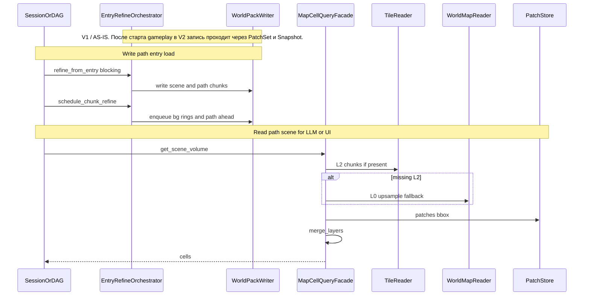

**Far / map UI:** без entry refine — `get_world_map_bbox` → L0 sample (отдельный read, не на диаграмме выше).

| API | LOD / роль |
|---|---|
| `get_world_map_bbox` | L0 **read** |
| `get_location_context` | L1 **read** |
| `get_scene_volume` | L2 + L0 fallback + patches — **read only**, не generate |
| `refine_from_entry` | **write** blocking: scene + path corridor (WP-13 P0) |
| `set_entry_anchor` | spawn / tile_cross / location_entry (session state) |
| `schedule_chunk_refine` | **write** фон: кольца от anchor + path-ahead (predicted border entry) |
| `refine_queued_chunk` | **write** 1…N wilderness chunks; mill/paint — `GradePipelineStages`. Entry/queue = `off()`. Product mill = DAG когда сцена требует grade; debug HTTP / ГМ bake — те же методы |
| `get_tile_wilderness_refine_status` | `absent` \| `partial` \| `complete` (**read** status) |
| `tile_refine_status` | jobs + corridor + partial progress (**read** status) |

### Merge backlog (WP-MERGE)

**Контракт (v2, 2026-07-10):** `dataModel/worldPack/mergeMapCells.py` — **`merge_layers` field-wise overlay** по `LAYER_PRIORITY_ORDER` (высший приоритет перекрывает **отдельные поля**, не всю ячейку) + `MapCellQueryFacade` — единая точка read при наличии pack.

**Climate coarse:** `climate_coarse.sample_macro(macro_gx, macro_gy)` — coords = **macro grid**. Fine (`r.{gx}.{gy}.climate.zst`) — `sample_fine` with `sample_step_fine`. Patch `climate_delta` — через слой PATCH (wins over fine/coarse). См. [`tz_climate.md`](./tz_climate.md) § World Pack climate.

**`POST generate-climate` на pack-мире:** reject (422) — base climate только через `pack/bake`.

#### Статус impl (v2, 2026-07-10)

| Слой WP-20 | Код | Заметка |
|---|---|---|
| **0 patch** | ✅ | `PatchStoreService` + `MapCellPatchLayerKind`; field-wise merge |
| **1 player scene** | ✅ | `ChunkRef.refine_role=scene` → `MapLayerKind.PLAYER_SCENE` |
| **2 player path** | ⚠️ | `refine_role=path` + heading corridor (WP-16); DAG intent wire — backlog |
| **3 city structure** | ✅ | `locations/l.*.settlement.zst`; `MapLayerKind.CITY_STRUCTURE` — [`tz_settlement_outdoor.md`](./tz_settlement_outdoor.md) |
| **4 location** | ⚠️ | `locations/l.*.terrain.zst`; local origin ✅; settlement footprint v1 ✅; multi-z overlap — backlog |
| **5 wilderness** | ✅ | `tiles/...c.*.zst`; registry keys в wire |
| **6 L0** | ⚠️ | surface @ `z==surface_z`; subsurface band `n_base`; не full column |
| **climate** (WP-5) | ✅ | post-merge fine→coarse; light bake пишет `climate_coarse.zst`; fine denser via pending drain |
| **registry resolve** | ✅ | L2/L0 `system_terrain` строки; не `terrain_{u8}` |
| **продуктовая склейка** | ⚠️ | facade + debug routes (MERGE-9 ✅); location footprint assembler (DEBT-6 ✅) |

**Механизм merge (POJO + field-wise)** — ✅. **Полный read path мира** — частично (см. WP-FIX-DEBT).

#### Приоритет доработок (утверждено)

| Приоритет | ID | Задача | Статус | Примечание |
|---|---|---|---|---|
| **P0** | **MERGE-1** | PLAYER_SCENE в manifest/read | ✅ | `ChunkRef.refine_role` |
| **P0** | **MERGE-2** | Climate в read path | ✅ | coarse bake + sample_macro; fine prefer via sample_fine |
| **P1** | **MERGE-3** | Location L2 coords | ⚠️ | footprint v1 ✅; multi-z overlap / layout bbox — backlog |
| **P1** | **MERGE-4** | terrain/material → registry keys | ✅ | FIX-01/02 |
| **P2** | **MERGE-5** | PLAYER_PATH corridor | ⚠️ | heading corridor ✅; DAG movement intent — backlog |
| **P2** | **MERGE-6** | L0 per-z fallback | ⚠️ | subsurface band ✅; full column — backlog |
| **P2** | **MERGE-7** | patch `layer_kind` + field overlay | ✅ | FIX-10; write model gap → WP-FIX-DEBT-1 |
| **P3** | **MERGE-8** | Read perf | ✅ | batch patch bbox; `FineTerrainDecodeCache` + `PackReadPolicy` | |
| **P3** | **MERGE-9** | Потребители только facade | ⚠️ | debug read ✅; legacy write routes (`generate-surface`) — отдельно |

**Порядок работ (оставшееся):** REVIEW-1 (pack I/O root) → MERGE-8 LRU → smoke WP-A* → bake tile/full → DAG intent wire → REVIEW-2…7.

**Тесты backlog:** integration WP-A6, WP-A13; unit tie-break multi-location; golden patch-over-L2.

**Инженерные фиксы (WP-FIX):** § ниже. Детальный чеклист: [`.cursor/plans/world-pack-fixes-done.md`](../.cursor/plans/world-pack-fixes-done.md).

---

### Инженерные фиксы (WP-FIX) — статус impl

Ревью smells после L1–L7; имплементировано **2026-07-10**. Связка MERGE-* ↔ FIX-* в plan-файле.

| ID | Тема | Статус | Где |
|---|---|---|---|
| FIX-01/02 | L2 wire: `system_terrain` / `system_material` (не u8-hash) | ✅ | `l2ChunkWire`, `mapCellToFineTerrainWire`, facade |
| FIX-03/11 | Location L2 read/write + territory origin | ✅ | `fineTerrainRefineOrchestrator`, facade |
| FIX-04 | tile-local cx/cy в background queue | ✅ | `schedule_tile_background` |
| FIX-05/06 | Chunk refine worker + `chunk_refine_jobs` | ✅ | `ChunkRefineWorker`, sqlite repo |
| FIX-07 | PLAYER_SCENE (`refine_role=scene`) | ✅ | manifest + facade |
| FIX-08 | Climate post-merge | ✅ | `_apply_climate` |
| FIX-09 | L0 surface z-gate | ✅ | `_world_map_contribution` |
| FIX-10 | `MapCellPatchLayerKind` + field-wise merge | ✅ | POJO + `merge_layers` |
| FIX-12…18 | POJO defaults, manifest/world sync | ✅ | `PackBakeDefaults`, `finalize_pack_on_world` |
| FIX-19 | `world_pack_root` config | ✅ | `AppSettings` |
| FIX-20 | `max_tiles` из POJO | ✅ | `PackBakeDefaults.max_tiles_light` |
| FIX-21/22 | manifest counters + `content_hash` | ✅ | `WorldPackWriter` |
| FIX-23/24 | L0 miss / missing chunk log | ✅ | facade |
| FIX-25…30 | API lifecycle, loading, typing | ✅ | routes, container |
| FIX-31 | Binary wire вместо JSON | ⬜ | P4 backlog |
| FIX-32/33 | `codec_version` / zstd level в manifest+POJO | ✅ | manifest, `TileCodec` |

**MERGE-5/6/8 (частично в рамках доработок):** path corridor v1, L0 subsurface band, batch patch bbox.

---

### Fix debt (WP-FIX-DEBT) — после второго ревью

Не блокирует smoke v1; закрывать до DAG gate / master приёмки.

| ID | Проблема | Целевое решение |
|---|---|---|
| **DEBT-1** | patch PK `(x,y,z)` vs multi-`layer_kind` overlay на write | merge-on-upsert по полям (read ✅); PK policy — backlog |
| **DEBT-2** | `dataModel` → `db.models.MapCell` в `mapCellPatchLayerKind` | ✅ `patchCellContribution.py` |
| **DEBT-3** | `source_layer` в field-wise merge вводит в заблуждение | ✅ `field_sources` |
| **DEBT-4** | `has_pack()` не учитывал `worlds.terrain_pack_path` | ✅ `packPresence` + `WorldPackPaths.for_world` (REVIEW-1) |
| **DEBT-5** | queue in-memory vs `chunk_refine_jobs` без recovery drain | ✅ `drain_persisted` на resume |
| **DEBT-6** | location `TerritoryVolume` stub (не settlement geometry) | ✅ assembler `footprint_side_fine` / `settlement_fine_rect` |
| **DEBT-7** | PLAYER_PATH corridor только +X | ✅ `pathHeading.py`; intent/history; без heading — no prefetch |
| **DEBT-8** | debug routes / `export` мимо facade | ✅ MERGE-9 |
| **DEBT-9** | pack orchestrators → `api.schemas.ImportResult` | ✅ `PersistResult` |
| **DEBT-10** | `DELETE /worlds/{uid}` — FK fail → HTTP 500; delete не atomic (half-deleted world после partial purge) | ordered purge / CASCADE + transaction; 409 с blockers; см. [`tz_generator_technical_debt.md`](./tz_generator_technical_debt.md) § **WP-DELETE-1** |

---

### Приоритет архитектурных фиксов (WP-FIX-REVIEW)

Результат code review после DEBT/MERGE (2026-07-10): неявные контракты, смешение ответственности, god-object, hardcode. **Не блокирует** smoke v1 целиком; **P0** — до master приёмки WP-A*.

| Приоритет | ID | Проблема | Целевое решение | Связь |
|---|---|---|---|---|
| **P0** | **REVIEW-1** | `has_pack_for(world)` смотрит `terrain_pack_path`, `WorldPackReader`/`Writer` открывают только `WorldPackPaths.from_db_parent` | ✅ `resolve_pack_root` + `WorldPackPaths.for_world`; facade reader cache | DEBT-4 |
| **P1** | **REVIEW-2** | `get_all_for_read` = concat L0 + patches без merge/dedupe | ✅ `get_debug_export_cells`; `read_mode=world_map_surface_merged_patches` | MERGE-9 |
| **P1** | **REVIEW-3** | `_settlement_like` — hardcoded `{"settlement","city","district"}` | ✅ `locationFootprintPolicy` + registry | DEBT-6 |
| **P2** | **REVIEW-4** | `TerritoryVolumePolicy.pin_half_extent_xy` дублирует `SCENE_LOAD_XY_RADIUS` | ✅ `SceneVolumePolicy` + `TerritoryVolumePolicy.pin_half_extent_xy()` | WP-13 |
| **P2** | **REVIEW-5** | `MapCellQueryFacade` — gameplay read + debug L0 export + loading progress | ✅ `PackDebugReadFacade` + `PackLoadingProgressFacade` + `PackReadContext` | MERGE-8/9 |
| **P2** | **REVIEW-6** | `MapCellService` — CRUD + read routing + debug export + legacy guards | ✅ `MapCellReadService` + `read_service_factory` | MERGE-9 |
| **P3** | **REVIEW-7** | `pathHeading.max_samples`, corridor `half_width_m=chunk_size` — literals | ✅ `PathHeadingPolicy` | WP-16, MERGE-5 |

**Неявные контракты (зафиксировать при impl, не откладывать молча):**

| Контракт | Риск | Действие |
|---|---|---|
| Heading на light bake без intent | path corridor **молча** не строится (WP-16) | smoke с `heading_dx/dy` или DAG wire |
| `depth_tiles × cell_m` в corridor | macro-tiles vs метры при смене `fine_cells_per_map_cell` | docstring + POJO единицы |
| Settlement rect half-open → territory inclusive | граница ±1 m vs generator occupancy | задокументировать в territory POJO |
| Entry refine session на Container singleton | одна очередь/anchors на process (`EntryRefineOrchestrator`) | WP-13-OPEN-6 — session scope при DAG / multi-session |
| `tile_cross` / `location_entry` kind без caller | debug/light bake зовут только `session_start` | WP-13-OPEN-1/2 |
**Порядок работ:** REVIEW-1 → smoke WP-A* → REVIEW-2/3 → MERGE-8 LRU → REVIEW-4…7 → DAG movement intent (MERGE-5).

---

### Прогресс загрузки (WP-15, утверждено)

Три **процентных** оси загрузки (backend → UI). Push на frontend — **TODO** SSE/poll (**каждые 10 s** пока `phase != idle`).

#### `worldMapLoading` — проценты 0…100

| Поле | Тип | Смысл | Формула |
|---|---|---|---|
| `tiles_pct` | float | L0 world map tiles | `100 * tiles_ready / tiles_total` |
| `locations_pct` | float | location fine terrain (WP-19) | `100 * locations_ready / locations_total` |
| `wilderness_pct` | float | wilderness L2 refine по tiles | `100 * (complete + 0.5·partial) / tiles_total` |
| `phase` | enum | `tiles` \| `locations` \| `wilderness` \| `idle` | первая незакрытая ось |

**Знаменатели:** `tiles_total` = `manifest.tiles`; `locations_total` = pins в `locations_index.json` (0 → `locations_pct=100`); wilderness — те же macro-tiles, статус `wilderness_refine_status`.

**Диагностика (optional в snapshot):** `*_ready` / `*_total` int рядом с pct.

**UI:** три независимых бара (tiles → locations → wilderness); не смешивать в один 0…1.

#### `localGridLoading` — L2 / climate (деталь вокруг игрока)

| Поле | Тип | Смысл |
|---|---|---|
| `refine_pct` | float | chunks ready / expected на активном tile (0…100) |
| `chunks_ready` / `chunks_total` | int | диагностика |
| `climate_status` | enum | `coarse_only` \| `fine_ready` |
| `entry_anchor` | `{x,y}?` | последняя точка входа |
| `tile_gx`, `tile_gy` | int? | активный macro-tile |

#### Backend API (target)

| API | Назначение |
|---|---|
| `get_loading_progress(world_uid)` | `{ worldMapLoading, localGridLoading, … }` |
| `subscribe_loading_progress` | **TODO:** SSE / push **каждые 10 s** пока `phase != idle` |

**Приёмка WP-A11:** после spawn `locations_pct` отражает готовность location terrain; `tiles_pct` / `wilderness_pct` растут в фоне без блокировки хода.

---

## Переход с `map_cells` (WP-23, утверждено)

**Решение продукта:** промежуточный **vertical slice** на legacy `map_cells` / dual-read **не делаем**. Нужен **переход на корректное ведение загрузки мира** — целевая архитектура Pack + Patch + entry-first + locations-first (WP-13…22), а не «ещё один слой оптимизации INSERT».

| Не делаем | Делаем |
|---|---|
| dual-read pack + `map_cells` | один read path: `MapCellQueryFacade` → `merge_layers` |
| писать terrain и в SQLite, и в pack | wilderness skeleton **только** pack |
| мигрировать старые rows | rebake fixtures |
| продлевать TR-PERF как основной путь | cutover **big bang** после L3 smoke |

### Big bang cutover

| Шаг | Действие |
|---|---|
| 1 | Impl L1–L7 по [plan](../.cursor/plans/world-data-storage-migration-done.md) |
| 2 | Smoke WP-A1…A14 на pack (debug HTTP / tests), **до** drop schema |
| 3 | **Один PR:** код + `0001_initial.sql` drop `map_cells` + `map_cell_patches` / jobs |
| 4 | Recreate local DB |
| 5 | Rebake fixtures: `light` pack в `fixtures/packs/{world_uid}/` |
| 6 | Удалить terrain INSERT path; grep-гейт в CI |

**Не мигрировать** старые `map_cells` rows → pack; только rebake.

**Пока L1–L3 не готовы (WP-26, утверждено):** legacy path **freeze** — `map_cells`, `materialize-stack`, TR-PERF **вне текущего scope**; не строим новый продуктовый slice на INSERT path. Допустимо: критичные bugfix на legacy. Имплементация — **только** по слоям целевой архитектуры (L1…L7).

---

## Уровни импорта и дистрибуция (WP-24, утверждено)

**П.9:** нужны **разные уровни импорта**, не один монолитный bundle. Согласовано с текущим кодом и целевым Pack.

**Оркестрация JSON bundle (handlers / facade):** продуктовый контракт — [`tz_world_bundle.md`](./tz_world_bundle.md) (**BUNDLE-2 / WP-BUNDLE**, WB-1…WB-10). Этот § WP-24 = **уровни** (registry/skeleton ↔ pack); не дублировать handler architecture здесь.

### Что есть сейчас (код)

| Компонент | Поведение |
|---|---|
| `POST /worlds/import` | [`WorldBundleService.import_bundle`](../backend/app/application/worldData/worldBundleService.py) — транзакция, rollback при ошибке; `?level=registry\|skeleton` |
| Секции bundle | ключи — [`BundleSection`](../backend/app/dataModel/worldBundle/bundleSections.py); `world` **обязателен**; skeleton: races/perks/states/locations/connections/**`relief_templates`**; `map_cells` reject |
| Relief templates (R35) | pointers/policy в `world`; полные тела — top-level **`relief_templates`** — [`tz_terrain_relief_v1_superseded.md`](./tz_terrain_relief_v1_superseded.md) R35; код: `BundleSection.RELIEF_TEMPLATES` + `bundle/reliefSection.py` ✅ |
| Дубликат `world_uid` | auto-remap → `имя vN` (`bundleRemapService`, BUNDLE-1) |
| `GET /worlds/{uid}/export` | filter by `level` (skeleton/registry); legacy `map_cells` **не** в allowlist |
| По-секционно | `POST …/locations/import`, `races/import`, … — уже **частичный** импорт (не замена facade) |
| [`fixtures/world_template.json`](../fixtures/world_template.json) | world + registries + hydro declare; **без** settlements и `map_cells` |
| `init_mode` partial/full | в [`tz_city_generation.md`](./tz_city_generation.md) §11 — **когда генерировать**, не что в файле; в `AppSettings` ⬜ |
| Bundle orchestration debt | inline section branches + HTTP в facade — [`tz_world_bundle.md`](./tz_world_bundle.md) / BUNDLE-2 |

**Проблема (историческая, частично снята):** явный `import_level` ✅; `map_cells` reject ✅; pack — отдельный path. Остаток — раздувание `WorldBundleService` (handlers).

### Целевые уровни импорта

**Модель сессии (утверждено):** **сессия = мир + персонаж** (`game_sessions`: `world_uid` + `player_character_id`). Персонаж **живёт отдельно** от мира (свой import/export), но при старте игры **всегда** привязан к миру через сессию.

**Персонаж в продукте — роли и статус impl:**

| Роль | Хранение (код сейчас) | Import сегодня |
|---|---|---|
| **Персонаж игрока (PC)** | `character_sheet`, `character_type='player'` | ✅ **`POST /characters/import`** ([`characters.py`](../backend/app/api/routes/characters.py) → `PlayerService.create`) — **отдельный JSON**, не из world bundle |
| **NPC мира** | `character_sheet`, `character_type='npc'` + `world_uid` | ⬜ backlog — bundle не трогает; lazy sim / отдельный epic |
| **Starter PC в bundle** | — (новая сущность) | ⬜ **backlog spec** — `starter_characters[]` **не** impl; см. § Backlog bundle characters |

> **Мастер:** персонаж **живёт отдельно** от мира (свой import/export), сессия связывает `world_uid` + `player_character_id`. World bundle **не** импортирует персонажей — только мир.

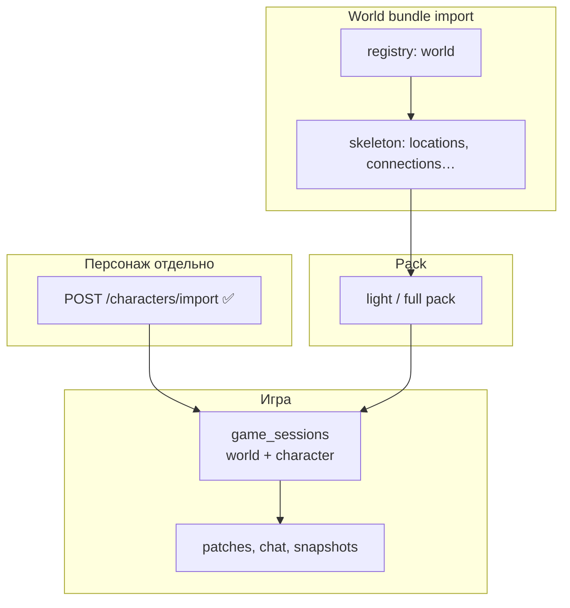

#### A. SQLite metadata (JSON bundle)

| Level | ID | Секции bundle | После import |
|---|---|---|---|
| **0** | `registry` | `world` | registries, scalars |
| **1** | `skeleton` | + `races`, `perks`, `states`, `locations`, `connection_*`, `relief_templates` | L1, без персонажей |
| ~~npcs~~ | — | **`npcs[]` backlog** | отдельный spec |
| ~~starter_characters~~ | — | **`starter_characters[]` backlog** | отдельный spec; **не** L6 |
| ~~legacy~~ | — | `map_cells` | **reject** (WP-23) |

**Сейчас в коде:** [`WorldBundleService`](../backend/app/application/worldData/worldBundleService.py) — `world`, `races`, `perks`, `states`, `locations`, `connection_*`, `relief_templates`; `map_cells` reject. Персонажи — **`POST /characters/import`** отдельно (✅). Bundle персонажей — **нет**. Оркестрация секций → [`tz_world_bundle.md`](./tz_world_bundle.md).

#### Backlog: bundle characters (spec only, не impl)

Две **будущие** сущности — зафиксировать wire отдельно, **не** включать в Pack migration / L6:

| Сущность | Назначение (идея) | Статус |
|---|---|---|
| **`npcs[]`** | pre-placed NPC roster мастера | ⬜ spec; vs lazy sim — не решено |
| **`starter_characters[]`** | готовые PC «в комплекте с миром» | ⬜ **новая** сущность; wire TBD; **не** дублировать `POST /characters/import` в L6 |

При появлении — отдельный epic + validator; remap UID как у locations. До решения — мастер: world bundle + отдельные character JSON.

#### B. Pack filesystem (отдельно от JSON или zip)

| Level | ID | Содержимое | Когда |
|---|---|---|---|
| **2** | `light` | `pack/manifest` + L0 location tiles + `climate_coarse` + `locations_index` | после skeleton import → **auto bake** ≤2 min **или** attach готового `fixtures/packs/{uid}/` |
| **3** | `pack` | + `locations/l.*.terrain.zst`, `tiles/...chunks` (partial/full) | master distributable / CI golden |
| **4** | `pack_attach` | только ссылка `worlds.terrain_pack_path` + validate hash | мир скопирован с pack folder |

**Не в bundle JSON:** бинарные zstd — **директория** `{data_dir}/worlds/{uid}/pack/` или zip `world_{uid}_pack.zip` рядом с `world.json`.

#### C. Session runtime (не определение мира/персонажа)

**Смысл:** bundle задаёт **мир** (skeleton + pack). **Сессия** — когда игрок выбрал/импортировал персонажа и создан `game_sessions`. Всё после — session runtime.

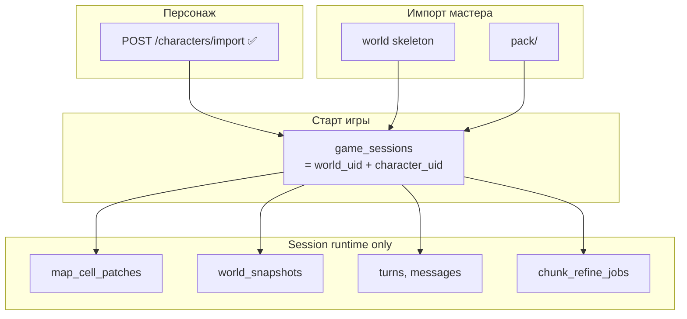

| Категория | Примеры | В bundle? |
|---|---|---|
| **Определение мира** | `world`, `locations`, connections | ✅ skeleton |
| **Определение PC** | character JSON | ✅ `POST /characters/import` (отдельно) |
| **Bundle characters** | `starter_characters[]`, `npcs[]` | ⬜ backlog spec |
| **Связка** | `game_sessions` | ❌ создаётся при **new game** |
| **Gameplay runtime** | patches, chat, snapshots, refine jobs | ❌ только сессия |

**Персонаж отдельно от мира:** `POST /characters/import` **без** мира (✅); export character JSON — отдельно от world export. Bundle «мир + герои одним файлом» — **backlog** (`starter_characters[]`), не текущий путь.

**Сценарии:**

| Действие | Что переносится |
|---|---|
| Мастер: world bundle + light pack | мир + карта |
| Мастер: готовый герой | `POST /characters/import` (отдельный JSON) |
| Игрок: new game | `game_sessions` + выбранный/импортированный PC |
| Продолжить игру | session + patches + snapshots |

**Что общее на инстансе мира:** `pack/` L2 — для всех сессий; `map_cell_patches` — накопление по миру в game.db (shared DB).

### Target API (L6)

| Endpoint | Назначение | Статус |
|---|---|---|
| `POST /worlds/import?level=skeleton` | JSON bundle ≤ skeleton | L6 |
| `POST /characters/import` | персонаж отдельно | ✅ **есть** |
| `POST /worlds/{uid}/pack/import` | zip → `pack/` | L6 |
| `POST /worlds/{uid}/map/pack/bake?mode=light` | **light_bake** | ✅ |
| `POST …/pack/bake?mode=full` | **full_bake** — весь `world_bounds` L0 | ✅ |
| `POST …/pack/bake?mode=detailed&scope=location&location_uid=` | **detailed_bake** location: L2 ✅; C11 на settlement-like ✅ (тот же `materialize`) |
| `POST …/pack/bake?mode=detailed&scope=wilderness` | **detailed_bake** wilderness topping | ✅ (`grade_mill`/`grade_paint` optional, default **off**) |
| `POST …/map/refine-chunk?gx=&gy=&cx=&cy=` | one wilderness chunk re-refine (same `FineChunkRunner`); `grade_mill`/`grade_paint` omit = off | ✅ debug |
| `GET /worlds/{uid}/map/loading-progress` | progress + `pack_completeness` | ✅ pct + classifier |
| `GET /worlds/{uid}/export?level=skeleton` | без map_cells / pack blobs | L6 |

### Связь с загрузкой игрока

| Импорт мастера | Игрок при старте сессии |
|---|---|
| skeleton + light pack (case 1) | cold load; spawn; L2 / missing L0 — resume/lazy |
| skeleton + full L0 pack (case 2) | сплошная map; L2 lazy / detailed |
| full + all detailed (case 3) | минимум фона на spawn по локациям |
| skeleton only | auto **light_bake** P0 или blocking bake P0 locations |

### Миграция с текущего export

| Было | Станет |
|---|---|
| export с `map_cells` | `level=skeleton`; terrain → pack export отдельно |
| import с `map_cells` | 422 + сообщение «use pack import» |
| monolith bundle | split: `world.json` + `pack/` directory |

---

## Deprecation

| Удаляется | Замена |
|---|---|
| `BootstrapMapCellWriter.write_terrain*` | `WorldPackWriter` |
| `insert_terrain_bulk` bootstrap | L2 tile blob |
| wilderness rows в `map_cells` | L0/L2 pack |
| per-cell climate upsert на bake | climate field blob |
| TR-PERF terrain bulk INSERT | pack encode; TR-PERF только patches |

---

## Имплементация (слои)

| Слой | Содержание | Статус (2026-07-10) |
|---|---|---|
| **L1** | `dataModel/worldPack/`, `merge_map_cells`, wire golden tests | ✅ |
| **L2** | `WorldPackWriter/Reader`, `TileCodec`, zstd | ✅ |
| **L3** | `MapCellQueryFacade`, LOD routing, `get_loading_progress` | ✅ |
| **L4** | orchestrators → pack writer; `ChunkRefineQueue`, `EntryAnchorTracker`, scene-volume blocking | ✅ |
| **L5** | schema `map_cell_patches`, drop `map_cells` | ✅ |
| **L6** | import levels WP-24; `pack/import`, `export?level=`; bake CLI | ✅ |
| **L7** | cleanup, sync `project_data_storage_tz.md` | ✅ |

**Post-L7:** § **WP-FIX**, § **WP-FIX-DEBT**, § **WP-FIX-REVIEW** (приоритеты code review). Smoke WP-A* — master.

**Не начинать L4** до L2+L3. DAG nodes — после L6+smoke, gate с мастером.

---

## Приёмка

| ID | Критерий |
|---|---|
| WP-A1 | `light` bake `world_terrain_test` ≤ 2 min; world map показывает рельеф + hydro + pins |
| WP-A2 | cold load `light` pack ≤ 5 min |
| WP-A3 | L1 + pins: локации видны на map без L2 |
| WP-A4 | L2 refine: река на fine tile **внутри** L0 river corridor; golden hash stable |
| WP-A5 | фон: chunks от entry; path corridor; worker ≤1; не burst 8 tiles |
| WP-A6 | patch merge: settlement поверх L2 без потери building cells |
| WP-A7 | нет wilderness INSERT в SQLite |
| WP-A8 | crash mid-chunk: готовые chunks сохранены; redo → stable hash |
| WP-A9 | **WP-14:** spawn → `get_scene_volume` playable ≤ **30 s** p95 (цель 15 s); игрок может отправить ход |
| WP-A10 | переход macro-tile: blocking ≤ **10 s**; дальше — L0 fallback + фон |
| WP-A11 | `worldMapLoading`: `locations_pct` / `tiles_pct` / `wilderness_pct`; wilderness — фон после входа |
| WP-A12 | climate tier A на scene сразу; tier B в фоне |
| WP-A13 | overlap: 3D territory mask; merge WP-20; multi-location per tile по z |
| WP-A14 | stale L0: wilderness regen от границы location наружу; patch/location preserved |

### WP-A1 — фактический smoke (2026-07-10)

**Контекст:** `initialize_world.py --fixture world_terrain_test.json` → `POST /map/pack/bake?mode=light&max_tiles=16` для `world-terrain-test-001`.

**Логи bake (per-world):** транскрипт `backend/logs/generation/{world_uid}/bake-light-latest.log` (+ stamped). Потоки консьюмеров — [`tz_logging.md`](./tz_logging.md) (`pack/packBakeLog`, не общий `app.log`). Sink allowlist: `app.core.generationLogging` — pack / generators / render (`dumpLog`, `mode=dump` → `bake-dump-*.log`) **и** `app.relief` (`reliefLog` / R44 `gradeCellRays`).

| Метрика | Значение | WP-A1 |
|---|---|---|
| HTTP `request_end` | **34.9 s** | ≤ 2 min — **PASS** |
| `pack bake done elapsed_ms` | **33.8 s** | — |
| world_map tiles | 16 | cap=16 |
| wilderness_chunks (blocking scene) | 1 (1883 cells) | — |
| Background queue | **8836** jobs → SQLite | см. backlog ниже |

**Разбивка по фазам** (wall-clock по timestamp логов, UTC):

| Фаза | Длительность | Примечание |
|---|---|---|
| Планирование тайлов + hydrology (до `pack bake start`) | ~1.1 s | bootstrap tile set |
| `drain_persisted` (resume) | **~12.5 s** | 1 persisted job с прошлого bake |
| Background wilderness_chunk (generate+persist) | ~0.17 s | role=background, 1883 cells |
| Surface context + hydrology | ~1.1 s | `pack surface context elapsed_ms=1083.9` |
| world_map bake (16 tiles, 16384 cells) | **~0.1 s** | `pack world_map bake done elapsed_ms=100.3` |
| fine_terrain scene phase — подготовка | **~12.4 s** | от `pack fine_terrain phase start` до `wilderness_chunk generate start` |
| scene wilderness_chunk (generate+persist) | ~0.16 s | `pack wilderness_chunk done elapsed_ms=161.7` |
| Queue persist (`tile_background`) | **~5.5 s** | `pack jobs persisted count=8836` |

**Выводы:**

1. **Сам terrain (world_map + blocking wilderness_chunk) — &lt; 0.5 s**; light bake укладывается в WP-A1 с большим запасом.
2. **Основное время** — не генерация cells, а orchestration overhead: resume persisted job (~12.5 s), подготовка scene phase (~12.4 s), bulk INSERT 8836 refine jobs (~5.5 s).
3. **Backlog (perf):** `schedule_tile_background` для macro-tile `(12,12)` планирует **весь** tile (~94×94 chunks → 8836 jobs), а не corridor/scene volume. Для light bake это избыточно; фоновый worker (WP-A5, ≤1) отработает позже, но **blocking persist очереди** удлиняет HTTP bake. Детальный backlog — § **Дополнительная оптимизация (WP-PERF)**.
4. **Повторный smoke** на чистой БД (без `drain_persisted`) ожидаемо короче на ~12.5 s.

**Артефакты:** `db/worlds/world-terrain-test-001/pack/manifest.json`, 16× `tiles/r.*.*.world_map.zst`, 1× `tiles/r.12.12.c.0.0.zst`.

---

## Дополнительная оптимизация (WP-PERF)

> **Статус:** ⬜ backlog. **Не блокирует** WP-A1 (light bake ≤ 2 min уже PASS).  
> **Цель:** сократить orchestration overhead light bake с **~35 s → ~5–10 s** на чистой БД и удержать WP-A9 (spawn ≤ 30 s) с запасом.  
> **Источник:** § **WP-A1 — фактический smoke**; профиль 2026-07-10.  
> **Измеренные прогоны** (L0 full / L2 detailed, wall vs CPU-sum): [`tz_application_performance.md`](./tz_application_performance.md).

### Принцип

| Правило | Смысл |
|---|---|
| **WP-PERF-0** | Pack + LOD + entry-first — **основная** оптимизация; WP-PERF — доработка **внутри** целевой архитектуры |
| **WP-PERF-1** | Не ускорять INSERT wilderness в SQLite — legacy freeze (WP-26) |
| **WP-PERF-2** | Узкое место после cutover — **orchestration**, не column fill (generate &lt; 0.5 s при smoke) |
| **WP-PERF-3** | Инварианты не трогать: один wilderness writer, determinism chunk hash, patch &gt; pack |

**Не в scope WP-PERF:** parallel persist, blocking full tile на gameplay, продление TR-PERF как основного пути.

### Профиль узких мест (baseline smoke)

| Фаза | ~время | Корневая причина |
|---|---|---|
| `drain_persisted` | 12.5 s | resume 1 job с прошлого bake; `max_jobs=max(drain, 1)` даже при `background_drain_per_request=0` |
| fine_terrain scene prep | 12.4 s | `build_tile_surface_state`: full tile upsample 3000×3000 + `run_gap_analysis` на 9M columns **до** первого scene chunk |
| `persist_enqueue` queue | 5.5 s | `schedule_tile_background` — **весь** macro-tile (~8836 jobs), blocking INSERT в `chunk_refine_jobs` |
| world_map + wilderness_chunk generate | &lt; 0.5 s | уже достаточно быстро |

### Backlog по приоритету

#### P0 — orchestration hot path (light bake HTTP)

| ID | Задача | Target fix | Ожидаемый выигрыш |
|---|---|---|---|
| **WP-PERF-10** | На `mode=light` **не** enqueue весь tile в `chunk_refine_jobs` | rings/corridor (WP-13); L0 всего bounds — это `full_bake`, не light | ✅ rings; см. WP-13-OPEN-8 |
| **WP-PERF-11** | `persist_enqueue` batch | `executemany` / bulk upsert jobs; или manifest-only queue без SQLite до фонового worker | **−3…5 s** при большой очереди |
| **WP-PERF-12** | `drain_persisted` policy | `max_jobs=0` когда `background_drain_per_request=0`; rebake → purge stale jobs или async drain **после** HTTP | **−12 s** на повторном bake |
| **WP-PERF-13** | Один `surface_ctx` на run | Исторический baseline: повторная preparation в L0 writer; после PC-11.7 writer принимает готовые bundle/working refs. Отдельного legacy context/projector нет | **−1 s** |

#### P1 — L2 prep (scene / WP-A9)

| ID | Задача | Target fix | Ожидаемый выигрыш |
|---|---|---|---|
| **WP-PERF-20** | Partial `TileSurfaceState` | gap analysis + fine upsample **по chunk rect + halo ±1**, не на весь macro-tile | **−10…12 s** scene phase |
| **WP-PERF-21** | Кэш `TileSurfaceState` per `(gx, gy)` | один build на tile per bake run; scene + background chunks reuse | меньше повторов WP-PERF-20 |
| **WP-PERF-22** | L0-constrained refine (Идея 2) | upsample L0 `surface_z` + hydro corridor + nearest `system_terrain` | ✅ z/hydro + terrain mask carry; smoke `world-test-003` `(-2,-2)` 2026-07-23 |

#### P2 — CPU generate (offline / фон)

| ID | Задача | Target fix | Статус |
|---|---|---|---|
| **WP-PERF-30** | ProcessPool backend | `ChunkComputePool` — optional `ProcessPoolExecutor` (GIL bypass) | ⬜ backlog |
| **WP-PERF-31** | Dedicated L0 hydro-raster | light bake: rasterize на `world_map` grid без полного `HydrologyGeneratorService.apply` | ⬜ опционально |
| **WP-PERF-32** | Climate tier A на bake | один `climate_coarse.zst` из `surface_ctx.pole_field`; tier B — spawn tile после scene | ✅ |

#### P3 — Pack I/O и wire

| ID | Задача | Target fix | Статус |
|---|---|---|---|
| **WP-PERF-40** | Binary wire (FIX-31) | column runs binary вместо JSON payload в zstd | ⬜ P4 |
| **WP-PERF-41** | `zstd_level` policy | dev/smoke: 1–2; release pack: 3–5 (`PackBakeDefaults`) | ⬜ |
| **WP-PERF-42** | Decode cache hot path | `FineTerrainDecodeCache` на `get_scene_volume` bbox | ⚠️ partial |

#### P4 — продуктовые рычаги (без смены архитектуры)

| ID | Рычаг | Когда |
|---|---|---|
| **WP-PERF-50** | L0-only light/full bake | **Job boundary:** нет `refine_scene` в bake path; entry — отдельная джоба | ✅ параметр убран; entry HTTP отдельно |
| **WP-PERF-51** | P0 tiles only (spawn + locations) | меньше L0 tiles на первом bake |
| **WP-PERF-52** | attach `fixtures/packs/{uid}/` | cold start без bake |
| **WP-PERF-53** | `path_ahead_depth` | меньше фоновой очереди на слабых машинах |

### Порядок имплементации

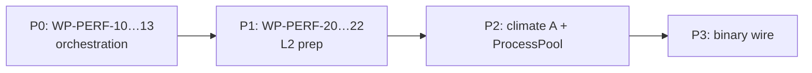

**Не начинать P3** до замера после P0+P1 на том же smoke (`world_terrain_test`, `max_tiles=16`).

### Приёмка WP-PERF

| ID | Критерий |
|---|---|
| PERF-A1 | light bake HTTP на **чистой** БД: `pack bake done` ≤ **10 s** p95 (`world_terrain_test`, `max_tiles=16`) |
| PERF-A2 | повторный light bake без stale jobs: нет фазы `drain_persisted` &gt; 1 s |
| PERF-A3 | `pack jobs persisted count` на light bake ≤ **scene + path corridor** (не ~8836 на один tile) |
| PERF-A4 | scene phase prep (`fine_terrain phase start` → `wilderness_chunk generate start`) ≤ **2 s** p95 |
| PERF-A5 | generate+persist 1 scene chunk — без регрессии (&lt; 1 s); chunk hash stable (WP-A4) |
| PERF-A6 | WP-A9 не регрессирует после P0+P1 |

### Связь с другими разделами

| Раздел | Связь |
|---|---|
| § WP-A1 smoke | baseline метрики и разбивка фаз |
| § WP-13, WP-17 | entry-first и path corridor — контракт для WP-PERF-10 |
| § Идея 2 | WP-PERF-22 — refine from L0 |
| § WP-A12 | WP-PERF-32 — climate tier A bake |
| FIX-31 | WP-PERF-40 — binary wire |
| WP-26 | legacy TR-PERF / `map_cells` — **вне** WP-PERF |

---

## Связанные документы

| Документ | Связь |
|---|---|
| [`tz_logging.md`](./tz_logging.md) | sinks: `{domain}/{service}.log`; транскрипт `generation/{uid}`; консьюмеры `pack/*` |
| [`tz_map_light_bake.md`](./tz_map_light_bake.md) | L0 LightGridCompose — контракты укладки маски world map; **не** writer холмов |
| [`tz_terrain_generation.md`](./tz_terrain_generation.md) | multi-pass skeleton, TR-LAZY-LOAD, hydrology pass order |
| [`tz_terrain_relief.md`](./tz_terrain_relief.md) | outdoor grade generate (очереди, стрелки); холм ≠ Grade. Bake R36 — [`tz_terrain_relief_v1_superseded.md`](./tz_terrain_relief_v1_superseded.md) |
| [`tz_terrain_hydrology.md`](./tz_terrain_hydrology.md) | Pass 1.5, liquid_candidate |
| [`tz_climate.md`](./tz_climate.md) | SurfaceClimateField, Climate LOD |
| [`tz_city_generation.md`](./tz_city_generation.md) | CitySkeleton import; **§8 topology** после `full_bake`; packing = C11/C24 |
| [`tz_city_generation_technical_debt.md`](./tz_city_generation_technical_debt.md) | **CITY-T-5** швы после topology-on-bake (не compose, не 4-й mode) |
| [`tz_settlement_outdoor.md`](./tz_settlement_outdoor.md) | Outdoor city layer; **C23** topology; **C24** packing по району; не `location_terrain` |
| [`project_data_storage_tz.md`](./project_data_storage_tz.md) | schema patch store |
| [`tz_world_snapshot.md`](./tz_world_snapshot.md) | pack_hash в snapshot |
| [`tz_generator_technical_debt.md`](./tz_generator_technical_debt.md) | техдолг; § **WP-DELETE-1** ↔ WP-FIX-DEBT-10 |
| [`tz_application_performance.md`](./tz_application_performance.md) | измерения bake (APP-PERF-R1); не WP-PERF backlog |

---

## История

| Дата | Изменение |
|---|---|
| 2026-09-20 | **C24:** `SettlementStructureEntry.packed_district_uids` / `structure_status`; gameplay packing = район, не tile. SoT [`tz_settlement_outdoor.md`](./tz_settlement_outdoor.md). Код ⬜. |
| 2026-09-19 | **LOC-T-3 / WP-21:** settlement AABB + запас; import 200 + ERROR лог; occupancy больше footprint иначе раньше в `locations[]`. Не 422. SoT [`tz_locations.md`](./tz_locations.md). |
| 2026-09-13 | C11/C23 stage seconds in `packBakeLog` (`settlement_c11_*`, `settlement_topology_*`). |
| 2026-09-13 | **C8:** city structure pack = full building cells (`StructureLayout`), not facade-only. Furniture remains InteriorAssembler. |
| 2026-09-06 | **Job boundaries:** после `full_bake` L0 — post-pass `settlement_topology` (C23). Не 4-й mode, не L2, не packing, не compose. `light_bake` topology не делает. |
| 2026-08-30 | WP-3/WP-20: authored outdoor city = pack `CITY_STRUCTURE`; gameplay = patches |
| 2026-08-30 | **Бюджет mill:** не спекулятивно; несколько чанков на сцене ок; полный мир — bake ГМ. APP-PERF-R1 = тайл целиком. |
| 2026-08-30 | **On-demand grade = chunk re-refine:** `refine_queued_chunk` / `POST …/refine-chunk` + `GradePipelineStages`; тот же `FineChunkRunner` (R41), не отдельный bake. Entry/queue остаются `stages=off()`. |
| 2026-08-30 | **Mill/paint не gameplay:** entry/runtime без mill/paint; `detailed_bake` `grade_mill`/`grade_paint` default **off** (явный on = APP-PERF-R1). |
| 2026-08-30 | Измерения bake 003 → [`tz_application_performance.md`](./tz_application_performance.md) **APP-PERF-R1** (full ~11 с; detailed `(-2,-2)` ~820 с wall). |
| 2026-08-26 | **grade_rays тело:** `SCH-GRADE-CELL-SLOTS` `{x,y,slots[8]}` — consume § Тело sidecar |
| 2026-08-23 | **grade_rays = фронт:** sender+receiver только с реальных фронтов (не тело×8) — consume TZ |
| 2026-08-22 | **Grade rim edges pack:** `tiles/r.{gx}.{gy}.grade_rays.json` / `locations/l.{uid}.grade_rays.json` — отправитель + получатель; не FineTerrain column — [`tz_terrain_relief_consume.md`](./tz_terrain_relief_consume.md) |
| 2026-08-21 | **L2 hills shapes:** палитра `shapes[]` на POJO; пусто = каталог (`circle`/`oval`/`double_circle`/`double_oval`); выбор hash(`world_uid`, origin). Формулы — § L2 open-land hills |
| 2026-08-20 | **L2 open-land hills:** helper (не mask domain); только L2; consumer plains/forest; стопа в host; `z_band` не режет холм. **Wire = POJO:** `min_spacing`, `radius`, `height` (метры / world-z). Мир `default_*.hills` → локация `hills.{plains\|forest}` перекрывает |
| 2026-08-16 | **Слой модификации мира:** не bake mode; Pack immutable; gameplay deltas = Patch Store (WP-20); skip `complete` ≠ взрыв |
| 2026-08-15 | **C29:** технический шов chunk/tile не продукт; климат/дороги/**локация·город**/шаг проходят ребро — [`tz_terrain_relief.md`](./tz_terrain_relief.md) |
| 2026-08-14 | **FineChunkRunner слои:** prep / `compute_rect` / persist; grade в том же `ColumnRect` task — [`tz_terrain_relief.md`](./tz_terrain_relief.md) |
| 2026-08-14 | **Шов мира:** `full_bake` L0 смыкает край AABB с антагонистом на макро-тайлах; не L2 / не R36w — [`tz_terrain_relief.md`](./tz_terrain_relief.md) |
| 2026-08-13 | **R36v:** FineChunkRunner grade per-rect in pool (не tile-wide serial) — [`tz_terrain_relief.md`](./tz_terrain_relief.md) |
| 2026-08-13 | **R36u lock wording:** terrain mask carry = только `system_terrain`; hydro/facing/z не под этим именем |
| 2026-07-30 | WP-24 ↔ **BUNDLE-2 SoT** [`tz_world_bundle.md`](./tz_world_bundle.md); sync skeleton/`relief_templates` в таблице «сейчас» |
| 2026-07-20 | **WP-PERF-50 ✅:** light/full L0-only; `refine_scene` убран из bake path; entry = отдельная джоба |
| 2026-07-20 | § Bake modes **Job boundaries:** L2 ∉ light/full; L2 = detailed \| entry job; entry после light — отдельная джоба |
| 2026-07-19 | **WP-FIX-DEBT-10** / WP-DELETE-1: `DELETE /worlds` FK-safe purge (link → `tz_generator_technical_debt.md`) |
| 2026-07-19 | § Read path: **Manifest cache** — stamp `(mtime_ns, size)` + `invalidate_pack` после bake |
| 2026-07-19 | § Приоритет L0: `world_bounds` = форма мира (AABB) |
| 2026-07-19 | **Bake modes — контракт мастера:** light = тайлы с локациями; full = весь `world_bounds`; нет product «wilderness» stage; `wilderness_*` = storage legacy |
| 2026-07-19 | **Impl:** `PackTilePlanner` + classifier + HTTP/smoke `max_tiles` default uncapped |
| 2026-07-19 | Smell fixes: `WorldBounds` POJO; `light_l0_tiles`; single `resolve_light_tile_cap`; light = locations∪declared hydro |
| 2026-07 | § Идея 1 (light world map) + § Идея 2 (refine from L0) утверждены |
| 2026-07 | WP-10: `world_map_cells_per_tile` ∝ 1/`fine_cells_per_map_cell` |
| 2026-07-15 | **WP-10 v2:** `side = 32` константа; `light_span = fine_cells_per_map_cell // 32`; убрана ∝-формула / clamp 8…48 |
| 2026-07 | World Pack + Patch Store; LOD L0/L1/L2 |
| 2026-07 | WP-26: legacy freeze — map_cells/materialize-stack/TR-PERF вне scope Pack migration |
| 2026-07 | WP-MERGE: статус merge v1 + приоритет доработок MERGE-1…9 |
| 2026-07 | WP-25: сессия=world+character; characters/import ✅; starter_characters + npcs — backlog spec only |
| 2026-07 | Ссылка на fix backlog: `.cursor/plans/world-pack-fixes-done.md` (FIX-01…33) |
| 2026-07-10 | **WP-FIX:** FIX-01…30 ✅, FIX-32/33 ✅; merge v2 field-wise; L1–L7 ✅ |
| 2026-07-10 | **WP-MERGE v2:** статус слоёв; MERGE-1/4/7 ✅; WP-FIX-DEBT-1…9 |
| 2026-07-10 | **WP-FIX-REVIEW:** REVIEW-5/6 — `PackDebugReadFacade`, `PackLoadingProgressFacade`, `MapCellReadService` |
| 2026-07-10 | § **WP-A1 — фактический smoke:** light bake `world_terrain_test` **34.9 s** HTTP; разбивка фаз + backlog queue=8836 |
| 2026-07-10 | Wire rename: `manifest.tiles[]` — `world_map_path`, `world_map_hash`, `wilderness_refine_status`; `location_terrain_entries[]` — `terrain_hash` |
| 2026-07-10 | § **Именование (LOD ↔ код):** bulk rename backend + **log activity** (`world_map`, `wilderness_chunk`, `location_terrain`); `MapLayerKind.WORLD_MAP`; `fine-terrain-read` debug API |
| 2026-07-10 | § **Дополнительная оптимизация (WP-PERF):** backlog P0…P4, baseline smoke, приёмка PERF-A1…A6 |
| 2026-07-12 | **CL-PACK fix:** `ClimatePackBakeOrchestrator`; denser fine; `climate_status` coarse/fine; CL-PACK-1…11 ✅ (CL-PACK-4 accepted L0 tint) |
| 2026-07-12 | **Climate pack cutover:** coarse `climate_coarse.zst` на light bake; fine spawn tile; meter→macro `apply_climate`; `generate-climate` reject on pack; WP-A12 / MERGE-2 / WP-PERF-32 ✅ |
| 2026-07-14 | L0 compose архитектура вынесена в [`tz_map_light_bake.md`](./tz_map_light_bake.md); cross-ref из § L0 |
| 2026-07-15 | **Parent light SoT:** disk `world_map.zst` + process-local cache после write/read; live compose не SoT; WP-PERF-22 target уточнён |
| 2026-07-15 | **Parent light refine contracts:** upsample z_band=±1, hard hydro corridor, cache key `(world_uid,gx,gy)`; SoT knobs → future `ParentLightRefinePolicy` |
| 2026-07-16 | WP-27/28 **impl status sync:** bake `light\|full\|detailed` ✅; `pack_completeness` ✅; climate fine на detailed / incremental skip / auto-resume ⬜ |
| 2026-07-15 | **Bake modes WP-27/28:** `light_bake` / `full_bake` (=все location L0) / `detailed_bake`; offline cases 1–3; detect+resume; API `mode=light\|full\|detailed`; старый tile/full wilderness ≠ full_bake |
| 2026-07-15 | **WP-PERF-22 ✅:** `ParentLightTile` / cache / upsample / hard corridor wired in pack refine |
| 2026-07-23 | **WP-PERF-22-OPEN-1 открыт:** L0 terrain mask не в L2 fill (smoke all forest) |
| 2026-07-23 | **Terrain mask carry утверждён + impl:** hard stamp nearest; hydro после; climate fine ≠ terrain; WP-19 chunks без изменений |
| 2026-07-23 | **Terrain mask carry ✅ закрыто:** smoke `world-test-003` `(-2,-2)` L2 = plains/mountain/ravine vs L0 light (не all forest) |
