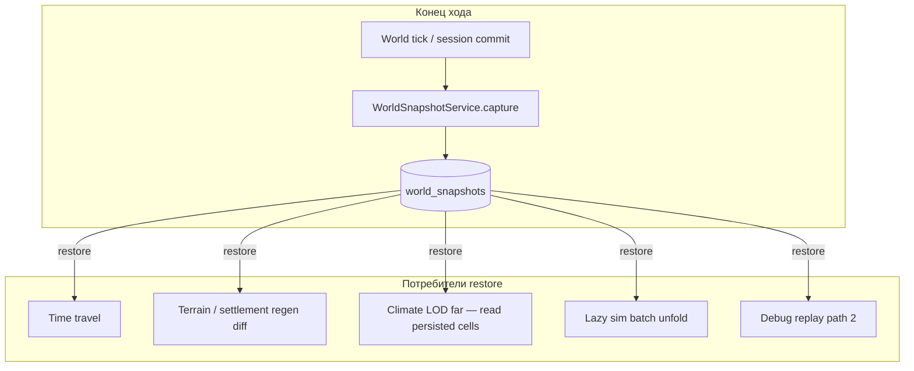

## Назначение

**World Snapshot** — **отдельный общий модуль платформы**, не часть climate, terrain или chat.

| Принцип | Смысл |
|---|---|
| **Единый сервис** | Один `WorldSnapshotService` отвечает за commit тика / read / restore / branch |
| **Дельта на тик** | Snapshot тика = patch set поверх базового pack (+ периодический keyframe), **не** полный слепок мира; § «Staged artifacts и точки публикации», [`tz_patch_system.md`](./tz_patch_system.md) |
| **Потребители** | Climate LOD, terrain regen, lazy sim, time travel, debug replay — **читают восстановленное состояние**, не делают свой ad-hoc snapshot |
| **Не маска** | Snapshot — **состояние мира** (данные + сессия), не boolean mask и не один derived field |
| **Игрок — отдельная цепочка** | Состояние игрока живёт в параллельной `player_snapshots`, синхронизированной по `turn_id` — export/import и time travel без привязки к world blob |
| **Immutable** | Записанный snapshot никогда не мутируется; изменение = новый узел/ветка, не правка существующего |

**Статус:** schema ✅ ([`project_data_storage_tz.md`](./project_data_storage_tz.md) § `world_snapshots`) · **runtime module ⬜** · capture на каждый ход ⬜

> **Не путать** с терминами в [`tz_climate.md`](./tz_climate.md) § «Терминология snapshot» — там другие сущности (`SurfaceClimateField`, `WeatherSnapshot`).

---

## Мутация, её планирование и materialization (решение мастера, 2026-10-26)

**Мутация — изменение состояния мира.** Например: разрушение стены,
изменение русла или смена покрытия региона. Данные планирования мутации
описывают запланированное изменение и служат входом для последующей
materialization. Их нельзя подменять неопределённым «планом состояния мира»:
здесь речь именно о планировании изменения.

Materialization воплощает запланированное изменение в конкретных данных
мира. Планирование мутации и её materialization — разные стадии;
сохранение snapshot не требует немедленного выполнения второй стадии.

**Snapshot должен сохранять данные планирования мутаций, которые затем
передаются materialization.** Если materialization уже выполнена по
предварительному запросу, snapshot сохраняет **и план мутации, и результат
materialization**, соответствующий этому плану. Если она ещё не выполнена,
snapshot сохраняет данные планирования без принудительной materialization.
Само создание snapshot не запускает materialization.

Пример: запланировано разрушение стены, но детальные данные области ещё
не запрошены — сохраняются данные планирования этой мутации. Если область
уже материализована с учётом разрушения, сохраняются также соответствующие
материализованные данные.

Это уточнение определяет обязательные сохраняемые данные и разделение
стадий, но не выбирает физический формат хранения. Хранение результата
materialization, впервые полученного после создания immutable snapshot
(отдельный производный артефакт или новый snapshot), пока не согласовано.
Приведённый ниже черновой blob-контракт должен быть согласован с этим
решением до реализации; сохранение только уже материализованных данных
без данных планирования мутаций ему не соответствует.

## Staged artifacts и точки публикации (решение мастера, 2026-10-27)

Закрывает вопрос записи объёмных результатов до публикации
([план](../.cursor/plans/world-domain-patches-snapshots.md) §3.3, §7.2).

### Pack и snapshot — разные сущности

**Граница — старт gameplay** (проверяется на уровне DAG).

- **До старта gameplay: материализация мира = pack.** Bake
  (`light`/`full`/`detailed`) поставляет мир **одним pack** (immutable
  manifest@hash), в первую очередь при первой материализации.
  `light_bake → full_bake` — переход одного pack: full дописывает его новой
  версией manifest (append-only, L0 light переиспользуется по hash), а не
  поставляет второй мир. Bake до старта не создаёт snapshot.
- **После старта gameplay всё становится snapshot.** Pack, на котором
  стартовала игра, — её базовый pack: заморожен полностью, новых версий
  manifest для этой игры нет. Любая дальнейшая материализация (full_bake
  поверх light, detailed_bake, runtime L2 WP-13/lazy refine, материализация
  добавленных/изменённых локаций) и любая правка мира — patch/результат
  в snapshot, читаемый поверх pack.
- **Bake — job DAG.** Когда и где запускать bake (в т.ч. auto bake мира без
  pack), решает DAG. `POST pack/bake?mode=…` — тонкий caller того же job.
  Gate старта gameplay (DAG): без опубликованного базового pack gameplay не
  стартует; источник pack не важен (auto, мастер, attach готового). Первый
  snapshot ссылается на этот pack. Ограничения WP-14 (≤30 s от spawn, без
  blocking bake на spawn) — контракт, который DAG обязан соблюдать.
  Встраивание в DAG — GEN-DAG-1 (scope bootstrap/bake); до него существующий
  `POST pack/bake` — legacy, новая архитектура через него не строится;
  его оркестрация стадий вне DAG — блокер приёмки (B-2).
- **Snapshot = историческая модификация мира по тикам.** Snapshot ссылается
  на базовый pack по hash (WP-6 `pack_content_hash`) и фиксирует patch set
  тика; объёмные результаты — staged artifacts по ссылке из snapshot.
  Snapshot сам materialization не запускает — её запускает DAG.
- **Чтение состояния = базовый pack + overlay snapshot поверх.** Мутация
  только читается сверху, не переписывает pack. Результат `detailed_bake`,
  попавший в pack, остаётся как был.

### Правила модели pack + overlay

0. **Вся production-оркестрация — только DAG.** Когда и в каком порядке:
   стадии bake, публикация и активация pack, commit тика, keyframe/компакция
   overlay, пересборка overlay при attach к ветке, GC staging, retry/resume.
   Snapshot, домены и storage только исполняют вызванную операцию и
   сами ничего не планируют и не запускают. Оркестрация вне DAG — блокер
   приёмки. **Debug route** остаётся как тонкий API и вызывает тот же граф
   DAG — своего порядка стадий и доменных решений не держит. Product route
   (`POST pack/bake`, import) не может объявляться debug-входом.

1. **Чтение не проигрывает цепочку тиков.** Цепочка snapshot — журнал
   истории. Текущее состояние читается как базовый pack + **один
   скомпактированный текущий overlay** (Patch Store). Для time travel/restore
   используются периодические keyframe-snapshots (скомпактированный overlay
   на тик) + дельты после keyframe. Read cost не растёт с числом тиков.
   **Один активный timeline на мир** (решение мастера 2026-10-27) → один
   активный overlay на мир. Замороженные ветки overlay не держат — только
   keyframe + дельты. Переход в другую ветку (attach) — DAG пересобирает
   overlay от ближайшего keyframe; ветка не тикала, пересборка
   детерминирована. Следствие: две игры одновременно на разных ветках
   одного мира невозможны.
2. **«Заморожен» = неизменяем.** Опубликованные blobs и manifest никогда не
   перезаписываются. До старта gameplay pack дополняется только новыми
   версиями manifest (append-only); после старта — только snapshot.
3. **Patch не зависит от LOD.** Patch задаётся в мировых координатах и
   семантике (`terrain_delta` по объёму и т.п.), не как байты конкретного
   тайла/LOD. Область, материализованная после мутации, строится из
   базового pack (generator не видит patches), затем patches накладываются
   поверх на её LOD. Связано с WP-22.
4. **Новая игра продолжает цепочку world-snapshot.** Игра на мире, где
   gameplay уже стартовал, не начинается с голого pack: она присоединяется к
   цепочке world-snapshot и получает всё, что в неё уже вошло (full_bake
   поверх light, L2, правки). Player-цепочка — своя
   ([`tz_patch_system.md`](./tz_patch_system.md) § Две цепочки snapshot).
5. **Игра не ломается от правок.** Добавление или изменение локаций и иная
   правка мастера после старта gameplay не перепекает pack: это patch в
   snapshot. Начатая игра и её цепочка snapshot не ломаются.
6. **Перепечки нет — только расширение** (политика патча, решение мастера
   2026-10-27). Запечённое остаётся: повторный bake не перезаписывает и не
   заменяет уже материализованное. Допустимо только расширение — новые тайлы
   или новые локации поверх wilderness, где не было patches; после старта
   gameplay это patch в snapshot. Новый pack вместо живого не создаётся;
   цепочка snapshot навсегда привязана к своему pack по hash (п. 12).
   Rebake (смена seed/генератора, пересборка fixtures) допустим только до
   старта gameplay и для dev-fixtures (`tz_world_pack_storage.md` § Rebake).

**Authoritative state — только опубликованное:** pack, достижимый как
`manifest@hash → blobs@hash`, и snapshot-цепочка с её SQL-версиями.
Запрет «подготовка не изменяет authoritative state» означает: подготовка не
создаёт **опубликованного** состояния. Недостижимая запись staged-данных
этот запрет не нарушает.

### Staged artifacts

| Категория результата | Где до публикации | Кто пишет |
|---|---|---|
| Небольшие typed результаты (planning/metadata, locations_index) | Память PatchSet / job (кэш §3.3 плана) | — |
| Объёмные immutable blobs (L0/climate tiles, L2 chunks) | Staged artifact: content-addressed blob, недостижимый из опубликованного состояния | Доменная операция materialization через доменный staging port |
| Производные SQL-строки (relief grades, дельты клеток) | Staged rows с `artifact_id`, невидимые читателям до публикации | Та же доменная операция через staging port |

Правила:

1. **Инициатор staging** — доменная операция materialization (application
   слой) по вызову DAG (в том числе инициированного Debug API). Generator/worker остаются pure и IO не
   делают. Snapshot staging не инициирует и materialization не запускает.
2. **Ссылка, не путь.** Операция возвращает typed ref на staged artifact
   (kind, format, content_hash, nbytes) без файлового пути; Patch/результат
   job несёт этот ref. Смена storage layout/backend не меняет Patch
   (план §3.4). Имя и поля типа фиксируются на contract freeze.
3. **Две точки публикации:**
   - **bake** — публикация pack целиком: проверка существования и
     content_hash каждого ref → immutable manifest@hash → активация pack
     мира. До неё ничего из job недостижимо; частичный pack из прерванного
     job не публикуется;
   - **тик** — commit Snapshot: проверка refs → одна короткая
     SQL-транзакция (patch set, SQL-версии, snapshot record со ссылкой на
     базовый pack). Pack при этом не меняется.
4. **Передача между стадиями job** (L0 → C23): следующая стадия читает через
   доменный read с рабочим представлением «опубликованное + staged refs
   текущего job». Предварительная публикация L0 запрещена.
5. **Отказ, отмена, retry.** Staged данные удерживаются lease по
   `operation_id` (holder без TTL, как в world-source-versioning). Без
   публикации они — мусор для GC. Retry/resume с тем же `operation_id`
   идемпотентен и переиспользует staged результаты. GC live-set =
   опубликованные packs, на которые ссылаются snapshots ∪ активные leases.
6. **Pack, целевое состояние:** content-addressed blobs + immutable
   manifest@hash вместо записи по координатным путям с `os.replace` поверх
   опубликованного файла ([`tz_world_pack_storage.md`](./tz_world_pack_storage.md)
   § Инварианты). Текущие `WorldPackWriter._atomic_write`,
   `publish_settlement_structure`, `save_manifest` и
   `finalize_pack_on_world` несовместимы — вход migration inventory,
   этим решением не исправлены.
7. **Владелец — ядро домена патчей** (решение мастера 2026-10-27): протокол
   staging/holder/GC/idempotent retry — общая инфраструктура ядра;
   [world-source-versioning](../.cursor/plans/world-source-versioning.md)
   (STAGE/STAGE-SQL, holder handoff) его переиспользует; второй механизм не
   вводится.

**Решения мастера 2026-10-27** (B-3, M-1, M-2, keyframe, rebase, объём):

8. **B-3. Один CAS-указатель мира `(pack_hash, snapshot_head)`.** Активация
   pack и commit тика — две операции этого указателя; обе вызывает DAG.
   Активация pack тем же CAS атомарно проверяет «gameplay не стартовал» —
   гонка «bake дописывает pack ↔ старт игры» закрыта. Указатель принадлежит
   ядру домена патчей (п. 7); CAS-активация world-source-versioning
   (`activation_seq`) использует его же — второй указатель не вводится.
9. **M-1. Patch — только данные.** Frozen typed тип в dataModel домена;
   apply и merge (компакция overlay) — доменная application-реализация,
   которую вызывает Snapshot. Patch не знает storage.
10. **M-2. Явный реестр секций** в composition root (Container):
    `section_key → DomainSectionHandler`. worldSnapshot зависит только от
    порта; авторегистрация через import side effects запрещена.
11. **Keyframe** — по объёму накопленных дельт и по событиям (старт gameplay,
    точка ветвления, конец сессии). Триггер — DAG; merge секций — домены через
    реестр п. 10; вне hot path commit. Пороги — при реализации.
12. **Rebase отвергнут** (не отложен). Цепочка навсегда живёт на своём
    базовом pack. Причина: patches посчитаны поверх своего pack, поверх
    перепечённого конфликтов слишком много и результат некорректен, а
    делегировать конфликты мастеру смысла нет.
13. **Объём snapshot.** Материализация после старта (full_bake/L2 поверх
    light) — staged blobs по content hash, общие между timelines и играми
    (dedupe); snapshot хранит refs. Детерминированный пересчёт при чтении
    вместо хранения не используется.
14. **Предусловия patch.** Ядро задаёт слот «ожидаемая версия цели»;
    для source-изменений используются ревизии source-versioning, для
    runtime-изменений — ссылка на последний Snapshot активной линии,
    изменивший затронутую доменную цель, либо исходную удерживаемую
    pack-версию, если изменений ещё не было. Незатрагивающие цель snapshots
    не меняют её runtime version stamp. Домен объявляет identity/область
    воздействия, вложенность и пересечение целей; при применении Snapshot
    проверяются версии затронутых целей, в т. ч. конфликты части с агрегатом.
    Несовпадение — явный исход «конфликт», не исключение. Ссылка на историю
    не вводит второй source-versioning механизм и не отменяет общий CAS
    `(pack_hash, snapshot_head)`. Формат stamp фиксируется при contract freeze.
15. **Только Snapshot — полноценный commit.** PatchSet — носитель, не
    единица commit; частичного commit секций нет. Набор фиксируется
    commit Snapshot целиком либо не фиксируется.
16. **Отложено:** контракт результата apply/effects со стороны DAG — до
    перехода DAG на pydantic.
17. **История перехода — ссылки.** Patch ссылается на удерживаемые версии
    (pack либо предыдущая дельта цепочки), полные before/after не копирует.
18. **Кэш PatchSet.** Малые typed результаты — память job; объёмные — staging
    по lease `operation_id` (п. 5). Lifetime = операция; отдельного durable
    кэша нет.
19. **Проверка «patches не было» для расширения (п. 6).** DAG доменным
    чтением pack + активного overlay: нет записей overlay для target'ов,
    пересекающих область; цепочка не проигрывается, ветки не учитываются.
    Минимальная единица — тайл (новый = нет в pack и overlay); локация —
    пересечение footprint с patches любых доменов. Гонку закрывает
    предусловие п. 14 «цель отсутствует» → конфликт при commit.

20. **Совместимость форматов (мастер, 2026-10-27).** Общая оболочка Snapshot
    и каждая доменная секция имеют собственную format version. Ядро читает
    старую оболочку, домен-владелец — свои старые секции через upgrade при
    чтении. История не переписывается; старые snapshots остаются читаемыми.
    Неподдерживаемый формат — явный отказ без пропуска секций и деградации.
21. **Атомарность world/player (мастер, 2026-10-27).** Изменения обеих
    цепочек одного тика публикуются единым commit Snapshot: проверка исходных
    heads, новые записи и продвижение обоих heads — в одной SQL-транзакции.
    Сбой или конфликт любой стороны не публикует ни одну; цепочки отдельные.
22. **Attach (мастер, 2026-10-27).** Session-домен восстанавливает binding
    этого игрока из целевого snapshot с проверкой позиции; если binding
    отсутствует, создаёт его в spawn-анкоре целевой ветки. Невалидная позиция
    или анкор — явный отказ без публикации изменений. Поиск ближайшей
    валидной точки требует отдельных правил и не входит в принятую политику.

### Гранулярность модификаций и сохранение истории (решение мастера 2026-10-30)

Patch адресует объявленную доменом изменяемую сущность любого масштаба:
стену, блок, семантическую часть/чанк, целый дом, локацию или другой
агрегат. Общая инфраструктура не навязывает размер target, не интерпретирует
payload и не подменяет доменную адресацию физическими LOD-чанками.
Домен определяет typed identity, область воздействия, вложенность и
семантику операции. Частичная дельта накладывается только на явно
затронутые части; незатронутые данные сохраняются. Полная модификация
объекта допустима как явно обозначенная операция, не как побочный эффект
частичного patch. Apply/merge реализует доменный `DomainSectionHandler`
(M-1/M-2); универсального `dict.update` или replace всей строки нет.

Пример: `x1` фиксирует/удерживает состояние дома с четырьмя стенами,
`x42` — разрушение одной стены. На `x1` дом восстанавливается с четырьмя,
на `x42` — с тремя; `x1` immutable и не изменяется. Историческое
состояние может быть восстановлено по pack + keyframe + дельтам:
полное тело дома не требуется хранить заново в каждом Snapshot.
Для обычных чтений используется текущий скомпактированный overlay (п. 1);
промежуточные snapshots не проигрываются при каждом запросе.

**Не ответственность этого ТЗ:** схема `world_snapshots`
(`timeline_id`/`turn_id`) — [`project_data_storage_tz.md`](./project_data_storage_tz.md)
и `0001_initial.sql`; здесь только инвариант «snapshot ссылается на pack по
hash, первый snapshot — первый тик после старта gameplay». Пороги keyframe —
параметр реализации (п. 11).

Конкретные типы, порты, файлы и DDL не выбраны; реализация не разрешена.

## Контракты ядра Snapshot — freeze шага 2 (2026-10-30)

**Статус: contract freeze принят мастером 2026-10-30; runtime не реализован.**
Backend map §8.3 принят отдельно; в 4A1 реализованы только refs/value
contracts и enum, не Snapshot lifecycle или storage. Раздел уточняет
принятые архитектурные правила плана §8.1 и использует frozen/type правила
из [Patch contracts](./tz_patch_system.md#контракты-ядра--freeze-шага-2-2026-10-30).
Точные классы → файлы/backend binding относятся к implementation map шага 3.

### Identity, refs и ожидаемые heads

`WorldSnapshotRef(world_uid: EntityUid, timeline_id: EntityUid,
snapshot_id: EntityUid)` и `PlayerSnapshotRef(player_uid: EntityUid,
snapshot_id: EntityUid)` — разные frozen types. `SnapshotRef` — их typed
union с StrEnum-дискриминатором `SnapshotChainKind.WORLD/PLAYER`.
Каждый record имеет kind, ограниченный своим членом этого enum.
Совпадение snapshot_id строкой не разрешает подмену world/player refs.
Runtime target versions ссылаются на эти refs, не на turn_id.

`WorldPublicationRef` имеет world_uid: EntityUid, publication_id: EntityUid,
pack_hash: RevisionHex | None, snapshot_head: WorldSnapshotRef | None,
active_timeline_id: EntityUid | None, gameplay_started: bool.
Логический указатель один: `(pack_hash, snapshot_head)`; publication_id —
identity его append-only записи для CAS и защиты от ABA, не второй head
и не SourceRevision/activation_seq store. snapshot_head, если присутствует,
принадлежит этому world_uid и active timeline либо является явно
закреплённой точкой ветвления до первого тика нового active timeline.
Единственный допустимый
runtime base без snapshot_head — опубликованный pack до первого тика.
Отсутствующий pack не позволяет Snapshot.apply или старт gameplay.

`PlayerHeadExpectation(player_uid: EntityUid,
expected_head: PlayerSnapshotRef | None)` задаёт ожидаемое отсутствие
player-цепочки или её точный head. Участвующие player refs упорядочены
по player_uid в canonical request, дубли запрещены. Участник не выводится
Snapshot из чужого payload: handler сверяет свои declared targets с этим
явным набором и отклоняет несогласованность. Scope migration подчиняется
тому же правилу, без независимого commit player/world.

World/player Snapshot metadata включают назначенный ref, parent ref,
operation_id, turn_id, created_at UTC, envelope_format_version,
base_pack_hash (для world), section state/history refs и удерживаемые
artifact refs. created_at назначается один раз публикацией, не входит
в request binding. Parent — фактический expected head/точка ветвления.
CreatedAtUtc — строгая UTC wire строка `YYYY-MM-DDTHH:mm:ss.ffffffZ`
с календарной проверкой; это явное str-исключение timestamp, не enum.
DataModel не читает часы; значение назначает application на commit boundary.
Первый world snapshot имеет parent=None, без фиктивного base snapshot.
Правила ancestry/перехода ветки проверяются без rebase pack.

### Snapshot.apply, результаты и порядок проверок

`IWorldSnapshotApply.apply(patch_set: PatchSet[S]) -> SnapshotApplyResult`
— async единственный публичный runtime publication entry. Реализация —
WorldSnapshotService. PatchSet не содержит validate_only: этот режим
заканчивается в той же DAG/domain preparation до вызова apply.
Самостоятельные create/update/delete, capture после доменного commit
и вызов domain persist из debug route не являются альтернативами apply.

`SnapshotApplyResult` — frozen record с category: SnapshotApplyOutcomeKind,
operation_id: EntityUid, request_fingerprint: RevisionHex,
committed: SnapshotCommitRefs | None, diagnostics: tuple[FieldPathError, ...].
`SnapshotCommitRefs` содержит world_snapshot: WorldSnapshotRef,
player_snapshots: tuple[PlayerSnapshotRef, ...], publication: WorldPublicationRef.
Валидатор требует committed!=None и diagnostics=() только при COMMITTED;
при CONFLICT/REJECTED committed=None и diagnostics непустой.
Category — сам enum, не str и не отдельный набор Literal значений.
Infrastructure/IO exception и cancellation не добавляются
в SnapshotApplyOutcomeKind и не выдаются за domain refusal. Неизвестный
commit outcome — отдельное recovery состояние операции, не результат успеха.
Ошибка формата запроса до принятия валидного operation_id/binding является
ошибкой decode; она не создаёт фиктивный durable operation outcome.

Порядок проверок фиксирован:

1. Строгий decode/валидация общей оболочки, registry/model bindings,
   formats, уникальности, порядка dependencies и request fingerprint.
   Некорректная форма — rejected/decode error, без доменных writes.
2. Проверка immutable binding operation_id. Иной запрос с тем же ID —
   rejected без изменения исходной operation record. Уже имеющийся terminal
   outcome того же запроса возвращается **до повторного чтения target refs**:
   retry успешного commit не превращается в conflict на новом head.
3. Claim одного apply owner операции; проверка artifact refs/holders.
   Missing/corrupt/unsupported — rejected. Результат проверки защищён
   удержанием и immutable storage до завершения публикации.
4. В короткой publication transaction сверяются expected world/player
   heads и gameplay/base pack; несовпадение — conflict без вызова handlers.
   Runtime apply требует gameplay_started=True и активный timeline запроса;
   до gameplay допустима только pregame pack activation, не snapshot-тик.
   turn_id — следующий тик active timeline, первый тик timeline имеет
   turn_id=1; родитель из другого timeline допустим только как уже
   явно закреплённая точка ветвления, apply сам ветку не создаёт.
5. Handler.validate всех секций в явном порядке на согласованной базе.
   Если среди полученных refusals есть REJECTED, основной исход REJECTED;
   иначе при любом CONFLICT — CONFLICT. Diagnostics возвращаются в порядке
   секций и порядке producer, не сортируются по message/code.
6. Только после успешной validation всех секций вызываются handler.apply
   и domain storage в той же transaction. Защитный отказ любого apply
   откатывает весь набор; завершение остальных apply после отказа запрещено.
7. Snapshot storage записывает общую metadata/refs, holder handoff, новый
   publication record и COMMITTED outcome в этой же transaction.
   COMMIT подтверждается до возврата результата COMMITTED и success log.

При одновременных причинах более ранняя неуспешная общая фаза определяет
основной исход. При IO failure во время проверки не изобретается более
полный domain report. Внутренние effects handler не являются публичным
DAG-facing effects DTO; его контракт остаётся в GEN-DAG-1.

`SnapshotValidationContext` содержит operation_id, expected_world,
expected_players, resolved_dependencies: tuple[SectionDependency, ...]
и read_scope: CommitReadScope;
domain handler получает свои read ports через DI и читает на той же
transaction-bound базе. `SnapshotApplyContext` содержит тот же validation
context, назначенные world_snapshot/player_snapshots и CommitScope.
CommitReadScope — read-only capability той же publication transaction;
выдаётся её owner, не открывает отдельный read snapshot/connection.
Prepared dependency — проверенный key/fingerprint предшествующей секции,
не SectionStateRef ещё не опубликованного snapshot. Необходимые typed
inputs/prepared данные уже включены producer'ом в consumer patches;
handler сверяет их binding. Snapshot не загружает/объединяет domain payload
и не строит промежуточное состояние ради validation следующей секции.
Refs receipt проверяются на соответствие участникам/назначенным snapshots;
references к старым незатронутым секциям должны быть достижимы из pinned base.
Handler не может незаметно добавить нового участника или продвинуть head.

### ArtifactRef, staging и domain SQL rows

`ArtifactKind(StrEnum)` имеет `BLOB="blob"`, `SQL_ROWS="sql_rows"`:
это контракт представления (байтовый payload / typed row set), а не
terrain/climate/domain tag или идентификатор concrete storage backend.
Замена SQL layout/backend при сохранении representation contract не меняет
kind, format key/version, canonical content hash или уже подготовленный ref.
Backend обязан разрешать прежние refs; новое представление — отдельное
versioned contract решение, а не оправдание CRUD coupling Patch.
`ArtifactRef` содержит kind: ArtifactKind, format_key: ArtifactFormatKey,
format_version: FormatVersion, content_hash: RevisionHex,
nbytes: strict int >= 0. Для SQL_ROWS ref дополнительно задаёт
row_count: strict int >= 0; для BLOB row_count=None. Файловых путей,
SQL/table names, connection и callback в ref нет.

Content hash BLOB = SHA-256 точных сохранённых bytes; nbytes — их длина.
SQL_ROWS hash/nbytes относятся к canonical bytes полного domain row set
с объявленным стабильным порядком и codec; row_count проверяется отдельно.
Mapping row set → domain tables и чтение для проверки выполняет доменный
storage adapter, не Snapshot и не общий staging coordinator.
CanonicalCodec переиспользуется для structured data; raw bytes digest
добавляется как общий primitive того же encoding модуля, без копирования
tileCodec/hash implementation в новое ядро. Existing TileCodec.content_hash
переводится на делегирование этому primitive в implementation map;
canonicalCodec.digest использует его же после canonical encode.
RevisionHex — представление
digest, не revision accounting. Format key и version участвуют в identity
проверки; одинаковый hash не делает несовместимые форматы взаимозаменяемыми.

`OperationKind(StrEnum)` — SNAPSHOT_APPLY, PACK_ACTIVATION, GAMEPLAY_START.
Это разные виды публикации одного общего механизма, не три operation stores.
`OperationLeaseRef(operation_id: EntityUid, world_uid: EntityUid,
kind: OperationKind,
preparation_fingerprint: RevisionHex, fence: strict int >= 1)` — общий
не TTL-based holder. Preparation fingerprint домен вычисляет из своего
типизированного исходного запроса/captured inputs; ядро его не реконструирует.
Финальный apply request fingerprint привязывается к операции отдельно один
раз после подготовки PatchSet. Это два immutable bindings разных фаз,
не разрешение изменить запрос подготовки или заменить готовый PatchSet.

Общий `IArtifactStaging` предоставляет async операции:

- `open_operation(operation_id, world_uid, kind, preparation_fingerprint)
  -> OperationLeaseRef`: идемпотентно для того же binding, иной binding — отказ;
- `reserve(lease, descriptor: ArtifactRef) -> StagingReservation`:
  descriptor — тот же content-addressed ref, ещё не доказательство готовности;
  reservation связывает
  artifact identity с lease и fence, ещё не делает ref читаемым/готовым;
- `seal(reservation) -> ArtifactRef`: проверяет durable полный content
  через зарегистрированный ArtifactBackend и делает ref доступным
  только рабочему view job, не published readers;
- `finish_preparation(lease, refs: tuple[ArtifactRef, ...]) -> OperationRecord`:
  проверяет полный объявленный набор sealed/held refs, закрывает admission
  новых writers и переводит подготовку в READY; не публикует состояние;
- `verify(ref, holder) -> VerifiedArtifactRef`: проверяет existence,
  kind/format/hash/nbytes/row_count и удержание; verified token действителен
  только в защищённом holder lifecycle, не бессрочный сертификат;
- `recover(operation_id) -> OperationRecord`,
  `cancel(operation_id, fence) -> OperationRecord`,
  `collect(operation_id: EntityUid, candidates: tuple[ArtifactRef, ...]) -> GcReport`.
  ID передаёт maintenance caller для общей log correlation; это не новый
  Snapshot/phase и не четвёртый OperationKind. Глобальный GC не выдумывает
  world_uid, если candidates общие для нескольких миров.

`StagingReservation(artifact_id: EntityUid, lease: OperationLeaseRef,
ref: ArtifactRef)` — capability записи не опубликованного artifact.
artifact_id — identity общей catalog record, используемая domain SQL rows;
reserve одинакового content identity переиспользует её между операциями.
В Patch не передаётся artifact_id вместо полного content ref.
`ArtifactHolderRef` — typed union `OperationHolder(lease: OperationLeaseRef)`,
`ArtifactRetentionHolder(artifact: ArtifactRef)` и
`SnapshotHolder(snapshot: SnapshotRef)`; discriminator —
ArtifactHolderKind(StrEnum) OPERATION/ARTIFACT/SNAPSHOT.
У holder wrappers собственное поле kind этого enum; оно не смешивается
с OperationLeaseRef.kind: OperationKind.
`VerifiedArtifactRef(ref: ArtifactRef, holder: ArtifactHolderRef)` —
проверенный ref под указанным удержанием, не второй artifact identity.

Перед reserve домен уже имеет prepared materialization/canonical bytes;
descriptor нельзя заполнить догадкой о будущем результате.
`ArtifactBackend[C]` предоставляет async `write(reservation, content: C)` /
`verify(ref)` / `delete(ref)`; C — concrete bytes либо frozen domain row set,
не object/dict. `ArtifactFormatContract[C]` связывает format key, kind,
versions, concrete content model и pure canonical codec. Это application
binding; dataModel metadata остаётся без executable codec. Реестр регистрирует
contract/backend с одним C, проверяет ключ/тип перед dispatch, без публичного
untyped payload. `TypedArtifactStager[C].stage(lease, content: C) -> ArtifactRef`
делегирует encode/hash/reserve/write/seal общему механизму; domain producer
получает только binding своего C. Это application staging, не generator API.
Blob adapter пишет bytes; domain SQL adapter пишет только новые rows с
artifact identity. Raw SQL и domain POJO не передаются staging coordinator.
Каждый writer проверяет reservation/fence до записи и seal; повтор записи
совпадающих immutable данных идемпотентен, overwrite и INSERT OR REPLACE
опубликованных rows запрещены. Неизвестный format/backend — явный отказ.
Patches/генераторы эти write ports не получают.

GC работает с тем же artifact catalog/holder/fence guard, что writer,
reserve, seal и handoff. Он повторно проверяет live-set непосредственно
перед удалением. Cancel сначала закрывает writer admission и подтверждает
остановку/отсутствие writer claims; освобождение lease до этого запрещено.
Fence не даёт writer прежней попытки записать/seal после resume/cancel.
Повторные collect/cancel идемпотентны; holds опубликованной истории
и ready_inactive artifact не освобождаются операцией cancel.

`GcReport(deleted: tuple[ArtifactRef, ...], retained: tuple[ArtifactRef, ...],
failed: tuple[FieldPathError, ...])` сообщает фактические удаления, а не
обещание фоновой задачи. Writer fence/GC не требуют независимого scheduler:
все операции явно вызывает DAG/domain application по принятым границам.

### Operation storage, CAS и capability ports

`OperationPhase(StrEnum)` — PREPARING, READY, APPLYING, TERMINAL,
RECOVERY_REQUIRED (wire lowercase). Phase отделена от enum итогов apply.
`OperationRecord` содержит operation_id/world_uid, kind: OperationKind,
preparation_fingerprint, publication_fingerprint: RevisionHex | None,
phase: OperationPhase,
fence, leased_artifacts: tuple[ArtifactRef, ...],
terminal: SnapshotApplyResult | PackActivationResult | GameplayStarted |
OperationCancelled | None.
`OperationCancelled` — отдельный frozen record с operation_id и reason:
FieldPathError; это не четвёртый SnapshotApplyOutcomeKind. TERMINAL требует
terminal, остальные phases его не содержат; APPLYING требует publication_fingerprint.
Kind и оба bindings immutable; terminal type обязан соответствовать kind.
SnapshotApplyResult с CONFLICT/REJECTED может описывать общий refusal
любого kind; его COMMITTED разрешён только для SNAPSHOT_APPLY.
Same ID другой kind — identity reuse refusal, не возврат результата чужого API.
Enum phase не является per-target version stamp или авторской revision.

Переходы phases: open создаёт PREPARING; finish_preparation — READY;
успешный claim — APPLYING; durable success/refusal/cancellation — TERMINAL.
Если staging record не создавался и запрос не имеет staged refs, claim
может атомарно создать операцию сразу для готового малого PatchSet.
Claim существующей PREPARING операции возвращает busy: подготовку нельзя
объявить законченной по одному наличию нескольких refs. После READY
reserve/write запрещены; published refs, уже удерживаемые другим holder,
не обязаны копироваться в staging, но проверяются при commit.
Неизвестный исход сохраняет APPLYING либо RECOVERY_REQUIRED; recover
сначала проверяет terminal marker. Только доказанный rollback и отсутствие
активного владельца/writers позволяют вернуть операцию в READY с новым
fence для явного resume. Один TTL/отсутствие процесса этого не доказывает.
Recover не генерирует PatchSet и не запускает apply автоматически.
Cancel после подтверждённого commit возвращает его прежний outcome;
OperationCancelled создаётся только после доказанного отсутствия публикации
и закрытия claims/writers, не как замена committed history.

После успешного Snapshot.apply outcome и snapshot refs durable в одной
publication transaction. При typed refusal все domain writes откатываются;
common operation store затем сохраняет CONFLICT/REJECTED без продвижения
heads. Потеря ответа/отказ самой записи refusal оставляет recovery состояние,
не ложный terminal marker. Повтор same ID сначала читает durable outcome,
после чего либо возвращает его, либо recovery сверяет commit marker.
Нельзя повторно применять набор только потому, что процесс с owner исчез.
При невалидном identity reuse первоначальная terminal record не меняется.

Ports разделены по capability:

- `IPublicationCommitStore.transaction(operation_id) -> async context manager[CommitScope]`:
  общий transaction port ядра. Runtime transaction инициирует только
  Snapshot service; pregame pack activation/gameplay-start — соответствующая
  core CAS операция по вызову DAG, без Snapshot-тика. Domain handler
  этот порт не получает. Adapter выдаёт одному task непрозрачный scope,
  делает COMMIT/ROLLBACK при выходе;
- `IWorldPublicationStore.read(world_uid) -> WorldPublicationRef` и
  `compare_append(scope, expected, next_publication) -> CasDecision`:
  CasDecision(StrEnum) — APPLIED/MISMATCH; compare проверяет полный expected
  record, включая publication_id, логический pointer и gameplay guard;
- `IPlayerPublicationStore.read(player_uid) -> PlayerSnapshotRef | None`,
  `compare_append(scope, expected: PlayerHeadExpectation,
  next_ref: PlayerSnapshotRef, operation_id: EntityUid) -> CasDecision`:
  тот же publication transaction/single-successor guard, без второго UOW;
- `IWorldPublicationInitializer.initialize(scope, world_uid) -> WorldPublicationRef`:
  explicit core bootstrap capability для единственного пустого pointer root;
  read его не создаёт, handler не получает initializer, fake snapshot не возникает;
- `ISnapshotHistoryStore.append(scope, metadata, receipts) -> None`:
  только общая snapshot metadata/lineage, без domain table mapping;
  `read(ref: SnapshotRef) -> SnapshotEnvelope | None` читает только эту
  metadata по точному immutable ref. Внутри publication validation используется
  CommitReadScope той же transaction; read не открывает competing UOW.
  MetadataBuilder переносит неизменённые section refs из исходного envelope,
  а не восстанавливает их replay всей цепочки. Это не domain payload read API.
- `IOperationStore.claim_publication(kind, operation_id, world_uid, preparation_fingerprint,
  request_fingerprint) -> OperationClaim`, `read(operation_id)`,
  `record_terminal(scope, outcome)` и `record_refusal(claim, outcome)`;
- `IArtifactHolders.handoff(scope, lease, snapshots, retained_refs)`:
  атомарно добавляет published holders и снимает operation holder только
  с переданных refs; оставшиеся refs удерживаются до корректного завершения;
- `IDomainCommitBinding[S]` связывает domain storage с данным CommitScope
  без предоставления handler управления transaction или raw connection.

`read` у этих инфраструктурных ports не подменяет domain.read API.
Общий CAS не хранится в world-source-versioning вторым механизмом.
Publication transaction повторно проверяет latest expected heads даже если
apply owner был claimed до неё; claim не является publication lock всего мира.
Claim выполняется атомарно в отдельной короткой common operation-bookkeeping
transaction без domain writes: связывает неизменный publication fingerprint и
возвращает typed `OperationClaim` (owner с lease/fence, сохранённый terminal
result либо busy). Одновременный busy не становится CONFLICT/REJECTED:
service выдаёт OperationBusyError без hidden wait/retry, DAG явно выбирает
дальнейшее действие. Owner, terminal и busy варианты различаются через
OperationClaimKind(StrEnum): OWNER/TERMINAL/BUSY. Record_refusal вызывается
Snapshot после полного rollback domain transaction и сохраняет outcome
отдельной common bookkeeping transaction; handler не получает этот порт.
Неизвестный COMMIT outcome запрещает record_refusal до recovery сверки marker.
Имена concrete transaction/adapters, ограничения SQL и binding к existing
Database/GuardedConnection обязательны в шаге 3; ambient transaction alone
не является capability или доказательством Snapshot ownership.

Pregame pack activation использует тот же compare_append/holder protocol,
новый immutable manifest и guard gameplay_started=False. Несовпадение
expected publication оставляет законченный artifact удерживаемым
ready_inactive, без скрытого повторного CAS. Повторная активация — новая
операция с новым expected ref. Старт gameplay тем же CAS фиксирует pack
и active timeline; он не создаёт snapshot-тик. Для runtime Snapshot
next publication сохраняет pack_hash/gameplay_started и продвигает только
snapshot head в согласованном timeline; silent branch switch запрещён.
Core pack-activation result задан ниже; source-specific preconditions/
holder bindings согласуются с world-source-versioning без placeholder SourceRevision.

Core terminal types для разделяемой operation storage заданы отдельно:
`PackActivationResult(operation_id, request_fingerprint, manifest: ArtifactRef,
disposition: PackActivationDisposition, publication: WorldPublicationRef)`;
PackActivationDisposition(StrEnum) — ACTIVE/READY_INACTIVE. В первом случае
CAS применён, во втором сохранён удерживаемый artifact без активации;
это не альтернативные значения SnapshotApplyOutcomeKind.
`GameplayStarted(operation_id, request_fingerprint, publication)` фиксирует
guard-переход без snapshot-тика. Невалидная pregame операция может завершиться
общим typed refusal, не придуманным успешным activation result. Наполнение
source-specific preconditions/holds — внешний binding, core types не ждут его.

### Логирование и проверка контрактов

Общий фасад — `tz_logging.md`. Snapshot producer пишет lifecycle/outcome,
artifact producer — staging/holder/GC. Общая категория события outcome
типизирована SnapshotApplyOutcomeKind; typed domain diagnostics не
переэмитируются Snapshot как новая доменная причина. События/ref checks
не логируют полные domain payload или raw SQL. Success — после COMMIT.
Неизвестный исход логируется отдельно и требует storage recovery.
Лог не является OperationRecord или authoritative snapshot history.

Обязательные проверки до приёмки реализации: static negative type cases
для смешения секций/handlers/enum/ref kinds; codec round-trip и неподдерживаемые
formats; immutable request binding; пустой тик и no-op stamps; одна
transaction world/player/holders/outcome; retry после lost response;
stale fence writer против GC; refusal после domain writes; независимость
каждого concrete Patch от замены CRUD по плану §3.4. Сейчас это acceptance
требования, не выполненные тесты.

## Обязательное разделение ответственности — gate каждого шага WS

**Критическое требование мастера (2026-10-26): разделение ответственности
является основой архитектуры WS. Оно проверяется на каждом шаге, включая
проектирование, реализацию и интеграцию. При нарушении шаг не может быть
принят, а WS не может быть объявлен завершённым, даже если функциональные
сценарии работают. Проверка не откладывается до итогового ревью.**

**Путь записи и сбор патчей (решение мастера, 2026-10-26).** Контракт
Patch/PatchSet сохраняется, но генератор не пишет через патчи напрямую в
snapshots: он возвращает доменный output, а подготовку и сбор инициирует
DAG на application границе. Формирование отдельных typed patches принадлежит
доменным patch implementations; **только DAG собирает PatchSet**
(уточнение мастера, 2026-10-29).
Debug API — тонкий API, вызывает тот же граф DAG; собственного порядка
сборки/стадий не держит (уточнение мастера 2026-10-27, заменяет прежнее
«debug собирает набор самостоятельно, без вызова DAG»).
**Применяет patches только Snapshot** (уточнение мастера, 2026-10-27).
Домен готовит patch без записи; DAG собирает набор. PatchSet может
временно кэшировать результаты для передачи в Snapshot. Snapshot вызывает
доменные реализации поведения при применении и сохраняет состояние/историю;
сам набор не собирает. Отдельного patcher как самостоятельного apply entry нет.
Эти границы также проверяются на каждом архитектурном пункте и шаге.

**Критический запрет обхода для всех доменов (решение мастера,
2026-10-26): если хотя бы один домен в любом пути записи состояния,
охватываемом новым планом, обходит DAG как application-вход и владельца
сбора PatchSet, это критическая архитектурная ошибка.** Проверка обязательна на каждом шаге,
включая design, implementation и integration. Проверяются все затронутые
entry points и вызывающие их пути, включая internal/debug/import/batch
callers; отдельный «служебный» caller не является исключением. Прямой
вызов write capability из домена/генератора не становится допустимым из-за
наличия typed контракта. Делегированные handlers/repositories внутри
разрешённого сценария выполняют свою работу под его координацией;
самостоятельным альтернативным входом записи они не являются.

Evidence каждого шага должно содержать проверку writer/caller ledger и
фактического пути от DAG (production либо debug-запрос) до доменного writer, отсутствие новых
обходов и статус всех известных legacy обходов. Затронутый путь нельзя
принимать с обходом; итоговый WS нельзя завершать, пока остаётся хотя бы
один обход в его scope. Исправление не переносится на будущую интеграцию,
а необследованный путь не считается проверенным.

Обязательные границы:

- Домен мутации владеет смыслом изменения, валидацией, форматом и
  формированием данных его планирования. Общая инфраструктура не переносит
  эти правила в себя.
- Materialization получает подготовленные данные планирования и воплощает
  изменение; история snapshots и её хранение ей не принадлежат.
- WorldSnapshotService владеет lifecycle истории: идентичностью,
  неизменяемостью, связями и ветвлением snapshots, координацией их сохранения
  и чтения. Только он применяет PatchSet через доменные реализации поведения
  и сохраняет данные планирования/имеющиеся результаты materialization.
  Сам доменные алгоритмы не реализует, мутации не планирует и materialization
  ради сохранения не запускает.
- Serializer/deserializer владеют кодированием формата; repository —
  физическим хранением через storage-порты.
- Application coordinator сценария связывает вызовы соответствующих
  владельцев и передачу данных. Координация snapshot lifecycle внутри
  snapshot service не означает владение планированием и materialization.
- Домен владеет собственными read/patch contracts и реализациями.
  DAG вызывает их напрямую. WS не задаёт общий domain read contract,
  не оборачивает и не маршрутизирует чтение, напрямую не обращается к БД.
  Snapshot сохраняет patch-операции всех доменов и связанные данные состояния.

В результате **каждого шага** обязательно фиксируются: затронутые
классы/методы и их единственные обязанности; публичные typed contracts и
конкретные реализации за ними; направление зависимостей и владельцы
координации, commit/rollback и обработки ошибок в пределах шага. Для
документального шага это проверяется по контрактам; для кодового — также
по фактическим вызовам, импортам и затронутым путям исполнения. Проверка
должна подтвердить отсутствие переноса доменных алгоритмов в общий сервис,
IO в pure compute и скрытой materialization при read/save snapshot.
Нарушение исправляется до закрытия шага; обещание исправить его при будущей
интеграции не является основанием для DONE. Неприменимые к шагу границы
отмечаются явно с причиной, без расширения его scope.

## Что это **не** является

### Уточнение общего CRUD и LOD-чтения (решение мастера, 2026-10-25)

Runtime snapshot ещё не реализован. Цель отдельного snapshot-трека — один
общий CRUD-интерфейс и его реализация, без самостоятельных world snapshot
источников у planning/materialization. Начальный snapshot при инициализации
также иммутабелен; модификации создают последующие snapshots. Update/delete
в будущем CRUD должны сохранять эту неизменяемость; точные операции и
физическое хранение истории определяются при проектировании трека.

Контракт должен позволять адресовать данные от объекта/чанка/области до
конкретной fine_cell. Пространственный scope/единица адресации и LOD
результата задаются отдельно. Полнота логического состояния snapshot не
означает полную материализацию мира или replay всех промежуточных snapshots.

LOD сначала читает запланированные метаданные, затем проверяет наличие
фактической материализации требуемого scope/LOD. На текущем этапе existing
cell/patch CRUD и pack read facades читают готовые слои с fallback по WP-20;
materialize/refine — отдельный explicit write по WP-13, не side effect read.
Snapshot freshness/provenance и новый inspector не являются частью PC-11.
Создание snapshot не запускает materialization. После реализации общего
snapshot CRUD путь LOD также проверяет наличие snapshot; точное место этой
проверки, поведение при отсутствии и связь с world-source-versioning
нужно определить в отдельном треке. PC-11 этот CRUD и проверку не реализует.
Задел PC-11 ограничивается TODO в коде application owner LOD-чтения рядом
с metadata/materialization lookup, со ссылкой на
[WS-план, §7](../.cursor/plans/world-state-crud-transition.md#7-связь-с-pc-11-и-будущими-snapshots).
Read-owner cutover PC-11.6b — WildernessRegionReadService.outline; TODO
ставится до membership early return. Точный текст:
`TODO(snapshot): integrate snapshot existence lookup via the shared CRUD;
see .cursor/plans/world-state-crud-transition.md, section 7 (PC-11 and future snapshots).`
Debug outline имеет явное исключение из общего порядка gameplay LOD-read:
сначала membership в baked индексе; absent → None без planning/state reads,
present → подготовка metadata/inputs → render контура для ответа; отсутствие
matching geometry → existing RegionOutlineStaleError. Вычисление контура
не создаёт и не публикует L0/L2. Gameplay read сохраняет WP-20 merge/fallback,
без capture/prepare на каждую клетку. EntryRefineOrchestrator.refine_from_entry
и materialize_pack_* — отдельные explicit write операции; read TODO им не
назначается. При согласованном cutover он остаётся у соответствующего доменного
application read-owner по caller ledger; общий WS read-owner не создаётся. Будущий порядок snapshot lookup и missing semantics
остаются предметом отдельного WS/snapshot design. Заглушки,
новые snapshot API и фиктивная existence-проверка в PC-11 не создаются.

Следующие таблицы описывают терминологию; существующие черновые API/blob
контракты ниже требуют согласования с этим уточнением до реализации.

### Общий World State CRUD и snapshot lifecycle

**Актуальное решение мастера, 2026-10-27:** прежняя схема центрального
WorldStateService/IWorldStateRead отменена. Контракты чтения принадлежат
доменам: DAG вызывает domain.read напрямую и получает доменный результат.
WS не определяет эти read-контракты, не оборачивает их и не маршрутизирует
вызовы. Прямой доступ WS к БД запрещён, включая WS storage adapters/UOW.

DAG вызывает подготовку patch соответствующего домена без записи состояния.
Только DAG собирает PatchSet; он может временно кэшировать
результаты metadata/planning/materialization для передачи в Snapshot.
Только Snapshot применяет patches, вызывая доменные реализации поведения,
и сохраняет результирующее состояние и историю. Обязательного промежуточного
WS CRUD и самостоятельного patcher apply entry на этом пути нет.

Snapshot сохраняет patch-операции всех доменов и соответствующие данные
состояния. Это общая история изменений, без переноса domain logic в snapshot
service. Existing immutable/authoritative state semantics сохраняются;
журнал patches сам по себе не заменяет данные состояния при restore.
Границы commit операции/набора/snapshot ещё определяются архитектурой.

Уточнение мастера 2026-10-27: состояние SQL и pack добавляется новыми
immutable версиями; исторические записи/артефакты не перезаписываются при
модификации. Patch хранит историчность изменения обеих storage representations.
Snapshot оборачивает набор patches и единственный применяет его, фиксируя
согласованный набор версий. Source-versioning mutable latest/pointer и
черновые свободные UPDATE требуют пересмотра; append-only commit protocol
пока не выбран. Журнал операций и доступные версии состояния сохраняют
разные роли; история не может ссылаться только на изменяемый latest.

Pure generators получают готовые inputs и возвращают domain output;
не читают БД/WS, не формируют patches и не сохраняют snapshots.
Materialization — явная отдельная операция из актуального плана;
read и snapshot save не запускают её неявно. Production/debug boundaries
и Gate: DAG сохраняются по tz_world_generation_dag.md.

[Актуальный новый план](../.cursor/plans/world-domain-patches-snapshots.md)
заменяет архивный world-state-crud-transition.md и прежнюю central CRUD схему.
Capabilities/UOW и WS-0 ledger также сохранены как архив
инвентаризации; старые class map и WS-1…WS-5 не являются implementation plan.
Сначала архитектура и её приёмка, затем конкретные реализации.

### Домен snapshot CRUD и методы (исторический design, 2026-10-25)

**Superseded точным core contract шага 2:** независимый `create` начального
snapshot не реализуется; единственный вход нового runtime состояния —
`IWorldSnapshotApply.apply(PatchSet)`. До gameplay активируется pack,
первый snapshot создаётся первым тиком. Упоминания create ниже сохраняются
как история design, не второй target publication API. Domain read не
поглощается общим IWorldSnapshotCrud/WS read посредником.

Владелец только snapshot lifecycle — платформенный домен **worldSnapshot**. Контракт
`IWorldSnapshotCrud` принадлежит application/worldSnapshot/contracts/
snapshotCrud.py, реализация — `WorldSnapshotService` в существующем target
application/worldSnapshot/worldSnapshotService.py. Это одна реализация
публичного lifecycle, с делегированием serializer/repository/domain handlers.
Файлы пока не создаются; snapshot runtime вне PC-11.

| Интерфейс → реализация | Typed вход → выход | Семантика |
|---|---|---|
| IWorldSnapshotCrud.create → WorldSnapshotService.create | SnapshotCreate → SnapshotRef | Начальный immutable snapshot из согласованных доменных данных |
| IWorldSnapshotCrud.read → WorldSnapshotService.read | SnapshotQuery → SnapshotReadResult | Metadata/scoped read выбранного состояния, без генерации отсутствующих данных |

**Superseded (2026-10-27):** `update`/`delete` убраны — это второй вход изменения рядом с
`apply(PatchSet)`. Новое состояние (в т.ч. логическое удаление) — только commit PatchSet
тика; § «Staged artifacts и точки публикации».

Snapshot identity/query/mutation/result DTO — dataModel/worldSnapshot/;
payload/patch типы и операции над ними принадлежат соответствующим доменам.
WorldScope — dataModel/spatial/query/worldScope.py, typed union ObjectScope,
ChunkScope, AreaScope, FineCellScope. FineCellScope использует existing
FineGridCoord; AreaScope задаёт координатную систему явно, chunk size берётся
из метаданных. Scope, requested LOD и физическая единица хранения независимы.
Object→footprint разрешает домен объекта; neighbor/canonicalize принадлежат
домену topology, не CRUD service.

Read selector различает latest и конкретный SnapshotRef, включая timeline/
world. Latest разрешается один раз на запрос и возвращается как resolved ref;
следующие scoped reads используют его. Player accepted state не подменяется
latest мастера. Result различает missing snapshot и missing scoped data;
самостоятельного parallel existence-store нет. Update/delete принимают явный
base_ref; conflict/branch policy фиксируется до реализации, скрытой перезаписи
head нет. GC/prune удерживаемой истории не является CRUD delete.

WorldSnapshotService владеет lineage/refs, согласованностью сохранения и scoped
чтением. Только snapshot lifecycle вызывает доменные handlers для своих typed changes; serializer
кодирует, repository сохраняет. Сервис не импортирует hydrology jobs/buffers,
terrain placement, climate scorer/tier kernel и не выполняет LOD/materialize.
Planning/pack views — потребители/производные, не реализации snapshot CRUD.
Это граница против monster-adapter из layer-boundaries.mdc: делегирование
доменному API вместо переноса алгоритмов в общий сервис.

До кода snapshot-трек обязан завершить freeze DTO/versions, точных storage
портов и путей, transaction/conflict protocol и folder composition. Настоящая
карта фиксирует домен и публичные операции, но не означает готовность runtime
к реализации. Черновые capture_turn/restore/list_timeline/branch_from ниже —
операционные сценарии того же WorldSnapshotService; они не создают второй
CRUD/хранилище. Restore не запускает domain materialization, branch не копирует
мир через генераторы. Соответствие этим сценариям и world-source-versioning
нужно детализировать в отдельном треке.

| Сущность | Что это | Где |
|---|---|---|
| **`SurfaceClimateField`** | Derived **horizontal field** `(gx, gy)` — pole + tier blend для climate LOD | climate generator; может **входить** в blob snapshot как часть мира или пересчитываться при restore |
| **`WeatherSnapshot`** | Runtime **DTO** для сцены (temp + `system_weather`) | `ClimateRuntimeAssembler`; ephemeral, не заменяет world snapshot |
| **`liquid_candidate` / hydrology mask** | Boolean/metadata на `map_cells` | hydrology; часть terrain state **внутри** world snapshot |
| **`snapshot_store` (frontend)** | In-memory resume пайплайна чата | [`tz_frontend.md`](./tz_frontend.md); **не** персистентный world snapshot |

---

## Архитектура



**Инвариант:** модули **не** пишут свои parallel «snapshot файлы». Нужное состояние — в БД до capture; capture сериализует **согласованный срез**; restore выбирает точку цепочки — базовый pack + overlay на тик (keyframe + дельты); БД не перезаписывается (§ «Staged artifacts и точки публикации»).

---

## Расположение (target)

```
app/application/worldSnapshot/
  worldSnapshotService.py      ← capture, restore, list, branch
  snapshotSerializer.py        ← schema → compressed blob
  snapshotDeserializer.py
  snapshotScope.py             ← что входит в v1 blob (registry ниже)
  checksum.py                  ← SHA256 verify

app/db/repositories/
  worldSnapshotRepository.py

app/application/engine/nodes/…   ← post_llm: capture после commit хода (позже)
```

**Граница слоя:** snapshot service **не** генерирует terrain/climate; **не** собирает LLM payload. Только serialize/deserialize + orchestration persist.

---

## Контракт API (исторический эскиз, не target API)

`capture_turn` «после commit: прочитать БД и сохранить историю» ниже
superseded Snapshot-owned apply. Его реализация по этому эскизу запрещена;
он не дополняет и не заменяет core contract шага 2.

```python
@dataclass(frozen=True)
class WorldSnapshotMeta:
    snapshot_id: str
    world_id: str
    timeline_id: str
    turn_id: int
    parent_snapshot_id: str | None
    created_at: datetime
    checksum: str

class WorldSnapshotService:
    async def capture_turn(
        self,
        world_id: str,
        timeline_id: str,
        turn_id: int,
        *,
        parent_snapshot_id: str | None = None,
    ) -> WorldSnapshotMeta:
        """После commit хода: read DB → compress → insert world_snapshots."""

    async def restore(self, snapshot_id: str) -> None:
        """Verify checksum → select base pack + overlay at tick (keyframe + deltas); no DB overwrite."""

    async def list_timeline(self, timeline_id: str) -> list[WorldSnapshotMeta]: ...

    async def branch_from(self, snapshot_id: str) -> str:
        """Новый timeline_id от точки ответвления."""
```

**Когда вызывать `capture_turn`:** **каждый ход** после успешного commit patches (world tick, session state, NPC batch). Один вызов на ход — **не** per-module.

---

## Состав blob v1 (legacy)

**Superseded (2026-10-27):** полный blob мира не хранится. Snapshot = ссылка на
базовый pack + patch set тика (+ keyframe); § «Staged artifacts и точки публикации», WP-6. Таблица ниже —
инвентарь доменов, которые должны покрываться pack + overlay, а не состав blob.

Схема хранения — [`project_data_storage_tz.md`](./project_data_storage_tz.md):

> «Что входит в слепок: схема мира на момент хода, состояние всех NPC, состояние игрока, состояние сессии.»

| Домен | Входит в v1 | Примечание |
|---|---|---|
| `worlds` + registries (N+1 JSON) | ✅ | master rules |
| `named_locations` | ✅ | |
| `map_cells` (materialized scope) | ✅ | lazy cells = absent until generated; после capture — как в БД |
| `connection_nodes` / `connection_edges` | ✅ | |
| `location_states`, `location_weather`, `location_resources` | ✅ | far-zone LOD state |
| NPC + `character_sheet` + needs/goals | ✅ | NPC — часть мира; **игрок — в `player_snapshots`**, см. ниже |
| Active session + chat pointers | ✅ | messages могут оставаться отдельно — TBD |
| Patch set хода | ✅ | дельта изменений хода — audit/diff/regen вход ([`tz_patch_system.md`](./tz_patch_system.md)); входит в authoritative состояние (pack + overlay) |
| **`SurfaceClimateField`** (optional derived) | ⬜ v2 | либо в blob, либо rebuild из map_cells + poles при restore |
| Engine `snapshot_store` (chat pipeline) | ❌ | ephemeral; не world snapshot |

**Сжатие:** `snapshot_data` — compressed blob; `snapshot_checksum` = SHA256.

---

## Связь с другими подсистемами

### Climate LOD ([`tz_climate.md`](./tz_climate.md))

| Режим | До world snapshot | После world snapshot |
|---|---|---|
| **Near** | per-cell resolve в bbox | то же; cells уже в БД → попадают в capture |
| **Far** | sample `SurfaceClimateField` in-memory | **read из последнего restore** / persisted `location_weather` + cells в blob; без full-world recalc каждый сезон |

Climate **не** владеет world snapshot; при far LOD читает **данные мира**, сохранённые общим модулем.

### Terrain / hydrology regen ([`tz_city_generation.md`](./tz_city_generation.md) §11.4)

**Отложено до snapshot:** change detection (`partial` init), regen matrix, TR-2 double pole-resolve across HTTP.

После snapshot: сравнение `snapshot_id` N vs N−1 → решение regen vs patch.

### Lazy simulation ([`tz_lazy_simulation.md`](./tz_lazy_simulation.md))

Переход far → near: batch unfold + optional climate promote — **от elapsed turns между snapshots** или между tick counter внутри хода (TBD).

### Debug path 2 ([`tz_world_generation_dag.md`](./tz_world_generation_dag.md))

Target: materialization run **один раз** → persist → capture; следующий HTTP **restore или read DB**, не повторный full pole resolve (TR-2).

---

## Time travel

Уже в storage TZ:

- **Назад:** `restore(snapshot_id)` → continue → новая ветка `timeline_id`
- **Вперёд:** jump на любой snapshot существующего timeline
- **Branch points:** `ON DELETE RESTRICT` на `parent_snapshot_id`

Детали дерева и checksum errors — [`project_data_storage_tz.md`](./project_data_storage_tz.md) § «Снапшоты и таймлайны».

---

## Player snapshot — параллельная цепочка

`player_snapshots` — отдельная цепочка, синхронизированная с `world_snapshots` по `turn_id`. Игрок отделён от мира ради **export/import** и **time travel**: переносится между мирами и ветками, его состояние не живёт внутри world blob.

- Player state = `memory` (история, timeline-агностична, переживает откат мира, опционально `origin_timeline`) + `intrinsic` (статы, инвентарь). **Placement** — свойство session-binding `player↔world`, живёт в world blob («Active session»), в player state не входит.
- Ослабленная односторонняя зависимость: player → world-факты (как memory); world знает session-bindings, но не player state.
- `attach(player, world_snapshot)` — операция session-домена: создаёт привязку в целевом мире; результат — session-патч. Player ↔ npc scope migration — `tz_patch_system.md` § «Scope migration».

Контракт patch-системы и attach — [`tz_patch_system.md`](./tz_patch_system.md). Schema — [`project_data_storage_tz.md`](./project_data_storage_tz.md) § `player_snapshots`.

## Порядок работ

**Архив:** WS-0…WS-4 заменены планом [world-domain-patches-snapshots](../.cursor/plans/world-domain-patches-snapshots.md).

| Фаза | Scope |
|---|---|
| **WS-0** | Repository + schema migration если нужно |
| **WS-1** | `capture_turn` / `restore` minimal blob (world + session smoke) |
| **WS-1b** | Hook post-turn в engine (node или `ChatService` commit) |
| **WS-2** | Full domain list (map_cells, NPC, connections, location_*) |
| **WS-3** | Regen diff + TR-2 unblocked |
| **WS-4** | Time travel UI + branch API |

**Не блокирует:** D HY hydrology, eager climate v2 — legacy запись в БД до cutover. Целевая модель: запись только через публикацию pack или commit Snapshot; отдельного persist cycle рядом со snapshot нет (§ «Staged artifacts и точки публикации»).

---

## Открытые вопросы

| Вопрос | Статус |
|---|---|
| Messages / chat history — inside blob или FK only | открыт |
| Sparse vs full `map_cells` в blob для lazy worlds | открыт |
| `SurfaceClimateField` — persist in blob vs recompute on restore | открыт (CL-17) |
| Incremental capture (delta) vs full каждый ход | v1: **full**; delta — v2+ |
| Sync events между timelines | решено: sync нет — между ветками перемещается только игрок; продвигается только таймлайн с игроком ([`tz_patch_system.md`](./tz_patch_system.md) § Timelines) |

---

## Changelog

| Дата | Изменение |
|---|---|
| 2026-06 | Initial TZ — единый `WorldSnapshotService`; disambiguation от climate field cache |
| 2026-10 | Две цепочки: `world_snapshots` + `player_snapshots` (player отделён для export/import и time travel); patch set хода фиксируется как дельта snapshot ([`tz_patch_system.md`](./tz_patch_system.md)) |
| 2026-10-27 | Чистка legacy: убраны полный слепок на ход, hydrate DB при restore, `IWorldSnapshotCrud.update/delete`, persist cycle под snapshot; blob v1 → legacy |
| 2026-10-27 | Staged artifacts; bake → один замороженный pack, snapshot = patches тиков поверх pack; pack target content-addressed |

---

## Связанные документы

- [`project_data_storage_tz.md`](./project_data_storage_tz.md) — schema `world_snapshots`, timelines
- [`tz_climate.md`](./tz_climate.md) — `SurfaceClimateField`, Climate LOD (≠ world snapshot)
- [`tz_city_generation.md`](./tz_city_generation.md) §11.4 — regen gated on snapshot
- [`tz_lazy_simulation.md`](./tz_lazy_simulation.md) — LOD unfold
- [`tz_generator_technical_debt.md`](./tz_generator_technical_debt.md) — TR-2 deferred → snapshot
- [`tz_world_generation_dag.md`](./tz_world_generation_dag.md) — post-turn capture node (future)


## PC-0 — surface source view и будущий snapshot adapter (2026-10-23)

**G0-S, 2026-10-27:** immutable generation view не является snapshot истории.
Phase UID, StateViewRevision, artifact PlanRef и authoritative SourceRevision/
snapshot identity различаются. Geo capture получает prepared source closure
на domain caller boundary; pure providers/samplers не выполняют restore/SQL/
Patch Store IO. Exact payload/canonicalization — [G0-S seam](./tz_terrain_generation.md#geo-1-g0-s--source-revision-и-snapshot-seam).
Равные prepared inputs текущего и будущего restored источника должны давать
равные derived plans; это acceptance будущего adapter, не evidence его наличия.
Выбор as-of/pinned source set, holder/retention, branch provenance и Snapshot-owned
apply/append-only publication остаются у [действующего внешнего плана](../.cursor/plans/world-domain-patches-snapshots.md),
§6–7.2, с переиспользованием source-versioning. SourceVersion/branch metadata
не синтезируются из cache key, pack mtime или turn number. Старый WS CRUD
архивирован; G0-S не вводит заменяющий его central read contract или локальный store.

[Норматив PC-0](./tz_terrain_generation.md#surface-planning-cache-pc0) фиксирует
StateViewRevision как SHA-256 canonical source projection. До общего
WorldSnapshot runtime caller передаёт world/locations и loaded mountain
member projections из одного authoritative read/draft view. Capture только
разрешает inputs/refs; не запускает генерацию, не читает cache/SQL/pack.

PlanKey использует собственный input closure и exact dependency refs,
а bundle — source-view revision. Неизменившийся domain artifact может
переиспользоваться после unrelated edit. Cache не хранит current pointer.
Publication owner повторно сверяет source projection под write guard до
pack/manifest publication; stale compute не становится latest. Coherent
read/guard — обязанность caller boundary, не обещание транзакционности
существующего file writer самого по себе. Future restore adapter меняет
эту boundary, не создаёт terrain-local snapshot/restore/branch service.
Новые schemas не означают реализацию WorldSnapshotService.
